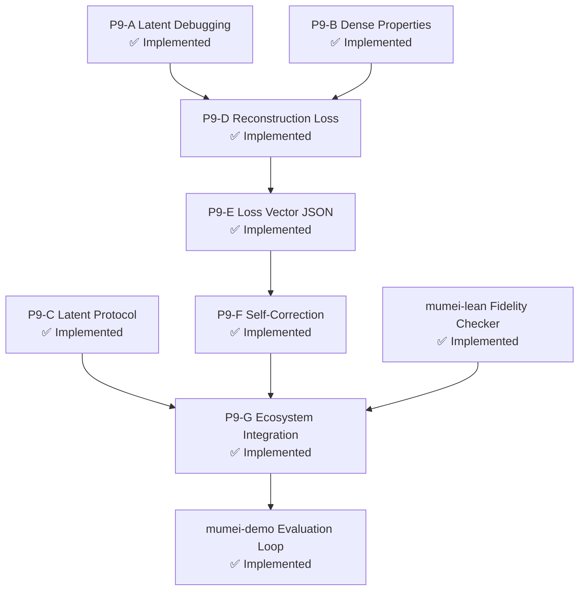
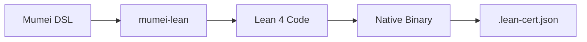
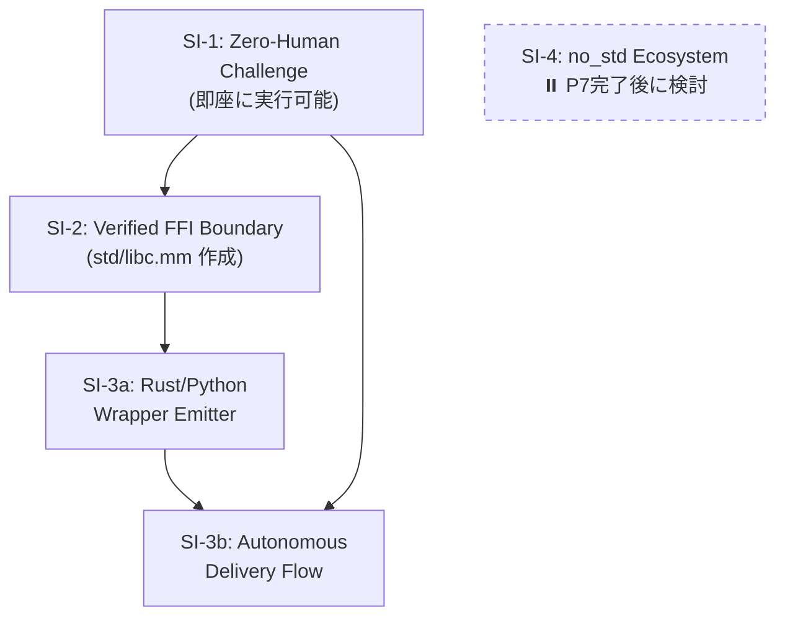
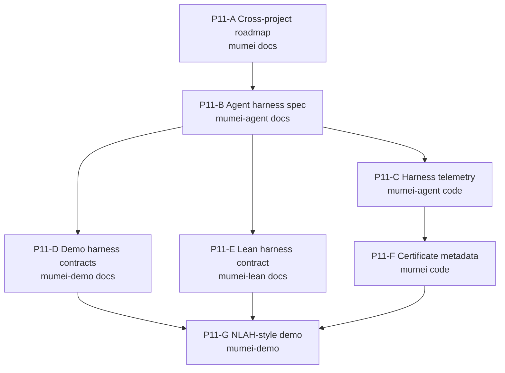
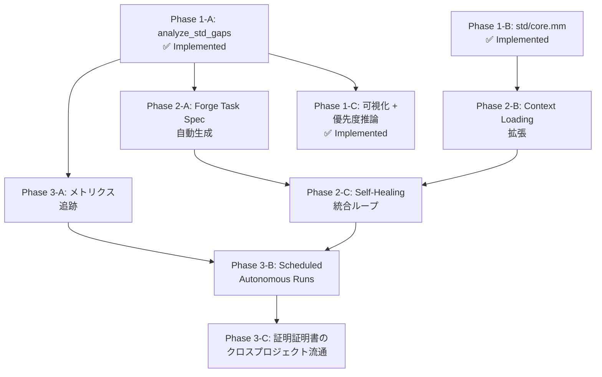
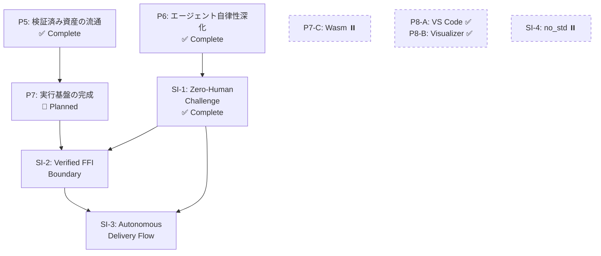
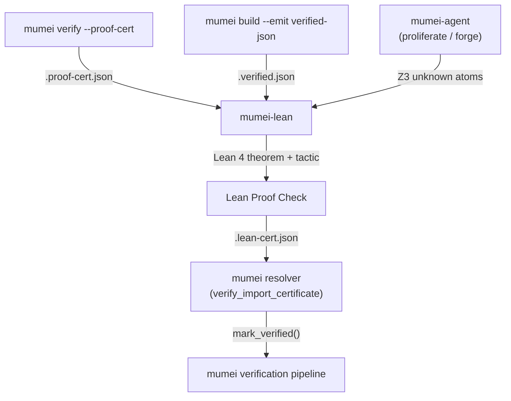
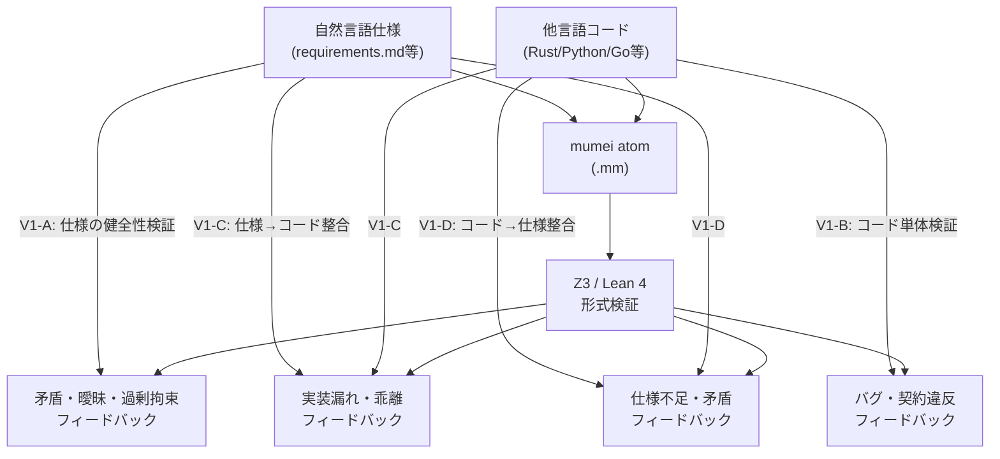
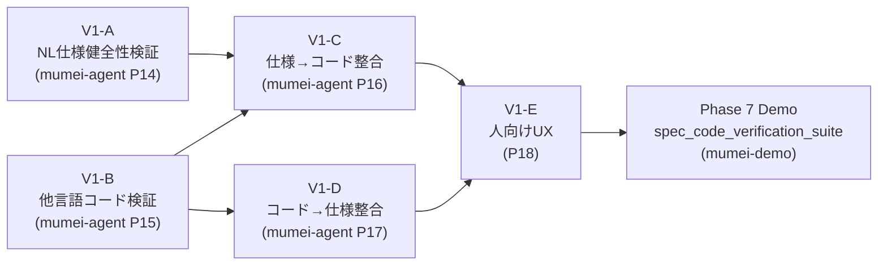

# Cross-Project Roadmap — mumei + mumei-agent (2026-03 〜)

> mumei エコシステム全体の次期ロードマップ。mumei の思想（proof-first / AI生成コード → 検証済み資産への変換）に沿って優先度を設定。

## Canonical cross-project contract

This file is the single top-level roadmap for `mumei`, `mumei-agent`, `mumei-lean`, and demo/tap follow-ups. Repository-local roadmaps may track local acceptance details, but they must not introduce a competing priority order. When wording diverges, align local docs back to this file first.

Canonical harness vocabulary:

| Term | Contract meaning | Primary owners |
| --- | --- | --- |
| `harness_contract` | Identifier/path for the policy that binds stages, gates, failure taxonomy, and evidence expectations. | `mumei` certificate metadata; agent/Lean/demo harness docs |
| `intent_fidelity` | Review metadata showing whether generated specs/artifacts still match the original natural-language intent. | `mumei-agent`, `mumei-demo`, certificate consumers |
| `artifact_paths` | Ordered evidence paths that CI, demos, or MCP clients must collect/compare. | compiler proof certificates, agent audit reports, Lean bridge summaries |
| `spec_health_issues`, `verification_violations`, `verification_status`, `cross_validation_gaps`, `next_steps`, `migration_hints`, `healed_files`, `heal_errors` | Canonical no-`.mm` audit artifact set from existing code through migration and self-healing. | `mumei-agent audit --auto-migrate --auto-heal`, MCP `scan_and_fix`, `mumei-demo/scenarios/no_mm_audit` |
| `contract_consistency[]` ↔ `missing_constraints[]`; `global_invariant_conflicts[]` ↔ `divergences[]`; `circular_dependencies[]` ↔ `drift_issues[]` | Cross-spec artifact mapping shared by human review and MCP consumers. | `mumei cross_spec.json`, `mumei-agent` cross-validation, P14-D human review |
| `budget_policy_fingerprint` | Stable hash of the retry/search policy used when producing evidence. | agent self-healing/audit, compiler proof certificates |
| `lean_verified` | Certificate status for an atom accepted only when the current `translator_version` and `bridge_lemma_hash` match both certificate fields and Lean result metadata; otherwise the atom is stale/unproven. | `mumei-lean` bridge; `mumei` certificate resolver; CLI/MCP certificate consumers |

The completed P11/P14 integration established docs-sync and harness-contract regression prevention as ongoing gates for the Verification-Native program below: keep the vocabulary above stable, keep local docs subordinate to this roadmap, and run the bridge/MCP/audit/spec regression gates whenever those contracts move. Manual review is now backed by the deterministic `scripts/check_contract_vocabulary.py` docs-sync gate — which checks docs, CLI help (`src/cli.rs`), and MCP tool docstrings (`mcp_server.py`) for forbidden aliases and `contradiction_type` drift. MCP docstring extraction uses `ast`-based parsing with a count assertion (decorator count vs extracted docstring count) to prevent silent false-negatives from decorator-argument or signature variations. Repository-local contract tests in `mumei-agent`, `mumei-lean`, and `mumei-demo` complement the central gate; `mumei-demo` extends its `scripts/check_scenario_contracts.py` to cover docs/README files for forbidden aliases in key-like contexts (backtick, code fence, JSON key style). `mumei-lean` extends its `tests/test_contract_vocabulary.py` beyond docs text to cover Python bridge code surfaces: `scripts/export_cert.py` constants (`TRANSLATOR_VERSION`, `BRIDGE_LEMMA_HASH`) are asserted against `docs/LEAN_HARNESS_CONTRACT.md` pinned values for bidirectional drift detection, and docstrings/argparse help/user-visible strings in `export_cert.py`, `bridge.py`, `ingest_cert.py`, `bridge_harness.py` are checked for Lean vocabulary alias drift in key-like contexts. All four repositories now symmetrically cover docs + code-surface contract vocabulary regression.

## Verification-Native program: ordered implementation

Mumei will evolve from primarily Z3-backed verification toward a small common
specification language connected to multiple formal verification methods,
while retaining execution. It will not become a universal language containing
every backend's logic. The user-approved program is tracked in
[the parent issue](https://github.com/mumei-lang/mumei/issues/784).
The [architecture and acceptance contract](VERIFICATION_NATIVE.md) defines
ownership, existing foundations, plugin requirements, evidence and non-goals;
this file remains the sole authority for cross-project implementation order.

| Wave | Work | Exit condition |
| --- | --- | --- |
| 1 | C01 ownership; initial C02 evidence contract; C03 minimal semantic design; C13 negative baseline | Shared meaning and non-guarantees are documented, and contract fixtures are checked without changing existing verdicts or grades. |
| 2 | C03 supported vertical slice; C04 planner; C11 replaceable plugin contract | Existing Z3/Lean paths and test adapters demonstrate capability checks, user selection/configuration, explainable routing and explicit fallback. No new external tool adoption is required. |
| 3 | C05 CFG/dataflow and C08 evidence-bound native bundles | Preserve Go facts and source provenance; independently check artifact identity, freshness and build conditions without claiming semantic correctness. |
| 4 | C06/C07 language/interprocedural analysis; C09 limited LLVM translation validation; individual C11 feasibility pilots | Expand one supported domain at a time, preserving assumptions, bounds and unsupported cases. |
| 5 | C10 consumer-side executable checks; demand-driven C12 authority correspondence | Recheck required evidence and display unverified runtime, ABI, linking and authority connections. |
| Deferred | C14 WASM; additional solvers; dynamic capability stages | Revisit only with explicit demand and the native/runtime/evidence prerequisites. |

Wave 1 is the initial foundation delivery, not completion of C02/C03/C13 or
the later waves. Existing logic-fragment tags, HIR/MIR, Translator IR,
Claim Book, native compilation and Lean dual checks must be extended rather
than re-created. Existing audit keys, grades, dependency freshness and Lean
promotion gates remain unchanged.

| Work item | Scope | Priority | Owner | Dependencies |
| --- | --- | --- | --- | --- |
| [C01](https://github.com/mumei-lang/mumei/issues/785) | Define Verification-Native ownership and assurance boundaries | P0 | mumei | None |
| [C02](https://github.com/mumei-lang/mumei/issues/786) | Define backend-neutral verification evidence without changing proof grades | P0 | mumei | C01 |
| [C03](https://github.com/mumei-lang/mumei/issues/787) | Define a minimal common semantic contract over existing IRs | P0 design; P1 vertical implementation | mumei | C01; co-design with C02 |
| [C04](https://github.com/mumei-lang/mumei-agent/issues/649) | Build an explainable user-configurable verifier planner | P1 | mumei-agent | C02; minimal C03 contract; co-design C11 |
| [C05](https://github.com/mumei-lang/mumei-agent/issues/650) | Connect explicit CFGs to existing function-local dataflow facts | P1 | mumei-agent | C02 source/provenance contract |
| [C06](https://github.com/mumei-lang/mumei-agent/issues/651) | Extend language semantics and type-symbol resolution incrementally | P2 | mumei-agent | C05 |
| [C07](https://github.com/mumei-lang/mumei-agent/issues/652) | Add interprocedural summaries over resolved calls | P2 | mumei-agent | C05; target-language C06 |
| [C08](https://github.com/mumei-lang/mumei/issues/788) | Bind native artifacts to source proof and build provenance | P1 | mumei | C02; identity/semantic-settings portion of C03 |
| [C09](https://github.com/mumei-lang/mumei/issues/789) | Pilot limited semantic translation validation to LLVM | P2 research pilot | mumei | C03; C08 target identification |
| [C10](https://github.com/mumei-lang/mumei/issues/790) | Add consumer-side checks for evidence-carrying native executables | P2 staged integration | mumei | C08; C09 for translation-validated claims |
| [C11](https://github.com/mumei-lang/mumei-agent/issues/653) | Define replaceable verifier plugin contracts before external adoption | P1 contract design; P2 individual feasibility pilots | mumei-agent | C02; co-design C04; C03 when semantic translation is needed |
| [C12](https://github.com/mumei-lang/mumei/issues/791) | Connect effect resource and capability models to real authority | P2 investigation; demand-driven | mumei | C03; concrete use case |
| [C13](https://github.com/mumei-lang/mumei-demo/issues/118) | Add regression gates against cross-backend assurance confusion | P0 baseline; ongoing per milestone | mumei-demo | Alongside C01/C02 and each later feature |
| [C14](https://github.com/mumei-lang/mumei/issues/792) | Keep WASM execution deferred behind native assurance milestones | Deferred / TODO | mumei | Native stability; C08/C10; concrete demand |

These priorities order this new program; they do not reopen completed work or
override unrelated security fixes. All four repository-local roadmaps follow
this order. C14 extends the existing deferred P7-C item, not a second active
WASM implementation. C12 preserves the existing demand gate for Capability
Stage 2 and later. Solver diversification is deferred rather than a default
requirement of the plugin architecture.
The compiler must not embed all external tools or implement every logic.
Agent owns external-tool selection/execution; Mumei owns specification semantics
and shared evidence acceptance. Do not equate external success with proved,
hide semantic loss in a universal IR, or run every backend in parallel by
default. Purpose-driven comparisons require permitted policy, budget and
result-reconciliation rules.

The initial C03 scalar implementation is an opt-in library profile over the
existing parser/HIR/MIR, with a real Z3/LLVM/native finite-regression slice.
It does not complete general obligation decomposition, default producer/consumer
integration, stable IR interchange or translation validation; see the
[supported scope](VERIFICATION_NATIVE.md#first-supported-scalar-slice).

### Wave 2 explicit result-contract routing follow-up

Agent's opt-in C04/C11 planner now supports an optional exact `ResultContract`
binding a profile/method pair to scope, complete bound/assumption identifiers
and correspondence relation/status. Registered offers must match one whole
contract: no borrowing fields across offers or treating missing declarations
as wildcards. Priority, explicit selection and permitted preflight fallback
cannot relax it. No implication, numeric ordering, assumption discharge or
correspondence upgrade is inferred. Unconstrained requests retain their earlier
v1 payload and do not silently acquire an assurance policy.

This is partial routing and C13 confusion regression, not Evidence ingestion,
proof acceptance, capability truth, lifecycle/execution/resource enforcement or
runtime fallback/reconciliation. Existing Core source/native consumers remain
separate; audit keys, grades, Lean gates and Mumei/Agent ownership are unchanged.
No external verifier is adopted and WASM stays deferred. The
[Agent roadmap](https://github.com/mumei-lang/mumei-agent/blob/develop/docs/ROADMAP.md#c04c11-explicit-result-contract-routing)
owns local API details under this implementation order.

### Wave 2 typed configuration follow-up

Agent's opt-in C04/C11 planner adds host-reviewed non-secret setting schemas:
strict Boolean, explicitly bounded integer and closed identifier choice only.
Registered defaults precede per-adapter explicit overrides. Unknown adapters or
options and invalid/duplicate values fail before selection, even for disabled
candidates; they cannot silently fall back. Permitted fallback uses its own
schema/defaults/overrides without copying settings or weakening the result
contract. Schema-less legacy output stays unchanged.

Only approved selected values are exposed/fingerprinted. A canonical
`mumei.adapter-configuration/v1` SHA-256 projection binds schema, defaults,
effective settings/budgets and selected adapter/tool/request context. Raw
overrides are not serialized or hashed before validation. The host must approve
all declared labels/defaults as non-secret; this is not secret detection or a
Core Evidence configuration identity. It is not an execution/authenticity or
acceptance receipt.

This remains partial C04/C11 and C13. Input preparation, actual permissions,
tool/plugin execution, secret transport, resource enforcement and runtime
reconciliation remain open. Core acceptance, audit grades, Lean/native/LLVM
guarantees and deferred WASM are unchanged; no external verifier is adopted.
The [Agent settings contract](https://github.com/mumei-lang/mumei-agent/blob/develop/docs/ROADMAP.md#c04c11-typed-configuration-follow-up)
owns local API details.

### Wave 2 consumable adapter-settings policy

Agent's `verify-plan` and `verify-schedule` policy documents now accept the
same host-declared `adapter_settings` contract as the in-memory planner API:
a closed list of `[adapter_id, [[name, value], ...]]` entries. Malformed
entries, unknown or unregistered adapters, duplicate settings, sensitive or
invocation channels and values outside the adapter's declared schema fail
before routing or fallback. Raw overrides are not echoed in the serialized
policy, CLI output or a partial plan; the sensitive-channel regression checks
both output streams and the absent output file.

Settings remain planning metadata only. They are not passed to child argv,
stdin or environment, and they do not authorize execution, transport secrets,
change Evidence meaning/acceptance or promote grades. The
[Agent policy contract](https://github.com/mumei-lang/mumei-agent/blob/develop/docs/ROADMAP.md#c11-consumable-adapter-settings-policy)
owns local API details under this implementation order.

### Wave 2 bounded source-input preparation

Agent's opt-in C04/C11 planner can constrain an explicit input-format declaration.
Missing offers are not wildcards; all prior filters and exact result contracts
remain in force. A separate `prepare_source` API replans against current registry
metadata and binds at-most-1-MiB immutable UTF-8 source bytes to a host-supplied
expected SHA-256 and the selected plan. The explicit manifest exposes only
format/digest/byte count and plan metadata, not source text, plus a deterministic
request fingerprint. Legacy unconstrained JSON stays unchanged.

This is partial input preparation and C13 negative-regression coverage, not
source parsing/semantic extraction, an Evidence identity, observation freshness,
authenticity, execution permission or acceptance. Saved records cannot authorize
later execution. Input/file/environment access policy, transport, real execution,
resource enforcement and runtime reconciliation remain separate work. No Core
acceptance, audit/Lean/native/LLVM guarantees or deferred WASM policy changes;
no external verifier is adopted. See the [Agent preparation contract](https://github.com/mumei-lang/mumei-agent/blob/develop/docs/ROADMAP.md#c04c11-bounded-source-input-preparation).

### Wave 2 declared permission-policy filtering

Agent's next opt-in C04/C11 slice matches host-declared required permission
categories against an explicit allowed set. Missing requirements fail closed
under an explicit policy; an empty allowed set denies all nonempty declarations.
Priority/explicit selection cannot bypass the filter, and permitted fallback
uses the destination declaration while preserving exact result/input contracts.
Omitted policy retains legacy planning/JSON without implying approval. Explicit
plan metadata and prepared-source fingerprints retain the policy/requirements.

This is coarse declaration matching and C13 regression coverage, not proof of
actual privilege requirements, authenticated user/admin authorization, an OS
sandbox, resource enforcement or execution. A matching plan cannot authorize
code execution or data egress; the later runner must independently enforce its
boundary. Core specification/Evidence ownership, C12's demand gate and existing
audit/Lean/native/LLVM/deferred-WASM policies remain unchanged. No external
verifier is adopted. See the [Agent permission contract](https://github.com/mumei-lang/mumei-agent/blob/develop/docs/ROADMAP.md#c04c11-declared-permission-policy-filtering).

### Wave 2 bounded host-observed attempt lifecycle

Agent's next partial C11/C13 contract records host-reported start, cancellation
request/acknowledgement, exit, failure and timeout observations against a prepared
manifest fingerprint, attempt number and declared timeout. Immutable histories
are bounded to three events, validate elapsed counters and terminal transitions,
and reject exit observations at/after the deadline. Cancellation requests are not
acknowledgements; incomplete histories remain nonterminal. Exit code zero is not
verification success or Evidence acceptance.

This is an observation contract, not a runner, authority token or common Evidence
replacement. No clock/process/I/O/signal operations, actual timeout/cleanup,
global attempt uniqueness, cross-attempt/backend arbitration, output ingestion or
default audit/CLI/MCP integration is added. Core meaning/Evidence ownership,
C12's real-authority demand gate and existing assurance/Lean/native/LLVM/deferred
WASM boundaries are unchanged. No external verifier is adopted. See the
[Agent lifecycle contract](https://github.com/mumei-lang/mumei-agent/blob/develop/docs/ROADMAP.md#c11-bounded-host-observed-attempt-lifecycle).

### Wave 2 same-attempt report reconciliation

Agent's next partial C11/C13 step compares an incoming immutable attempt snapshot
to the caller's current record. Request fingerprint, attempt number and timeout
must match; all known events must remain an exact prefix. Identical reports are
idempotent, and complete validated extensions may advance multiple observations.
Stale/shorter, divergent or rewritten terminal histories fail rather than being
merged or resolved in favor of code zero, later counters or report arrival order.

The helper does not select which independent branch is true. Callers still own
retaining and atomically updating their current record and surfacing conflicts;
starting from an older prefix can still fork. Duplicate acceptance is not
freshness, authentication or replay protection. No global ledger, new schema,
runtime/process/clock/I/O operation, actual enforcement or output/Evidence
normalization/acceptance is added. Cross-attempt/backend result reconciliation
and full C11 execution remain open. Core meaning/acceptance, C12's demand gate,
existing assurance/Lean/native/LLVM behavior and deferred WASM are unchanged.
See the [Agent reconciliation boundary](https://github.com/mumei-lang/mumei-agent/blob/develop/docs/ROADMAP.md#c11-same-attempt-report-reconciliation).

### Wave 2 bounded sequential attempt records

Agent adds an opt-in `AttemptSequence` for one prepared-request fingerprint and
unchanged per-attempt timeout, with at most 16 exact immutable attempt records.
An empty sequence requires explicit permission metadata when prepared; direct
construction checks representation only. Reserving a record assigns the next
contiguous ordinal from 1 and requires a terminal predecessor. Gaps, duplicates,
mixed bindings, nonterminal predecessors and overflow fail without truncation.
No process starts and no retry is authorized. The current record is not a winner.

Reports must target an already reserved ordinal and preserve that attempt's
known prefix via existing same-attempt reconciliation. Unknown ordinals, rewinds,
branches and terminal replacements fail; exact duplicates of old terminal reports
remain idempotent, not fresh. Sequence JSON adds only ordered attempt metadata,
not stdout, successful results or common Evidence; prior attempt/output formats
and the explicit Core handoff are unchanged. A changed plan/timeout needs a
separate prepared request/sequence, not cross-backend fallback reuse.

This is local logical ordering, not global numbering, atomic/durable publication,
replay/authenticity protection, retry scheduling or cross-attempt/backend result
arbitration. Hosts retain/atomically advance their canonical value; independent
values can fork. A terminal report does not prove cleanup or prevent physical
process overlap. No total retry deadline, backoff, resource/authority enforcement,
stream collection, output selection/invalidation, normalization or Core-owned
Evidence acceptance is added. Code zero remains only an observation. C11/C13 are
partial, C12 remains demand-gated, existing assurance/Lean/native/LLVM/deferred-WASM
policies unchanged, with no default audit/CLI/MCP route or external verifier.
See the [Agent sequence boundary](https://github.com/mumei-lang/mumei-agent/blob/develop/docs/ROADMAP.md#c11-bounded-sequential-attempt-records).

### Wave 2 bounded opaque stdout snapshots

Agent's next partial C11/C13 step prepares host-supplied immutable stdout bytes
against an exited attempt, a separately specified attempt number, the prepared
request/timeout and a caller-supplied raw SHA-256. The helper requires explicit
permission metadata; this is not authority. The 0–65,536-byte bound is checked
before hashing, with no truncation. Failed/timed-out/cancelled/nonterminal records
are rejected, but zero/nonzero exit codes and empty/binary/invalid JSON bodies
remain opaque transport data, not verification success or well-formed Evidence.

The bounded snapshot retains stdout for explicit access, while repr/JSON expose
only attempt, size/digest and canonical metadata fingerprint. Generic reflection
or `.stdout` access is not redacted. Same-output reconciliation is idempotent only
for identical attempt histories and raw bytes; changed metadata/body fails, not
last-writer-wins. Callers must first reconcile their current attempt and retain
and atomically publish a canonical output; independent snapshots can still fork.

No parsing, process/stream collection, I/O/clock operation, authentication/replay
protection, actual resource/authority enforcement or default audit/CLI/MCP wiring
is added. Caller-supplied digests do not establish origin, completeness, delivery
timing, secrecy or Evidence acceptance. Cross-attempt/backend arbitration,
adapter result normalization and Core-owned common Evidence checks remain open;
C12's demand gate, existing
assurance/Lean/native/LLVM behavior and deferred WASM are unchanged. No external
verifier is adopted. See the [Agent output boundary](https://github.com/mumei-lang/mumei-agent/blob/develop/docs/ROADMAP.md#c11-bounded-opaque-stdout-snapshots).

### Wave 2 bounded JSON stdout decoding

Agent adds explicit private-body decoding of one UTF-8 JSON object from a bounded
stdout snapshot. Duplicate decoded keys, extra output, BOM/other encodings,
unpaired surrogates, invalid syntax and non-JSON numeric constants fail with a
static error and no chained decoder payload. Nesting is bounded to 32 before
parsing; number tokens are at most 128 characters and decimal exponents must be
representable. Exact integer/Decimal values avoid binary-float precision loss.

Each decode returns a fresh private tree without changing raw bytes, identity or
metadata. Neither decoded content nor explicit byte access is safe to log. Empty
objects and success claims are still untrusted, not Evidence. Core must check
original bytes, not a reserialized Python tree. Core schema/meaning/acceptance,
adapter normalization, stream collection, execution and authority enforcement
remain separate; no default audit/CLI/MCP route or external verifier is added.
C11 remains partial, C12 demand-gated and existing assurance/Lean/native/LLVM/
deferred-WASM behavior unchanged. See the [Agent JSON boundary](https://github.com/mumei-lang/mumei-agent/blob/develop/docs/ROADMAP.md#c11-bounded-json-stdout-decoding).

### Wave 2 original-byte Core stdin representation checks

Core's explicit `evidence check --stdin [--json]` accepts original stdout bytes
without a temporary file or reserializing Agent's private decoded tree. It uses
the existing common Evidence representation decoder and unchanged anonymous
diagnostic: success is representation-valid only, acceptance remains
`not_evaluated`. Empty objects/saved success claims still fail Core shape checks.

Exactly one file or stdin source is required; missing/conflicting selection is
a usage error, and a positional `-` remains a file name. Both modes keep the
65,536-byte limit. Stdin reads at most one extra byte to detect overflow and
does not drain an oversized stream. This is no time bound: the invoking host
must close input and own deadlines/cancellation. No private body, decoder or
underlying I/O error is echoed. File-only source/native consumers are unchanged.

This is an opt-in Core integration entry point, not an Agent call/runner, receipt,
normalization or result-contract binding. Agent execution/stream collection and
Core-owned Evidence meaning/acceptance remain separate open work. C11 is partial;
C12, assurance/Lean/native/LLVM and deferred-WASM policies are unchanged, with no
external verifier adoption. See the [Core consumer](VERIFICATION_NATIVE.md#standalone-representation-only-cli-consumer).

### Wave 5 bounded multi-record representation check

`mumei evidence check-list <envelope> [--json]` admits one closed
`mumei.verification-evidence-list/v1` envelope holding up to 64 records
inside the shared 65,536-byte limit. Each element's raw bytes pass the
single-record gate independently: duplicate keys, unknown fields and invalid
combinations fail closed exactly as standalone, and field-ordered JSON
sequences are rejected by both gates. The static diagnostic reports
`record_count`, keeps `acceptance: not_evaluated` and names
`cross_record_consistency` among checks not performed; an empty list is
representation-valid. No deduplication, ordering, coverage, truth or
acceptance is implied, and the envelope is not reusable Evidence or a
receipt. See the
[list check contract](VERIFICATION_NATIVE.md#bounded-multi-record-representation-check).

### Wave 5 cross-record identity-pin consistency check

`mumei evidence check-consistency <envelope> [--json]` closes the
`cross_record_consistency` gap the list check declared: over the same
`mumei.verification-evidence-list/v1` envelope it compares the identity
pins records declare and reports
`mumei.evidence-consistency-check/v1` — `consistent`, a bounded
`conflicts` list naming each disagreeing pair's indices and field with
the true total in `conflict_count`, and `record_count`. Records sharing
`subject.id` *and* `subject.sha256` must pin one `subject.kind` — a
`subject.id` alone is a producer label, not an identity, so records
pinning different subjects stay independent. Records sharing
`obligation_id` must pin one subject, specification, semantics and
method; outcome fields are claims, never compared. Agreement stays
syntactic — `acceptance: not_evaluated`, and pin correctness, truth,
freshness and authenticity remain unperformed. See the
[consistency check contract](VERIFICATION_NATIVE.md#cross-record-identity-pin-consistency).

### Wave 2 explicit Agent-to-Core representation handoff

Agent adds a separately invoked POSIX-only local Core handoff. The host must
independently authorize a trusted absolute executable; adapter declarations,
fingerprints and an absolute path do not establish authority or authenticate it.
Fixed `evidence check --stdin --json` receives the original bounded stdout bytes,
with no reserialization, temporary input file, environment forwarding or command
discovery. No default route calls it and no external verifier is adopted.

A separately supplied 1–60,000 ms timeout bounds pipe I/O and child exit (not
uninterruptible OS process creation), with up to one extra second for direct-child
kill/reap. Nonblocking concurrent pipes bound each diagnostic to 4,096 bytes plus
one overflow byte. This is not a general plugin runner, descendant sandbox or
memory/CPU/authority enforcement. Windows support remains outside this pilot.

Agent additionally accepts an optional host-owned standard `threading.Event`
for cooperative cancellation of this Core call. A pre-set event prevents spawn;
otherwise pipe/exit waits poll at most every 50 ms without resetting the deadline.
Observed cancellation closes pipes and kills/reaps the direct child before a
fixed cancellation error (cleanup failures remain check failures). This does
not interrupt process creation, guarantee real-time response or stop descendants.
Signals can race with the last completion check and set/clear pulses can be
missed: the host must keep the event set until return and arbitrate completion.
No event is changed and no host attempt cancel/timeout report is synthesized.

An optional Agent `attempt_sequence` argument checks an exact `AttemptSequence`
against the exact stdout snapshot before Core spawn/I/O. Its
`check_output_binding()` requires the current record to match request fingerprint,
ordinal, timeout and complete event history; empty/unreconciled sequences,
old/future outputs and changed histories fail with static, body-free errors.
Omission/`None` preserves the sequence-independent API and all existing schemas.
This is equality of supplied immutable metadata, not global currentness or
Evidence/request-contract matching: a stale sequence may match a stale output.
Competing bodies for the same record both pass binding; the host must retain and
reconcile canonical outputs and own atomic updates, publication/completion and
result selection. No lock/CAS, completion revalidation, authentication/replay
protection, process cleanup proof, receipt or acceptance is added.

The complete known v1 diagnostic and zero Core exit are both required; stderr,
malformed/duplicate/extra output, unknown versions and timeouts fail with static
errors. The function returns no receipt/record and changes no snapshot. A normal
return means representation-valid only, relying on the trusted executable;
`acceptance` remains `not_evaluated`. An anonymous saved diagnostic is not proof
of this invocation. Evidence/request result-contract matching, adapter
normalization, actual plugin execution, truth, authenticity, freshness and Core
acceptance remain separate.
C11 stays partial; C12 and existing assurance/Lean/native/LLVM/deferred-WASM
policies are unchanged. See the [Agent handoff boundary](https://github.com/mumei-lang/mumei-agent/blob/develop/docs/ROADMAP.md#c11-explicit-local-core-representation-handoff).

### Wave 2 host-declared canonical result selection

Agent adds `AttemptSequence.select_result(output)`, a canonical-result-selection
contract on the sequential-attempt ledger. The supplied snapshot must satisfy
the existing `check_output_binding` against the sequence's current `exited`
record — request fingerprint, ordinal, timeout and complete event history.
Selection marks the detached `(attempt_number, output_fingerprint)` pair as
this value's canonical result and closes the sequence: further reservations
and competing snapshots fail with static errors, while re-selecting the same
output is an idempotent no-op. `to_dict()` carries the marker under the
existing `mumei.verifier-attempt-sequence/v1` schema with no stdout, source or
diagnostics.

A selected result is host-declared canonical metadata for that sequence value
only — not truth, Evidence acceptance, a Core representation-check receipt or
cross-sequence arbitration. Independently captured snapshots bound to the same
attempt both satisfy binding, and independent sequences can select independent
results; hosts still own canonical storage, `AttemptOutput.reconcile`,
atomic publication and any cross-attempt/backend arbitration. There is no
global ordering, locking/CAS, replay protection, freshness or authenticity
claim, and selection neither revalidates the output nor invokes Core.
C11 stays partial: runner/scheduler, stream collection, Evidence
normalization/acceptance and actual execution/cancellation remain open, and
C12's demand gate plus existing assurance/Lean/native/LLVM/deferred-WASM
policies are unchanged. See the
[Agent result-selection boundary](https://github.com/mumei-lang/mumei-agent/blob/develop/docs/ROADMAP.md#c11-canonical-result-selection-for-sequential-attempts).

### Wave 2 atomic canonical-lineage publication

Agent adds `AttemptSequenceStore`, an in-process compare-and-set publication
point for one canonical `AttemptSequence` lineage — the atomic storage hosts
were previously told to own. `publish(sequence)` stores the first canonical
value; `compare_and_set(expected, updated)` atomically swaps it when
`expected` equals the stored value, so competing writers extending the same
prefix can no longer silently fork. A mismatch reports the fork with a static
error and changes nothing; equal updates and re-publications are idempotent.

An update must be a lineage extension of the expected value: same request
fingerprint and timeout, every retained record equal or a valid same-attempt
report extension, and no change after a selected result. Removed, replaced,
rewound, rebound or diverged updates are rejected. The store holds immutable
metadata values only — never source or stdout bodies — and has no
serialization surface of its own. It linearizes callers on this object only:
it is not durable storage, a cross-process/OS lock, replay protection at the
boundary or authentication. Stale expectations are detected by equality, not
freshness proof; hosts still own distribution, crash recovery and any
cross-attempt/backend arbitration. C11 stays partial: runner/scheduler,
stream collection, actual execution/cancellation and Evidence
normalization/acceptance remain open, and C12's demand gate plus existing
assurance/Lean/native/LLVM/deferred-WASM policies are unchanged. See the
[Agent publication boundary](https://github.com/mumei-lang/mumei-agent/blob/develop/docs/ROADMAP.md#c11-atomic-canonical-lineage-publication).

### Wave 2 declared lineage restoration

Agent's `AttemptEvent.from_dict`, `AttemptRecord.from_dict` and
`AttemptSequence.from_dict` rebuild the declared
`mumei.verifier-attempt*/v1` snapshots a host persisted, letting a host
reinstate its own canonical lineage after a restart without trusting the
bytes: unknown or missing keys, a foreign `schema_version`, malformed
members and a record's declared `state` disagreeing with its replayed
events are static errors, and every constructor invariant — record
bindings, ordinals, terminal predecessors, the selected-result reference,
the report stamp — is re-checked, not recovered.

A restored `selected_result` still names a declared fingerprint the
snapshot cannot re-bind to bytes. Durability itself, canonical-store
ownership, distribution, crash recovery and Evidence remain host duties:
this is a parse boundary, not a trust boundary. C11 stays partial:
Evidence normalization/acceptance remains open, and C12's demand gate
plus existing assurance/Lean/native/LLVM/deferred-WASM policies are
unchanged. See the
[Agent lineage-restoration boundary](https://github.com/mumei-lang/mumei-agent/blob/develop/docs/ROADMAP.md#c11-declared-lineage-restoration).

### Wave 2 monotonic report stamps for replay detection

Agent's `AttemptSequence.reconcile_report` accepts an optional
`report_stamp`: a host-declared monotonic counter bound to the lineage's
report stream. Stamps are exact positive bounded integers; once one is
accepted every later report must carry one. A stamp must strictly increase
across distinct deliveries — a smaller stamp fails as stale, and a reused
stamp only reconciles an identical report (reused stamp + changed content
fails too). A fresh stamp on identical content advances the counter, so
replays arriving after newer reports are detected. The last accepted stamp
serializes as detached `report_stamp` metadata under the existing
`mumei.verifier-attempt-sequence/v1` schema, and `AttemptSequenceStore`
lineage updates may never regress it.

This is a replay/reorder detection contract, not a clock, freshness proof,
authentication or authorization: a host assigns stamps itself, so a host can
always mint a higher one. Delivery integrity, sender identity, durable
storage, global counters across lineages and content acceptance remain host
duties. Stamps carry no report content, source or stdout. C11 stays partial:
runner/scheduler, stream collection, actual execution/cancellation and
Evidence normalization/acceptance remain open, and C12's demand gate plus
existing assurance/Lean/native/LLVM/deferred-WASM policies are unchanged.
See the
[Agent report-stamp boundary](https://github.com/mumei-lang/mumei-agent/blob/develop/docs/ROADMAP.md#c11-monotonic-report-stamps-for-replay-detection).

### Wave 2 declared execution and cancellation requests

Agent's `AttemptSequence.request_execution()` returns an
`AttemptExecutionRequest` value declaring which reserved record a host
intends to run next; only a `ready` current record can produce one, so an
unreserved, started, cancelling, terminal or selected-result-closed sequence
fails with a static error. `request_cancellation()` returns an
`AttemptCancelRequest` for a `running` current record only — cancellation
intent cannot be declared for nothing running or twice. Both serialize as
detached metadata under `mumei.verifier-attempt-execution/v1` and
`mumei.verifier-attempt-cancel/v1`.

These are declarations of intent only: producing a request never spawns a
process, signals a running one, delivers anything to a runner, reserves
resources or confirms an outcome — dispatch, delivery integrity, process
control and start/stop observation remain host duties, and a request bound
to a stale sequence value is just a stale description the host must discard.
The calls are pure and carry no source, stdout, environment or process
state. C11 stays partial: runner/scheduler, stream collection, actual
execution/cancellation effects and Evidence normalization/acceptance remain
open, and C12's demand gate plus existing
assurance/Lean/native/LLVM/deferred-WASM policies are unchanged. See the
[Agent request boundary](https://github.com/mumei-lang/mumei-agent/blob/develop/docs/ROADMAP.md#c11-declared-execution-and-cancellation-requests).

### Wave 2 ready-record withdrawal

Agent's `AttemptSequence.withdraw_attempt()` records a host's decision not to
run the reserved-but-never-started attempt: the `ready` record is extended
with a terminal `cancelled` event at elapsed zero, and the direct
`ready → cancelled` transition is shared lineage vocabulary — a host report
carrying the same event reconciles to an identical sequence. Only a `ready`
current can be withdrawn; a running attempt still goes through
`request_cancellation`, terminal/empty/closed sequences fail statically.

Withdrawal is intent and outcome collapsed into one declaration — no process
exists to signal — but it is not a crash, timeout, Evidence verdict or
authorization: the next attempt still needs an explicit `begin_attempt`.
C11 stays partial: runner/scheduler, actual cancellation effects on running
records and Evidence normalization/acceptance remain open. See the
[Agent withdrawal boundary](https://github.com/mumei-lang/mumei-agent/blob/develop/docs/ROADMAP.md#c11-ready-record-withdrawal).

### Wave 2 declared stream identity and completeness

Agent's `AttemptOutput` declares the collection boundary of its snapshot with
two optional metadata fields: `stream` names the declared stream the captured
bytes came from (the `STREAM_KINDS` vocabulary supports only `"stdout"`
today — other names fail as unsupported rather than being aliased), and
`complete` is an exact `bool` declaring whether the capture is the whole
stream. `reconcile` compares the claims too, so identical bytes carrying
different declarations conflict instead of silently merging, and the
`mumei.verifier-output/v1` manifest emits both only when non-default so
default `output_fingerprint` values are unchanged.

Both fields are host declarations, not proven observations: a declared
`complete=True` does not establish completeness and `False` does not measure
what was missed — only the SHA-256 binds the captured bytes. No streams are
read, pipes are opened or truncation is detected; capture mechanics, the
producer's true byte count and multi-stream capture remain host duties. C11
stays partial: runner/scheduler, actual execution/cancellation effects and
Evidence normalization/acceptance remain open, and C12's demand gate plus
existing assurance/Lean/native/LLVM/deferred-WASM policies are unchanged.
See the
[Agent stream-declaration boundary](https://github.com/mumei-lang/mumei-agent/blob/develop/docs/ROADMAP.md#c11-declared-stream-identity-and-completeness).

### Wave 2 evidence-candidate handoff descriptors

Agent's `AttemptSequence.evidence_candidate()` returns an
`AttemptEvidenceCandidate` naming the declared canonical snapshot for a host
to hand to Core: the request fingerprint, the selected attempt ordinal and
the output manifest fingerprint — nothing else. Only a sequence closed by
`select_result` can produce one, and the value serializes as detached
metadata under `mumei.verifier-evidence-candidate/v1`.

This is a handoff descriptor, not Evidence: the fingerprint binds the
manifest, not content correctness — hashing a manifest is not semantic
correctness and naming a candidate is not acceptance. The value carries no
bytes, makes no validity claim and grants no authority; Core owns the
meaning and acceptance of the original bytes, which the host must still
deliver over its own channel. C11 stays partial: runner/scheduler, actual
execution/cancellation effects and Evidence normalization/acceptance itself
remain open, and C12's demand gate plus existing
assurance/Lean/native/LLVM/deferred-WASM policies are unchanged. See the
[Agent evidence-handoff boundary](https://github.com/mumei-lang/mumei-agent/blob/develop/docs/ROADMAP.md#c11-evidence-candidate-handoff-descriptors).

### Wave 2 declared evidence-check outcomes

Agent's `AttemptSequence.evidence_check(candidate, outcome)` records a
host-declared representation-check outcome for the sequence's
`evidence_candidate()` as an `AttemptEvidenceCheck`: the request
fingerprint, the attempt ordinal, the output manifest fingerprint and
one declared `outcome` from `EVIDENCE_CHECK_OUTCOMES` — `"valid"` (Core
returned the known v1 diagnostic for the delivered bytes), `"failed"`
(the check produced no accepted diagnostic — an invalid representation,
a malformed diagnostic and a spawn/I/O failure are indistinguishable by
design) or `"cancelled"`. A stale or foreign candidate and any outcome
outside the vocabulary are static errors, not recorded checks. The value
serializes as detached metadata under
`mumei.verifier-evidence-check/v1`.

`agent.core_evidence.record_evidence_check` runs the same opt-in POSIX
Core handoff and returns the record the check produced, distinguishing
`CoreCheckFailed` (a `ValueError` subclass — a real check failure) from
request-shape errors, which stay plain `ValueError` and are never
misrecorded as checked-and-failed. The checked output must be the
selected result itself — its manifest fingerprint must equal the
candidate's, so different bytes under the same attempt record cannot
borrow the declaration. Candidate, output binding and selection are
validated before any spawn; static errors propagate and record nothing.

This is a check record, not Evidence: `"valid"` only means Core's
representation check passed for the bytes the host delivered — the
record carries no bytes, performs no check itself and asserts no truth,
freshness, authenticity, correspondence or grade promotion, which remain
unassessed host/Core duties. C11 stays partial: runner/scheduler, actual
execution/cancellation effects and Evidence normalization/acceptance
itself remain open, and C12's demand gate plus existing
assurance/Lean/native/LLVM/deferred-WASM policies are unchanged. See the
[Agent evidence-check boundary](https://github.com/mumei-lang/mumei-agent/blob/develop/docs/ROADMAP.md#c11-declared-evidence-check-outcomes).

### Wave 2 dispatch-boundary checks for declared requests

Agent's `AttemptSequence.next_dispatch()` derives the single outstanding
dispatchable intent — a `ready` current record yields its
`AttemptExecutionRequest`, and anything else yields `None` (which does not
mean nothing may run: an in-flight attempt continues and host-initiated
cancellations are declared separately). `check_dispatch` is the static
counterpart for host-built requests: an execution request must name this
value's current ready record including its declared timeout, a cancellation
request the current running one — wrong types, foreign fingerprints, stale
ordinals and unserved states are static errors, never silent drops.

These are boundary checks, not a runner or scheduler: nothing is
dispatched, delivered, queued, ordered across sequences or confirmed —
dispatch, delivery integrity, ordering policy and process control remain
host duties, and a request that passes today is just a description the host
must re-check against the canonical value at send time. C11 stays partial:
actual execution/cancellation effects and Evidence normalization/acceptance
remain open, and C12's demand gate plus existing
assurance/Lean/native/LLVM/deferred-WASM policies are unchanged. See the
[Agent dispatch boundary](https://github.com/mumei-lang/mumei-agent/blob/develop/docs/ROADMAP.md#c11-dispatch-boundary-checks-for-declared-requests).

### Wave 2 real process control for declared execution requests

Agent's `attempt_runner.py` is the first effectful boundary in the C11
cluster: `AttemptRunner.run(request, argv, cancel_event=None)` spawns one
real child process for one declared `AttemptExecutionRequest`, waits bounded
by the request's declared timeout, terminates runaways and honors a single
`threading.Event` cancellation. Observations are reported as `AttemptRecord`
events — `started`, then exactly one of `exited` (real exit code), `failed`
(spawn refused by the OS), `timed_out` (deadline reached, child killed) or
`cancelled` (cancel grace expired after `cancel_requested` + terminate).
Captured stdout is drained on a side thread so writers past the pipe buffer
cannot deadlock the wait, bounded to `MAX_STDOUT_BYTES`, and returned with a
`complete` declaration that is `False` whenever truncation occurred or the
bounded drain could not finish.

`run` performs no authorization, scheduling, dispatch decision, output
interpretation or canonical publication — the host still decides via
`check_dispatch`, binds snapshots with `AttemptOutput` and publishes through
`AttemptSequenceStore`. `complete=False` records observed truncation, not
how much was lost, and an `exited` code is a fact about process exit, never
a verification verdict. C11 stays partial: Evidence normalization/acceptance
remains open, and C12's demand gate plus existing
assurance/Lean/native/LLVM/deferred-WASM policies are unchanged. See the
[Agent attempt runner](https://github.com/mumei-lang/mumei-agent/blob/develop/docs/ROADMAP.md#c11-real-process-control-for-declared-execution-requests).

### Wave 2 declared-dispatch execution driver

Agent's `attempt_runner.dispatch_attempt(sequence, argv, *, runner=None,
cancel_event=None, memory_bound_mb=None, report_stamp=None)` runs the
sequence's outstanding dispatch end-to-end: `next_dispatch()` must yield
a request (nothing reserved, an attempt in flight or a terminal current
record is a static error, never a run), `AttemptRunner.run` executes it
under the declared timeout and the terminal record is reconciled back
into the sequence — a stamped sequence requires a fresh `report_stamp`,
checked before spawn so a missing or stale stamp fails statically
instead of discarding an observed run. The returned
`AttemptDispatch(sequence, run)` pairs the reconciled sequence with the
observed run, validating that the sequence's current record carries the
run's full binding (fingerprint, ordinal, declared timeout) and events.
`dispatch.captured_output()` binds the run's bounded stdout as an
`AttemptOutput` on the reconciled current record (the run's `complete`
collection claim carried across); a failed, timed-out or cancelled run
cannot mint a snapshot — output requires an exited record.
`publish_dispatch(store, dispatch, expected=None)` closes the loop: an
`exited` run selects its captured output before the terminal lineage is
atomically published through `AttemptSequenceStore` compare-and-set
(first `publish` on an empty store), while non-exited terminals publish
the reconciled lineage without a selection.

The driver composes the declared dispatch boundary with the single-spawn
runner — no scheduling, ordering or cross-sequence arbitration is
added; publication keeps the same CAS/first-publish contract, and
durability plus Evidence remain host duties. C11 stays
partial: Evidence normalization/acceptance remains open, and C12's demand
gate plus existing assurance/Lean/native/LLVM/deferred-WASM policies are
unchanged. See the
[Agent dispatch driver](https://github.com/mumei-lang/mumei-agent/blob/develop/docs/ROADMAP.md#c11-declared-dispatch-execution-driver).

### Wave 2 reserve-and-dispatch driver for the next attempt

Agent's `attempt_runner.dispatch_next_attempt(sequence, argv, ...)` reserves
the next attempt and runs it through the same declared-dispatch driver:
`begin_attempt` supplies the reservation — a sequence closed by a selected
result fails statically and a running or cancelling current record fails
because predecessors must be terminal — then `dispatch_attempt` runs it. On
a fresh sequence this runs attempt one; after a terminal record it is the
declared retry. A stamped sequence requires a fresh `report_stamp`, checked
before spawn, and the returned `AttemptDispatch` carries the same
reconciled-sequence/observed-run pair.

This is still not a retry policy: nothing decides whether another attempt
is worthwhile, re-picks `argv`, bounds the attempt count or inspects the
previous outcome — the host declares each next attempt by calling. C11
stays partial; Evidence normalization/acceptance remains open. See the
[Agent reserve-and-dispatch driver](https://github.com/mumei-lang/mumei-agent/blob/develop/docs/ROADMAP.md#c11-reserve-and-dispatch-driver-for-the-next-attempt).

### Wave 2 end-to-end dispatch-and-publish driver

Agent's `dispatch_and_publish(store, argv, ...)` closes the attempt
lifecycle loop: `store.current` supplies the lineage (an empty store is a
static error), `begin_attempt` reserves the next record, `dispatch_attempt`
runs it and reconciles the observation, and `publish_dispatch` commits the
terminal lineage through compare-and-set against the pre-run store value —
a store another writer touched mid-run fails statically instead of
clobbering. The canonical lineage, including any `selected_result` the
publish added, is the store's current value.

A CAS rejection after a completed run surfaces the store's error — the
process still ran and recovering it is a host decision. The driver adds no
arbitration across writers, retry policy, durability or Evidence acceptance
— it composes the declared boundaries only. C11 stays partial: Evidence
normalization/acceptance remains open, and C12's demand gate plus existing
assurance/Lean/native/LLVM/deferred-WASM policies are unchanged. See the
[Agent dispatch-and-publish driver](https://github.com/mumei-lang/mumei-agent/blob/develop/docs/ROADMAP.md#c11-end-to-end-dispatch-and-publish-driver).

### Wave 2 declared lifecycle composition coverage

Agent's `tests/test_attempt_lifecycle.py` exercises the declared
boundaries as one chain rather than separate gates: manifest-declared
probe → observed outcome → history-bounded retry scheduling →
probe-driven planning → canonical store lineage →
`dispatch_and_publish` → captured output → `selected_result` →
`evidence_candidate` → detached snapshots. A regression in any
composition fails one test. Every value in the chain remains a host
declaration — probing proves a command ran, selection names a declared
snapshot and the evidence candidate is a handoff descriptor, never
acceptance. C11 stays partial: Evidence normalization/acceptance remains
open, and C12's demand gate plus existing
assurance/Lean/native/LLVM/deferred-WASM policies are unchanged. See the
[Agent lifecycle composition coverage](https://github.com/mumei-lang/mumei-agent/blob/develop/docs/ROADMAP.md#c11-declared-lifecycle-composition-coverage).

### Wave 2 declared evidence-check acceptance normalization

Agent adds the mechanical acceptance-normalization step for declared
evidence-check records — evaluation was previously a host duty with no
declared shape. `AttemptEvidenceCheck.from_dict(data)` and
`AttemptEvidenceCandidate.from_dict(data)` restore a stored
`mumei.verifier-evidence-check/v1` record and its
`mumei.verifier-evidence-candidate/v1` handoff descriptor under the
exact key set and schema, with each constructor re-checking every
invariant, and `AttemptNormalizedResult.from_dict(data)` restores
the `mumei.verifier-run-result/v1` record the candidate binds
(exact keys, conditional `exit_code`, `stdout.complete` declared
only as absent-or-false). Then
`agent.core_evidence.evaluate_evidence_check(sequence, check)` emits
`mumei.evidence-check-acceptance/v1`: `candidate_match` holds only when
the record binds the sequence's CURRENT `evidence_candidate()` — a stale
or foreign check never counts — and `accepted` holds only when the
record is current AND its outcome is `"valid"`. This is
representation-level acceptance: the six semantic checks stay listed in
`checks_not_performed`, and the descriptor is not Evidence, a verdict or
a grade promotion. Evaluation reads declared values only — no I/O,
spawn or Core call — and a sequence with no selected result is a static
error. Freshness beyond record currency, cross-sequence ordering and
every `checks_not_performed` entry remain unassessed host/Core duties.
C02/C11 stay partial. See the
[Agent evidence-check acceptance normalization](https://github.com/mumei-lang/mumei-agent/blob/develop/docs/ROADMAP.md#c02-declared-evidence-check-acceptance-normalization).

### Wave 2 declared evidence-check acceptance route

Agent wires the acceptance normalization to a consume route,
`python -m agent evidence-check-accept --sequence <path> --check <path>`
(`--output <path>` optional). The route restores a declared
`mumei.verifier-attempt-sequence/v1` snapshot through
`AttemptSequence.from_dict` and a declared
`mumei.verifier-evidence-check/v1` record through
`AttemptEvidenceCheck.from_dict`, then emits
`mumei.evidence-check-acceptance/v1` — `accepted` only when the record
binds the sequence's CURRENT evidence candidate AND declares
`outcome: "valid"`. Declared documents are bounded reads (1 MiB), a
malformed or foreign-schema document is a static error, and `--output`
may not overwrite either declared input.

Representation-level acceptance only — the route runs no Core check and
`checks_not_performed` still names the six unassessed semantic duties.
Producing a record stays in-library (`record_evidence_check` needs the
live Core plus the selected output bytes), so a stale or foreign record
always yields `accepted: false` — the route cannot forge acceptance.
C02/C11 stay partial.

### Wave 2 declared verify-attempt route (produce + consume)

Agent's `python -m agent verify-attempt --core <path> --source <path>`
closes the produce+consume loop the consume-only route could not: it
runs `<core> evidence verify-source <src> --json` as one declared
attempt — the `mumei.verify-attempt-request/v1` fingerprint binds the
Core executable's bytes, the source bytes and the bounded solver
budgets — publishes the reconciled sequence, and only when a result is
selected (`exited` with `exit_code == 0`, i.e.
`EstablishedWithinProfile`) runs `record_evidence_check` +
`evaluate_evidence_check` against the live Core. Emits
`mumei.verify-attempt-report/v1` (sequence + normalized + candidate +
evidence_check + acceptance).

This is the first route where `accepted` can be `true`: the produced
bytes are `mumei.verification-evidence/v1` — evidence-shaped, unlike
the summary manifests that made the withdrawn `--evidence-core` wiring
deterministically `accepted:false`. Refuted (exit 1) / inconclusive
(exit 3) runs publish the terminal lineage with no selection;
`--output` may not overwrite declared inputs and sources over Core's
64 KiB input bound are rejected before dispatch. The `acceptance`
descriptor stays representation-level — `accepted: true` asserts
nothing about claim truth, freshness, authenticity or correspondence.
Separately, a selected run discharges five of the six semantic checks
for the produced record — also at representation level —
`claim_truth` (the `established` verdict is the strongest truth
receipt the pipeline emits), `file_identity`,
`producer_authenticity`, `freshness` and `semantic_correspondence`,
reported in `discharged_checks` with `artifact_semantics` (the
compiled-artifact layer) left in `checks_not_performed`. C02/C11 stay
partial.

### Wave 2 declared verify-recheck route (freshness layer)

Agent's `python -m agent verify-recheck --core <path> --evidence <path>
--source <path>` is the freshness companion of verify-attempt: it runs
`<core> evidence recheck-source <evidence> --source <src> --json` as
one declared attempt — the `mumei.verify-recheck-request/v1`
fingerprint binds the Core executable's bytes, the saved Evidence
record's bytes, the caller-supplied source's bytes and the bounded
solver budgets — re-running the same restricted source query against a
SAVED record so stale, tampered or profile-drifted records surface
without any saved label/path being read. Only an `exited` run with
`exit_code == 0` (`Consistent`) selects the produced
`mumei.source-evidence-recheck/v1` diagnostic. The `recheck` field
names only unambiguous codes (`0 → consistent`, `3 → inconclusive`):
exit 1 conflates `Refuted` with every static failure including
`Invalid`/`InconsistentSavedEvidence` — the stale-or-tampered case —
so it is claimed only through the lineage's `exit_code`. Mid-run input
drift suppresses selection and any claimed outcome, reported as
`inputs_changed`. No evidence_check runs: the recheck diagnostic is
not verification-evidence-shaped — its exit code IS the verdict.
A `consistent` outcome discharges `claim_truth`, `freshness` and
`semantic_correspondence` at representation level — the record's
bound claims were re-established by the fresh same-profile verdict —
reported in `discharged_checks` with the other three duties in
`checks_not_performed`.
C02/C11 stay partial.

### Wave 2 declared verify-accept route (acceptance layer)

Agent's `python -m agent verify-accept --core <path> --evidence <path>
--source <path>` is the acceptance companion of verify-recheck: it
runs `<core> evidence accept-source <evidence> --source <src> --json`
as one declared attempt under a `mumei.verify-accept-request/v1`
fingerprint binding the same four inputs — Core executable, saved
record, declared source, bounded solver budgets. Where verify-recheck
asks whether the record is still consistent, accept-source folds the
representation gate in on top — the record must parse AND still match
a fresh same-profile verification — and emits the
`mumei.source-evidence-acceptance/v1` descriptor (with
`evidence_fingerprint` binding the record's bytes) on acceptance
only. Only an `exited` run with `exit_code == 0` (`Accepted`) selects
the produced descriptor; `rejected` (1) and `inconclusive` (3) runs
publish terminal lineage with no selection. The `acceptance` field
names only `0 → accepted` and `3 → inconclusive`: exit 1 conflates
`Rejected` with every static failure including
`Invalid`/`InconsistentSavedEvidence`, so it is claimed only through
the lineage's `exit_code`; mid-run drift reports `inputs_changed`
with no claimed outcome. An `accepted` outcome discharges the same
honest three-check set as a consistent recheck — `claim_truth`,
`freshness` and `semantic_correspondence` — reported in
`discharged_checks` with the rest in `checks_not_performed`. Also
reachable as the `verify_accept` MCP tool. With this route, every
Core `evidence` subcommand has a declared-attempt route.
C02/C11 stay partial.

### Wave 2 declared native-recheck route (C10 consumer)

Agent's `python -m agent native-recheck --core <path> --bundle <dir>
--source <path> --expected-build-id <sha256>` declares a native
consumer recheck as one attempt: `<core> native-bundle recheck-llvm
--expected-build-id <id> --json <bundle> <source>` under a
`mumei.native-recheck-request/v1` fingerprint binding the Core
executable's bytes, every bundle member the record declares — the
`files` map's component members plus, for
`mumei.native-multifile-bundle/v1`, each `sources/<member>` the merge
re-derivation consumes, enumerated from `native-bundle.json` and
validated against the member grammar before joining — the source's
bytes and the trusted-channel build ID. The post-run drift check
re-enumerates members from the current record, so a record swapped
mid-run that declares new members reports `inputs_changed` rather
than claiming an outcome on unbound bytes. Only
an `exited` run with `exit_code == 0` (`EquivalentWithinProfile`)
selects the produced `mumei.native-consumer-evidence/v1` report (the
three-record envelope: bundle identity, fresh source postcondition,
source-to-LLVM user-body correspondence). `recheck` names only
`0 → equivalent` and `3 → inconclusive`; exit 1 conflates
Different/UndefinedBehavior with every static failure, and mid-run
drift reports `inputs_changed` with no claimed outcome. No
evidence_check: the envelope's own `acceptance` is `not_evaluated`.
An `equivalent` outcome discharges `artifact_semantics` — the
bundle's user-body LLVM corresponds to the declared source's verified
semantics, the deepest layer the pipeline covers — and `claim_truth`
(the envelope's fresh source postcondition was re-established within
the declared profile), both at representation level and reported in
`discharged_checks` with the other four checks in
`checks_not_performed` (linker, runtime and binary correctness stay
outside the profile).
C02/C10 stay partial.

### Wave 2 declared native-attempt route (C10 producer)

Agent's `python -m agent native-attempt --core <path> --source <path>
--bundle <dir>` declares a native bundle production as one attempt:
`<core> native-bundle build <source> -o <dir>` under a
`mumei.native-attempt-request/v1` fingerprint binding the Core
executable's bytes, the source's bytes and the declared output path.
Because the bundle is a side effect rather than a stdout document,
selection requires three post-conditions: an `exited` run with
`exit_code == 0`, a parseable `Build ID: <sha256>` line and every
member the produced record declares present — the component files
plus, for a multifile record, each `sources/<member>` (an
unparseable produced record is incomplete by definition). The
reported `build_id` is the Core-computed SHA-256 of
`native-bundle.json` — the exact identity
`native-recheck` pins via `--expected-build-id`, closing the
produce/recheck pair. Also exposed as the `native_attempt` MCP tool.
C02/C10 stay partial.

### Wave 2 declared native-evidence-recheck route (C10 consumer)

Agent's `python -m agent native-evidence-recheck --core <path>
--bundle <dir> --source <path> --evidence <path>
--expected-build-id <sha256>` declares a saved consumer-Evidence
replay as one attempt: `<core> native-bundle recheck-evidence
--expected-build-id <id> <bundle> <source> <evidence>` under a
`mumei.native-evidence-recheck-request/v1` fingerprint binding the
Core executable's bytes, every bundle member the record declares —
the `files` map's component members plus, for
`mumei.native-multifile-bundle/v1`, each `sources/<member>` the merge
re-derivation consumes, enumerated from `native-bundle.json` and
validated against the member grammar before joining — the source's
bytes, the saved envelope's bytes (bounded at Core's 1 MiB evidence
limit) and the trusted-channel build ID. The post-run drift check
re-enumerates members from the current record and re-fingerprints all
four inputs, so a mid-run swap reports `inputs_changed` rather than
claiming an outcome on unbound bytes. `evidence_recheck` names only
`0 → consistent` and `3 → inconclusive`; exit 1 conflates a tampered
or mismatched envelope with every static failure, and no outcome is
claimed on drift. Only an `exited` run with `exit_code == 0` selects
the produced `mumei.native-evidence-recheck-report/v1` report; no
evidence candidate is emitted — the saved envelope is the replayed
input, not a produced artifact, so there is nothing to hand off. A
`consistent` outcome discharges `artifact_semantics` — the saved
envelope still matches the bundle's user-body LLVM and the declared
source's freshly re-verified semantics, replaying the deepest
comparison the pipeline covers — and `claim_truth`, both at
representation level with the other four checks in
`checks_not_performed` (producer authenticity, freshness against an
external clock and runtime semantics stay outside the profile). Also
exposed as the `native_evidence_recheck` MCP tool. C02/C10 stay
partial.

### Wave 2 declared native-evidence-accept route (C10 consumer)

Agent's `python -m agent native-evidence-accept --core <path>
--bundle <dir> --source <path> --evidence <path>
--expected-build-id <sha256>` declares a saved consumer-Evidence
acceptance evaluation as one attempt: `<core> native-bundle
accept-evidence --expected-build-id <id> --json <bundle> <source>
<evidence>` under a `mumei.native-evidence-accept-request/v1`
fingerprint binding the same four inputs as `native-evidence-recheck`
— Core bytes, every member the record declares (component members
plus `sources/<member>` for `mumei.native-multifile-bundle/v1`,
enumerated and grammar-validated before joining), source bytes, the
saved envelope's bytes (bounded at Core's 1 MiB evidence limit) and
the trusted-channel build ID. The post-run drift check re-enumerates
members from the current record and re-fingerprints, so a mid-run
swap reports `inputs_changed` rather than claiming an outcome on
unbound bytes. `acceptance` names only `0 → accepted` and
`3 → inconclusive`; exit 1 conflates a tampered or mismatched
envelope with every static failure. Only an `exited` run with
`exit_code == 0` AND no drift selects — binding Core's emitted
`mumei.native-evidence-acceptance/v1` descriptor to the lineage via
`select_result`. No evidence candidate is emitted: the acceptance
descriptor is anonymous (it names no subject digest), so there is
nothing to hand off. An `accepted` outcome discharges
`artifact_semantics` and `claim_truth` at representation level —
the descriptor asserts the saved envelope matched the bundle's
user-body LLVM and the source's freshly re-verified semantics — with
the other four checks in `checks_not_performed`. Also exposed as the
`native_evidence_accept` MCP tool. C02/C10 stay partial.

### Wave 2 declared evidence file-identity route (C02)

Agent's `python -m agent evidence-identity-check --evidence <path>
--source <path>` discharges the `file_identity` duty at
representation level: it reads a declared
`mumei.verification-evidence/v1` record — fail-closed on a foreign
schema or a `subject` outside the closed `{id, kind, sha256}` shape —
and a declared source file, then emits
`mumei.evidence-file-identity/v1` comparing the record's bound
`subject.sha256` (the source digest Core binds at production) against
the sha256 of the current source bytes. `identity` is `"match"` or
`"mismatch"`; a mismatch is data, not an error. Both inputs are
bounded at Core's 64 KiB read limit. A match only means the record
still binds THESE bytes — full representation validity stays Core's
`evidence check` duty and the other five checks stay in
`checks_not_performed`. It is the byte-level staleness companion of
`verify-recheck`'s query-level freshness: no Core run, no fresh
query. C02 stays partial. See the
[Agent roadmap](https://github.com/mumei-lang/mumei-agent/blob/develop/docs/ROADMAP.md#c02-declared-evidence-file-identity-route-evidence-identity-check).

### Wave 2 declared evidence comparison route (C02)

Agent's `python -m agent evidence-compare --evidence-a <path>
--evidence-b <path>` is the record-vs-record companion: two declared
`mumei.verification-evidence/v1` records are read under the same
64 KiB bound and strict shape checks (schema + closed subject +
required `specification` object), then
`mumei.evidence-comparison/v1` reports `subject_match`,
`specification_match` and `claims_match` — whether two saved records
carry the same claims, with no Core run and no fresh query. A
mismatch is data, not an error; malformed input is a static failure.
All six `checks_not_performed` entries stay named. C02 stays
partial. The route is also reachable as the `evidence_compare` MCP
tool — validated declared paths, in-process
`compute_comparison_descriptor`, `_err` with basename-redacted
paths on declared failures. See the
[Agent roadmap](https://github.com/mumei-lang/mumei-agent/blob/develop/docs/ROADMAP.md#c02-declared-evidence-comparison-route-evidence-compare).

### Wave 2 declared evidence producer-identity route (C02)

Agent's `python -m agent evidence-producer-check --evidence <path>
--tool <name> --adapter <id> [--tool-version <v>]
[--adapter-version <v>]` discharges the `producer_authenticity`
duty at representation level: the declared record's `provenance`
block is restored fail-closed under the closed
`adapter{id, version, protocol_version}` /
`tool{name, version}` / `configuration_fingerprint` shape, then
`mumei.evidence-producer-identity/v1` compares each declared
expectation and answers `match`/`mismatch` with the differing
field names listed. A mismatch is data, not an error. Versions are
pinned only when declared — pinning identity without pinning a
release stays possible — and unknown expectation fields are a
static error, never a silent pass. A match means the record
DECLARES these producer values: producer pinning, not
attestation — the five other semantic checks stay in
`checks_not_performed`. Also reachable as the
`evidence_producer_check` MCP tool (empty version arguments mean
unpinned). C02 stays partial. See the
[Agent roadmap](https://github.com/mumei-lang/mumei-agent/blob/develop/docs/ROADMAP.md#c02-declared-evidence-producer-identity-route-evidence-producer-check).

### Wave 2/3 declared producer + reuse demo coverage (mumei-demo)

The optional `evidence_producer` scenario exercises the
producer-identity route end to end: `evidence verify-source`
produces a real `mumei.verification-evidence/v1` record, the route
answers `match` for the record's own declared provenance values
(extracted from the produced record, not hardcoded) and `mismatch`
naming `adapter.id` for a foreign expectation. Separately, the four
summaries demos (`ts_summaries`, `rust_summaries`,
`sol_summaries`, `go_summaries`) gained a `reuse_manifest` step
covering the declared `*-summaries-reuse` routes: under zero
source drift the merged manifest must be byte-identical to the
declared one, asserted with `cmp` — the go variant replays the
recorded manifest bytes under `CI_FIXTURE_MODE=1`. All stay in
`OPTIONAL_SCENARIOS`. See the
[evidence_producer scenario](https://github.com/mumei-lang/mumei-demo/blob/main/scenarios/evidence_producer/scenario.json).

### Wave 2 declared evidence routes as MCP tools (C02)

The Agent MCP server exposes the two spawn-free consume routes as
tools a model can call without a shell:
`evidence_identity_check(evidence_path, source_path)` returns the
`mumei.evidence-file-identity/v1` descriptor through the same
bounded reads as the CLI route, and
`evidence_check_accept(sequence_json, check_json)` restores the two
declared documents from inline JSON (bounded to the route's 1 MiB
snapshot limit before parsing) and returns
`mumei.evidence-check-acceptance/v1`. Both keep the CLI contract:
malformed or oversized inputs are `status: "error"`, never a
mismatch/reject answer, and declared checkout-local paths are
redacted to basenames in model-facing failure text. Neither tool
spawns, queries Core or decides truth — the six semantic checks stay
named in `checks_not_performed`. C02 stays partial. See the
[Agent roadmap](https://github.com/mumei-lang/mumei-agent/blob/develop/docs/ROADMAP.md#c02-declared-evidence-routes-as-mcp-tools).

### Wave 2 spawn-based declared evidence routes as MCP tools (C02)

The three spawn-based routes are exposed in-process the same way:
`verify_attempt(core_path, source_path, solver_timeout_ms=5000,
solver_resource_limit=1000000, attempt_timeout_ms=30000)`,
`verify_recheck(core_path, evidence_path, source_path, ...)` and
`native_recheck(core_path, bundle_dir, source_path,
expected_build_id, attempt_timeout_ms=30000)` each build the
identical declared request as their CLI route and call the shared
`run_*(args) -> dict` now factored out of `main_*`, returning the
same `mumei.verify-attempt-report/v1` / `mumei.verify-recheck-report/v1`
/ `mumei.native-recheck-report/v1` document under `status: "ok"`.
The attempt fingerprint still binds the Core executable bytes, input
bytes and solver budgets; `_check_request` validation (absolute POSIX
paths, size bounds, timeout ranges) runs before any spawn;
model-facing errors redact declared paths to basenames. C02 stays
partial — acceptance remains representation-level. See the
[Agent roadmap](https://github.com/mumei-lang/mumei-agent/blob/develop/docs/ROADMAP.md#c02-declared-evidence-routes-as-mcp-tools).

### Wave 2 declared evidence-check route (C02)

Agent's `python -m agent evidence-check --core <path> --evidence
<path>` is the consume-side companion of `verify-attempt`: it feeds
a saved `mumei.verification-evidence/v1` record's bytes to
`<core> evidence check --stdin --json` as one declared attempt under
a `mumei.evidence-check-request/v1` fingerprint (Core bytes +
evidence `{path, sha256}`), so the representation check carries the
canonical attempt lineage instead of running as an inline spawn.
`AttemptRunner`/`dispatch_attempt` gained a bounded `feed_bytes`
argument (at most 65536 bytes, written to the child's stdin on a
daemon feeder thread then closed) to carry the record bytes.
Selection requires exit 0 AND captured stdout that parses as the one
accepted `mumei.evidence-representation-check/v1` diagnostic — a
rejected record exits 1 with no diagnostic to bind — and
`mumei.evidence-check-report/v1` echoes `representation` plus the
full six-entry `checks_not_performed` vocabulary only on selection;
mid-run drift reports `inputs_changed` with no claimed outcome. Also
reachable as the `evidence_check` MCP tool. C02 stays partial.
See the
[Agent roadmap](https://github.com/mumei-lang/mumei-agent/blob/develop/docs/ROADMAP.md#c02-declared-evidence-check-route-evidence-check).

### Wave 2 declared evidence-check-list route (C02)

Agent's `python -m agent evidence-check-list --core <path> --evidence
<path>` is the multi-record companion of `evidence-check`: it feeds a
saved `mumei.verification-evidence-list/v1` envelope's bytes to
`<core> evidence check-list --stdin --json` as one declared attempt
under a `mumei.evidence-check-list-request/v1` fingerprint (Core
bytes + envelope `{path, sha256}`), through the same bounded
`feed_bytes` stdin wiring and post-run drift re-hash. Selection
requires exit 0 AND captured stdout that parses as the list-family
`mumei.evidence-representation-check/v1` diagnostic —
`evidence_schema_version` pinned to the list schema and
`record_count` lifted out, then the remaining document compared
field-for-field; a single-record v1 diagnostic or unrecognised bytes
bind nothing. `mumei.evidence-check-list-report/v1` echoes
`representation`, `record_count` and the seven-entry
`checks_not_performed` — including `cross_record_consistency`, which
stays Core's `evidence check-consistency` duty — plus the evidence
candidate, only on selection; mid-run drift reports `inputs_changed`
with no claimed outcome. Also reachable as the
`evidence_check_list` MCP tool. C02 stays partial: representation
admission of a multi-record envelope, not record agreement or
acceptance. See the
[Agent roadmap](https://github.com/mumei-lang/mumei-agent/blob/develop/docs/ROADMAP.md#c02-declared-evidence-check-list-route-evidence-check-list).

### Wave 2 declared evidence-check-consistency route (C02)

Agent's `python -m agent evidence-check-consistency --core <path>
--evidence <path>` declares Core's `evidence check-consistency`
(cross-record identity-pin agreement) as one attempt — the envelope
bytes flow through the same bounded `feed_bytes` stdin wiring under a
`mumei.evidence-check-consistency-request/v1` fingerprint, with the
post-run drift re-hash and compare-and-set publication shared across
the evidence routes. Both `consistent` outcomes select: the completed
check IS the contract — Core exits 0 with the
`mumei.evidence-consistency-check/v1` diagnostic whether or not
conflicts were found, so the route binds the produced bytes whenever
the diagnostic parses and is internally coherent: `consistent` must
equal `conflict_count == 0`, `conflicts` must be exactly
`min(conflict_count, 64)` well-formed `{index_a, index_b, field}`
entries with `index_a < index_b < record_count` and `field` inside
the nine-name comparison vocabulary, and the fixed fields must match
the expected shape. Contradictory or out-of-vocabulary diagnostics
bind nothing. `mumei.evidence-check-consistency-report/v1` echoes
`representation`, `record_count`, `consistent`, `conflict_count`,
the bounded `conflicts` and `checks_not_performed` (seven names
ending `pin_correctness` — agreement on pins is not pin correctness)
plus the evidence candidate, only on selection; drift reports
`inputs_changed` with no claimed outcome. Also reachable as the
`evidence_check_consistency` MCP tool. C02 stays partial. See the
[Agent roadmap](https://github.com/mumei-lang/mumei-agent/blob/develop/docs/ROADMAP.md#c02-declared-evidence-check-consistency-route-evidence-check-consistency).

### Wave 2 normalized run-result descriptors

Agent's `AttemptRunResult.normalized()` maps one observed terminal run into
`AttemptNormalizedResult` — detached metadata under
`mumei.verifier-run-result/v1` naming only the request binding (fingerprint,
ordinal, declared timeout), the terminal outcome
(`exited`/`failed`/`timed_out`/`cancelled`), the terminal event's elapsed
counter, the exit code when and only when the outcome is `exited`, and the
bounded-output manifest (size, SHA-256, `complete`). Hosts can consume every
outcome through one stable shape without reading event histories or raw
bytes; non-terminal outcomes, foreign exit codes, oversize declarations and
non-bool completeness are static errors.

Normalization covers agent-side observations only: the digest binds bytes,
not meaning; an exit code is transport metadata, never a verification
verdict; `complete` records only that collection stayed within the bound.
No parsing, verdict interpretation, acceptance or canonical publication is
added — Core still owns Evidence checks and meaning, and hosts still bind
snapshots with `AttemptOutput` and publish via `AttemptSequenceStore`. C11
stays partial; C12's demand gate plus existing
assurance/Lean/native/LLVM/deferred-WASM policies are unchanged. See the
[Agent normalized run result](https://github.com/mumei-lang/mumei-agent/blob/develop/docs/ROADMAP.md#c11-normalized-run-result-descriptors).

### Wave 2 declarative adapter manifests

Agent's `AdapterDescriptor.from_manifest(manifest)` statically parses a
detached host-supplied manifest (`mumei.verifier-adapter/v1`) into a
validated descriptor, and `AdapterRegistry.register_manifest(manifest,
replace=...)` registers it — a test user adapter can be described and added
or replaced without editing core code. `to_dict()` round-trips losslessly;
wrong schema versions, unknown or missing fields, malformed label lists,
result contracts or setting specs are static errors.

A manifest is metadata, not a plugin: it names capabilities, budgets and
schemas but carries no code, grants no authority and proves nothing about
availability — nothing is imported, discovered, probed or executed on
registration. Actual plugin loading, adapter code execution, resource
enforcement and Evidence acceptance remain host duties and open work. C11
stays partial; C12's demand gate plus existing
assurance/Lean/native/LLVM/deferred-WASM policies are unchanged. See the
[Agent adapter manifest](https://github.com/mumei-lang/mumei-agent/blob/develop/docs/ROADMAP.md#c11-declarative-adapter-manifests).

### Wave 2 monotonic observation stamps for replay detection

Agent's `RuntimeObservation` carries an optional host-declared `stamp` — a
bounded monotonic counter, the planner-side analogue of attempt
`report_stamp`. `AdapterRegistry.plan()` records accepted stamped
observations per adapter id: once one is accepted every later observation
for that adapter must carry a stamp, a smaller stamp is a static stale
error, a reused stamp only tolerates an identical observation and a larger
one advances the boundary. Tracking only updates when the whole plan
succeeds; unstamped tuples keep legacy behavior.

A stamp is a delivery counter, not freshness proof, authenticity or
acceptance: the host can always mint a larger one, and observed
availability/tool versions stay untrusted claims. Probing, clock checks,
delivery completeness, cross-registry ordering and Evidence acceptance
remain host duties and open work. C11 stays partial; C12's demand gate plus
existing assurance/Lean/native/LLVM/deferred-WASM policies are unchanged.
See the
[Agent observation stamps](https://github.com/mumei-lang/mumei-agent/blob/develop/docs/ROADMAP.md#c11-monotonic-observation-stamps-for-replay-detection).

### Wave 2 declared memory bounds for attempted executions

Agent's `AttemptRunner.run()` accepts an optional host-declared
`memory_bound_mb`: the child is spawned under POSIX `RLIMIT_AS`, so the
declared `memory_mb` budget a `VerificationPlan` produces now reaches the
execution boundary rather than stopping at the plan manifest. The bound is
validated statically, applies to the child only, and a non-POSIX host
refuses it outright. The bound is installed by an exec wrapper —
`prlimit --as=` when available, else a POSIX
`sh -c 'ulimit -v <KiB> && exec "$@"'` wrapper (the same RLIMIT_AS
through a pure exec chain), so bounded spawns stay thread-safe on hosts
without `prlimit`; `preexec_fn` remains only when neither exists.

The bound is best-effort resource enforcement, not a sandbox: it covers no
CPU, I/O, network or permission policy, and exceeding it surfaces only as
an ordinary observed outcome (`exited`/`failed`/`timed_out`), never
diagnosed as a resource violation. Authorization, scheduling, Evidence
acceptance and further isolation remain host duties and open work. C11
stays partial; C12's demand gate plus existing
assurance/Lean/native/LLVM/deferred-WASM policies are unchanged. See the
[Agent memory bounds](https://github.com/mumei-lang/mumei-agent/blob/develop/docs/ROADMAP.md#c11-declared-memory-bounds-for-attempted-executions).

### Wave 2 bounded plan history for runtime fallback records

Agent's `AdapterRegistry.plan()` appends each successful
`VerificationPlan` to a bounded in-memory `history()` — the runtime
fallback/selection record in the C04/C11 gap list. Entries are appended
in call order and evicted oldest-first past the bound; failed plans are
never recorded, `prepare_source` records exactly the plan it ran and
adapter replacement does not clear the record.

History is a declared record, not a durable audit or Evidence: it is lost
with the registry, evicts silently past the bound, and says nothing about
dispatch or acceptance. Persistence, tamper evidence and Evidence
acceptance remain host duties and open work. C11 stays partial; C12's
demand gate plus existing assurance/Lean/native/LLVM/deferred-WASM
policies are unchanged. See the
[Agent plan history](https://github.com/mumei-lang/mumei-agent/blob/develop/docs/ROADMAP.md#c11-bounded-plan-history-for-runtime-fallback-records).

### Wave 2 declared runtime fallback replanning

Agent's `AdapterRegistry.replan(plan, exclude=(), observations=None)`
re-routes a recorded plan after a host-declared runtime failure — the
runtime fallback the plan history was recorded for. The previously
selected adapter plus every registered `exclude` id is treated as
disabled and explicit selection is cleared; the same request and policy
constraints are preserved. The plan must come from the registry's
recorded history, must have selected an adapter, and must permit
routing — an explicit non-fallback selection stays a hard boundary.
When `observations` is `None` the registry reuses its last accepted
stamped observations.

Replanning is a declared re-selection, not a runtime verdict: it records
that the host observed a failure — it does not prove the excluded
adapter failed or that the new route works, and it carries no attempt
outcome or Evidence. See the
[Agent runtime fallback](https://github.com/mumei-lang/mumei-agent/blob/develop/docs/ROADMAP.md#c04c11-declared-runtime-fallback-replanning).

### Wave 2 declared availability probes

Agent's `agent.adapter_probe` connects a host-declared probe command to
`AttemptRunner` and maps the observed terminal outcome to a
`RuntimeObservation` that `AdapterRegistry.plan()` consumes — the "actual
probing" phrase of C11 closed at the observation level. `AdapterProbeRequest`
declares `adapter_id`, an immutable `argv`, `timeout_ms`, the registry's
monotonic `stamp`, an attempt number and an optional bounded
`memory_bound_mb`; `run_probe` runs exactly one attempt and returns
`AdapterProbeOutcome{observation, result}`.

The declared mapping is a convention, not a verdict: exit 0 observes
`"available"`, nonzero exit or a refused spawn observes `"missing"`,
timeout and cancellation observe `"unknown"`. No stdout is parsed,
`tool_version` stays host-declared, and nothing authorizes, schedules,
retries or accepts — a lying probe records a lying observation.
Actual plugin loading, adapter execution beyond the declared probe,
output interpretation and Evidence acceptance remain open work. C11
stays partial; C12's demand gate plus existing
assurance/Lean/native/LLVM/deferred-WASM policies are unchanged. See the
[Agent probe slice](https://github.com/mumei-lang/mumei-agent/blob/develop/docs/ROADMAP.md#c11-declared-availability-probes).

### Wave 2 manifest-declared probe commands

Agent's `AdapterDescriptor.probe_argv` lets a manifest declare its own
probe command (a nonempty list of nonempty strings; other shapes are
static manifest errors). `adapter_probe.probe_request_for(descriptor,
stamp)` binds the declared argv to the descriptor's `max_timeout_ms` /
`max_memory_mb` budgets — a manifest pins how much room its own probe
gets — and a host-declared `tool_version` passes through so the
observation can satisfy the planner's version gate. A descriptor without
`probe_argv` is a static binding error, never a wildcard probe.

The argv stays verbatim host-declared text — never parsed, expanded or
PATH-resolved — and the observation stays an untrusted, stamp-ordered
claim. Plugin loading, adapter execution beyond the declared probe,
stdout interpretation and Evidence acceptance remain open work. C11
stays partial; C12's demand gate plus existing
assurance/Lean/native/LLVM/deferred-WASM policies are unchanged. See the
[Agent manifest probe slice](https://github.com/mumei-lang/mumei-agent/blob/develop/docs/ROADMAP.md#c11-manifest-declared-probe-commands).

### Wave 2 observation-driven probe scheduling

Agent's `adapter_probe.probe_requests_for(registry, request, policy,
observations, stamp=...)` runs `plan()` and emits an `AdapterProbeRequest`
for every candidate excluded only by observation-level reasons
(`availability_unknown`, `tool_missing`, `tool_version_unknown`,
`tool_version_mismatch`) that declares `probe_argv`. Structural
exclusions are never probed and the selected adapter is skipped;
`AdapterRegistry.descriptor(adapter_id)` is now a public read.

Scheduling stays declarative — it decides which declared probes would
make excluded candidates observable and runs nothing itself. Retry
policy, concurrency and Evidence acceptance
remain open work (cross-stamp ordering is covered by its own section
below). C11 stays partial; C12's demand gate plus existing
assurance/Lean/native/LLVM/deferred-WASM policies are unchanged. See the
[Agent probe scheduling](https://github.com/mumei-lang/mumei-agent/blob/develop/docs/ROADMAP.md#c11-observation-driven-probe-scheduling).

### Wave 2 probe execution driver

Agent's `adapter_probe.observe_probes(requests, runner=..., cancel_event=...)`
executes a scheduled `AdapterProbeRequest` tuple through one shared
`AttemptRunner` and returns the `RuntimeObservation` tuple in request
order — closing the observe → re-plan loop: `probe_requests_for` emits,
`observe_probes` executes, and the caller feeds the observations back
into `registry.plan` (or the next scheduling round) itself.

Normalized attempt results stay inside `run_probe`; only
availability/stamp/tool_version cross into observations, so probe
stdout or exit detail cannot leak into a routing decision. The driver
never plans, reorders or retries. Concurrency, retry policy and
Evidence acceptance remain open. C11 stays partial; C12's demand gate
plus existing assurance/Lean/native/LLVM/deferred-WASM policies are
unchanged. See the
[Agent probe driver](https://github.com/mumei-lang/mumei-agent/blob/develop/docs/ROADMAP.md#c11-probe-execution-driver).

### Wave 2 bounded probe-driven planning

Agent's `adapter_probe.plan_with_probes(registry, request, policy,
observations, stamp=..., rounds=1, max_parallel=1, histories=...,
max_attempts=...)` runs the observe → re-plan loop: `plan()`,
`probe_retry_requests`, bounded batch execution, then `plan()` again
with the accumulated observations — incrementing the stamp each round
so the registry's freshness check accepts them. `rounds` is bounded by
`MAX_PLAN_ROUNDS` (4); the loop stops early on a selection or an empty
schedule. Per-adapter `AdapterProbeHistory` records bound attempts
(`max_attempts` ≤ `MAX_PROBE_HISTORY`): each observed outcome is
appended and the attempt number advances until the bound stops
re-probing. The result,
`AdapterProbePlan(plan, observations, histories)`, hands the caller
the final plan, the new observations and the updated histories to
chain further planning.

The driver never authorizes, retries beyond `max_attempts`, or
accepts Evidence — it only schedules and observes declared probes.
C11 stays partial; Evidence acceptance remains open. See the
[Agent probe-driven planning](https://github.com/mumei-lang/mumei-agent/blob/develop/docs/ROADMAP.md#c11-bounded-probe-driven-planning).

### Wave 2 bounded probe outcome history

Agent's `adapter_probe.AdapterProbeHistory` is a frozen record of probe
outcomes bound to one declared request fingerprint:
`start(request)` binds the execution fingerprint and `record(request,
outcome)` re-derives it per entry, appending the next ordinal — a
replayed, reordered or foreign outcome fails statically instead of
contaminating the history. `MAX_PROBE_HISTORY` (8) bounds entries.

The history is replay evidence only: no health verdict, no retry, no
Evidence acceptance. C11 stays partial. See the
[Agent probe history](https://github.com/mumei-lang/mumei-agent/blob/develop/docs/ROADMAP.md#c11-bounded-probe-outcome-history).

### Wave 2 history-bounded probe retry scheduling

Agent's `adapter_probe.probe_retry_requests(registry, request, policy,
observations, histories, stamp=..., max_attempts=...)` emits the next
attempt for every still-excluded declared candidate — attempt 1 with
no history, `attempt_count + 1` otherwise, skipped once the history
reaches the bound. A history whose fingerprint does not re-derive from
the scheduled request fails statically: stale evidence never
authorizes another attempt.

Scheduling stays declarative — it runs nothing and retries only inside
the declared bound. Concurrency and Evidence acceptance remain open;
C11 stays partial. See the
[Agent probe retry scheduling](https://github.com/mumei-lang/mumei-agent/blob/develop/docs/ROADMAP.md#c11-history-bounded-probe-retry-scheduling).

### Wave 2 declared probe retry gate

Agent's `probe_retry_requests` and `plan_with_probes` accept
`retry_on=frozenset({...})` — a declared subset of the terminal outcome
vocabulary (`PROBE_OUTCOME_KINDS`: `exited`, `failed`, `timed_out`,
`cancelled`) gating which still-excluded candidates are re-asked. An
adapter whose last recorded outcome kind is outside the set is skipped:
a policy that retries `timed_out` never re-asks after a `failed`
spawn. First attempts are unaffected and `None` keeps the unfiltered
behavior. The gate stays declarative — it emits or withholds requests
and accepts no Evidence; the `summaries-plan` route surface is
unchanged. C11 stays partial; Evidence acceptance remains open. See
the
[Agent probe retry gate](https://github.com/mumei-lang/mumei-agent/blob/develop/docs/ROADMAP.md#c11-declared-probe-retry-gate).

### Wave 2 declared probe-outcome acceptance

Agent's `adapter_probe.evaluate_probe_acceptance(request, outcome)`
normalizes a declared `AdapterProbeOutcome` into a
`mumei.probe-acceptance/v1` descriptor: `request_match` holds only
when the outcome binds the presented request's execution fingerprint
and attempt ordinal, and `accepted` holds only when the outcome is
current AND decisive — an `exited`/`failed` probe answers
`available`/`missing`; a `timed_out`/`cancelled` one answers
`unknown` and accepts nothing. The descriptor names the checks left
unassessed (`checks_not_performed`: stdout interpretation,
tool-version truth, availability semantics, freshness beyond the
stamp, producer authenticity) — declaration-level acceptance only,
not Evidence, a verdict or a routing authority; `plan()` consumes
observations unchanged. C11 stays partial; Evidence acceptance of
selected attempt outputs remains a Core duty. See the
[Agent probe-outcome acceptance](https://github.com/mumei-lang/mumei-agent/blob/develop/docs/ROADMAP.md#c11-declared-probe-outcome-acceptance).

### Wave 2 declared probe-history stamp ordering

Agent's `AdapterProbeHistory` emits
`mumei.adapter-probe-history/v2` — the same record plus a `stamps`
array parallel to `outcomes` carrying each outcome's observation
stamp. `record()` fails statically when a request's stamp regresses
below the last declared stamp (equal stamps order by attempt
ordinal), and restored records get the same check: `None` entries
form a prefix only and the declared run must not regress, so a
reordered or smuggled-undeclared record never restores. Persisted
v1 records still resume — their stamps restore as `None`
(undeclared, not fabricated) — so `summaries-plan --histories` and
the MCP `summaries_plan` keep working. Ordering is declared per
`command_fingerprint`; cross-adapter ordering stays the registry
stamp's job. See the
[Agent probe-history stamp ordering](https://github.com/mumei-lang/mumei-agent/blob/develop/docs/ROADMAP.md#c11-declared-probe-history-stamp-ordering).

### Wave 2 declared probe-history evaluation

Agent's `evaluate_probe_history(history)` folds a recorded
`AdapterProbeHistory` into `mumei.probe-history-evaluation/v1` — the
history-level counterpart of probe-acceptance's single-outcome
normalization. The record itself carries the binding (every outcome
bound its request's fingerprint and ordinal at `record()` time), so
the fold needs no presented request; the descriptor reports
`outcome_count`,
`latest_attempt`/`latest_kind`, `latest_availability` re-derived
through the same outcome mapping, `ordered` (declared stamps never
regress) and `decisive` (the latest outcome is conclusive).
Acceptance stays a single-outcome property and is not emitted
here; `checks_not_performed` names what the fold leaves unassessed
(freshness beyond the last stamp, cross-adapter ordering, stdout
interpretation, tool-version truth, availability semantics,
producer authenticity, Evidence acceptance). Declaration-level
evaluation, not a verdict or routing authority. See the
[Agent probe-history evaluation](https://github.com/mumei-lang/mumei-agent/blob/develop/docs/ROADMAP.md#c11-declared-probe-history-evaluation).

### Wave 2 declared probe cancellation

Agent's `AdapterProbeRequest.cancel_request()` returns the declared
`AttemptCancelRequest` bound to the same fingerprint and attempt
ordinal as `execution_request()`. The descriptor only names which
running probe record a host proposes to stop — it never signals a
process, confirms delivery or proves a stop; dispatch and stop
observation remain host duties. C11 stays partial; Evidence
acceptance remains open. See the
[Agent probe cancellation](https://github.com/mumei-lang/mumei-agent/blob/develop/docs/ROADMAP.md#c11-declared-probe-cancellation).

### Wave 2 bounded parallel probe execution

Agent's `observe_probes(..., max_parallel=N)` bounds how many declared
probes run at once through a `ThreadPoolExecutor` over the shared,
stateless `AttemptRunner`; `plan_with_probes` forwards the same bound.
Returned observations keep request order regardless of completion
order, and `max_parallel=1` remains the sequential default. Because the
memory bound now goes through an exec wrapper on every POSIX host
(`prlimit`, or the `sh`/`ulimit -v` fallback), memory-bound batches
stay parallel-safe except on hosts with neither, where they still
fall back to sequential. C11 stays
partial; Evidence acceptance remains open. See the
[Agent probe execution driver](https://github.com/mumei-lang/mumei-agent/blob/develop/docs/ROADMAP.md#c11-probe-execution-driver).

### Wave 3 first supported boundaries

The [Agent C05 slice](https://github.com/mumei-lang/mumei-agent/pull/656)
adds source-mapped structured Go normal-flow graphs and return-site lookup over
the existing heuristic walker. Unsupported control flow produces gaps, not a
partial graph; fixed-point CFG dataflow, complete source identities, typed
resolution and other-language coverage remain open.

The [first C08 native identity slice](VERIFICATION_NATIVE.md#first-native-identity-bundle-slice)
adds opt-in `native-bundle build/check` for one pure-i64 `main` on Linux/x86_64.
It captures source/specification/IR/certificate/object/executable identities
and observed build settings in the same fresh build. The consumer compares
snapshots to an externally pinned build ID, without executing the artifact or
promoting hash consistency to authenticity, translation validation or an
`artifact_verified` claim. System dependencies, tool execution, filesystem
metadata and wider ABI/runtime semantics remain unverified. This is partial
C08 and a narrow C10 identity-check foundation, not completion of either item.

The later [C08 object descriptor signing slice](VERIFICATION_NATIVE.md#detached-object-descriptor-signing-partial-c08)
lets the producer emit a detached Ed25519 envelope over the exact object
acceptance descriptor bytes after pinned checks succeed. It leaves the
attempt fingerprint, authenticity status, and acceptance policy unchanged.
This is partial C08, not C02 Evidence promotion or C10 consumer trust policy;
the canonical dependency order is unchanged.

The paired C10 consumer replay now accepts the same detached signature chain:
`native-bundle recheck-object-acceptance` hashes the exact saved descriptor
bytes, verifies the pinned Ed25519 binding before re-running fresh acceptance,
and applies only the key-label/freshness/registry/revocation gates explicitly
supplied by the caller. Omitting the signature preserves consistency-only
replay. This is a partial C08×C10 byte-binding and consumer-policy slice, not
real-world producer identity, historical execution, dependency closure,
reusable Evidence, grade promotion or final-artifact assurance.

### Wave 3 fixed-point assignment facts over the explicit Go CFG

Agent's `control_flow.assignment_facts(body, graph)` runs the first
bounded fixed-point dataflow over the `mumei.go-explicit-normal-flow/v1`
graph: per-node `all_paths` (identifiers textually assigned on every
path from entry) and `some_path` (assigned on at least one path). Both
directions converge monotonically on a finite lattice with a defensive
iteration bound; a body that does not match the graph digest or fails to
parse is a static error.

Facts are declared textual assignment, not memory truth: only simple
identifier targets count — selectors, indexes, the blank `_`,
scoping/shadowing and mutation through opaque calls are excluded, and
unreachable nodes hold the vacuous universe. Interprocedural flow,
use/defect detection and proof-grade semantics remain open C05/C06 work.
See the
[Agent assignment facts](https://github.com/mumei-lang/mumei-agent/blob/develop/docs/ROADMAP.md#c05-fixed-point-assignment-facts-over-the-explicit-cfg).

### Wave 3 possibly-unassigned use hints over assignment facts

Agent's `control_flow.unassigned_uses(body, graph)` connects the
fixed-point assignment facts to reads: it reports `UnassignedUse` when a
simple identifier is textually assigned somewhere in the body yet absent
from a node's `all_paths` pre-state — a possibly-unassigned read (one
sided branch, loop-gated assignment). Checks run against the pre-state
and initializers flow into their conditions.

A finding is a hint for the host's own analysis, not a defect verdict:
fields/elements, calls, shadowing and closures are not modelled, and
proof-grade semantics remain open C05/C06 work. See the
[Agent unassigned-use hints](https://github.com/mumei-lang/mumei-agent/blob/develop/docs/ROADMAP.md#c05-possibly-unassigned-use-hints-over-assignment-facts).

### Wave 3 definite unassigned-use classes over the same facts

Agent's `UnassignedUse` gains a `definite` flag: a possibly-unassigned
read is definite when the name is textually assigned somewhere in the
body yet absent from the node's `some_path` pre-state too — no modelled
path can deliver it (assignment only after the use, or only in a
sibling the use's path never takes). `definite = False` keeps the
earlier class where some path may deliver the value.

Still a hint for the host's own analysis, not a defect verdict — a
definite finding is a stronger suspicion, not proof, and fields, calls,
shadowing, closures and unreachable code remain unmodelled. See the
[Agent definite unassigned-use classes](https://github.com/mumei-lang/mumei-agent/blob/develop/docs/ROADMAP.md#c05-definite-unassigned-use-classes-over-the-same-facts).

### Wave 3 unused-assignment hints at name granularity

Agent's `control_flow.unused_assignments(body, graph)` reports
`UnusedAssignment` when a recognized assignment statement targets a
simple identifier that appears in no use position anywhere in the body —
the dead-store hint at name granularity, over the same conservative
identifier scan as the unassigned-use hints.

Still a hint for the host's own analysis, not a defect verdict: any
textual occurrence counts as a read (including inside the name's own
initializer, `x++`, and unreachable code), every writer of an unread
name is flagged, and fields, calls, shadowing and closures remain
unmodelled. See the
[Agent unused-assignment hints](https://github.com/mumei-lang/mumei-agent/blob/develop/docs/ROADMAP.md#c05-unused-assignment-hints-at-name-granularity).

### Wave 3 one-pass flow-hint report and unreachable-statement hints

Agent's `control_flow.flow_hints(body, graph)` returns `FlowHints` —
the three bounded hint families in one immutable report:
`unassigned_uses`, `unused_assignments` and the new
`unreachable_statements(graph)`, which flags every span-carrying node
outside `graph.reachable()` as `UnreachableStatement` — statements no
normal-flow path from the entry reaches.

The aggregate adds no analysis of its own: syntactic reachability over
explicit normal flow is not dead-code proof, and each finding stays a
hint for the host, not a defect verdict. See the
[Agent flow-hint report](https://github.com/mumei-lang/mumei-agent/blob/develop/docs/ROADMAP.md#c05-one-pass-flow-hint-report-and-unreachable-statement-hints).

### Wave 3 independent hint metrics over declared expectations

Agent's `control_flow.evaluate_flow_hints(hints, expected)` compares a
`FlowHints` report against host-declared `HintExpectations` and returns
per-family `FamilyMetrics` — `matched`, expected-but-unreported
(`missed`) and reported-but-unexpected (`unexpected`) — keeping false
positives and missed defects independent as the C05 acceptance
criteria require.

Expectations are host declarations, not ground truth: agreement
measures consistency between two declarations, not correctness of
either. See the
[Agent hint metrics](https://github.com/mumei-lang/mumei-agent/blob/develop/docs/ROADMAP.md#c05-independent-hint-metrics-over-declared-expectations).

### Wave 3 file-level provenance over Go source units

Agent's `control_flow.go_file_units(source)` indexes every function
declaration in one Go source unit into `GoFileUnits` — the unit's
SHA-256 plus per-function `FileFunction` entries with raw name,
declaration and inner-body `SourceSpan`s and body digests.
`function_body(source, units, function)` hands `build_go_cfg` only
bytes whose declared digests still match, so analysis results can bind
back to a verified location in the source file instead of a detached
body string. Bodiless declarations and unparseable units surface as
declared gaps, never a partial index.

Provenance is declared metadata, not semantic identity: digests bind
bytes, not meaning, and the index is not symbol resolution or
cross-file linking. See the
[Agent file provenance](https://github.com/mumei-lang/mumei-agent/blob/develop/docs/ROADMAP.md#c05-file-level-provenance-over-go-source-units).

### Wave 3 labelled loop jumps over the explicit CFG

Agent's `build_go_cfg` now models labelled `break`/`continue`: a label
on a `for`/`range` statement becomes a jump target for that loop's
body, so `break L` / `continue L` edge to the labelled loop's exit or
update — including jumps through nested unlabelled loops. Labels on
non-loop statements, unresolved label names and `goto` stay declared
gaps (`labelled_statement`, `unresolved_label`, `unsupported_goto`), so
existing flow analyses work over the new edges without change — a
labelled break skipping the loop update is reported unreachable.

Label names come from syntax, not scope resolution; duplicate-label
rejection is not modelled. See the
[Agent labelled jumps](https://github.com/mumei-lang/mumei-agent/blob/develop/docs/ROADMAP.md#c05-labelled-loop-jumps-over-the-explicit-cfg).

### Wave 3 terminating calls as exit edges

Agent's `build_go_cfg` now models Go terminating calls
(`panic`/`os.Exit`/`log.Fatal*`/`log.Panic*`/`runtime.Goexit`) as
`terminate` nodes edging to the CFG exit instead of refusing the body
with `unsupported_terminate`. Normal flow after such a call becomes
genuinely unreachable, so `unreachable_statements` reports trailing
code after `panic`, while branch-local termination keeps sibling paths
live and arguments still count as reads.

Termination means exit of the modelled function's normal flow only —
deferred calls, `recover` and unwinding semantics stay unmodelled, and
a terminate edge says nothing about whether the process stops. See the
[Agent terminating calls](https://github.com/mumei-lang/mumei-agent/blob/develop/docs/ROADMAP.md#c05-terminating-calls-as-exit-edges).

### Wave 3 declared unreliable names over flow hints

Agent's `flow_hints` now exports `unreliable` — names the extractor
declares unsafe for path facts (closure-assigned or address-taken).
They still appear in `unassigned` findings but are never promoted to
`definite`, since a closure call or aliased write sits outside the
modelled paths and "no modelled path can deliver it" would overclaim.
The set is exported on the report so hosts can see suppressed claims.

The set is syntactic, not call-graph or escape analysis — conservative
marking is possible in both directions. See the
[Agent unreliable names](https://github.com/mumei-lang/mumei-agent/blob/develop/docs/ROADMAP.md#c05-declared-unreliable-names-over-flow-hints).

### Wave 3 expression switches as exclusive alternatives

Agent's `build_go_cfg` now models Go expression switches: the `switch`
node edges to one `case`/`default` node per arm with implicit-break
semantics (each arm exits to the switch's following), plus a direct
edge to following when no `default` exists. `break` inside a case
exits the switch — not an enclosing loop — `continue` still targets
the enclosing loop, and switch initializers are modelled. `select` and
type switches stay declared gaps (`unsupported_select_switch`/
`unsupported_type_switch`), as do `fallthrough` and non-loop labels.

Arms are alternatives under the non-evaluating profile — no ordering,
overlap or exhaustiveness claims beyond the default's no-match path.
See the
[Agent expression switches](https://github.com/mumei-lang/mumei-agent/blob/develop/docs/ROADMAP.md#c05-expression-switches-as-exclusive-alternatives).

### Wave 3 compound targets as reads, not assignments

Agent's flow hints now treat compound assignment targets (`x.f`,
`a[i]`, `*p`) as reads of every identifier inside them: `x := 1;
x.f = 2` no longer flags `x` as an unused store and `a[i] = 2` keeps
both `a` and `i` live — removing dead-store false positives on
composite roots. Compound targets still never assign their root in
`assignment_facts`, and a name whose only writes are compound stays
outside the declared universe.

The scan is textual: field names may be over-counted as reads — a
conservative miss, never a false "assigned" claim. See the
[Agent compound targets](https://github.com/mumei-lang/mumei-agent/blob/develop/docs/ROADMAP.md#c05-compound-targets-as-reads-not-assignments).

### Wave 3 terminal fallthrough in expression switches

Agent's Go CFG now models a `fallthrough` statement that is the final
statement of a non-final case clause (including a non-final `default:`):
it edges into the next clause's body instead of producing the declared
`unsupported_fallthrough` gap. `break` inside such a clause still exits
the switch and `continue` still targets an enclosing loop. Any other
`fallthrough` position — last clause, mid-body, outside a switch —
remains the declared gap, and the model is positional rather than a Go
type check. See the
[Agent terminal fallthrough](https://github.com/mumei-lang/mumei-agent/blob/develop/docs/ROADMAP.md#c05-terminal-fallthrough-in-expression-switches).

### Wave 3 let bindings in scalar parameter summaries

Agent's C07 body fragment now admits `name := expression` declarations
ahead of the single scalar return: each let binding records its
compiler-resolved binding identity, requires a scalar declared type, and
contributes its initializer's dependencies to later expressions and the
return. Reassignment, tuples and other statement shapes stay
`unsupported_statement`; a left-hand identifier with no compiler binding
or a non-scalar type yields `binding_unavailable`. Dependencies remain a
conservative overapproximation — never equality or proof. See the
[Agent let bindings](https://github.com/mumei-lang/mumei-agent/blob/develop/docs/ROADMAP.md#c07-let-bindings-before-the-single-return).

### Wave 3 branched bodies and multiple returns

Agent's C07 fragment now admits `if`/`else` statements and more than one
return: dependencies union every syntactic return, conditions are
evaluated but contribute no result dependency (every fragment statement
is effect-free), and branch-local let bindings stay scoped to their
branch. Unreachable returns still contribute — reachability is not
proven — and `if` initializers, loops and other statement shapes stay
`unsupported_statement`. See the
[Agent branched bodies](https://github.com/mumei-lang/mumei-agent/blob/develop/docs/ROADMAP.md#c07-branched-bodies-and-multiple-returns).

### Wave 3 bounded for statements in scalar summaries

Agent's C07 fragment now admits `for` statements under a narrow clause
contract: a single let-binding initializer, a supported condition and an
inc/dec update on a bound scalar — or no clause at all (`for {}`,
`for cond {}`). Loop-scoped bindings never escape; returns inside union
into the result; iteration is never unrolled or counted. `range`,
`break`/`continue` and assignment updates stay unsupported. See the
[Agent bounded for statements](https://github.com/mumei-lang/mumei-agent/blob/develop/docs/ROADMAP.md#c07-bounded-for-statements).

### Wave 3 scalar reassignment in scalar summaries

Agent's C07 fragment now admits scalar `x = expression` reassignments:
a single identifier target bound to a parameter or in-scope let, never
a declaration. Top-level reassignment replaces dependencies; inside a
branch or loop the new value joins back by union (a may-analysis);
loop bodies join to a widening fixed point so dependencies propagating
across iterations are captured.
Compound operators, tuple targets and out-of-scope names stay
unsupported. See the
[Agent scalar reassignment](https://github.com/mumei-lang/mumei-agent/blob/develop/docs/ROADMAP.md#c07-scalar-reassignment).

### Wave 3 expression switches in scalar summaries

Agent's C07 fragment now admits `expression_switch_statement` bodies:
no initializer, no `fallthrough`; tag and case guards are evaluated
effect-free, clause bodies run scoped with union-join (a may-analysis),
and returns inside clauses union into the result. Type switches stay
unsupported; `select` admits in the Go interprocedural frontier
(#933). See the
[Agent expression switches](https://github.com/mumei-lang/mumei-agent/blob/develop/docs/ROADMAP.md#c07-expression-switches-in-bodies).

### Wave 3 var declarations in scalar summaries

Agent's C07 fragment now admits `var_declaration`: one name per
`var_spec` with at most one value, scalar bindings only, and `var x T`
binding the dep-free zero value. That initial slice kept multi-name
specs, non-scalar bindings, `const` and grouped `var (...)` as declared
gaps; later slices expanded those boundaries — grouped vars are mirrored
in the dedicated section below. See the
[Agent var declarations](https://github.com/mumei-lang/mumei-agent/blob/develop/docs/ROADMAP.md#c07-var-declarations-in-bodies).

### Wave 3 effect-free control statements in scalar summaries

Agent's C07 fragment now accepts `x++`/`x--` on bound scalars
(dependency-preserving), blank `_ = expression` (evaluate-and-discard),
and unwraps inert `labeled_statement`s. Unlabelled `break`/`continue`
mark the innermost loop-or-switch body they exit, turning its remaining
statements into may-assignments that union rather than replace — the
jump may have skipped them. Labelled jumps, `goto`, `defer` and `go`
stay declared gaps; an inc/dec operand resolving to an imported
`var` member admits through the imported member-write gate (`lib.V++`,
`(*lib.PV)++` on a pointer-typed member)
instead, and a bound field (`t.F++`, `(*t).F++`, or nested
`t.W.F++`) routes through the opaque-write-target gate: the
increment records the same external-mutation transfer `t.F = v`
does and, like `(*p)++`, needs no dependency fold — the stored
value is the field's own external contents. See the
[Agent effect-free control statements](https://github.com/mumei-lang/mumei-agent/blob/develop/docs/ROADMAP.md#c07-effect-free-control-statements).

### Wave 3 statement initializers in scalar summaries

Agent's C07 fragment now accepts a simple-statement `initializer` on
`if` and expression `switch` — `if v := f(); v > 0 { ... }` and
`switch v := f(); v { ... }` — dispatched like a for-clause init with
the bound name scoped to the statement. Multi-name declarations,
compound assignments and expression/send initializers stay declared
gaps. See the
[Agent statement initializers](https://github.com/mumei-lang/mumei-agent/blob/develop/docs/ROADMAP.md#c07-statement-initializers-on-if-and-switch).

### Wave 3 scalar conversions in scalar summaries

Agent's C07 fragment now treats conversion calls `T(e)` as effect-free:
the result inherits the operand's dependencies; the type change
(truncation, widening, signedness) is not modelled. Conversions to
non-scalar targets still fail closed at the binding check. See the
[Agent scalar conversions](https://github.com/mumei-lang/mumei-agent/blob/develop/docs/ROADMAP.md#c07-scalar-conversions-in-expressions).

### Wave 3 pure builtins in scalar summaries

Agent's C07 fragment now admits the `min`/`max` builtins — the only
pure, result-producing builtins usable in-fragment — with the result
unioning every argument's dependencies. `len`/`cap` admit one
extra shape: a single argument naming an imported container `var`
(`len(lib.VA)`, `len(lib.VS)` on a `string` var) reads external
state like the member itself — the result is dep-free, the call
records the imported transfer, and the declared identity pins. An
index chain on an imported var whose element is itself a container
admits the same way (`len(lib.V2[i])` on `[][]int64`,
`len(lib.VM2["a"])` on a map-valued map): dep-free apart from the
indexes' own dependencies, with the member's whole fact tree pinned.
Every other operand (`len(xs)` on a binding, `len(f())`, a field
like `len(lib.VS2.G)`, `len(lib.VC)` on a channel) stays
opaque, as do `panic`, `append` and `make` — `new(T)` is the one
exception, admitting as a dep-free `*T` allocation whose type
argument pins (see the resource-state section below). See the
[Agent pure builtins](https://github.com/mumei-lang/mumei-agent/blob/develop/docs/ROADMAP.md#c07-pure-builtins-in-expressions).

### Wave 3 compound and tuple assignments in scalar summaries

Agent's C07 fragment now admits compound assignments `x op= e` — the
result unions the binding's current dependencies with the right-hand
side's — and parallel tuple assignments `x, y = e1, e2`, where every
right-hand side evaluates against the pre-state before any store lands.
Selector/index targets and count mismatches stay declared gaps — a
lone multi-valued imported call of matching arity unpacks (see the
multi-valued imported call results section below). See the
[Agent assignment forms](https://github.com/mumei-lang/mumei-agent/blob/develop/docs/ROADMAP.md#c07-compound-and-tuple-assignments).

### Wave 3 integer range loops in scalar summaries

Agent's C07 fragment now admits `for` statements with a `range` clause
over an integer operand — `for i := range e` binds a scoped index
variable carrying the operand's dependencies, `for i = range e` reuses
an existing binding, and `_`/bare forms just evaluate. A `range`
clause over an imported container member — `for i := range lib.VA`,
`for k, v := range lib.VMK`, or a `.`-imported operand — also admits:
the operand names a `var` member whose `type` is a `slice`, `array` or
`map` fact, the read transfers on the member's identity with `effects`
`unknown`, and the member's `type_id` plus named key/element
identities pin. Up to two left-hand names bind dependency-free — the
yielded values are external — with `_` slots skipped, `:=` binding
fresh identifiers and `=` storing through the assignment machinery.
The clause stays closed when a bound name's declared type is not
scalar-or-pointer (a `map[string]` key or a struct element), when the
operand is a non-container member (`lib.VStr`, a `chan` var — its
member fact reports `unsupported`), or when more than two names
appear. Multi-variable ranges over any other operand shape stay
declared gaps. See the
[Agent integer range loops](https://github.com/mumei-lang/mumei-agent/blob/develop/docs/ROADMAP.md#c07-integer-range-loops).

### Wave 3 multi-name declarations in scalar summaries

Agent's C07 fragment now admits `a, b := e1, e2` and multi-name `var`
specs: each left-hand name binds its matching right-hand side's
dependencies, all right-hand sides evaluating in parallel against the
pre-state, `_` slots discarding their values, and mixed redeclares
keeping their existing bindings. Non-scalar names stay declared gaps;
multi-valued calls admit one right-hand expression supplying every
name only for an imported callee at matching declared arity (see the
multi-valued imported call results section below). See the
[Agent multi-name declarations](https://github.com/mumei-lang/mumei-agent/blob/develop/docs/ROADMAP.md#c07-multi-name-declarations).

### Wave 3 expression statements in scalar summaries

Agent's C07 fragment now admits statement-position expressions — in Go
only calls (and receives, unreachable in-fragment) are legal there —
evaluating the inner expression for its recorded transfer and
discarding the result, including inside `if`/`switch`/`for`
initializers. Unsummarizable callees keep their declared gaps. See the
[Agent expression statements](https://github.com/mumei-lang/mumei-agent/blob/develop/docs/ROADMAP.md#c07-expression-statements).

### Wave 3 alias and resource-state coverage in scalar summaries

Agent's C07 acceptance criterion for aliasing and resource state is
exercised as negative fixtures: pointer parameters, `&x` aliases,
slice/map/channel resource state and
unbound function values still fail closed
as declared gaps rather than producing summaries that silently miss the
alias or mutation — `new(T)` admits as a dep-free `*T` allocation
and bound function literals admit via the captured-dep call model
below (package-level `var`s — scalar and composite —
admit since the package-globals slices — see below). See the
[Agent alias and resource-state fixtures](https://github.com/mumei-lang/mumei-agent/blob/develop/docs/ROADMAP.md#c07-alias-and-resource-state-fixtures).

### Wave 3 dependent invalidation in scalar summaries

Agent's `GoSummarySet.stale_dependents(known)` closes the "callee
replacement invalidates dependent summaries" criterion: recorded call
targets are source-anchored binding identities, so a replaced or
deleted callee never reuses its identity and every summary that
recorded a call to an absent target is exactly the re-derive set.
Flagging propagates transitively along `call_targets` edges to a
fixed point — a caller's summary encodes its callee's answer — and a
summary also pins the named/alias type identities its own declared
parameter and result type facts carry, so redeclaring a signature
type flags the function itself, not just its callers. Detection
only — the host decides what to rebuild. See the
[Agent dependent invalidation](https://github.com/mumei-lang/mumei-agent/blob/develop/docs/ROADMAP.md#c07-dependent-invalidation)
and
[Agent transitive staleness and own-signature pins](https://github.com/mumei-lang/mumei-agent/blob/develop/docs/ROADMAP.md#c07-transitive-staleness-and-own-signature-pins).

### Wave 3 switch fallthrough in scalar summaries

Agent's expression-switch fragment admits a terminal `fallthrough` in
non-final clauses, mirroring the positional rule the C05 checker already
models: a clause reached by fallthrough is evaluated both as a
sequential continuation of the chain (writes carry through) and as a
fresh direct-match alternative (skipping the preceding clause's
writes), while a conditional `break` before it keeps the continuation's
writes may-assignments. A trailing
fallthrough in the final clause and non-terminal fallthroughs stay
rejected (upstream at the type check, with a defensive gap as well).
Type switches, `select`, labelled jumps and `goto` remain outside the
fragment. See the
[Agent switch fallthrough](https://github.com/mumei-lang/mumei-agent/blob/develop/docs/ROADMAP.md#c07-switch-fallthrough).

### Wave 3 general for updates in scalar summaries

Agent's for-clause update no longer requires the `i++`/`i--` inc/dec
shapes: the update statement runs through the same statement dispatch
as the body, once per fixed-point pass, so assignments, compound and
tuple updates and calls all admit — assignment RHS
dependencies widen into the loop fixed point like any body statement.
Update shapes rejected elsewhere still surface as declared gaps;
condition evaluation stays a once-per-loop approximation and trip
counts remain unmodelled. See the
[Agent general for updates](https://github.com/mumei-lang/mumei-agent/blob/develop/docs/ROADMAP.md#c07-general-for-updates).

### Wave 3 scalar constants in summaries

Agent's scalar fragment now admits `const` declarations and constant
reads: a constant expression can never read a variable, so a
scalar-typed `constant` binding always resolves to an empty dependency
set and the declaration writes nothing — `iota` is dep-free, and spec
values are still checked for fragment legality. Non-scalar constants
stay declared gaps, and this is dependency analysis, not constant
evaluation. Grouped `const ( ... )` declarations admit the same scalar
fragment, including Go's implicit no-value repetition: repetition is
parameter-independent because constants cannot read variables, not
because `iota` or the repeated value is evaluated. Empty `const ()` is
a no-op. Compact valid forms without a final separator are admitted
through narrow tree-sitter recovery: original byte offsets are kept,
comment text never supplies the terminator, nested compact groups inside
function literals are validated without shifting offsets, recognized
zero-width final-spec `ERROR` wrappers are flattened, and the
semicolon-patched parse must otherwise be clean. Unrelated parse errors
still fail closed. Non-scalar implicit
repetitions stay outside the fragment. See the
[Agent scalar const declarations](https://github.com/mumei-lang/mumei-agent/blob/develop/docs/ROADMAP.md#c07-scalar-const-declarations-and-reads)
and the
[grouped const slice](https://github.com/mumei-lang/mumei-agent/blob/develop/docs/ROADMAP.md#c07-grouped-const-declarations-and-implicit-repetition).

### Wave 3 grouped var declarations

Agent's scalar fragment now flattens grouped `var ( ... )` declarations
through the same binding contract as individual vars: explicit values
bind pairwise against the pre-state, zero-value forms are dep-free,
multi-name specs follow the existing declaration rules, `_` discards,
and empty `var ()` groups are no-ops. Each grouped spec is a separate
declaration in source order, while names within one multi-name spec enter
scope only after that spec's initializer list. Supported channel,
function-value, pointer and composite shapes keep their individual-var
semantics. Compact valid forms without a final separator use the same
narrow tree-sitter recovery as grouped consts: original byte offsets are
kept, comment text never supplies the terminator, nested compact groups
inside function literals are validated without shifting offsets,
recognized zero-width final-spec `ERROR` wrappers are flattened, and the
semicolon-patched parse must otherwise be clean. Unrelated parse errors
still fail closed. This is dependency analysis, not proof, evidence
or audit verdict integration. See the
[Agent grouped var slice](https://github.com/mumei-lang/mumei-agent/blob/develop/docs/ROADMAP.md#c07-grouped-var-declarations).


### Wave 3 remaining scalar binary operators

Agent's scalar fragment now admits every scalar binary operator —
`/`, `%`, `<<` and `>>` join the arithmetic, bitwise, comparison and
logical set — since dependency composition is operation-agnostic. The
compound forms (`/=`, `%=`, `<<=`, `>>=`) were already admitted, so
this also removes an inconsistency in the declared boundary; no value,
overflow, shift-count or division-by-zero semantics are modelled. See
the
[Agent remaining scalar operators](https://github.com/mumei-lang/mumei-agent/blob/develop/docs/ROADMAP.md#c07-remaining-scalar-binary-operators).

### Wave 3 named scalar result parameters

Agent's scalar fragment now admits a named result —
`func F(x int64) (r int64)` — as an ordinary dep-free local: body
statements write to it like any local, a bare `return` yields its
current dependencies, and `return e` assigns the expression's
dependencies exactly as an unnamed result. An untouched result stays
parameter-independent; multiple results, methods and generics stay
declared signature gaps, and no zero-value semantics beyond
parameter-independence are modelled. See the
[Agent named result parameters](https://github.com/mumei-lang/mumei-agent/blob/develop/docs/ROADMAP.md#c07-named-result-parameters).

### Wave 3 multi-file package units and per-file freshness

Agent's Go producer gains a package profile —
`mumei.go-types-package/v1` — that takes named `{name, source}` files
as one unit. Spans carry a file index, `source_sha256` is a unit digest
over `name\x00file-digest` pairs, and each binding identity embeds its
declaring file's digest — so replacing one file churns only that
file's identities and the existing `stale_dependents` check maps
file-level changes to dependents without re-deriving untouched files.
Calls across file boundaries inside the unit classify `direct_local`.
Single-file v1 reports keep their exact wire shape. A unit is exactly
the declared file set — no import resolution (`imports_not_supported`
still applies), at most 64 files of 64 KiB each, unique names, one
shared package name. File indices are report-internal, not paths. See
the
[Agent multi-file package units](https://github.com/mumei-lang/mumei-agent/blob/develop/docs/ROADMAP.md#c07-multi-file-package-units-and-per-file-freshness).

### Wave 3 host-declared import resolution

Agent's package profile accepts `imports: [{path, sources}]` — the host
declares every source set an import path may resolve to; nothing reads
disk, the network, or the toolchain, and the stdlib is not provided.
Resolution is recursive and cycle-safe; an undeclared, uncompilable or
cyclic import fails the report as `unresolved_import`. Package-qualified
calls `lib.G(x)` record `direct_import` whose target is the callee's
identity in the imported unit's own coordinate space — the same
identity that unit's own package report assigns — so regenerating it
churns the target and `stale_dependents` flags callers across package
boundaries. Imported member uses record `import` references; package
names stay namespace qualifiers. The consumer treats an imported call's
result as potentially depending on every argument — a documented
over-approximation; bodies and package-level state stay opaque. Only
callees whose results are all scalar are `direct_import` — a
composite result at any arity fails closed, and a multi-valued scalar
callee declares its arity on the record; a variadic callee
(`lib.W(x, y)`) admits positionally — each argument's dependencies
union into the result — while the spread form `lib.W(xs...)` cannot
map its argument expressions and stays closed; a summary
recording an imported transfer reports `effects` as `unknown`; imported
sources honour the same no-directive contract; identities are
content-addressed, so identical imported sources across paths share
identities. Which
packages exist, their paths and source order stay host decisions; there
is no shadowing, vendoring or version selection. See the
[Agent host-declared import resolution](https://github.com/mumei-lang/mumei-agent/blob/develop/docs/ROADMAP.md#c06-host-declared-import-resolution).

### Wave 3 imported member declarations and scalar constant reads

The package report gains `imported_members: [{id, name, kind, type}]` —
one declaration per imported object the unit actually names, carrying
the member's own binding identity plus its kind (`function`, `const`,
`var`, `type`) and type fact. The section is optional: a report without
it still loads and imported names stay unmodelled. The consumer admits
a package-qualified read `lib.K` only when the declared member is a
scalar constant and the record's name matches the source token —
constants carry no dependencies, like local constants. Imported
functions (not values) keep `non_parameter_reference` and fail
closed, as does any read whose member declaration is absent.
Constant *values* are not modelled — the fragment tracks
dependencies, not what a constant equals.

A package-qualified scalar `var` read `lib.V` is an opaque state
read: it records a zero-argument imported `CallTransfer`, so the
result carries no parameter dependencies while `effects` reports
`unknown`, and the member identity still propagates staleness to
readers via `stale_dependents`. A `var` of non-scalar type stays
closed.

A field read of an imported struct var — `lib.VS.F` (or `VS.F` under
a dot import, or parentheses around either) — admits through the
member records the producer already emits: the selection's field is
itself a `var` member whose `import` reference classifies the read.
The field is external state like the member itself — dep-free,
`effects` `unknown`, the transfer records the field's own identity,
the struct var's own identity pins, and both the struct var's and
the field's declared type identities pin for `stale_dependents`. The
field's type must be scalar or
pointer; method selections (`lib.VS.PF`) and non-struct selections
stay closed. A bound base admits through the same dep-free model:
`t.F` on a `*S` parameter or local auto-dereferences caller state —
the operand must be a bound identifier whose pointer names a `type`
member — or, since the local-named-types slice, a package-local
`type` binding, with the field resolving through its `local`
reference to the field's own `variable` binding (the `scope`-less
marker) — and the field must
resolve to a scalar-or-pointer `var` member. One explicit
dereference — `(*t).F` — spells the same auto-deref out and admits
the same way, and intermediate selections walk the chain while each
field is pointer-typed: `t.W.N` resolves `W`'s `*W2` member to `W2`
— every traversed `type` member pins. A struct pointee can never
alias a tracked scalar binding, so no escaped union applies.
`(**t).F`, struct-valued intermediates (`t.A.B` on `A S3`), `t.PF`
method values and composite-typed fields stay closed.

A field read through an index chain admits the same way:
`lib.VSM[k].F` on `map[string]S` or `lib.VSS[i].F` on `[]S` reads a
field of external state — dep-free apart from the indexes' own
dependencies (literal indexes carry none), recording the imported
transfer against the field's identity and pinning the container
member's whole fact tree so the element's named type flags
`stale_dependents` too. A computed operand (`g()[0].F`) names no
member and stays closed; a scalar element cannot compile anyway.

Member declarations also classify `lib.T(e)` conversion targets: the
consumer admits the call only when the declared member is a `type`
whose type fact is integer or boolean, so the result inherits the
operand's dependencies like a local or predeclared scalar conversion.
Alias targets (`type A = int64`) take the same path; non-scalar named
types, non-`type` records and missing declarations keep
`binding_unavailable`. Generic instantiations `lib.T[int](e)` are
admitted by the instantiated type-conversion gate (see below) when the
target is a scalar `type` member and every named identity in its type
arguments pins; a composite underlying or an unpinnable type argument
stays closed.

Dot-imported names take the same declared-member path: the producer
records `import` references and member records for a `. "lib"`
import's objects, so a bare `K`, `V` or `T(e)` classifies exactly
like its package-qualified form — scalar consts dep-free, scalar vars
as opaque state reads with the same staleness propagation, scalar
type members admitting conversions. Function values, non-scalars and
missing records stay closed, as do generic instantiations
(`T[int](e)`) — the instantiated type-conversion gate resolves its
member through a `lib.` qualifier, so the dot-imported shape is out
of scope.

### Wave 3 imported member type identities

A member's declared type fact now carries `type_id` when the type is
a named or alias type the imported unit declares: the producer names
it with that declaration's own imported-unit binding identity (an
alias names the alias object); basic and unnamed types carry none.
The consumer pins the identity on every admitted read or conversion
whose member type declares one — `FunctionSummary.pinned` joins
`call_targets` in `stale_dependents(known)`, so redeclaring `type T`
in the imported unit flags summaries reading `lib.VT` or converting
through `lib.T` even when the member record is byte-identical. The
pin names the declared type, not its meaning: a compatible
redeclaration still flags (detection, not equivalence), members with
identity-free type facts pin nothing, and reads that fail admission
record no pin. See the
[Agent imported member type identities](https://github.com/mumei-lang/mumei-agent/blob/develop/docs/ROADMAP.md#c06-imported-member-type-identities).

#### Call signature type-identity pins

Function member records now also declare `signature_type_ids`: the
named/alias type identities the callee's declared parameters and
results mention, in the imported unit's coordinate space. An
admitted call pins them like a member read's declared type — a
`direct_import` unions the member's list, and a resolved local call
pins its callee's declared parameter/result `type_id`s, so a caller
of `lib.Z` (`func Z() T`) goes stale when `T` is redeclared even
though `Z`'s own identity is unchanged. Pins cover top-level
signature types only — no composite nesting — and are recorded by
the caller's analysis, never by the callee's own summary. See the
[Agent call signature type-identity pins](https://github.com/mumei-lang/mumei-agent/blob/develop/docs/ROADMAP.md#c06-call-signature-type-identity-pins).

#### Imported generic instantiations

Explicit instantiations of imported generic functions —
`lib.G[int64](x)` — now classify as `direct_import` when every type
argument is basic, named, alias or a composite constructor of
those, every instantiated parameter is
basic-underlying (one `*T` layer unwraps) and every
instantiated result is scalar, at any arity (see the multi-valued
section below for the tuple rule). The dependency model is the existing
opaque shape (the result depends on every argument) and the member
record's signature pins cover the generic's declared signature,
type-parameter identities included. Named/alias type arguments
(`lib.G[lib.T](v)`) carry their identity on the call record as
`type_arg_type_ids`, pinning `lib.T` at that call site alone —
substituted type-parameter identities are declared nowhere else —
and an *inferred* instantiation `lib.G(x)`/`G(x)` takes the same
gate through `info.Instances`, admitted when every inferred type
argument is basic, named, alias or a composite constructor of
those (`lib.G(t)` with `t` declared
`lib.T` admits with the `lib.T` pin on the record). Composite type
arguments pin every named identity inside them — `G[*lib.T](v)`,
`G[[]lib.T](v)` and `G[map[string]lib.T](v)` all record `lib.T` —
while a signature, struct, interface or type-parameter argument
carries no pinnable identity and keeps the call closed
(`G[func()](nil)`); nested named arguments pin every identity they
contain
(`G[other.N[lib.T]](v)` records both `N` and `T`).
Instantiated generic *type* conversions are admitted when the
target member's underlying is scalar (`lib.S[int64](x)`,
`type S[A any] int64`): the operand's dependencies flow through
like any `T(e)`, and the whole type expression is walked so every
named identity it contains is pinned, composite argument
constructors included — `lib.S[*lib.T](x)` pins `S` and `T`. A
composite underlying or an unpinnable argument
(`lib.S[func() int64](x)`) stays closed. Local generics
and methods are unchanged. See the
[Agent imported generic instantiations](https://github.com/mumei-lang/mumei-agent/blob/develop/docs/ROADMAP.md#c06-imported-generic-instantiations)
section.

#### Imported method calls on concrete named types

`recv.M(args)` now classifies as `direct_import` when the method is
declared in a resolved imported unit on a concrete named receiver
type and every result is scalar; method values carry
`method: true` so the consumer evaluates the receiver expression too
— each result depends on the receiver and every argument. A
composite imported var receiver (`lib.VS.PF()` on a struct var)
admits too: it reads external state, so it is dep-free and records
the imported transfer. The admission reaches a composite *element*
of an imported container — `lib.VSS[i].PF()` and `lib.VSM[k].VF()`
carry only the indexes' dependencies, record the transfer on the
container member and pin its fact tree; a computed operand
(`g()[0].PF()`) names no member and stays closed. Method
expressions `lib.T.M(recv, args)` record `method_expr: true` — the
receiver is the leading argument, so the consumer applies the
receiver rules to it and a composite imported var receiver
(`lib.S.PF(lib.VS)`) admits the same dep-free read
(the receiver is already the leading argument). Method members'
signature pins include the receiver's named type, so redeclaring it
flags every admitted caller. Instantiated receivers admit through
the same gate — `x.GM(y)` on `x: lib.GT[lib.T]` and the method
expression `lib.GT[lib.T].GM` classify as `direct_import` when every
receiver type argument is basic, named, alias or a composite of
those; the collected
identities ride on the record's `type_arg_type_ids` so a type-argument
redeclare stales the call site. Interface receivers (dynamic dispatch —
values and expressions alike), local methods and generic methods stay
closed, as do receivers still declared on type parameters and
instantiated receivers whose arguments contain an unpinnable shape
(composite constructors pin their elements — `lib.GT[*lib.T]` pins
`T`; a signature or interface literal pins nothing and stays closed).
Promoted selections (`s.GM` through
`struct{ GT[T] }`, or an embedded interface's method) stay closed
too — the static receiver is the outer type, so the embedded
instantiation's type arguments or the dynamic dispatch escape the
gate. The scalar-result check reads the *instantiated* signature
the selection reports, so a result mentioning the receiver's own
type parameter (`func (t GT[P]) MR() P`) is judged after
substitution — `GT[int64]` yields a scalar `int64` result and
admits. Multi-valued method results are admitted
like plain function results (see below).

Pointer-typed parameters and results joined the signature fragment:
a `*lib.T` parameter reports `kind: "pointer"` carrying the
pointee's named/alias identity on `type_id`, and signature pins
unwrap one pointer layer. The consumer admits the fact wherever a
scalar is allowed — parameters, results and `:=`/`var` locals — so
`t.PM(x)` on a `*lib.T` parameter and the `(*lib.T).PM(t, x)` method
expression summarize with the receiver-plus-arguments union.
Pointer *values* also flow: `&x` inherits its operand's deps,
imported calls may return pointers (`lib.R(t)` — the arg-union dep
set is identical), and pointer-typed imported `var` reads
(`lib.PV`) stay dep-free with the staleness transfer. One level
of dereference on such a var is admitted too — `*lib.PV` reads the
pointee as package state, sharing the operand read's imported
transfer and its pointee pin — when the named pointee resolves to
a `type` member whose fact is scalar or pointer; a struct or
interface pointee stays closed. An unnamed pointee classifies by
the member's `pointee_kind` declaration instead: `*lib.PU` on
`*int64` reads an `integer` dep-free, `*lib.PPV` on `**T` reads a
`*T` and pins `T` through `pointee_type_ids` — whose identities
the producer declares as members too, so a bound `*p` on the
stored pointer resolves `T` — while a non-scalar shape (`*lib.PA`
on `*[4]int64`, `*lib.PSTR` on `*struct{ F T }`) stays closed like
a named struct pointee. A deref through a pointer-typed *field*
member resolves the same way — `*lib.VS2.P` resolves the field
like a field read, the same pointee gates (`type_id`, then
`pointee_kind`/`pointee_type_ids`) classify the result, and the
base member's identity pins beside the field's. A bound pointer dereferences the
same way — `*t` on a parameter or local whose declared `*T` names
the pointee admits, records its own imported transfer against the
pointee identity (the binding's read carries none of its own),
and returns the pointer's provenance unioned with the current deps
of every `&x`-escaped binding — a stored pointer may alias one,
and alias facts record distinct type_id's per alias so no type
check narrows the set (`p := &x; x = y; *p` reads x's updated
value, and the same may-read covers `*lib.PV` after `lib.PV =
&x`); `p := &t` inherits the same
`*T` identity, so `*p` reads the same way — a pointee naming a
package-local `type` admits identically since the local-named-types
slice (the `type_id` falls back to the unit's own `type` bindings —
a real identity in `known`, so staleness stays honest both
directions) — while a computed pointer
(`*g()`) stays closed. A nested deref admits one level — `**t`
reads and `**t = v` stores admit when the inner `*t` operand is a
bare identifier and the pointee chain resolves pointer →
scalar/pointer under a `<binding>/pointee/pointee` identity or a
named deep type, while `***t` and named-alias pointer chains
(`type PP *T`, whose producer facts stay opaque) fail closed.
Composite pointees now admit the external-state model for
index access and stores — dep sets still
track binding indices, not pointee contents: `(*p)[i]`/`p[i]` on a
bound `p *[]T`/`*map[K]V`/`*[N]T` (named `p *S` alike) reads with
the pointer's provenance ∪ index deps ∪ escaped ∪ indirect stores,
recording the pointee identity (named `type_id`, else the
synthetic `<binding_id>/pointee`); `(*p)[i] = v` and any
whole-pointee `*p = v` store fold the stored deps like `*p = v`
always did — and `(*GP)[i]`/`GP[i]` on a package-level pointer var
records the var's own identity like `GA[i]`. Element-field reads
and stores admit too — `(*p)[i].F`/`p[i].F` reads and
`(*p)[i].F = v`/`+=`/`++` stores on a named-struct element (the
store folds the value's deps into `indirect_writes` so an aliased
`(*q)[j].F` observes them), plus `GA[i].V`/`M["k"].V` on a package
container `var` and `(*GA[i]).V`/`(*GP).V` on a package pointer
var; container iteration and element inc/dec admit as well —
`for range *p`/`for range p`/`for range *GP`/`for range GP` (the
element name carries deps(p) ∪ indirect stores for a bound
pointer, dep-free for a package var) and `(*p)[i]++`/`--` — and a
computed range operand admits too: `for range *g()`/`for range
g()` over a locally declared callee whose declared result is a
pointer to a slice/array/map (or a slice/array/map directly, or a
pointer-to-array under the `for range p` sugar rule) ranges it
under the opaque-callee model — the callee's body is outside the
scalar signature fragment, so the call records an imported
transfer carrying the argument deps, `effects` stays unknown and
each element name carries deps(args) ∪ escaped ∪ indirect writes
while the index/key stays dep-free — while
nested element fields (`(*p)[i].F.G` reads or stores) and a bare
`*p` composite-value read stay
closed. Anonymous `*struct{...}` pointees now admit single-level
scalar field access — `p.V`/`(*p).V` reads and `p.V = v`/`+=`/`++`
stores — since the producer emits a `struct` fact for every
struct underlying and each field resolves through its own
binding; the synthetic `<binding>/pointee` identity records the
store, while whole-struct derefs, nested selections (`p.A.N`) and
pointer-typed struct fields stay closed — anonymous `struct{...}`
values (`st := struct{...}{...}`) admit separately under the
conflated dep-set model described below. An unnamed-pointee
binding (`p := &x` on a builtin `int64`) admits through the
pointer fact's `elem` on both sides, recording the synthetic
per-binding `<binding_id>/pointee` identity described below. Recording a pointer-typed
`var` member now also declares its named pointee as a `type`
member so the consumer can classify it. Passing
`&x` to an imported callee hands it a writable alias of `x`, so
afterwards `x` conservatively depends on every call argument,
and a pointer result never admits a generic callee through its
declared signature — `func G[P any](v P) *P` still goes through
the instantiation gate. A field
write *through* a pointer-typed parameter lands only in caller
state — a bound pointer can never alias a tracked composite
(`&st`/`&st.V` stay closed since the struct-local-values slice),
so `t.f = v` can never overwrite a tracked binding's conflated
set — and admits as an
opaque write target when the base is a bound parameter or local
identifier carrying a declared named-type identity (the RHS still
evaluates for its calls and the stored value's dependencies
accumulate into the base binding — a later `t.M()` can observe the
write through the pointer). A `(*t).f = v` base spells the same
auto-deref out and admits identically (`(**t).f` stays closed).
The store is an external
mutation, so it records a zero-argument imported transfer against
that identity — `effects` reports `unknown` and a type redeclaration
flags the summary. A nested selection `t.W.f = v` walks the chain
like the field read: pointer-typed intermediate members (`W *W2`)
resolve and pin, the deepest pointee records the transfer, and the
stored value's dependencies fold into the root binding `t`.
Struct-valued intermediates (`t.A.B = v`) and double derefs stay
closed. A `*t = v` dereference store admits through the
same escaped-binding fold: `p := &x` may aim the pointer at any
tracked local, so the store cannot be proven to miss one — unioning
the stored value's dependencies into every escaped binding is the
`*lib.PV = v` over-approximation, and the pointee's declared
identity records the mutation. Stored deps also accumulate for
dereference reads to observe — `*t = v; return *t` reports `v`'s
deps even with nothing escaped — and a local callee with unbounded
effects hands the same conservative rule to `&x` arguments:
`Set(&x, y); return x` reports every argument's deps like an
imported call. The operand must be a bound
identifier whose pointer names a resolvable pointee — named
through its `type_id`, or classified through the pointer fact's
`elem` since the unnamed scalar pointee slice (`p := &b` on `int64`
admits through `elem`; `**t = v` admits through the same alias
fold while computed pointers stay
closed). The store folds unconditionally, so composite pointees
admit identically — `*p = v` on `p *[]T`/`*struct{...}` writes
external memory as soundly as a scalar store; only the read side
keeps its scalar-or-pointer classification — and
`(*p)++`/`*t--` admit without a fold — provenance-preserving. `&`
on non-fragment operands stays outside the fragment; a pointer to
an unnamed or composite pointee (`*int64`, `**T`) pins nothing but
still tracks its dep set — an unnamed pointee records the mutation
against a synthetic per-binding `<binding_id>/pointee` identity
that can never be pinned nor redeclared. Writes to imported `var` members admit
through the same external-mutation rule — `lib.V = v`,
`lib.VA[i] = v` and `lib.VS.f = v` (and dot-imported forms) resolve
the LHS until a `var` member names the target, record the imported
transfer against the member's identity, and pin the member's declared
type identity (plus a container element's) for `stale_dependents`;
a nested index still evaluates whenever it could record a call or an
imported member read while a literal or plain-name one needs no
evaluation, and computed operands (`g()[0] = v`, `*g() = v`) stay
closed. A `*`-dereferenced LHS admits too when it resolves a
pointer-typed `var` member whose pointee is named — `*lib.PV = v`
and dot-imported `*PV = v` — storing through the member into
package state with the same dep-free external-mutation record and
the pointee's identity pinning via the pointer fact's `type_id`.
A package-level `var` in the unit itself admits the same way since
the package-globals slice — `return x + G` on `var G int64` records
an imported transfer (dep-free value, `effects` unknown) and
`G = v`/`G += v` mutate it like `lib.V = v` with the stored deps
dropped and `G++`/`G--` admit like `lib.V++` — but the target is
the var's own binding identity in
`known`, so `stale_dependents` flags honestly in both directions.
Composite globals admit the same way since the composite-package-
globals slice: `G.V`/`G.A.N` field reads record the field's
identity, `GA[i]`/`GM[k]` index reads and `*GP` derefs record the
var's, and `G.V = v`, `GA[i] = v`, `G = P{...}`, `*GP = v`,
`G.V++`/`GA[i]++` and `for ... := range GA`/`GM` all admit — a
`*GP` store still folds the stored deps through the alias fold
because `GP = p` may aim it at any escaped binding. Untracked
function-local `var`s stay closed.
A function-local value bound to a named composite type —
`st := P{...}` or `var st P` on a `type P struct{...}` in the unit
or imported — admits since the struct-local-values slice under a
conflated dependency model: the binding carries ONE dependency set
covering every field, a sound over-approximation in both directions.
The declaration unions every literal field value's deps into `st`
(the composite-literal arms evaluate only the stored elements —
keys are field names, never expressions), a field read `st.V` or a
nested chain `st.A.N` returns the whole set (local state, so no
transfer records and `effects` stays honest), a partial store
`st.V = y` / `st.V += y` / `st.A.N = y` / `st.V++` unions the RHS
in via the existing accumulate slot — never a transfer, because a
local mutation is not an external effect — and `st = P{...}`
replaces the set wholesale. Admission gates on
`type.kind == "unsupported"` with a `type_id` resolving to a `type`
declaration, or — since the anonymous-struct-values slice — on
`type.kind == "struct"` with no `type_id` at all: `st := struct{...}{...}`
and `var st struct{...}` conflate the same way, enumerating fields
in source order right after the declaring name's span (a named
type's fields follow its `type` name; nothing pins since no `type`
identity exists to redeclare). Nested anonymous fields admit too —
`st.A.N` where `A` is itself `struct{...}` resolves each field
against its own declaring name's window — and a package-level
`var GS struct{...}` admits through the composite-globals model.
Named `[]T`/`map`/`string` and other `type_id`-less bindings stay
`binding_unavailable`, and struct
params/results stay closed at the signature gate. The hard boundary
is the aliasing invariant the dep-free bound-pointer field read
relies on — a bound pointer must never alias a tracked composite —
so `&st`, `&st.V`, `&st.A.N` raise `unsupported_operator` (the `&`
operand's root is walked through parens/selectors/indexes), and
`&P{...}` stays closed too since the fresh literal's initializer
deps would be invisible to the dep-free read. A chain through a
*pointer-typed intermediate* (`st.A.N` where `A *P2`) stays closed
on both sides — the deref reads or writes caller memory the
conflated set cannot represent — while a pointer-typed leaf field
(`st.A = p`) just folds the value in. Method values (`f := st.M`),
method calls (`st.M()`), `st[i]` and `*st.V` stay closed.
A bound function literal — `h := func(...) T { ... }`,
`h = func(){...}` or `var h = func(){...}` — admits since the
bound-function-literals slice under a captured-dependency call
model. The literal itself only pins: its subtree is walked to keep
calls, writes, `go`/`defer` and `send` closed inside it, while
each captured enclosing-scope binding id is recorded on the bound
name. The call `h()` resolves every captured binding id's CURRENT
dep set at the call site — locals before params — so `z := x;
h := func(){z}; z = y; h()` reports `y`, and a captured parameter
reassigned before the call reports its reassigned deps. A literal
capturing a pointer-typed binding records an imported CallTransfer
at each call and unions every escaped binding's current deps —
the honest `*p`-read model, since `*p` inside the literal may
observe post-bind writes through the pointer — and `effects`
reports `unknown`. Copies propagate the record: `h2 := h`,
`h2 = h` and `var h2 = h` carry the captures and the pointer flag
through pre-loop snapshots so `h, g = g, h` tuple swaps transfer
each name's pre-state captures, and a non-pointer rebind clears
the flag. A rebind on a maybe-skipped path (branch, loop body,
post-`break`/`continue` statements) unions its capture record with
the skipped path's like `_store` unions deps. Closed shapes stay
closed: calls or writes inside the literal, `go`/`defer`, a
function-name bind (`h := G`), a computed or parenthesized callee
(`(func(){...})()`, `(h)()`), a recursive literal (`h := func(){
h()}` — `h` is not yet bound when the literal evaluates), package
`var` aliases (reassignable, hence opaque) and function-typed
parameters (the signature gate).
Deeper pointee trees declare their named uses on the member
record's `pointee_type_ids`: a fully unnamed pointee (`*lib.PU` on
`*int64`, `(*lib.PA)[i]` on `*[4]int64`) resolves to the empty
list and admits — the member's own identity covers the declaration —
while a deeper named use (`*lib.PPV`/`**lib.PPV` on `**T`) declares
and pins `T` like a type argument — and every id the list collects
emits its own `type` member record, since a pin can only match a
redeclaration when the member record exists; only a pointee shape the key
cannot declare stays closed (`*lib.PSTR` on `*struct{ F T }`, or a
signature tree) — a `*chan T` pointee resolves its `T` element
like a slice or map and admits. A non-pointer member behind `*` stays
closed (uncompilable), no other unary operator unwraps, and a
`*lib.PV = v` store unions the stored value's dependencies into
every binding an earlier `&x` escaped because the member may point
at it. A deref through a pointer-typed *field* member resolves
the same way: `*lib.VS2.P = v` resolves the field like a field
read, records the field member's identity as the write target,
and pins the base member's identity beside the field's — the
same `pointee_type_ids` rule decides the field's pointee, so a
fully unnamed one (`*lib.VS3.PU` on `PU *int64`) admits through
the empty list exactly like `*lib.PU`. Inc/dec on an imported member (`lib.V++`, `VA[i]++`,
`lib.VS.f++`, `(*lib.PV)++`, `(*lib.PU)++`) routes through this
same gate with the same `pointee_type_ids` rule. See the
[Agent imported method calls](https://github.com/mumei-lang/mumei-agent/blob/develop/docs/ROADMAP.md#c06-imported-method-calls-on-concrete-named-types)
section.

An index read of an imported container var — `lib.VA[i]` — admits
through a new element fact on slice/array type records (`[]T`,
`[N]T`, and named or alias types whose underlying is one, which keep
their own identity on `type_id`). The element is external state like
the container var itself: the result carries only the index's own
dependencies while the read records the imported transfer, reports
`effects` as `unknown`, and pins the container's declared identity
plus the element's named identity (`[]lib.T` pins `T`; a named slice
type pins itself) so a redeclaration flags the summary via
`stale_dependents`. The operand resolves like a member read — a
package-qualified name, a dot-imported name, or parentheses around
either (`VA[0]`, `(lib.VA)[0]`). Elements must be scalar or
pointer-typed — a
struct or nested-slice element is a value the fragment cannot hold —
and strings and computed operands (`f()[i]`)
stay closed; an index write (`lib.VA[i] = v`) takes the
imported-var-write path instead. A nested index chain
(`lib.V2[i][j]` on `[][]int64`, `lib.VM2["a"]["b"]` on
`map[string]map[string]int64`) admits through the same gate: each
level descends one `elem` fact, the result unions every level's
index deps evaluated innermost-first in Go's order, intermediate
containers pin their own named and key identities, and the final
element keeps the scalar-or-pointer rule. A single-value read of an imported
map var — `lib.VM[k]` — admits through the same gate: map type facts
carry a `key` fact beside the `elem` value fact (`map[K]V`), so a
named key's identity pins alongside the container's and value's.
The index must still be a modelled expression — a literal index
(`lib.VM["k"]`) is dep-free like a constant (`true`/`false`
resolve through the expression path instead, since Go allows
shadowing the predeclared names as variables) — and the comma-ok
form `v, ok := lib.VM[k]` admits too: exactly two names on a map
member unpack like a two-result call, so the value read and the
presence flag each conservatively take the read's own dependencies;
a composite-typed element stays closed like the single-value read.
On a nested chain, comma-ok admits when the outermost index's
container is still map-typed — `v, ok := lib.VM2[k1][k2]` descends
one `elem` fact per level and requires the surviving container fact
to be a `map` (the root need not itself be a map —
`v, ok := lib.V[i]["k"]` on a `[]map[K]V` admits);
`v, ok := lib.VM2[k]` stays closed since its value is a map the
model cannot bind.
A member write
(`lib.VM[k] = v`) pins the named key's identity too. See the
[Agent imported method calls](https://github.com/mumei-lang/mumei-agent/blob/develop/docs/ROADMAP.md#c06-imported-method-calls-on-concrete-named-types)
section.

### Wave 3 multi-valued imported call results

An imported callee whose results are all scalar now classifies
`direct_import` at any arity — the call record declares the arity on
an optional `results` key (emitted only above one), so the consumer
admits tuple unpacking `a, b := lib.F(x)` — and the same shape in
multi-name `var` specs and plain tuple assignments — only when the
declared arity matches the left-hand width. Each result carries the
same over-approximated dependency set (the union of the receiver's
and every argument's), so one evaluation stores to every name.
Spread calls (`lib.W(lib.G(x))`) need no arity — the inner union
already covers the outer result — while a spread into a local callee
stays closed via the parameter-count check. A multi-valued
instantiated callee `a, b := lib.G[T](x)` unpacks at its declared
arity the same way — composite *instantiated* results still stay
closed. Composite results stay
`external_or_bodyless`, arity mismatches stay
`unsupported_statement`, and `results` validates only on `direct_import`
records with arity at least two — reports predating the key load
unchanged. See the
[Agent multi-valued imported results](https://github.com/mumei-lang/mumei-agent/blob/develop/docs/ROADMAP.md#c06-multi-valued-imported-results)
section.

### Wave 3 declared summary manifests

`GoSummarySet.to_dict()` serializes a derived Go summary set into a
detached manifest under `mumei.go-scalar-parameter-deps/v1`: the
context key plus each function's declared fields — type facts with
element/key chains, sorted return dependencies, call transfers
(target, per-argument dependency sets, result set, span, `imported`
marker), gaps (reason, span, callee) and pinned type identities.
Serialization is detached metadata, not a claim: it carries no bytes
and grants no acceptance, derived properties (`available`, `effects`)
are recomputed by the reader rather than stored, `None` dependencies
serialize as an absent key (never a null reading as
parameter-independent), and foreign span shapes fail statically.
Package-unit spans keep their file index.

`GoSummarySet.from_dict()` restores a declared set with strict key
sets per level, exact schema match, bounded lists, unique binding
identities and dependencies validated as ordinals inside the declared
parameter count — declared data, not derived truth, so a foreign or
stale manifest can only describe reuse, never authorize it.

This is a **handoff surface, not a route** — no I/O, transport,
versioning negotiation, evidence semantics, plugin,
runner/scheduler or default audit/CLI/MCP route is added; reuse still
goes through `for_function`/`for_package_function` (which reject on
any source/target/report change) and `stale_dependents`. It is the
first declared output surface a consumable route can bind. See the
[Agent declared summary manifests](https://github.com/mumei-lang/mumei-agent/blob/develop/docs/ROADMAP.md#c06-declared-summary-manifests)
section.

### Wave 3 declared summary manifest route (go-summaries)

Agent's `python -m agent go-summaries` is the first consumable route
over the declared summary manifests: it runs a provisioned
`tools/go-types` helper on explicitly declared `--source` files,
validates the compiler report through the fail-closed snapshot reader
and emits the `mumei.go-scalar-parameter-deps/v1` manifest from
`GoSummarySet.to_dict()` on stdout (or `--output`). One `--source`
selects the single-file profile; repeated `--source` selects the
package profile with each file declared under its unique basename.
`--target-arch` names the `gc` target and `--timeout` bounds the
helper spawn. `--import <IMPORT_PATH>=<FILE>` declares one file of an
importable package unit (repeatable per file and path; requires a
multi-file `--source` unit) — the helper resolves imports only
through the declared map, never disk, network or the toolchain.

The route stays a host declaration boundary: it never discovers
projects, resolves imports or chooses tools — the operator provisions
the binary and supplies every byte the helper reads. A nonzero exit,
any stderr or a non-`ok` report status fails closed before parsing,
and the emitted manifest remains declared data — derived properties
are recomputed by readers and reuse still goes through
`for_function`/`stale_dependents`. No audit, MCP or planner route is
wired yet, and Evidence normalization/acceptance stays open. C06
stays partially delivered.
See the
[Agent summary manifest route](https://github.com/mumei-lang/mumei-agent/blob/develop/docs/ROADMAP.md#c06-declared-summary-manifest-route-go-summaries)
section.

### Wave 3 declared summary manifest reuse check (go-summaries-check)

Agent's `python -m agent go-summaries-check` is the second consumable
route: the same provisioned helper and declared inputs plus
`--manifest <PATH>` naming a manifest the produce route emitted. It
restores the manifest through `GoSummarySet.from_dict`, runs the
helper on the declared sources and emits `mumei.go-summary-check/v1`:
`context_match` for the strict `for_function` gate plus an
identity-level partition — `reusable` (identity survived and nothing
it references went stale), `stale` (`stale_dependents`, transitive)
and `missing` (identity no longer produced).

The report is detection, not authorization: identity survival is
weaker evidence than the monolithic `context_key` gate, so a host
consuming `reusable` under `context_match: false` is choosing
per-function freshness — what to recompute stays the host's call.
`--output` may not equal any declared input. C06 stays partially
delivered; Evidence normalization/acceptance stays open. See the
[Agent summary manifest reuse check](https://github.com/mumei-lang/mumei-agent/blob/develop/docs/ROADMAP.md#c06-declared-summary-manifest-reuse-check-go-summaries-check)
section.

### Wave 3 declared summary manifest reuse (go-summaries-reuse)

Agent's `python -m agent go-summaries-reuse` is the third consumable
route: the same provisioned helper, the same declared inputs plus
`--manifest <PATH>`. It applies the check's identity partition and
emits a merged `mumei.go-scalar-parameter-deps/v1` manifest — a
`reusable` function's declared summary carries over verbatim, every
other live function is freshly derived, a `missing` entry is dropped,
and the merged set is keyed to the fresh context.

Reuse stays detection, not authorization: carrying a declared summary
forward is the host's per-function freshness choice under the weaker
identity-survival rule — `for_function`/`for_package_function` remains
the strict whole-set gate and `stale_dependents` still flags what must
be re-derived. `--output` may not equal any declared input. C06 stays
partially delivered; Evidence normalization/acceptance stays open. See
the
[Agent summary manifest reuse](https://github.com/mumei-lang/mumei-agent/blob/develop/docs/ROADMAP.md#c06-declared-summary-manifest-reuse-go-summaries-reuse)
section.

### Wave 3 declared summary strict acceptance (go-summaries-accept)

Agent's `python -m agent go-summaries-accept` is the fourth consumable
route and the strict counterpart of check and reuse: the same
provisioned helper, the same declared inputs plus `--manifest` and
`--binding <ID>`. It emits `mumei.go-summary-accept/v1` — `accepted`
only when the manifest's declared context key still matches the fresh
derivation (the monolithic `for_function` whole-set gate) and the
named binding survives in the fresh report. A refusal names its
`reason` — `context_mismatch` or `unknown_binding` — and never carries
a `summary`; an accepted report carries the freshly derived function
record — under the strict gate it is identical to the declared one,
and emitting the live record removes any tamper channel in the
declared record itself.

The weaker identity partition never authorizes here: reuse's
per-function freshness choice stays the host's, while accept refuses a
summary after any change anywhere in the unit. `--output` may not
equal any declared input. C06 stays partially delivered; Evidence
normalization/acceptance stays open. See the
[Agent summary strict acceptance](https://github.com/mumei-lang/mumei-agent/blob/develop/docs/ROADMAP.md#c06-declared-summary-strict-acceptance-go-summaries-accept)
section.

### Wave 3 declared summary attempt route (go-summaries-attempt)

Agent's `python -m agent go-summaries-attempt` is the fifth consumable
route: it runs the produce route itself as one declared attempt inside
the C11 lifecycle. The route spawns `python -m agent go-summaries`
with the same declared inputs through `dispatch_and_publish` — a fresh
`AttemptSequence` keyed to a request fingerprint that binds the helper
binary's bytes and every declared input file's bytes under
`mumei.go-summaries-attempt-request/v1`, one reserved attempt observed
by `AttemptRunner` under the required `--attempt-timeout <MS>` bound
(plus an optional `--memory-bound-mb` POSIX ceiling), reconcile and
compare-and-set publication. An `exited` run's captured stdout becomes
the sequence's selected result; failed, timed-out or cancelled runs
publish the terminal lineage with no selection.

The emitted `mumei.go-summaries-attempt-report/v1` carries the
canonical lineage, the `mumei.verifier-run-result/v1` normalized
descriptor and — only when a result was selected — the
`mumei.verifier-evidence-candidate/v1` handoff descriptor, so a host
can restore the lineage through `AttemptSequence.from_dict` and
evaluate a recorded check against the candidate. The report carries
no manifest bytes: the child's manifest is observed only through the
bounded capture claim, a nonzero observed exit is still a completed
observation and the child inherits only the caller's environment.
C06 stays partially delivered; no retry policy, scheduling or audit
route is wired and Evidence normalization/acceptance stays open. See
the
[Agent summary attempt route](https://github.com/mumei-lang/mumei-agent/blob/develop/docs/ROADMAP.md#c06-declared-summary-attempt-route-go-summaries-attempt)
section.

### Wave 3 multi-language adapter summary routes

The same route family plus the attempt route lands on the in-process
TypeScript,
Solidity and Rust adapters. The spike work accumulated on
[mumei-agent#749](https://github.com/mumei-lang/mumei-agent/pull/749),
[#774](https://github.com/mumei-lang/mumei-agent/pull/774) and
[#775](https://github.com/mumei-lang/mumei-agent/pull/775) as draft
branches — those accumulation spikes stay draft-only by design and are
never merged; the declared routes land as their own PRs. The Rust and
Solidity families are promoted to declared
routes by their own Wave 3 sections below, and the TypeScript family
follows the same normalization. What stays unwired is consumption —
no production verification path calls these routes yet:

- `<lang>-summaries <file>` emits the summary set as JSON — the
  declared manifest shape (`schema_version`, `context_key`,
  `functions`) each adapter already round-trips through `to_dict`/
  `from_dict`, with `from_dict` fail-closed on unknown keys, wrong
  types and a forged `available` flag.
- `<lang>-summaries-check <file> --manifest <PATH>` emits
  `mumei.<lang>-summary-check/v1`: `context_match` plus a name-level
  `reusable`/`stale`/`missing` partition — the honest partition is
  per-record equality, since deterministic derivation reproduces an
  unchanged function's record verbatim.
- `<lang>-summaries-reuse` merges verbatim records for `reusable`
  functions with fresh derivations for the rest, keyed to the fresh
  context — the host's weaker freshness choice, never the strict
  gate.
- `<lang>-summaries-accept <file> --manifest <PATH> --function
  <NAME>` emits `mumei.<lang>-summary-accept/v1` under the strict
  whole-context gate and echoes the freshly derived record —
  identical for honest manifests, closing the forgery channel.
  TypeScript's context key also covers every resolved module's
  bytes; Solidity and Rust accept `<contract>.<name>` / qualified
  member names and refuse a bare name that resolves to several
  functions (`ambiguous_function`).
- `<lang>-summaries-attempt <file> --attempt-timeout <MS>` runs the
  produce route itself as one declared attempt inside the C11
  lifecycle and emits `mumei.<lang>-summaries-attempt-report/v1` —
  the canonical lineage, the normalized run-result descriptor and,
  when a result was selected, the evidence-candidate descriptor. The
  request fingerprint binds the declared source's bytes
  (`mumei.<lang>-summaries-attempt-request/v1`); TypeScript refuses
  `--resolve-modules` here because implicit module resolution names
  files the request identity cannot cover.

C06 stays partially delivered; scheduling/re-derivation wiring and
the audit/MCP route stay open for every language.

### Wave 3 declared summary adapter descriptor

`summary_derivation` joins the planner's declared method vocabulary —
deriving a dependency-summary manifest is an evidence method distinct
from every verification method — and `agent.summaries_adapters`
registers the `go-summaries` produce route as an `AdapterDescriptor`
(profile `mumei.go-scalar-parameter-deps/v1`,
`mumei.source-text/v1` input, `filesystem.read` + `process.spawn`
permissions, a `bounded`/`declared-inputs` result contract with
`conservative-summary` correspondence at `assumed` status, and a
`probe_argv` the C11 probe boundary can observe).
`summary_requirements(profile)` builds the matching
`RouteRequirements` query so `AdapterRegistry.plan()` and
`prepare_source()` select and bind the adapter like any declared
capability. The descriptor is routing metadata only — it spawns no
process and accepts no manifest; planner/audit wiring for the summary
routes stays open. See the
[Agent summary adapter descriptor](https://github.com/mumei-lang/mumei-agent/blob/develop/docs/ROADMAP.md#c06-declared-summary-adapter-descriptor)
section.

### Wave 3 summary-route probe wiring

`plan_summary_route(profile, policy, stamp=...)` composes the summary
registry (the declared `go-summaries` `AdapterDescriptor`) with
`plan_with_probes`: an adapter excluded only because nothing observed
it gets its declared `probe_argv` run through `AttemptRunner` and is
re-planned with the fresh `RuntimeObservation`. Probing is
availability only — the version stays host-declared (`tool_version`),
so an unversioned observation still excludes and a structural
exclusion is never probed. The returned `AdapterProbePlan` carries
the updated `AdapterProbeHistory` records for retry scheduling.
Selecting is routing only — nothing runs the route or accepts a
manifest; audit wiring stays open. See the
[Agent summary-route probe wiring](https://github.com/mumei-lang/mumei-agent/blob/develop/docs/ROADMAP.md#c06-summary-route-probe-wiring)
section.

### Wave 3 declared summary MCP tool (go_summaries)

The agent's MCP surface exposes the produce route as
`go_summaries(source_files, go_types, target_arch='amd64',
imports_json='{}', timeout_s=30)` — the same declared boundary the
CLI routes speak: the caller declares every byte (source texts,
import units, the provisioned helper binary), the shared
`summarize_declared` entry point builds the helper request, and the
`mumei.go-scalar-parameter-deps/v1` manifest goes out under
`manifest`. A summary is a conservative report, not a proof or a
verdict — consumption (the accept gate and any audit/planner caller)
stays host-side. See the
[Agent declared summary MCP tool](https://github.com/mumei-lang/mumei-agent/blob/develop/docs/ROADMAP.md#c06-declared-summary-mcp-tool-go_summaries)
section.

### Wave 3 consumable plan route (summaries-plan)

`python -m agent summaries-plan --profile <id> --stamp <n>` is the
first consumable caller over `plan_summary_route`: it plans the
summary route for a declared profile through the probe boundary and
prints `mumei.summaries-plan/v1` — the `mumei.verification-plan/v1`
document, the recorded `RuntimeObservation`s, the updated
`AdapterProbeHistory` records, and a
`mumei.probe-history-evaluation/v1` descriptor per history so a host
reads ordering and decisiveness checks rather than assuming them.
`--tool-version`, `--rounds` and
`--max-parallel` pass through to the observe-and-replan loop, and
`--histories <file>` resumes persisted
`mumei.adapter-probe-history` records (v2 emitted, v1 still
restored) via the `AdapterProbeHistory.to_dict()` / `from_dict()`
record schema, so a host can persist probe histories between runs. Routing only — a
selected adapter grants no verification or acceptance authority. See
the
[Agent consumable plan route](https://github.com/mumei-lang/mumei-agent/blob/develop/docs/ROADMAP.md#c06-consumable-plan-route-summaries-plan)
section.

### Wave 3 declared planning and produce routes over MCP

`summaries_plan` exposes the same planning boundary over MCP through a
shared `run_plan(args)` — identical request binding, identical
`mumei.summaries-plan/v1` document — with declared-argument
validation and basename-redacted failure text. `ts_summaries`,
`rust_summaries` and `sol_summaries` expose the three in-process
produce routes: each tool validates the declared `source_path`, reads
under the same per-route byte bound (64 KiB / 64 KiB / 256 KiB) and
returns the emitted `mumei.<lang>-scalar-parameter-deps/v1` manifest;
`ts_summaries` carries the `resolve_modules` opt-in. Together with
`go_summaries` the family's planning and produce surfaces are now
uniformly reachable over MCP — a manifest is still a conservative
report, never an accepted artifact. See the
[Agent declared summary MCP tools](https://github.com/mumei-lang/mumei-agent/blob/develop/docs/ROADMAP.md#c06-declared-summary-produce-routes-as-mcp-tools)
section.

### Wave 3 declared summary check and reuse routes over MCP

`ts_summaries_check`, `rust_summaries_check` and `sol_summaries_check`
extend the same surface to the check routes. Each tool reads both
declared inputs under the route's byte bounds (source per route,
manifest at 8 MiB), restores the manifest through the strict
`from_dict` gate, derives a fresh summary set and returns the shared
`mumei.<lang>-summary-check/v1` document — `context_match` plus the
`reusable`/`stale`/`missing` partition. The document construction is
shared with the CLI route through `summary_check_document`, so the
partition is bit-identical; detection only — nothing is merged or
accepted. `ts_summaries_reuse`, `rust_summaries_reuse` and
`sol_summaries_reuse` extend it to the reuse routes: the shared
`summary_reuse_set` merge reuses a declared function's record
verbatim when the fresh record is identical, derives every other
live function fresh and drops `missing` entries — the weaker
per-function freshness merge, keyed to the fresh context, never the
strict whole-context gate that stays `accept`'s alone. See the
[Agent declared summary check MCP tools](https://github.com/mumei-lang/mumei-agent/blob/develop/docs/ROADMAP.md#c06-declared-summary-check-routes-as-mcp-tools)
and
[reuse tools](https://github.com/mumei-lang/mumei-agent/blob/develop/docs/ROADMAP.md#c06-declared-summary-reuse-routes-as-mcp-tools)
sections.

### Wave 3 declared summary accept routes over MCP

`ts_summaries_accept`, `rust_summaries_accept` and
`sol_summaries_accept` expose the strict whole-context accept gate
over MCP through the shared `summary_accept_document`: `context_match`
first, then a declared-only function resolution
(`unknown_function` / `ambiguous_function` / `undeclared_function`)
that emits the freshly derived record — never the declared one, so
the manifest-forgery channel stays closed. Per-language name
resolution is preserved exactly (Rust and Solidity keep the
bare-member-name fallback; TypeScript requires the emitted name).
The returned document is the acceptance decision; the summary
inside remains a conservative report, not a proof. See the
[Agent declared summary accept MCP tools](https://github.com/mumei-lang/mumei-agent/blob/develop/docs/ROADMAP.md#c06-declared-summary-accept-routes-as-mcp-tools)
section.

### Wave 3 declared summary attempt routes over MCP

`ts_summaries_attempt`, `rust_summaries_attempt` and
`sol_summaries_attempt` expose the declared attempt routes over
MCP, completing the summaries-route MCP surface (plan, produce,
check, reuse, accept, attempt). Each module's lifecycle is shared
through `run_attempt`: the same `AttemptSequence` keyed to the
request fingerprint, `dispatch_attempt` observation and drift gate
— an `exited` run's captured stdout becomes the selected result
only when every declared input byte is unchanged after the
observed run. The returned
`mumei.<lang>-summaries-attempt-report/v1` document is the
canonical lineage — never an accepted manifest. See the
[Agent declared summary attempt MCP tools](https://github.com/mumei-lang/mumei-agent/blob/develop/docs/ROADMAP.md#c06-declared-summary-attempt-routes-as-mcp-tools)
section.

### Wave 3 declared summary go routes over MCP

`go_summaries_attempt`, `go_summaries_check`,
`go_summaries_reuse` and `go_summaries_accept` extend the go
summary route family to MCP, completing the summaries MCP surface
for every declared language (go alongside ts/rust/sol). The go
consume routes keep their distinct shape — the live report needs
the provisioned go-types helper — so each tool rebuilds the
route's argument namespace from the same JSON encodings
(`source_files` array, `imports_json` object) through the shared
`_go_summaries_declared_args`, then calls the identical document
constructor the CLI emits: `run_attempt` for the attempt report,
`summary_check_document` for the `reusable`/`stale`/`missing`
partition, `summary_reuse_set` for the per-function freshness
merge (manifest-architecture guard included) and
`summary_accept_document` for the strict whole-set gate — where
`binding` names the binding identity, not a function name, and the
emitted `summary` is the freshly derived record. Declared-input
failures return `error` with checkout-local paths redacted to
basenames. See the
[Agent declared summary go consume MCP tools](https://github.com/mumei-lang/mumei-agent/blob/develop/docs/ROADMAP.md#c06-declared-summary-consume-mcp-tools-go_summaries_check--go_summaries_reuse--go_summaries_accept)
section.

### Wave 3 declared Rust summary route family

`rust-summaries` and its four siblings (`-check`, `-reuse`, `-accept`,
`-attempt`) lift the Rust interprocedural spike to the same declared
route family Go pioneered: `mumei.rust-scalar-parameter-deps/v1`
manifests over the bounded scalar fragment with in-process
tree-sitter parsing (gaps recorded, never dropped silently). `-accept`
alone applies the strict whole-context gate (`context_key` identical
plus the binding alive); `-check` is a record-level comparison and
`-reuse` a weaker per-function freshness merge; `-attempt` runs the
produce route inside the C11 lifecycle.
`rust_summaries_adapter()` registers it as a second
`summary_derivation` descriptor declaring only `filesystem.read`, so
the probe-wired planner covers it. Routing evidence only — no
verification, audit or acceptance authority changes hands. See the
[Agent Rust summary route family](https://github.com/mumei-lang/mumei-agent/blob/develop/docs/ROADMAP.md#c06-declared-rust-summary-route-family)
section.

### Wave 3 declared summary route demo (mumei-demo)

The optional `go_summaries` scenario in `mumei-demo` runs the declared
route family end to end: `go build` provisions the go-types helper
(SKIPPED without a maintained toolchain), `go-summaries` emits the
`mumei.go-scalar-parameter-deps/v1` manifest for a two-function fixture
unit, `go-summaries-check` partitions reusable/stale/missing bindings
against a fresh helper report, and `go-summaries-accept` echoes one
binding's declared summary under the strict whole-context gate. The
scenario stays in `OPTIONAL_SCENARIOS` — the default sequence is
unchanged and `CI_FIXTURE_MODE=1` replays recorded payloads for
deterministic CI. The demo binds declared routing evidence only: it
grants no verification, audit or acceptance authority. See the
[go_summaries scenario](https://github.com/mumei-lang/mumei-demo/blob/develop/scenarios/go_summaries/README.md).

### Wave 3 declared ts-summaries route demo (mumei-demo)

The optional `ts_summaries` scenario in `mumei-demo` runs the declared
TypeScript route family end to end: `ts-summaries` emits the
`mumei.ts-scalar-parameter-deps/v1` manifest for a two-function fixture
unit, `ts-summaries-check` partitions reusable/stale/missing functions
against a fresh in-process derivation, and `ts-summaries-accept` echoes
one function's declared summary under the strict whole-context gate.
The scenario stays in `OPTIONAL_SCENARIOS` — the default sequence is
unchanged — and needs neither a provisioned toolchain nor fixture
payloads because the analyzer runs in-process on tree-sitter. The demo
binds declared routing evidence only: it grants no verification, audit
or acceptance authority. See the
[ts_summaries scenario](https://github.com/mumei-lang/mumei-demo/blob/develop/scenarios/ts_summaries/README.md).

### Wave 3 declared sol-summaries route demo (mumei-demo)

The optional `sol_summaries` scenario in `mumei-demo` runs the declared
Solidity route family end to end: `sol-summaries` emits the
`mumei.sol-scalar-parameter-deps/v1` manifest for a one-contract fixture
unit, `sol-summaries-check` partitions reusable/stale/missing functions
against a fresh in-process derivation, and `sol-summaries-accept` echoes
one function's declared summary under the strict whole-context gate.
Manifest keys are contract-qualified (`DemoCounter.add`); the scenario's
bare `--function add` resolves because the unit holds one contract. The
scenario stays in `OPTIONAL_SCENARIOS` — the default sequence is
unchanged — and needs neither a provisioned toolchain nor fixture
payloads because the analyzer runs in-process on tree-sitter. The demo
binds declared routing evidence only: it grants no verification, audit
or acceptance authority. See the
[sol_summaries scenario](https://github.com/mumei-lang/mumei-demo/blob/main/scenarios/sol_summaries/README.md).

### Wave 3 declared rust-summaries route demo (mumei-demo)

The optional `rust_summaries` scenario in `mumei-demo` runs the declared
Rust route family end to end: `rust-summaries` emits the
`mumei.rust-scalar-parameter-deps/v1` manifest for a two-function fixture
unit, `rust-summaries-check` partitions reusable/stale/missing functions
against a fresh in-process derivation, and `rust-summaries-accept` echoes
one function's declared summary under the strict whole-context gate. The
check and accept steps `grep` the verdict JSON for the positive verdict so
an exit-0 refusal fails the step instead of passing. The scenario stays in
`OPTIONAL_SCENARIOS` — the default sequence is unchanged — and needs
neither a provisioned toolchain nor fixture payloads because the analyzer
runs in-process on tree-sitter. The demo binds declared routing evidence
only: it grants no verification, audit or acceptance authority. See the
[rust_summaries scenario](https://github.com/mumei-lang/mumei-demo/blob/main/scenarios/rust_summaries/README.md).

### Wave 3 declared TypeScript summary route family

The TypeScript summary spike accumulated on a draft branch is promoted
to a declared route family, matching the Go, Rust and Solidity
families: `python -m agent ts-summaries` emits
`mumei.ts-scalar-parameter-deps/v1` for single-file TypeScript
(in-process tree-sitter, no helper binary), `ts-summaries-accept`
applies the strict whole-context gate to one function's declared
summary, `ts-summaries-check` and `ts-summaries-reuse` partition and
merge a declared manifest against the fresh derivation, and
`ts-summaries-attempt` runs the produce route as one declared attempt
through the C11 lifecycle (`--resolve-modules` is refused because
implicit resolution names files the request identity cannot bind) and
emits `mumei.ts-summaries-attempt-report/v1`. The `agent.ts-summaries`
adapter descriptor declares `filesystem.read` only — the route runs
in-process, so the `process.spawn` in its `probe_argv` belongs to the
probe boundary. Producing or accepting a summary is not a proof, an
audit or a verification verdict. See the
[Agent declared TypeScript summary route family](https://github.com/mumei-lang/mumei-agent/blob/develop/docs/ROADMAP.md#c06-declared-typescript-summary-route-family)
section.

### Wave 3 declared Solidity summary route family

The Solidity summary spike accumulated on a draft branch is promoted
to a declared route family, matching the Go and Rust families:
`python -m agent sol-summaries` emits
`mumei.sol-scalar-parameter-deps/v1` for single-file Solidity (in-process
tree-sitter, no helper binary), `sol-summaries-accept` applies the
strict whole-context gate to one function's declared summary,
`sol-summaries-check` and `sol-summaries-reuse` partition and merge a
declared manifest against the fresh derivation, and
`sol-summaries-attempt` runs the produce route as one declared attempt
through the C11 lifecycle and emits
`mumei.sol-summaries-attempt-report/v1`. The `agent.sol-summaries`
adapter descriptor declares `filesystem.read` only — the route runs
in-process, so the `process.spawn` in its `probe_argv` belongs to the
probe boundary. Producing or accepting a summary is not a proof, an
audit or a verification verdict. See the
[Agent declared Solidity summary route family](https://github.com/mumei-lang/mumei-agent/blob/develop/docs/ROADMAP.md#c06-declared-solidity-summary-route-family)
section.

### Wave 3 declared summaries in directory audits

`python -m agent audit --code-file <dir> --enable-summaries` connects
the directory audit to the declared produce routes: every collected
unit that has a route (`go-summaries` per package directory,
`ts-summaries` / `rust-summaries` / `sol-summaries` per file) is
invoked as a bounded subprocess, and the directory result records the
manifest's declared metadata under `summary_audits` — `route`, `unit`,
`status` (`emitted`, `skipped_no_helper`, `failed`), `context_key` and
`function_count` for emitted entries. `--go-types <path>` declares the
helper; Go units record `skipped_no_helper` without it. Entries are
advisory, manifest bytes are not stored, and `scan_and_fix` does not
expose the flag. See the
[Agent declared summaries in directory audits](https://github.com/mumei-lang/mumei-agent/blob/develop/docs/ROADMAP.md#c06-declared-summaries-in-directory-audits-audit---enable-summaries)
section.

### Wave 3 declared audit summaries demo (mumei-demo)

The optional `audit_summaries` scenario in `mumei-demo` exercises
`audit --enable-summaries` end to end on a mixed TypeScript/Go fixture
directory: the first step asserts `summary_audits` records
`ts-summaries` `emitted` for `util.ts` and `go-summaries`
`skipped_no_helper` for the package directory when no `--go-types` is
declared, and the second step — gated on `optional_toolchain: "go"` —
builds the helper, re-runs the audit with `--go-types`, and asserts
`go-summaries` `emitted` with `function_count` present. Both steps use
the `rc`-preserving `> file; rc=$?; cat file; test $rc -eq 0 && grep`
form so a failed audit or refused route cannot pass as exit-0 output.
The scenario stays in `OPTIONAL_SCENARIOS` — the default sequence is
unchanged — and `CI_FIXTURE_MODE=1` replays recorded metadata for the
helper-bound step. The demo binds declared advisory metadata only: it
grants no verification, audit or acceptance authority.

### Wave 3 translation validation build demo (mumei-demo)

The optional `translation_validation` scenario in `mumei-demo` exercises
the C09 advisory wiring from `mumei build --emit binary`: the first step
builds a two-atom fixture and asserts the emitted
`<name>.translation-validation.json` binds
`mumei.translation-validation-report/v1` with
`equivalent_within_profile` for every function; the second runs the
produced binary and checks its exit code against `main`'s return value;
the third builds an extern-declaring module that links cleanly but is
outside the bounded pure-i64 profile, so it must leave no report — the
check's honest coverage boundary, not a fabricated equivalence. The
scenario runs the real `mumei` binary (no fixture payload) and stays in
`OPTIONAL_SCENARIOS` — the default sequence is unchanged. The demo binds
the advisory report artifact only: it grants no verification, audit or
acceptance authority beyond the profile.

### Wave 3 declared evidence route demos (mumei-demo)

Eight optional scenarios exercise the declared evidence routes end
to end against the real `mumei` binary and agent checkout:

- `verify_recheck` produces a real `mumei.verification-evidence/v1`
  record with `evidence verify-source` under an explicit solver budget
  (the route forwards its declared budget, so produce and recheck must
  agree), re-checks it through `python -m agent verify-recheck` and
  asserts `recheck == "consistent"` plus a
  `mumei.verifier-evidence-candidate/v1` handoff, then flips one hex
  digit of the saved `specification.sha256` and asserts the route exits
  1 with no `recheck` field and no selection — exit 1 conflates
  refutation with `InconsistentSavedEvidence`, so tampering surfaces as
  no claimed outcome rather than a mislabel.
- `native_recheck` builds a real `mumei.native-bundle/v1` directory
  with `native-bundle build` and captures the printed Build ID, re-checks
  it through `python -m agent native-recheck` and asserts
  `recheck == "equivalent"` plus the same candidate handoff, then
  re-runs with one flipped hex digit of `--expected-build-id` and
  asserts exit 1 with no claimed outcome.
- `verify_attempt` runs `python -m agent verify-attempt` on an
  established source and asserts `acceptance.accepted: true`,
  `candidate_match` and the live `mumei.verifier-evidence-check/v1`
  record — the first end-to-end `accepted: true` path — then runs a
  refuted source and asserts no selection.
- `evidence_identity` produces a real record, then runs
  `python -m agent evidence-identity-check`: the bound source reports
  `identity == "match"` and a foreign source reports `"mismatch"` —
  byte-level file_identity, no Core re-run.
- `evidence_check_accept` restores a stored attempt sequence and its
  `mumei.verifier-evidence-check/v1` record through
  `python -m agent evidence-check-accept` and asserts
  `accepted: true` for the attempt's own sequence, then evaluates the
  same check against a foreign sequence and asserts
  `candidate_match: false` and `accepted: false` — the consume half of
  produce+consume.
- `evidence_compare` produces two real records for the same source,
  runs `python -m agent evidence-compare` and asserts
  `subject_match`/`specification_match` plus `claims_match: true`,
  then compares against a foreign-source record and asserts
  `claims_match: false` — the record-vs-record comparison boundary.
- `native_attempt` runs `python -m agent native-attempt` and asserts
  `build_id` equals sha256(native-bundle.json), a non-null
  `selected_result`, a `mumei.verifier-evidence-candidate/v1`
  candidate and all five bundle members on disk — the produce half
  of the native produce/recheck pair — then re-runs on an
  out-of-profile source and asserts a nonzero normalized exit_code
  with no `build_id`, no selection and no candidate.
- `evidence_check` produces a real record, then runs
  `python -m agent evidence-check` feeding the saved record bytes to
  `evidence check --stdin --json` as one declared attempt and asserts
  `representation: "valid"`, the full six-entry
  `checks_not_performed` vocabulary, a `selected_result` and a
  `mumei.verifier-evidence-candidate/v1` candidate, then re-runs on
  corrupt bytes and asserts `normalized.exit_code == 1` with no
  representation or candidate claimed — the consume-side
  representation check verify-attempt performs internally.

All eight stay in `OPTIONAL_SCENARIOS` — the default sequence is
unchanged — and every step uses the `rc`-preserving
`> file; rc=$?; cat file; test $rc -eq 0 && grep` form. The demos bind
the freshness, file-identity, representation-check and
representation-acceptance boundaries only: acceptance beyond
representation, producer authenticity and correspondence stay
unassessed.

### Wave 3 declared summary-route planning demo (mumei-demo)

The optional `summaries_plan` scenario in `mumei-demo` exercises
`python -m agent summaries-plan` end to end. Because every declared
adapter probes as `python -m agent <route> --help`, availability is
deterministic wherever the agent runs — no external toolchain needed.
Three steps assert `plan_selected` (Go adapter selected under
`--tool-version 1.23.0` with `selected_priority` reason and one
`mumei.adapter-probe-history/v2` record), `plan_resumes_history`
(`--histories histories.json` continues `attempt_number` 1→2 rather
than restarting) and `plan_unpinned` (no declared pin selects nothing
with `tool_version_unknown`). The scenario stays in
`OPTIONAL_SCENARIOS` — the default sequence is unchanged — and
planning is routing only: a selected adapter is not an accepted
manifest.

### Wave 3 channel state in scalar summaries (mumei-agent)

The Go fragment now admits channel state under a conflated
queue model: `ch := make(chan T)` / `var ch chan T` (scalar
element only) tracks one dependency set — `ch <- x` unions the
sent deps into the queue, `<-ch` and `for v := range ch` hand it
back, `close(ch)` is a no-dep sync fact, and `v, ok := <-ch`
binds the comma-ok pair with the same set. Channel bindings may
not be re-aliased (`ch2 := ch` stays closed — one queue, one dep
set). `chan`-typed parameters admit under the external
sync-resource model: sends/receives/close on a parameter record
an imported transfer (effects unknown) and reads return
deps(param) ∪ indirect writes. `select`, non-scalar elements,
chan results and `len`/`cap` stay closed.

### Wave 3 per-statement read attribution (mumei-agent)

`FunctionSummary.statement_reads` now carries one
`{span, deps}` record per walked statement — the union of every
dependency set its evaluation read, including implicit reads
that never route through `expression()` (inc/dec operands, `op=`
old values, bare `return` named results, store destinations
resolved against pre-state). Closed functions emit nothing; the
field is descriptive only — `for_function`/`stale_dependents`
semantics are unchanged.

### Wave 3 cross-file summaries via the resolver contract (mumei-agent)

Rust and Solidity summaries now resolve cross-file dependencies
through the same host-declared resolver contract TypeScript
already used: `summarize_rust(source, resolver, source_path)`
and `summarize_solidity(source, resolver, source_path)` accept
`resolver(spec[, importer_path]) -> source | Path | None`, where
None keeps the directive's symbols opaque instead of degrading
the unit. Rust resolves `mod NAME;` declarations plus `use`
bindings (`use b::f`, `use b::{f,g as h}`, `crate::`/`self::`/
`super::` paths); Solidity resolves `import "b.sol"` (star),
`import {f, C as C2}` (named+rename) and `import ... as D` /
`import * as D` (namespace `D.f()`). Every resolved module's
bytes fold into `context_key`, so a changed module invalidates
strict reuse; resolution is bounded by `MAX_MODULE_DEPTH`, per-
module byte caps and cycle guards. `--resolve-modules` exposes
the filesystem resolver on the produce/check/reuse/accept routes
(sandboxed to the importer's directory tree); the attempt routes
refuse it because the attempt fingerprint cannot bind undeclared
bytes. Re-exports, glob imports, remappings, `#[path]` and
cyclic imports stay closed; ambiguous names never wrong-pick.

### Wave 4 first compiler-backed source-analysis boundary

The [C06 Go adapter](https://github.com/mumei-lang/mumei-agent/pull/657) adds an
opt-in, standard-library `go/types` metadata producer and a pure Agent-side
reader. It type-checks one explicitly supplied source unit under Go 1.23
language rules with explicit `gc` integer widths for `amd64`, `386` or `arm64`.
Bindings, scopes, references, named/alias scalar types, parameters/results and
ordinary local declaration call targets are tied to the full source identity;
shadowing is distinct and reassignment is not a new lexical binding. The reader
checks the unit identity before joining the exact body to the existing C05 CFG,
keeping file UTF-8 byte spans separate from body Unicode-codepoint spans.

Imports/directives and failed type checks produce no partial bindings. Dynamic,
method, generic, variadic, bodyless, deferred/concurrent and other unsupported
call/value semantics remain opaque. A direct target is declaration lookup,
not purity, termination, recursion analysis or argument/return/effect transfer.
Source hashes detect stale reports, not compiler authenticity or semantic truth.
The helper is explicitly provisioned/used by an authorized Agent-side caller;
Mumei gains no external tool dependency, and existing audit/grade/Lean gates do
not change. No external verifier is adopted.

This is **partial C06**, not full Go/project/import resolution, other-language
coverage or a completed C07 call-summary engine. Continue with conservative C07
summaries only over explicitly supported resolved calls; keep unresolved calls
and aliases/resources unsafe or unsupported. C09 remains a separate, limited
LLVM translation-validation pilot after its C03/C08 prerequisites; neither
compiler type metadata, finite replay nor C08 hash binding supplies that claim.

### Wave 4 per-language lexical binding reports (Rust, Solidity, TypeScript)

The C06 lexical binding reports add opt-in, single-file, tree-sitter producers
for Rust ([mumei-agent
#1033](https://github.com/mumei-lang/mumei-agent/pull/1033)), Solidity
([#1038](https://github.com/mumei-lang/mumei-agent/pull/1038)) and TypeScript
([#1042](https://github.com/mumei-lang/mumei-agent/pull/1042)). Each one emits a
`mumei.<lang>-lexical-bindings/v1` report with the same shape and reads it
through one shared fail-closed reader. The report covers bindings tied to the
full source hash, declaration and scope UTF-8 byte spans, read/write/call
references, explicit type facts, function records, conservative callee kinds,
unresolved names and analysis gaps. Fixtures for each language keep shadowing
and reassignment distinct: an initializer still sees the outer binding, and a
write refers to the existing binding rather than creating a new one. TypeScript
member and index assignments do not rebind, so they read the root binding.
Solidity inherited overloads collapse only when a more-derived override or
implementation has identical parameter type text.

Type facts come only from explicit annotations. Rust `isize`/`usize` need an
explicit pointer width. Solidity `uintN`/`intN`, `address` and `bytesN` widths
are fixed by the language. TypeScript `number` is float64 and `bigint` is
recorded as its own kind. Nothing is inferred from initializers or identifier
spelling.

Unresolved names never become trusted targets: prelude and builtin names,
qualified paths, module/item boundaries, overloads, private or external bases,
implicit globals and `arguments` stay unresolved. Imported names bind only to
an import declaration, calls through them stay opaque, and glob imports are
gaps.
Macros, `cfg`, inline assembly, `eval`/`new Function`, decorators, temporal
dead zone uses and unsupported syntax are gaps. Any unresolved name or gap makes
`complete` false. A `direct_local` call is a declaration lookup to a
body-bearing, non-generic, non-async local function (also non-virtual in
Solidity and non-generator in TypeScript). It says nothing about
purity, termination or effect transfer.

The reader rejects stale reports (source hash, profile or target mismatch),
malformed reports and internally inconsistent reports. These reports are not
compiler type checks, proofs or verdicts. They add no default route, and Mumei
gains no tool dependency. Existing audit keys, Seal Grades and Lean
trust/freshness gates do not change, and no external verifier is adopted.

This is still **partial C06**. Single-file lexical metadata does not give
project, import or type-checked resolution, and C07 summaries over these
reports are not wired yet. Go remains served by the compiler-backed `go/types`
route above.

### Wave 4 first resolved-call dependency summaries

The [C07 scalar dependency slice](https://github.com/mumei-lang/mumei-agent/pull/658)
composes formal-to-actual parameter dependencies through trusted C06 local call
targets and source-mapped C05 CFG joins. It is an opt-in, in-process Agent
consumer, not a compiler/evidence dependency or a default audit-route change.
The fragment has scalar integer/Boolean parameters and one explicit scalar
return expression; supported syntax is parameter/literal reads, selected pure
operators and supported ordinary local calls. Target widths and named type
identities remain compiler-derived, not inferred from identifier spelling.

Reordered/nested calls compose dependencies, but this is not value evaluation
or a correctness proof: `x*0` still includes parameter `x`, and an empty set
means parameter-independent within the fragment, not a known constant. Every
argument must be supported even when the callee ignores it. Missing/opaque
edges, recursion, effects, unsupported signatures/statements/operators and
alias/resource operations block summaries; unknown results are not empty
dependencies or effect-free facts. Unsupported callees block their callers.

Full source/profile/language/target/compiler and consumed-report identities
invalidate reuse after any unit/callee change. Bounded analysis fails closed,
and no persistent cache, proof acceptance or finding suppression is added.
Invocation-fragment effect metadata does not verify package initialization,
process/runtime behavior, resource state or authority; hashes do not establish
authenticity. Existing function-local dataflow and audit/grade/Lean gates stay
authoritative. No external verifier is adopted.

This is **partial C07**, not general value/SSA/fixed-point analysis,
alias/resource semantics or production audit integration — resolved modules
fold into the context key, so cross-file freshness now holds for the
resolver-covered fragment. Those
remain open alongside broader C06 resolution. C09 is still a separate limited
LLVM translation-validation pilot; neither dependency summaries nor C08 hashes
establish executable semantic correctness.

### Wave 4 first LLVM equivalence boundary

The [C09 pilot](VERIFICATION_NATIVE.md#first-llvm-translation-validation-slice)
compares a C03 source body to a separately interpreted LLVM 17 SSA snapshot
over all concrete i64 inputs using the existing Z3 library. It fixes Linux/x86_64
target/layout and accepts only a memory-free, acyclic scalar instruction
whitelist. Wrong signedness, changed values and phi edges are refuted;
unsupported/invalid IR, poison/undef, budget exhaustion and inconclusive solver
results never become equivalence. Unflagged `add`/`sub`/`mul` are admitted as
mod-2^64 wrapping arithmetic (the emitter never sets nsw/nuw, and flagged IR
arithmetic stays rejected — overflow is still unproved). Unflagged
`sdiv`/`srem`/`shl`/`ashr` are admitted as truncating signed division,
remainder and shifts under partial-domain refinement: equivalence is claimed
only on inputs the source's own defined domain binds (nonzero divisor except
`i64::MIN / -1`, shift amount `0..64`), IR poison on such an input reports
`UndefinedBehavior` rather than a value difference, a source whose guarded
operators bind no input is an error, and hard nonlinear queries
(variable-divisor `srem`) keep failing closed as `Inconclusive`.
`udiv`/`urem`/`lshr` and any flagged form stay rejected. Source
`&`/`|`/`^` are admitted as total i64 bitwise `and`/`or`/`xor` on both
sides — defined for every input, so no partial domain applies.
Block-scoped `let` bindings, scalar reassignments and pure expression
statements are admitted
in bodies: initializers, rebindings and discarded expressions are
encoded in order
under the enclosing guard (keeping their definedness obligations) and
bindings stay lexical — nested blocks are likewise admitted in leading
positions with bindings lexical to the nested block; reassignments may
rebind names bound on the current linear path, including inside `if`
branches where each written name merges under the branch condition
like the emitter's per-name phi (a name written on one side keeps its
prior value on the other, and branch partial operations keep their
definedness obligations under the refined guard); writes inside
operands, `let` initializers, expression blocks and match arms cannot
escape their conditional path;
unbound assignment, call statements and trailing `let`s without a value
statement stay rejected. Declared `bool` parameters and `-> bool`
results are admitted, completing the Boolean half of the issue's "pure
integer/Boolean functions": a `bool`
parameter lowers to i64 carrying 0/1 (the emitter's `resolve_param_type`
and `icmp ne` condition), its source value is `input != 0` and the
signature itself restricts the checked input to `{0, 1}`; a `-> bool`
result lowers the same way (the emitter zexts its i1 result to i64), so
the checked source value is the Boolean body's 0/1 materialization and
an `i1` return is a signature error, not a value difference — boolean
expressions stay two-valued (a `bool` binding is not an i64 operand, a
`-> bool` body must produce a Bool kind). Declared subrange integer
types (`i8`/`i16`/`i32`/`u8`/`u16`/`u32`) lower to an i64 formal the
same way, so the signature bounds the checked input to the type's
range; declared subrange result types also lower to an i64 return with
no truncation; `u64`/`usize`/`isize` and `i128` stay out on both sides.
`match`
on an i64 scrutinee
is admitted in first-match order — literal patterns contribute one
`target == n` test each, an arm may add a Boolean guard evaluated in
the arm's scope so it hits only on `pattern ∧ guard`, and arms encode
as an ite chain under the accumulated negations of earlier hits,
requiring a trailing unguarded `Wildcard`/`Variable` catch-all arm (a
`Variable` arm binds the scrutinee for its guard and body). A guarded
catch-all, non-literal patterns, a non-i64 scrutinee, a non-Boolean
guard and mixed-kind arms stay rejected. The IR whitelist also admits `unreachable`: reachable on a
defined input it reports `UndefinedBehavior`, while a dead
`unreachable` block is harmless — the existing emitter's match lowering
never emits it (its final else edge is a constant-true branch). The C03
recheck/native-bundle fragment keeps arithmetic and statement sequences
excluded so build and recheck
agree on one grammar; only the equivalence source side is widened.

The real CLI regression supplies emitted pre-optimization IR with an explicitly
pinned target/layout. The result concerns that exact snapshot, not its origin
or later optimizer/backend/object/linker/runtime/executable stages. It does not
prove requires/ensures, independently validate parser normalization, authenticate
reports, change C08 native-bundle acceptance or add an evidence/grade/Lean route.
This is **partial C09**, not full LLVM semantics or final-artifact verification.
C06/C07 expansion and broader C09/C02/C10 remain open. No external verifier is
adopted and Mumei/Agent ownership remains unchanged.

### Wave 5 first clean source-recheck consumer boundary

The [C10 Stage A slice](VERIFICATION_NATIVE.md#first-clean-source-recheck-consumer-slice)
adds `native-bundle recheck-source` separately from identity-only `check`.
A clean consumer checks the separately pinned C08 snapshots and freshly queries
the C03 source postcondition under fixed, bounded Z3 settings. It needs no
producer directory, project configuration/cache or compiler/linker processes;
it neither executes the artifact nor emits new proof/evidence acceptance.
Forged self-consistent source certificates do not substitute for the query;
stale/tampered/missing inputs and inconclusive results cannot become success.

This is **partial C10**, source-and-identity-only. It does not connect C09 LLVM
correspondence (Stage B), certify executable semantics, authenticate a producer
or change Claim Book/Seal Grade/Lean gates. Dependency closure, wider programs
and targets, runtime/ABI/linker and final-artifact assurance remain open. No
external verifier is adopted, and Mumei/Agent ownership remains unchanged.

### Wave 5 first native LLVM snapshot consumer boundary

The [C10 Stage B slice](VERIFICATION_NATIVE.md#first-native-llvm-snapshot-consumer-slice)
adds opt-in `native-bundle recheck-llvm`: Stage A's pinned identity and fresh
source-postcondition gates plus a C09-derived check of the actual pinned
`program.ll`. A separate narrow native profile compares the full i64 user-main
body and checks the direct-call/truncating C-main wrapper shape without rewriting
snapshots or relaxing the existing scalar C09 profile. Target/layout observations
must match the module exactly; unsupported shapes and inconclusive queries never
become success. Copied read-only consumers need the existing Z3/LLVM libraries,
not producer tools, project config/cache or artifact execution.

This is **partial C09/C10 integration**, not proof that these IR bytes produced
the object, or that an i64 result equals an OS exit status. Object/backend/linker,
runtime/ABI/OS/final-binary semantics, authenticity, dependency closure, wider
profiles/targets, common evidence integration and full C10 policy remain open.
Neither packaging nor repinning object/executable bytes promotes proof status.
Existing commands, grades, Claim Book, Lean gates and Mumei/Agent ownership stay
unchanged; no external verifier is adopted.

### Wave 5 first native consumer Evidence producer

The [C02/C10 producer slice](VERIFICATION_NATIVE.md#first-native-consumer-evidence-producer)
adds opt-in `native-bundle recheck-llvm --json` after every Stage A/B gate succeeds.
It emits three separate common-Evidence records: pinned bundle identity, fresh
source postcondition and restricted source-to-LLVM user-body correspondence.
The envelope explicitly leaves acceptance unevaluated. Source/IR/specification
hashes bind the same in-memory snapshots; labels are fixed, provenance is local,
and the configuration fingerprint contains only approved non-secret settings.
No failure or inconclusive query emits a success report or partial Evidence.

This is partial C02/C10 output integration, not a new report-acceptance path.
Saved/schema-valid JSON supplies no truth, freshness, authenticity, grade or
artifact guarantee. General evidence consumers, C02 acceptance/mapping, object,
linker/runtime/ABI/OS/final-binary correctness, dependency/toolchain closure and
broader C09/C10 remain open. Agent orchestration, existing text/default commands,
Claim Book/Seal Grade/Lean gates and external-verifier adoption are unchanged.

### Wave 5 first saved native Evidence replay consumer

The [C02/C10 replay slice](VERIFICATION_NATIVE.md#first-saved-native-evidence-replay-consumer)
adds `native-bundle recheck-evidence`: bounded closed report decoding plus all
fresh Stage B checks against separately pinned bundle/source snapshots. Every
decoded field must agree with the fresh same-profile/provenance result; saved
success or self-consistent hashes cannot substitute for either query. Unknown,
refuted, unsupported, malformed, stale and mismatched inputs never become a
consistency result. Read-only consumers need no producer tools, cache/config or
artifact execution, and report values never select files/tools to open/run.

This is partial C02/C10 consumer integration, not general Evidence acceptance,
authenticity, historical proof execution, version migration or grade promotion.
Object/backend/linker/runtime/ABI/OS/final-binary assurance, dependency closure,
broader profiles and common acceptance/mapping remain open. Existing commands,
schema, Claim Book/Seal Grade/Lean gates, Mumei/Agent ownership and the decision
not to adopt external verifiers are unchanged.

### Wave 5 multi-atom native module bundles

The first wider C10 profile adds `mumei.native-module-bundle/v1` records under
`mumei.native-pure-i64-module-linux-x86_64/v1`: a whole-source module binding
whose sorted per-atom map pins each atom's contract/implementation/HIR/MIR/IR
digests, so atom sets cannot be shuffled into another source snapshot. The
widened source profile keeps wrapping-i64 semantics and admits sibling calls
(call-site comparisons only — each callee's own contract is a separate
obligation) and single-level `while` loops whose exits are claimed only within
the profile bound. `check`/`recheck-source`/`recheck-llvm` dispatch on the
record's own profile, and the LLVM stage runs the module snapshot TV
(`mumei.llvm17-native-module-snapshot/v1`, per-atom body comparison).

This is a wider profile boundary, not a new acceptance path: entry-point
`main` keeps the zero-argument i64 shape, optimizer/ABI/runtime and
final-artifact semantics remain open, and the single-atom profile is
unchanged — its records now pin `{"main": []}` under the same convention,
so earlier bundles must be rebuilt. `source_dependencies_sha256` pins the
intra-source call graph — the Claim Book `{atom: [sorted direct callees]}`
convention as canonical JSON — rather than an honest empty pin; the
file-level `import` closure stays unadmitted.

### Wave 5 pinned toolchain artifact recheck

`native-bundle recheck-artifact` closes the "pinned object/executable need not
correspond to the verified IR" gap: after the full
identity → source → LLVM chain, `program.o` is re-emitted from the pinned
`program.ll` and relinked into `program`, requiring byte-identical outputs and
equal toolchain observations (driver/linker versions, triple, data layout) —
the toolchain-determinism claim, so a different-but-equivalent emitter fails
closed. Both stages compare against the record's once-read in-memory snapshot
rather than re-reading bundle files after they were verified.

`link_build.arguments_sha256` is intentionally not re-compared — it pins the
build-time absolute staging paths, which no recheck reproduces; the
executable's byte identity is the real binding. Records additionally pin the
optional `canonical_arguments_sha256` — the argv with path-dependent
arguments replaced by `{output}`/`{input:i}`/`{toolchain}` placeholders —
which the artifact recheck re-derives and compares when present. Artifacts are never executed:
OS exit-status, ABI/runtime, optimizer-path and attestation stay out of scope
(the scope string says so), and inconclusive upstream queries still exit 3.

### Wave 5 per-atom module consumer Evidence

Module bundles emit the sibling envelope
`mumei.native-module-consumer-evidence/v1` — a separate schema so the two
families cannot cross-parse, mirroring `native-bundle`/`native-module-bundle`.
`evidence` carries `1 + 2·N` records in canonical order: one identity record,
then per atom a source-postcondition record and a
source-to-LLVM record, all naming the module profiles (never single-atom
strings) with the configuration fingerprint recording the same pair. Atoms
with `while` claim `bounded` scope (`while_loop_guard_evaluations <= 4`),
re-derived from the source text rather than trusted from the report; the
replay bound widens to 1 MiB for atom-count growth.

This is per-atom output parity for the module family, not acceptance:
`acceptance: not_evaluated`, aggregate-only emission (no partial-success
report), and the same assumptions/exclusions. Producer authenticity,
attestation and dependency/toolchain closure remain open.

### Wave 5 shared Core Evidence representation gate

The [C02/C13 Core gate](VERIFICATION_NATIVE.md#shared-core-representation-gate)
provides the existing common v1 owned model and bounded runtime decoding plus
shape/vocabulary/list/digest/outcome/scope/correspondence checks. Native producer
and replay share it without changing emitted JSON or bypassing pins/fresh queries/
same-profile equality. Missing nullable targets are rejected in accordance with
the unchanged schema. Python/schema and Rust share a 1,152-case synthetic oracle;
Core needs no Python, runtime schema library, new tool or verifier dependency.

This is representation infrastructure, not proof acceptance, metadata trust,
semantic support, grade/Claim Book/Lean promotion or final-binary assurance.
Generic acceptance/mapping, more real producers/consumers, wider C09/C10 and
final-artifact semantics remain open. Agent orchestration/plugin ownership,
external-verifier adoption decisions and deferred WASM remain unchanged.

### Wave 5 standalone Evidence representation consumer

`mumei evidence check <record> [--json]` exposes the existing shared v1 Core
representation gate without a Native bundle or Rust integration. It accepts one
bounded regular JSON file and emits only a static anonymous diagnostic, not raw
metadata or a reusable Evidence/acceptance receipt. Valid non-success records
also pass the representation gate; no solver, hash/file check, record-selected
tool/file access, project configuration, proof cache or artifact execution occurs.

This is partial C02/C13 consumer integration, not trust/freshness/authenticity,
semantic support, common acceptance/mapping, grade/Claim Book/Lean promotion or
final-binary assurance. Native's independently pinned fresh same-profile rechecks
remain separate and unchanged; Agent's orchestration boundary, external-verifier
adoption decisions and deferred WASM remain intact. See the
[CLI contract](VERIFICATION_NATIVE.md#standalone-representation-only-cli-consumer).

### Wave 5 standalone fresh source Evidence producer

`mumei evidence verify-source <source> [--json]` uses the existing bounded C03
encoder and a fresh linked-Z3 query independently of Native bundles or existing
certificates. Only unsat yields one common v1 record; sat/unknown/unsupported
inputs emit none. The literal-true pure-i64 comparison/conditional profile
prevents vacuity and explicitly trusts parser/model/solver correspondence.
Positive timeout/resource budgets and actual tool/configuration provenance
bound the local query; saved JSON is not accepted or authenticated proof.

This is partial C02/C13 producer integration, not common acceptance/mapping,
general verifier/LLVM-lowering correspondence, grade/Claim Book/Lean promotion,
or final-artifact assurance. Native consumer/replay, Agent orchestration,
external-verifier adoption decisions and deferred WASM remain unchanged. See the
[source producer contract](VERIFICATION_NATIVE.md#standalone-fresh-source-evidence-producer).

### Wave 5 standalone source Evidence consistency consumer

`evidence recheck-source <record> --source <source> [--json]` and Core's recheck
API connect the standalone producer to a strict same-profile consumer. A single
bounded common record is decoded, then independently supplied source/budgets
drive a fresh source query. Only unsat and agreement of all decoded fields with
the current producer result succeeds; forged success, rebound hashes, stale or
different profile/tool/configuration/assumption metadata cannot replace it.
Anonymous diagnostics are not Evidence or acceptance receipts. No saved field
selects a tool, file, artifact, query or budget.

This remains partial C02/C13, not generic acceptance/mapping, authenticity,
historical execution, independent source-model correspondence, grade/Claim
Book/Lean promotion or LLVM/final-artifact assurance. Native rechecks, Agent
orchestration, external-verifier decisions and deferred WASM remain unchanged.
See the [source consistency contract](VERIFICATION_NATIVE.md#standalone-source-evidence-consistency-recheck).

### Wave 5 standalone source Evidence acceptance evaluation

`evidence accept-source <record> --source <source> [--json]` and
`mumei_core::source_evidence::accept` report the same bounded pipeline as the
consistency recheck (representation gate, fresh caller-budgeted query, full
field equality) in the acceptance vocabulary: `Accepted`, `Rejected`,
`Inconclusive`. Acceptance emits one anonymous
`mumei.source-evidence-acceptance/v1` descriptor listing
`checks_performed`/`checks_not_performed`; it binds no subject or digest and
is not reusable Evidence. Non-acceptance paths emit nothing.

Acceptance remains bounded to the one restricted profile: producer
authenticity, historical execution, record freshness, independent model
correspondence (the same producer re-derives the record), LLVM/artifact
semantics and grade/Lean promotion stay unassessed. This is not a general
acceptance engine or profile mapping; multi-record admission, Agent
consumption and Claim Book integration remain open. See the
[acceptance contract](VERIFICATION_NATIVE.md#standalone-source-evidence-acceptance-evaluation).

### Native-bundle Evidence acceptance evaluation (C02/C13)

`mumei native-bundle accept-evidence <bundle> <source> <evidence>
--expected-build-id <id> [--json]` reports the deepest consumer chain —
saved-report decode, bundle identity pin, fresh same-profile source recheck,
LLVM snapshot translation recheck and saved-evidence equality — in the
acceptance vocabulary for both the single-atom and module families.
Acceptance emits one anonymous `mumei.native-evidence-acceptance/v1`
descriptor naming `checks_performed` (bundle identity binding, fresh source
and LLVM-snapshot rechecks, saved-evidence consistency) and
`checks_not_performed` (producer authenticity, historical execution,
object/linker/artifact recheck, optimizer/ABI/runtime/OS semantics, grade,
Lean). The descriptor echoes no subject, digest or provenance and is not
reusable Evidence; non-acceptance emits no stdout. General
acceptance/mapping, authenticity and final-artifact assurance remain open.
See the
[native acceptance contract](VERIFICATION_NATIVE.md#native-evidence-acceptance-evaluation).

`mumei native-bundle accept-artifact <bundle> <source> --expected-build-id
<id> [--json]` extends the same vocabulary to the deepest verifiable chain:
the `recheck-artifact` evaluation adds pinned `program.ll`→object re-emission
and `program.o`→executable relinking byte-identical to the pinned artifacts
under the recorded toolchain, so its descriptor scope is
`native_bundle_source_llvm_and_toolchain_artifact_reproduction` with
`toolchain_object_executable_reproduction` and
`canonical_link_argument_vector_reproduction` performed (claimed only when
the record pins it — a pre-field record names it among the checks not
performed) and `raw_link_argument_vector_reproduction` honestly named
among the checks not performed. Acceptance is byte reproduction — not execution, exit-status,
ABI/runtime or optimizer-semantics proof. See the
[artifact acceptance contract](VERIFICATION_NATIVE.md#native-artifact-acceptance-evaluation).

### Wave 5 multifile import-closure bundles

The third record family, `mumei.native-multifile-bundle/v1` under
`mumei.native-pure-i64-multifile-linux-x86_64/v1`, closes the import
closure over the whole pinned member set — nested, transitive and
subdirectory members included: the producer merges members via a
post-order walk (each member after its own imports, diamonds once,
cycles honestly rejected) with `alias::`/`stem::` call qualifiers
normalized to bare names file-locally, into the canonical text the
module pipeline compiles. Imports resolve file-relative against each
member's own directory — the language resolver's `base_dir` semantics —
so `sub/dep.mm` members merge with an unaliased qualifier of the
last-segment stem, and `..`/absolute/`\\`/`:` segments are rejected so
member keys stay inside the root's subtree namespace (≤16 segments);
`std/`-prefixed imports additionally fall back to the language's
shipped-stdlib chain (compiler-adjacent `std/`, working-directory
`std/`) and any still-unresolved import to `MUMEI_STD_PATH` — the
producer delegates to the language's own `resolve_path` — pinned under
the importer-prefixed member key. Original
members pin byte-for-byte in the record's `sources` map at their
`/`-separated member keys, `source_files` pins the root name and
`import_graph_sha256` — the file-level `{member: [sorted imports]}`
graph under the same canonical-JSON convention as the atom-level
`source_dependencies_sha256` pin. Consumers never touch a filesystem
beyond `--source`: every recheck re-derives the merge from the pinned
members and binds the checked text to the record. The merge is
comment-aware — `//` line comments never strip qualifiers — and import
lines must be single strict `import "..." [as x];` statements.

This is a profile boundary, not a new verification strength: `std/`
members follow the language's fallback chain — importer-relative first
(a `std/` member beside the root is an ordinary local subdirectory),
then the shipped toolchain stdlib and `MUMEI_STD_PATH`, which is also
the last-resort fallback for any unresolved import — while non-atom
members and alias pinning stay outside the slice. A fallback member
resolves its own imports beside its REAL file (the producer records
each member's resolved path for exactly this), and the merge emits
identical member bodies once — deduplicated on the POST-STRIP emitted
text (import lines removed, call qualifiers stripped, trailing
whitespace trimmed), not the raw member bytes — the language loads a
resolved path once and folds same-name atoms in ModuleEnv. One member key resolving
to two different files across importers (e.g. the root's
`import "std/helper"` naming the project file while a fallback
member's `import "helper"` names its stdlib neighbour) fails honestly:
the member namespace cannot express two modules under one key.

### Wave 5 multifile consumer Evidence

The multifile family emits `mumei.native-multifile-consumer-evidence/v1` —
the module envelope shape plus one merge-correspondence record
(`2 + 2·atoms`): an `identity_check`/`identity`-scoped record binds the
`import_graph_sha256` pin to the re-derived merged text the LLVM snapshot
was validated against. `recheck-llvm --json` emits it, `recheck-evidence`
compares a saved envelope against the fresh one, and `accept-evidence`/
`accept-artifact` report multifile acceptance scopes naming
`pinned_member_merge_rederivation` among `checks_performed`. The
descriptor family is picked from the inputs the chain itself classified —
the saved envelope's `schema_version` for `accept-evidence`, the
`RecordFamily` the artifact recheck ran for `accept-artifact` — so a
mid-command record swap cannot make a descriptor claim a merge that
never ran. Same assumptions/exclusions otherwise: `acceptance:
not_evaluated` in emitted envelopes, no authenticity or execution claims.

### Wave 5 declared native-accept route (C10 acceptance)

Agent's `python -m agent native-accept --core <path> --bundle <dir>
--source <path> --expected-build-id <sha256>` declares a native
artifact acceptance as one attempt: `<core> native-bundle
accept-artifact --expected-build-id <id> --json <bundle> <source>`
under a `mumei.native-accept-request/v1` fingerprint binding the Core
executable's bytes, every bundle member the record declares, the
source's bytes and the trusted-channel build ID. Like
`native-recheck`, this route enumerates members from
`native-bundle.json` — the `files` map plus, for
`mumei.native-multifile-bundle/v1`, each `sources/<member>` the merge
is re-derived from — with every member name validated against the
member grammar before joining, so a hand-crafted record cannot steer
the fingerprint's reads outside the bundle. The post-run drift check
re-enumerates members from the current record, so a record swapped
mid-run that declares new members reports `inputs_changed` rather than
claiming an outcome on unbound bytes. `acceptance` names only
`0 → accepted` and `3 → inconclusive`; exit 1 conflates a failed
reproduction with every static failure. Only an `exited` run with
`exit_code == 0` selects the produced
`mumei.native-evidence-acceptance/v1` descriptor; no evidence candidate
is emitted — the descriptor is anonymous by design (no subject, digest
or provenance binding), so there is no handoff and the captured bytes
enter the lineage through the selection itself. An `accepted` outcome
discharges `artifact_semantics` — the bundle's user-body LLVM AND its
pinned object/executable bytes correspond to the declared source's
verified semantics under the recorded toolchain, the deepest layer the
pipeline covers — and `claim_truth`, both at representation level with
the other four checks in `checks_not_performed` (producer authenticity,
historical execution and runtime/OS semantics stay outside the
profile; the link argument-vector is recorded-but-not-reproduced inside
Core and adds no claim). Also exposed as the `native_accept` MCP tool.
C02/C10 stay partial.

### Wave 5 declared native-artifact-recheck route (C10 consumer)

Agent's `python -m agent native-artifact-recheck --core <path>
--bundle <dir> --source <path> --expected-build-id <sha256>` declares a
native artifact reproduction replay as one attempt: `<core>
native-bundle recheck-artifact --expected-build-id <id> <bundle>
<source>` under a `mumei.native-artifact-recheck-request/v1`
fingerprint binding the Core executable's bytes, every member the
record declares and the declared source's bytes — the same member
enumeration and post-run drift re-enumeration as the other native
routes. `artifact_recheck` names only `0 → reproduced` and
`3 → inconclusive`; exit 1 conflates a failed reproduction with every
static failure and claims nothing. A `reproduced` run reports
`discharged_checks` — `artifact_semantics` and `claim_truth` — at
representation level with the remaining checks in
`checks_not_performed`. The command's stdout is a fixed diagnostic
line rather than an evidence record, so no
`mumei.verifier-evidence-candidate/v1` is emitted and a clean run
selects the captured output into lineage only. Also exposed as the
`native_artifact_recheck` MCP tool. C02/C10 stay partial.

### Wave 5 declared native-check route (C10 consumer)

Agent's `python -m agent native-check --core <path> --bundle <dir>
--source <path> --expected-build-id <sha256>` declares the shallowest
native consumer — `<core> native-bundle check --expected-build-id
<id> <bundle> <source>` — as one attempt under a
`mumei.native-check-request/v1` fingerprint with the same member
enumeration and drift re-check. `bundle_check` names only
`0 → consistent`; the command has no inconclusive exit and exit 1
conflates an identity mismatch with every static failure. A
`consistent` run reports `file_identity` in `discharged_checks` with
the other five checks in `checks_not_performed` — claim truth,
producer authenticity, freshness, semantic correspondence and
artifact semantics all need the deeper consumers this route does not
run. No candidate: the stdout is a fixed diagnostic line. Also
exposed as the `native_check` MCP tool. C02/C10 stay partial.

With this route every `native-bundle` consumer subcommand has a
declared-attempt route: `build` (`native-attempt`), `check`,
`recheck-source` (`native-source-recheck`), `recheck-llvm`
(`native-recheck`), `recheck-artifact`, `recheck-evidence`,
`accept-evidence` and `accept-artifact` (`native-accept`).

### Wave 5 declared native-source-recheck route (C10 consumer)

Agent's `python -m agent native-source-recheck --core <path>
--bundle <dir> --source <path> --expected-build-id <sha256>` declares
the Stage A native consumer as one attempt: `<core> native-bundle
recheck-source --expected-build-id <id> <bundle> <source>` under a
`mumei.native-source-recheck-request/v1` fingerprint binding the Core
executable's bytes, every member the record declares and the declared
source's bytes — the same member enumeration and post-run drift
re-enumeration as the other native routes. `source_recheck` names
only `0 → rechecked` and `3 → inconclusive`; exit 1 conflates a
refuted postcondition with every static failure and claims nothing. A
`rechecked` run reports `discharged_checks` — `file_identity` and
`claim_truth` — at representation level with the remaining checks in
`checks_not_performed`. The command's stdout is a fixed diagnostic
line rather than an evidence record, so no
`mumei.verifier-evidence-candidate/v1` is emitted and a clean run
selects the captured output into lineage only. Also exposed as the
`native_source_recheck` MCP tool. C02/C10 stay partial.

### Wave 5 pinned executable exit-status recheck (C10 consumer)

Core's `mumei native-bundle recheck-exit-status <bundle> <source>
--expected-build-id <id>` is the execution slice of the consumer
chain: it runs the whole `recheck-artifact` chain — pinned identity,
fresh source postcondition, fresh LLVM snapshot and byte-identical
object/executable reproduction — then executes the reproduced
`program` once with no arguments and closed stdio, comparing its OS
exit status against the record's `link_build.expected_exit_status`
pin the producer wrote at build time (one run under the same
conditions, 30-second cap). A status mismatch fails closed as
`Different` after reproduction succeeds; spawn failure, timeout,
signal termination and pre-field records carrying no pin exit 3 as
inconclusive rather than claiming an unevaluated comparison. The
scope is `artifact_reproduction_and_os_exit_status_observation_only`
— an OS-level observation with no runtime, ABI, process-semantics
or historical-execution claim. Agent's declared
`native-exit-status-recheck` route / `native_exit_status_recheck`
MCP tool rides the same wiring: `exit_status_recheck` claims only
`0 → reproduced` and `3 → inconclusive`, discharging
`artifact_semantics` + `claim_truth` on reproduction (the OS
observation discharges no further category). C02/C10 stay partial.

### Wave 5 pinned executable exit-status acceptance (C10 consumer)

Core's `mumei native-bundle accept-exit-status <bundle> <source>
--expected-build-id <id> [--json]` is the acceptance face of the
exit-status stage: it runs the same chain — the full
`recheck-artifact` reproduction plus one no-argument, closed-stdio,
30-second-capped execution of the byte-identical reproduced
`program` — and on a matching OS-exit-status observation emits the
anonymous `mumei.native-evidence-acceptance/v1` descriptor with
`os_exit_status_observation` moved into `checks_performed`. One run
under one environment is an observation, not a history:
`historical_execution`, `abi_runtime_semantics`, optimizer and
process semantics stay in `checks_not_performed`, and
`accept-artifact` keeps `os_exit_status_observation` excluded — it performs no
execution, so each descriptor names exactly what it ran. Exit
mapping mirrors the recheck (match → 0, mismatch → 1,
inconclusive → 3); the descriptor is anonymous and cannot be
replayed as Evidence. Agent's declared `native-exit-status-accept`
route / `native_exit_status_accept` MCP tool rides the same wiring:
`acceptance` claims only `0 → accepted` and `3 → inconclusive`,
discharging `artifact_semantics` + `claim_truth` (the OS observation
discharges no further category), and the anonymous descriptor is
selected into the lineage with no candidate handoff. mumei-demo's
`native_exit_status_recheck` and `native_exit_status_accept`
scenarios exercise both routes end to end — every `native-bundle`
consumer subcommand now has a declared route and a demo scenario.
C02/C10 stay partial.

### Wave 5 pinned executable stdout recheck and acceptance (C10 consumer)

Core's `mumei native-bundle recheck-stdout <bundle> <source>
--expected-build-id <id>` is the channel-observation slice alongside
the exit-status stage: it runs the whole `recheck-artifact` chain, then
executes the reproduced `program` once with no arguments, closed stdin
and drained stdout capped at 64 KiB, comparing the captured bytes'
SHA-256 against the record's `link_build.expected_stdout_sha256` pin
the producer wrote at build time under the same conditions (a silent
program pins the empty-stream digest). A digest mismatch fails closed
as `Different` after reproduction succeeds; spawn failure, timeout,
signal termination, capture overflow and pre-field records carrying no
pin exit 3 as inconclusive rather than claiming an unevaluated
comparison. The scope is
`artifact_reproduction_and_os_stdout_observation_only` — an OS-level
observation of one channel with no exit-status, stderr, runtime, ABI
or historical-execution claim. The paired `native-bundle
accept-stdout` emits the anonymous acceptance descriptor on a matching
observation with `os_stdout_observation` in `checks_performed` and
`os_exit_status_observation`, `os_stderr_observation`, `historical_execution`,
optimizer/ABI/runtime, grade and Lean honestly named in
`checks_not_performed`; the sibling descriptors name the new check in
their own `checks_not_performed` so each document lists exactly what
it ran. C02/C10 stay partial — ABI/runtime assurance and producer
authenticity remain open.

mumei-agent replays both subcommands as declared routes
(`native-stdout-recheck`, `native-stdout-accept`) with the same
uniquely-mapped outcome contract — exit 0 `reproduced`/`accepted`
with `artifact_semantics` + `claim_truth` discharged, exit 3
`inconclusive`, any other code claims nothing — and exposes them as
the `native_stdout_recheck`/`native_stdout_accept` MCP tools.
mumei-demo's `native_stdout_recheck` and `native_stdout_accept`
scenarios exercise both routes end to end.

### Wave 5 pinned executable stderr recheck and acceptance (C10 consumer)

Core's `mumei native-bundle recheck-stderr <bundle> <source>
--expected-build-id <id>` completes the channel-observation trio: it
runs the whole `recheck-artifact` chain, then executes the reproduced
`program` once with no arguments, closed stdin and stdout, capturing at
most 64 KiB of stderr and comparing its SHA-256 against the record's
`link_build.expected_stderr_sha256` pin the producer wrote at build
time under the same conditions (a program silent on stderr pins the
empty-stream digest). A digest mismatch fails closed as `Different`
after reproduction succeeds; spawn failure, timeout, signal
termination, capture overflow and pre-field records carrying no pin
exit 3 as inconclusive rather than claiming an unevaluated comparison.
The scope is
`artifact_reproduction_and_os_stderr_observation_only` — an OS-level
observation of one channel with no exit-status, stdout, runtime, ABI
or historical-execution claim. The paired `native-bundle
accept-stderr` emits the anonymous acceptance descriptor on a matching
observation with `os_stderr_observation` in `checks_performed` and
`os_exit_status_observation`, `os_stdout_observation`, `historical_execution`,
optimizer/ABI/runtime, grade and Lean honestly named in
`checks_not_performed`; the sibling descriptors name the new check in
their own `checks_not_performed` so each document lists exactly what
it ran. C02/C10 stay partial — ABI/runtime assurance and producer
authenticity remain open.

mumei-agent replays both subcommands as declared routes
(`native-stderr-recheck`, `native-stderr-accept`) with the same
uniquely-mapped outcome contract — exit 0 `reproduced`/`accepted`
with `artifact_semantics` + `claim_truth` discharged, exit 3
`inconclusive`, any other code claims nothing — and exposes them as
the `native_stderr_recheck`/`native_stderr_accept` MCP tools.
mumei-demo's `native_stderr_recheck` and `native_stderr_accept`
scenarios exercise both routes end to end.

### Wave 5 pinned executable runtime-observation recheck (C10 consumer)

Core's `mumei native-bundle recheck-observations` runs the reproduced
executable once and compares its exit status, stdout digest and stderr
digest against all three build-time pins in that single invocation.
Missing pins or incomplete observation exit 3 as inconclusive; any
mismatch exits 1; a match emits `mumei.runtime-observation/v1` with
`runtime_observation_semantics` in `checks_performed`. The scope is
bounded to the one OS-level invocation and claims no runtime/ABI,
process-semantics or historical-execution proof. Both JSON descriptors
include the same envelope: `argv: []`, `stdin: "closed"`,
`timeout_ms: 30000`, `channel_cap_bytes: 65536`,
`environment: "empty"` and
`working_directory: "executable_directory"`. Multiple invocations,
non-empty argv, stdin bytes and CPU/memory limits are unsupported and
unclaimed; only the timeout and per-channel cap are enforced. Every native
observation uses this policy, including build-time pins, per-channel
`recheck-*`/`accept-*`, and the paired runtime-observation commands. The
record now optionally pins `link_build.observation_envelope`. Pins from a
different envelope are not compared, making runtime rechecks inconclusive
(exit 3); legacy records without the field are still compared and report
`pin_envelope: "unrecorded"`.
Per-channel `accept-*` JSON descriptors also carry `invocation`, `host` and
`pin_envelope`; none of these properties is covered by
`runtime_observation_semantics`.
Composition landed via `accept-observations`; this raw
descriptor is not an Agent performer, while Agent's
`native-observations-accept` route (mumei-agent#1039) performs
`runtime_observation_semantics` from the `accept-observations` descriptor.
Agent acceptance rests on Core's exit code and input recheck; the
envelope is Core-reported and not validated by the Agent.
Following design-memo Option D folded into Option A, both runtime
descriptors report the consumer binary's compile-time `os`/`arch`/
`family` as host observations, never claims; no host is pinned or
compared, producer host/libc/loader/kernel versions and CPU features
are unrecorded, so the scope is only some host of that OS/architecture,
not an attested environment.

### Wave 5 pinned executable runtime-observation acceptance (C10 consumer)

Core's `mumei native-bundle accept-observations` emits the anonymous
acceptance descriptor only after artifact reproduction and one invocation
match exit status, stdout and stderr together. Its checks include
`runtime_observation_semantics`, the conjunction no per-channel
`accept-*` command can claim because those observations are made in
separate runs. The Agent `native-observations-accept` route
(mumei-agent#1039) now performs `runtime_observation_semantics` from
this Core descriptor.
Sibling descriptors now name the exit-status observation only as
`os_exit_status_observation` (formerly bare `os_exit_status` in
non-exit-status `checks_not_performed` lists).

### Wave 5 linked object-function correspondence (C10 Option B, third slice)

Core's `mumei native-bundle recheck-object` runs artifact reproduction and
checks that the reproduced object's non-local defined text symbols match the
pinned LLVM IR's externally visible function definitions, with object
undefined symbols contained in the IR declarations. It now also compares each
externally visible function's direct IR callees with call-relocation targets
inside its object byte range. For each object function, the same-named global
defined text symbol in the reproduced executable must have the same size and
matching bytes except at supported four-byte x86-64 `PLT32`/`PC32` fields;
those fields must contain the resolved PC-relative target value. This third
bounded Option B step covers program functions only. CRT/startup code, the
dynamic loader, libc, external symbols, non-call relocations and instruction
semantics are not checked, and this is not general linker-semantics or ABI
validation. Local/private function definitions, indirect calls, and unsupported
or unresolvable relocations are inconclusive. Full object-code translation
validation remains the deep endpoint.

Agent consumes this as the bounded `native-object-recheck` route / MCP tool
(mumei-agent #1050, #1051): it discharges only the object checks the validated
`mumei.object-symbol-correspondence/v1` descriptor lists in `checks_performed`
(schema and expected build ID must match; exit status alone discharges
nothing), so an older Core without the link check never yields
`object_link_correspondence`. It is not a recovery performer, and
`object_translation_correspondence` stays not performed.

### Wave 5 acyclic-branch direct-call TV profile (C10 Option B)

Core's opt-in `mumei native-bundle recheck-machine-tv` runs the full linked
object-correspondence pipeline, then checks reproduced machine code against
pure-i64 source models with Z3 for straight-line, acyclic-branch, and bounded-loop
functions in a fixed instruction whitelist. Conditional and unconditional
local branches must target decoded instruction starts inside the function.
Unknown per-path equivalence queries retry the identical obligations with
`simplify → smt` under the same budget; constant-divisor magic-number
sequences may remain inconclusive.
Backward edges are supported, including bounded loops under `LOOP_BOUND = 4`
and the same `loop_bound_exits` input domain as LLVM translation validation.
A path's sixth visit to an instruction is dropped only after its path
conditions, input bindings, parameter domains, definedness, call-result bounds,
and loop-exit domain prove Unsat; Sat or Unknown returns `loop_bound`.
Symbolic execution is bounded at 64 completed paths. Direct calls are matched
per path to ordered source `CallSite`s;
provably false guards are skipped, while undecided guards remain outside the
profile as `conditional_call`. Call arguments and result terms are compared
as uninterpreted sites. The x86-64
integer-register convention and callee-saved preservation are assumed, not
verified, and make no ABI claim.
The stack-argument slice supports up to 16 arguments under an assumed
convention: incoming argument `k >= 7` is at entry-relative `%rsp + 8*(k-6)`,
and outgoing argument `k >= 7` is at call-time `%rsp + 8*(k-7)`. Only
64-bit `movq`/`addq` reads from valid incoming slots and modeled outgoing
stores are supported; the incoming argument area is read-only.
The instruction profile includes `setcc`, byte-register views and extensions,
masked immediate, implicit-one, and `%cl`-count shifts, and `or` logical flags.
The division slice adds `cqto`/`cltd`, register `idivq`/`divq`/`divl`, and
one-operand `imulq` high-half products. Every path must prove the divisor is
nonzero and the quotient fits, or the function remains outside profile as
`division_trap`. The unary slice adds register `inc{l,q}`, `dec{l,q}`,
`neg{l,q}`, and `not{l,q}`, plus base-and-index `leaq` forms with implicit
unit scale and displacement. Increment/decrement flags model only the zero
flag; negation models subtract-from-zero flags, and `not` preserves flags.
Memory-operand unary forms remain unsupported. Masked-zero shifts preserve
the prior flags; nonzero shifts model only the result zero flag, and an
undecided symbolic count makes flags unknown. These are bounded proof
obligations, not runtime or ABI claims. The cancellation poll returns zero
under the no-cancellation-requested assumption; cancellation/runtime semantics
remain unchecked.
The `machine_code_forward_branch_function_tv` descriptor keeps its
forward-only meaning; `machine_code_acyclic_branch_function_tv` covers
equivalent functions with backward but acyclic edges. The not-performed
vocabulary changed from `machine_code_tv_backward_branch_functions` to
`machine_code_tv_cyclic_control_flow_functions`; it is listed only when a
function outcome is `cyclic_control_flow` or `loop_bound`. The
`machine_code_bounded_loop_function_tv` check is performed for an equivalent
function with a reachable loop; `machine_code_tv_loop_executions_beyond_bound`
and `runtime_cancellation_semantics` remain not performed. mumei-agent
consumers must adopt these descriptor names. `machine_code_conditional_call_function_tv` is performed when an
equivalent function has both a conditional branch and a call; such functions
remain direct-call functions and are not counted as forward- or
acyclic-branch functions. The C `main` wrapper, CRT/startup code, loader, libc and runtime
are not covered. This is a bounded per-instruction profile; full object-code
TV remains the deep endpoint.

The bundle linker conditionally includes the embedded C runtime when an
undefined object symbol matches one of its exports and pins the source with
the optional `runtime_source_sha256` record field. This is artifact
reproduction only; runtime semantics remain outside the claims. An external
runtime target can keep `recheck-object` inconclusive, while machine-TV
reports object-link correspondence as not performed and retains its
fail-closed function outcomes.

Agent consumes it as the bounded `native-machine-tv-recheck` route / MCP tool
(mumei-agent #1053). It validates the `mumei.machine-code-tv/v1` schema and
expected build ID and discharges only the listed object checks, including the
new `machine_code_leaf_function_tv` vocabulary entry. The assumed register
convention is echoed as an assumption, function outcomes are reported as
counts only, the route is not a recovery performer, and
`object_translation_correspondence` stays not performed. The
`machine_code_direct_call_site_tv` check added by mumei #1201 is not yet in
the agent vocabulary, so the agent never discharges it until a follow-up
adds it. No
`accept-machine-tv` acceptance producer exists yet.

Core's new `mumei native-bundle accept-object` producer reruns artifact
reproduction, object symbol/call-edge checks and bounded machine-TV. It emits
the `mumei.native-evidence-acceptance/v1` descriptor only when at least one
source-atom function exists, all such functions are equivalent within the
machine-TV profile, the supported C `main` entry wrapper is equivalent when
applicable, and every remaining non-source function is exactly outside the
source-atom set. The wrapper check compares the low 32 bits returned by one
unconditional call to `__mumei_user_main`; `argc` and `argv` are unused. The
descriptor binds the expected
build ID and reproduced LLVM/object hashes, performs the Core-owned
`object_source_machine_code_correspondence` check, and carries machine-TV's
dynamic coverage names. When linked object correspondence is uncheckable, the
scope explicitly uses `_without_object_link` and leaves that check
not performed. Different exits 1; inconclusive outcomes emit no descriptor and
exit 3. This does not validate the register convention, CRT/loader semantics,
OS exit-status semantics, ABI/runtime behavior, authenticity or historical
execution.

Core's `mumei native-bundle recheck-object-acceptance` is the consumer side of
that descriptor. It rejects malformed, duplicate-key, foreign or non-accepted
saved descriptors, then reruns `accept-object` on the pinned inputs. It
recomputes `evidence_fingerprint` and requires the saved descriptor to equal
the fresh one field for field. A stale descriptor from other attempt inputs is
rejected as unbound, and a tampered field is rejected as different. The
agent's `native-object-acceptance-recheck` route and MCP tool
(mumei-agent#1344) run it as a declared attempt. Flat `{f64,i64}` and
`{i64,f64}` return pairs admitted by C09 (#1470) replay the same way. This is
partial C10 delivery, not C10 completion. Descriptor and producer
authenticity, historical execution, dependency or toolchain closure, and
register-convention, ABI/runtime/OS or final-artifact assurance remain open.

The future mumei-agent `native-object-accept` route maps the Core check
`object_source_machine_code_correspondence` to its agent-owned
`object_translation_correspondence` vocabulary. The Core descriptor does not
emit the agent-owned name, and no mumei-agent code is changed in this slice.
The following Core C10 Option B slice re-derives module and multifile machine-TV
models under the record's pinned admission, as the LLVM recheck does; the
single-file path retains `RefinedAdmission::Reject`. Refined scalar parameter
predicates feed the machine-TV input domain, whose label matches LLVM's exact
refined-signature module label and preserves any loop-bound suffix. Unsupported
memory, composite/enum, `i128`/`u128` leaves and non-scalar f64 features
remain outside the profile. U64 leaves use full-width bitvectors without an
extra signature-domain constraint; unsigned comparisons, division, remainder
and logical right shift retain their source semantics.
The C10 Option B machine-TV result adds `callee_saved_preservation` to each
Equivalent function entry. Core performs
`machine_code_callee_saved_register_preservation` only when at least one
function is Equivalent and all equivalent functions are proved preserved;
otherwise the check is not performed, and with no equivalent functions it is
absent. When performed,
`machine_code_callee_saved_preservation_assumed_for_external_callees` remains
not performed. Direct and cancellation-poll callees are assumed to preserve
callee-saved registers; composition within a module requires independent
preservation proofs for all source callees, while external callees remain an
assumption. The argument/result register convention remains assumed. The
entry-wrapper check is named `machine_code_entry_wrapper_tv`; agent consumers
must adopt this and both preservation check names and the function field.

The C10 Option B machine-TV slice admits register-only scalar f64 functions
under the record's f64 profile, with NaN-aware result comparison, `xmm0`–`xmm7`
entry registers for f64 parameters and the low 64 bits of `xmm0` for f64
results. Direct calls classify f64 arguments into `xmm0`–`xmm7` and integers
into `rdi`–`r9` then integer-indexed stack slots. Their f64 arguments must
first match NaN-aware and then pass an exact-bit proof against the machine XMM
argument under the same path assumptions. Pass-through calls can be admitted;
computed f64 arguments whose NaN payload bits are not provably identical and
f64 tail calls fail closed as `call_arguments`; more than eight f64 arguments
use `argument_count`. f64 call results remain supported. MXCSR RNE, masked
exceptions, disabled FTZ/DAZ, and NaN payload bits are not established. Core
performs `machine_code_f64_scalar_function_tv` for equivalent functions with
any f64 leaf, including one inside a struct or call shape, and lists
`machine_code_tv_mxcsr_control_state` and `machine_code_tv_nan_payload_bits`
as not performed. F64 struct aggregates use the mixed INTEGER/SSE rules
described in the machine-TV profile. Register-only `ucomisd`/`comisd` model
unordered/equal/less flags exactly (`ZF = unordered || fp.eq`,
`CF = unordered || fp.lt`, `PF = unordered`; `OF/SF/AF = 0`); their branch,
`setcc`, and `cmovcc` conditions are supported. Memory operands and parity
conditions after integer flag producers remain outside the profile. Agent
consumers must adopt these names.

### Wave 5 declared producer-identity gate (C02 consumer)

Core's `mumei evidence check|check-list|check-consistency`
`--expected-adapter <id>` closes the declaration-level half of the
producer gap: the descriptor's `checks_not_performed` always named
`producer_authenticity`, yet nothing checked even which producer the
record declares. The flag follows the `--expected-build-id`
trusted-channel convention — a mismatched record exits 1 with a
static error and no diagnostic, while a matching run gains
`checks_performed` naming `representation_gate` (plus
`cross_record_pin_agreement` on consistency) and
`declared_producer_identity`. `producer_authenticity` stays
not_performed: declared identity is what the record says, not
whether it is true. `accept-*` routes need no flag — `fresh ==
saved` byte equality already binds the whole provenance block.

Agent mirrors the flag on the `evidence-check`, `evidence-check-list`
and `evidence-check-consistency` routes / MCP tools: the expectation
joins the attempt fingerprint only when given, the gated and ungated
diagnostic shapes are distinct accepted documents, and the report
lifts `checks_performed` on selection. See
[VERIFICATION_NATIVE.md](VERIFICATION_NATIVE.md#declared-producer-identity-gate).
C02 stays partial — real authenticity/attestation remains open.

### Wave 5 refined scalar member profiles (C10 producer, v2)

Core widens the admitted fragment to refined scalar declarations:
a module or multifile member declaring
`type Port = i64 where v >= 1 && v <= 65535;` builds under
`mumei.pure-i64-refined-scalar/v1` and pins
`mumei.native-pure-i64-module-linux-x86_64/v2` or
`mumei.native-pure-i64-multifile-linux-x86_64/v2`. The profile name is
part of the pinned identity — `check`/`recheck-source`/`recheck-llvm`
dispatch on it, so v1 records keep the strict gate. Admission is
fail-closed to exactly what the verifier encodes: single-level aliases
over literal integer-sort bases (`i64`, `i8`–`u32`), no `unit`
metadata, no `bool` or chained-declaration bases, no duplicate or
atom-colliding names. Alias predicates fold into the obligations
already proven — parameters strengthen the signature domain each call
site must establish, results strengthen the postcondition the callee
guarantees.

Agent needs no route change — records carry the pinned profile name
opaquely. mumei-demo gains the `native_refined_attempt` scenario
exercising `native-attempt`/`native-check` end to end on a v2 bundle
plus an unresolvable-base typedef selecting nothing. See
[VERIFICATION_NATIVE.md](VERIFICATION_NATIVE.md#refined-scalar-member-profiles-v2).
C10 stays partial — struct/enum members, deeper optimizer/ABI/runtime
assurance and producer authenticity remain open.

### Wave 5 refined-type boundary enforcement (verifier)

`mumei verify` now enforces refined declarations at every boundary it
encodes, so the profile's fold-in claims are backed end to end:
declaration chains compose every ancestor conjunct (cycle-safe, cyclic
declarations are a type error); `bool`/`f64` leaf bases bind the operand
at the matching Z3 sort (`Bool`/`Real`); a refined return type acts as
an implicit postcondition the body must satisfy; call sites — direct
and `call(atom_ref(...))` — must establish each refined parameter's
conjuncts under the enclosing path conditions; and callers may assume
a callee's refined return conjuncts on the call result when the two
arithmetic modes agree. Solver `Unknown` at a boundary reports
Inconclusive rather than silently passing.

### Wave 5 widened refined scalar profiles (C10 producer, v3)

With the verifier enforcing chains and `bool` leaf sorts, the two
remaining v1-admission exclusions lose their justification, so Core
adds a second refined level: `mumei.pure-i64-refined-scalar/v2` admits
`bool` leaf bases and alias chains whose every conjunct folds into the
same obligation vocabulary the verifier composes, and bundles using
them pin `mumei.native-pure-i64-module-linux-x86_64/v3` or
`mumei.native-pure-i64-multifile-linux-x86_64/v3`. The member profile
a module names is derived from what its declarations need — a single-
conjunct integer-leaf module still pins the v1 member profile — and a
call keeps the callee's declared signature kinds: a `bool` argument or
result lowers to the profile's i64 0/1 bitvector convention, with each
argument checked against the callee parameter's kind. Fail-closed gates
carry over: `unit` metadata, cyclic or unresolvable bases, `u64`-family
and `f64`/`Str` leaves, and atom-name collisions stay rejected.
Recheck dispatch is unchanged: the pinned name selects the admission
level exactly. C10 stays partial — `u64`-family leaves, struct/enum
members and the deeper assurance layers remain open.

### Wave 5 composite struct member profiles (C10 producer, v4)

Core admits non-generic `struct` declarations whose fields are all
`i64`/`bool` as module members, struct-typed atom parameters and `p.f`
field reads on them, under `mumei.pure-i64-composite/v1` and the
`mumei.native-pure-i64-module-linux-x86_64/v4` /
`mumei.native-pure-i64-multifile-linux-x86_64/v4` bundle profiles —
pinned only when a module actually declares a struct, so v1–v3 records
are untouched. A struct parameter flattens to one scalar input per
field in declaration order; it is never a scalar value itself and only
passes through by name to a same-struct sibling parameter. Struct
constraints, invariants, methods, subrange fields (the verifier does
not yet assume a subrange domain for struct fields) and binders
spelled like the emitter's synthesized field names all fail
closed. Struct construction and results, struct `let`s and
call-result field reads are admitted under
`mumei.pure-i64-composite/v3` and the `/v6` bundle profiles: a struct
result binds `result.f` per declared field, a struct literal must set
every declared field exactly once and satisfy any alias predicates,
and a `let`-bound or call-returned struct value reads through the
same flattened slots; a module pins v6 only when an atom actually
uses a struct value, and branch-merged struct values, aggregate
`phi`/`select`, field assignment, nested structs and generic structs
stay rejected. Refined-alias fields whose chain resolves to an `i64`/`bool`
leaf are admitted under `mumei.pure-i64-composite/v2` and the `/v5`
bundle profiles: the verifier assumes a field's alias predicates for
a struct parameter the same way it does for a scalar parameter, and
`StructInit` literals must establish them (a `P { x: 0 }` literal
with `x: Pos` is a rejected verification error); records keep pinning
the gate that produced them, so v1–v4 rechecks re-derive under their
own admission. `check`, `recheck-source` and — since the translation
profile decomposes aggregate member signatures — `recheck-llvm` cover
the composite fragment: each struct formal maps to its flattened
field slots in declaration order, `extractvalue` reads the field at
its index and a passed-through aggregate call argument expands to the
same slots the source applies, and under v6 a returned or
`insertvalue`-built aggregate pairs with the flattened result slots
(an unwritten slot fails closed). Aggregate `phi`/`select` merges,
nested/packed/non-i64 shapes and scalar/aggregate mismatches stay
rejected rather than paired by guesswork. Downstream consumers need no route changes:
the bundle record pins the profile name it was produced under, so the
declared recheck/accept routes re-derive under the record's own
admission. The mumei-demo `native_composite_attempt` declared-route
scenario exercises the v4 fragment end to end (produce → `native-check`
consistent → a struct field typed by a refined alias refused).
Enum members join the composite fragment under
`mumei.pure-i64-composite/v4` and the `/v7` bundle profiles, pinned
only when a module declares an enum: a non-generic, non-recursive
enum whose every payload field resolves to an `i64`/`bool` leaf
(directly or through a refined-alias chain) is admitted as a module
member, and an enum-typed atom parameter flattens to a tag slot
plus one scalar slot per payload index in declaration order —
the same `{i64, ...}` tagged-union layout the emitter produces.
The tag carries the variant-count domain (`0 <= tag < variants`)
and each payload slot keeps its declared type's refined domain,
which the verifier assumes under the match arm's hit condition
(a payload exists only when the tag matches). `match` on an enum
parameter is admitted with `Variant` arms plus a required final
unguarded wildcard arm; `let`-bound enum values pass through by
name to a same-enum sibling parameter or scrutinee. Enum
construction and enum results, literal/variable arms on enum
targets, mixed-type payload slots across variants, and recursive
or generic enums stay rejected. Verification of the fragment
itself needed several repairs shipped in the same slice: enum
variant `field_types` now stores only the declared type (named
payloads had kept the verbatim `name: type` text, so every
type-driven consumer read `b: bool` as an unknown Int type),
exhaustiveness guards evaluate in the pattern-bound environment,
an enum constructor proves each payload satisfies its
declared field type at the construction site — otherwise a
`Chan::Tcp(0)` under `p: Port` escaped as a valid `Chan` and a
later match's arm-conditional assumption made the context
vacuous rather than rejecting the bad value — and match-arm
bodies evaluate under their real reachability window (the
negations of the *preceding* arms plus the arm's own condition
on the path-condition stack), because the previous fold order
accumulated later arms' conditions and a trailing wildcard's
`not true` turned every earlier arm's checks vacuous. `check`,
`recheck-source` and `recheck-llvm` cover the fragment: tag and
payload slots re-derive under the record's pinned profile name,
so v1–v6 records are untouched. Struct field assignment
`q.f = v` joins the composite fragment under
`mumei.pure-i64-composite/v5` and the `/v8` bundle profiles,
pinned only when a module actually writes a field: the kind
layer admits the write when the base resolves to a declared
struct and the field is declared — enum bindings, undeclared
fields and deeper `a.b.c` paths stay rejected — and the source
layer encodes the written value, re-checks its slot kind, and
rebinds the composite under the base name. The verifier
re-checks the written field's refined-type predicates,
`where v` clause and the struct's cross-field invariants — the
same obligations `StructInit` runs — then re-homes the binding
on a fresh handle so a sibling alias keeps projecting its own
unwritten fields; the emitter emits `insertvalue` into the
aggregate. `ensures` reads post-write fields, so a callee's
`ensures result == 1 && q.x == 1` propagates to call sites
while unwritten fields keep the input-time projection. A field
write inside an `if`/`match` arm or `while` body reaches the
branch/loop merge as a composite and fails closed there rather
than being silently dropped — branch-merged composites are the
next slice. A `let` may re-bind a composite name only to the
same struct type; scalar or different-struct shadows are
rejected because name-keyed field slots would merge stale
values. Enum construction and enum results join the fragment
under `mumei.pure-i64-composite/v6` and the `/v9` bundle
profiles, pinned only when a module actually *produces* an
enum: `E::V(..)` constructors resolve through the declared
enum map to each variant's payload kinds, a nullary `E::V`
reads as a tagged value with no payload, and an atom result
`-> E` is admitted when the body produces exactly that enum.
A constructor lowers to `SourceValue::Enum { tag, slots }`
with slots padded to the widest variant's arity and `Bool`
payloads carried as `v != 0`; an enum-returning call site
flattens to `result.tag` + `result.{i}` slots, uninterpreted
unless the callee's `ensures` pins it. The signature domain
bounds bool payload slots under every tag — an unconstrained
slot would let the slot slice differ from the payload's own
`v != 0` bound — and `result_shape` models enum results so
the returned-aggregate validator no longer rejects them as
non-integer. Enum *production* alone lifts the profile: a
module that only consumes an enum (parameter + `match`)
keeps its existing profile name, and `let`/call-arg
pass-through stays V4 vocabulary. Branch-merged enum values,
enum-producing `match`/`if` arms, enum equality
`e == E::V`, `result.tag` reads as scalars and enum field
writes all fail closed. `check`, `recheck-source` and
`recheck-llvm` cover the fragment.
Branch-merged composite values join the fragment under
`mumei.pure-i64-composite/v7` and the `/v10` bundle
profiles, pinned only when a module actually merges a
composite across a branch: an `if`/`match` whose tail (or
whose body writes a composite binding) produces a struct or
enum encodes a per-slot conditional merge — scalars and tags
merge through `ite(cond, then, else)`, struct fields and
enum payload slots merge recursively — and fails closed on
shape mismatches, mixed composite kinds and loop-tail
composites. The emitted IR merges aggregates with
`{i64, ...}` `phi` nodes; the translation validator admits
aggregate phis under the same value-source gate as scalars
(formals, `insertvalue` chains, calls, constants) and
commits them after the block's phi run so a sibling phi read
resolves to its pre-block incoming value, matching LLVM's
simultaneous-commit semantics. Two repairs shipped in the
same slice: enum variant construction starts from the zeroed
union type so a short variant's unwritten payload slots read
as the zero padding the source model asserts, and
aggregate-typed `phi`/`select` results skip the integer
width check that only applies to scalar slots. `check`,
`recheck-source` and `recheck-llvm` cover the fragment.
Struct-valued fields join the fragment under
`mumei.pure-i64-composite/v8` and the `/v11` bundle
profiles, pinned only when a module declares a field whose
type is another declared struct: `Outer { inner: Inner, c:
i64 }` admits nested literals, nested leaf reads
(`o.inner.a`) and whole-subtree writes (`o.inner = w`),
while generic/recursive/mismatched-type declarations,
depth > 8 and > 16 leaf slots fail closed (nested-path
leaf writes landed at `/v15`, below). Resolved fields carry
`shape: ValueKind` rather than `kind: ScalarKind`; field
paths expand to leaf paths (`inner.a`) plus prefix paths
(`inner`) for signature binders, reserved names and arity,
and `composite_target_name` resolves `o.inner` to the
child struct name so a whole-subtree write checks the
written value's composite type equals the declared field
type. The verifier seeds nested field constants
recursively so `__struct_<b>_<field>_<leaf>` exists at
every depth, and `q.inner = w` rebinds the projected
`<base>_<field>_*` leaves; emitted IR lowers nested fields
to nested LLVM aggregates with leaf-slice
`insertvalue`/`extractvalue` splices. `check`,
`recheck-source` and `recheck-llvm` cover the fragment.
Generic struct declarations join the fragment under
`mumei.pure-i64-composite/v9` and the `/v12` bundle
profiles: `struct Pair<A, B> { fst: A, snd: B }`
monomorphizes at each use site — the signature's
`<b>_<field>_<leaf>` naming pins concrete instantiations
(`Pair<i64,bool>`), while recursive instantiations,
unbounded depth and undeclared type parameters fail
closed. `u64` leaves join the fragment under
`mumei.pure-i64-composite/v10` and the `/v13` bundle
profiles with true unsigned semantics: the source model's
`a >= 0` is now `true` by construction and `a < 0`
unsatisfiable (the prior signed-BV model could refute the
first and satisfy the second — a soundness gap), with
unsigned comparisons and wrap-free arithmetic bounds
encoded per leaf. The target-width aliases `usize` and
`isize` fold onto `u64`/`i64` under the same admission —
parameters, results, struct fields and enum payload slots
— and pin the v10 profile like a `u64` leaf. `check`,
`recheck-source` and `recheck-llvm` cover both fragments.
Let-bound arrays join the fragment under
`mumei.pure-i64-composite/v11` and the `/v14` bundle
profiles — the C09 bounded stack-memory slice: a
`let a = [i64; N]` (N ≤ bound) lowers to `alloca` +
per-cell `store`/`load`/`GEP`, the verifier models each
alias group through a canonical `alloc_stores` array map
(shared data pointer per group, merged at branches), and
`a[i] = v` binds only where the statement runs — a
`false && { … a[i] = v … }` path keeps the pre-statement
backing, matching the emitted short-circuit branch. The
value of an `a[i] = v` statement evaluates before its
index, matching the emitter's `val` then `idx` order.
Writes inside expression-position blocks stay fail-closed
via the empty-assignable `Expr::Block` gate. `check`,
`recheck-source` and `recheck-llvm` cover the fragment.
C10 stays partial — deeper assurance layers remain open.

### C11 bounded attempt stderr observation (mumei-agent)

[mumei-agent#887](https://github.com/mumei-lang/mumei-agent/pull/887)
extends `AttemptRunner`'s stream capture to stderr: an attempt's
stderr is now collected as a bounded observation next to stdout —
same per-stream byte cap, same truncation flag, and the stream
keeps its own tail so a verbose stdout cannot starve the error
channel. The observation is descriptive plumbing only: no verdict,
acceptance or probe decision reads stderr bytes yet, and
interleaved ordering across streams stays unclaimed. Cancellation
(SIGTERM → SIGKILL escalation), stdin feeding and the existing
stdout bound are unchanged.

### Wave 3 adapter per-statement read attribution ports (mumei-agent)

The `statement_reads` port from the Go model lands on all three
multi-language adapters — TypeScript
([#888](https://github.com/mumei-lang/mumei-agent/pull/888)),
Solidity
([#889](https://github.com/mumei-lang/mumei-agent/pull/889)) and
Rust
([#890](https://github.com/mumei-lang/mumei-agent/pull/890)).
`_statement` pushes one frame per in-flight statement on a read
stack and every evaluated dependency set unions into all open
frames, so implicit reads that never route through
`expression()` — Solidity modifier bodies, `_;` continuations,
Rust macro token trees, break/closure children — still attribute
to the enclosing statement. Unsupported-expression failures keep
the reads already accumulated on the exception (`partial_deps`)
so a partial record survives a fail-closed abort, while the
callee boundary blanks `partial_deps` before re-raising so a
failed callee's dep indexes never leak into the caller's index
space — per-function attribution is preserved. The field stays
optional on manifests and descriptive only:
`for_function`/`stale_dependents` semantics are unchanged.

### C11 declared producer-signature envelope fold (mumei-agent)

[mumei-agent#891](https://github.com/mumei-lang/mumei-agent/pull/891)
adds the `signature-eval` route — a declared fold over
`mumei.producer-signature/v1` envelopes (`subject_digest`,
`algorithm`, `signature`, `producer_key_id`) that emits
`mumei.signature-envelope-evaluation/v1`. The evaluation is
representation-level only: `envelope_match` checks the closed
five-field shape, 128-hex ed25519 signature and algorithm tag,
and `subject_bound`/`key_pinned` report whether the caller's
expected subject/key pins match. `checks_not_performed` keeps
`signature_verification`, `key_authenticity`, `envelope_freshness`
and `key_revocation` honest — no cryptographic verification, key
distribution or freshness is claimed, matching the established
declared-fold pattern of `evidence-acceptance-eval`. A malformed
or foreign envelope reports as an observation, never a verdict.

### C11 declared producer-signature verification (mumei-agent)

[mumei-agent#892](https://github.com/mumei-lang/mumei-agent/pull/892)
adds the `signature-verify` route — the cryptographic counterpart
of `signature-eval`:
`core_evidence.verify_signature_envelope(envelope, producer_key,
expected_subject, expected_key)` emits
`mumei.signature-verification/v1` over a declared
`mumei.producer-signature/v1` envelope. The ed25519 signature is
verified over the `subject_digest` lowercase-hex ASCII bytes —
the same convention as Core's `crypto_verify_signature` FFI — and
the fold reports `subject_bound`/`key_pinned`/`signature_valid`
only. `checks_not_performed` keeps `key_authenticity` (the
supplied public key is trusted as declared — a verifying signature
binds that key to the digest, not to the producer),
`envelope_freshness` (a stale-but-signed envelope verifies) and
`key_revocation`; an unmatched envelope or failed verify reports
`false` observations, never an error.

### C11 declared unperformed-check recovery (mumei-agent)

[mumei-agent#898](https://github.com/mumei-lang/mumei-agent/pull/898)
adds `core_evidence.evaluate_unperformed_check_recovery(record,
evidence)` and the `recovery-eval` route — the issue #897 design
memo — which compose the family's folds: given a record's declared
`checks_not_performed` and a set of supporting documents, emit
`mumei.unperformed-check-recovery/v1` reporting each check as
`recovered` (a supplied document carries the declared performer
schema AND its outcome field is `true`), `evidence_failed` (the
performer schema was supplied but the outcome is absent or not
`true`) or `no_evidence`. Attribution is closed: `_CHECK_PERFORMERS`
pins each check name to its emitted schema and outcome field, so a
document never declares its own coverage and a foreign schema never
counts. The fold stays representation-level: `recovery_enforcement`
(no check is re-run), `evidence_authenticity` (documents are trusted
as declared) and `evidence_binding` (a document is not pinned to the
record it covers) stay in `checks_not_performed`.

### C11 declared freshness evaluation over produced_at (mumei-agent)

[mumei-agent#895](https://github.com/mumei-lang/mumei-agent/pull/895)
adds `core_evidence.evaluate_freshness(record, reference_time,
max_age_seconds)` and the `freshness-eval` route — slice 1 of the
issue #894 design memo — emitting
`mumei.freshness-evaluation/v1`. `freshness_claimed` holds only when
`produced_at` is present and parses as a strict RFC 3339 timestamp
(ASCII digits only, required seconds/offset, and sub-microsecond
fractions use conservative low/high bounds so truncation can never
flip a bound); `within_window` requires the claim to neither
postdate the declared `--reference-time` nor exceed
`--max-age-seconds`. The clock is declared, never the system clock,
so two runs over the same documents always agree.
`checks_not_performed` keeps `clock_authenticity`,
`producer_time_authenticity` and `freshness_enforcement`; a record
with no `produced_at` reports `freshness_claimed: false`, never an
error, so the fold composes with every record that predates the
optional field.

### C02 opt-in produced_at stamp on Evidence records (mumei)

[mumei#1110](https://github.com/mumei-lang/mumei/pull/1110) lands
the Core half of the #894 design memo (slice 2): the Evidence v1
record gains an optional `produced_at` field — absent records
serialize byte-identically to before — validated at the byte level
by `is_rfc3339_timestamp` (ASCII digits; month 01-12, day 01-31,
hour ≤ 23, minute ≤ 59, second ≤ 60 leap allowance, offset
≤ 23:59). An explicit `null` fails closed as `InvalidShape` via
`required_when_present`, and the standalone
`schema/verification-evidence.schema.json` pattern was tightened to
the same ranges, so a schema-valid stamp is exactly a Core-valid
one. `evidence verify-source --produced-at <RFC 3339>` stamps a
caller-declared timestamp — never the system clock, keeping
production reproducible — and because the stamp is part of the
record bytes, `recheck-source`/`accept-source` take the same flag:
a stamped record is only consistent under the same declared stamp.
The stamp is a producer claim: `clock_authenticity` /
`producer_time_authenticity` / `freshness_enforcement` remain
unperformed, and binding the stamp into the signed `subject_digest`
waits on producer-side signing.

### C11 declared evidence binding over record bytes (mumei-agent)

[mumei-agent#899](https://github.com/mumei-lang/mumei-agent/pull/899)
adds `agent.core_evidence.evaluate_evidence_binding(record, document)`
and the `binding-eval` route — the last representation-level gap the
recovery fold names, `evidence_binding`. The route reads a record's
raw bytes (never parsed, so any bounded document binds the same way)
and emits `mumei.evidence-binding/v1` reporting the recomputed
`record_digest` (SHA-256 of the bytes, the same convention as
`subject_digest`/`evidence_fingerprint`), `carrier_match`,
`subject_declared` and `bound`. `_BINDING_CARRIERS` pins the subject
field per schema so a document never declares its own coverage and a
foreign schema never binds. A `bound` document now performs
`evidence_binding` in the recovery fold (`_CHECK_PERFORMERS`), counted
only when its `record_digest` equals the record's own SHA-256 —
`carrier_authenticity` and `binding_enforcement` stay in
`checks_not_performed` as documented host decisions. C11 stays partial.

### C11 declared binding over the recheck carrier (mumei-agent)

[mumei-agent#902](https://github.com/mumei-lang/mumei-agent/pull/902)
binds `mumei.source-evidence-recheck/v1` diagnostics into the
binding-eval carrier map — the recheck diagnostic's
`evidence_fingerprint` joins `mumei.source-evidence-acceptance/v1` and
`mumei.native-evidence-acceptance/v1` as a declared subject-bearing
field, so a `binding-eval` report over a recheck output binds to the
same record-bytes digest convention.

### C02 evidence_fingerprint on the source recheck diagnostic (mumei)

[mumei#1113](https://github.com/mumei-lang/mumei/pull/1113) adds
`evidence_fingerprint` (SHA-256 of the record bytes) to the
`mumei.source-evidence-recheck/v1` diagnostic, making the recheck
output a declared subject-bearing carrier the binding-eval route can
attribute to its record — same digest convention as
`evidence-acceptance` documents.

### Wave 3 summary-aware call modeling, Go port (mumei-agent)

[mumei-agent#901](https://github.com/mumei-lang/mumei-agent/pull/901)
lands issue #900 Option B for Go: `go-summaries --summary-aware-calls
<MANIFEST>` folds a declared callee summary manifest
(`mumei.go-scalar-parameter-deps/v1`) into `direct_import` calls it
covers, replacing the opaque every-argument union with the declared
`return_dependencies`/`pinned`/`effects` — unknown-effects callees
keep the store-through-alias write widening. Matching keys on
`(file digest, declaration start)` since the binding id carries a
package-unit file index single-file units lack; colliding entries
fold neither. Monotone-widening only: missed callees, gapped or
unavailable entries, arity mismatch, out-of-range ordinals and
method/receiver calls keep the opaque approximation, so a partial or
stale manifest never narrows. The callee manifest's canonical bytes
fold into `context_key`, so a changed manifest invalidates the strict
whole-context gate; manifests derived with the flag carry advisory
`call_modeling` counts (`summary_modeled_calls`/`opaque_calls`/
`summary_unmatched`). `reuse` keeps `call_modeling` in the merged
manifest, and the callee manifest's declared identities join `known`
— its own `binding_id` does not, so a callee change without a
manifest regen flags the folded caller stale. The flag joins the
declared inputs (the attempt route forwards it and binds it into the
request fingerprint; the fingerprint streams input hashes and hides
checkout-local paths in errors).

### Wave 3 summary-aware call modeling, Rust port (mumei-agent)

[mumei-agent#905](https://github.com/mumei-lang/mumei-agent/pull/905)
ports the same fold to `rust-summaries`: opaque calls matching a
declared entry fold `return_dependencies`; receiver calls
(`fld is not None`) and local-bound names (membership in `locals_`,
not bound-set truthiness — an empty-dep binding produces an empty
`bound`) never fold. Matching is on recorded call text with
`::`→`.` normalization and one `crate.`/`self.`/`super.` root strip,
exact then one-token prefix; gates are `not void`, `available`,
arity and `max(deps, default=-1) < len(actual)`. The top-level build
loop reuses inline-summarized callees so each call site is counted
exactly once; an empty manifest still counts as declared
(`_declared_set is not None`). The attempt fingerprint bounds the
manifest read at `MAX_MANIFEST_BYTES + 1`, reports `exc.strerror`
only, and the drift recheck catches `(OSError, ValueError)`.

### Wave 3 summary-aware call modeling, TypeScript port (mumei-agent)

[mumei-agent#903](https://github.com/mumei-lang/mumei-agent/pull/903)
ports the same fold to `ts-summaries`: an opaque call matching a
declared manifest entry folds `return_dependencies` over the
actuals; local-bound names and imported bindings keep their opaque
union. Matching is exact then one-token prefix on the recorded call
text; gates are `not void`, `available`, arity and
`max(deps, default=-1) < len(actual)`. The advisory counters are
call-site-span-deduped sets, so a callee already summarized inline
is counted exactly once while a callee re-derived after a
depth-limited cache hit still counts the calls the first walk
never reached. An empty manifest still counts as declared
(`_declared_set is not None`), the attempt fingerprint bounds the
manifest read at `MAX_MANIFEST_BYTES + 1`, reports `exc.strerror`
only, and the drift recheck catches `(OSError, ValueError)`.

### Wave 3 summary-aware call modeling, Solidity port (mumei-agent)

[mumei-agent#904](https://github.com/mumei-lang/mumei-agent/pull/904)
lands the same fold for `sol-summaries`, closing issue #900 across
all four adapters. Sol's manifest is name-based rather than
binding-id-based, so an opaque `ext.Lib.g` call matches an entry
named `Lib.g` (one module-token prefix) or `ext.Lib.g` exactly; a
name match counts toward `summary_unmatched` even when a gate
rejects the fold. The fold narrows only the result set — `effects`
stays `unknown` because a Sol manifest cannot bound writes through
argument objects or state — and discarded-result, `named`-argument,
gapped, arity-mismatched or out-of-range-ordinal entries keep the
opaque record, so a partial manifest can never narrow below the
flag-less report. `context_key` binds the manifest's canonical
bytes; produce/check/reuse/accept all take the flag, `--output`
refuses the manifest path, and `sol-summaries-attempt` forwards
the flag and binds the manifest into the request fingerprint. The
re-derivation counters are call-site-span-deduped sets, so calls
first reached after a depth-limited cache hit still count.

### f64 pass-through leaf (mumei, issue #884 Option A)

[mumei#1115](https://github.com/mumei-lang/mumei/pull/1115) lands
`double` as a pass-through leaf — composite v12 /
pure-i64-composite/v11 / bundle v15. The value rides one 64-bit
slot carrying the IEEE-754 bit pattern opaquely: it can be stored,
copied, returned, fielded, payloaded into enums and merged across
branches, but it is never an arithmetic or comparison operand and
no `f64` literal exists. Admission mirrors the u64 leaf: every
kind-bearing gate (`declared_param_kind`, `param_kind`,
`return_kind`, the `return_ok` gate, the enum field/struct
shape/slot kind maps) admits `f64` under `admit_f64`, and
`uses_f64_leaves` pins the v12/v15 profiles. The emitter keeps the
leaf honest — aggregate lowering treats `double` like `u64` (one
64-bit slot, moved bitwise), constant folding rejects float
constants inside admitted aggregates, and the `has_fast_math`
translation-validation scan fails closed: an instruction that
cannot be printed cannot be proven flag-free, so a NULL print
rejects rather than admits (the printed string is disposed through
`LLVMDisposeMessage`).

### usize/isize fold onto u64/i64 (mumei, issue #884 memo)

[mumei#1116](https://github.com/mumei-lang/mumei/pull/1116) folds
the target-width aliases onto the 64-bit leaves under the same v10
admission — `usize` is `u64`, `isize` is `i64` — completing #884's
actionable scope (`Str` stays blocked on the C09 memory-semantics
encoding decision). `module_env::resolve_base_type` performs the
single central fold, so the general verifier, the emitter's
`resolve_named_type` and `mumei_type_to_c` all agree; `lowering`
maps `usize`→`U64` / `isize`→`I64` and `mir::movability_from_type`
counts them Copy. Both leaves count in `uses_u64_leaves`, so an
`usize` parameter pins v10 exactly like `u64`. Enum payload-slot
uniformity compares declared names, not resolved kinds — only the
builtin width pairs (`u64`/`usize`, `i64`/`isize`) may mix, since a
refined alias shares the base's kind while carrying a domain
conjunct the signature would wrongly apply to the other variant's
payloads. The widened i64-equivalence profile and refined-alias
bases keep refusing all three names — a full-width domain cannot
be an i64 range bound.

### Bound-document recovery of the C02 semantic checks (mumei-agent #897 fold)

[mumei-agent#907](https://github.com/mumei-lang/mumei-agent/pull/907)
extends `recovery-eval`'s performer table so all six C02 semantic
checks recover through bound documents, mirroring each declared
attempt route's `discharged_checks`: `claim_truth`, `freshness` and
`semantic_correspondence` ← a consistent `source-evidence-recheck/v1`
or an accepted `source-evidence-acceptance/v1`; `claim_truth` and
`artifact_semantics` ← an accepted `native-evidence-acceptance/v1`;
and `file_identity`, `producer_authenticity` plus the three shared
checks ← an accepted `verify-attempt-report/v1`. Each record's bound
digest is its declared carrier (`evidence_fingerprint` /
`subject_digest` / `record_digest`) when it pins another artifact —
so a descriptor folded AS the record recovers through the docs bound
to the same evidence — else the record's own byte SHA-256. Attempt
reports bind through `normalized.stdout.sha256` (the produced bytes'
digest; `candidate.output_fingerprint` fingerprints the
verifier-output manifest, not the record), and the report's attempt
sequence also performs `historical_execution` on the record its run
produced. `evidence_binding` stays byte-level: it compares against
`record_digest` even when the record declares a carrier for a
different artifact, and `record_freshness` recovers through a
`freshness-evaluation/v1` doc over the record's `produced_at`.
Outcome equality is strict — a declared `1`/`"true"` never counts as
the boolean `true`, while `"consistent"` compares by value — and a
schema-shaped document that fails its binding reports
`evidence_failed`. The fold stays representation-level:
`recovery_enforcement`, `evidence_authenticity` and the remaining
host-duty checks stay in `checks_not_performed`; C11 stays partial.

### Attempt-route acceptance envelopes and audit attempt wiring (mumei-agent #908/#909/#910)

[mumei-agent#908](https://github.com/mumei-lang/mumei-agent/pull/908)
adds `evidence_check` and `acceptance` to the
`go-summaries-attempt-report/v1` envelope: the emitted report names
`candidate`, the `GoSummarySet.from_dict` representation check's
outcome, `acceptance.accepted`, `discharged_checks` and
`checks_not_performed`. The discharge set is byte/run-level only —
`SUMMARY_ESTABLISHED` = file_identity + freshness +
producer_authenticity — because parsing a manifest never verifies
its declared dependency claims; claim_truth and
semantic_correspondence stay unperformed until a strict accept
re-derives them. `recovery-eval` follows the same shape: records
that declare no check list fold over every known check, but
undeclared records now recover only through bound documents —
record-agnostic performers (signature-verification,
freshness-evaluation) are skipped for them since nothing scopes
such a document to the record.

[mumei-agent#909](https://github.com/mumei-lang/mumei-agent/pull/909)
ports the same envelope to the ts/sol/rust sibling attempt routes,
each binding through `normalized.stdout.sha256` like Go.

[mumei-agent#910](https://github.com/mumei-lang/mumei-agent/pull/910)
wires the attempt lifecycle into directory audits: `audit
--enable-summary-attempts` runs each discovered summary unit
through `<route>-attempt` (with `--summary-attempt-timeout <MS>`,
default 120000) and records the acceptance envelope per unit —
mode=attempt, selected sequence index, check outcome, accepted —
instead of the produce-route summary. The flag requires
`--enable-summaries` and is incompatible with
`--summaries-manifest-map` (declared input); attempt failures stay
advisory like every summary-lane record.

### Audit summary plans (mumei-agent #912)

[mumei-agent#912](https://github.com/mumei-lang/mumei-agent/pull/912)
adds `audit --enable-summary-plan`: for each collected summary
unit the directory audit runs `plan_summary_route` and records the
`mumei.summaries-plan/v1` document in `summary_plans` — the same
shape the `summaries-plan` CLI/MCP emits, kept advisory like every
summary-lane record. This is the production analysis-route
integration: audits now emit not just the produced manifest but
the plan that would generate it, so downstream recovery can replay
planner decisions.

### Str leaf under composite TV (mumei #1120, #1118 Option B)

[mumei#1120](https://github.com/mumei-lang/mumei/pull/1120) lands
the `Str` leaf decided in #1118: `let s = "lit"` enters the
composite fragment as an immutable byte sequence, inlined as a
bounded `[u8; 64]` reusing the v11 alloc_stores mechanism —
source-side profile `mumei.pure-i64-composite/v13` and bundle
profile `mumei.native-pure-i64-module-linux-x86_64/v16`.
`s[i]` lowers to a `u64` read with a proven in-range index,
`len(s)` to an `i64`; assignment, index writes and branch merges
of `Str` values stay fail-closed outside the fragment. General
`mumei verify` keeps treating strings symbolically, so the leaf is
exercised through the composite codegen path.

### Post-`default<O2>` TV snapshot profiles (mumei #1121, #885 Option B)

[mumei#1121](https://github.com/mumei-lang/mumei/pull/1121) admits
`opt -S -passes='default<O2>'` output as a translation-validation
snapshot — the supplied IR is itself the post-pipeline artifact
and opt is never re-run in-process; the `-opt-o2` profile suffix
pins the pipeline as attestation. Four profiles
(`-opt-o2/v1` variants of the pure-i64 SSA equivalence and its
bounded-loops/bounded-memory combinations) plus
`tv::validate_pure_i64_optimized` entry points. Under
`optimized` the whitelist widens only for canonical O2 forms:
`tail`/`musttail` and a fixed fn-attr whitelist (`noreturn`
excluded, memory claims checked for consistency), `freeze` (with a
producer-tagged definedness rescue cone), the
`llvm.{umin,umax,smin,smax,abs}.i64` family and
`*.with.overflow.i64` (encoded as `[wrapped, flag]` leaf slots
with unsigned carry/borrow predicates). Poison-strengthening
forms — param/ret `noundef`, `signext`, `nsw`/`nuw`/`exact`,
`disjoint`, module asm — stay rejected in every profile.

### Bounded-`while` unroll bound declared on the TV record

The `mumei.translation-validation-report/v1` family now carries
`unroll_bound` whenever a bounded-`while` profile applies — the
`ValidationReport`/`ModuleValidationReport` gain
`unroll_bound: Option<usize>`, set to `Some(LOOP_BOUND)` exactly
when `loop_bound_exits` admitted a loop, and the emitted record
joins the field only in that case so its absence reads as "no
loop coverage claimed" rather than an unknown bound. Consumers
no longer parse `_and_loops_exiting_within_bound_4` out of
`input_domain` to learn the coverage limit; `recheck-llvm` binds
the value by re-deriving the report from the same
`LOOP_BOUND`-unrolled model. Remaining: `for` is not a source
form (`while` only), and the bound stays a compile-time constant
— a declared per-atom `unroll_bound` input (mumei-agent #979) is
the follow-on.

### Int-model `/` truncates toward zero (mumei #1122, #781)

[mumei#1122](https://github.com/mumei-lang/mumei/pull/1122) fixes
the verifier's int model dividing with Z3's Euclidean `div` while
the emitted `sdiv` and `%` truncate: `-7 / 2` proved `-4` where
sdiv produces `-3`, so `verify` could prove postconditions the
emitted code violates. `truncated_div(ctx, l, r) =
l >= 0 ? l div r : -((-l) div r)` routes `Op::Div`; `/` and `%`
pair on one quotient so `(a / b) * b + a % b == a` holds for every
nonzero divisor. `VERIFIER_POLICY_VERSION` bumps to 19,
invalidating verdicts cached under Euclidean division, and
`contract_host` emits truncating division in generated Python
(`divmod` correction) and Rust (native `/`) wrappers so a verified
clause checks the same quotient at runtime. Rounding matches
`bvsdiv` on defined inputs; `i64::MIN / -1` remains BV-level UB
but defined in the int model.

### General declared-requirement Evidence acceptance (mumei)

`mumei evidence accept <record> --requirement <req.json>` normalizes
one declared `mumei.evidence-requirement/v1` document against one
common Evidence record and emits a `mumei.evidence-acceptance/v1`
descriptor — `accepted`/`rejected`/`inconclusive` plus per-check
outcomes (subject/obligation/profile/integer-model/target-triple
pins, `execution_completed`, `result_polarity`,
`method_sufficient`, `scope_sufficient`, `correspondence_status`,
`excluded_assumptions`). The requirement names its assurance floor:
`unbounded_proof`, `bounded_proof`, `bounded_check`,
`observation` or `identity`; finite execution satisfies only the
observation floor and can never answer a proof-level requirement
(C02). A counterexample/finding result or a mismatched pin is an
affirmative rejection (exit 1); a non-completed execution or an
unknown-class result is inconclusive (exit 3), never a silent pass.
Normalization only — `checks_not_performed` keeps claim truth,
producer authenticity, freshness, independent correspondence,
artifact semantics, tool execution and grade promotion out of the
verdict. Consumer-side arbitration across multiple records and
verdict-bearing acceptance into grades remain open.

### Bounded attempt scheduling with declared retry/fallback (mumei-agent #913)

[mumei-agent#913](https://github.com/mumei-lang/mumei-agent/pull/913)
adds `run_attempt_schedule`: the declared
plan→dispatch→observe→replan loop over `AdapterRegistry`,
`PreparedSourceRequest`, `AttemptSequence` and `dispatch_attempt`
with no new authority — a failed or `not_dispatched` round replans
with the adapter excluded until `max_attempts` (≤ 8), permissive
routing is required for fallback (`fallback_denied` otherwise), and
a host `cancel_event` ends the schedule as `cancelled` even between
rounds. The result folds into `mumei.attempt-schedule/v1`:
per-round ordinal/adapter/plan+request fingerprints/terminal state
(`exited`, `failed`, `timed_out`, `cancelled`, `not_dispatched`)/exit
code and the schedule `outcome` (`selected`, `exhausted`,
`not_schedulable`, `fallback_denied`, `cancelled`). Dispatch record
only — a `selected` outcome names which adapter produced a
declared-success exit, never an Evidence acceptance.

### verify-schedule CLI and MCP consumable surface (mumei-agent #914, #915)

[mumei-agent#914](https://github.com/mumei-lang/mumei-agent/pull/914)
adds `python -m agent verify-schedule`: closed-shape declared inputs
(`--request`, `--adapters`, `--argv-map`, `--policy` with explicit
`allowed_permissions`, `--observations`, `--source`, schedule bounds
`--max-attempts`/`--success-exit-code`/`--memory-bound-mb`) feed
`run_attempt_schedule` and print `mumei.attempt-schedule/v1`;
`--output` may not overwrite any declared input and error text
redacts declared paths. `allowed_locations: []` reaches the planner
as declared instead of collapsing to `{local}`.
[mumei-agent#915](https://github.com/mumei-lang/mumei-agent/pull/915)
exposes the same wiring as the `verify_schedule` MCP tool.
Together they close the scheduler's "default CLI/MCP integration"
gap.

### Audit-lane scheduled verification (mumei-agent #916)

`audit --enable-scheduled-verification` dispatches each audited
unit's generated `.mm` spec through `run_attempt_schedule` with
host-declared `--schedule-request`/`--schedule-adapters`/
`--schedule-argv-map`/`--schedule-policy` inputs (declared argv is
a prefix; the unit's spec path is appended as the final argument).
The `mumei.attempt-schedule/v1` descriptor lands on
`AuditResult.scheduled_verification` as a dispatch record only —
it never alters `verification_status` or `success` and stays out
of the MCP `audit_schema` vocabulary. Every `--schedule-*` flag
without the enable is a static error, `--output` may not overwrite
any declared schedule input (realpath-compared like
`verify-schedule`), and declared-path load failures are redacted.

### Producer keypair generation (mumei #1126)

`mumei evidence keygen --secret-file <path>` closes the
"key generation" residual of the issue #886 Option A
producer-authenticity stack: it draws 32 bytes from OS entropy,
derives the ed25519 signing key and writes the 64-char lowercase-hex
secret — exactly the shape `evidence sign --key-file` reads — to a
new regular file (`create_new`, never clobbered; `0o600` on unix, and
a printed ACL-inheritance warning on platforms without mode bits).
Only the public key reaches stdout; every intermediate secret copy —
the raw entropy buffer, the `to_bytes()` array and the hex string —
is zeroized after use, and no secret material is ever printed or
logged. Rotation and revocation stay out of scope per #886, as the
command's scope line states.

### Envelope `produced_at` stamp (mumei #1136)

`mumei evidence sign --produced-at <RFC3339>` stamps a declared
production timestamp onto the `mumei.producer-signature/v1`
envelope — the missing input for the `envelope_freshness` check
that `signature-eval`/`signature-verify` still list under
`checks_not_performed`. Like `producer_key_id` the stamp is
declared, never signed: the detached signature continues to cover
the subject digest alone, so a stamped envelope verifies
byte-identically to an unstamped one. The field joins the record
only when stamped (`skip_serializing_if`), keeping the closed v1
shape for unsigned envelopes; non-RFC3339 values fail
`InvalidProducedAt` before signing. The consumer-side
`envelope_fresh` fold (`--reference-time` + `--max-age-seconds`)
is the mumei-agent half.

### Recovery fold: producer_authenticity via pinned signature verification (mumei-agent #917)

`recovery-eval`'s `producer_authenticity` check recovers through a
`mumei.signature-verification/v1` document — the family's first
multi-outcome performer: a verifying signature alone binds SOME key
to the digest, so the doc must hold `signature_valid` AND
`key_pinned` (the `--expected-producer-key` pin), and it counts only
when its `subject_digest` carrier equals the record's bound digest.
`signature-verify` now echoes the matched envelope's
`subject_digest` so the doc binds to record bytes like the envelope
itself (`_BINDING_CARRIERS` admits the schema for `binding-eval`
too), and an unmatched envelope emits none. `key_authenticity`,
`envelope_freshness` and `key_revocation` stay unperformed.


### Manifest replay through the attempt lifecycle (mumei-agent #918)

`go-summaries-reuse-attempt` closes the Go summary route family's
last gap: manifest replay no longer stays out of attempt mode. The
route spawns `python -m agent go-summaries-reuse` with the same
declared inputs through `dispatch_attempt`, keyed to a
`mumei.go-summaries-reuse-attempt-request/v1` fingerprint that also
binds the declared `--manifest`'s bytes; an `exited` run's captured
stdout (the merged manifest) is selected only when the drift gate
re-hashes every declared input unchanged. The emitted
`mumei.go-summaries-reuse-attempt-report/v1` mirrors the produce
attempt's envelope — lineage, normalized run result, evidence
candidate, `GoSummarySet.from_dict` check, acceptance verdict and
the `SUMMARY_ESTABLISHED` discharge split — and recovery-eval folds
it under the same four bound-report performer lists. The
`go_summaries_reuse_attempt` MCP tool matches. At #918 the
ts/sol/rust reuse routes still had no attempt variant, and audit
`--enable-summary-attempts` did not yet route
`--summaries-manifest-map` units through the attempt lifecycle —
both gaps are closed by #919 and #920 below.

### Sibling reuse-attempts + audit manifest-map wiring (mumei-agent #919, #920)

`ts-summaries-reuse-attempt`, `rust-summaries-reuse-attempt` and
`sol-summaries-reuse-attempt` (#919) mirror the Go variant
one-to-one: single declared source, `--manifest` bytes bound into
the request fingerprint, identical lineage/acceptance envelope and
`SUMMARY_ESTABLISHED` discharge, matching
`*_summaries_reuse_attempt` MCP tools, and the three new report
schemas fold under the same four recovery-eval performer lists.
Audit `--enable-summary-attempts` then combines with
`--summaries-manifest-map` (#920): a mapped unit dispatches its
`<route>-reuse-attempt` route and records
`mode: "reuse-attempt"` with the acceptance-envelope fields, while
an unreadable, malformed or rejected prior manifest falls back to the
plain `-attempt` route with `reuse_status: "stale_manifest"` (only an
`exited` child counts as rejection — a timeout or transport failure
is recorded as-is) — a bad prior manifest can never weaken the audit.

### Demo: producer signature recovery lane (mumei-demo #158)

The optional C13 scenario `producer_signature_recovery` exercises
the lane end to end: `mumei evidence keygen` writes a demo-only
ed25519 keypair (secret to file only, deleted by the sign step and
never published as an artifact), `mumei evidence sign` detaches a
`mumei.producer-signature/v1` envelope bound to `sha256(record
bytes)`, `signature-verify` verifies it under a pinned producer key,
and `recovery-eval` recovers the record's declared
`producer_authenticity` check — while a wrong `--expected-producer-key`
pin reports `evidence_failed`. Steps chain through `depends_on`, so a
failed keygen skips the lane rather than running on stale artifacts.

### Agent producer signing + audit manifest-map dispatch (#920, #921)

`python -m agent signature-sign` (#921) emits the same closed
`mumei.producer-signature/v1` envelope as Core `mumei evidence sign` —
sha256 over the record's raw bytes, ed25519 over the digest's
lowercase-hex ASCII, the secret key file held to exactly 64 lowercase
hex bytes and never printed — so an agent-side producer is
interchangeable with the Core producer downstream. `signature-verify`
and `recovery-eval` accept either producer's envelope, and a
`producer_signature_recovery`-style lane works end to end without
Core on the sign side.

With #920, `audit --enable-summary-attempts --summaries-manifest-map`
dispatches each mapped unit through `<route>-reuse-attempt`, so the
manifest replay now runs inside the attempt lifecycle (declared
attempt, bounded plan, observed acceptance) instead of the bare reuse
route. An unreadable, malformed or rejected prior manifest still
falls back to the plain `-attempt` route with
`reuse_status: "stale_manifest"`.

This wave also closed the implemented design memos — the landed code
now serves as their decision record: the mumei-agent design-memo
issues #884 (carrier ABI:
u64/f64/Str all landed), #885 (C09 bounded stack memory + `opt-o2`
profiles), #893 (audit summary integration, all stages), #894
(record freshness), #897 (check recovery), #900
(`--summary-aware-calls` in all four languages), #886 (producer
signature envelope across every layer), and mumei #1118 (Str leaf
Option B).


### Demo agent producer lane + Go nested element fields (mumei-demo #159, mumei-agent #922, #923)

The optional C13 scenario `agent_signature_sign` (#159) exercises the
agent-side producer lane end to end: `python -m agent signature-sign`
emits a `mumei.producer-signature/v1` envelope over a record the demo
writes itself (the secret key file is generated in the scenario's
output dir and never leaves it), `signature-verify` verifies it under
a pinned producer key, `recovery-eval` recovers the declared
`producer_authenticity` check, and a wrong-key pin reports
`evidence_failed` — mirroring the Core-side
`producer_signature_recovery` lane without Core on the sign side.

On the Go deep-analysis frontier, #922 admits one deeper named-struct
element field level: `(*p)[i].F.G` resolves when the intermediate `F`
is a `var`/`variable` member with `type.kind == "struct"` and a named
`type_id` (which pins it for `stale_dependents`), while the leaf `G`
resolves exactly like the single-level leaf. The dependency model is
identical to `(*p)[i].F` — pointer deps ∪ index deps ∪
`indirect_writes` for reads, with stores folding value deps through
the alias fold — and index expressions now evaluate before the
`indirect_writes` snapshot so a call index that performs an indirect
write (e.g. `(*p)[Set(q,x)].V.G`) reports its full dep set. A third
selection level and an anonymous `struct{...}` intermediate stay
closed.

#923 corrected two stale ROADMAP caveats: pre-start cancellation is
landed (`ready → cancelled` via `AttemptSequence.withdraw_attempt()`),
and evidence normalization/acceptance ride the summaries routes, with
Core `mumei evidence accept` producing `mumei.evidence-acceptance/v1`
verdicts.

### Go deep-analysis: named pointer types, deep derefs and deep fields (mumei-agent #924–#926)

Three small frontier PRs widened the Go pointer model while keeping
the dep-set semantics unchanged. #924 admits named/alias
pointer-underlying types (`type PP *T`; `ppp **PT` resolves through
the alias's underlying pointer chain). #925 admits arbitrarily-deep
anonymous dereference chains (`***t`, `****q`) — the deref loop walks
the pointer elem chain and each level reads the caller memory the
previous level's aim selected (pointer deps ∪ `indirect_writes`),
with intermediate bound-pointer folds pinned. #926 generalizes the
named-struct element field walk to arbitrary depth (`(*p)[i].F.G.H`)
under the same member-with-named-type_id pinning rule #922 used —
anonymous `struct{...}` intermediates and selector-field writes stay
closed.

### Go deep-analysis: channel frontier — aliases, len/cap and external operands (mumei-agent #927–#930)

Four channel slices widened the same conflated/external queue
model. #927 admits unconditional channel-name copies (`ch2 := ch`,
`var ch2 = ch`, `ch2 = ch3`) as queue aliases resolving to the
root's dep set — tuple-assign pre-state and params/closure reads
included; conditional rebinds stay closed. #928 admits
`len(ch)`/`cap(ch)` as dep-free runtime state (a `chan` parameter's
calls record an imported transfer like a receive). #929 admits
channel operands in external state — package-level `var GC chan T`
and imported `lib.GC` — under the `chan`-parameter model: ops
record imported transfers on the var's/member's identity, sends
broadcast into `indirect_writes`, and a callee's external-channel
ops broadcast the call's argument deps back to the caller. #930
admits bound-pointer `chan` fields (`p.C <- x`, `<-p.W.C`,
`close(p.C)`, `for range p.C`) the same way — a send folds into
the root like `p.F = v` and `p.C = ch` may-aliases the member to
the RHS queue's tokens.

### Go deep-analysis: `chan` results and struct-typed params/results (mumei-agent #931, #932)

#931 admits a scalar `chan T` function result: `ch := g()` /
`var ch = g()` binds a callee-produced queue when the (local)
callee declares a single scalar `chan` result — ops on the bound
name follow the external model exactly like a `chan` parameter,
an alias tracks through the root, and a function literal
capturing the name records the same imported effect a captured
parameter does. Imported `lib.G()` results (no element kind in
the signature), multi-result callees and `ch = g()` rebinds stay
closed. #932 admits `struct`-typed parameters and results into
the scalar signature fragment: a `struct` parameter's binding is
seeded like a composite local — `s.V = x` and `s.A.W = x` fold
in, reads carry the conflated set, and `p := G(x)` binds the
callee's declared result deps. Anonymous-struct literals anchor
per-binding direct-name sets so name-unified field resolutions
(`cp.V` hitting the first identical literal) admit while promoted
names (`Q.V` colliding with nested `A.V`, `s.A *Q`, embedded
pointers, map/slice field mutation, interface params) stay
closed. Non-scalar channel elements stay closed.

### Go deep-analysis: unconditional channel rebinding (mumei-agent #934)

#934 lands the `=` counterpart of #931's `ch := g()`: a chan-typed
name reassigned to a call declaring a single scalar `chan`
result reseats to the callee-produced queue — a `return q`
passthrough callee aliases the argument's queue exactly like
`ch = q`, otherwise the name keeps an external queue and drops
its prior alias entry while `locals_` keeps the old contents
reachable through remaining aliases. The reseat targets are
resolved against the pre-state, so a tuple `a, b = b, g(a)`
binds `b` to the queue `a` named before `a`'s own store, and a
non-passthrough `ch = g(x)` unions the evaluated call deps into
the name's conflated slot so `<-ch` observes what `g`'s result
can carry. Conditional/loop rebinding stays closed (a
maybe-skipped `ch = g()` could mean either queue).

### Go deep-analysis: select communication cases (mumei-agent #933)

#933 admits `select` in the interprocedural fragment: each
communication case — a receive (`v := <-ch`, `v, ok := <-ch`,
`v = <-ch`, a bare `<-ch`) or a send (`ch <- v`) — runs in a
fresh alternative scope and every alternative joins back by
union, an if/else chain whose guards are comm ops. A receive
binds the queue's deps like any other receive, `break` exits
the select like a switch clause, an empty `select {}` blocks
forever and stays closed, and a non-identifier receive target
(`s.V = <-ch`) stays closed. The CFG admits `operator=select`
and suppresses the no-default following edge since a select
without default blocks.

### Go deep-analysis: package-level function-var calls (mumei-agent #935)

#935 admits calls through a package-level function variable
(`var Alias = Id; Alias(x)`): the callee is unknown mutable
package state, so the call models as an opaque external call —
dep-free callee, arguments evaluated normally, an imported
transfer recorded against the var's real binding identity, and
indirect writes unioned into the result like every opaque call.

### Go deep-analysis: function-name aliases and same-package method calls (mumei-agent #936, #937)

#936 admits function-name aliases (`h := G` / `h = G` / `var h = G`):
the name binds a declared function and `h(args)` resolves through G's
own summary via the shared `_direct_local_call` fold. The alias map
holds only while every path binds that one function — a literal
rebind, a maybe-skipped rebind to another target, or a non-identifier
RHS clears it and the call falls back to the opaque external callee.
Func-typed signature slots pin their inner named-type ids through the
callee binding's `signature_type_ids` like an imported member's.

#937 admits same-package method calls — both `st.M(args)` (receiver
operand evaluated first, binding actual 0) and `T.M(st, args)`
(receiver as argument 0, arity `parameters + 1`). A value receiver
on a pointer operand auto-derefs: `p.Value()` reads the pointee set
(`indirect_writes`), not `p`'s own. An effectful `*T`-receiver callee
folds its writes into the receiver's ROOT binding — `s.A.Set(x)`
lands in `s`'s conflated set, `(*p).Set(x)` broadcasts into
`indirect_writes` and escaped bindings like a `*p = v` store. The
receiver type pins in the signature loop the same way parameters do.

### Go deep-analysis: bound method values (mumei-agent #938)

#938 admits bound method values — `f := st.M`, `var f = st.M`,
`f = st.M` — recording `(method, receiver)` pairs on the binding so
`f(args)` resolves through the method's own summary with the
receiver as actual 0, exactly like the direct `st.M(args)` call.
The receiver's dep set freezes at bind time (Go evaluates and
copies it), while an effectful `*T`-receiver callee's writes fold
onto the receiver binding's CURRENT deps — into `indirect_writes`
when the receiver is a bound pointer. Copies (`g := f`) propagate
the pair; any other RHS drops it, and a conditional drop escapes
the old receiver so an untaken-path call still reaches it. A chan
receiver's sends broadcast through `indirect_writes` for
parameter/external queues.

### Go deep-analysis: method-expression values (mumei-agent #939)

#939 extends bound method values to method *expression* values:
`f := St.M` records `(method, None)` on the binding, and a call
`f(recv, args)` puts the receiver at argument 0 exactly like the
direct `St.M(st, args)` call. The record is a triple carrying the
type operand's type_id, pinned at call time so `stale_dependents`
flags the summary when the named type's method set changes; a
`*T` method expression's writes broadcast into `indirect_writes`
plus escaped bindings rather than a dead `locals_[None]` slot,
and promoted selections read pointee memory for pointer
receivers.

### Go deep-analysis: conditional channel rebinding (mumei-agent #941)

#941 admits rebinding a channel name under a branch or loop —
`if c { ch = q }`, `ch = g(q)`, `ch = g()`, `ch = make(chan)` —
by detaching the name to an external queue: its dep slot unions
the old queue's contents with the RHS deps, and every queue it
could still mean is promoted external so sends broadcast through
`indirect_writes` and receives union it. A third name still
holding the old queue's identity sees writes the untaken path
delivered; select clauses snapshot and merge `chan_aliases`/
`external_chan_locals` per clause; and the loop fixpoint carries
both maps so a detach inside a body counts as change. A fresh
`make` over an unaliased, non-target name keeps the conflated
admission.

### Go deep-analysis: multi-result callees (mumei-agent #940)

#940 admits multi-result callees — `a, b := g()` — by binding
every declared result position to the callee's conflated
result-dep set: Go evaluates the call once, so each name carries
the union of the callee's `return_dependencies`; single-result
assignment keeps the per-position fold. A discarded position
(`a, _ := g()`) skips its slot, and a `chan` element among the
results keeps the whole tuple closed until a non-scalar element
model exists.

### Go deep-analysis: selector/computed func-value calls (mumei-agent #942)

#942 admits calls through a computed or selector callee —
`tbl[k](x)`, `s.f(x)`, `getF()(x)` — as opaque external calls:
the callee expression's deps join the arguments and indirect
writes, an imported transfer records against the callee node's
synthetic span identity (`file:start:end`), and the result
carries the conflated set — effects unknown, since the callee is
whatever the lookup produced.

### Go deep-analysis: in-place func literal calls (mumei-agent #943)

#943 admits `func(...) T { ... }(args)` — an immediate literal
call whose callee IS the literal — under the same model bound
literals use: `_func_literal_capture` splits the free-variable
scan out of `_func_literal` so both paths share the gate (an
internal call, assignment, send, `go` or `defer` still closes),
and `_immediate_literal_call` unions the captured bindings'
current dep sets, the evaluated arguments, and `indirect_writes`.
A pointer capture or a captured param/external channel records
an imported chan-op transfer on that identity with effects
unknown; aliases declared inside the literal (`c := ch`),
parenthesized operands, and variadic chan params resolve to the
arg queue through a pre-pass that runs before the reversed DFS
walk consumes children.

### Go deep-analysis: effectful func literal bodies (mumei-agent #945)

#945 lets a bound literal's body carry effects to its call
site: calls, stores and pointer stores inside `h :=
func(){ ... }; h()` land in the caller's dep model instead of
closing the literal outright. Conditional copies of bound
method values union `bound_method_receiver_deps` so a value
bound on one branch keeps every receiver set it may hold.

### Go deep-analysis: multi-result chan slots (mumei-agent #946-#948)

#946 admits `ch, n := g()` per slot — the callee declaring a
scalar `chan` at the name's position binds an external queue,
resolved in a pre-pass against the pre-state so mid-loop
`chan_aliases` mutation (`a, c := g(a, b)`, `a, b := b, a`)
cannot leak across slots. #947 extends the slot to the `var
ch, n = g()` declaration form, and #948 to the plain
assignment `ch, n = g()` — a passthrough callee aliases the
argument's queue, otherwise the name binds external while
every `chan` argument is promoted since the callee may hand
one back through a local alias. A `make` reseat detaches
each alias onto its own slot with the old queue's contents
copied, so `<-ch` keeps the queued sends while `<-q` reads
only the fresh queue.

### Go deep-analysis: imported `lib.G()` chan results (mumei-agent #944)

#944 admits `ch := lib.G()` where the imported member
declares a scalar-element `chan` result: `result_types` on
the member record carries each slot's fact, the call
classifies `direct_import`, and the bound name joins the
external queue model with ops recorded on the member's
identity. `signatureTypeIDs` dedupes on `types.Type`
identity instead of `Type.String()`, so a function-local
`type T` shadowing a package `type T` pins both
declarations.

### Go deep-analysis: imported multi-result chan callees (mumei-agent #949)

#949 admits `ch, n := lib.G()` where the imported member
declares a scalar-element `chan` in one result slot with
scalar results elsewhere: `result_types` on the member
record resolves the chan slot positionally, so a `chan`
slot at result index `i` seeds the i-th bound name into
the external queue model while the scalar slots conflate
into the call deps as before. The probe for chan args
resolves against the shared call node — the same
assignment shape a local multi-result callee takes —
so `lib.G(q)` promotes `q` into `external_chan_locals`
exactly like `g(q)` does.

### Go deep-analysis: imported methods declaring chan results (mumei-agent #950)

#950 extends the same result-slot rule to imported methods:
`ch := st.M()` and `ch, n := st.M()` admit when the imported
method's `result_types` declare a scalar-element `chan` slot.
The bound name at that slot seeds an external queue; scalar
sibling slots conflate into the call deps as with free
functions. A `var`/assignment shape behaves identically, and
a chan-typed receiver root or argument still promotes into
`external_chan_locals` through the shared call probe.

### Go deep-analysis: interface method calls (mumei-agent #951)

#951 admits `I.M(recv, args)` — a method *expression* on a
named interface — as an `interface_dispatch` opaque-external
call: deps union the receiver (the method expression's first
argument), the remaining arguments, indirect writes, escaped
bindings, and promoted chan-argument contents. `target` pins
the named interface's declaration; a `type A = I` alias target
also pins the underlying named interface through the extra
`type_arg_type_ids` slot. Instantiated interface type
arguments pin likewise. Method-value calls `i.M(args)` stay
closed — interface-typed values are always unsupported
bindings, so no receiver could ever reach the call — and a
non-scalar result keeps `method_generic_or_variadic`.

### Go deep-analysis: function-name reads in call arguments (mumei-agent #952)

#952 admits a declared function name used as a call argument
— `H(G, x)` evaluates `G` as a dep-free read of a stable
declaration (matching the existing `h := G` alias read), so
the argument list no longer fails on a `function`-typed
operand. The callee receives no provenance for the function
value itself — only the scalar arguments contribute deps —
and the call record keeps its ordinary classification. A
function name in non-argument positions (assignments,
returns, comparisons) was already handled by the alias
machinery and is unchanged.

### Go deep-analysis: `go`/`defer` statements (mumei-agent #953)

#953 admits `go f(args)` and `defer f(args)`: the callee
expression and arguments evaluate at the statement and their
reads land in the enclosing walk like a plain call, while
the launched call's result is discarded. The call record
carries a `special` marker (`concurrent`/`deferred`) so
consumers can tell the call site from an ordinary one. For
`defer`, the deferred call runs after the function's named
result is evaluated but before it returns to the caller, so
a deferred call that may write through a pointer argument
adds its argument deps to a named-result return — the bound
deps are matched against the recorded `CallTransfer`s by
call span (opaque/interface paths record `()` args), falling
back to the call result's own deps when the call has
syntactic arguments but recorded none. A callee provably
pure in the fragment adds nothing.

### Go deep-analysis: void callees (mumei-agent #954)

#954 lifts the signature gate's `not fn.results` rejection:
a result-less body summarises with an empty return dep set —
bare `return` and falling off the end both satisfy
`saw_return`, and a statement-position call `s(x)` folds the
callee's calls and effects exactly like a result-typed
one. The transitive external-chan probe gained a
`seen`-bounded walk so `mid(x)` calling `inner` which sends
on a shared package chan flags the write two hops out, not
just one. An empty void body still fails `unsupported_body`
rather than claiming `effects: none`.

### Go deep-analysis: non-identifier select receive targets (mumei-agent #955)

#955 extends `select` communication cases to the write-target
shapes the ordinary assignment admits: `case s.V = <-ch`
folds the received deps into the composite's continuing dep
set (and the pointer-provenance/indirect-stores destination
read mirrors `=`), `case *p = <-ch`, `(*p)[i] = <-ch` and
`(*p)[i].F = <-ch` alias-fold into every escaped binding plus
`indirect_writes` — all inside the case's alternative scope
with may-skip union semantics. An index into an unbound
container (`a[i] = <-ch`) stays closed.

### Go deep-analysis: func-typed results (mumei-agent #956)

#956 admits `func`-typed results at the signature gate like a
`func` parameter: the value carries no scalar deps, `return G`
reads dep-free, and `return func() int64 { return x }` lets the
literal's captured deps ride the result's dep set — `f :=
mk(x)` (also `var f = mk()` / `f = mk()` / multi-result unpacks)
binds an opaque func value whose calls resolve through the
ordinary func-value path. `return nil` stays closed, and
review-driven hardening covers captured-dep re-resolution
before the return and chan arguments entering the external
queue model.

### Go deep-analysis: imported func-typed results (mumei-agent #957)

#957 admits imported callees declaring `func`-typed results:
`funcResultOK` lifts the `importedResultsOK` gate so `lib.Mk()`
/ `lib.M2()` record `direct_import` and `f := lib.Mk()` binds
the same opaque func value as the local form. `chan chan T`
and other composites stay `external_or_bodyless`. The same
rounds hardened `_fold_func_arg_invocations` for all Go code:
parenthesized args `P((h), x)`, `h := Id` aliases, unbounded
callback write-back, and `opaque_callees` joining the loop
fixed point.

### Go deep-analysis: one level of `chan chan T` (mumei-agent #959)

#959 admits `chan chan T` params/results through the external
queue model one level deep: the outer queue is the tracked
resource and channels sent through it promote to external
queues (`chanChanElemOK` gates scalar-element inner channels).
At this stage, deeper nesting and local `make(chan chan T)` queues
stayed closed; #1036 and #1057 below later extend local queues and
scalar-leaf nesting.

### Go deep-analysis: chan chan follow-on forms (mumei-agent #960)

#960 extends the `chan chan T` admission to the binding and
iteration forms the ordinary chan path admits: `cc = G()`
rebind, `var cc = G()` / `var cc, n = G()`, `for c :=/= range
cc`, and comma-ok tuple receives `c2, _ = <-cc`. Two
review-found precision fixes landed beside it: `:=`/range
rebinding pops stale `chan_aliases` when the name rebinds
external, and a maybe-skipped `c = <-cc` externalizes the old
root before overwriting the alias.

### Go deep-analysis: call-result field reads (mumei-agent #958)

#958 admits `g(a).V` and nested chains `g(a).A.B`: the selector
walks to a `call_expression` base and the call's conflated
result dep set covers whichever field is read. Review rounds
hardened promoted-field reads — `_promotion_path` searches
embedded fields shallowest-first, go-types emits `embedded` on
every binding (absent key falls back to the pre-marker
search-all), same-depth pointer crossings win over named-field
lookalikes, name-mismatched fields (`R *Q`) skip outright, and
a known value match beats an unenumerable embedded sibling.
`g().M` method values and `g(a)[0]` index reads stay closed.

### Go deep-analysis: call-result callees (mumei-agent #961)

#961 admits `mk(x)()` — an `indirect_or_selector` call whose
callee operand is a `call_expression`: the inner call evaluates
first (Go order), then the outer call unions the inner dep set
with the arguments' and records an `imported` transfer on the
inner call's span identity. `mk()()()` nests the same
evaluation, and the producing call's `chan` arguments join the
external queue model like `f := mk(ch)`, so `mk(ch)(x)` can
send `x` into `ch`. An unevaluable inner call keeps the outer
call closed.

### Go deep-analysis: func-element collection results (mumei-agent #962)

#962 admits `mk(x)[0]()` — indexing a `[]func`/`[N]func`
call result and calling the element. The index callee's
operand `call_expression` evaluates through the same
inner-first rule as #961 (the producing call's `chan`
arguments join the external model like `f := mk(ch)`), and
the callee binding resolves from the inner call's span
identity. Element literals the callee returned in a
composite record their captures under the container binding
with union semantics; the index call then folds the
captured bindings' current deps and writes like a bound
anonymous callee.

### Go deep-analysis: bound func-element containers (mumei-agent #963)

#963 admits `fs := mk(x); fs[k]()` — binding a `[]func`/`[N]func`
call result to a local and later calling through a computed index.
The container local binds the same conflated dep set the call
result carried (`fs := mk(x)`, `var fs = mk(x)`, and
`var fs []func() T; fs = mk(x)`), so `fs[k]()` runs opaque on the
container's slot: the callee read is the container's dep set and
the computed index evaluates like an argument. Element literals
inside the composite record their captures under the container's
name with union semantics, so `fs := []func(){func(){ return y }}`
followed by `y = x` resolves at the `fs[0]()` call site and a
captured write target gets the call's write-back fold. The
container's `chan` arguments promote like `f := mk(ch)`: a later
`ch <- x` reaches `fs[k]()` via `indirect_writes`. The same slice
admits a `nil` literal as a dep-free value in every expression
position (`return nil`, `G(nil)`, `f = nil`, `p == nil`).

### Go deep-analysis: map[K]func call results (mumei-agent #964)

#964 admits `lib.Mk(x)["k"]()` — calling through a `map[K]func`
call result. A keyed slot is as unknowable as a numbered index, so
the keyed element runs as an opaque call on the container's slot;
go-types admits the signature because a `map` underlying whose
element is `*types.Signature` joins the imported-results gate, and
`signatureTypeIDs` now walks map/slice/array element types plus
the underlying signature's params and results so anonymous
`func(N)` and collection-element named types pin. A computed key
evaluates like an argument (`lib.Mk(x)[k]()` folds the key's
deps); binding the map to a local stays closed until #965's bound
map containers.

### Go deep-analysis: bound map[K]func containers (mumei-agent #965)

#965 admits `fm := lib.Mk(x); fm["k"]()` — binding a `map[K]func`
call result to a local and calling through a key. The bound map
binds the producing call's conflated dep set (`fm := lib.Mk(x)`,
`var fm = lib.Mk(x)`, `fm = lib.Mk(x)`), so `fm["k"]()` runs
opaque on the container's slot and a computed key evaluates like
an argument; the producing call's `chan` arguments promote through
the container like the `[]func` form. A declared collection type
(`type FM map[K]func() T`) binds through the type's fact the same
way.

### Go deep-analysis: element writes into bound func-element containers (mumei-agent #966)

#966 admits `fs[i] = f`, `fm[k] = f`, `append(fs, f)`, and
`make([]func, n)`/`make(map[K]func)`/`make(FM)` into a bound
func-element container: the stored value's captures, writes and
deps union into every name sharing the container's current backing,
so `fs[k]()` re-resolves the elements through the one conflated
slot. Literals, identifiers, `nil` and call results all land as
element values; a share group is an eval-time connected component,
so a store through one name reaches every alias. Param containers
stay closed — their elements live in caller memory.

### Go deep-analysis: one level of nested func-element containers (mumei-agent #967)

#967 admits `fm := [][]func{fs}` / `map[K][]func{fs}` (and the
named-type forms) — exactly one level of nesting. `fm[k][i] = f`
writes through the outer slot's donor backings (`fm[k]` aliases
`fs`'s slice, slices and maps being the only aliasing element
carriers), and `fm[k][i](x)` calls opaque folding every donor
group's element records. A reseated inner slice parks its records
under a unique surrogate so the abandoned backing still resolves.
A third index, an element read (`v := fm[k][i]`), `append(fm[k], f)`,
a whole-inner store (`fm[k] = sub`) and a call-result nested
container stay closed.

### C11: opt-in FileAttemptSequenceStore (mumei-agent #968)

#968 adds a file-backed `AttemptSequenceStore`: canonical attempt
lineage publications persist to disk with fsync and advisory
locking, so a crash between dispatch and publication cannot lose
or reorder the canonical sequence. In-memory behaviour is
unchanged for stores that do not opt in.

### C11: attempt-sequence reconcile (mumei-agent #969)

#969 arbitrates cross-lineage conflicts by prefix order: when two
published attempt sequences diverge, the reconcile pass decides
which prefix stays canonical and records the arbitration, so a
restarted or duplicated attempt stream converges deterministically
instead of racing.

### Go deep-analysis: func-element collection parameters (mumei-agent #970)

#970 admits a `[]func` / `[N]func` / `map[K]func` *parameter*:
`fs[i](x)` calls opaque on the parameter's own slot like the
result form — the callee read carries the container's deps and a
computed index evaluates like an argument. Element writes into a
parameter container stay closed (caller-memory writes the model
cannot scope).

### Go deep-analysis: new(struct{...}) anonymous pointee (mumei-agent #971)

#971 admits `new(struct{ ... })` — an anonymous struct pointee
allocation whose field access `p.F` / `p.F = v` resolves through
the bound-pointer model like `new(NamedStruct)` does. Comments
inside a generic type argument (`new(map[ /* key */ string]int64)`)
are skipped so the map pins cleanly; generic composite literals
and conversions stay closed by design.

### Go deep-analysis: func-value callees declaring scalar chan results (mumei-agent #972)

#972 admits `ch := g(x)` / `var ch = g(x)` / `ch = g(x)` where `g`
is a func-typed parameter or bound func value: go-types resolves
the bound name's declared `chan` type from `g`'s signature, so the
name binds an external queue like `ch := lib.G()` — no signature
record needed on the `indirect_or_selector` call. Chan arguments
promote into the external model and `ch = g(x)` reseats like
`ch = G()`. Non-identifier callees and multi-result func-value
callees stay closed.

### Go deep-analysis: func-element index callees declaring scalar chan results (mumei-agent #973)

#973 extends the #972 arm to `ch := fs[k](x)` / `ch := fm["k"](x)`:
tree-sitter-go parses an identifier-index element call as a
`type_conversion_expression` (`generic_type` carrying the
collection's `type_identifier`), while `fs[0](x)` stays a
`call_expression` — both shapes unwrap to the same element
signature gate, and the conversion form's single `operand`
argument feeds chan-arg promotion so `ch := fs[k](q)` promotes
`q` external. Nested-index and call-result callees stay closed.

### Go deep-analysis: index reads on call results (mumei-agent #974)

#974 admits `lib.G(a)[i]` / `lib.M(a)["k"]` / `lib.N(a)[i][j]` —
index reads on a call's composite result: the callee's declared
single-result type must name a container with a scalar-or-pointer
element, and the element's provenance is the call's dep set union
each index's deps. `external_or_bodyless` callees admit through a
minimal opaque fold (argument union, `_store_call_writes`, chan
promotion, transfer on the member id, signature pins, func-arg
invocation drain), and the comma-ok form `v, ok := lib.M(a)["k"]`
admits when the outermost container is a map. Bare composite
bindings, struct elements and multi-result calls stay closed.

### Go deep-analysis: range over imported call results (mumei-agent #975)

#975 admits `for _, v := range lib.G(a)` and `for range *lib.P(a)`
on the same container fact the local `for range g(a)` path uses —
the member's `result_types` carry the shape even when the
composite result keeps the call `external_or_bodyless`. The fold
drains queued func-arg invocations itself, promotes chan
arguments, pins member signature types, and counts the bodyless
call opaque; chan-alias sends resolve to the root queue and an
empty bodyless `call.target` falls back to the member id so no
empty transfer identity is recorded. A method receiver reads like
an argument for the callback-write path, and a map's range key is
stored data — it carries the call deps while slice and array
indices stay dep-free.

### Go deep-analysis: len/cap on call results (mumei-agent #976)

#976 admits `len(lib.G(a))` and `cap(lib.G(a))` through the same
container fact as the range form: the length of a callee-produced
container is not stored data, so the result is dep-free while the
call itself still folds (argument union, writes, chan promotion).
`len` of true external state — package variables and bound-pointer
contents — stays dep-free as before.

### Go deep-analysis: bare composite bindings of call results (mumei-agent #977)

#977 admits `s := lib.G(a)` when the callee's declared result is a
container whose element is scalar-or-pointer: the binding holds a
conflated dep set over the call's arguments, and a backing-token
set tracks which call produced it. Slice and map re-binds share
tokens, array re-binds mint fresh ones, and a conditional reseat
unions rather than replaces. Tuple element writes snapshot the
pre-state sharers (Go evaluates LHS operands before stores),
union the index deps into the stored value, and publish through
`indirect_writes` so pointer, range and callee readers see them.
Arguments that are opaque containers may-alias a call result or
receive callee element writes; map range keys carry deps, and
comma-ok reads on bound opaque maps admit.

### Declared key-revocation list on the signature folds (mumei-agent #978)

#978 performs `key_revocation` — the first signature-family
supplementary check — via a declared `mumei.key-revocation-list/v1`
document (`{schema_version, revoked_keys}`) supplied through
`--revocation-list PATH` on `signature-eval`/`signature-verify`,
trusted as declared over a separately trusted channel exactly like
the existing pins. `key_not_revoked` holds only when the envelope
matched AND its `producer_key_id` is absent from the list; an
unmatched envelope emits no `subject_digest` echo so nothing binds
to a malformed envelope.

The eval fold now echoes `subject_digest` on match (the carrier
convention verification already used), `_BINDING_CARRIERS` binds
signature-evaluation docs on it, and `_CHECK_PERFORMERS` names both
folds' `key_not_revoked` bound through that carrier — a bound doc
reporting `key_not_revoked: true` recovers a record's
`key_revocation`, while `false` or a doc bound to other bytes fails
the evidence. Recovery conflict semantics tightened with it: the
all-agree veto scopes to bound (digest-carried) docs of a
(schema, fields) group — record-agnostic performers keep their
any-of-docs semantics since disagreement across unrelated records
is expected, not a conflict. `--output` refuses to overwrite the
revocation list like the other declared inputs.

### Declared producer-key registry on the signature folds (mumei-agent #981)

#981 performs `key_authenticity` — the second signature-family
supplementary check — via a declared
`mumei.producer-key-registry/v1` document
(`{schema_version, registry}`) supplied through `--key-registry
PATH` on `signature-eval`/`signature-verify`, trusted as declared
like the pins and the revocation list. `registry` maps each
producer key id to a closed entry `{principal, not_before,
not_after}` — a non-empty principal label plus two RFC 3339
timestamps bracketing the window the key is authorized for, with
duplicate ids and definitely-inverted windows rejected at parse
time. `key_authentic` holds only when the envelope matched AND its
`producer_key_id` names an entry whose window covers the declared
reference — the conservative `within_window` bounds, so a
sub-microsecond fraction never widens a window into a pass.
`--reference-time RFC3339` joins the flags for it: the consumer's
declared trusted clock, stamped onto both folds' `reference_time`
— declared, never read from the wall clock. A registry without a
reference time performs nothing, and a reference time without a
registry (or, after #982, a max-age window) is a caller error.
`_CHECK_PERFORMERS` names both folds' `key_authentic` bound through
`subject_digest`, the same carrier convention as `key_not_revoked`.

### Signature-envelope freshness via `--max-age-seconds` (mumei-agent #982)

#982 performs `envelope_freshness` — the consumer side of the
optional `produced_at` stamp Core's `evidence sign` can write —
via `--max-age-seconds N` on `signature-eval`/`signature-verify`.
`produced_at` joins `mumei.producer-signature/v1` as its only
optional field: the closed-shape `envelope_match` admits
`required <= fields <= required | {produced_at}` when the stamp is
a string; a non-string stamp or any other extra field still fails
the match, so stamped and unstamped envelopes both verify.
`--max-age-seconds` requires `--reference-time`, and
`--reference-time` now requires a declared consumer
(`--key-registry` or `--max-age-seconds`). `envelope_fresh` uses
the same conservative (low, high) bounds as `evaluate_freshness`:
the claim must not postdate the declared reference and
`produced_at + N` must reach it; absent or unparseable stamps fail
closed. `_CHECK_PERFORMERS` names both folds' `envelope_fresh`
bound through `subject_digest`, so recovery-eval recovers a
record's `envelope_freshness` from a bound fold doc. The stamp is
declared, not signed (like `producer_key_id`), so
`producer_time_authenticity` and `clock_authenticity` stay
not-performed by design — both now named in the folds'
`checks_not_performed`, matching `evaluate_freshness`' declared
set.

### Bounded-while TV records declare `unroll_bound` (mumei #1135)

mumei#1135 adds `unroll_bound` to the translation-validation record
when the bounded-while profile applies, so a consumer reading the
pinned module contract sees the loop bound the proof was checked
under rather than re-deriving it from the source.

### Optional `--produced-at` stamp on `evidence sign` (mumei #1136)

mumei#1136 adds `--produced-at RFC3339` to `mumei evidence sign`:
the flag writes a declared production timestamp into the
`mumei.producer-signature/v1` envelope as its only optional field,
and the public schema
(`schema/producer-signature.schema.json`) admits it as an optional
`date-time` string. The stamp is declared, not signed — the
signature covers the digest alone — which is exactly the honesty
level mumei-agent#982's `envelope_fresh` consumes.

### Enum equality under composite TV (mumei #1137)

[mumei#1137](https://github.com/mumei-lang/mumei/pull/1137) lands
`e == e'` / `e != e'` on two values of one declared enum under
`mumei.pure-i64-composite/v14` and the `/v17` module/multifile
bundle profiles. `enum_slot_eq` pairs `(Integer|Unsigned,
Integer|Unsigned)` and `(Boolean, Boolean)` payload slots to an
`_eq` obligation and refuses mixed or non-scalar shapes — the
join walks the declared enum's slot list, so `==` on a payload
slot resolves the concrete declared type rather than a name
match. Ordering, arithmetic and `.tag` composition stay closed.
Two review-round repairs shipped with it: the
translation-validation slot model's `LLVMIsUndef` handling is
reverted to fail-closed `None` slots (poison subclasses `undef`
in LLVM, and a stored per-slot BV wrongly equated two extractions
of one `undef` leaf — undef is fresh per use), and the match
codegen's unreachable phi arm emits a concrete `const_zero()`
aggregate instead of `get_undef()`, matching the zero/null
already produced for the int/float/pointer arms. `check`,
`recheck-source` and `recheck-llvm` cover the fragment.

### Nested-path leaf writes under composite TV (mumei #1139)

[mumei#1139](https://github.com/mumei-lang/mumei/pull/1139) admits
`o.inner.a = v` — a leaf write through a nested field path — under
`mumei.pure-i64-composite/v15` and the `/v18` bundle profiles,
extending v11's whole-subtree writes. The verifier desugars the
write through each enclosing level: the projected `<base>_<field>`
leaf set rebinds along the path and untouched sibling leaves carry
over, so `o.inner.a = v` updates `o_inner_a` while `o_inner_b` and
`o.c` keep their pre-write values; the emitted IR splices a
leaf-slice `insertvalue` into the nested aggregate. Deeper paths
(e.g. `o.a.b.c = v`), writes through non-declared or
mismatched-type segments and writes under refined sub-structs keep
failing closed. Review-hardened: a callee's nested write now freshens
every leaf under the enclosing direct field (`q_inner_*`), so an
unmodified sibling can't be asserted stale, and tail-position
`o.inner.a = o.inner.a + 1` evaluates the RHS before the subtree
rebind — matching LLVM's single evaluation.

### Nested-write admission rule corrects a stale v8 clause

The v8 paragraph above now reads "nested-path leaf writes landed at
`/v15`" where it previously listed `o.inner.a = v` among
fail-closed shapes.

### `.tag` reads on bound enum values lower to slot 0 (mumei #1138)

[mumei#1138](https://github.com/mumei-lang/mumei/pull/1138) closes
the emitter gap where `e.tag` verified (the tagged-union slot-0
binder) but had no codegen lowering — `FieldAccess` on a bound
variable now dispatches on the receiver's declared type first: an
enum resolves `.tag` to the slot-0 `extractvalue` and rejects
other fields; a declared struct reads only its own declared
fields; the name-only `find_field_index` scan remains the last
resort for uninferable receivers. The dispatch order is what
keeps `Meta { tag: i64 }.tag` reading the struct's field while
`Chan.Tcp(x).tag` reads the enum tag even when a `Meta` struct
coexists — the earlier every-struct scan would have hijacked
`c.tag` to Meta's field index.

### Enum payload slot writes under composite TV (mumei #1141)

[mumei#1141](https://github.com/mumei-lang/mumei/pull/1141) admits
`e.p = v` as `mumei.pure-i64-composite/v16` and
`module|multifile/v19`: a single-segment write to a payload name
owned by exactly one declared variant. Admission requires the
field to resolve to a unique (variant, slot) pair across the enum
— ambiguous names, unknown fields and deeper paths still fail
closed — and the verifier rebuilds the aggregate as
`V(sel_0(e),..,v,..)` under a solver obligation `guard ⇒ is_V(e)`
so writes under a wrong or unknown tag are rejected at
verification, not assumed. The emitter lowers the write to
`insertvalue` at aggregate index `1 + slot` with the tag and
sibling payload slots carried over unchanged. Enum-typed atom
parameters now seed `local_enum_types` the way struct params seed
the struct map, so match-arm narrowing discharges the tag gate.

### Signed trust anchors (mumei-agent #985, issue #984 Option A)

[mumei-agent#985](https://github.com/mumei-lang/mumei-agent/pull/985)
signs the trust anchors themselves: the producer-key registry and
the revocation list each carry an optional detached signature
verified under a declared root pin, so a tampered anchor file is
rejected instead of silently authorizing a swapped key. The
anchor shape stays closed — unsigned anchors still load exactly
as before, and a malformed or unverifiable signature fails the
load rather than degrading to unsigned acceptance.

### Enum-typed struct fields under composite TV (mumei #1143)

[mumei#1143](https://github.com/mumei-lang/mumei/pull/1143) admits
`struct S { e: E }` — a declared enum nested inside a struct — as
`mumei.pure-i64-composite/v17` and `module|multifile/v20`. The enum
field flattens into the same `EnumTag` + `EnumField` leaves an enum
parameter carries, so the linear `signature_domain` enum protocol
needs no changes: `b.e` reads produce a whole `SourceValue::Enum`
consumable by `match`, equality and pass-through, and `b.e = e2`
writes the whole slot while `b.e.p = v` / `b.e.tag = 1` /
mismatched-enum writes fail closed. The general translator seeds
enum-typed fields as the enum's Z3 datatype — the same encoding an
enum parameter uses — so both layers verify `match b.e` and
whole-field writes. Struct literals may carry enum values, and the
v20 record validation allowlists were added alongside the profile.

### Composite-typed enum payloads under composite TV (mumei #1145)

[mumei#1145](https://github.com/mumei-lang/mumei/pull/1145) admits
`enum Ev { Move(p: Point), Idle }` — an enum whose payload is a
declared struct — as `mumei.pure-i64-composite/v18` and
`module|multifile/v21`. A composite payload flattens into one
`EnumField` leaf per scalar field on the linear `signature_domain`
encoding, so `Ev::Move(Point{..})` and `Ev::Move(p)` construct,
`match e { Ev::Move(p) => p.x }` reads, and `e.p = q` writes the
whole slot under the usual tag gate; deeper paths (`p.inner.x`),
enum/array payloads and recursive shapes fail closed. The emitter
lowers construction, payload reads and payload writes leaf-wise.

### Struct-typed enum payloads on the general Datatype path (mumei #1147)

[mumei#1147](https://github.com/mumei-lang/mumei/pull/1147) widens
`is_finite_adt` to admit enums whose payloads are structs with only
scalar direct fields, so the general verifier encodes them as a Z3
datatype instead of silently degrading to the Int-tag model where
`p.x` reads and `e.p = v` writes were invisible. `field_leaf_types`
names the leaves and `payload_leaf_range` gives each declared field
its `(offset, width)` span inside the flattened ctor; ctor
application expands declared-arity args via `expand_ctor_args`
(`struct_fields_of_value`), match binds a composite payload as a
fresh struct handle under both handle and bound names, and
`enum_field_assign` rebuilds the ctor leaf-wise with each leaf
sort-checked (BV(64) under `--bitvec-i64`) behind the existing
`path_cond ⇒ is_V(e)` tag gate. Over-wide patterns (`Ev::Move(a, b)`
on a one-field variant) now diagnose instead of panicking, and an
arm binding that shadows an outer struct no longer destroys the
outer field state at the merge point.

### `.tag` reads and Int-tag param domains (mumei #1148)

[mumei#1148](https://github.com/mumei-lang/mumei/pull/1148) admits
`e.tag` reads on bound enum values on the general Datatype path —
the read lowers to the variant discriminant so `e.tag == 1` and
tag comparisons verify. An enum-typed parameter carried as the Int
model gets its tag domain constrained to `0 <= tag < variants`, so
constructors outside the declared variant set can no longer satisfy
a caller's contract. Callee parameters of any type now shadow the
caller's during contract instantiation (previously a same-named
caller field const could be picked up instead), and match-target
field consts resolve the caller's binding rather than the callee's
same-named parameter.

### Nested composite enum payloads (mumei #1149)

[mumei#1149](https://github.com/mumei-lang/mumei/pull/1149) flattens
nested composite payloads — `enum Ev { Move(p: Outer) }` where
`Outer` itself holds a struct — into per-leaf bindings, so a nested
payload reads and verifies leaf-wise instead of collapsing to an
opaque slot. The per-atom DAG depth cap now warns instead of
tripping an alias panic on an empty-struct `slice[0]`; deeper DAGs
stay bounded by the declared budget.

### Generic enum instances (mumei #1151)

[mumei#1151](https://github.com/mumei-lang/mumei/pull/1151) resolves
constructor and variant ownership for generic enum instances —
`Option<i64>::Some` / `Result<T,E>::Ok` instantiate the monomorphized
ctor and its payloads, with return types collected per instance so
`match` binds concrete leaf types. A generic ctor reference with no
instantiated instance fails closed (no silent integer fallback), and
the verification cache now hashes the module's enum environment so a
cached "verified" result cannot survive an enum declaration edit.

### f64 arithmetic under composite TV + per-atom `str_bound` (mumei #1152, #1153)

[mumei#1152](https://github.com/mumei-lang/mumei/pull/1152) admits
`f64` `+ - * / ==` under `pure-i64-composite/v19` (bundle v22) as real
IEEE 754 binary64 — the TV encodes `double` leaves with z3 `FP` sorts
(fpa-add/sub/mul/div, `fp.eq`, NaN collapsed to the canonical quiet-NaN
pattern), source contracts verify under the IEEE encoding, and the
emitter lowers them to `fadd`/`fsub`/`fmul`/`fdiv`/`fcmp oeq` so
recheck-llvm round-trips.

[mumei#1153](https://github.com/mumei-lang/mumei/pull/1153) adds a
per-atom `str_bound: N;` clause (same machinery as `max_unroll`) under
composite v20 / bundle v23: the `Str` literal cap becomes the declared
bound instead of the default `STR_BOUND` (64), capped at
`STR_BOUND_MAX` (1024). `KindEnv.str_bound` reaches the literal kind
gate through a shared `Cell` carried in `CallShapes`, so a clause
declared on one atom never leaks its bound into a sibling's contract —
declaration presence alone pins v20/v23, and the recheck-llvm module
environment now whitelists the emitter's private constant `str_lit`
byte-string global when the admission covers `Str` leaves.

### i128/u128 two-slot carriers (mumei #1154)

[mumei#1154](https://github.com/mumei-lang/mumei/pull/1154) admits
declared `i128`/`u128` leaves under `pure-i64-composite/v21` (bundle
v24). Each 128-bit leaf occupies two consecutive 64-bit ABI slots
(`[lo, hi]` — LLVM's own i128 pairing), bound into a `BV(128)`
`SourceValue::Wide`/`UWide` built `hi.concat(lo)`; signed/unsigned
mixing and 64-bit coercions stay fail-closed, and literals widen by
signedness (i128 sign-extends, u128 zero-extends — in the model and
the emitter's `wide_int_cast`). TV learns the leaf span in aggregate
ranges, inserts and call results; the emitter records `u128` in
`var_types` so comparisons lower to `ULT`/`UGT`/`udiv`/`urem`/`lshr`
instead of signed predicates, and `chan`/`task` payloads wider than
the i64 slot are boxed. The record gains `leaf_widths`
(`atom → Vec<u64>`) so a v24 recheck re-derives the slot split and a
tampered pairing fails closed.

### i128/u128 leaves in enum payloads (mumei #1156)

[mumei#1156](https://github.com/mumei-lang/mumei/pull/1156) extends
the v21 two-slot carrier into enum payload positions under
`pure-i64-composite/v22` (bundle v25). A declared payload position
whose uniform slot type is `i128`/`u128` — directly (`A(i128)`) or
transitively inside a payload struct — consumes two consecutive
64-bit input slots via `SignatureSlot::EnumWideField`, which keeps
the enclosing `enum_tag` domain (a wide payload slot binds only
under tags whose variant declares that index) unlike the standalone
`WideScalar`. `seed_enum_payload` pairs `lo`/`hi` into the same
`hi.concat(lo)` `Wide`/`UWide` value in `param_env`, `CallShapes`
and the default-slot builders; `Num` literals adapt to wide ctor,
payload-write and branch/arm merge slots; and enum results encode
uniformly as `[tag, lo, hi]` through `lower_composite`. Mixed-type
positions (`A(i128), B(i64)`) stay rejected — there are no
tag-conditional slot domains — and the general Datatype path still
lowers only `i64`/`f64`/`Str`/`bool` payload leaves, so a wide-payload
ctor atom encodes under v22 but cannot pass `mumei verify` source
verification yet (the same pre-existing boundary as `i32` payloads).

### Nested enum payloads (mumei #1158)

[mumei#1158](https://github.com/mumei-lang/mumei/pull/1158) admits
enum-typed enum payloads — `A(E)` where `E` is itself an enum — under
`pure-i64-composite/v23` (bundle v26). An enum-typed payload field is
one `enum:{base}` leaf in `collect_field_leaves` (a
`MAX_ENUM_PAYLOAD_NEST=8` fuel bounds `A ↔ B` cycles), maps to the
inner enum's cached `DatatypeSort` in `field_leaf_sorts`, and widens
`enum_slot_leaf_slots`/`enum_leaf_paths` to an inner `EnumTag` plus
the inner payload leaf slots at depth+1. `signature_domain` keeps a
per-level tag/gate stack rather than one mutable tag: a leaf's domain
conjuncts are gated by its enclosing gates holding AND the tag at its
own level sitting in its carriers, so inner constraints never leak
onto outer variants that do not carry them and outer tags survive
inner-tag slots. `enum_slot_eq` folds the inner tag equality in with
the payload slots (unit-variant inner enums still compare tags),
`result_conjuncts_at` recurses refined clauses into composite/enum
slot values, and the fueled `is_finite_adt` walk is memoized on
(enum, fuel) so shared inner enums stay linear. Mixed-type union
slots, non-finite inners (recursive or array payloads) and forward
references stay fail-closed. This lands the last of issue #983's
five verification residuals.

### Widened general-path enum payload scalars (mumei #1161)

[mumei#1161](https://github.com/mumei-lang/mumei/pull/1161) widens the
general-path enum payload scalars beyond `i64`: `field_leaf_types`
now keeps each leaf's declared scalar (`u64`, `u32`, `i32` — and
`usize`/`isize` through the existing `resolve_base_type` fold) instead
of collapsing every payload leaf to `I64`, so an `E(u64)` leaf is
verified with unsigned semantics and `a < 0` on it is vacuous rather
than satisfiable. `Pattern::Variable` payload bindings register the
declared fixed-width type into `local_int_types`, and every binding
site the coverage pass walks snapshots and restores the map — a
guarded arm's `x:u64` no longer leaks past its `match` onto an outer
`x:i64`. Declared-width leaf-domain asserts run on the enum-typed
constants a solver env is seeded with — function params and the
enum-typed fields of struct call results (the `result` handle),
never at constructor sites (`0 <= v` for unsigned leaves, plus the
declared ceiling for narrower widths), and the `enum:`-leaf walk
from
#1158 is charged a shared descent budget
(`MAX_ENUM_DOMAIN_NODES = 1024`): once spent, deeper inner-enum
descent is skipped and only the dropped conjuncts weaken proofs.
The binary-op check still rejects a `u64` operand — widened leaf or
plain declaration — paired with a declared non-`u64` integer;
`i32`/`u32` leaves keep the ordinary promotions.

### Verification-plan route (mumei-agent #987)

[mumei-agent#987](https://github.com/mumei-lang/mumei-agent/pull/987)
adds the C04 `verify-plan` route: a collected unit's profiles are
planned into a consumable `mumei.verification-plan/v1` document so the
downstream dispatch lanes (`<route>-attempt`, `verify-schedule`) read
one declarative plan instead of re-deriving per-route policy. The
document pins the route, the plan inputs, and the attempt-order
decisions the scheduler may execute, so a recorded plan can be
replayed and audited.

### Test-user-adapter E2E lane (mumei-agent #986)

[mumei-agent#986](https://github.com/mumei-lang/mumei-agent/pull/986)
lands the C11 test-adapter E2E lane: a stub test-user adapter is
driven through `verify-schedule` end to end — plan, dispatch,
observation and replan — proving the adapter contract carries a real
attempt cycle without production effects. The lane is exercised by
dedicated tests against the stub only; no adapter-facing semantics
change.

### Type-switch alternatives in the normal-flow CFG (mumei-agent #988)

[mumei-agent#988](https://github.com/mumei-lang/mumei-agent/pull/988)
models `switch v := x.(type)` alternatives as explicit edges in the
normal-flow CFG instead of a single collapsed branch: each `case T`
binds the narrowed type for its own body, and the default/other-cases
path keeps the declared type. The accompanying dataflow fixes keep
self-reslices (`s = s[:0]`), different-name reslices (`x := s[lo:hi]`)
and channel direction casts (`chan<- int(ch)`) from losing nil or
closed state — a reslice keeps the same backing and a direction cast
is the same runtime channel — while map indexes whose keys contain a
colon (`m["a:b"]`) are no longer misread as reslices.

### Goto/label edges in the normal-flow CFG (mumei-agent #989)

[mumei-agent#989](https://github.com/mumei-lang/mumei-agent/pull/989)
turns `goto`/`label` into real normal-flow CFG edges: forward and
backward jumps are wired to their label targets, `break`/`continue`
keep working inside labelled loops, and labels that Tree-sitter
returns without a child statement (`L:` before `}`) or stacked
(`L1: L2: stmt`) still register as `goto` targets. Unreachable
predecessors no longer leak into unassigned-use pre-states, so a use
reached only through a jumped-over assignment reports definite rather
than possible, and the synthetic stacked-label wrapper stays
transparent to dataflow scope.

### Manifest-declared attempt argv (mumei-agent #990)

[mumei-agent#990](https://github.com/mumei-lang/mumei-agent/pull/990)
adds `AdapterDescriptor.attempt_argv`: an adapter manifest can declare
its own attempt command, which `verify-schedule` and the audit
`--enable-scheduled-verification` schedule fall back to when the host
argv map has no entry — but only under an explicit host opt-in,
`allow_manifest_attempt_argv: true` in the declared planner policy, so
a manifest can never plant an executable command on its own.

### Declared output verdict markers (mumei-agent #991)

[mumei-agent#991](https://github.com/mumei-lang/mumei-agent/pull/991)
adds `AdapterDescriptor.verdict_markers`: an ordered tuple of
`{stream, contains, outcome}` declarations that map an adapter's raw
stdout/stderr onto its declared outcome vocabulary (`valid`, `failed`,
`inconclusive`). The schedule records the first match as the entry's
`reported_outcome` — the adapter's declared self-report, never a
selection signal or Evidence acceptance.

### Manifest-declared attempt stdin (mumei-agent #992)

[mumei-agent#992](https://github.com/mumei-lang/mumei-agent/pull/992)
adds `AdapterDescriptor.attempt_stdin`: an adapter manifest can declare
the byte payload piped to the attempt process's standard input through
`dispatch_attempt`'s `feed_bytes` channel — gated on a separate opt-in,
`allow_manifest_attempt_stdin: true`, so declared input is inert
without it. Scheduled attempts never inherit the parent's stdin: no
declared feed means a closed pipe (deterministic EOF).

### Host-declared source stdin preparation (mumei-agent #1346)

[mumei-agent#1346](https://github.com/mumei-lang/mumei-agent/pull/1346)
extends `verify-schedule`'s host argv map with the closed object shape
`{"argv": [...], "stdin": "source"}`; the object may also omit `stdin`,
which behaves like the legacy argv array. Only the exact `source` declaration
pipes the source bytes already bound into the schedule to that attempt's
stdin; legacy argv arrays and stdin-less objects mean no host feed. The host declaration
takes precedence over manifest `attempt_stdin`, source bytes never enter
diagnostics or schedule output, and a source larger than the runner's
bounded feed makes that adapter fail closed as `not_dispatched` so
permitted fallback can continue. Without any declared feed the child still
receives a closed pipe, never inherited parent stdin. This is input
preparation only, not Evidence acceptance, output meaning or grade
promotion; C11 remains partial.

### Incomplete adapter output fail-closed handoff (mumei-agent #1347)

[mumei-agent#1347](https://github.com/mumei-lang/mumei-agent/pull/1347)
makes every Core representation/requirement handoff refuse an
`AttemptOutput` whose capture is declared incomplete before any Core
process or pipe I/O. The capture-completeness bit remains a host
declaration, not detection of every truncation; when that declaration is
present, a captured prefix cannot be mistaken for the whole evidence
document merely because it is well formed. Recorded checks become `failed`,
scheduling keeps the
host-declared exit-code selection separate, `evidence_acceptance` is not
accepted, and a stale promotable triple is not left behind. Complete
captures are unchanged. This is transport integrity only — not output
meaning, Evidence truth or grade promotion; the C11 contract remained
partial before the acceptance-completion slice below.

### C11 plugin contract acceptance completion (mumei-agent #1348)

[mumei-agent#1348](https://github.com/mumei-lang/mumei-agent/pull/1348)
pins the issue-level C11 acceptance matrix in
`tests/test_c11_plugin_contract_acceptance.py`: declarative adapter
registration/replacement/selection/disable/configuration, version and
execution-location policy, budgets, explicit fallback, missing or
incompatible tools, invalid settings, timeouts, malformed, partial or
conflicting outputs, forbidden secret/invocation/egress channels, and the
boundary that scheduling never claims Evidence acceptance or grade
promotion. Partial output may still carry a host-declared exit-code
`selected` dispatch outcome, but it fails closed before Core I/O and cannot
become Evidence acceptance or promotion. This completes the C11 plugin
contract as a verification-native orchestration contract; it does not adopt
or endorse an external verifier, make backend self-reports proof, make
Semantic IR universal, hide lossy transformations, or run Z3 and external
verifiers unconditionally in parallel. External adoption still requires
separate maintenance, license/distribution/commercial, CI,
toolchain-compatibility and cost review.

The sections below remain chronological implementation notes. Statements
there that C11 "stays partial" describe the state when those earlier slices
landed, not the current plugin-contract status after #1348; Core-owned
Evidence meaning/acceptance and grade promotion remain outside the completed
orchestration contract.

### C13 incomplete-output regression gate (mumei-demo #203)

[mumei-demo#203](https://github.com/mumei-lang/mumei-demo/pull/203) extends
the optional `evidence_check_schedule` scenario and integration CI with a
large-output adapter regression. The adapter emits more than the agent's
64 KiB capture bound, while the first exactly 64 KiB are a valid padded
`mumei.verification-evidence/v1` document. The scenario therefore fails if a
truncated prefix can be passed to Core as a complete document: scheduling may
retain the host-declared exit-code `selected` dispatch outcome, but
`evidence_check` must be `failed` and `evidence_acceptance.accepted` must
be false. A
probe-validated recording wrapper must record no Core invocation for the
incomplete output, distinguishing rejection before Core I/O from a Core-side
rejection. This is a C13 confusion regression only — not adapter adoption,
output meaning, Evidence truth or grade promotion. C13 remains ongoing as
later planner/native/translation milestones land.

### C13 planner selection-policy regression gate (mumei-demo #204)

[mumei-demo#204](https://github.com/mumei-lang/mumei-demo/pull/204) extends
the optional `verify_plan` scenario and integration CI with host-declared
planner-policy regressions. An explicit lower-priority adapter must record
`selected_explicit` rather than being confused with the priority route; a
missing explicit adapter with fallback denied must leave `selected` null and
block the automatic route; and a pinned tool-version mismatch must exclude
the affected adapter. The scenario checks plan shape keys explicitly, uses
checks that still fail under `PYTHONOPTIMIZE`, injects only a fake sentinel
into each new planning invocation, and binds the new fixtures/outputs into
the input-hash plus no-execution/no-secret boundary gate. These are C13
selection/exclusion regressions only — not adapter execution, output meaning,
Evidence truth or grade promotion. C13 remains ongoing as later
planner/native/translation milestones land.

### C13 planner adapter-settings regression gate (mumei-demo #205)

[mumei-demo#205](https://github.com/mumei-lang/mumei-demo/pull/205) extends
the optional `verify_plan` scenario from selection/exclusion into consumable
adapter configuration. A schema-valid explicit route must record the exact
Boolean, bounded-integer and closed-choice values with their decoded types and
pinned `mumei.adapter-configuration/v1` fingerprint, while raw policy overrides
stay out of the serialized policy. Out-of-schema and sensitive-channel settings
must reject before routing, fallback or a partial plan; both output streams are
scanned for plan fragments and the fake sentinel value. The fixtures and outputs
are inside the input-hash plus no-execution/no-secret boundary gate. These are
selection/configuration/exclusion regressions only — not adapter execution,
output meaning, Evidence truth or grade promotion. C13 remains ongoing as later
planner/native/translation milestones land.

### C13 contract benchmark outcome taxonomy (mumei-demo #206)

[mumei-demo#206](https://github.com/mumei-lang/mumei-demo/pull/206) separates
contract-benchmark outcomes that previously shared one inconclusive bucket.
False acceptance, false positive, unsupported input/generated output/capability,
residual inconclusive outcome, environment failure and budget exhaustion are
counted independently per checked variant. New verifier attempts record wall
seconds and the declared timeout budget, including vacuity controls; provider
usage remains separate model time and cost. Reports show measured versus
expected verifier-call coverage so old rows and partial `--only` refreshes do
not look fully instrumented. Certificate emission/rechecks, case orchestration
and provider calls remain outside the verifier-time measurement. This is
measurement and regression control only — not proof truth, Evidence acceptance
or grade promotion. C13 remains ongoing as later planner/native/translation
milestones land.

### C13 mutation control outcome taxonomy (mumei-demo #207)

[mumei-demo#207](https://github.com/mumei-lang/mumei-demo/pull/207) applies the
same measurement separation to the mutation-control negative lane. Surviving
mutants are reported as potential false acceptance, while invalid mutant
outcomes are counted independently as unsupported input/capability, residual
inconclusive outcome, environment failure or budget exhaustion. Baseline
fixed-port outcomes are counted separately; a non-proven baseline yields no
mutation score and is no longer misreported as a port with no mutable token.
New runs retain wall seconds and declared timeout budget for baseline and
mutant verifier calls, with measured-versus-expected coverage explicit for
historical or partially refreshed rows. The regression-gate summary carries
the same invalid-outcome breakdown. Mutation generation, report rendering and
runner orchestration remain outside verifier time. This is measurement and
regression control only — not proof truth, Evidence acceptance or grade
promotion. C13 remains ongoing as later planner/native/translation milestones
land.

### C13 regression gate outcome taxonomy (mumei-demo #208)

[mumei-demo#208](https://github.com/mumei-lang/mumei-demo/pull/208) applies the
same measurement separation to changes under a pinned contract. Regressions
let through remain the false-acceptance surface and good changes blocked
remain the false-positive surface, while unresolved regression and keep-fix
outcomes are counted independently as unsupported input/generated
output/capability, residual inconclusive outcome, environment failure or
budget exhaustion. Subtype medians are explicitly independent of the total
unresolved-count median. Model time is the sum of usage-recorded provider
responses, excluding retry backoff and failed provider attempts, and stays
separate from verifier wall time and declared timeout budget. The report
shows measured-versus-expected verifier-call coverage for historical or
partially refreshed rows. Certificate emission/rechecks, gate orchestration
and report rendering remain outside verifier time. This is measurement and
regression control only — not proof truth, Evidence acceptance or grade
promotion. C13 remains ongoing as later planner/native/translation milestones
land.

### C13 machine-TV outcome taxonomy (mumei-demo #209)

[mumei-demo#209](https://github.com/mumei-lang/mumei-demo/pull/209) applies the
same separation to the source-to-machine native lane. Acceptance of a refuted
buggy port is counted as false acceptance; fresh source rejection of a proven
fixed port is counted as a false positive; LLVM/object mismatches are counted
as translation mismatches rather than source-level false positives.
Unsupported profile outcomes, residual inconclusive outcomes, environment
failures and budget exhaustion are counted independently. Source Z3 checks and
the vacuity control keep wall time and declared timeout budget separate from
native build, acceptance and diagnostic recheck commands, with
measured-versus-expected coverage explicit for older or partial rows. This is
measurement and regression control only — not proof truth, Evidence acceptance
or grade promotion. C13 remains ongoing as later planner/native/translation
milestones land.

### C13 native replay outcome taxonomy (mumei-demo #210)

[mumei-demo#210](https://github.com/mumei-lang/mumei-demo/pull/210) applies the
same separation to native replay evidence. Unresolved reference-port,
LLM-witness reference-port and LLM-port verdicts are counted independently as
unsupported input/capability, residual inconclusive outcome, environment
failure or budget exhaustion. Port verification wall time and declared timeout
budget stay separate from native driver execution, replay input preparation and
report rendering. Verifier calls rejected before execution do not create
expected measurement calls, while historical rows expose measured-versus-
expected coverage instead of looking fully instrumented. This is measurement
and regression control only — not proof truth, Evidence acceptance or grade
promotion. C13 remains ongoing as later planner/native/translation milestones
land.

### C13 port-divergence outcome taxonomy (mumei-demo #211)

[mumei-demo#211](https://github.com/mumei-lang/mumei-demo/pull/211) applies the
same separation to the translation diagnostic that replays reference
counterexamples on accepted buggy LLM ports. Diverged, still-refuting and
inconclusive rows remain distinct; unresolved reference-port and LLM-port
verdicts are counted independently as unsupported input/generated output or
capability, residual inconclusive outcome, environment failure or budget
exhaustion. Reference verdicts are measured once per case/input because they
are reused, while LLM ports are measured per accepted row/input. Missing or
invalid generated bodies and pre-verifier input failures do not create
expected verifier-call measurement slots. Verifier startup failure is an
environment failure, and benchmark certificate-writing paths fail closed
before unlinking recorded certificates. This is measurement and regression
control only — not proof truth, Evidence acceptance or grade promotion.

### Manifest-declared attempt memory bound (mumei-agent #993)

[mumei-agent#993](https://github.com/mumei-lang/mumei-agent/pull/993)
makes a manifest's `max_memory_mb` the scheduled attempt's ceiling when
the host declares no bound of its own — the adapter's declared budget,
enforced as an ordinary observed outcome. The host's `memory_bound_mb`
still wins; on platforms with no POSIX bound mechanism the manifest
fallback stays unenforced rather than breaking the schedule.

### Scheduled-attempt evidence check via `--core` (mumei-agent #994)

[mumei-agent#994](https://github.com/mumei-lang/mumei-agent/pull/994)
lets a scheduled attempt carry a declared Core evidence check: after the
schedule selects an adapter, `verify-schedule --core <path>` (absolute path
to a regular file) pipes the selected output through `core evidence check`
with the policy timeout capped at 60s and records the result on
`AttemptScheduleResult.evidence_check`; `evaluate_evidence_check` maps the
check plus the emitted `mumei.evidence-check-acceptance/v1` descriptor into
`evidence_acceptance` only when the descriptor's schema version matches.
Both fields serialize on the existing `mumei.attempt-schedule/v1` record —
the check is a dispatch observation, never a grade or claim verdict. C11
stays partial; Core meaning and acceptance, C12's demand gate and any
default audit/CLI/MCP route are unchanged — Evidence acceptance remains
open.

### Audit-lane scheduled evidence check (mumei-agent #995)

[mumei-agent#995](https://github.com/mumei-lang/mumei-agent/pull/995)
adds `audit --schedule-core <path>` (with
`--enable-scheduled-verification`): the declared Core path is validated as
absolute and regular, joins the `--schedule-*` gating names and the
declared-path redaction set, and flows into each scheduled attempt's
`evidence_check`/`evidence_acceptance` exactly as `verify-schedule --core`
does. `--output` may not overwrite any declared input — compared by
realpath and samefile so a hardlink is also refused. The record stays a
dispatch record: it never alters `verification_status` or `success`. C11
stays partial; Evidence acceptance remains open.

### MCP scheduled-attempt evidence check (mumei-agent #996)

[mumei-agent#996](https://github.com/mumei-lang/mumei-agent/pull/996)
gives the MCP `verify_schedule` tool a `core_path` argument declaring the
same trusted Core executable as `verify-schedule --core`: a selected
attempt's output runs through the Core representation check and the
schedule record carries `evidence_check`/`evidence_acceptance` — a
dispatch observation only. C11 stays partial; Evidence acceptance
remains open.

### Evidence accept-list consumer arbitration (mumei #1165)

[mumei#1165](https://github.com/mumei-lang/mumei/pull/1165) adds
`mumei evidence accept-list`: a declared
`mumei.evidence-requirement/v1` requirement is evaluated against each
record of a bounded `mumei.verification-evidence-list/v1` document via
`evidence_acceptance::evaluate`, and the results fold into a disjunctive
verdict — any `Accepted` accepts the list, else any `Rejected` rejects,
else `Inconclusive` — emitted as `mumei.evidence-list-acceptance/v1`
with per-record verdicts, fingerprints and performed/not-performed
checks. Records are validated statically (closed shape, bounded list);
the error prefix "Evidence list acceptance evaluation failed" routes
its own exit messages so failures never fall through to the
source-query diagnostics. Cross-record consistency now feeds the
aggregate: an `accepted` verdict over records whose shared identity
pins disagree is demoted to `inconclusive` — an affirmative
acceptance over a contradictory set is never a silent pass — and the
descriptor emits `consistent`, `conflict_count` and the bounded
`conflicts` list under a `cross_record_pin_agreement` performed
check. Arbitration remains a consumer-side declaration, not a grade
promotion.

`accept-list` also accepts `--requirement-list <reqs.json>` (mutually
exclusive with `--requirement`): a bounded
`mumei.evidence-requirement-list/v1` document declares a *conjunctive*
set of requirements (at most 16, non-empty — a vacuous conjunction is
a representation error), and each requirement arbitrates against the
same record list independently. The aggregate verdict requires every
requirement accepted — an affirmative rejection on any requirement
rejects the whole list, anything short of all-accepted stays
inconclusive — and cross-record inconsistency still demotes accepted
verdicts. Emitted as
`mumei.evidence-requirement-list-acceptance/v1` with per-requirement
verdicts, per-requirement fingerprints and per-record verdicts, under
an added `conjunctive_requirement_fold` performed check.

`accept` accepts the same `--requirement-list` declaration against a
single Evidence record: every requirement evaluates against that record
and folds conjunctively the same way; a single record can never be
self-inconsistent, so the descriptor still reports `consistent: true`
with zero conflicts. The emitted descriptor pins the input under
`evidence_fingerprint` with `evidence_schema_version`
`mumei.verification-evidence/v1` — the record pin is not relabelled as
a list envelope.

The first consumer of that substrate is the Claim Book's opt-in gate
`--require-evidence-acceptance <requirement-list> <evidence>
<acceptance>`: fail-closed, the gate passes only when the declared
`mumei.evidence-requirement-list-acceptance/v1` descriptor reports
`accepted`, pins the exact declared requirement-list and evidence
bytes (via `requirement_list_fingerprint` plus `evidence_fingerprint`
or `list_fingerprint` with the matching evidence schema), and reports
no unresolved conflicts — a mismatch, a different descriptor, a
non-accepted verdict or a conflicting set is a rejection, never a
silent pass. The gate trusts the descriptor's declared verdict without
recomputing it; the pinned fingerprints are what bind the descriptor
to the declared inputs (mumei#1168 slice 2).

### Scheduled-attempt evidence acceptance (mumei-agent #997)

[mumei-agent#997](https://github.com/mumei-lang/mumei-agent/pull/997)
adds `verify-schedule --core-requirement PATH` (requires `--core`): the
declared `mumei.evidence-requirement/v1` document is passed to the
selected attempt's captured output as `core evidence accept --stdin
--json --requirement PATH`, and Core's declared verdict
(`accepted`/`rejected`/`inconclusive`/`failed`/`cancelled`) lands on
`mumei.attempt-schedule/v1` alongside the `requirement_fingerprint`
Core itself emitted — the host never re-reads the requirement bytes,
so the pinned fingerprint always covers exactly what Core evaluated.
The acceptance descriptor is validated strictly (top-level object,
no duplicate keys, `evidence_fingerprint` bound to the evidence
Core checked), and the path joins the declared inputs and is
redacted from error text. C11 stays partial — Evidence acceptance
remains a recorded dispatch observation, never a grade promotion.

### Directory-audit scheduled-attempt evidence acceptance (mumei-agent #998)

[mumei-agent#998](https://github.com/mumei-lang/mumei-agent/pull/998)
ports the same requirement check to directory audit:
`audit --schedule-core-requirement PATH` (requires `--schedule-core`)
runs `core evidence accept --stdin --json --requirement PATH` on the
selected attempt's captured output inside a scheduled audit, recording
Core's declared verdict and the `requirement_fingerprint` it emitted on
the per-unit `mumei.attempt-schedule/v1` record. The requirement path
is a declared input — it must be an absolute path to a regular file
and is redacted from per-unit failure text. Acceptance stays a recorded
observation, never a grade promotion.

### MCP scheduled-attempt evidence acceptance (mumei-agent #999)

[mumei-agent#999](https://github.com/mumei-lang/mumei-agent/pull/999)
exposes the same check on the MCP surface: `verify_schedule` gains
`core_requirement_path` (requires `core_path`), which declares a
`mumei.evidence-requirement/v1` document; the selected attempt's
captured output is evaluated by `core evidence accept --stdin --json
--requirement PATH` and the schedule record carries Core's declared
verdict plus the `requirement_fingerprint` Core emitted. The tool
listing and the canonical contract table document the argument;
acceptance remains a recorded dispatch observation, never a grade
promotion.

### C11 Core attempt-schedule representation check (mumei)

`mumei evidence check-schedule <input> | --stdin [--json]` applies a
bounded, strict representation gate and schedule-consistency check to
`mumei.attempt-schedule/v1`. It does not execute an adapter: `selected`
names only a manifest-declared-success exit, never acceptance.
`reported_outcome` remains the adapter's self-report, not result polarity
or a verdict. Manifest-declared argv/stdin/memory bounds are not attested;
embedded `evidence_acceptance` is carried, not re-judged. The optional
`enforcement` field is an exact per-attempt object with `environment`,
`network`, `filesystem_write`, `filesystem_read`, `process_spawn`, and
`memory_bound_mb` keys when present, and must be present on every attempt or
none; it is shape-checked only, not Evidence or a resource-enforcement
attestation.

Agent consumes it as the `evidence-check-schedule` route / MCP tool
(mumei-agent #1054): one reserved attempt feeds the schedule bytes over
stdin, the input is rehashed after execution (drift suppresses selection),
and only an exact fail-closed diagnostic is accepted. A selected result is a
manifest-declared-success exit, not Evidence acceptance or grade promotion.

C11 stays partial; Evidence acceptance of adapter claims, C12's demand
gate and grade promotion are unchanged.

### C11 Core adapter-manifest attempt-field check (mumei)

`mumei evidence check-adapter <input> | --stdin [--json]` applies a
bounded representation and consistency check to the complete
`mumei.verifier-adapter/v1` manifest. It does not execute an adapter or
assess command safety, stdin semantics, host policy, or resource
enforcement. Declared argv and stdin remain inert unless host policy opts
in through `allow_manifest_attempt_argv` and
`allow_manifest_attempt_stdin`; a host argv map takes precedence.
Verdict markers describe adapter self-report vocabulary, never a verdict.
`max_memory_mb` is the adapter's declared ceiling: planning uses the smaller
of it and the policy memory bound; a scheduled attempt uses it only when the
host declares no memory bound. Core does not enforce it. No grade is promoted.

C11 stays partial; Evidence acceptance of adapter claims, C12's demand
gate and grade promotion are unchanged.

### C11 Core evidence-check acceptance check (mumei)

`mumei evidence check-attempt-acceptance <input> | --stdin [--json]`
validates the closed representation and consistency of a scheduled
`mumei.evidence-check-acceptance/v1` record. `accepted` is the producer's
binding of a declared check to its current candidate, never Core Evidence
acceptance. `candidate_match` is not rechecked because Core has no
attempt-sequence snapshot. Core does not rerun the declared check.

C11 stays partial; C12's demand gate and grade promotion are unchanged.

### Claim Book promotable gate (mumei #1172)

[mumei#1172](https://github.com/mumei-lang/mumei/pull/1172) turns the
requirement-list substrate into a gate: `mumei claims
--require-evidence-acceptance <reqs.json> <evidence.json>
<acceptance.json>` (repeatable, opt-in) refuses to emit the claim book
unless every declared triple promotes — the acceptance descriptor must
be a bounded `mumei.evidence-requirement-list-acceptance/v1` document
pinning the requirement list by `requirement_list_fingerprint` and
exactly one evidence record by `evidence_fingerprint` +
`evidence_schema_version`, must report `consistent` with zero
conflicts, and must declare verdict `accepted`. Every input is read
through the bounded declared-input path and all three sha256 pins are
checked against the declared bytes — a verdict-bearing descriptor the
consumer did not itself evaluate is trusted only as far as its
fingerprints.

### Scheduled-attempt promotable export (mumei-agent #1000)

[mumei-agent#1000](https://github.com/mumei-lang/mumei-agent/pull/1000)
closes the loop from observation to promotable input:
`verify-schedule --core-requirement-list PATH` (requires `--core`,
conflicts with `--core-requirement`) runs `core evidence accept
--stdin --json --requirement-list PATH` on the selected attempt's
captured output, and `--export-evidence-acceptance DIR` writes the
exact triple the Claim Book gate pins — the declared requirement list,
the evaluated stdout bytes and the raw conjunctive descriptor — under
`requirement-list.json`, `evidence.json` and `acceptance.json`. The
descriptor is validated strictly (top-level object, no duplicate keys,
`evidence_fingerprint` bound to the captured bytes, verdict
`accepted`), the requirement list is re-hashed against the fingerprint
Core evaluated before export, and a failed or cancelled check leaves
nothing promotable: the reserved names are cleared of a prior export
before dispatch and foreign files under them are refused, never
deleted. Export targets colliding with declared inputs or `--output`
are declaration errors. Acceptance remains a recorded dispatch
observation — the gate decides promotion, not the scheduler.

### Audit scheduled-verification requirement-list (mumei-agent #1001)

[mumei-agent#1001](https://github.com/mumei-lang/mumei-agent/pull/1001)
mirrors the conjunctive check onto the audit surface:
`audit --schedule-core-requirement-list PATH` (requires
`--schedule-core`, conflicts with `--schedule-core-requirement`,
absolute path to a regular file) validates the declared
`mumei.evidence-requirement-list/v1` document and records the
scheduled attempt's `evidence_check` as Core's declared verdict —
accepted, rejected or inconclusive, with the emitted
`requirement_fingerprint`. The path joins the declared-input set so
error text redacts it; the promotable export stays CLI-only.

### Promotable acceptance gate scenario (mumei-demo #160)

[mumei-demo#160](https://github.com/mumei-lang/mumei-demo/pull/160)
exercises the gate end-to-end as an optional scenario:
`claimbook_acceptance_gate` produces an evidence record from real
`mumei evidence verify-source`, builds a requirement list pinning
that record, runs the conjunctive `evidence accept` into an
`accepted` verdict, then shows `mumei claims
--require-evidence-acceptance` emitting the claim book for the
promoting triple and failing closed when the pinned subject sha is
tampered — five steps, `claimbook-acceptance-gate-v1` budget policy.

### MCP scheduled-verification requirement-list (mumei-agent #1002)

[mumei-agent#1002](https://github.com/mumei-lang/mumei-agent/pull/1002)
mirrors the conjunctive check onto the MCP surface: the
`verify_schedule` tool accepts
`core_requirement_list_path: str | None = None` (requires
`core_path`, conflicts with `core_requirement_path`), running
`core evidence accept --stdin --json --requirement-list PATH` over
the selected attempt's captured output against a declared
`mumei.evidence-requirement-list/v1` document and recording Core's
declared verdict with the emitted `requirement_fingerprint`. The
path joins the declared-input set so error text redacts it; the
promotable export stays CLI-only — the MCP tool does not write the
gate triple.

### Scheduled promotable export gate scenario (mumei-demo #161)

[mumei-demo#161](https://github.com/mumei-lang/mumei-demo/pull/161)
exercises the scheduled path end-to-end as an optional scenario:
`schedule_export_gate` declares an adapter producing an evidence
record from real `mumei evidence verify-source`, schedules it
through the agent's `verify-schedule` route with
`--core-requirement-list` and `--export-evidence-acceptance`, then
shows `mumei claims --require-evidence-acceptance` emitting the
claim book for the exported triple and failing closed when the
pinned subject sha is tampered — six steps,
`schedule-export-gate-v1` budget policy.

### MCP verification-plan route mirror (mumei-agent #1003)

[mumei-agent#1003](https://github.com/mumei-lang/mumei-agent/pull/1003)
closes the MCP coverage gap for the C04 planner route: a `verify_plan`
tool takes declared request/adapters/policy paths (plus optional
stamped runtime observations) and returns the
`mumei.verification-plan/v1` descriptor — the selected adapter, its
effective non-secret settings, per-candidate selection/exclusion
reasons and the fallback origin — mirroring the `verify-plan` CLI
(#987) and `verify_schedule` MCP shape, with declared-path validation
and redacted errors. Planning only: nothing is spawned, dispatched or
accepted.

### Forward goto in the Go dataflow walker (mumei-agent #1004)

[mumei-agent#1004](https://github.com/mumei-lang/mumei-agent/pull/1004)
admits a forward `goto` inside `dataflow_facts` walks: an env carried at
the goto site is recorded per label and merged into the facts env where
the label lands, so may-assignments still union across the skipped
region instead of dropping the label-side state. A backward `goto`
(re-creating the loop the CFG model cannot see) stays unsupported, as
does a label the walker never reaches.

### Labelled jumps and goto in summary bodies (mumei-agent #1005)

[mumei-agent#1005](https://github.com/mumei-lang/mumei-agent/pull/1005)
admits `break L`/`continue L` and `goto` in `go_interprocedural` summary
bodies under the existing may-assignment over-approximation: a label
pushed by `labeled_statement` is consumed only by the `for`/`switch`/
`select` frame directly underneath, a labelled `break`/`continue` marks
every frame from its named target inward `exited`, and `goto` marks all
open frames exited plus a function-level flag — the walker does not
resolve targets, so statements between a jump and its label are covered
by the conservative may-write model either way. A goto to an already-
seen label (a backward jump, i.e. a loop the frame model cannot
represent) stays closed, per-pass label state resets before every loop
fixed-point re-walk and fallthrough double walk, and `defer`/`go` or an
unresolvable target remain outside the fragment.

### Scalar-element local containers (mumei-agent #1006)

[mumei-agent#1006](https://github.com/mumei-lang/mumei-agent/pull/1006)
admits `[]T`/`[N]T`/`map[K]T` locals whose elements are scalar or
pointer into a bound opaque-container model: one conflated dep set
carries every element's provenance, `a[i] = v` lands in the backing
every sharer reads, `a[i]` unions the sharers' sets with the index's
own deps, and a `b := a` copy shares a slice/map backing while an array
copy mints a fresh one.

### Nested scalar-element local containers (mumei-agent #1007)

[mumei-agent#1007](https://github.com/mumei-lang/mumei-agent/pull/1007)
extends the same model one level: `[][]T`, `map[K][]T` and `[N][]T`
bind with a one-level conflation — `a[i][j] = v` stores into the
backing every sharer reads and `a[i][j]` unions the sharers' sets with
both indexes' deps. Extracting an inner container stays closed at this
step.

### Index-extract an inner container (mumei-agent #1008)

[mumei-agent#1008](https://github.com/mumei-lang/mumei-agent/pull/1008)
admits `b := a[i]` on a bound nested-scalar container: the extracted
inner container joins the share group so `b[j] = v` lands in the root's
backing and `a[i][j]`/`b[j]` reads observe each other's stores. Index
donors inside composite literals and callee-write index arguments
union the root's share group the same way.

### Index-extract reseat (mumei-agent #1009)

[mumei-agent#1009](https://github.com/mumei-lang/mumei-agent/pull/1009)
admits the reseat form `b = a[i]`: the destination's share group
reseats onto the operand's backing at pre-state — `a, a[0] = arr, x`
resolves `a[0]` against the OLD `a` — and an array operand expands the
store's holders over its current tokens because `a = arr` copies into
`a`'s own storage, but only while the write stays inline (`[1][]int64`'s
`a[0][0]` writes through the inner slice header's backing and detaches).

### Append on an extracted inner container (mumei-agent #1010)

[mumei-agent#1010](https://github.com/mumei-lang/mumei-agent/pull/1010)
admits `b := append(a[i], v)` on a bound nested-scalar container: the
appended slice may reuse the extracted element's backing, so `b` unions
the root's share-group tokens beside its fresh result token and the
appended elements' deps land in the root's sharers like the plain
`append(a, v)` slice case. A discarded `_ = append(a[i], x)` still
registers the union as a may-write on the group, and parallel-assignment
RHS resolves `append(a[i], v)` at the pre-state group.

### Field member extraction (mumei-agent #1011)

[mumei-agent#1011](https://github.com/mumei-lang/mumei-agent/pull/1011)
admits `a := s.F` on a local composite whose member is a scalar-element
container (`[][]int64`/`map[K][]T`/`[N][]T`): `a` joins the field's
share group like the single-level form, an array member EMBEDDING a
collection (`[1][]int64`) shares its copied header instead of minting a
fresh value copy, and `s.F = rhs` reseats the field onto the operand's
backing (literal/call sources mint a backing like a local; conditional
stores union instead of replacing). `[][][]T` members and deeper stayed
closed at this step.

### Arbitrary-depth nested containers (mumei-agent #1012)

[mumei-agent#1012](https://github.com/mumei-lang/mumei-agent/pull/1012)
lifts the two-level cap: `_scalar_elem_nested_collection` is recursive,
so `[][][]T` and deeper bind like the two-level forms, and a field
member that itself nests a scalar container (`struct { F [][][]T }`)
shares at any depth. `_opaque_container_index_target` unwinds the full
operand chain — `a := s.F` on a member whose type is a pure array
(`[N]int64`) mints a fresh value copy instead of joining the group,
while a member embedding a collection shares the copied header.
Element writes at any depth land on the root's share group, a
deep index READ (`a[i][j][k]`) descends one `elem` per level like the
two-level form, and `append(a[i][j], v)` joins the appended slice to
the root's group with the appended elements' own tokens unioned in.
A deep array argument (`[1][1][]int64`) shares caller memory through
the same path.

### Scalar-element container parameters (mumei-agent #1013)

[mumei-agent#1013](https://github.com/mumei-lang/mumei-agent/pull/1013)
admits scalar-element container *parameters* and results: a `[]T`,
`map[K]T`, `[N]T` (and nested) signature slot no longer closes the
function's summary at the signature gate. Every such param seeds a
backing at entry; params that can share caller memory (slice, map,
pointer-element array) join ONE share group (`G(a, a)` is honest),
while a pure `[N]int64` keeps a solo group. `a[i] = x` on a
shared-group param accumulates into the param's dep set, and a set
grown past its seed records a `/caller-backing` write so the callee's
`effects` reports unknown and the caller folds the stored deps into
the argument's sharers — `func G(s []int64, v int64) { s[0] = v }
func F(a []int64, x int64) int64 { G(a, x); return a[0] }` →
`{0, 1}`. A `[]int64` result seeds the callee's own group, and a
direct-local call result aliases the declared `return_dependencies`
slots — `t := G(a)` joins `a`'s group.

### Container builtins on bound scalar-element containers (mumei-agent #1014)

[mumei-agent#1014](https://github.com/mumei-lang/mumei-agent/pull/1014)
admits `copy(dst, src)`, `delete(m, k)`, and `clear(m)` on bound
scalar-element containers. `copy` merges the source's share group into
every destination holder (the connected component, never a replace),
`delete` records a may-write on the map's group, and `clear` unions the
group's deps. Index-expression operands (`copy(a[i], b[j])`,
`delete(m[i], j)`) resolve through the same index target as element
stores.

### Struct-element containers (mumei-agent #1015)

[mumei-agent#1015](https://github.com/mumei-lang/mumei-agent/pull/1015)
admits `[]St`/`[N]St`/`map[K]St` locals, params, and receivers: struct
joins the scalar-element kinds so element containers bind automatically.
`s[i].F` field reads and writes ride the same index resolution — the
conflated element set cannot distinguish fields, so `s[i].F = v`
stores, inc/dec, select-receive, and parallel-assign all land on the
element slot. A pointer member in the selector chain unions
`indirect_writes` into the read's deps. `b := s[i]` stays closed (a
struct embeds no collection), and `m[k].A = v` on a `map[K]St` is
rejected by go/types as unaddressable.

### Collection field off a struct element (mumei-agent #1016)

[mumei-agent#1016](https://github.com/mumei-lang/mumei-agent/pull/1016)
admits `b := s[i].F` (and `b = s[i].F`, `s[i].F.G`) where the field is
a scalar-element container: the field's slot mints a share group under
the root's binding id and joins it to the root's group, like `a := s.F`
on a local composite. `s[i].F[j]` direct-index stays closed exactly as
`st.F[j]` does — a collection field is reachable only through
extraction — and a pure array field still copies on extract.

### Chan-element local containers (mumei-agent #1017)

[mumei-agent#1017](https://github.com/mumei-lang/mumei-agent/pull/1017)
admits `s[i] <- x` / `<-s[i]` on a bound `[]chan T` or `map[K]chan T`
with a scalar payload: the element queues conflate into the container's
share group, so an element send deposits into every holder's dep set
like an element store and an element receive reads the group — `c <- x`
(for `s := []chan{c}`), `s[i] <- x`, `b := s` copies, `s[i] = c` queue
stores, and `s = []chan{c2}` reseats all stay connected. A reseat
(`c = make(chan)`) detaches the member's queue under a surrogate token
carrying the pre-reseat contents, since the slice keeps a copy of the
old descriptor; a maybe-skipped reseat keeps membership so the untaken
path's sends still reach the group. `[N]chan`, `[]chan chan`, element
extraction (`d := s[i]`, until #1019), `close(s[i])`, `for range` and
`select` on an element queue stay closed.

### Chan-element container parameters and results (mumei-agent #1018)

[mumei-agent#1018](https://github.com/mumei-lang/mumei-agent/pull/1018)
lifts the signature gate so `[]chan T` / `map[K]chan T` params and
results admit under the same `_chan_elem_collection` model: a `[]chan`
param seeds its own share group like a scalar-element collection
parameter, `s[i] <- x` deposits land in `indirect_writes` so a callee's
send through the parameter reaches caller memory, and
`func G() []chan int64` binds like the local `s :=` form. `[N]chan`
and `[]chan chan` signatures stay closed.

### Bound chan-element extraction (mumei-agent #1019)

[mumei-agent#1019](https://github.com/mumei-lang/mumei-agent/pull/1019)
admits `d := s[i]` / `var d chan T = s[i]` / `d = s[i]` on a bound
`[]chan`/`map[K]chan`: the extracted name mints as a *member* of the
container's share group (not a copied token set — a copy would diverge
on the first `s[j] = c2` union), so `d <- x`, `<-d`, `for v := range d`
and passing `d` as a chan argument all see the group's conflated queue
deps, and a `s[j] <- x` send lands in `d`'s slot like every sharer's.
Reseating behaves like a rebind: `d = t[i]` detaches before joining
`t`'s group (pre-state resolution on parallel assigns), a conditional
`if f { d = t[i] }` externalises the maybe-skipped rebind AND mints
the new membership, and `d = make(chan)` parks the old queue under a
`/chan_queue/` surrogate so `<-s[0]` keeps reading it — the surrogate's
members inherit the detached set so `e := d; d = make; e <- x` still
lands in the group, while `call_targets` excludes synthetic ids so
unchanged source reuses the summary. `d := s[0][0]` on `[][]chan`
stays closed.

### close on a bound chan element (mumei-agent #1023)

[mumei-agent#1023](https://github.com/mumei-lang/mumei-agent/pull/1023)
admits `close(s[i])` on a bound chan-element container: a purely local
group tracks no synchronization fact so the close is a no-op like
`close(ch)`, while a group holding a param/external member records an
imported `CallTransfer` on each such member (deduped, deterministically
sorted) — a caller-visible effect like `s[i] <- x`. The index operand
still evaluates for non-literal indexes and is recorded as a statement
read on the close, matching the element send/read paths.

### Chan-element arrays (mumei-agent #1021)

[mumei-agent#1021](https://github.com/mumei-lang/mumei-agent/pull/1021)
widens `_chan_elem_collection` to `array` roots so `[N]chan T` admits
the whole element surface (`a[i] <- x` / `<-a[i]` / `d := a[i]` /
`close(a[i])` / `for v := range a[i]` / `select`): the `b := a` copy
still names the same queues, so `_opaque_container_bind` joins `b` to
`a`'s group like a slice copy instead of minting an unshared backing.
`a[0] = c` stores on an empty `var a [N]chan` join `c`'s queue and
`c = make(chan)` reseats park the group's membership on the surrogate
like the slice form. `[N][M]chan` nested arrays, `[]chan chan` and
`[][]chan` extraction stay closed.

### External chan-element containers (mumei-agent #1025)

[mumei-agent#1025](https://github.com/mumei-lang/mumei-agent/pull/1025)
admits the same element surface on a chan-element container living in
external state — `var GS []chan T` / `var GM map[K]chan T` /
`var GA [N]chan T` package-level, or an imported member `lib.GS[i]`.
The element queues have no declared identity of their own, so
`GS[i] <- x` / `<-GS[i]` / `close(GS[i])` / `for v := range GS[i]`
record an imported CallTransfer on the *container's* identity (like a
`lib.VA[i] = v` member write): sends broadcast `value ∪ index` deps
into `indirect_writes`, reads return `indirect_writes` plus the
index's deps, and `select` alternatives resolve through the same
operand paths. Storing a channel into an external slot
(`GS[i] = c`, `GS = s`) promotes the stored queue's group to the
same caller-visible state — sends into it broadcast through
`indirect_writes`, group reads union it, and a callee performing
an external chan-element op promotes the caller's channel
arguments. `[][]chan` nests, `[]chan chan`, `d := GS[i]`
extraction and `map[string]chan` variable keys stay closed.

### Append on a chan-element collection (mumei-agent #1024)

[mumei-agent#1024](https://github.com/mumei-lang/mumei-agent/pull/1024)
admits `append` on a bound chan-element collection —
`s = append(s, c2)`, `b := append(s, c2)` and `var b = append(s,
c2)`: the result may reuse the argument's backing so it keeps the
group's tokens, and each appended `chan` argument joins the
result's share group exactly like a `[]chan{c2}` literal seed —
carrying the queue's token in the result's set alone is not
enough, since a member only reads and writes through the group
once its own token entry exists. `[]chan chan T` payloads stay
closed.

### External chan-element extraction (mumei-agent #1028)

[mumei-agent#1028](https://github.com/mumei-lang/mumei-agent/pull/1028)
admits `d := GS[i]` / `var d = GS[i]` / `var d chan T = GS[i]` /
`d = GS[i]` on an external chan-element container (package-level or
imported `lib.GS[i]`). An external element queue has no identity of its
own, so `GS[i]` *as a value* records the imported CallTransfer on the
container identity, as `<-GS[i]` does, and the extracted name binds as
an external queue (`external_chan_locals`). Sends through it broadcast
into `indirect_writes`, reads union `indirect_writes`, and the
extraction's index deps are kept as per-name selectors, so
`d := GS[i]; d <- 1; return <-GS[0]` still depends on `i`. A local
`[]chan` share group that takes an external member (`GC`, `GS[i]`, an
extracted name) through a literal, an element store or `append`
becomes caller-visible in both directions. Aliases detached by a
`make` reseat or a swap keep their external status. `[][]chan` nests,
`[]chan chan T` elements, comma-ok `d, ok := GM[k]` and func-literal
calls taking `GS[i]` stay closed.

### Local `chan chan T` queues (mumei-agent #1036)

[mumei-agent#1036](https://github.com/mumei-lang/mumei-agent/pull/1036)
opens local `cc := make(chan chan T)` / `var cc chan chan T` (scalar
`T`) as a bound chan-element container under the conflated share-group
model a local `[]chan T` uses. `cc <- c` joins `c`'s queue to the group
like `append`. Every receive form (`d := <-cc`, `d = <-cc`, comma-ok,
`for d := range cc`, `select`) joins `d` to the group like `d := s[i]`.
`cc2 <- <-cc` joins the two groups. Ops on the outer local queue record
no CallTransfer, so a fully local program stays
`none_in_supported_fragment`, while external members (`GC`, `GS[i]`)
keep the group caller-visible. Conditional receive-reassigns keep the
old alias joined, and parallel assigns resolve from the pre-state.
Later slices below add call promotion, external sources, matching
returns and package-variable stores, containers, and deeper
scalar-leaf queues. Container-value escapes, closure capture,
address-taking, struct-field stores, and non-scalar leaves remain
closed.

### Direct local chan-chan call arguments (mumei-agent #1040)

[mumei-agent#1040](https://github.com/mumei-lang/mumei-agent/pull/1040)
admits a local scalar-element `chan chan T` queue passed to a direct local,
non-method, non-variadic call with a matching parameter. The whole share
group becomes caller-visible at the call, including `go`; for `defer`,
promotion occurs at registration. Later joins inherit externality. The
outer-queue parameter ordinal also flows to values received through channels
taken from it, including named-result assignments, range/select bindings and
comma-ok receives. Imported, interface, closure, method, variadic,
mismatched-type and converted arguments stay closed.

### Received channels as operation targets (mumei-agent #1043)

[mumei-agent#1043](https://github.com/mumei-lang/mumei-agent/pull/1043)
admits a channel received from an eligible queue as an operation operand:
`(<-Q) <- v`, `<-(<-Q)`, `close(<-Q)`, `len`/`cap` of `<-Q`,
`for v := range <-Q`, and send/receive select cases. Each is analyzed like
`tmp := <-Q` evaluated at the same point, carrying the same share-group,
externality and origin facts. `Q` may be a local queue, a queue made
caller-visible by an external member or #1040 promotion, a `chan chan T`
parameter, or a multi-result binding whose temporary-receive form is already
admitted. Direct call-result queue operands and aliases of a chan-chan
parameter were admitted by #1047 below.

### External chan-chan queue sources (mumei-agent #1047)

[mumei-agent#1047](https://github.com/mumei-lang/mumei-agent/pull/1047)
admits external scalar-element `chan chan T` queue sources with the same
precision as the direct/temporary forms. Aliases (`q := E`, `var q = E`,
`q = E`) of a chan-chan parameter, package/imported queue variable,
external call result or another external alias carry selector dependencies
and parameter origins; strong reassignments replace them and conditional
branches union them. Reseating a local queue onto such a source
(`cc = p`, `cc = G()`) conservatively promotes its whole previous share
group. A direct local/imported call result may be used directly as a queue
operand (`<-(<-G())`, `(<-G()) <- x`, `G() <- c`, `close`/`len`/`cap`,
`range`, select cases, `d := <-G()`), equivalent to `cc := G()`; a channel
received from an external queue and sent into a local queue
(`dst <- <-G()`) joins the destination group.

### Local chan-chan queues escaping to the caller (mumei-agent #1049)

[mumei-agent#1049](https://github.com/mumei-lang/mumei-agent/pull/1049)
admits returning a local scalar-element queue through a matching
`chan chan T` result (aliases, multi-result, named results with bare
`return`, conditional returns): the result dependencies include the
readable contents of its share group, and the group becomes external at the
return point. Storing a local queue in a package or imported `chan chan T`
variable promotes its group and broadcasts its dependencies to later
external reads, including channels that join the group after the store.
Stores into struct fields, closure capture, address-taking and
non-scalar inner elements remain closed; containers of queues were
admitted by #1052 below, and deeper scalar-leaf queues by #1057.

### Containers of chan-chan queues (mumei-agent #1052)

[mumei-agent#1052](https://github.com/mumei-lang/mumei-agent/pull/1052)
admits one-level containers of scalar-element queues — local
`[]chan chan T`, `[N]chan chan T` and `map[K]chan chan T` — by modeling the
whole container as one conflated local queue (the #1036 share-group model,
with the container binding as the queue identity), so results may
over-approximate but never under-approximate the per-element form.
Literals, `make`, `var a [N]...`, `append` and indexed stores join their
elements; an external element (chan-chan parameter, package/imported
queue, call result or external alias) promotes the group as a #1047 reseat
does. An indexed element `s[i]`/`a[i]`/`m[k]` is admitted in every queue
operand position (send, receive incl. comma-ok and select,
`<-(<-s[i])`, `(<-s[i]) <- x`, `close`/`len`/`cap`, `range`, `q := s[i]`),
and `for _, q := range s` / `for _, q = range s` bind or reseat `q` into
the group; range assignment is conditional, keeps the target's prior
externality, and a package-variable target records a #1049 package store.
`p []chan chan T` parameters and package/imported `GS []chan chan T`
containers behave per element as external queues with index dependencies
unioned, as for `GS[i]` (#1028). Returning, storing, passing, capturing or
taking the address of the container itself, struct fields, `[N]chan T`
array parameters, `[][]chan chan T`, and non-scalar inner elements
remain closed.

### Deeper scalar-leaf chan-chan queues (mumei-agent #1057)

[mumei-agent#1057](https://github.com/mumei-lang/mumei-agent/pull/1057)
extends recursive channel queues to `chan chan chan T` and deeper when
the leaf is an integer or boolean. A local queue at any depth is one
conflated share group containing every channel reachable at every level;
channels sent into or received out of it join that group. External nested
queues retain imported-transfer semantics, including selector
dependencies and parameter origins.

Supported operations include nested receives (`<-(<-(<-q))`), sends to
received-channel targets, `close`/`len`/`cap`/`range`, select and comma-ok
receives (including `var q2, ok = <-p`), aliases, direct call/`go`/`defer`
promotion, matching returns and package-variable queue stores, and #1052
containers of nested queues, including `[]chan chan chan T`,
`[N]chan chan chan T` and `map[K]chan chan chan T`. Selector and index
dependencies remain attached when operations go through container
members.

Non-scalar or struct leaves, returning/storing/passing the container
itself, closure capture, address-taking, struct fields, and nested
containers such as `[][]chan chan T` remain closed.

## No-`.mm` front door and V1 order

Claim Book's opt-in `--require-complete` gate complements grade requirements:
it requires non-empty claims with complete dependency coverage without changing
Seal Grade semantics or default CLI behavior. The reusable gate exposes the
same optional check as `require-complete`; scenario consumers must continue to
distinguish dependency coverage from proof, observations, and runtime assumptions.
See [Claim Book](CLAIMBOOK.md#gates-and-exit-codes) for the contract.

### Scenario-scoped evidence and the reviewed-contract example

`mumei-demo`'s Charter scenario opts into `mumei-demo.scenario-evidence/v1`.
Its readers revalidate required claims and local artifacts rather than trusting
a stored success label. Reports separate model evidence, finite observations,
declared assumptions, unverified connections, and exclusions. Existing G0–G5
semantics and scenarios without the opt-in metadata remain unchanged.

The [Charter runbook](https://github.com/mumei-lang/mumei-demo/tree/main/scenarios/charter_gate_demo)
is the requirements-to-CI reference. The `make demo-charter-regression` follow-up
connects the existing Charter, controls, and observation examples, with real
G4/completeness and stale-certificate gates plus explicitly synthetic evidence
reader regressions. These are separate models, not one application proof;
controls and observations on other examples do not strengthen `clamp_dose`.
CI exposes the reviewed Charter, lock, project configuration, and required
evidence as a snapshot and Git diff for human review. Local hashes and a green
publishing job are not approval, authenticity, or semantic-equivalence proofs.

Under C13, a required claim may pin `evidence_kind` (exact match over the claim
and its dependency coverage), so a requirement written for model proof is not
satisfied by finite replay or another backend's evidence carrying the same
grade — including one reached transitively; the kinds stay distinct. The pin is
optional and existing contracts without it are unchanged. `dependency_kinds`
extends the pin per claim atom, so a mixed-kind chain can pin each claim's own
kind (the selected claim and any reachable dependency may be named; a name
outside the coverage fails closed), and a per-claim pin composes with a uniform
`evidence_kind` rather than overriding it. `content_hash`/`proof_hash` pins
bind the requirement to the reviewed producer bytes, so a same-atom claim
regenerated with different bytes no longer satisfies it. Synthetic reader
regressions cover the pinned-match, substituted-kind, per-claim-selector and
producer-hash arms.

Repository responsibilities stay the same: `mumei` owns proof and dependency
gates; `mumei-agent` owns harvesting and repair tools; `mumei-lean` remains the
optional proof backend under its existing acceptance rules; `mumei-demo` binds
and displays scenario evidence. No new compiler DSL, grade system, audit-key
alias, or mandatory LLM path is introduced. Production/runtime correspondence,
clinical suitability, external services, and authority-aware execution remain
outside this example. A runtime experiment requires separate scope approval.

### Existing-code audit route

The canonical no-`.mm` route is `mumei-agent audit --code-file ... --auto-migrate --auto-heal` and MCP `scan_and_fix`. Both names describe the same contract and must keep the gate order `audit -> migrate-suggest -> heal`:

Language coverage for this front door is Python, Rust, TypeScript, Go, and Solidity. The language selector only changes the parser path; it must not rename or alias the eight no-`.mm` result keys. The fixed artifact keys and gate order do not vary by language: Rust overflow/bounds, TypeScript null/undefined, Go bounds/nil/overflow, and Solidity reentrancy/CEI/access-control findings are normalized into `verification_violations`, while spec/code drift remains `cross_validation_gaps` and human review still starts only at `next_steps`.

Deterministic/no-LLM mode must keep the same Z3 counterexample route for multi-language fixtures: Rust `a + b` i64 overflow/bounds, TypeScript `name!.length` null/undefined, and Go `values[idx]` bounds / `user.Name` nil / `a + b` overflow are audit findings before any Lean escalation. `mumei-demo/scenarios/no_mm_audit` is the cross-project demo fixture for this contract; it stops at `audit -> migrate-suggest -> heal` and does not expect `lean_verified`.

- `audit` classifies `spec_health_issues`, `verification_violations`, `verification_status`, `cross_validation_gaps`, and `next_steps`.
- `migrate-suggest` / `--auto-migrate` emits `migration_hints` and generated `.mm` skeleton evidence.
- `heal` / `--auto-heal` emits `healed_files` and `heal_errors`.

Those eight no-`.mm` keys are the public contract for CLI JSON, MCP `scan_and_fix`, report formatting, and demo artifacts. Do not document `recommendations`, `actions`, `audit_issues`, `verification_gaps`, `repair_hints`, `review_actions`, `human_review`, or other aliases as alternate keys.
`mumei-demo` scenario metadata may list these same keys as `artifact_keys` so demo reviewers can compare them against ordered evidence paths; `artifact_keys` must not introduce alternate audit field names. Phase 7 is now materialized as `mumei-demo/scenarios/spec_code_verification_suite`, which runs V1-A〜V1-D as `mode_a -> mode_b -> mode_c -> mode_d` and still keeps `next_steps` as the only human-review entrypoint before migration/heal evidence.

The V1 implementation order is fixed across repositories:

1. `V1-A` natural-language spec health and `V1-B` existing-code audit run in parallel.
2. `V1-C` spec→code conformance and `V1-D` code→spec conformance run after V1-A/V1-B stabilize the artifact contract.
3. `V1-E` human review comes last and starts from `next_steps` plus `intent_fidelity` evidence.

`mumei-lean` is a complement for Z3 `unknown` only. The multi-language no-`.mm` audit expansion does not widen that role: Rust / TypeScript / Go audit findings remain agent-side `verification_violations` / `cross_validation_gaps`, not Lean fallback candidates. It must not be documented as a general fallback for `sat`, `unsat`, parser failures, or audit findings; promotion to `lean_verified` requires current `translator_version` and `bridge_lemma_hash`, otherwise the failure condition is `stale_translator`.

Every PR in this area should review this file together with the local roadmap it changes and record the bridge/MCP/audit/spec regression commands from `mumei-agent/tests/` and `mumei-lean/tests/`.

## 現状サマリ

**mumei (コンパイラ)**: P1〜P34 を実装済み。P34 Claim Book / Seal Grade に続き、charter、erosion、negative controls / vacuity、test observations、certificate dependency freshness、opt-in local proof store を実装（P35〜P39）。エフェクトシステム、MIR、temporal verification、modular verification、LSP、concurrency codegen、proof certificate / proof graph、capability Stage 1、nlsat 先行経路まで到達。 v0.7.0 リリース済み（P34〜P39 と v0.6.23 以降の verifier/evidence/CLI 更新を含む）。

**mumei-agent**: V1-A〜V1-E（spec health / 監査 / 双方向整合 / 人向け UX）全項目実装済み。Track A データフロー層（A-1〜A-6）、Lean AI 証明生成（B-4〜B-6、`--external-proofs` 経路）、`language_patterns` レジストリ（tree-sitter scope-aware、confidence フィールド付き）まで到達。Forge Mode は Infrastructure Complete / Expansion In Progress（cron 稼働中）。2026-10-24〜26 の #616〜#627 で trusted atom の satisfiability-aware `all_verified`、charter / erosion / controls guard、test harvesting と observation-feedback spec extraction、dependency-aware proliferation を追加。#630 で classic heal に negative-controls による修正案の順位付け（`--controls-gate`、既定 off）を追加。#631 / #633 で `extract-spec --from-tests` が `inconclusive` / `outside_requires` を再試行の指示と警告にし、後の再試行が不正なときは soft feedback だけの仕様に戻る。共有する sibling claim は machine-verified G4 に限定。

**mumei-lean**: live generated theorem path 20 本、obligation class 9 種（P31 で `concurrency_obligation` 追加）。B-1 群 1 全 4 構文 lowering 完了、`task`/`task_group:all`/`any` の並行意味論 bridge lemma と seq 中段 `task_group` lowering（P31 完結、2026-09-22）も実装済み。B-2/B-3 external-proof 受理面と群 3 loop-VC（B-4 経由）で全 3 atom `lean_verified` 実証済み。`bridge_lemma_hash = 5716cfdd…`（3 repo lockstep）。2026-10-24 の PR #136 で Python exporter と native Lean `CertWriter.lean` の `all_verified` 判定を一致させた。trusted atom は spec が satisfiable のときに限り verified に数える（satisfiability 欠落時は satisfiable 扱い）。

**mumei-demo**: PR #78〜#81 で Claim Book report fields、Charter Gate、Negative Controls、Test Observations を追加。README の no-LLM specimen scoreboard は 10/171 detected (6%)、29/171 detected or function-flagged、with LLM は not run yet。

---

## 次の計画

1. **Done** — v0.6.23 lockstep release。
2. **Done** — no-LLM specimen re-measure（mumei-demo #84、10/171 で score change なし）。
3. **Done** — Seal Grade G2 は observation-backed に実装済み（`consistent` / `entailed` があり、`contradicts_ensures` / `not_entailed` がない場合）。G3 は bounded-proof evidence source ができるまで予約。controls は discrimination / `--require-discriminating` を通じて grade と直交。G5 は Lean dual-check で実装済み（項目 5）。
4. **Done** — charter / Claim Book CI reusable workflow を実装（mumei#758）。mumei-demo の `.github/workflows/mumei-gate.yml` が `charter_gate_demo` の `correct.mm` を G4 + Charter で検査する dogfood を PR と週次 cron で実行（mumei-demo#85）。
5. **Done** — Lean dual-check を `lean_verified` とは別 field（`lean_dual_check`）に記録し、Claim Book の G5 gate を実装（mumei#762、trust boundary は変更しない）。mumei-lean の `bridge.py --dual-check` が Z3-unsat atom を Lean で再証明して書き込む（mumei-lean#138）。
6. **Done** — erosion / controls を使った agent heal ranking（mumei-agent#630）。classic `heal --controls-gate off|warn|require`（既定 off）が verify・Charter・erosion を通過した修正案に negative controls を実行する。`warn` は weak な候補で止めずに再試行し、予算が尽きたら `(malformed, weak atom 数, survived mutant 数, attempt)` の順で最良候補を採用して `Heal candidate ranking` を出力する。`require` は weak / malformed / unavailable を採用しない。
7. **Done** — observation-feedback re-extraction を local LLM（Ollama `qwen2.5-coder:1.5b`、6 関数 × 3 回 × 説明文のみ / `--from-tests`）で 3 回測定。テストの観測と矛盾した仕様は `--from-tests` で 0/54、説明文のみで 7/54。測定で見つかった、判定できない `inconclusive` と例を除外する `outside_requires` が黙って採用される穴を修正し、再試行の指示と最終試行の警告にした（mumei-agent#631）。再試行が schema 不正になると使える仕様を失う回帰も修正し、soft feedback だけの最新の仕様に戻るようにした（mumei-agent#633）。1.5B モデルは soft feedback をほとんど解消できず、多くは 3 回目に警告付きで採用される。1 関数 3 回では版の差が回ごとのばらつきと同程度。feedback による修正率は、より大きいモデルでの測定を残課題とする。

## Priority 1: mumei-agent の実用化（"AI → 検証済み資産" パイプラインの完成）

mumeiの根幹思想は「AIが生成した不確実なコードを検証済みの信頼できる資産に変換する」こと。

現在のmumei-agentは **fix（修正）** に特化しているが、**generate（生成）** モードが追加されたばかりで、まだ「自然言語仕様 → 検証済みコード」のフルパイプラインが未完成。

### P1-A: Generate Mode の強化

**Repository**: `mumei-lang/mumei-agent`

現在の `generate_code` は基本的なコード生成のみ。以下を追加すべき:

- **仕様からの atom 生成**: 自然言語で `requires`/`ensures` を記述 → LLMが `atom` を生成 → `mumei verify --json` で検証 → 失敗時は self-healing ループへ
- **`mumei infer-contracts`/`mumei infer-effects` との統合**: 生成前にエフェクト推論を実行し、LLMプロンプトに注入
- **テンプレートベースの生成**: `atom` のスケルトン（requires/ensures/body）をLLMに埋めさせる形式で、hallucination を抑制

### P1-B: structured_unsat_core の活用

**Repository**: `mumei-lang/mumei-agent`

mumei側で最近追加された `structured_unsat_core`（PR #97）をagent側で消費する:

- `report.json` の `structured_unsat_core` フィールドをパースし、LLMプロンプトに「どの制約が矛盾しているか」を具体的に伝える
- 現在のプロンプトテンプレート群（`agent/prompts/`）を拡張し、unsat core 情報を活用

### P1-C: E2E テスト・CI の整備

**Repository**: `mumei-lang/mumei-agent`

- GitHub Actions で `pytest` を実行するCI
- mumei バイナリのモック or 実バイナリを使ったインテグレーションテスト
- 各 violation type（precondition, effect_mismatch, temporal_effect 等）に対する修正成功率の回帰テスト

---

## Priority 2: mumei コンパイラの検証能力深化

mumeiの差別化は「Z3による完全自動検証」。この強みをさらに深める。

### P2-A: Cross-atom contract composition（呼び出し元での契約合成） ✅ Implemented

**Repository**: `mumei-lang/mumei`

- ✅ `analyze_temporal_effects_with_contracts()` in `mumei-core/src/mir_analysis.rs`: forward dataflow analysis verifies callee `effect_pre` against caller's current temporal state and applies `effect_post` as state transition
- ✅ `AtomEffectContract` struct mapping effect names to (pre_state, post_state) pairs
- ✅ `TemporalOp` enum distinguishing `Perform` and `Call` operations
- ✅ `mumei-core/src/verification.rs` builds `callee_contracts` map from `ModuleEnv` and passes to analysis
- ✅ 5 unit tests: valid composition, invalid order, no contracts, chained A→B→C, effect_post available to caller
- ✅ E2E tests: `tests/test_modular_verification.mm`, `tests/test_modular_verification_error.mm`, `tests/test_cross_atom_chain.mm`

### P2-B: Trait method constraints の Z3 注入 ✅ Implemented

**Repository**: `mumei-lang/mumei`

- ✅ `TraitMethod.param_constraints` injected into Z3 at both `verify_impl` (law verification) and inter-atom call sites
- ✅ Naive `.replace("v", ...)` replaced with word-boundary-aware `replace_constraint_placeholder()` using `\bv\b` regex
- ✅ `method_trait_index: HashMap<String, Vec<(String, usize)>>` added to `ModuleEnv` for deterministic method→trait lookup
- ✅ `get_traits_for_method()` returns all candidates; callers use `find_impl()` to disambiguate
- ✅ `infer_requires` callee argument substitution with simultaneous placeholder-based replacement
- ✅ `collect_callees_with_args_expr/stmt` and `expr_to_source_string` helpers added
- ✅ `check_contract_subsumption()`: when `atom_ref(concrete)` is passed to a `contract(f)` parameter, verifies both `contract.requires ⇒ concrete.requires` and `(concrete.requires ∧ concrete.ensures) ⇒ contract.ensures`, failing closed with a verification error on a violated or undecidable implication
- ✅ Unit tests for all items (replace_constraint_placeholder, method_trait_index, infer_requires substitution, subsumption check)

### P2-C: Struct method parsing（`impl Struct { atom ... }` 構文） ✅ Implemented

**Repository**: `mumei-lang/mumei`

- ~~`StructDef.method_names` は存在するが、`impl Stack { atom push(...) }` 構文のパーサーが未実装~~
- ~~OOP的なメソッド呼び出し `stack.push(x)` を可能にし、実用的なデータ構造定義を支援~~
- ✅ `ImplBlock` AST node added (`Item::ImplBlock` variant)
- ✅ `impl StructName { atom method(...) ... }` syntax parsing implemented
- ✅ Methods registered in `ModuleEnv` with qualified names (`StructName::method_name`)
- ✅ Handled in all match arms (`main.rs`, `resolver.rs`, `lsp.rs`, `cmd_build`, `cmd_check`, REPL)

### Verified FFI Layer ✅ Implemented

**Repository**: `mumei-lang/mumei`

- ✅ `ExternFn` extended with optional `requires`/`ensures` fields
- ✅ Extern function contracts propagated to `Atom` registration (no more hardcoded `"true"`)
- ✅ Contracts verified at call sites by Z3 (callers must satisfy `requires`)
- ✅ Backward compatible: omitted contracts default to `"true"`

---

## Priority 3: 実世界ユースケースの証明（"Proof of Concept → Proof of Value"）

mumeiの思想を体現する実践的なデモが不足している。

### P3-A: 実行可能な HTTP API スクリプトの E2E デモ ✅ Demo Ready

**Repository**: `mumei-lang/mumei`

- ~~`examples/http_demo.mm` を実際にビルド・実行し、HTTP レスポンスを取得するデモ~~
- ~~FFI バックエンド（`reqwest`）が実際にリンク・動作することの検証~~
- ✅ `examples/http_e2e_demo.mm` — Verified HTTP client demo with:
  - Safe/unsafe URL handling (Z3 catches unconstrained inputs)
  - JSON parse pipeline with contract propagation
  - Multi-user fetch composition with verified contracts

### P3-B: mumei-agent による「仕様 → 検証済みAPI クライアント」デモ

**Repository**: `mumei-lang/mumei-agent`

mumeiの思想の究極的な体現:

1. 自然言語で「GitHub API からユーザー情報を取得し、名前を返す」と指示
2. mumei-agent が `atom` を生成（`effects: [SecureHttpGet]`, `requires`/`ensures` 付き）
3. `mumei verify` で検証
4. 失敗時は self-healing ループで自動修正
5. 検証通過後、LLVM IR にコンパイル（ネイティブバイナリ生成）し FFI 経由で利用

### P3-C: Capability Security の実践デモ ✅ Demo Ready

**Repository**: `mumei-lang/mumei`

- ~~`SecurityPolicy` を使って「このagentは `/tmp/` 以下のファイルのみ読み書き可能」を強制するデモ~~
- ~~mumei-agent が生成したコードが capability boundary を超えた場合に自動的にリジェクトされるフロー~~
- ✅ `examples/capability_demo.mm` — Comprehensive capability security demo with:
  - `SafeFileRead`: `/tmp/` path restriction + traversal prevention
  - `SafeFileWrite`: `/tmp/output/` write restriction
  - `SecureHttpGet`: HTTPS-only URL enforcement
  - Sandboxed pipeline composing all three capabilities
  - Three unsafe examples that Z3 rejects at compile time (passwd read, path traversal, plain HTTP)

### P3-D: Phase 1 Demo: Ownership Transfer Protocol ✅ Demo Ready

**Repository**: `mumei-lang/mumei`

- ✅ `std/ownership.mm` — Stateful `Ownership` effect with `Idle`, `PendingTransfer`, and `Transferred` states
- ✅ Verified atoms for proposal, acceptance, cancellation, full transfer, and propose-then-cancel composition
- ✅ E2E tests covering valid transfer flows and hostile takeover rejection via temporal effect verification

---

## Emitter Plugin Architecture (コード生成プラグイン構造)

mumei のコード生成バックエンドをプラグイン化し、LLVM IR 以外のターゲットへの出力を可能にするアーキテクチャ。

### Phase 1 (Current — PR scope) ✅ Implemented

- `Emitter` trait と enum ベースの静的ディスパッチを mumei core に追加
- 既存の `codegen::compile()` (LLVM IR バックエンド) を `LlvmEmitter` としてトレイトを実装
- `CHeaderEmitter` を第2のエミッターとして追加 — 検証済み `HirAtom` から `.h` ヘッダファイルを生成
- `mumei build` コマンドに `--emit` CLI フラグを追加（値: `llvm-ir` (デフォルト), `c-header`）
- すべてのエミッターは mumei バイナリクレート内で `pub(crate)` のまま
- ワークスペース再構成は不要
- ✅ `Artifact` 抽象化: `Emitter` trait の戻り値を `MumeiResult<Vec<Artifact>>` に変更。`Artifact` 構造体（`name`, `data`, `kind`）と `ArtifactKind` enum (`Binary`, `Source`, `Header`) を追加。ファイル書き出しを `cmd_build` 側に移動
- ✅ `CHeaderEmitter` の Doxygen 形式強化: `/* requires: ... */` → `/** @pre ... */`, `/* ensures: ... */` → `/** @post ... */`, `@brief` コメント自動生成
- ✅ 型マッピング拡充: `i32` → `int32_t`, `u32` → `uint32_t`, `f32` → `float`

### Phase 2 (Future — 3+ emitters exist 時) ✅ Implemented

- ✅ `mumei-core` 共有クレートを抽出: `HirAtom`, `ModuleEnv`, `Emitter` trait, 関連型を含む
- ✅ リポジトリを Cargo ワークスペース構造に変換 (`mumei-core`, `mumei-emit-llvm`, `mumei-cli`)
- ✅ `Emitter` trait とコア型を `pub` にし、外部クレートがエミッターを実装可能にする
- ✅ 外部プラグインリポジトリ (例: `mumei-emit-wasm`) が可能になる
- ✅ `VerifiedJsonEmitter` を第3のエミッターとして追加 (`--emit verified-json`)
- ✅ `ProofBookEmitter` を第4のエミッターとして追加 (`--emit proof-book`) — 検証済み Atom から人間可読な Markdown 証明書ドキュメントを生成

### Phase 3 (✅ Implemented)

- ✅ 動的プラグインローディングのファウンデーション (Task 1-C):
  - `mumei-core/src/emitter.rs` に `EmitTarget::External(String)` バリアントを追加し、CLI 不明文字列を外部プラグイン名として保持できるようにした。
  - `ArtifactKind::Metadata` バリアントを追加し、`Source` / `Header` / `Binary` のいずれにも当てはまらないプラグイン由来サイドカー (Wasm component manifest, lean cert blob 等) のための分類軸を用意。
  - `pub type BoxedEmitter = Box<dyn Emitter + Send + Sync>` 型エイリアスと `pub fn load_external_emitter(name: &str) -> MumeiResult<BoxedEmitter>` を公開。`~/.mumei/emitters/<name>/libmumei_emit_<name>.{so,dylib,dll}` を `crate::manifest::mumei_home()` 経由で解決し、`libloading` で実 dlopen を行う。
  - プラグインは `mumei_emitter_abi_version() -> u32` と `mumei_create_emitter() -> EmitterPluginHandle` を export する。ホスト側は `EMITTER_ABI_VERSION` を検証し、C-compatible な2ポインタ handle から trait object を復元して、`PanicSafeEmitter` で `emit()` 中の panic を `MumeiError` に変換する。
  - `src/main.rs` の `--emit` 文字列マッチを拡張し、未知ターゲット文字列は `EmitTarget::External(other.to_string())` として保持する。`cmd_build` は外部 emitter を build ごとに1回だけロードし、`dispatch_emit` の `External(name)` 分岐へ再利用して渡す。
  - 単体テスト: `test_artifact_kind_metadata_distinct`、`test_emit_target_external_carries_name`、`test_load_external_emitter_missing_plugin_errors`、`test_emitter_abi_version_constant`、`test_panic_safe_emitter_catches_panic`。
- ✅ 動的ローダー本体 (`libloading` 経由の dlopen + ABI バージョニング + panic-safety wrapper) を実装。
- ✅ `mumei add --emitter <name> [--path <path>] [--force]` で外部エミッターを `~/.mumei/emitters/<name>/` にインストールする CLI 導線を実装（`src/cli.rs` の `Command::Add`、`src/commands/add.rs` の `cmd_add_emitter`）。`--path` は cdylib 本体・ディレクトリ・cargo プロジェクト（`target/release` → `target/debug`）のいずれでもよく、既定は現在ディレクトリ。インストール先は `mumei-core::emitter::external_emitter_library_path()` でローダーと同一に解決する。インストールは atomic で、候補をまず同一ディレクトリ内の `.<lib>.incoming` に staging し、`load_external_emitter_from_path()`（`load_external_emitter()` と同一の `EMITTER_ABI_VERSION` 検証・`mumei_create_emitter` handle 検証・`PanicSafeEmitter` ラップ）を通してから `rename` で確定させる。検証に失敗した場合は staging ファイルを削除するだけなので、既存の正常なプラグインは一切変更されない。回帰: `tests/test_add_emitter.rs`（invalid name / 期待ファイル名 / 非ライブラリの拒否 / ABI mismatch / `--force` 失敗時に既存 install が bit 単位で不変 / `--emitter` と依存引数の排他）と `mumei-core` の `test_external_emitter_path_helpers_agree`
- ⏸ Wasm ターゲット（現在保留中）を外部プラグインとして core に触れずに追加可能

### Design Decisions

- **プラグイン境界**: `HirAtom` + `ModuleEnv` + `ExternBlock[]` (LLVM 非依存のデータ構造)
- **将来の境界**: MIR (`MirBody`) が MIR ベースの codegen 実装後にプラグイン境界となる可能性
- **静的ディスパッチ**: 安全性のため enum ベースのディスパッチを動的ディスパッチ (trait objects / .so loading) より優先
- **Wasm 出力**: 意図的に延期; プラグインアーキテクチャにより core を変更せずに後から追加可能

---

## Priority 5: 検証済み資産の流通基盤 (Verified Asset Distribution) ✅ Implemented

mumeiの思想「AI生成コード → 検証済み資産への変換」の次段階。検証済み資産を流通・消費できるエコシステムの構築。

### P5-A: Proof Certificate Chain（証明書チェーン） ✅ Implemented

**Repository**: `mumei-lang/mumei`

- ✅ `AtomCertificate` 拡張: `proof_hash`, `dependencies`, `effects`, `requires`, `ensures` フィールド追加
- ✅ `ProofCertificate` 拡張: `package_name`, `package_version`, `certificate_hash`, `all_verified` フィールド追加
- ✅ `generate_certificate()` が `ModuleEnv` を活用して推移的ハッシュ・依存関係グラフを埋める
- ✅ `mumei verify-cert <path>` CLI コマンド: 証明書の整合性検証
- ✅ `--emit proof-cert` フラグ: `.proof-cert.json` 出力

### P5-B: パッケージレジストリの実装 ✅ Implemented

**Repository**: `mumei-lang/mumei`

- ✅ `VersionEntry` 拡張: `cert_path`, `cert_hash` フィールド追加
- ✅ `mumei publish`: 検証 → 証明書自動生成 → レジストリ登録
- ✅ `mumei add`: レジストリ解決 → 証明書検証 → `mumei.toml` 自動追記

### P5-C: Verified Import（検証済みインポート） ✅ Implemented

**Repository**: `mumei-lang/mumei`

- ✅ インポート時の `.proof-cert.json` 自動検証
- ✅ 証明書なし/期限切れのインポートは taint analysis 対象
- ✅ `--strict-imports` フラグ: 証明書なしインポートをハードエラーに

---

## Priority 6: エージェントの自律性深化 (Agent Autonomy Deepening) ✅ Implemented

### P6-A: Multi-atom / Multi-file 生成 ✅ Implemented

**Repository**: `mumei-lang/mumei-agent`

- ✅ Multi-atom spec JSON フォーマット (`atoms: [...]` 配列)
- ✅ `generate_multi_atom()`: 依存関係検出・ソート・一括生成・atom 単位 retry
- ✅ 既存 single-atom spec との後方互換性維持

### P6-B: Pattern Library の学習型拡張 ✅ Implemented

**Repository**: `mumei-lang/mumei-agent`

- ✅ `FixPattern` に `applied_count` / `success_count` フィールド追加
- ✅ `try_pattern_fix()`: 成功率ベースのパターン自動適用（LLM バイパス）
- ✅ `lookup()` の成功率ランキング
- ✅ `Metrics` に `pattern_attempts` / `pattern_successes` 追加

### P6-C: Specification Refinement Loop ✅ Implemented

**Repository**: `mumei-lang/mumei-agent`

- ✅ `spec_refinement.py`: 検証失敗時に仕様（requires/ensures）自体の修正を提案
- ✅ `RetryHistory.is_same_error_repeating()` トリガーで仕様洗練モードに切り替え
- ✅ `mumei infer-contracts` 結果を活用した仕様推論

---

## Priority 7: 実行基盤の完成 (Runtime Completion)

### P7-A: REPL 実行エンジン

**Repository**: `mumei-lang/mumei`

LLVM ORC LLJIT を使用した JIT 実行:

- `inc(5)` → `= 6` のような即時評価
- atom 定義 → JIT コンパイル → 式評価の連続フロー
- 相互依存 atom の incremental 解決と atom redefinition（`ResourceTracker` による再コンパイル）
- FFI 関数（`json_parse`, `http_get` 等）の JIT 内シンボル解決
- `mumei-emit-llvm/src/jit.rs` に `JitEngine`（ORC LLJIT ベース）/ `compile_to_module()` を追加
- `cmd_repl()` に `ReplContext` 構造体を導入
- 回帰テスト: `tests/test_repl_incremental.rs` が cross-atom resolution と redefine を担保

### P7-B: End-to-End バイナリ実行

**Repository**: `mumei-lang/mumei`

- `mumei run src/main.mm` コマンド: verify → codegen → link → execute を一括実行
- `--emit binary` フラグ: 全 atom を単一 LLVM Module にコンパイル → `clang` でリンク → 実行可能バイナリ
- `atom main()` をエントリポイントとして C の `main` にエクスポート
- ランタイムライブラリ: `@__mumei_resource_{name}` mutex / `@__effect_{name}` ハンドラのスタブ

### P7-C: Wasm Target — ⏸ Deferred / not starting now

**Repository**: `mumei-lang/mumei`

**Not starting now**: Emitter Plugin Architecture lets `mumei-emit-wasm` be added later as an external library without moving it into core. Runtime ABI, distribution evidence, and `artifact_paths` / `harness_contract` are still changing, so near-term priority stays on docs-sync and harness-contract regression prevention.

**意図的に保留**。Emitter Plugin Architecture (Phase 3) により、`mumei-emit-wasm` を外部プラグインとして core に触れずに後から追加可能。P7-A/P7-B の実行基盤が安定した後に検討する。

---

## Priority 8: DX の成熟 (Developer Experience)

### P8-A: VS Code Extension の Marketplace 公開 — ✅ Ready for Publish

LSP は completion/definition まで実装済み。Marketplace 公開に必要なファイル一式を整備完了:
- TextMate grammar（全キーワード・契約・エフェクト・演算子対応）
- language-configuration.json（ブロックコメント、折り畳み、自動閉じペア）
- tsconfig.json / .vscodeignore / README.md / CHANGELOG.md / icon.png
- `vsce package` で .vsix 生成可能な状態
- 公開には Marketplace publisher アカウントと PAT が必要

### P8-B: Counter-example Visualizer in Editor — ✅ Implemented (Plan 22, PR #167)

LSP の `relatedInformation` を活用し、Z3 counter-example をエディタ内でインライン表示する拡張がマージ済み。mumei doc 拡張と同期して [PR #167](https://github.com/mumei-lang/mumei/pull/167) で導入された。

### P8-G: Retry Budget Theoretical Foundation — ✅ Implemented

Self-healing loop と Lean escalation の retry を、固定回数の経験則ではなく `BudgetPolicy` による明示的な制御問題として扱う基盤を実装済み。

**Implemented scope**:
- `mumei-core/src/proof_cert.rs`: `BudgetPolicy`, `ActionClassLimit`, `AttemptSummary`, `CostSuccessMetrics` と atom certificate retry metadata fields を追加
- `mumei-agent/agent/budget_policy.py`: policy JSON loader、SHA-256 fingerprint、action class classification、budget exhaustion 判定
- `mumei-agent/agent/self_healing.py`: `--budget-policy`、同一 counterexample signature 抑制、budget exhaustion 時の `manual_review_required` structured summary
- `mumei-agent/agent/strategies/fix_strategy.py`: action class を prompt に注入し、budget exhausted の場合は LLM call を抑制
- `mumei-agent/agent/budget_metrics.py`: `attempts_to_success`, `tokens_to_success`, `solver_seconds_to_success`, `spec_drift_score` aggregation

**Operational plan**:
1. Forge / heal / MCP request ごとに policy fingerprint を証明書・agent log・quarterly metrics に保存する。
2. Default policy は `max_attempts`, `max_tokens`, `max_solver_time_ms`, `max_semantic_delta` と action class limits（`llm_fix`, `effect_fix`, `precondition_strengthening`, `postcondition_fix`, `lean_escalation`）を持つ。
3. 同一 counterexample signature が再出現した場合、情報利得なしの retry とみなし manual review へ切り替える。
4. Lean escalation は action class limit により bounded にし、unknown / timeout の無制限再投入を避ける。
5. 四半期ごとに proof health gain per token と retry success rate を集計し、default budget を再調整する。

---

## P9: NLAE Integration — ✅ Implemented

Anthropic Natural Language Autoencoders (NLAE) の構図を mumei エコシステムに対応させ、自然言語・LLM 推論・Mumei DSL・Z3/Lean 証明を Loss Vector で閉じた自己修復ループとして接続する。

### P9-A〜G 実装状態

| Phase | 状態 | 実装済みスコープ |
| --- | --- | --- |
| P9-A: Latent-space Debugging | ✅ Implemented | `mumei-agent` の `LatentEncoder` / `LatentDecoder` / `LatentDebugStrategy` が修復前段の潜在表現と fallback を提供 |
| P9-B: Dense Property Generation | ✅ Implemented | `mumei-agent` の `DensePropertyGenerator` が spec/source から圧縮された `requires` / `ensures` 候補を生成 |
| P9-C: Latent Protocol for Agent Communication | ✅ Implemented | `send_latent_message`, `send_latent_message_batch`, `async_send_latent_message` MCP tools が latent protocol を外部 agent に公開 |
| P9-D: Reconstruction Loss Formalization | ✅ Implemented | `mumei` が Z3 反例・違反 property・constraint/data-flow trace を復元誤差として Loss Vector に格納 |
| P9-E: Structured Feedback JSON Schema | ✅ Implemented | `mumei verify --emit loss-vector <file.mm>` と `get_structured_feedback` MCP tool が P9-E JSON を出力 |
| P9-F: Self-Correction Protocol | ✅ Implemented | `mumei-agent self-correct <file.mm>` / `self_correct` MCP tool が Loss Vector を使って修復・再検証を bounded loop 化 |
| P9-G: Ecosystem Integration | ✅ Implemented | `NLAEPipeline` / `run_nlae_pipeline` / `examples/nlae_integration_demo.mm` / Lean witness / demo harness で 4 repo E2E を接続 |

### 4リポジトリ NLAE コンポーネントマッピング

| Repository | NLAE 役割 | 最新 artifact |
| --- | --- | --- |
| `mumei-lang/mumei-agent` | Module A (AV) / Self-Correction Controller | `agent/nlae_pipeline.py`, `python -m agent self-correct`, `run_nlae_pipeline` MCP tool |
| `mumei-lang/mumei` | Module B (AR) / Z3 reconstruction | `mumei verify --emit loss-vector`, P9-E Loss Vector schema, `examples/nlae_integration_demo.mm` |
| `mumei-lang/mumei-lean` | Fidelity Checker | live generated theorem path の `lean_verified` export、`scripts/known_witnesses.py` の NLAE vault witnesses |
| `mumei-lang/mumei-demo` | Evaluation Loop | `demos/nlae_integration/run_demo.sh`, expected output fixture, 4 repo flow evidence |

### 推奨実行順序



---

## Strategic Initiatives: 「信頼のインフラ」への道筋

> mumei は「あらゆる言語、プラットフォーム、そして AI エージェントに対して『数学的真理』を供給するインフラ」という独自の頂点を目指す。以下は、その実現に向けた戦略的イニシアチブの評価と推奨順序。

### SI-1: Zero-Human Challenge（自律性の証明）— ✅ Complete

**目的**: mumei-agent に難易度の高い課題を与え、人間が一切介入せずに検証をパスするまでのログを公開する。

**思想との整合性: ★★★** — mumei の根幹思想「AI生成コード → 検証済み資産への変換」の直接的な証明。

**完了済みインフラ**:
- ✅ mumei-agent の generate mode + self-healing loop + pattern library + retry history
- ✅ `mumei verify --json` による構造化フィードバック
- ✅ P6-A (Multi-atom 生成) による複数 atom モジュール生成

**課題 spec (7/7 バリデーション OK)**:
- ✅ **100% 安全なキュー** (`safe_queue_spec.json`): 4-atom, overflow/underflow 防止
- ✅ **Verified JSON validator** (`verified_json_validator_spec.json`): SafeFileRead エフェクト + capability security
- ✅ **Deadlock-free producer-consumer** (`deadlock_free_producer_consumer_spec.json`): resource hierarchy による deadlock-free 証明
- ✅ bounded_queue, safe_arithmetic, payment, verified_clamp

**成果物**:
- ✅ `examples/challenges/` ディレクトリに課題 spec + 結果テンプレート + サンプル生成コード
- ✅ `docs/ZERO_HUMAN_CHALLENGE.md` にチャレンジ分析ドキュメント
- ✅ `.github/workflows/challenge.yml` で `workflow_dispatch` によるフル実行可能

---

### SI-2: Verified FFI Boundary（安全でない関数を安全に使う）— ✅ Implemented

**目的**: C 標準ライブラリ（`memcpy`, `strlen`, `malloc` 等）を mumei から呼ぶ際、厳格な事前条件を課した検証済みラッパーを量産する。

**思想との整合性: ★★★** — mumei の Verified FFI Contracts (`extern "C"` + `requires`/`ensures`) の実践的活用。

**既存インフラ**: 完備
- `extern "C"` ブロックに `requires`/`ensures` 契約を付与し、Z3 が呼び出し元で検証する仕組みが実装済み
- `--emit c-header` で Doxygen `@pre`/`@post` 付き `.h` ファイルを自動生成
- ExternFn → trusted atom への自動変換が実装済み

**実装内容**:
- ✅ `std/libc.mm` モジュールを新規作成
- ✅ `memcpy`, `memmove`, `memset`, `strlen`, `malloc`, `free`, `calloc`, `realloc`, `snprintf` の検証済みラッパー（9関数）
- ✅ 各ラッパーに現実的な `requires`/`ensures` 契約（例: `memcpy` の `requires: n >= 0 && dst_size >= n && src_size >= n`）
- ✅ `tests/test_libc_contracts.mm` / `tests/test_libc.mm` による呼び出し元検証テスト
- ✅ `tests/test_libc_contracts_error.mm` / `tests/test_libc_error.mm` による契約違反テスト
- ✅ `examples/libc_demo.mm` — メモリ確保→使用→解放パイプライン + 安全/不安全呼び出しデモ
- ✅ `--emit c-header` で生成される `.h` を C プロジェクトが直接利用可能（Doxygen `@pre`/`@post` 付き）

**追加実装**: コンパイラ側の変更は不要。`std/libc.mm` の作成のみ。

---

### Phase 3: Verified Microservice Demo — ✅ Implemented

**目的**: 検証済み支払いロジック + RBAC を実装し、Python FFI 経由で呼び出すデモを提供する。

**実装内容**:
- ✅ `examples/verified_microservice/payment.mm` — `calc_subtotal`, `calc_tax`, `calc_total` atoms
- ✅ `examples/verified_microservice/rbac.mm` — capability security による RBAC 検証
- ✅ `examples/verified_microservice/demo_ffi.py` — Python ctypes FFI デモ
- ✅ `examples/verified_microservice/build.sh` — verify → emit c-header ビルドスクリプト
- ✅ `examples/verified_microservice/README.md` — "logic fortress" パターンのドキュメント

**パターン**: 「logic fortress」— ビジネスロジックを mumei で形式検証し、FFI 経由で任意の言語から呼び出す。

---

### SI-3: Autonomous Delivery Flow（完全自律型デリバリー）— ✅ Complete (実地検証完了)

**目的**: mumei-agent が mumei コードを書く → 検証 → Rust/Python ラッパーを自動生成 → PR を出す、完全自律パイプライン。

**思想との整合性: ★★★** — 「生成 → 検証 → 流通」パイプラインの完成形。

**実装内容**:

| 必要な機能 | 状態 |
|-----------|------|
| mumei コード生成 + 検証 | ✅ generate mode + self-healing |
| C ラッパー生成 | ✅ `--emit c-header` |
| Rust ラッパー生成 | ✅ `--emit rust-wrapper` (`mumei-emit-rust` crate) |
| Python ラッパー生成 | ✅ `--emit python-wrapper` (`mumei-emit-python` crate) |
| PR 自動作成 | ✅ `--publish` モード (mumei-agent) |

**重要**: `RustWrapperEmitter` / `PythonWrapperEmitter` は **トランスパイラではない**。
コンパイル済み mumei バイナリ（`.so`/`.dll`）を FFI 経由で安全に呼び出すためのグルーコードを生成するもの。
`CHeaderEmitter` と同じレイヤー。

**実現ステップ**:
1. ✅ `RustWrapperEmitter` + `PythonWrapperEmitter` を emitter plugin として追加（`CHeaderEmitter` パターンを踏襲）
2. ✅ mumei-agent に `--publish` モードを追加（生成 → 検証 → ラッパー生成 → git commit → PR）
3. ✅ GitHub Actions CI テスト（Rust/Python からラッパーを呼び出し、契約が守られることを確認）

**実地検証（E2E テスト・CI 連携確認）**:
- ✅ `tests/test_publish_e2e.py` — E2E インテグレーションテスト（既存 spec + mock mumei バイナリ）
- ✅ `tests/test_wrapper_validation.py` — C/Rust/Python ラッパーの静的検証テスト
- ✅ `.github/workflows/verify-examples.yml` — publish dry-run テストジョブ追加
- ✅ `docs/AUTONOMOUS_DELIVERY.md` — パイプラインドキュメント（mermaid フロー図、使い方、CI 連携）

**前提条件**: SI-1 (Zero-Human Challenge) と SI-2 (Verified FFI Boundary) の完了

---

### SI-4: no_std Ecosystem — ⏸ Deferred / not starting now

**Not starting now**: `no_std` requires redesigning `reqwest`, `serde_json`, pthread/runtime, and stdlib FFI assumptions. Completed items remain in place; future priority is docs-sync plus regression prevention for `harness_contract`, `artifact_paths`, `budget_policy_fingerprint`, and `lean_verified`.

**目的**: no_std 環境での動作を安定させ、マイコン等で「スタックオーバーフローが物理的に起きない」制御ソフトのデモを作る。

**思想との整合性: ★★☆** — 検証の価値は高いが、現在の mumei の強みはアプリケーションレベルの検証。

**保留理由**:
- ランタイムが `reqwest`, `serde_json`, `pthread` に依存しており、no_std 化には大幅な再設計が必要
- std ライブラリ（Vector, HashMap, JSON, HTTP）がすべて allocator 前提
- 静的スタックサイズ解析が未実装
- P7（実行基盤の完成）が完了し、リンカーパイプラインが安定した後に検討すべき

---

### SI-6: Lean 4 Executable Code Generation — ✅ Completed

**目的**: ArkLibの「Lean 4で本番コード（CLIツール等）を直接書く」アプローチをMumeiエコシステムに統合

**関連リンク**:
- Vitalik's comment: "you can even write live production code (including eg. CLI tools) directly in Lean"

**思想との整合性: ★★★** — Mumei DSL → Lean 4 → 実行可能バイナリの完全パイプラインにより、証明された仕様がそのまま本番コードになる世界を実現

**実装内容**:
- `mumei-lean/scripts/lean_to_executable.py`: Lean 4モジュールから実行可能バイナリを生成
- `mumei-lean/examples/lean_cli/`: Lean 4で書かれたCLIツールの例
- `mumei-lean/docs/LEAN_EXECUTABLE.md`: Lean 4実行可能コードのガイドライン
- `mumei-lean/examples/lean_cli/.lean-cert.json`: Lean executable artifact contract と witness theorem を記録

**アーキテクチャ**:


**完了状態**: Phase 4-6 デモと mumei-lean witness modules が揃い、Lean 4 CLI executable pipeline は `mumei-lean/scripts/lean_to_executable.py`、`mumei-lean/examples/lean_cli/`、`mumei-lean/docs/LEAN_EXECUTABLE.md` で実行・レビュー可能。

---

### Strategic Initiatives 推奨実行順序



| 順序 | イニシアチブ | 理由 |
|------|------------|------|
| **1** | SI-1: Zero-Human Challenge | 追加実装ゼロ。mumei の思想を最も直接的に証明。マーケティング効果大 |
| **2** | SI-2: Verified FFI Boundary | `std/libc.mm` の作成のみ。C header emitter との相乗効果。実用的価値が高い |
| **3** | SI-3: Autonomous Delivery Flow | Rust/Python emitter の追加が必要だが、既存の `CHeaderEmitter` パターンを踏襲可能 |
| **保留** | SI-4: no_std Ecosystem | P7 完了後。ランタイム・リンカー・std の大幅な再設計が必要 |

---

## Priority 11: Natural-Language Agent Harnesses 対応ロードマップ

**背景**: "Natural-Language Agent Harnesses" (arXiv:2603.25723) は、エージェント性能をモデル単体ではなく、周辺の harness（実行制御、状態、検証、停止条件、artifact 契約）が強く規定することを示す。Mumei エコシステムでは、既に P6 self-healing、P8-G retry budget、P9 Forge、P10 MCP、P11 natural-language spec extraction、P12 NLAE、mumei-lean fallback、mumei-demo scenario runner が分散実装されている。次の焦点は、これらを「コードに埋もれた制御」ではなく、外部化・計測・ablation 可能な harness 仕様として扱うことである。

### 学ぶべき設計原則

1. **Harness を第一級オブジェクトにする**
   生成、修復、検証、Lean fallback、PR 作成、demo 実行を controller code の暗黙状態ではなく、読み書き可能な harness policy として表現する。
2. **自然言語 = 方針、Mumei DSL / JSON schema / Z3 / Lean = 執行**
   NLAH の編集性は取り入れるが、決定的な検証、証明証明書、adapter、schema validation はコード・DSL・証明器側に残す。
3. **Artifact contract と file-backed state を必須にする**
   各段階で読むファイル、生成するファイル、検証証拠、停止条件を明記し、長期実行や子エージェント handoff を context 依存にしない。
4. **Verifier は evaluator / intent に近づける**
   Z3/Lean の数学的正しさだけでなく、元の要求仕様との fidelity、semantic drift、manual review 条件も artifact に残す。
5. **重い探索より acceptance path を短くする**
   Multi-candidate search は費用対効果が悪化し得るため、まずは単一路線の generate → verify → repair → evidence gate を堅牢化し、分岐は独立性と budget が明確な場合だけ使う。
6. **Module ablation を前提に設計する**
   file-backed state、evidence-backed answering、verifier separation、self-evolution、multi-candidate search、context compression、markdown memory を個別に ON/OFF できるようにし、成功率・token・solver time・handoff loss を比較する。

### P11-A: Cross-project harness plan & task ordering — ✅ This roadmap PR

**Repository**: `mumei-lang/mumei`

既存ロードマップへ NLAH 論文からの学習点を統合し、以降の PR 順序を明文化する。

**成果物**:
- `docs/CROSS_PROJECT_ROADMAP.md` に Priority 11 を追加。
- mumei-agent / mumei-demo / mumei-lean / mumei 本体の責務境界を整理。
- 後続 PR の順序を「まず harness 仕様と artifact contract、次に runtime 実装、最後に demo/Lean/MCP 連携」に固定。

### P11-B: Agent Harness Spec（NLAH 風プレイブック）導入 — ✅ Completed

**Repository**: `mumei-lang/mumei-agent`

mumei-agent の Forge / heal / extract-spec / proliferate / Lean fallback を、外部化された harness 仕様として文書化し、実行時ログと対応付ける。

**実装タスク**:
- `docs/AGENT_HARNESS_SPEC.md` を追加し、role、stage、artifact contract、state semantics、verifier gates、failure taxonomy、budget policy、stopping criteria を定義。
- `docs/ROADMAP.md` に P13: Harness Externalization を追加。
- `agent` の既存 CLI は変更せず、まずは仕様と運用契約を固定する。
- `summary.json` / `forge_log.json` / `lean_fallback` / `budget_metrics` の各フィールドがどの harness stage の証拠かを対応表にする。

**受け入れ条件**:
- `pytest -q` が通る。
- `AGENT_HARNESS_SPEC.md` だけで Forge run の入力、出力、検証ゲート、停止条件をレビューできる。

### P11-C: Harness telemetry & ablation metrics — ✅ Completed

**Repository**: `mumei-lang/mumei-agent`

論文の module ablation を Mumei 向けに実行できるよう、module flags と集計指標を追加する。

**実装タスク**:
- `agent/harness_metrics.py` を追加し、`module_enabled`, `artifact_contract_passed`, `verification_gate`, `handoff_count`, `retry_class`, `intent_fidelity_status` を集計。
- P8-G `budget_metrics.py` と統合し、`tokens_to_success`, `solver_seconds_to_success`, `spec_drift_score` と同じ summary に出す。
- `--harness-profile basic|stateful|verifier|self_evolution|lean_fallback|full` を Forge / proliferate dry-run に追加する。
- `tests/test_harness_metrics.py` で module ON/OFF と summary JSON を検証する。

**受け入れ条件**:
- module ごとの成功率・コスト・drift を比較可能。
- 重い multi-candidate search は default off のまま、明示 profile のみで起動する。

### P11-D: Demo scenario harness contracts — ✅ Completed

**Repository**: `mumei-lang/mumei-demo`

scenario runner を NLAH 風の artifact contract と evidence gate で説明可能にする。

**実装タスク**:
- `docs/HARNESS_CONTRACTS.md` を追加し、scenario.json の `l1_z3`, `l2_agent`, `l3_lean` を stage contract として定義。
- 各 scenario の `result.json`, `report.md`, proof certificate, dashboard summary がどの gate の証拠かを明記。
- `docs/SCENARIO_SPEC.md` に `artifact_contracts` と `intent_fidelity` の推奨フィールドを追記。
- `Makefile` の scenario 一覧と README の ten-scenario 記述を整合させる。

**受け入れ条件**:
- `python3 -m compileall -q scripts dashboard`
- `bash -n scripts/setup_repos.sh scripts/run_scenario.sh scripts/run_all.sh`
- 代表 scenario JSON が `python3 -m json.tool` を通る。

### P11-E: Lean bridge harness contract — ✅ Completed

**Repository**: `mumei-lang/mumei-lean`

mumei-lean を「Z3 unknown を受ける deep-proof verifier module」として、入力・出力・失敗分類を harness contract 化する。

**実装タスク**:
- `docs/LEAN_HARNESS_CONTRACT.md` を追加し、`.proof-cert.json` / generated Lean / lake build / `.lean-cert.json` の contract を定義。
- `manual_lemma_required`, `translator_ir`, `bridge_lemma_hash`, `stale_translator`, `lake_missing`, `lean_verified` の failure taxonomy を整理。
- `docs/BRIDGE_PIPELINE.md` から参照する。
- CI pending 対策として、live E2E job に timeout と skip diagnostics を追加する別 PR を後続で切る。

**受け入れ条件**:
- `PYTHONPATH=scripts MUMEI_LEAN_SKIP_LIVE=1 python -m pytest -q`
- `PATH="$HOME/.elan/bin:$PATH" lake build`（環境が重い場合は結果を PR に明記）

### P11-F: Mumei-side harness certificate fields — ✅ Completed

**Repository**: `mumei-lang/mumei`

mumei 本体の proof certificate / MCP / doc 生成に、harness が参照できる intent・artifact・budget メタデータを追加する。

**実装タスク**:
- `ProofCertificate` に optional `harness_contract`, `intent_fidelity`, `artifact_paths`, `budget_policy_fingerprint` を追加する設計を固める。
- `mumei verify --proof-cert` で既存 schema と後方互換を保ったまま追加 metadata を出す。
- `mcp_server.py::get_proof_certificate` と `generate_doc` が追加 metadata を返す。
- `docs/PROOF_CERTIFICATE.md` を更新する。

**受け入れ条件**:
- `cargo test` または関連 unit tests。
- `python -m pytest tests/test_mcp_server.py -v`。
- 既存 certificate consumer が optional field を無視して動作する。

### P11-G: NLAH-style integrated demo — ✅ Completed

**Repository**: `mumei-lang/mumei-demo`

P11-B〜F の成果を、demo で「自然言語要件 → harness spec → artifact contract → Z3/Lean/agent evidence」として可視化する。

**実装タスク**:
- 既存 `nl_to_verified` scenario を拡張し、harness policy、state file、verification evidence、intent fidelity を dashboard に表示。
- `make demo-nl` で harness contract compliance を report に出す。
- Phase 4 Merkle Tree / Phase 5 DeFi Invariant / Phase 6 ArkLib-Style Audit がこの contract を標準採用する。

**受け入れ条件**:
- `make demo-nl` または fixture mode equivalent が PASS。
- dashboard summary に harness contract compliance が表示される。

### P11-H: Cross-repository harness consistency check — ✅ Completed

**Repository**: `mumei-lang/mumei`, `mumei-lang/mumei-agent`, `mumei-lang/mumei-lean`, `mumei-lang/mumei-demo`

P11-B〜G と Phase 4-6 完了後の横断確認。各 repository の harness 仕様、artifact contract、failure taxonomy が同じ役割境界を共有していることを確認した。

**整合性確認結果**:
- `mumei-agent/docs/AGENT_HARNESS_SPEC.md`: Forge / heal / extract-spec / proliferate / Lean fallback の stage、artifact、verifier gate、budget/failure taxonomy を定義。
- `mumei-lean/docs/BRIDGE_HARNESS_SPEC.md` と `docs/LEAN_HARNESS_CONTRACT.md`: `mumei-lean-bridge-harness/v1`、`.proof-cert.json` → generated Lean → `lake build` → `.lean-cert.json` → summary JSON の artifact contract、`manual_lemma_required` / `translator_ir` / `bridge_lemma_hash` / `stale_translator` / `lake_missing` / `lean_verified` を安定 vocabulary として定義。
- `mumei-demo/docs/HARNESS_CONTRACTS.md`: `scenario-harness/v1`、`harness_contract_compliance`、scenario-to-gate mapping、Phase 4-6 を含む全 scenario の `artifact_contract` / `verifier_gate` / `failure_taxonomy` を dashboard/report evidence に接続。
- `mumei/docs/PROOF_CERTIFICATE.md`: `harness_contract`, `intent_fidelity`, `artifact_paths`, `budget_policy_fingerprint` を optional certificate metadata として定義し、demo/agent/Lean harnesses から参照可能。

### 推奨 PR 順序



| 順序 | PR | Repository | 理由 |
|------|----|------------|------|
| 1 | P11-A | `mumei` | クロスプロジェクトの順序と責務を固定する |
| 2 | P11-B ✅ Completed | `mumei-agent` | 実行制御の中心である agent harness contract を先に外部化する |
| 3 | P11-D ✅ Completed | `mumei-demo` | 既存 scenario runner を artifact contract として説明可能にする |
| 4 | P11-E ✅ Completed | `mumei-lean` | deep-proof verifier の input/output/failure taxonomy を固定する |
| 5 | P11-C ✅ Completed | `mumei-agent` | harness module の計測・ablation を実装する |
| 6 | P11-F ✅ Completed | `mumei` | certificate / MCP metadata を harness から参照可能にする |
| 7 | P11-G ✅ Completed | `mumei-demo` | 全成果を統合 demo として可視化する |
| 8 | P11-H ✅ Completed | 全リポジトリ | harness 仕様・artifact contract・failure taxonomy の横断整合性を確認する |

---

## P14: `.mm`を書かない入口と Human-in-the-Loop UX（2026-06-15 実装状態）

P14 は「既存コード/自然言語仕様を入口に、必要になった部分だけ `.mm` へ段階移行する」
ためのクロスプロジェクト層。P11 の harness contract を前提に、mumei 側は
multi-file cross-spec と MCP 向け conflict analysis を提供し、mumei-agent 側は
audit / migration / self-healing / MCP の 1 コマンド導線を提供する。

### P14-A: 自然言語仕様の健全性検証強化 ✅ Implemented

**Repository**: `mumei-lang/mumei-agent`（主）、`mumei-lang/mumei`（検証バックエンド）

**実装タスク**:

1. `validate-spec` / `extract-spec --check-contradiction-only` で自然言語仕様を
   Mumei contract atom に変換し、矛盾・曖昧さ・過制約・vacuity を検出する。
2. `contradiction_type` を structured result と human/markdown report に含め、
   `direct_contradiction` / `overconstraint` / `satisfiability` 系の原因を人間と MCP client が
   同じキーで扱えるようにする。
3. MCP から `check_spec_contradiction` を呼び、コード生成前に spec-only の fail-fast
   verification を実行できるようにする。

**対象ファイル**:

- `mumei-agent/agent/cross_validation.py` — `NLSpecValidationResult.contradiction_type`
- `mumei-agent/agent/extract_spec.py` — contradiction-only extraction / report generation
- `mumei-agent/agent/report_formatter.py` — `contradiction_type` の human / markdown 表示
- `mumei-agent/agent/mcp_server.py` — `check_spec_contradiction`
- `mumei/mumei-core/src/proof_cert.rs` / `mumei-core/src/verification/*` — Z3 result と
  proof metadata の検証基盤

**成功指標**:

- 仕様だけを入力した場合に `.mm` 生成へ進む前に直接矛盾を検出できる。
- CLI / MCP / report のすべてで `contradiction_type` が同じ意味で読める。
- `validate-spec` の出力が human review で原因分類・修正対象・再検証手順を追える。

### P14-B: 他言語コードの論理的健全性検証 ✅ Implemented

**Repository**: `mumei-lang/mumei-agent`

**実装タスク**:

1. `audit --code-file <file>` で既存 Python/Rust/TypeScript から仕様を抽出し、
   spec health、foreign-code contract verification、cross-validation をまとめて実行する。
2. `audit --code-file src/` のディレクトリスキャンで対応拡張子を再帰収集し、
   ファイルごとの `AuditResult` と集約 `AuditDirectoryResult` を返す。
3. 問題がある関数に対して `migrate-suggest` の `.mm` skeleton を生成し、
   `--auto-migrate --auto-heal` で skeleton 生成から self-healing まで 1 コマンド化する。
4. MCP tool `scan_and_fix` で同じ audit → migrate → optional heal flow を外部 agent から呼べるようにする。

**対象ファイル**:

- `mumei-agent/agent/audit.py` — `AuditPipeline.audit_file()` / `audit_directory()`,
  `--auto-migrate`, `--auto-heal`, `--heal-output-dir`
- `mumei-agent/agent/extract_spec.py` — `_collect_code_files()` と directory extraction
- `mumei-agent/agent/mm_migration_advisor.py` — `.mm` migration skeleton generation
- `mumei-agent/agent/mcp_server.py` — `scan_and_fix`

**成功指標**:

- 単一ファイルとディレクトリを同じ `--code-file` 導線で監査できる。
- 問題なしなら `.mm` を書かずに監査完了、問題ありなら skeleton / heal 結果が機械可読に返る。
- MCP 経由でも `scan_and_fix(code_file, language, auto_heal=true)` で同等の flow を再現できる。

### P14-C: 仕様↔コードのクロス検証 ✅ Implemented

**Repository**: `mumei-lang/mumei-agent`（主）、`mumei-lang/mumei`（multi-file cross-spec）

**実装タスク**:

1. mumei PR #285 の multi-file cross-spec verification を基盤に、
   `mumei verify --cross-spec-files a.mm,b.mm --report-dir reports/ main.mm` で複数 `.mm`
   の contract consistency / global invariant / circular dependency を検査する。
2. `validate-spec-to-code` で自然言語仕様の制約が既存コードに実装されているかを検査する。
3. `validate-code-to-spec` でコード変更に仕様が追従しているかを drift として検査する。
4. mumei-agent PR #121 の MCP tools で `check_cross_spec_consistency` を公開し、
   cross-spec report を外部 agent が利用できる JSON に正規化する。
5. mumei MCP 側では `analyze_contract_conflicts` / `propose_interface_refactoring`
   が `cross_spec.json` を読み、interface-level refactoring proposal を返す。

**対象ファイル**:

- `mumei/src/cli.rs` — `verify --cross-spec-verify`, `--cross-spec-files`, `--report-dir`
- `mumei/src/pipeline.rs` — `load_cross_spec_files()` / `merge_module_env()`
- `mumei/mumei-core/src/cross_spec/mod.rs` — `CrossSpecVerifier`,
  `CrossSpecResult`, `GlobalInvariantConflict`
- `mumei/mcp_server.py` — `analyze_contract_conflicts`, `propose_interface_refactoring`
- `mumei-agent/agent/cross_validation.py` — spec↔code alignment / drift result
- `mumei-agent/agent/mcp_server.py` — `check_cross_spec_consistency`,
  `validate_spec_to_code`, `validate_code_to_spec`

**成功指標**:

- `reports/cross_spec.json` に `contract_consistency[]`, `global_invariants[]`,
  `global_invariant_conflicts[]`, `circular_dependencies[]` が出力される。
- 複数ファイル間の caller/callee contract mismatch が `caller_file` / `callee_file`
  付きで説明される。
- spec↔code drift が `missing_constraints[]`, `divergences[]`, `drift_issues[]`
  として CLI / MCP の両方で取得できる。

### P14-D: 人間向けUX強化（Human-in-the-Loop）✅ Implemented

**Repository**: `mumei-lang/mumei`, `mumei-lang/mumei-agent`, `mumei-lang/mumei-demo`

**実装タスク**:

1. `.mm` を書かない入口を README / workflow guide / demo scenario に明文化し、
   `audit --auto-migrate --auto-heal` と MCP `scan_and_fix` を標準導線にする。
2. 反例・仕様矛盾・cross-validation gap を human-readable report と structured JSON の
   両方で出し、人間レビュー対象を `contradiction_type` や migration hints で分類する。
3. mumei 側の cross-spec diagnostics と mumei-agent 側の audit summary をつなぎ、
   「完了」「移行候補」「要 human review」の判断を同じ artifact set で追跡する。
4. mumei-demo では no-`.mm` audit scenario / human review workflow をデモ化し、
   人間が判断する境界を可視化する。

**対象ファイル**:

- `mumei-agent/README.md` — `.mmを書かない入口` flowchart
- `mumei-agent/docs/VERIFICATION_WORKFLOW_GUIDE.md` — audit / directory scan / MCP guide
- `mumei-agent/agent/human_review.py`, `agent/audit.py`, `agent/report_formatter.py`
- `mumei/docs/ROADMAP.md`, `docs/CROSS_PROJECT_ROADMAP.md`
- `mumei-demo/scenarios/*`, `scripts/run_scenario.sh`, `reports/*`（demo 側）

**成功指標**:

- ユーザーは既存コードに対して `mumei-agent audit --code-file src/ --auto-migrate --auto-heal`
  または MCP `scan_and_fix` から開始できる。
- `.mm` を手で書く前に「監査完了」「自動移行」「human review」の分岐が説明される。
- demo / docs / CLI output が同じ P14 用語（audit, migration hints, contradiction_type,
  cross-validation gaps）で揃っている。

---

## 優先度マトリクス（更新版）

| 優先度 | 項目 | リポジトリ | 状態 |
|--------|------|-----------|------|
| ~~最高~~ | P1-A/B/C: Agent 実用化 | mumei-agent | ✅ Complete |
| ~~高~~ | P2-A/B/C: 検証能力深化 | mumei | ✅ Complete |
| ~~中~~ | P3-A/B/C: 実世界デモ | 両方 | ✅ Complete |
| ~~中~~ | Emitter Plugin Phase 1-2 | mumei | ✅ Complete |
| ~~最高~~ | P5-A/B/C: 検証済み資産の流通 | mumei | ✅ Complete |
| ~~最高~~ | P6-A/B/C: エージェント自律性深化 | mumei-agent | ✅ Complete |
| ~~高~~ | P7-A: REPL 実行エンジン | mumei | ✅ Implemented |
| ~~高~~ | P7-B: E2E バイナリ実行 | mumei | ✅ Implemented (Known Limitations fixed) |
| ~~高~~ | SI-1: Zero-Human Challenge | mumei-agent | ✅ Complete |
| ~~高~~ | SI-2: Verified FFI Boundary | mumei | ✅ Implemented |
| ~~中~~ | SI-3: Autonomous Delivery Flow | 両方 | ✅ Complete (実地検証完了) |
| ⏸️ | P7-C: Wasm ターゲット | mumei | Deferred |
| ✅ | P8-A: VS Code Extension Marketplace 公開準備 | mumei | Published workflow ready (PR #153) |
| ✅ | P8-B: Counter-example Visualizer | mumei | Implemented (Plan 22, PR #167) |
| ✅ | P9-A〜G: NLAE Integration | 全リポジトリ | Implemented (Loss Vector, self-correction, 4 repo demo) |
| ✅ | P9: Autonomous Forge Mode | mumei-agent | Complete (SI-5 統合、vStd-1/2/5 鍛造検証済) |
| ✅ | vStd-5: SafeList | mumei | Forged (PR #151) |
| ✅ | Phase 1 Demo: Ownership Transfer Protocol | mumei + mumei-lean + mumei-agent | Complete (PR #184, mumei-lean PR #5, mumei-agent PR #53) |
| ✅ | Phase 2 Demo: RTGS Settlement | mumei-demo + 全リポジトリ | Complete |
| ✅ | Phase 3 Demo: RegTech Compliance | mumei-demo + 全リポジトリ | Complete |
| ✅ | mumei-demo: 統合デモリポジトリ | mumei-lang/mumei-demo | Complete (ten-scenario harness suite) |
| ✅ | Phase 4: Merkle Tree Verification | mumei-demo + mumei-lean + mumei-agent | Completed |
| ✅ | Phase 5: DeFi Invariant | mumei-demo | Completed |
| ✅ | Phase 6: ArkLib-Style Audit | mumei-demo + mumei-lean | Completed |
| ✅ | P11: NLAH-style Harness Externalization | 全リポジトリ | Completed |
| ✅ | P14-A: 自然言語仕様の健全性検証強化 | mumei-agent | Implemented |
| ✅ | P14-B: 他言語コードの論理的健全性検証 | mumei-agent | Implemented |
| ✅ | P14-C: 仕様↔コードのクロス検証 | mumei-agent + mumei | Implemented |
| ✅ | P14-D: 人間向けUX強化（Human-in-the-Loop） | mumei + mumei-agent + mumei-demo | Implemented |
| ✅ | 自然言語仕様抽出の曖昧性レポート（欠落要件 vs underspecified 意図） | mumei-agent | Implemented (`agent/spec_ambiguity.py`: 抽出された contract clause が trivial かつ prose が対象に一切言及しない場合のみ `missing_requirement` として `cross_validation_gaps` に出し `verified` verdict を止める。言及はあるが確定していない場合・語彙的に曖昧な prose は `underspecified_intent` として `next_steps` の人手確認へ回し、clause を推測で補完しない。8 固定キー契約（`AUDIT_SCHEMA_KEYS`）はそのままで、新規 verdict 分類や別名 alias は追加しない。回帰ゲートは mumei-agent `tests/test_spec_ambiguity.py` / `tests/test_audit.py`) |
| ✅ | SI-6: Lean 4 Executable Code Generation | mumei-lean | Completed |
| ✅ | SI-6 / Lean fallback unknown-obligation bridge | mumei + mumei-lean | Implemented (20 live generated paths: `abs_saturating`, `bounded_mul_with_overflow_check`, `constant_time_eq_flag`, `ff_zero_eq_zero`, `verified_insertion_sort_ascending`, `poly_bound_monotone`, `exists_pivot_partition`, `sum_nonneg_inductive`, `rtgs_transfer_conservation`, `ff_mul_commutative`, `ff_mul_associative`, `ff_mul_add_distributive`, `predicate_guard_collapse`, `ff_pow_square_expands`, `cei_compliant_withdraw` / `guarded_state_update`, `move_once` / `read_before_move`, `clamp_to_range`, `take_point`, `join_all_last_result`, `race_two_replicas`)。escalation bundle は `body_expr` / `body_summary` を搬送するため、`mumei verify --escalate-lean` 経路でも body semantics 依存 obligation が `lean_verified` へ昇格する |
| ✅ | 生成定理の自動タクティク探索 | mumei-lean | Implemented (`scripts/tactic_search.py`: 決定的 17 候補 ladder、per-obligation timeout `--tactic-search-timeout`（既定 300s）、`residual` / `build_failure` の 2 stage。採用タクティクは生成 proof として emit され、再生成した定理が実際に `lake build` を通った場合のみ `lean_verified`。失敗時は `manual_lemma_reason` を保持し誤昇格しない。探索時間は既存 `lean_solver_time_s` に加算。12 番目の live path `ff_mul_add_distributive` を `mumei_ff_mod` で discharge; `docs/LEAN_TRANSLATOR_SPEC.md` §12) |
| ✅ | タクティク ladder の非算術拡張と候補順序の学習 | mumei-lean | Implemented (arithmetic / modular / field 以外の命題論理・リスト・順序・帰納目標をカバーする `tauto` / `mumei_list` / `mumei_order` / `mumei_induct` を追加して ladder を 16 候補へ拡張。候補順序の学習は pinned artifact `data/tactic_search_history.json`（`mumei-lean.tactic_search_history/v1`）に基づく決定的な並べ替えのみで、候補の追加・削除は行わず ladder の permutation を超えない（tie は宣言順、未知候補・壊れた artifact は無視）。記録は実際に `lake build` を通った採用のみ。13 番目の live path `predicate_guard_collapse` を `tauto` で discharge。`translator_version` / `bridge_lemma_hash` は不変; `docs/LEAN_TRANSLATOR_SPEC.md` §12.2/§12.5) |
| ✅ | タクティク ladder の剰余べき乗拡張（候補 C）| mumei-lean | Implemented (`mumei_ff_pow` を ladder 末尾に追記して 17 候補へ拡張。`Int.toNat` リテラル還元と指数の下の剰余還元（`MumeiLean.Algebra.emod_pow_emod`）を含むため、`mumei_ff_mod` では届かない modular exponentiation 目標を discharge できる。14 番目の live path `std/algebra/finite_field.mm::ff_pow_square_expands`。bridge lemma catalog は無変のため `bridge_lemma_hash` / `translator_version` は不変。既存 16 候補の順序は prefix として不変; `docs/LEAN_TRANSLATOR_SPEC.md` §12.2) |
| ✅ | 契約式トランスレータ / `mumei_arith` の有限体・群論拡張 | mumei-lean | Implemented (`finite_field_commutativity_lowering` + `MumeiLean.Algebra.ff_{add,mul}_comm_eq`; `mumei_field` cascade と `mumei_arith` の `ring1` / `field_simp`; 10 番目の live path `ff_mul_commutative` と 11 番目の `ff_mul_associative`（`finite_field_associativity` bridge pattern + `MumeiLean.Algebra.ff_{add,mul}_assoc_mod` / `ff_eq_refl`、既存 catalog 補題のみのため hash 不変）; `bridge_lemma_hash` = `ee8cd3ba…4347`, `docs/LEAN_TRANSLATOR_SPEC.md` §5.6/§5.14/§5.15/§8/§10) |
| ✅ | CertParser.lean / CertWriter.lean ネイティブ実装 | mumei-lean | Implemented (`Lean.Data.Json` ベースの parse/write が Python bridge と round-trip 一致。`z3_result_class` / `escalation_reason` / `logic_fragment_tags` を書き換えず保持し、`tests/test_cert_roundtrip.py` で固定) |
| ✅ | Obligation class bridge lemma catalog + escalation timing | mumei-lean + mumei | Implemented (`docs/LEAN_TRANSLATOR_SPEC.md` §10/§11; `bridge_lemma_hash` derived from the catalog and bumped to `ee8cd3ba…4347` across all pinned docs/fixtures; `lean_solver_time_s` reported per atom and in the bridge summary, consumed by `benchmarks/run_benchmarks.py`) |
| ✅ | vStd crypto primitives forge | mumei + mumei-agent | Complete (`std/crypto/primitives.mm`; Z3 decidable fragment; Lean escalation 不要) |
| ✅ | vStd core guards forge | mumei + mumei-agent | Complete (`std/core_guards.mm`; deterministic bodies; Z3 decidable fragment; Lean escalation 不要) |
| ✅ | 多言語 no-`.mm` 監査の回帰固定 | mumei-agent | Implemented (Rust/TypeScript/Go Z3 counterexamples normalize to `verification_violations`) |
| ✅ | Priority 16: 大規模ケースでの atom-local proof obligation 合成性検証 | mumei + mumei-demo + mumei-agent | Implemented (5 scale シナリオ / 172 atoms / 依存深さ 5–7、1014 clause の ablation で `atom_local_closure_ratio` 0.4945、合成の破れ 277 本を `call_site_precondition` 86 / `counterexample_replay_mismatch` 86 / `effect_state_obligation` 58 / `neighbor_ensures_strengthening` 47 に分類。全 172 atom の certificate が `verify-cert --strict` 5/5 通過、`std/` trusted atom は 0 のまま、アプリ trusted atom 0 / FFI 境界 0 / Lean escalation 0、Z3 solver 9.77s、`budget_policy_fingerprint: sha256:scale-default`。報告は既存の `verification_status` / `verification_violations` / `next_steps` のみ) |
| ✅ | Priority 18 / P22: Session Types（分散プロトコル検証） | mumei + mumei-agent | Implemented (測定 2026-08-29。`cargo test --test test_session_types` 4/4 / `cargo test -p mumei-core session_types` 20/20 passed。`duality_mismatch` / `unreachable_receive` / `deadlock_no_progress` を有界抽象解釈のみで判定し、打ち切りは `session_analysis_skips[]` で可視化。agent 側は `agent_artifact_mapping[]` の宣言どおり `session_protocol_violations[]` を `missing_constraints[]`（`spec_vs_code`）として消費し、新規 verdict 語彙は追加しない) |
| ✅ | Priority 19 / P23: Proof-Aware Observability（実行時モニタリング） | mumei + mumei-agent | Implemented (測定 2026-08-29。`cargo test --test test_runtime_monitor` 6/6 / `cargo test -p mumei-core trust_boundary` 6/6 / `cargo test -p mumei-emit-monitor` 6/6 passed。信頼境界のみ計装し証明済み純粋 atom は成果物 0、ゼロコスト検証 `cargo tree --edges no-dev` に opentelemetry は現れない。運用フローは mumei-agent `docs/OBSERVABILITY.md` § (f)) |
| ✅ | Priority 20 / P24: Remote Package Registry（証明書付きパッケージのネットワーク配布） | mumei | Implemented (測定 2026-08-29。`cargo test --test test_remote_registry` 14/14 / `cargo test -p mumei-core registry` 12/12 passed。`mumei.toml` の `[registry] url` か `MUMEI_REGISTRY_URL` を設定したときだけ name 依存が HTTP レジストリへフォールバックし、`.proof-cert.json` のハッシュ・パッケージ帰属を既存 P5-B の検証で確認してから `~/.mumei/packages/<name>/<version>/` にキャッシュして既存のローカル解決経路へ合流する。`--strict-imports` は証明書なし / ハッシュ不一致 / パース不能をハードエラーにし、新規 verdict 語彙は追加しない。未設定時は従来どおりローカル / path / git のみ) |
| ✅ | Priority 21 / P25: concurrency codegen follow-up（polymorphic `chan<T>` payload / task body の配列要素キャプチャ） | mumei | Implemented (測定 2026-08-30。`cargo test --test test_concurrency` 25/25 passed。`send` / `recv` は payload を既存 `bitpreserve_cast` で runtime の `int64_t` スロットへビット保存変換 / 復元し（`f64` は `bitcast`、`Str` / ポインタは `ptrtoint` / `inttoptr`）、runtime helper のシグネチャは i64 固定のまま。task wrapper は capture した配列の fat pointer `(len, data)` を pthread args struct 経由で受け取り、task body が親の要素ストレージを bounds check 付きで参照する。併せて追加検証で見つかった 2 件の codegen 不具合を修正: struct パラメータが i64 に潰れて `p.x` が codegen 失敗していた点と、オブジェクトを非 PIC で出力していたため文字列リテラルが PIE リンクに失敗していた点。follow-up 測定 2026-09-06: `cargo test --test test_concurrency` 37/37 passed。値渡し aggregate は `malloc` box + `ptrtoint` / `inttoptr` で搬送し `recv` / `join` 側が 1 回だけ `free`（cancel で捨てられた send は `__mumei_chan_send_owned` の戻り値で送信側が解放、cancel で起こされた recv はゼロ初期化値）、非 i64 task join 結果は `send` と同じビット保存変換で復元（`task_group:any` の敗者は wrapper 内で自身の box を解放）。runtime helper は i64 シグネチャのまま `__mumei_chan_send_owned` と、boxed payload の `malloc` NULL 時に abort する `__mumei_payload_box_alloc_failed`（`noreturn`）を追加) |
| ✅ | Priority 22 / P26: Interactive Proof Graph（依存・証明関係のインタラクティブ可視化） | mumei | Implemented (測定 2026-08-30。`cargo test -p mumei-core proof_graph` 8/8 / `cargo test --test test_proof_graph_export` 3/3 / `PYTHONPATH=. pytest tests/` 151/151 passed（`tests/test_proof_graph_lib.py` 10 件を新規追加）。`mumei verify --emit proof-graph` が cross-spec の `dependency_graph[]`・各 atom の requires/ensures・P23 trust boundary 分類・session protocol 違反を単一の `proof_graph.json` に畳み込み、既存 Streamlit 基盤に追加した Proof Graph ビュー（`visualizer/app.py` + 純粋変換層 `visualizer/proof_graph_lib.py`）が atom 選択で契約・依存元 / 依存先・trust boundary・session 違反を表示する。色分けは `std_graph_lib` と同じ緑 / 黄 / 赤で、新規 verdict 語彙・新規 Web フレームワーク・追加 Python 依存はなし。`cargo tree --edges no-dev` に opentelemetry は現れない) |
| ✅ | Priority 23 / P27: 6 軸定量評価スイート（paper §7 の評価軸を制御タスク群で測定） | mumei + papers | Implemented (測定 2026-08-30。`PYTHONPATH=. pytest tests/` 177/177 passed（`tests/test_evaluation_suite.py` 23 件を新規追加）。`benchmarks/evaluation_suite.py` が既存 6 カテゴリ 46 ファイル / 105 atom を制御タスク群として `PAPER_DRAFT.md` §7 の 6 軸を 1 回の run で測定する: proof success rate 100.00%（46/46）、counterexample quality 100.00%（20/20）、trust surface アプリ trusted atom 0 / FFI 境界 0 / Lean escalation 候補 6、user burden 2.4667 clauses/atom・spec/impl token 比 1.8902、runtime artifact utility 93.27%（97/104 emission）、repair convergence は agent 修復データ非投入のため `SKIP`。既存 `run_benchmarks.py` / `scale_trust_surface.py` の測定をそのまま再利用し、新規 verdict 語彙は追加せず欠測は `SKIP` に決定論的縮退。artifact は `benchmarks/evaluation/evaluation_suite.json`（`mumei.evaluation_suite/v1`）と `docs/EVALUATION_SUITE.md`。`cargo tree --edges no-dev` に opentelemetry は現れない) |
| ✅ | Priority 24 / P28: ベンチマーク verdict とインフラ失敗の分離 | mumei | Implemented (測定 2026-08-30。`PYTHONPATH=. pytest tests/` 185/185 passed（回帰テスト 8 件を新規追加）。`mumei verify` は棄却と判定未到達（timeout / 入力不可読 / crash）の双方で終了コード 1 を返すため、`run_benchmarks.py` が verdict サマリ行（`✅` / `❌` / unverifiable の `⚠️`）の有無で両者を見分け、判定に到達しなかった run を `verify_status` = `TIMEOUT` / `FAIL` かつ `actual` = `SKIP` として counterexample catch rate から構造的に除外し、`no_verdict_files` / `no_verdict_statuses` として markdown・forge feedback・`evaluation_suite.json` に明示する。既存 6 カテゴリ 46 ファイルは全件 `MEASURED` / `no_verdict_files` 0 のため P27 の測定値は不変。新規 verdict 語彙は追加せず `MEASURED` / `TIMEOUT` / `FAIL` / `SKIP` の既存語彙のみ) |
| 🔧 | Priority 25: 意味モデル移行と AI 主体 Lean 証明生成 — 実行計画 | mumei-agent + mumei-lean + mumei + papers | In progress（棚卸し 2026-09-18。Track A: A-1〜A-6 ✅ mumei-agent PR #570 / #588 / #589 / #590（A-6 全 3 系統対応済み） / Track B: B-4・B-5・B-6 と B-0 の mumei-agent 側 ✅ PR #572、mumei-lean 側 B-1 / B-2 / B-3 ✅ PR #115 / #116、B-4 → B-2 経路接続 ✅・B-7 測定 ✅（2026-09-13、Wave 4 ✅ 完了）/ Track C: C-1 ✅ 分類済み（mumei P30 / P31 起票）・C-2 ✅ Implemented（mumei PR #562、2026-09-14、Wave 5）+ B-7 再測定 ✅（escalation 候補 6 → 6・`lean_verified_delta` 0 不変）。Wave 表は本書「Priority 25」節で実装実態に合わせて改訂済み） |
| 🔧 | Priority 26: mumei コンパイラ側残課題バックログの整理と対応順序 | mumei + mumei-agent + papers | In progress（棚卸し 2026-09-18: 群 1 R-1 ✅（PR #553）・R-2 ✅（PR #554）・R-3 / R-4 ✅（PR #555）・R-5 ✅・R-6 需要待ち / 群 2 R-7 ✅（2026-09-13、repair convergence `MEASURED`）・R-9 ✅・R-8 ✅ Implemented（= C-2、Wave 5、mumei PR #562、2026-09-14）・R-10 ✅ 分類済み（= C-1、mumei P30 / P31 起票）/ 群 3: 需要待ち R-11〜R-18。詳細は本書「Priority 26」節） |
| ⏸️ | SI-4: no_std Ecosystem | mumei | Deferred |

## vStd: Verified Standard Library Expansion

検証済み標準ライブラリの拡張。AI エージェントが再利用可能な検証済み部品を発見・活用するための基盤。

### vStd-1: std/contracts.mm — Verified Contract Catalog

汎用の精緻型（`Port`, `Percentage`, `Byte`, `HttpStatus` 等）と検証済みバリデータ（`clamp`, `abs_val`, `safe_divide` 等）のカタログ。AI エージェントが新規コード生成前に再利用可能な型とバリデーションロジックを発見するためのモジュール。

### vStd-2: std/math/fixed_point.mm — Fixed-Point Arithmetic

4 桁精度（スケールファクター 10000）の固定小数点演算モジュール。加減乗除、整数変換、述語チェックを提供し、すべての演算でオーバーフロー防止契約を Z3 で検証する。浮動小数点が使えない環境での金額計算等に有用。

### vStd-3: std/container/safe_queue.mm — Verified FIFO Queue

`std/container/bounded_array.mm` と同パターンの検証済み FIFO キュー。enqueue/dequeue のオーバーフロー/アンダーフロー防止、バッチ操作、安全な操作バリアントを提供。SI-1 Zero-Human Challenge の「100% 安全なキュー」課題の基盤。

### vStd-4: std/http_secure.mm — HTTPS-only HTTP Client

`std/http.mm` の FFI バックエンドを再利用しつつ、パラメタライズドエフェクト（`SecureHttpGet`, `SecureHttpPost`, `SecureHttpPut`, `SecureHttpDelete`）で `starts_with(url, "https://")` 制約をコンパイル時に強制する HTTPS 専用クライアント。

### vStd-MCP: list_std_catalog ツール

MCP サーバーに `list_std_catalog` ツールを追加。`std/` ディレクトリを再帰的にスキャンし、全モジュールの型定義・atom シグネチャ・構造体定義を JSON で返す。AI エージェントがコード生成前に既存の検証済み部品を発見するためのディスカバリ API。

### vStd-5: std/container/safe_list.mm — Verified SafeList

境界チェックが数学的に証明されたリスト。`safe_get(index)` の `requires: 0 <= index < len` により Out of Bounds アクセスを完全に排除。`std/container/safe_queue.mm` / `std/container/bounded_array.mm` と同パターン。mumei-agent Forge モード（P9）による初の無人鍛造ターゲット。

### vStd-Core: std/core.mm — Core Axioms（最小の真理セット）

プロジェクト全体で共有すべき最も基礎的な精緻型と安全な操作。`Size`, `Index`, `NonZero`, `BoundedIndex` の公理型、`safe_to_non_negative`/`safe_narrow`/`checked_add`/`checked_sub`/`checked_mul` の安全変換 atom、`equals`/`compare`/`min`/`max` の比較 atom を提供。全 atom が Z3 で完全検証済み（`trusted atom` を使用しない）。`std/prelude.mm` / `std/contracts.mm` より下層に位置し、他 std モジュールが公理として利用できる最小の真理セット。

### vStd-Crypto-Primitives: std/crypto/primitives.mm — ✅ Complete

`forge_tasks/vstd_crypto_primitives.json` から決定的 forge された crypto predicate
モジュール。`is_valid_key_len`, `is_valid_nonce_len`, `constant_time_eq_flag`,
`digest_len_ok` は Z3 decidable fragment 内で proof certificate 検証済みで、Lean
escalation は不要。`constant_time_eq_flag` は mumei-lean 側の crypto live generated
theorem fixture としても使われ、Z3 `unknown` ルーティング時は
`Generated.Std.Crypto.Primitives.constant_time_eq_flag_correct` へ昇格する。

### vStd-Core-Guards: std/core_guards.mm — ✅ Complete

`forge_tasks/vstd_core_guards.json` から決定的 forge された core-seeded defensive
guard モジュール。`is_in_bounds`, `safe_abs_diff`, `clamp_to_positive`,
`both_positive` は明示 body と `deterministic_bodies: true` により LLM credential
なしでレンダリングされ、Z3 decidable fragment 内で proof certificate 検証済み。Lean
escalation は不要。

### vStd-MCP-Gaps: analyze_std_gaps ツール

MCP サーバーの `list_std_catalog` と対を成すディスカバリ API。`std/` 依存グラフ構築、`trusted atom`（証明の穴）検出、`TODO`/`Phase` コメント収集、`tests/`/`examples/` 内の atom 利用頻度分析を統合し、「次に実装すべき std コンポーネント」を優先度付きで最大 3 件提案する。SI-5 Autonomous Proliferation の「次に何を作るか」を AI エージェントが自己判断するための基盤。

2026-Q2 continuation: `analyze_std_gaps` now returns `core_seed` and `extension_anchor` metadata, keeping vStd follow-up anchored on `std/core.mm` atoms such as `safe_to_index` and `is_nonzero`; `P7-C` (Wasm Target) and `SI-4` (no_std Ecosystem) remain deferred. Its `candidate_policy` / `next_implementation_candidates` output narrows each std implementation batch to 1–3 items before agents start work.

### vStd-Trusted-Atoms: Runtime Contract Harness — ✅ Implemented

`docs/TRUSTED_ATOMS.md` の Reduction roadmap Step 1。`std/json.mm`, `std/http.mm`, `std/http_secure.mm`, `std/http_server.mm`, `std/file.mm` の 48 trusted atom から `requires`/`ensures` を抽出し、`scripts/ffi_contract_test_gen.py` が `tests/ffi_contracts/*.rs` を生成する。`mumei-ffi-tests` crate が Rust FFI backend（JSON/HTTP/HTTPS/HTTP server/File）に対して proptest property tests を実行し、CI は `.github/workflows/ffi-contract-tests.yml` で std/・FFI backend 変更時に生成差分チェック + `cargo test -p mumei-ffi-tests` を走らせる。

### Forge Mode Integration (mumei-agent P9)

mumei-agent の forge モード（P9）により、vStd の各タスクを自律的に実行可能。タスク spec JSON → generate → verify → self-healing → commit の完全自律パイプライン。Z3 Logical Repair Protocol と Cross-file Context Loading により、複数 std ファイルをまたいだスタイル / 契約一貫性を担保する。

| vStd 項目 | Forge タスク | 状態 |
|-----------|-------------|------|
| vStd-1: contracts.mm 拡張 | `vstd_safe_add.json`, `vstd_safe_multiply.json` | ✅ Forged (PR #151 — `safe_add`, `safe_multiply`) |
| vStd-2: fixed_point.mm | `vstd_fixed_point.json` | ✅ Forged (PR #151 — `fp_negate`, `fp_min`, `fp_max`, `fp_clamp`) |
| vStd-3: safe_queue.mm | — | ✅ Already exists |
| vStd-4: http_secure.mm | — | ✅ Already exists |
| vStd-5: safe_list.mm | `vstd_safe_list.json` | ✅ Forged (PR #151 — 初回鍛造完了) |
| vStd-MCP: list_std_catalog | — | ✅ Implemented |
| vStd-Core: std/core.mm | — | ✅ Implemented (SI-5 Phase 1-B 基盤) |
| vStd-Core-Predicates: std/core_predicates.mm | `vstd_core_predicates.json` | ✅ Forged (deterministic bodies, no LLM credential required; Z3 decidable fragment) |
| vStd-Core-Guards: std/core_guards.mm | `vstd_core_guards.json` | ✅ Forged (deterministic bodies, no LLM credential required; Z3 decidable fragment) |
| vStd-MCP-Gaps: analyze_std_gaps | — | ✅ Implemented (SI-5 Phase 1-A 基盤) |

---

## 統合デモ戦略 (mumei-demo)

**Repository**: [`mumei-lang/mumei-demo`](https://github.com/mumei-lang/mumei-demo)

3リポジトリ（mumei / mumei-agent / mumei-lean）を統合し、「1つの体験」として見せるデモリポジトリ。

### デモの核心メッセージ

> "Mumei detects bugs in LLM-generated code using formal verification."

技術説明ではなく「LLM のバグを証明で潰す」というストーリーを中心に据える。
成功例より**失敗例**（バグ検出の瞬間）を見せることで、mumei の価値を直感的に伝える。

### Phase 1: Ownership Transfer Protocol — ✅ Complete

| リポジトリ | PR | 内容 |
|---|---|---|
| mumei | #184 | `std/ownership.mm` — Temporal Effect による状態遷移検証 |
| mumei-lean | #5 | `MumeiLean/Ownership.lean` — `no_transfer_without_accept` 到達不可能性証明 + `decide` タクティク |
| mumei-agent | #53 | `forge_tasks/vstd_ownership.json` — Forge タスク仕様 |

デモストーリー:
1. LLM が ownership transfer を実装（バグ入り: accept なしに直接 Transferred へ遷移）
2. mumei verify → InvalidPreState でバグ検出 + 反例表示
3. mumei-lean → 正しい実装の到達不可能性を数学的に証明
4. BEFORE (LLM alone: バグ見逃し) vs AFTER (LLM + mumei: バグ検出)

### Phase 2: RTGS Settlement — ✅ Complete

基幹システム寄りのデモ。mumei の全機能を同時に活用:
- Resource Hierarchy（デッドロック防止）
- Temporal Effects（決済ステータス遷移）
- Loop invariant + decreases（停止性証明）
- forall 量化子（残高不変量）
- safe_queue（キュー操作）

実装:
- ✅ mumei: `std/settlement.mm` — RTGS 決済プロトコル。Temporal Effect (`Pending → Validated → Settled`)、Resource Hierarchy (`ledger → queue`)、Loop invariant + decreases（キュー処理停止性）、forall 量化子（全残高の非負性）を統合。

Z3 → Lean エスカレーション: Z3 が個別トランザクションの安全性を証明、Lean がグローバル残高保存の帰納的証明を担当。

### Phase 3: RegTech Compliance — ✅ Completed

規制遵守の論理的コンプライアンス保証。forall 量化子 + match 網羅性で Z3 が処理。
注: Z3 だけで完結する可能性が高いため、2層検証デモとして設計。

実装:
- ✅ mumei: `std/compliance.mm` — KYC/AML コンプライアンスプロトコル。`CustomerType` / `RiskLevel` enum、全顧客タイプの match 網羅性、forall 量化子による全取引の限度額遵守、`RiskScore` / `TransactionAmount` 精緻型、guards による承認レベル分類を統合。Lean 不要の Z3-only デモとして構成。
- ✅ mumei-demo: `scenarios/regtech_compliance/` — バグ検出デモ、正しい実装検証、E2E テスト、ドキュメント、デモ動画。
- ✅ mumei: `tests/test_compliance.mm` — E2E テストスイート。
- ✅ mumei: `tests/test_compliance_negative.mm` — 負テストスイート（PEP漏れ検出）。

### Phase 4: Merkle Tree Verification — ✅ Completed

**目的**: VitalikがArkLibで示した「マージルツリーの衝突抵抗性」をMumei DSLで証明

**関連リンク**:
- Vitalik's FV article: https://vitalik.eth.limo/general/2026/05/18/fv.html
- ArkLib: https://github.com/Verified-zkEVM/ArkLib

**実装内容**:
- `scenarios/merkle_tree_verification/buggy_code.mm`: ハッシュ関数が破られた前提での衝突攻撃コード
- `scenarios/merkle_tree_verification/correct_code.mm`: 正しいマージルツリー実装（`requires: hash_function_secure`）
- `scenarios/merkle_tree_verification/scenario.json`: 3層検証（L1 Z3 + L2 Agent + L3 Lean）
- `MumeiLean/MerkleTree.lean`: Phase 4 witness module
- `forge_task.json`: `--harness-profile verifier` で L2 agent harness を dry-run 可能

**トップレベル定理（Mumei DSL）**:
```mumei
atom verify_merkle_proof(root: Hash, leaf: Hash, proof: [Hash], index: i64)
    requires: hash_function_secure;
    ensures: result == true => merkle_root(leaf, proof, index) == root;
    body: { ... };
```

### Phase 5: DeFi Invariant — ✅ Completed

**目的**: スマートコントラクトの典型的な脆弱性（オーバーフロー、アンダーフロー）をMumeiのrefinement typesで防止

**関連リンク**:
- zkSecurity "End Coding": https://blog.zksecurity.xyz/posts/end-coding/

**実装内容**:
- `scenarios/defi_invariant/erc20_overflow.mm`: オーバーフロー脆弱性のあるtransfer実装
- `scenarios/defi_invariant/erc20_safe.mm`: `type Uint256 = i64 where v >= 0 && v <= MAX_UINT256` で保護
- `scenarios/defi_invariant/scenario.json`: 2層検証（Z3のみで完結可能）
- `scenarios/defi_invariant/correct_code.mm`: harness contract compliance と proof density を dashboard summary に出力する Z3-only acceptance path

**トップレベル定理**:
```mumei
type Uint256 = i64 where v >= 0 && v <= 115792089237316195423570985008687907853269984665640564039457584007913129639935;

atom safe_transfer(from: Uint256, to: Uint256, amount: Uint256, balance_from: Uint256, balance_to: Uint256)
    requires: balance_from >= amount;
    ensures: result.from_balance == balance_from - amount && result.to_balance == balance_to + amount;
    body: { ... };
```

### Phase 6: ArkLib-Style Audit — ✅ Completed

**目的**: Vitalikの「レビュアーはトップレベル定理だけを確認し、実装はLeanの証明スタンプを信じる」という監査パラダイムを実証

**関連リンク**:
- Vitalik's comment on ArkLib: https://github.com/Verified-zkEVM/ArkLib
- zkSecurity "End Coding": https://blog.zksecurity.xyz/posts/end-coding/

**実装内容**:
- `scenarios/arklib_style_audit/complex_implementation.mm`: 複雑な最適化を含む実装（人間が読むのは困難）
- `scenarios/arklib_style_audit/top_level_theorem.mm`: クリーンな`requires`/`ensures`のみを定義
- `scenarios/arklib_style_audit/scenario.json`: L3 Lean層で「実装の正しさ」を証明
- `MumeiLean/ArkLibAudit.lean`: Phase 6 reviewed top-level theorem witness

**トップレベル定理（人間がレビューする対象）**:
```mumei
atom verified_merkle_branch(root: Hash, leaf: Hash, path: [Hash], index: i64) -> bool
    requires: 0 <= index && index < 2^path.length;
    ensures: result == true => hash_collision_impossible;
    // bodyは複雑な最適化実装（レビュー不要）
```

**Lean 4証明（mumei-lean側）**:
- `MumeiLean.MerkleBranch.verified_merkle_branch_correct`: 実装の正しさを数学的に証明
- `.lean-cert.json`が「証明スタンプ」として機能

### ディレクトリ構成設計

scenarios/ 配下にシナリオを配置。scenario.json の layers フィールドで 2層/3層を切り替え可能。
- 3層: ["l1_z3", "l2_agent", "l3_lean"]（Ownership Transfer, RTGS）
- 2層: ["l1_z3", "l2_agent"]（RegTech）

### デモ実行

目標: `make demo` の1行で全シナリオを実行可能にする。

---

## SI-5: Autonomous Proliferation（自律増殖） — ✅ Complete

**目的**: AI エージェントが「次に何を作るか」を自己判断し、検証済み資産を自律的に増殖させるループを完成させる。SI-3 の「生成 → 検証 → 流通」パイプラインに「ディスカバリ → 計画 → 実装 → 計測」の自己参照サイクルを接続する。

**思想との整合性: ★★★** — 検証済み資産を起点に、人間の介入なしで標準ライブラリが成長し続けるエコシステム。

**全体像**: 3 層 × 3 フェーズの構成。

- **Phase 1（ディスカバリ基盤）**: 「何が足りないか」を自動で把握する。
- **Phase 2（計画 + 生成）**: 欠落を埋める spec を自動生成し、Forge で鍛造する。
- **Phase 3（計測 + 拡張）**: 成果物の質・利用度を計測し、ループを継続する。

### Phase 1: Discovery Layer（ディスカバリ基盤）

#### Phase 1-A: `analyze_std_gaps` MCP ツール — ✅ Implemented

**Repository**: `mumei-lang/mumei`

`std/` を走査し、依存グラフ、`trusted atom`（証明の穴）、TODO/Phase コメント、`tests/`/`examples/` 内の利用頻度を統合して「次に実装すべきコンポーネント」を最大 3 件提案する MCP ツール。AI エージェントが「何を作るか」を自己判断するための基盤。

#### Phase 1-B: `std/core.mm` シード — ✅ Implemented

**Repository**: `mumei-lang/mumei`

プロジェクト全体で共有する最小の真理セット。`Size`, `Index`, `NonZero`, `BoundedIndex` の公理型、`safe_to_non_negative`/`safe_narrow`/`checked_add`/`checked_sub`/`checked_mul` の安全変換、`equals`/`compare`/`min`/`max` の比較 atom を提供。全 atom が Z3 で完全検証済み。std 拡張時に参照できる「公理の根」として機能する。

#### Phase 1-C: 依存グラフ可視化 + 優先度推論の精緻化 — ✅ Implemented

**Repository**: `mumei-lang/mumei`

`analyze_std_gaps` の出力を Mermaid / DOT 形式で可視化し、`visualizer/` に統合。ヒューリスティクス（現在はルールベース）を `atom 使用頻度` × `依存深度` × `trusted 密度` の加重スコアに拡張し、提案の精度を向上させる。

実装:
- ✅ `mcp_server.py` に `visualize_std_graph(format)` MCP ツール追加。Mermaid / DOT 双方を生成し、ノードを健全度で色分け（green = 完全検証済 / yellow = trusted atom あり / red = 検証失敗予約）。ラベルに `<N> atoms, <M> trusted` を含める。
- ✅ `mcp_server.py::analyze_std_gaps` の `_rank_key` を 3 軸加重スコア (`_compute_weighted_score`) に刷新。`usage_demand` × `dep_depth` × `trusted_density` − `difficulty_penalty` を 0.30 / 0.30 / 0.25 / 0.15 の重みで合成し、proposals に `score` フィールドを付加。`priority` は score 降順の連番として維持。
- ✅ `visualizer/generate_graph.py` と `visualizer/std_graph.md` を追加。`mcp_server` 内のヘルパを再利用し、GitHub 上で直接レンダリングされる Mermaid を `std_graph.md` に書き出す。CI の `update-metrics.yml` / `proliferate.yml` から定期再生成可能。
- ✅ ws5 (PR #154) で visualizer ヘルパを `std_graph_lib.py` に抽出 — `_scan_std_imports` / `_collect_trusted_atoms` / `_count_atoms_per_file` / `_trusted_by_file_counts` / `_classify_health` / `_sanitize_node_id` / `_render_std_graph_mermaid` / `_render_std_graph_dot` を純粋 Python モジュールに切り出し、`mcp_server.py` と `visualizer/generate_graph.py` の両方が直接 import する構成に統一。FastMCP 依存の lazy-import dance を排除。

#### Phase 1-D: Claude Code MCP 統合 — ✅ Complete

**Repository**: `mumei-lang/mumei`

Claude Code CLI が project scope の MCP 設定として自動検出する `.mcp.json` と、プロジェクト固有の作業指示 `.claude/CLAUDE.md` を追加。`mcp_server.py` の FastMCP stdio server (`mumei-forge`) を Claude Code から直接利用し、検証・ビルド・std 分析・証明証明書・doc 生成までの mumei ツールを会話内で呼び出せる。

- ✅ `.mcp.json` — `mumei-forge` を stdio transport で起動。Claude Code 互換性のため `cwd` には依存せず、shell wrapper でリポジトリルートへ移動して `python mcp_server.py` を実行。
- ✅ `.claude/CLAUDE.md` — mumei の概要、MCP ツール一覧、推奨ワークフロー、`.mm` 基本構文、`semantic_feedback` / `machine_readable` / `counter_example` の読み方を記載。
- ✅ `docs/CLAUDE_CODE_QUICKSTART.md` — Claude Code + mumei のセットアップ、動作確認、バグ修正ワークフロー、MCP ツール早見表を追加。
- ✅ P10-D toolchain — `mcp_server.py` の `measure_std_health()` / `get_proof_certificate(module_path)` / `generate_doc(source_code, format)` を Claude Code から直接呼び出せる状態に整理。

### Phase 2: Planning & Generation Layer（計画 + 生成）

#### Phase 2-A: Forge Task Spec 自動生成 — ✅ Implemented

**Repository**: `mumei-lang/mumei-agent`

`analyze_std_gaps` の JSON 提案を入力として、`forge_tasks/vstd_*.json` 形式の spec を自動生成する。`depends_on`、`difficulty`、`reason` フィールドから `requires`/`ensures` テンプレートと `import` プレアンブルを構築。

実装: `mumei-lang/mumei-agent` の `agent/propose.py` と `python -m agent propose` サブコマンド（`--gaps-json` / `--auto` / `--output-dir` / `--overwrite` / `--dry-run`）。`difficulty` → `max_retries`（low=3 / medium=5 / high=8）のスケーリング、`depends_on` → `import "<path>" as <alias>;` プレアンブル構築、`forge_discovery._load_task` 互換のラウンドトリップ検証を含む（mumei-agent PR #35）。

#### Phase 2-B: Cross-file Context Loading の拡張 — ✅ Implemented

**Repository**: `mumei-lang/mumei-agent`

P9 の `Cross-file Context Loading` を拡張し、`std/core.mm` の公理型 / 安全 atom を常に LLM プロンプトのプレフィックスに注入する。新規 std モジュールが「公理の根」を自動的に再利用できるようにする。

実装: `mumei-lang/mumei-agent` の `agent/strategies/generate_strategy.py` に `_is_std_module` / `_summarise_core_axioms` / `_load_core_axiom_context` / `_build_core_axiom_context` を追加し、単一 atom (`generate_code`) と複数 atom (`generate_multi_atom`) の両経路で `std/` 配下モジュール生成時に公理ブロックを注入。`AgentConfig.core_axiom_path` / `inject_core_axioms` (`CORE_AXIOM_PATH` / `INJECT_CORE_AXIOMS` 環境変数) で制御可能、`(path, mtime)` キーのキャッシュで繰り返し読み取りを回避（mumei-agent PR #35）。

#### Phase 2-C: Self-Healing + Forge の統合ループ — ✅ Implemented

**Repository**: `mumei-lang/mumei-agent`

Forge が生成した `.mm` を verify → 失敗時は self-healing ループに委譲 → 成功時は PR を自動作成するフロー。SI-3 の既存の `--publish` モードと統合する。

実装: `mumei-lang/mumei-agent` の `agent/proliferate.py` と `python -m agent proliferate` サブコマンド。

- `analyze_gaps(std_dir)` — `mcp_server.py::analyze_std_gaps` と同等のロジックをローカルファイルシステム上で直接実行（MCP サーバー起動不要）。依存グラフ、trusted atom、TODO/FIXME、提案リストを返し、difficulty + 未充足依存数でランキング。
- `generate_specs_from_gaps(gaps, max_count)` — `propose.build_spec_from_proposal` を再利用して forge 互換 spec を生成。
- `check_blast_radius(mumei_client, repo_dir, new_file_path, code)` — 新規 `.mm` を `std/` にトランザクション的に仮配置 → 既存 `std/*.mm` を全件 `mumei verify` → 仮ファイルを自動除去（例外時も確実にクリーンアップ）。既存 std を壊したかどうかを判定する安全柵。
- `attempt_heal(client, model, broken_info, mumei_client)` — 既存 `agent/strategies/fix_strategy.py` の `get_fix` を再利用し、blast-radius で壊れた既存 `.mm` を自動修復。
- `proliferate(mumei_repo_dir, max_proposals, dry_run)` — 全体オーケストレーター。各提案を独立処理（1 件の失敗が他をブロックしない）、壊れたファイルが生じた場合は rollback / heal を自動選択、ループ前後で Phase 3-A の `measure_health` を呼び出し健全度 delta を表示。

CLI: `python -m agent proliferate --mumei-repo <path> [--max-proposals 3] [--dry-run]`。`--dry-run` では git/PR 操作と生成ファイルの永続化をスキップし、analyze → spec 生成 → generate → blast-radius のフローのみを検証可能（mumei-agent PR #36）。

### Phase 3: Measurement & Expansion Layer（計測 + 拡張）

#### Phase 3-A: 利用頻度・証明健全度メトリクス — ✅ Implemented

**Repository**: `mumei-lang/mumei-agent` (+ 将来的に `mumei-lang/mumei` 側で時系列 CI を追加予定)

`analyze_std_gaps` の `usage_frequency` を時系列で記録し、`docs/STDLIB_METRICS.md` を自動更新する CI ジョブ。`trusted atom` 数の推移を「証明の穴の数」として追跡。

実装（エージェント側の定量測定層）: `mumei-lang/mumei-agent` の `agent/std_health.py` と `python -m agent health` サブコマンド。

- `measure_health(mumei_client, std_dir)` — `std/` 配下の各 `.mm` を `mumei verify` で検証し、atom 数 / trusted atom 数 / TODO 数を集計。返却: `total_files` / `verified_files` / `failed_files` / `total_atoms` / `verified_atoms` / `trusted_atoms` / `health_score` / `todo_count` / `details[]`。
- `compute_health_score(total, verified, trusted, todo)` — 0.0〜1.0 クランプされた健全度スコア。base = `(proven_atoms + TRUSTED_CREDIT × trusted_atoms) / total_atoms`（proven = atoms - trusted, TRUSTED_CREDIT = 0.8）、TODO ペナルティは 1 件あたり 0.01（累積上限 0.2）、`mumei verify` が FAIL した場合は最終スコアを半減。ws1 (PR #150) で `trusted` は「レビュー済み契約」として 0.8 credit を与える設計に更新（旧式では FFI を trusted に変更すると score が下がる矛盾があった）。
- `proliferate.py` からの統合 — 増殖ループの前後で `measure_health` を呼び出し、健全度 delta をログ表示（将来的なロールバック判定の基盤）。

CLI: `python -m agent health --mumei-repo <path> [--format json|table]`。失敗ファイルが 1 件でもあれば exit code 2 を返し、CI ゲートとして使用可能（mumei-agent PR #36）。

mumei 側の時系列記録（`docs/STDLIB_METRICS.md` 自動更新 CI）は `.github/workflows/update-metrics.yml` + `scripts/generate_stdlib_metrics.py` で実装済み（✅ SI-5 Phase 3-A 完了）。`std/**` への push で走り、各モジュールの atom / trusted atom / TODO / `mumei verify` 結果 / health score を集計した `docs/STDLIB_METRICS.md` を自動生成 + コミットする。

#### Phase 3-B: Scheduled Autonomous Runs — ✅ Implemented

**Repository**: `mumei-lang/mumei-agent` + `mumei-lang/mumei`

週次の GitHub Actions で `analyze_std_gaps` → Forge → PR を自動実行。人間の介入なしで提案が実装され続ける定常ループを確立する。

- ✅ `mumei-lang/mumei-agent` `.github/workflows/proliferate.yml`
  - 毎週月曜 00:00 UTC (`cron: '0 0 * * 1'`) で自動起動 + `workflow_dispatch` で手動トリガー可
  - mumei-agent と mumei の両リポジトリを checkout し、mumei コンパイラを `cargo build --release` でビルドして `PATH` に追加
  - `python -m agent health` で pre/post-flight のヘルスチェックを JSON 出力
  - `python -m agent proliferate --mumei-repo ../mumei --output-json /tmp/proliferate/summary.json` を実行
  - 初期の安全柵として `schedule` 起動時と `workflow_dispatch` の `dry_run=true` デフォルトでは `--dry-run` を強制し、PR を作らずにパイプラインを検証
  - 必要なシークレット: `MUMEI_REPO_TOKEN`（cross-repo で mumei に push/PR するため）、`OPENAI_API_KEY`
  - 生成物: `pre_health.json` / `post_health.json` / `proliferate.log` / `summary.json` を artifact `proliferate-logs` として保存
- ✅ `mumei-lang/mumei-agent` `agent/proliferate.py` の CI 対応強化
  - `[PROLIFERATE] Step N/4: ...` 形式のステップログで CI 出力を人間が追いやすく
  - `--output-json <path>` オプションで `timestamp` / `pre_health` / `post_health` / `proposals_processed` / `proposals_succeeded` / `proposals_failed` / `details[]` を構造化出力
  - `publish()` に `pr_title_prefix` / `pr_body_extra` を渡し、自動生成 PR のタイトルに `[SI-5 Autonomous Proliferation]` を付与、description に提案・健全度 delta・検証サマリを含める
- ✅ `mumei-lang/mumei` `.github/workflows/verify-std.yml`（回帰差分ゲート）
  - `std/**` / コア / backend / `Cargo.*` に触れる PR で自動起動
  - 同一 job 内で PR head と PR base の両方を `cargo build --release` → `find std -type f -name '*.mm'` で全件 `mumei verify` にかけ、それぞれの失敗集合を `/tmp/verify-std/{head,base}_failures.txt` に記録
  - `comm -23 head base` で **新規に失敗したモジュールが 1 件以上あれば CI 失敗**、既に base で失敗していたモジュールは許容（develop 時点で 8 モジュールが未検証状態のため絶対基準では全 PR がブロックされてしまう問題への対応）
  - artifact `verify-std-report` に `head_failures.txt` / `base_failures.txt` / `new_failures.txt` / `fixed_modules.txt` を出力し、pre-existing / 新規回帰 / 新規修復 を可視化
  - proliferate が開いた PR が「既存の green だった std モジュールを red に戻す」事故を防ぐ安全柵として機能

#### Phase 3-C: Cross-Project Proof Certificate Sharing — ✅ Implemented

**Repository**: `mumei-lang/mumei` + `mumei-lang/homebrew-mumei`

生成された検証済みモジュールの `.proof.json` を下流プロジェクトが再利用できるように `homebrew-mumei` 経由で配布。検証済み資産の「流通」を自動化する SI-3 の延長。

実装:
- ✅ `mumei-lang/mumei` `.github/workflows/generate-std-certs.yml` — `std/**` への push で走り、`find std -type f -name '*.mm'` の全件に対して `mumei verify --proof-cert --output std/certs/<rel>.proof.json` を実行。失敗ファイルは `::warning` を出しつつ継続。生成された `std/certs/` を artifact として upload + develop ブランチへ自動コミット。
- ✅ `mumei-lang/mumei` `scripts/bundle_std_certs.py` — `std/certs/` 配下の全 `.proof.json` を単一の `std-proof-bundle.json` に集約する CLI。bundle schema は `bundle_version` / `generated_at` / `mumei_version` / `modules` / `summary` (total_modules / all_verified / partial_verified / total_atoms / proven_atoms) を含み、各 `AtomCertificate` の Lean translator contract metadata (`translator_version` / `binder_mapping` / `bridge_lemma_hash` / `manual_lemma_reason` / `translator_ir`) をそのまま配布する。
- ✅ `mumei-lang/mumei` `.github/workflows/release.yml` — Unix ターゲット向けパッケージング直前に `mumei verify --proof-cert` で全 std モジュールの証明書を生成し、`bundle_std_certs.py` で `std-proof-bundle.json` を作成して release tarball に同梱。
- ✅ `mumei-lang/homebrew-mumei` `Formula/mumei.rb` + `mumei-lang/mumei` `scripts/homebrew/mumei.rb` (テンプレート) — tarball に含まれる `std-proof-bundle.json` を `#{share}/mumei/std-proof-bundle.json` に install し、`MUMEI_PROOF_BUNDLE` を `etc/mumei/env.sh` から export。`caveats` にもパスを明示。
- ✅ `mumei-lang/mumei` `mumei-core/src/resolver.rs::verify_import_certificate` — `MUMEI_PROOF_BUNDLE` 環境変数を参照するフォールバックを追加 (PR #152)。ローカルの `.proof-cert.json` / `proof_certificate.json` を優先し、見つからない場合はバンドル内 `modules["std/<dir>/<stem>"]` を引く 3-tier 探索。`module_key_from_source()` がソースパスから正規キーを抽出し、`lookup_bundle_certificate()` が `ImplBlock` メソッドも含む qualified atom 名でも動作する。Lean 側から返る `lean_verified` atom は `translator_version` と `bridge_lemma_hash` が現在の translator contract と一致する場合のみ受理し、不一致は `stale_translator` として再翻訳を要求する (PR #221)。

### SI-5 推奨実行順序



| 順序 | フェーズ | 理由 |
|------|---------|------|
| **1** | 1-A, 1-B | 「何を作るか」を決定する基盤。互いに独立なので並行実装可能 |
| **2** | 1-C | 1-A の出力を人間/エージェント双方が理解できる形に可視化 |
| **3** | 2-A, 2-B | 生成パイプラインを std/core.mm と analyze_std_gaps に接続 |
| **4** | 2-C | 生成 → 検証 → PR の完全自律サイクル |
| **5** | 3-A | 定量評価（「証明の穴」の推移を計測） |
| **6** | 3-B | 定常ループの確立（週次自動実行） |
| **7** | 3-C | 下流プロジェクトへの流通（エコシステム拡大） |

**前提条件**: SI-3 (Autonomous Delivery Flow) 完了、P9 (Autonomous Forge Mode) のインフラ完了、vStd-MCP (`list_std_catalog`) 実装済み。

---

## 推奨実行順序



---

## 残課題サマリー（SI-5 完了後）

SI-5 Autonomous Proliferation が 9 フェーズ全て ✅ Implemented / Complete に到達した時点での残課題を整理する。ws1〜ws6 (PR #150〜#155) で多くの後続タスクを消化した後の現状スナップショット。

### Active

| 項目 | リポジトリ | 状態 | 備考 |
|------|-----------|------|------|
| std/ 健全度維持 (health 0.9+ 継続) | mumei | ✅ Achieved (0.917 @ ws1) | FFI + quantified-forall を trusted 化、TRUSTED_CREDIT = 0.8。Z3 Array store 追跡が入ったら trusted を外す `// TODO` コメントで逆転マーキング済 |
| vStd 鍛造実績拡大 | mumei | ✅ Baseline (PR #151) | vStd-1/2/5 の初回鍛造完了。今後は forge_tasks/ を追加投入して proliferate ループ駆動 |
| resolver.rs MUMEI_PROOF_BUNDLE フォールバック | mumei | ✅ Implemented (PR #152) | 3-tier 探索 (local `.proof-cert.json` → `proof_certificate.json` → bundle env) + `module_key_from_source()` / `lookup_bundle_certificate()` |
| visualizer ヘルパ分離 (std_graph_lib.py) | mumei | ✅ Implemented (PR #154) | FastMCP lazy-import dance を排除、`mcp_server.py` / `visualizer/generate_graph.py` の両経路が直接 import |
| VS Code Extension Marketplace 公開 | mumei | ✅ Published | `.github/workflows/publish-vscode.yml` 経由で [`mumei-lang.mumei`](https://marketplace.visualstudio.com/items?itemName=mumei-lang.mumei) を公開。`vscode-v*` タグ push で再発行可能 |
| STDLIB_METRICS.md 時系列推移の表示 | mumei | ✅ Implemented | `scripts/generate_stdlib_metrics.py` が `git log` から過去 `docs(std): auto-update STDLIB_METRICS.md` コミットを遡って Summary 行を抽出し、`## History` テーブル (最大 20 行, 同日コミットは最新のみ) を出力。`--no-history` / `--stdout` では省略可能 |
| trusted atom の削減 (Z3 Array store 追跡 + fold index + sorted_map) | mumei | ✅ Complete (sort / fold index / sorted_map 系) | Task 1-A で `std/list.mm::verified_insertion_sort` / `verified_merge_sort` から `trusted` を除去。`mumei-core/src/mir.rs::infer_hir_ty()` に配列アクセスの要素型推論を追加し、`[i64]` / `[f64]` / `[bool]` などの polymorphic 配列型 (`[T]`) から `let key = arr[i]` の Copy 推論を成立させる（型注釈なし配列は後方互換として `i64` にフォールバック）。二重 while 内側ループの MIR move 解析 false-positive は `tests/test_nested_while_no_trusted.mm::nested_while_with_array_read_init` と `tests/test_verified_sort.mm::verify_insertion_sort_full` で回帰テスト。`verified_insertion_sort` は OOB 推論用に `forall(i, 0, n, arr[i] >= 0)` を `requires` に追加（`verify_insertion_sort_skeleton` と同じイディオム）。`std/list.mm::fold_min_index` / `fold_max_index` も early-return 分岐 (`n == 0` -> -1 / else -> valid index) が Z3 path 条件と MIR move 解析で証明可能になったため `trusted` を除去し、`tests/test_fold_no_trusted.mm` で同じ body パターンを回帰検証。`std/container/sorted_map.mm::sorted_map_insert` からも `trusted` を除去（Z3 decidable fragment: 末尾挿入は `map_len` 位置への store のみで、`forall(i, 0, map_len, keys[i] <= key)` から不変量維持を証明可能。`z3_check_result: "unknown"` 時は mumei-lean Lean 4 escalation 対象）。残る `std/list.mm::fold_left` の `trusted` は `atom_ref` 契約展開の制限に起因。 |
| P10-D mumei-side MCP tools | mumei | ✅ Complete | `mcp_server.py` に `measure_std_health()` / `get_proof_certificate(module_path)` / `generate_doc(source_code, format)` を実装済み。Claude Code 統合として `.mcp.json` と `.claude/CLAUDE.md` を配置し、`docs/CLAUDE_CODE_QUICKSTART.md` にセットアップ・動作確認手順を追加。 |
| ベンチマーク評価スイート | mumei | ✅ Implemented | `benchmarks/run_benchmarks.py` で検証成功率・Z3 solver 時間・trusted atom 比率をカテゴリ別に集計し、`docs/BENCHMARK_RESULTS.md` に時系列で蓄積。stdlib 全体の metrics も統合出力。dafny_puzzles / svcomp_style カテゴリで 100% 成功率を達成 |
| ベンチマーク評価スイート拡張 (P16) | mumei / mumei-agent / mumei-lean | ✅ Implemented | mumei-local な実装チェックポイントは `docs/ROADMAP.md` P16。arithmetic / state_machine / concurrency / domain_compliance の 4 カテゴリを追加（成功例＋「検証で捕捉されるべきバグを含む反例ケース」）し、総 atom 数 6→**105**・カテゴリ数 2→**6**、反例バグ捕捉率 **20/20 = 100%** を達成。`run_benchmarks.py` の `success_rate` は「expected どおりの結果になった率」に一般化し、`mumei verify --proof-cert --escalate-lean` 経由の Lean escalation 時間を `details.lean_solver_time_s` として収集（bridge 不在・candidate 0 件時はゼロコストで `SKIP`）。`benchmarks/arithmetic/finite_field_modular.mm` と `benchmarks/domain_compliance/modular_commitment.mm` の 6 atom は Z3 が実際に `unknown` を返すため、この channel は実測値を記録し（カテゴリ別 Lean discharge 率 6/6、うち 4 件は mumei-lean の自動タクティク探索が採用）。回帰ゲートは `python3 -m pytest tests/test_benchmark_suite.py -q`。標準ライブラリ拡張パイプライン（vStd forge / proliferate）へのフィードバック接続も P16-C で実装済み: `run_benchmarks.py --forge-feedback <path>` が `mumei.benchmark_forge_feedback/v1`（カテゴリ別の weakness score → stdlib ドメインへの負の `priority_delta`）を出力し、mumei-agent の `agent/benchmark_feedback.py` が `python -m agent forge|proliferate --benchmark-feedback <path>` で gap proposal / forge task spec の優先度のみを並べ替える（提案の追加・削除なし、provenance は run summary の `benchmark_feedback`）。回帰ゲートは mumei-agent `tests/test_benchmark_feedback.py`。提案生成自体の導出も P16-C 拡張として実装済み: `run_benchmarks.py` は弱点カテゴリ（expected-outcome 不一致 / 反例捕捉不足 / trusted 比率）から決定的な新規 vStd 提案を後方互換の optional フィールド `generated_proposals` として出力し、mumei-agent の `agent/benchmark_feedback.py` が既存 gap proposal と重複しないものだけを forge / proliferate のキューへ合流させる（provenance は `benchmark_generated`、既存提案の削除は行わない）。canonical harness 語彙（`harness_contract` / `artifact_paths` / `lean_verified`）と既存優先順位を保持し、競合する priority order は導入しない |
| 並行性・所有権証明の強化 (paper Future Work #5 / P17) | mumei | ✅ Implemented | mumei-local な実装チェックポイントは `docs/ROADMAP.md` P17。MIR lowering が `task_group` の子を逐次チェーンへ平坦化するため MIR move 解析（Phase 1h）では並行 interleaving も `task_group:any` のキャンセルも表現できない。この不足を AST レベルの検証フェーズ **Phase 1h-2**（`mumei-core/src/verification/support/task_ownership.rs`）で補い、`task_group:any` winner cancellation を超えるカバレッジを追加した: 並行二重 move（`ConcurrentDoubleMove`）、兄弟が参照中の値の move（`MoveWhileSiblingUses`）、同期なしの共有書き込み（`ConcurrentDataRace`）、子が consume した値の親による使用（`UseAfterConcurrentMove`）、`task_group:any` の子が書いた値の親による読み出し（`CancelDependentRead`）。非 i64 キャプチャ（配列 / struct / `f64` / pointer）も宣言型から movability を導くため対象に含まれる。Z3 側は子が `acquire` したリソースについて `parent_done ⇒ resource_released`、`JoinSemantics::All` では `parent_done ⇒ ¬cancelled_i` を assert する。これらの義務は構文的に決定されるため常に hard error となり Z3 `unknown` を経由せず、Lean escalation（`lean_solver_time_s` / mumei-lean `MumeiLean/Ownership.lean`）へ流れず `lean_verified` へ誤昇格しない。struct キャプチャは `struct Name { ... }` 宣言形（`type Name = ...` は refinement type）で正例・反例とも回帰固定済み。失敗理由は `mumei verify --json` の `diagnostics` に atom 毎（`code` / `severity` / `message` / `tags`）で出力され、`warnings` は advisory のみを保持する（[`docs/REPORT_SCHEMA.md`](REPORT_SCHEMA.md)）。E2E テストで判明した検証パスの穴も解消済み: 束縛変数を含まない Z3 quantifier pattern（`forall(i, .., exists(j, .., arr[i] * arr[j] ...))` の `arr[j]`）による null AST panic を `expr_mentions_var` によるパターン絞り込みで解消し、`--solver-timeout` を Phase 0a（spec validation）と effect-state probe にも伝播、`code: "escalation_candidate"` 診断（`escalation_reason` / `z3_unknown`）を `tests/test_verify_json_diagnostics.rs` で回帰固定した。回帰ゲートは `cargo test --test test_concurrency`、`cargo test --test test_verify_json_diagnostics`、`cargo test -p mumei-core task_ownership`、`python3 -m pytest tests/test_benchmark_suite.py -q`、`python3 scripts/check_contract_vocabulary.py`、mumei-agent `uv run pytest tests/test_contract_vocabulary.py -q`、mumei-lean `PYTHONPATH=scripts MUMEI_LEAN_SKIP_LIVE=1 python -m pytest tests/test_contract_vocabulary.py -q`。canonical 語彙（`harness_contract` / `intent_fidelity` / `artifact_paths` / `budget_policy_fingerprint` / `lean_verified`）と既存優先順位を保持し、競合する priority order や alias は導入しない |
| 外部コード dogfooding 堅牢性拡張 | mumei-agent | ✅ Implemented | mumei-agent-local な受け入れ詳細は `mumei-agent/docs/ROADMAP.md`「外部コード dogfooding 堅牢性拡張」。項目1: `tests/corpora/oss/`（`MANIFEST.json` で upstream commit sha をピン留めした python / rust / typescript / go / solidity の実 OSS ファイル 13 件 / 1139 行）を決定的抽出（`use_llm=False`）に通し、全 62 atom の `requires` / `ensures` を既存 oracle（`_malformed_extraction_issue_strings` / `_is_boolean_like_clause` / `_is_multi_value_return_expression`）で面検証（`tests/test_foreign_code_oss_corpus.py`, 実行 < 1s / CI 予算ガード付き）。漸進拡大分（generics 2 件 / inline assembly 1 件）は `MANIFEST.json` の `risk_shape` に追加理由を記録する。項目2: `scripts/dogfood_triage_gate.py` がディレクトリ / コーパス監査を既存 verdict（`refuted` / `unverifiable` / `verified`）でバケット分けし、`refuted` のみを既存 `next_steps` 入口に浮かせ、`unverifiable` は原因サブカテゴリへ畳み込む。`.github/workflows/dogfood-triage.yml` が cron + `ollama-local`（外部依存ゼロ）で恒久運用。8 固定キー契約（`AUDIT_SCHEMA_KEYS`）はそのまま反射し、新規分類や別名 alias は追加しない。堅牢化として `--per-file-timeout` がファイル単位の子プロセス監視（`agent/dogfood_timeout.py`）で予算超過ファイルのみを打ち切り（既存語彙の `unverifiable` / `timeout` に畳み込み、構造的 risk marker `large_function` / `inline_assembly` / `complex_generics` を job summary に出力）、`--history-file` が verdict バケットの時系列（`agent/dogfood_trend.py`, workflow 側は `actions/cache` 保持）から `refuted` 急増と `unverifiable` サブカテゴリ偏りを `::warning::` で検知する。回帰ゲートは `uv run pytest tests/test_foreign_code_oss_corpus.py tests/test_dogfood_triage_gate.py tests/test_dogfood_timeout.py tests/test_dogfood_trend.py tests/test_contract_vocabulary.py tests/test_ci_workflow_timeouts.py -q` |
| ドッグフーディング本監査（12リポ・4331ファイル） | mumei-agent | ✅ 集計完了・バックログ起票 | 2026-09 実施、`verified` 515 / `unverifiable` 237 / `refuted` 6 / timeout 3576（≈82%、主因はローカル LLM 推論律速）。是正 4 PR（mumei-agent #573 encoding-gap 誤判定 / #574 Solidity const・配列長 / #580 Rust 固定長配列パラメータ / #582 Go interface スコープ）マージ済み。残る改善は mumei-agent `docs/ROADMAP.md`「ドッグフーディング本監査（12リポ・4331ファイル）」に B-1〜B-8 として起票。対象リポ側の確定的な不具合はゼロ |
| NLAE マルチエージェント検証ワークフロー (paper Future Work #9) | mumei-agent | ✅ Implemented | mumei-agent-local な実装チェックポイントは `mumei-agent/docs/ROADMAP.md` P12-D。P9-G の単一 pipeline（generate → verify → self-correct → Lean fidelity）と `LatentProtocol` の 1 対 1 メッセージングに留まっていた範囲を、1 つの spec を複数の検証エージェントで分担する opt-in ワークフローへ拡張した: `agent/nlae_multi_agent.py` の `MultiAgentOrchestrator` が `generator`（生成 + verify）/ `counterexample`（Loss Vector 駆動 self-correction、`NLAE_MULTI_AGENT_MAX_ROUNDS` ラウンド）/ `lean_escalation`（`mumei-lean` fidelity check）の 3 role を固定順で決定的にオーケストレーションする。role 間の受け渡しは既存の `LatentProtocol.encode_message` envelope（`lp-v2` versioned envelope / `blake2b-128` semantic hash / `hmac-sha256` authentication tag / AES-256-GCM / redacted audit log）に載せ、`NLAEResult.multi_agent` に handoff 毎の `from_role` / `to_role` / `round` / `semantic_hash` / `protocol_version` / `transfer_bytes` / `authenticated` を記録する。verdict は従来どおり verifier と Lean bridge のみが決定し、新規 verdict 分類や別名 alias は追加しない。OTel は 1 本の分散トレースを維持（`mumei.nlae.pipeline` root → `mumei.nlae.multi_agent` → `mumei.nlae.agent.<role>` / `mumei.nlae.handoff`）。デフォルト無効（`ENABLE_NLAE_MULTI_AGENT`、MCP は `run_nlae_pipeline` の `multi_agent` 引数）で、失敗時は既存の単一 pipeline へ graceful fallback（`multi_agent.status = "fallback"`）する。回帰ゲートは mumei-agent `uv run pytest tests/test_nlae_pipeline.py tests/test_latent_protocol.py tests/test_contract_vocabulary.py -q`、`python3 scripts/check_contract_vocabulary.py`（mumei）、mumei-lean `PYTHONPATH=scripts MUMEI_LEAN_SKIP_LIVE=1 python -m pytest tests/test_contract_vocabulary.py -q`。canonical 語彙（`harness_contract` / `intent_fidelity` / `artifact_paths` / `budget_policy_fingerprint` / `lean_verified`）と 8 固定キー契約（`AUDIT_SCHEMA_KEYS`）を保持する |
| P13 harness externalization telemetry / ablation (paper Future Work #10) | mumei-agent | ✅ Implemented | `mumei-agent/docs/ROADMAP.md` P13-B / P13-C。P13-B: `agent/harness_metrics.py` が stage/module 単位で `artifact_contract_passed` / `verification_gate` / `handoff_count` / `retry_class` / `intent_fidelity_status` を集計し、P8-G `budget_metrics.py` と同じ summary に出力、`--harness-profile basic\|stateful\|verifier\|self_evolution\|lean_fallback\|full` で ablation 実行が可能。P13-C: `forge_log.json` / `proliferate --output-json` の details に harness stage evidence を追加し、Lean fallback / manual review / blast-radius rollback を同一 failure taxonomy で表示、certificate metadata（`harness_contract` / `intent_fidelity` / `artifact_paths` / `budget_policy_fingerprint`）を summary から参照する。残作業は harness 配線ではなく、より大きな task population での ablation データ蓄積。paper 側の記述はこの実装済み状態に同期済み |
| proof artifact の配布 / CI / エディタ診断統合 (paper Future Work #7 / Priority 17) | mumei / homebrew-mumei | ✅ Implemented | P17 で `scripts/bundle_std_certs.py` v1.1 が `artifact_paths` と `lean_provenance` を生成し、release / Homebrew が per-module `std/certs/` と bundle を同梱する。既知の未証明 atom は certificate-derived baseline `scripts/std_proof_baseline.json` と共有 checker `scripts/verify_packaged_certs.py` で厳密に固定し、配布物のみで再検証する。`.github/workflows/stdlib-proof-gate.yml` が stdlib metrics `--check` と baseline drift gate を通常 CI で実行する。`docs/LSP_DIAGNOSTIC_DATA.md` / `docs/MCP_TOOL_CONTRACT.md` と AST 回帰テストがエディタ・MCP 契約を固定する。既存の proof certificate chain（P5-A）、package registry（P5-B）、Lean escalation（P5-C/P18-B）は互換のまま維持する。 |
| mumei-agent P15 OTel Phase 1 完了 | mumei-agent | ✅ Complete | 直接 `client.chat.completions.create` 呼び出し全 8 箇所の個別 span 計装、`complete_with_tools` 独立 span 化、ディスパッチ関数 `complete_text` / `complete_response` 計装完了。既存 JSON メトリクス形式への影響なし |
| P15 OTel 分散トレース CI 回帰ゲート | mumei | ✅ Complete | `src/telemetry.rs::attach_parent_context` の `TRACEPARENT` 抽出と `mumei.verify.cli` → `mumei.z3.solve` span 親子関係を `#[cfg(all(test, feature = "otel"))]` ユニットテスト（インメモリ exporter）で end-to-end 検証。`.agents/skills/testing-mumei-cli/SKILL.md` の検証フロー（ゼロコスト検証・両ビルドターゲット・`TRACEPARENT` 受理/無視・graceful degradation・出力等価・Python 側 no-op）を `.github/workflows/otel-tracing.yml` として CI ジョブ化 |

### Deferred

| 項目 | リポジトリ | 備考 |
|------|-----------|------|
| P7-C: Wasm ターゲット | mumei | LLVM Wasm backend 依存 + ABI 設計が必要 |

| SI-4: no_std Ecosystem | mumei | embedded 向け、ランタイム・リンカ・std の再設計が必要 |

---

## mumei-lean: External Lean 4 Proof Backend — ✅ Active (External Project)

**Repository**: [`mumei-lang/mumei-lean`](https://github.com/mumei-lang/mumei-lean)

mumei の Z3 検証で `unknown` となる複雑な性質に対し、Lean 4 による対話型証明を**外部プロジェクト**として提供する。mumei 本体には変更を加えず、既存の Proof Certificate Chain (P5-A) と `MUMEI_PROOF_BUNDLE` (SI-5 Phase 3-C) を介してのみ連携する。

- **入力**: `.proof-cert.json` / `std-proof-bundle.json` 内で `z3_check_result: "unknown"` となっている `AtomCertificate`
- **出力**: mumei 互換の `.lean-cert.json`(`ProofCertificate` スキーマ準拠)。成功した atom は `z3_check_result: "lean_verified"` / `status: "verified"` を持つ
- **連携**: resolver の 3-tier 探索 (tier 1: ローカル `.proof-cert.json` / `proof_certificate.json`、tier 3: `MUMEI_PROOF_BUNDLE`) に統合

**思想的位置づけ**: mumei の「完全自動検証」思想は維持。Lean は Z3 の能力を超える領域(暗号プリミティブの正当性、量化子重視の不変条件 等)のみを対象とし、mumei ユーザーには透過的に動作する。`mumei-core/src/resolver.rs::verify_import_certificate` はデフォルトで `"unsat"` 以外を `"unproven"` 扱いするが、PR 2 で導入された `--allow-lean-verified` フラグと `verify_certificate(.., allow_lean_verified)` シグネチャ拡張により、オプトインしたビルドだけが `"lean_verified"` を `"proven"` として認識する（後方互換）。

**連携アーキテクチャの全体像**:



| 項目 | 状態 | 備考 |
|------|------|------|
| Lean 4 プロジェクト初期構成 | ✅ Implemented (mumei-lean PR #1) | `lakefile.lean` (mathlib4 依存), `lean-toolchain` (`leanprover/lean4:v4.15.0`), `MumeiLean/{Basic,CertParser,TheoremGen,Verify,CertWriter}.lean` |
| Python ブリッジ | ✅ Implemented (mumei-lean PR #1) | `scripts/{expr_translator,ingest_cert,export_cert,bridge}.py` — mumei 契約式 → Lean `Prop` トランスレータ + cert ↔ `generated/*.lean` ↔ `.lean-cert.json` パイプライン |
| pytest スイート + GitHub Actions CI | ✅ Implemented (mumei-lean PR #1) | 24 ケース。`lake build` ジョブは mathlib4 ブートストラップ中の暫定 `continue-on-error: true` |
| Ownership 到達不可能性証明 | ✅ Implemented (mumei-lean PR #5) | `MumeiLean/Ownership.lean` — `no_transfer_without_accept` 定理。`decide` タクティクを `mumei_arith` に追加 |
| SC 頻出パターン証明ライブラリ | ✅ Implemented (mumei-lean PR #7) | `MumeiLean/Patterns.lean` — `add_bounded`, `transfer_preserves_sum`, `list_transfer_preserves_sum`, `monotone_comp`, `counter_monotone` |
| RTGS 残高保存の帰納的証明 | ✅ Implemented (mumei-lean PR #8, 拡張 PR #44) | `MumeiLean/Settlement.lean` — `balance_conservation` 定理を `sorry` なしで証明（`MumeiLean.Patterns.list_transfer_preserves_sum` 経由）。PR #44 で `trace_balance_conservation` と `Algebra.rtgs_transfer_conserves_sum{,_of_amounts}` に拡張 |
| 契約式トランスレータ拡張 (mathlib4 active 利用) | ✅ Implemented | translator v2: 9 種の obligation class taxonomy (`quantifier_obligation`, `finite_field_obligation`, `group_theory_obligation`, `crypto_primitive_obligation`, `arithmetic_obligation`, `smart_contract_obligation`, `smart_contract_guard_trace_obligation`, `rtgs_obligation`, `unknown_obligation`)。`classify_obligation()` + `obligation_bridge_lemmas()` で各 escalated atom をクラス分類し、`MumeiLean/AdvancedPatterns.lean`, `Algebra.lean`, `Crypto.lean`, `Quantifiers.lean` の bridge lemma entry points にマッピング。`translator_version = mumei-lean-translator-ir-v2`, `bridge_lemma_hash` 更新済み |
| A1/L3: Solidity guard-trace obligation class (stage 3) | ✅ Implemented | mumei-agent `agent/strategies/foreign_code_strategy_helpers.py` の `extract_solidity_guard_trace_atoms` / `build_solidity_guard_trace_proof_certificate` が Solidity の reentrancy guard を guard-trace atom（`obligation_class == "smart_contract_guard_trace_obligation"`, `logic_fragment_tag == "smart_contract_guard_trace"`）として抽出し、mumei-lean `scripts/expr_translator.py`（`OBLIGATION_CLASS_SMART_CONTRACT_GUARD_TRACE` / `render_guard_trace_theorem` / `normalize_guard_trace_translator_ir`）が `MumeiLean/SmartContract.lean`（`GuardState` / `GuardOp` / `runGuard` / `no_external_call_without_lock`）を用いた `runGuard` トレース theorem を生成、Lake ビルドで `z3_check_result == "lean_verified"` へ昇格する。回帰ゲート: mumei-agent CI の "Guard-trace regression gate" ステップ（`tests/test_foreign_code.py` + `tests/test_audit.py::test_audit_pipeline_emits_guard_trace_certificate_and_upgrades_via_lean_bridge`）と mumei-lean CI の guard-trace 回帰（`tests/test_ingest_cert.py` render + `tests/test_lean_bridge_e2e.py::test_guard_trace_fixture_upgrades_unknown_to_lean_verified` E2E）。既存 bridge lemma を再利用するため `bridge_lemma_hash` は不変 |
| mumei 側 `"lean_verified"` 認識 | ✅ Implemented (PR 2 + Task 1-B) | `verify_certificate(.., allow_lean_verified)` と `--allow-lean-verified` CLI フラグ (`build` / `verify` / `verify-cert`) を追加。デフォルトでは `"unsat"` のみ受付、フラグ付けで `"lean_verified"` も `"proven"` として認識。Task 1-B で resolver の (a) `strict_imports` をマニフェスト dep 配下のサブ import (`path` / `git` / `registry` 全分岐) の `ResolverContext` にも伝播 (`test_strict_imports_propagated_to_sub_imports` で回帰)、(b) `allow_lean_verified` で `"lean_verified"` atom を `"proven"` として受理した際に `🔗 Lean-verified atom '{}' accepted as proven (--allow-lean-verified)` の audit ログを `eprintln!` に追加、(c) `mumei verify --proof-cert` 完了時に `z3_check_result == "unknown"` の atom 数を `ℹ️  N atom(s) returned 'unknown' from Z3. Consider running mumei-lean to discharge them.` として要約出力。 |
| P8-B Counter-example Visualizer | ✅ Implemented (Plan 22) | LSP `relatedInformation` を活用した Z3 反例のインライン表示。mumei doc 拡張と同期して PR #167 でマージ |

---

## Priority 14
現状の各リポジトリを把握できました。以下にロードマップ整理と新規追加提案をまとめます。

---

## 現状の整理

まず、ユーザーが求める4機能と**既存実装の対応関係**を整理します。

```
求める機能                                    既存の実装（部分的）
─────────────────────────────────────────────────────────────────
① 自然言語仕様の検証・FB          ← ambiguity_detector.py, P8-B SpecContradiction
② 他言語コードの検証・FB          ← code_to_spec.py (コード→仕様抽出のみ)
③ 自然言語仕様→他言語コード整合   ← spec_code_mapper.py, intent_tracker.py (部分的)
④ 他言語コード→自然言語仕様整合   ← code_to_spec.py (抽出のみ、比較なし)
```

①は`ambiguity_detector.py`と`P8-B`で部分実装済みですが、②③④は「抽出」止まりで**検証・フィードバック**まで届いていません。

---

## ロードマップ提案

### 全体像



---

### V1-A: 自然言語仕様の健全性検証

**対象リポジトリ**: `mumei-lang/mumei-agent`（主）、`mumei-lang/mumei`（検証基盤）

**実装状況**: ✅ Implemented（旧計画の `verify-spec` / `spec_verifier.py` / MCP `verify_spec_soundness` / `check_spec_satisfiability` は下記の実装に置き換わった）

- **V1-A-1 仕様充足可能性チェック — 実装済み**: `python -m agent audit` / `validate-spec`（`agent/cross_validation.py` の `main_validate_spec`）が抽出仕様を `mumei verify --enable-vacuity-check --proof-cert` にかけ、`SpecHealthChecker`（`agent/strategies/spec_health_strategy.py`）が矛盾（`ContradictionInfo`）・vacuity・過剰拘束（`_suggest_overconstrained_fix`）・曖昧さを分類して `spec_health_issues` 出力キーに集約する。MCP では `check_spec_health` / `check_spec_contradiction` / `validate_nl_spec` / `scan_and_fix` が同経路を公開する。
- **V1-A-2 仕様完全性チェック — 実装済み**（mumei-agent PR #596/#597）: `audit --domain-hint` / `validate-spec --domain` / `extract-spec --domain`（MCP `extract_spec_from_code(domain_hint=)`）が `DOMAIN_CHECKLISTS`（`agent/spec_completeness_checker.py` の `check_domain_completeness` / `check_forge_spec_domain_completeness`）でドメイン必須条件の欠落を検査する。checklist 項目は `clause` スコープ（requires/ensures/any）持ち — 例: financial は残高保存則を ensures に、非負金額を requires に要求し、欠落時は `domain-completeness: financial spec lacks balance conservation (…; expected in ensures)` を `spec_health_issues` / `completeness_warnings` に出す。prose-only 仕様は clause 単位で全文フォールバック。残件: keyword ヒューリスティックのため意味的マッチは限定的。
- **V1-A-3 人向けフィードバックレポート — 実装済み**: `audit`/`validate-spec` は構造化 JSON（`spec_health_issues` + `next_steps`）と人向けレポートを出力し、mumei-demo Phase 7 `mode_a` でも実行される。

---

### V1-B: 既存他言語コードの検証・フィードバック

**対象リポジトリ**: `mumei-lang/mumei-agent`（主）、`mumei-lang/mumei`（検証基盤）

**実装状況**: ✅ Implemented（旧計画の `verify-code` / `code_verifier.py` は `validate-code` + `audit` に置き換わった）

- **V1-B-1 コード→仕様→Z3検証パイプライン — 実装済み**: `python -m agent validate-code`（旧 `verify-foreign` は同サブコマンドに統合）が Python/Rust/TypeScript/Go/Solidity から契約を推定し `mumei verify` で検証、違反は `_with_source_lines` / `_infer_foreign_source_line_map`（`agent/cross_validation.py`）で元コードの行番号に紐付けて `verification_violations` に出す。MCP では `validate_code` / `validate_foreign_code` / `verify_foreign_code` が利用可能。
- **V1-B-2 言語別の検証ヒューリスティクス — ✅ Implemented**（mumei-agent PR #598、マージ済み）: `agent/language_patterns.py` の宣言的 registry（`LANGUAGE_PATTERNS`）で 5 言語の「よくある問題」パターンを advisory warning として注入 — Python mutable default/bare except、Rust unguarded unwrap/expect、Go defer-in-loop、TS floating promise、Solidity tx.origin/selfdestruct/unchecked low-level call。advisory のみで `success` を反転させない配線（`_language_advisory_issues` 経由、`fix_suggestion` テンプレート連携）。現行の言語別契約推定は `_infer_{go,python,rust}_contracts` 等で動作中。残件: cross-file/import 解決、custom guard 関数、`#[allow]` 系 opt-out（Rust conditional repairs は mumei-agent PR #607 で対応中）。
- **V1-B-3 差分フィードバック — 実装済み**（mumei-agent PR #596/#597）: `validate-code` の各 issue に `_with_fix_suggestions` が `fix_suggestion` を付与 — 違反種別テンプレート（reentrancy→`nonReentrant`、access-control→`require(msg.sender …)`、除算→`divisor != 0`、overflow→operand bound、bounds→`0 <= i && i < len(…)`、null→non-null 前提等）に加え、`source_line`/`location` があれば行アンカー付き `Suggested diff` fenced block（契約コメント挿入・solidity 1 行ガード）。残件: rewrite patch ではなく挿入ヒント；自動適用なし（`next_steps` が唯一の human-review 入口のまま）。

---

### V1-C: 自然言語仕様 → 他言語コードの整合性検証

**対象リポジトリ**: `mumei-lang/mumei-agent`（主）

**実装状況**: ✅ Implemented（計画どおりの `conformance_verifier.py` / `verify-conformance` が実装済み — MCP ツール名は `validate_spec_to_code`）

- **V1-C-1 仕様→コード網羅性チェック — 実装済み**: `python -m agent validate-spec-to-code` / `verify-conformance`（MCP `validate_spec_to_code` / `verify_conformance`）が自然言語仕様の各条件をコード内実装にマッピングし（LLM 意味的マッピング + 抽出 atom の `mumei verify` の 2 段階）、未実装条件を `cross_validation_gaps` に列挙する。`agent/conformance_verifier.py` + `agent/verify_conformance.py`。
- **V1-C-2 未実装条件の特定 — 実装済み**: 仕様にあるが実装されない条件・実装されるが仕様に無い条件の両方向を `cross_validation_gaps` で報告（`_with_spec_code_source_lines` で行番号紐付け）。
- **V1-C-3 トレーサビリティマトリクス — 実装済み**: `verify-traceability`（V1-D-3 と共有）が条件↔コードの対応を `conformance` ビューで出力する。

---

### V1-D: 他言語コード → 自然言語仕様の整合性検証

**対象リポジトリ**: `mumei-lang/mumei-agent`（主）

**実装状況**: ✅ Implemented

- **V1-D-1 コード→抽出仕様 vs 元仕様の差分検出 — 実装済み**: `python -m agent validate-code-to-spec`（MCP `validate_code_to_spec`）が `code_to_spec` で抽出した契約と元の自然言語仕様を比較し、仕様不足・実装の仕様超過を `cross_validation_gaps` / `drift` に列挙する。
- **V1-D-2 仕様ドリフトレポート — 実装済み**: 乖離度 `drift_score`（0.0〜1.0）と乖離箇所の説明を `verify-traceability` が出力し、`next_steps` で修正方向を提示する。
- **V1-D-3 双方向整合性サマリ — 実装済み**: `python -m agent verify-traceability --code src/ --spec req.md` / MCP `verify_code_spec_traceability`（`agent/traceability_verifier.py` + `agent/verify_traceability.py`）。出力キーは `conformance` / `drift` / `cross_validation_gaps` / `drift_score` / `next_steps` で固定、`next_steps` が唯一の human-review 入口（`recommendations` 等の alias は出さない）。

---

### V1-E: 人向けUX強化（Human-Friendly UX）

**対象リポジトリ**: 全リポジトリ

**現状のギャップ**:
- フィードバックが機械向けJSON中心で、人が読む際の可読性が低い
- CLIの出力が英語のみ
- インタラクティブな対話フローがない（一方向の検証のみ）

**追加すべき機能**:

```
V1-E-1: 人向けフィードバックフォーマット（実装済み）
  - --format human|json|markdown の選択
  - 問題の重要度（🔴 error / 🟡 warning / 🔵 info）の視覚的表示
  - 日本語/英語の自動切り替え（LANG環境変数対応）
  - 修正提案を「コピペできるコード」として提示

V1-E-2: インタラクティブ検証モード（実装済み）
  - mumei repl の拡張: :verify-spec, :verify-code コマンド追加
  - mumei-agent CLI サブプロセス連携を採用: `validate-spec --format json` / `validate-code` JSON stdout を parse
  - 出力語彙は `spec_health_issues` / `verification_violations` / `cross_validation_gaps` / `next_steps` に固定
  - 検証失敗時に「修正しますか？ (y/n)」の対話フローを出し、`next_steps[0].command` を提示（自動実行はしない）

V1-E-3: エディタ統合（LSP拡張） — 実装済み
  - 既存 LSP サーバー（src/lsp.rs）に mumei-agent diagnostics を追加
  - `.mm` 内の自然言語コメント（/// spec: ...）を `validate-spec --format json` で検証し、`spec_health_issues` を該当コメント行へ表示
  - `.py` / `.rs` / `.ts` / `.tsx` / `.go` を開いた際に `validate-code --input <path>` を呼び（`--language` は任意、拡張子から推定）、`verification_violations` / `cross_validation_gaps` をインライン表示
  - `mumei-agent` JSON サブプロセス連携を採用し、`mumei-agent` 不在・JSON parse 失敗時は既存 `.mm` diagnostics のみ返す graceful degrade
  - 出力語彙は `spec_health_issues` / `verification_violations` / `cross_validation_gaps` / `next_steps` に固定し、`next_steps` を唯一の human-review 入口として表示する

V1-E-4: mumei-demo への統合 — 実装済み
  - `mumei-demo/scenarios/spec_code_verification_suite/` に V1-A〜D の4モードをデモシナリオとして追加
  - "仕様のバグを証明で潰す" ストーリーを `mode_a` (spec health) / `mode_b` (code audit) / `mode_c` (spec→code conformance) / `mode_d` (code→spec drift) で可視化
  - Phase 7: Spec-Code Verification Suite デモは no-`.mm` 入力を前面に出し、`next_steps` を唯一の human-review 入口として固定
```

V1-E-3 の LSP diagnostics 拡張により、V1-E 系は V1-E-1〜V1-E-4 まで全完了。これで V1-A〜V1-E はすべて実装済み。local roadmap (`docs/ROADMAP.md`) も P3 / LSP の完了項目としてレビュー済み。

---

## 既存ロードマップへの組み込み位置

| 新規項目 | 組み込み先 | 前提条件 |
|---------|-----------|---------|
| V1-A: NL仕様健全性検証 | mumei-agent P14 | P11（extract-spec）✅ |
| V1-B: 他言語コード検証 | mumei-agent P15 | code_to_spec.py ✅ |
| V1-C: 仕様→コード整合 | mumei-agent P16 | V1-A + V1-B |
| V1-D: コード→仕様整合 | mumei-agent P17 | V1-B + intent_tracker ✅ |
| V1-E: 人向けUX | mumei P10 / mumei-agent P18 | V1-A〜D |
| mumei-lean連携 | ✅ 実装済み（math / crypto / algebra / sort / nonlinear-monic / quantifier-alternation / induction / RTGS / finite-field-commutativity / finite-field-associativity / finite-field-distributivity / predicate-guard-collapse / finite-field-exponentiation / perform-statement-sequence / let-statement-sequence / nested-if / struct-projection / task-group-all / task-group-any の20 live generated theorem paths が `known_witness_used = false` で `lean_verified` を E2E export） | V1-A〜D（Z3 unknown時）✅ |

---

## 推奨実装順序



**V1 系はすべて実装済み**。`mumei-lean連携` は Z3 `unknown` 専用の補完経路として math / crypto / algebra / sort / nonlinear-monic / quantifier-alternation / induction / RTGS / finite-field-commutativity / finite-field-associativity / finite-field-distributivity / predicate-guard-collapse / finite-field-exponentiation / perform-statement-sequence / let-statement-sequence / nested-if / struct-projection / task-group-all / task-group-any の20 live generated theorem paths を通し、いずれも `known_witness_used = false` のまま `lean_verified` を E2E export することを確認済みです。sort ascending-preservation 経路は `tests/fixtures/sort_ascending.mm::verified_insertion_sort_ascending` の `forall(i, 0, n-1, arr[i] <= arr[i+1])` ensures を `MumeiLean.Sort.insertion_sort_ascending_bridge` で mathlib の `List.Sorted` に接続します。追加3経路は `std/math/patterns.mm::poly_bound_monotone`（非 conjunction 非線形算術を `mumei_arith_deep` で）、`std/list.mm::exists_pivot_partition`（∀∃ 交代を `MumeiLean.Quantifiers.forall_exists_swap_of_finite` で）、`std/math/patterns.mm::sum_nonneg_inductive`（自然数帰納を `MumeiLean.AdvancedPatterns.int_nonnegative_induction_pattern` で）discharge し、いずれも既存 backing lemma を再利用するため `bridge_lemma_hash` は不変です。10 番目の `std/algebra/finite_field.mm::ff_mul_commutative` は swapped operand の `ff_eq` を `MumeiLean.Algebra.ff_mul_comm_eq` で discharge し、この 2 補題が catalog に加わるため `bridge_lemma_hash` は `ee8cd3ba…4347` に更新されています。11 番目の `ff_mul_associative` は `MumeiLean.Algebra.ff_mul_assoc_mod` + `ff_eq_refl` で discharge し、12 番目の `ff_mul_add_distributive` と 13 番目の `std/core_predicates.mm::predicate_guard_collapse` は bridge lemma template を持たないため、決定的な tactic 探索（`mumei-lean/scripts/tactic_search.py` の 17 候補 ladder）がそれぞれ `mumei_ff_mod` / `tauto` を採用します。14 番目の `std/algebra/finite_field.mm::ff_pow_square_expands`（modular exponentiation の展開）は ladder 末尾に追記した `mumei_ff_pow` が採用され、bridge lemma catalog は変更しないため `bridge_lemma_hash` は不変のままです。15 番目は `domain_compliance/defi_invariants.mm::cei_compliant_withdraw` / `guarded_state_update` で、`{ perform Eff.op…; <pure tail> }` body が `perform_statement_lowering`（mumei-lean spec §4.3）で tail 式に lowering されて `lean_verified` へ昇格します。16 番目は `concurrency/linear_ownership.mm::move_once` / `read_before_move` で、`{ let x = e; …; <tail> }` body が `let_statement_lowering`（§4.4）により束縛を tail へ代入展開して lowering されます。17 番目は `arithmetic/saturating.mm::clamp_to_range` で、`{ if c { a } else { if … } }` body が `nested_if_lowering`（§4.5）によりブランチを再帰 lowering し、`mumei_arith_deep` の `split <;> omega` 段で discharge されます。18 番目は `concurrency/task_struct_capture_double_move_fail.mm::take_point` で、`p.x` のフィールド読み取りが `struct_projection_lowering`（§4.6）により Int バインダ `p_x` へ一貫改名され、`mumei_arith_deep` で discharge されます。15〜18 番目はいずれも既存補題または tactic のみを使うため `bridge_lemma_hash` は不変です。19 番目は `concurrency/task_group_all.mm::join_all_last_result` で、`task_group:all { task {…}; … }` body が `task_group_all_lowering`（§4.7）により最終 task の値へ lowering され `omega` で discharge されます。本 path は新 obligation class `concurrency_obligation`（§10 catalog）を伴うため `bridge_lemma_hash` は `5716cfdd…d8e9` に更新されています。20 番目は `concurrency/task_group_any_winner.mm::race_two_replicas` で、`task_group:any { task {…}; … }` body が `task_group_any_lowering`（§4.7）により候補値リスト `[e₁, …, eₙ]`（`List Int`）へ lowering され、`result ∈ <def>` 仮定を `fin_cases` が候補毎に分解して discharge されます。既存 `concurrency_obligation` catalog を再利用するため `bridge_lemma_hash` は不変です。`Phase 7 Demo` は `mumei-demo/scenarios/spec_code_verification_suite` として実体化済みで、推奨順序を壊さずに4モードを1本の CI fixture シナリオで確認できます。

---

## 既存思想との整合性

| mumei の思想 | V1 での体現 |
|-------------|------------|
| Proof-First | 自然言語仕様も「証明前に健全性を検証」する対象として扱う |
| AI生成コード → 検証済み資産 | 他言語コードも「検証済み資産への変換」の対象に拡張 |
| Logic Fortress | 仕様とコードの両方が「要塞の壁」として機能するか検証 |
| Structured Feedback | 人向けフィードバックも `structured_unsat_core` と同じ構造化原則で設計 |
| Harness Externalization (P11/P13) | V1の各検証モードも AGENT_HARNESS_SPEC.md のステージとして定義 |

既存の `agent/spec_extractor.py`、`agent/code_to_spec.py`、`agent/ambiguity_detector.py`、`agent/spec_code_mapper.py`、`agent/intent_tracker.py` はすべて**変更せず再利用**し、新規モジュールがそれらを組み合わせる設計にすることで、既存パイプラインへの影響を最小化できます。 [0-cite-1](#0-cite-1) [0-cite-8](#0-cite-8) [0-cite-2](#0-cite-2) [0-cite-4](#0-cite-4) [0-cite-9](#0-cite-9)

---

## Priority 15: Capability Model 拡張の評価と段階的導入 — ✅ 調査完了（タスク 1〜4）/ ✅ Stage 1 実装済み / ⏸ Stage 2 以降は保留（タスク 3 結論: 否定）

**Repository**: `mumei-lang/mumei`（設計調査の本体） / `mumei-lang/mumei-agent`（生成側の追従は調査結果が出てから）

**目的**: AI エージェントに対して権限を**動的に委譲・narrowing・revoke** できる object-based capability model を、既存の parameterized effect system（Option A: effects + Z3）と互換を保ったまま段階導入できるかを評価する。`docs/CAPABILITY_SECURITY.md` は現状の制約として「動的な capability 委譲不可 / 失効不可 / 第一級 capability オブジェクト非対応」を挙げ、代替案を "Section 3. Object-Based Capability Model (Alternative)" として記述したうえで、Recommendation は Option A 継続、object-based は capability 委譲ニーズの観測待ちとして保留している。本 Priority はその保留状態を「評価タスク」としてロードマップ化するものであり、**今すぐ着手する実装ではない**。

**具体タスク**:

1. **非破壊な設計調査（先行・必須）** — 実装に入る前に、以下4点の要否と影響範囲を文書化する。
   - 新 AST ノード（`capability` 型宣言、`grant` 式、narrowing 構文）の必要性と、既存 `effect` 宣言との共存方法
   - 型システム拡張（capability を第一級の値として扱う際の subtyping / linearity との相互作用。`LinearityCtx` による move 追跡は revocation の自然な実装候補になり得る）
   - Z3 エンコーディング（capability 値の制約を現行の `check_constant_constraint()` / Z3 String Sort 上でどう表現するか。effect containment 証明 `UsedEffects(body) ⊆ AllowedEffects(signature)` を壊さないこと）
   - capability オブジェクトのランタイム表現の要否（compile-time 消去できるなら zero runtime overhead を維持できるか）
2. **互換性判定** — 既存 `.mm` を一切書き換えずに新モデルを opt-in できるか（`grant` 未使用コードは現行セマンティクスのまま）を判定基準として明記する。破壊的変更が不可避と判明した場合は Option A 継続の再確認で打ち切る。
3. **AI エージェント側の需要検証** — ✅ **調査完了（結論: 否定）**。mumei-agent が生成・修復するコードで「呼び出し先に狭めた権限を渡したい」ケースを収集した結果、現行の `requires` による暗黙的 narrowing で足りており、Stage 2 以降を要求する実需要は観測されなかった。成果物: `mumei-lang/mumei-agent` [`docs/CAPABILITY_DEMAND_STUDY.md`](https://github.com/mumei-lang/mumei-agent/blob/develop/docs/CAPABILITY_DEMAND_STUDY.md)（PR [mumei-agent#567](https://github.com/mumei-lang/mumei-agent/pull/567)、マージ済み）。
4. **段階導入計画** — 1〜3 の結果が肯定的な場合にのみ、`grant` / narrowing / revocation の順に最小サブセットから導入するフェーズ分割案を作成する。

**契約への影響**: なし。本 Priority は `harness_contract` / `intent_fidelity` / `artifact_paths` / `budget_policy_fingerprint` / `lean_verified` と no-`.mm` の8キーいずれも変更しない。capability 由来の検証結果は既存の effect 検証と同じ経路（`verification_violations` / `next_steps`）で報告する。

**調査結果**（2026-08-30、タスク 1（非破壊な設計調査）とタスク 2（互換性判定）の完了）:
成果物は `mumei-lang/mumei` の `docs/CAPABILITY_MODEL_STUDY.md`（コンパイラのコード変更なしの調査 PR）。
4 項目すべてで判定基準「`grant` を使わない既存 `.mm` が現行セマンティクスのまま通る」を充足し、
**結論は肯定的**：静的に解決できる capability・コンパイル時に閉じた constraint・capability を
data structure に載せない、という最小サブセットに限れば実装フェーズに進める。

- 新 AST ノードはすべて新バリアントの追加。effect 部分は既存 `TypeRef.effect_set` で表現できるが、
  constraint は `effect_set` に載らないため capability 専用の型フィールドを追加し HIR / MIR まで伝播させる。
  `grant` / `capability` はコンテキスト依存キーワードとして導入する（無条件なキーワード化は外部ソースに破壊的）。
- subtyping は constraint の含意 `C1 ⟹ C2` だけで閉じる（effect は不変。子 effect の capability を
  親 effect のパラメータに代入できると権限拡大になるため、capability の subtyping に effect 階層は使わない）。
  revocation は MIR move 解析
  （`movability_from_type()` が未知の型名を `Move` に分類）の骨格にそのまま載る。ただし `Rvalue::Call` の
  引数は現状消費されないため、呼び出し地点の所有権移動は Stage 4 で新規実装する。動的 revocation は非対象。
- capability の制約は既存の文字列制約断片と同一で、effect containment 証明
  （`UsedEffects(body) ⊆ AllowedEffects(signature)`）と effect propagation checking は不等式を変えずに維持される。
- 静的に effect 名が決まる範囲では capability 値は compile-time に完全に消去でき、zero runtime overhead を維持できる。
  LLVM 側はパラメータを 1 対 1 で具現化するため、capability パラメータと実引数を除去する ABI 消去パスが Stage 2 に入る。
- タスク 4（段階導入計画）は Stage 1（capability 型宣言）→ Stage 2（`grant`）→ Stage 3（narrowing）→
  Stage 4（move ベース revocation）として `docs/CAPABILITY_MODEL_STUDY.md` §6 に記載した。
- タスク 3（AI エージェント側の需要検証）は別途完了し、**結論は否定**。本調査の肯定判定は「技術的に着手可能」であり、需要判断ではない。

**Stage 1 実装**（2026-08-30、`mumei-lang/mumei` `docs/ROADMAP.md` P29）:
Stage 1（capability 型宣言 + capability 型パラメータ、`grant` なし）は `grant` を含まず
完全に非破壊なため、タスク 3 の結果に依存せず実装済み。`type X = capability E(..) where C;` を
コンテキスト依存キーワード（study §1.4 案 1）で導入し、capability パラメータを
`TypeRef.effect_set` 付きパラメータとして既存の effect containment 規則 3（`carries_effects()` ゲート 3 箇所）に
乗せた。capability 版と等価な effect パラメータ版が同一 verdict を出すことをテストで固め、
`std/` + `examples/` + `tests/` の既存 `.mm` 132 ファイルで `develop` と verdict が完全一致（回帰ゼロ）。
Stage 1 では `grant` 関連を一切実装していない。
未着手の制限: import 越しの capability 型パラメータ（resolver への搭載は Stage 2 以降）。

**タスク 3（AI エージェント側の需要検証）**（2026-08-30、調査完了 / **結論: 否定**）:
成果物は `mumei-lang/mumei-agent` の
[`docs/CAPABILITY_DEMAND_STUDY.md`](https://github.com/mumei-lang/mumei-agent/blob/develop/docs/CAPABILITY_DEMAND_STUDY.md)
（PR [mumei-agent#567](https://github.com/mumei-lang/mumei-agent/pull/567)、コード変更なしの需要検証 PR、マージ済み）。
self-healing / generate / forge / audit / MCP の各ワークフローを洗い出し、
呼び出しごとの権限委譲・narrowing・失効が本質的に必要なユースケースは現時点で存在しないと判定した:
mumei-agent は third-party `.mm` を消費せず（委譲の相手が存在しない）、生成 `.mm` を実行せず
（`verify` / `check` / `infer-*` / `build` のみ = 失効させる実行時主体が存在しない）、最小権限化の価値がある権限は
harness の Python プロセス側（LLM / Lean bridge / git / MCP）にあり `.mm` の `grant` では届かない。
現行の `requires` による暗黙的 narrowing と静的 effect 宣言で全ユースケースを表現できている。
最も需要に近い「self-healing が effect 違反を effect 宣言の拡大で修復できる」点も、対策は修復器側の
静的 allowlist ゲート（mumei-agent 側のフォローアップ候補）であり Stage 2 では閉じない。

**したがって Option A（parameterized effects + Z3）を既定として継続し、Stage 2 以降（PR-A2 / A3 / A4）は
需要が観測されるまで保留する**。保留解除トリガ T1〜T4 は `docs/CAPABILITY_MODEL_STUDY.md` §6.1 に記載。
Stage 1 は非破壊なので実装済みのまま維持する。

`docs/CAPABILITY_SECURITY.md` §4 の Recommendation（Option A 継続）は撤回しない。Option A を既定パスとして継続し、
capability model は Stage 1 のみが opt-in 拡張として上積みされている位置づけとなる。

- ✅ **追補（2026-11-22, 10）— 追補（9）以降の番号の相互参照**: 内容を広げずに番号で追記する。mumei Core: 新規なし。mumei-agent: C06 Sol lexical member access が非識別子オブジェクト上の member を解決（#1121。contract 配列要素 `tokens[0].f()`・call 戻り値 `getToken().f()`・コンストラクタ/キャスト `Token(addr).f()`・`new Token().f`・public getter 経由 `this.token().f()` が宣言 contract 型の member に bind。function 型戻り値・function 型変数・`new Token[]`・mapping 索引・member チェーンは引き続き opaque）。mumei-demo: 新規シナリオなし。いずれも各 PR の境界のまま。
- ✅ **追補（2026-11-23, 42）— 追補（41）以降の番号の相互参照**: 内容を広げずに番号で追記する。mumei Core: `object_translation_correspondence` Step 3 — Step 2 の照合結果を descriptor 側に集約配線（[mumei#1360](https://github.com/mumei-lang/mumei/pull/1360)。`correspondence.status` が `checked_correspondence`（全項目 checked）/`inconsistent_correspondence`（inconsistent あり）/`unchecked_not_translation_validated` の集約値となり、`object_translation.status` も `metadata_only`→`checked_correspondence` に昇格。verdict・grade promotion・checks リストへの追加はなし）。mumei-agent: 新規なし。mumei-demo: 新規なし。いずれも各 PR の境界のまま。
- ✅ **追補（2026-11-23, 43）— 追補（42）以降の番号の相互参照**: 内容を広げずに番号で追記する。mumei Core: 新規なし。mumei-agent: C06 — `m.entry(k).or_insert*`/`or_default` の `&mut V` レシーバ payload（[mumei-agent#1251](https://github.com/mumei-lang/mumei-agent/pull/1251)）、`m.keys()`/`values()`/`into_*` ビューの要素伝播と `get_key_value` → `Option<(&K,&V)>`（[mumei-agent#1252](https://github.com/mumei-lang/mumei-agent/pull/1252)）、`next_back`/`or_else` の payload 保持（[mumei-agent#1253](https://github.com/mumei-lang/mumei-agent/pull/1253)）、`let e = m.entry(k)` の `key`/`into_mut`・`split_off`・`map_while`/`scan` 要素（[mumei-agent#1254](https://github.com/mumei-lang/mumei-agent/pull/1254)）、`Option::flatten` の payload と `VecDeque`/`LinkedList::as_slices` の `(&[P],&[P])` pair（[mumei-agent#1255](https://github.com/mumei-lang/mumei-agent/pull/1255)。あわせて `let it2 = it` のイテレータエイリアスが `&[P]` を要素として保持、パターン束縛スライスの要素をプロデューサ注釈スコープで解決、宣言済み `as_slices` は std pair を仮定しない）。mumei-demo: 新規シナリオなし。いずれも各 PR の境界のまま。
- ✅ **追補（2026-11-23, 44）— 追補（43）以降の番号の相互参照**: 内容を広げずに番号で追記する。mumei Core: 新規なし。mumei-agent: C06 — `Result::iter` の要素と `Option::unzip` の `(A,B)` pair（[mumei-agent#1256](https://github.com/mumei-lang/mumei-agent/pull/1256)）、iterator `unzip`/`partition` の `(Vec<A>,Vec<B>)` pair 化と末尾カンマ許容・保存 iter の spelled args 保持（[mumei-agent#1257](https://github.com/mumei-lang/mumei-agent/pull/1257)）、`Result::and`/`or`/`transpose` の payload と、注釈記述 args と生成 args の区別（`let a = r1.and(r2)` の `if let`/`match` 分解・`make() -> Result` の戻り値注釈・`r.and(s).or(t)` 連鎖・`make().unzip()` の Option pair ゲート・保存 iter の注釈スコープ解決・`domain::` 修飾を含む spelled head の verbatim 保持）（[mumei-agent#1258](https://github.com/mumei-lang/mumei-agent/pull/1258)）。未注釈クロージャ引数をレシーバの反復要素から型付け（[mumei-agent#1294](https://github.com/mumei-lang/mumei-agent/pull/1294)。`for_each`/`map`/`filter`/`any`/`all`/`find`/`position`/`inspect` 等）。`chunks_exact`/`rchunks_exact` 系 `remainder()` の `&[P]`/`&mut [P]` 要素（[mumei-agent#1297](https://github.com/mumei-lang/mumei-agent/pull/1297)）、`retain`/`retain_mut`/`sort_by*`/`dedup*`/`partition_point`/`binary_search*`/`is_sorted_by`/`try_*` 系の要素コールバック型付け（[mumei-agent#1298](https://github.com/mumei-lang/mumei-agent/pull/1298)。`_closure_element` の slot 数で pair comparator は両引数を `&P` へ）。mumei-demo: 新規シナリオなし。いずれも各 PR の境界のまま。
- ✅ **追補（2026-11-23, 45）— 追補（44）以降の番号の相互参照**: 内容を広げずに番号で追記する。mumei Core: 新規なし。mumei-agent: C06 — `Result::as_ref`/`as_mut`/`as_deref`/`as_deref_err` の借用 payload（[mumei-agent#1259](https://github.com/mumei-lang/mumei-agent/pull/1259)。produced spelling peel を unwrap/`?`/as_ref 系に適用、借用要素の型位置解決を含む）。mumei-demo: 新規シナリオなし。いずれも各 PR の境界のまま。
- ✅ **追補（2026-11-23, 46）— 追補（45）以降の番号の相互参照**: 内容を広げずに番号で追記する。mumei Core: `object_translation_correspondence` Step 4 — 設計メモ §7 の直接 LLVM-IR 比較を記録項目として実装（[mumei#1363](https://github.com/mumei-lang/mumei/pull/1363)。`llvm_ir_object_equivalence` 項目が source atom の LLVM-IR encode と object 関数の machine-TV lift を共有 `model.inputs` 上で照合し、全 lifted path で defined な IR エッジの戻り値と一致するかを検査。スカラー i64 署名のみ（aggregate/f64/128-bit leaf/call/loop/bounded-memory は `skipped`）、definedness 領域は IR→object 方向のみ検査。verdict・grade・checks 昇格なし、fail-closed で unchecked）。mumei-agent: 新規なし。mumei-demo: 新規なし。いずれも各 PR の境界のまま。
- ✅ **追補（2026-11-23, 47）— 追補（46）以降の番号の相互参照**: 内容を広げずに番号で追記する。mumei Core: `object_translation_correspondence` Step 5 — 照合集約結果と inconsistent 項目の診断行を text 出力へ配線（[mumei#1369](https://github.com/mumei-lang/mumei/pull/1369)。`recheck-machine-tv`/`accept-object` の非 JSON 出力に `Object translation correspondence: <status> (N of M items checked).` と項目ごとの `inconsistent: <item> — <detail>` 診断を追加。verdict・grade・acceptance 変更なし、報告のみ）。mumei-agent: 新規なし。mumei-demo: 新規なし。いずれも各 PR の境界のまま。
- ✅ **追補（2026-11-23, 48）— 追補（47）以降の番号の相互参照**: 内容を広げずに番号で追記する。mumei Core: 新規なし。mumei-agent: C06 — `Option`/`Result::inspect`/`inspect_err`/`inspect_ok` のレシーバ payload 保持（[mumei-agent#1260](https://github.com/mumei-lang/mumei-agent/pull/1260)。spelled args を注釈スコープで解決、whole spelling は verbatim 返却、`Box<P>` 単一引数の greedy 融合を防止）、`Peekable::peek`/`next_if`/`next_if_eq` の借用要素（[mumei-agent#1261](https://github.com/mumei-lang/mumei-agent/pull/1261)。型注釈 `Peekable<IntoIter<P>>` の spelled args 復元と `I::Item` peel、`v.chunks(n).peekable().peek()` の `&&P` spelled で `chunk[0]` まで解決）。mumei-demo: 新規シナリオなし。いずれも各 PR の境界のまま。
- ✅ **追補（2026-11-23, 49）— 追補（48）以降の番号の相互参照**: 内容を広げずに番号で追記する。mumei Core: machine-TV — `shld`/`shrd` ダブルシフトのリフトで i128 変数シフトを受理（[mumei#1372](https://github.com/mumei-lang/mumei/pull/1372)。`shl`/`lshr`/`ashr i128` が generic target で emit する `shldq`/`shrdq`+`test $0x40,%cl`+`cmov` 系列を 128-bit concat shift でモデル化。比較ドメインは wide definedness 0..128 で cmov フォールバック経路も比較対象。`mul i128` limbs は deferred のまま fail-closed）。mumei-agent: 新規なし。mumei-demo: 新規なし。いずれも各 PR の境界のまま。

- ✅ **追補（2026-11-23, 50）— 追補（49）以降の番号の相互参照**: 内容を広げずに番号で追記する。mumei Core: object link 照合が外部 relocation を assumed-external import 語彙で受理（[mumei#1376](https://github.com/mumei-lang/mumei/pull/1376)。loader import（exe の symtab/dynsym の global 非定義シンボル）を `.rela.plt` の N 番目 `R_X86_64_JUMP_SLOT` → `.plt.sec`/`.plt` の N 番目 stub に解決して call field を実検証。`llvm.memcpy`/`memmove`/`memset` intrinsic が注入する libc 辺は `ir_function_surface.libc_calls` で surface ゲートを通過。stub 未解決 import はフィールドが PLT 領域内を指すことを必須化し `resolved_value: None` のまま正直に `unchecked`。runtime リンクの loop bundle が inconclusive から checked link へ昇格）。mumei-agent: 新規なし。mumei-demo: 新規シナリオなし。いずれも各 PR の境界のまま。
- ✅ **追補（2026-11-23, 51）— 追補（50）以降の番号の相互参照**: 内容を広げずに番号で追記する。mumei Core: `source_machine_tv` ゲート記録を `machine-code-tv`/`native-evidence-acceptance` 両記述子に emit（[mumei#1378](https://github.com/mumei-lang/mumei/pull/1378)。全 source atom 関数 + entry wrapper が `equivalent_within_profile` なら `checked_source_machine_tv_within_profile`、それ以外は `unchecked_not_translation_validated` で fail-closed。`non_equivalent_functions` に非 equivalent 関数を outcome 付きで列挙（`reason` は `outside_profile` の場合のみ出力）、`unchecked_domains` は `checks_not_performed` と一致。`object_link_correspondence` フィールドでリンク辺の検証状態を別名付けし、`checked` がリンク辺を含意しないことを明示。text 出力は両コマンドに `Source machine-TV within profile: ...` 行を追加。verdict・grade 昇格・checks リスト変更なし）。mumei-agent: 新規なし。mumei-demo: 新規シナリオなし。いずれも各 PR の境界のまま。
- ✅ **追補（2026-11-23, 52）— 追補（51）以降の番号の相互参照**: 内容を広げずに番号で追記する。mumei Core: Step 3a（machine-TV 期待値の LLVM-IR モデル比較）の設計メモを追加（[mumei#1380](https://github.com/mumei-lang/mumei/pull/1380)。`docs/DESIGN_MACHINE_TV_IR_MODEL.md`。比較器の期待値出所をソースモデルから `encode_ir_function_for_comparison` に替え、`model.inputs` は署名から両側同じ ABI 解釈で導出。比較入力域はソース定義域で絞った部分に限定と明示、arity/ヘッダー検査の接続と call の実引数照合義務を必須項目化、昇格前に対象一覧と関数別結果の欠落検査を要求。拡張順序は branch→call→bounded memory→aggregate/sret→i128→f64 leaf。昇格語彙 `checked_object_translation_tv` は `checked_source_machine_tv_within_profile` とは `hir→llvm_ir` 昇格まで接続しない。実装・語彙・checks リスト変更は含めない）。mumei-agent: 新規なし。mumei-demo: 新規シナリオなし。いずれも各 PR の境界のまま。
- ✅ **追補（2026-11-23, 53）— 追補（52）以降の番号の相互参照**: 内容を広げずに番号で追記する。mumei Core: Step 3a の実装スライス1 — 直接 IR↔object 比較エンコーダに共有検証ゲート `check_function` を接続（[mumei#1382](https://github.com/mumei-lang/mumei/pull/1382)。arity/ヘッダー不一致が `model.inputs` の誤束縛を生まないようエンコード時に fail-closed。共有ゲートが許容するサブセット外形（`i128` 戻り値・checked direct call）は比較経路で明示拒否し、エラー文言 `return/call outside comparison subset` を固有化して回帰テストが拒否箇所を区別。outcome 語彙・昇格・checks リスト変更なし）。mumei-agent: 新規なし。mumei-demo: 新規シナリオなし。いずれも各 PR の境界のまま。
- ✅ **追補（2026-11-23, 54）— 追補（53）以降の番号の相互参照**: 内容を広げずに番号で追記する。mumei Core: Step 3a 本体 — machine-TV の scalar-i64 関数で期待値をソースモデルから LLVM-IR エンコードに切替（[mumei#1384](https://github.com/mumei-lang/mumei/pull/1384)。`evaluate_machine_tv` が `ir_object_signature_liftable` 関数のみ `encode_parsed_function_for_comparison` の `(path_condition, return_value)` エッジ + `(path_condition, defined)` 定義域義務を期待値に使用（`check_function_with_frame_memory_against_ir` 新設、`check_function_against_ir` と同一のミスマッチ選言、IR モジュールは関数間で1回パース共有）。IR なし・エンコード失敗時はソースモデル比較にフォールバック（`source_machine_tv` のクレームはどちらでも machine↔source で正直）。比較入力域はソース定義域内限定。API 自身が `ir_object_signature_liftable` で署名ゲート、端到端単体テストが乖離 IR→`Different`・IR なし→`Equivalent` を検証。verdict・grade・checks リスト・語彙変更なし）。mumei-agent: 新規なし。mumei-demo: 新規シナリオなし。いずれも各 PR の境界のまま。
- ✅ **追補（2026-11-23, 55）— 追補（54）以降の番号の相互参照**: 内容を広げずに番号で追記する。mumei Core: Step 3b — LLVM-IR 比較サブセットを scalar-i64 call site へ拡張（[mumei#1386](https://github.com/mumei-lang/mumei/pull/1386)。`scalar_i64_call_site` が結果・引数とも単一 64-bit 非 double リーフで callback・合成なしの site のみ許容し、`check_function_against_ir` が call_argument/exact_f64/sret_pointer 義務をミスマッチ項に追加して引数照合義務を検証。encode 側は blanket `LLVMCall` 拒否から 64-bit スカラー結果+引数の per-call ゲートへ移行し、未使用 call 結果は実引数が非拘束になるためサブセット外。`native_call_renames(true)` で `__mumei_user_main` をソース名 `main` に写像。端到端テストが実引数乖離 IR→`Different` を検証。verdict・grade・checks リスト変更なし）。mumei-agent: 新規なし。mumei-demo: 新規シナリオなし。いずれも各 PR の境界のまま。
- ✅ **追補（2026-11-23, 56）— 追補（55）以降の番号の相互参照**: 内容を広げずに番号で追記する。mumei Core: Step 3c — LLVM-IR 比較サブセットに bounded memory（`let a = [...]` ローカル配列セル）を追加（[mumei#1389](https://github.com/mumei-lang/mumei/pull/1389)。`ir_object_signature_liftable` の `bounded_memory` 除外を解除 — 共有 IR エンコーダが alloca/GEP/store/load を Z3 array の select/store + `memory_in_bounds` 定義域義務でモデル化し、frame-memory 比較がプロデューサの bounds-checked 形を同じ return-value エッジで照合。回帰テストは `pick(a0, i)` の変数 index ストアで matching→`Equivalent`・乖離 store→`Different` を両 API で検証。未ガードの変数 index store は従来どおり `OutsideProfile("frame_memory_bounds")` で fail-closed。端到端の v14 バンドルテストが生成 IR 実物の `llvm_ir_object_equivalence: equivalent` を検証。verdict・grade・checks リスト変更なし）。mumei-agent: 新規なし。mumei-demo: 新規シナリオなし。いずれも各 PR の境界のまま。
- ✅ **追補（2026-11-23, 57）— 追補（56）以降の番号の相互参照**: 内容を広げずに番号で追記する。mumei Core: Step 3d 第1スライス — LLVM-IR 比較サブセットに register-resident 全 i64 集約戻り値を追加（[mumei#1391](https://github.com/mumei-lang/mumei/pull/1391)。`ir_object_signature_liftable` が `result_shape ≤ 3`（rax/rdx/rcx 予算）・全 `result_leaf_doubles` false の集約結果を許容、encode 側は `aggregate_all_i64_leaves` で全葉 i64 を要求（`{i128}` は `{i64,i64}` と署名上区別不能なため幅検査で fail-closed）、両比較 API が `64*leaf_count` ビット辺 + `aggregate_return_value` の leaf-0-high fold で照合。`ret {i128}`/`{i64,double}` は `skipped`、sret memory-class・f64 リーフ・i128 リーフ・集約 call site は後続スライス。端到端の v6 バンドルテストが生成 IR 実物の `make: equivalent`・struct-callsite caller `skipped` を検証。verdict・grade・checks リスト変更なし）。mumei-agent: 新規なし。mumei-demo: 新規シナリオなし。いずれも各 PR の境界のまま。
- ✅ **追補（2026-11-23, 58）— 追補（57）以降の番号の相互参照**: 内容を広げずに番号で追記する。mumei Core: 新規なし。mumei-agent: C06 — `extract_if` 要素と set `replace` payload（[mumei-agent#1262](https://github.com/mumei-lang/mumei-agent/pull/1262)）、set `get_or_insert` 借用要素（[#1263](https://github.com/mumei-lang/mumei-agent/pull/1263)）、`BTreeMap` `first/last_key_value` 借用ペア（[#1264](https://github.com/mumei-lang/mumei-agent/pull/1264)）、`Vec splice`・`LinkedList extract_if` 要素（[#1265](https://github.com/mumei-lang/mumei-agent/pull/1265)）、`Result inspect_ok` payload 保持（[#1266](https://github.com/mumei-lang/mumei-agent/pull/1266)）、`BTreeSet range` 借用要素（[#1267](https://github.com/mumei-lang/mumei-agent/pull/1267)。custom `BTreeSet` の opaque 化・`range_mut` extension ガード含む）、let 束縛 entry レシーバと `Vec::leak`/`intersperse` 要素（[#1268](https://github.com/mumei-lang/mumei-agent/pull/1268)）、`Result cloned`/`copied` payload と `Vec into_boxed_slice`（[#1269](https://github.com/mumei-lang/mumei-agent/pull/1269)）、heap `into_vec`/`into_sorted_vec`/`drain_sorted` と `Vec into_flattened`（[#1270](https://github.com/mumei-lang/mumei-agent/pull/1270)）、`Vec concat` と `Option take_if`（[#1271](https://github.com/mumei-lang/mumei-agent/pull/1271)）、`make_contiguous`・`chunks_exact` 系要素（[#1272](https://github.com/mumei-lang/mumei-agent/pull/1272)）、map `entry()` scrutinee と `Occupied`/`Vacant` entry payload（[#1273](https://github.com/mumei-lang/mumei-agent/pull/1273)）、`BTreeMap first/last_entry` Option payload と slice rotation（[#1274](https://github.com/mumei-lang/mumei-agent/pull/1274)）、`RefCell`/`Cell`/`Mutex`/`RwLock`/`Rc`/`Arc` guard-accessor payload（[#1278](https://github.com/mumei-lang/mumei-agent/pull/1278)）、`BinaryHeap peek_mut`・scoped `try_unwrap`/`into_inner`（[#1280](https://github.com/mumei-lang/mumei-agent/pull/1280)。値返しメソッドを producing-call 判定から除外・trait 可視性を impl 対象でスコープ化）、`chunks_exact`/`rchunks_exact` の remainder 要素と `retain`/`sort`/`dedup`/`search`/`try_*` の要素コールバック型付け（[#1302](https://github.com/mumei-lang/mumei-agent/pull/1302)。impl 対象を宣言レコード id に解決しエイリアス shadow を解消、`self: Box<Self>` のラッパ head カバー、同名ローカル宣言型の誤カバー防止、unresolved import は head 名カバー維持）。C06(ts) — `?.`/`!` member アクセスを非 null union 部分に narrow・initializer 型推論（[#1275](https://github.com/mumei-lang/mumei-agent/pull/1275)）、std array result methods・`Object` static views（[#1285](https://github.com/mumei-lang/mumei-agent/pull/1285)）、rust-analyzer `member_access` fixture の pin と member 参照比較（[#1276](https://github.com/mumei-lang/mumei-agent/pull/1276)）。mumei-demo: 新規シナリオなし。いずれも各 PR の境界のまま。
- ✅ **追補（2026-11-23, 59）— 追補（58）以降の番号の相互参照**: 内容を広げずに番号で追記する。mumei Core: Step 3d 第2スライス — LLVM-IR 比較サブセットに `sret` memory-class 全 i64 集約戻り値を追加（[mumei#1393](https://github.com/mumei-lang/mumei/pull/1393)。全 `i64` 集約結果が3つの INTEGER 結果レジスタを超えると LLVM は memory-class に低級化し、callee が hidden `sret` ポインタ（rdi）経由で葉 `i` を byte offset `8*i` に store・rax でポインタを復帰。lifter 側は `sret_stores`/`sret_pointer_obligation` を既に記録済み、produced IR は aggregate `ret` のままなので encode 変更不要 — `ir_object_signature_liftable` が `sret_result_leaf_count`（4..=16 の全整数葉）を許容するのみの小差分。混在クラス sret（`{i64×4,f64}` 等）は all-false leaf 検査で引き続き除外、`aggregate_all_i64_leaves` が非 i64 葉を fail-closed。doc コメントに「ゲート通過は検査専用ではなく acceptance 経路の期待値切替」を明記。端到端の v6 バンドルテストが 4葉 `Q` 結果で `make4: equivalent` を検証。verdict・grade・checks リスト変更なし）。mumei-agent: 新規なし。mumei-demo: 新規シナリオなし。いずれも各 PR の境界のまま。
- ✅ **追補（2026-11-23, 60）— 追補（59）以降の番号の相互参照**: 内容を広げずに番号で追記する。mumei Core: Step 3e — LLVM-IR 比較サブセットに scalar `i128`/`u128` 署名を追加（[mumei#1396](https://github.com/mumei-lang/mumei/pull/1396)。`ir_object_signature_liftable` が `has_wide_scalar_features` 下で `[false,false]` の i128 引数ペアと 2リーフ 128bit スカラー結果を許容（`supports_signature` と同条件、スカラーのリーフ予算は `value.get_size()/64` 由来）。encode 側はスカラー `ret` を `model.value.get_size()` 完全一致に厳格化し foreign IR の i128-vs-i64 を fail-closed。両比較 API の `result_bits` は `result_shape.map_or_else(|| value.get_size(), 64*count)` — i128 は1本の 128bit `rdx:rax` エッジとして照合、上位64bit限定乖離（`result + 2^64`）テストで全幅照合を実証。`{i128}` 集約リーフ（SysV 16B アラインで `8*leaf` オフセット不一致）・i128 call site・f64 リーフ・deferred 群（i128 mul limbs・srem recheck）は引き続き除外。端到端の v24 バンドルテストが `add`/`lt`/`callee: equivalent`・`caller: skipped` を検証。verdict・grade・checks リスト変更なし） mumei-agent: 新規なし。mumei-demo: 新規シナリオなし。いずれも各 PR の境界のまま。
- ✅ **追補（2026-11-23, 61）— 追補（60）以降の番号の相互参照**: 内容を広げずに番号で追記する。mumei Core: Step 3f（拡張順の最終項目）— LLVM-IR 比較サブセットに scalar `f64` 署名を追加（[mumei#1398](https://github.com/mumei-lang/mumei/pull/1398)。`ir_object_signature_liftable` が単一リーフの f64 パラメータ（`[true]`）とスカラー f64 結果を許容 — IEEE-754 ビットパターンを 64bit BV として照合（xmm 引数・xmm0 戻りは既存リフタ経路、リーフ種別は共有 `leaf_is_double` チェックが固定）。集約内 f64 リーフ（`{f64,i64}` 等）は引き続き除外、FP 演算（`fadd`/`fcmp` 等）も `f64_arithmetic: false` で fail-closed（machine 側 NaN quieting と IR `f64_arith` の不一致は deferred の MXCSR/NaN 領域）。NaN ペイロードはソース比較の `f64_values_match` 同一視とは別に bit-exact で照合（payload-1 差で `Different` を検証）。端到端の v15 バンドルテストが `pick`/`main: equivalent`・`wrap`/`unwrap: skipped` を検証。verdict・grade・checks リスト変更なし）。 mumei-agent: 新規なし。mumei-demo: 新規シナリオなし。いずれも各 PR の境界のまま。
- ✅ **追補（2026-11-23, 62）— 追補（61）以降の番号の相互参照**: 内容を広げずに番号で追記する。mumei Core: 新規なし。mumei-agent: C06 — spelled `str`/`String` レシーバの trait impl カバー（[mumei-agent#1307](https://github.com/mumei-lang/mumei-agent/pull/1307)。`Vec<String>`/`&[str]` の要素メソッド呼び出し・`for` 要素、tuple index 要素 `v[0].0`、inferred-return `Option/Result<Vec<P>>` の unwrap→`chunks_exact`/`remainder` チェーン、レシーバ参照種別を Rust autoref 順序に合わせたメソッド解決 — shared-borrow は `&self` 優先、`VecDeque` inherent `as_slices`/`as_mut_slices` は到達可能な参照種別のみ shadow、`LinkedList` の幻の std inherent 削除、`&`-rooted field/index place は mut binding または `&mut` root のみ mut-place）。mumei-demo: 新規シナリオなし。いずれも各 PR の境界のまま。
- ✅ **追補（2026-11-23, 63）— 追補（62）以降の番号の相互参照**: 内容を広げずに番号で追記する。mumei Core: `object_translation_correspondence` Step 4（relocation 全件照合）— §3.3 の reloc レコードを全セクション・全種別で emit（[mumei#1401](https://github.com/mumei-lang/mumei/pull/1401)。`.eh_frame` 等非コード reloc を含む全エントリを記録（`function_index` を `Option` 化）。非 Text の PC32/PLT32 は exe 同名セクション内で `target + addend − place` を満たす 32bit フィールドを探索して解決（入力セクション→exe ベースは関数マッピングから推定、重複スロットは排他割当）、その他種別は `resolved_value: None` で記録。新検査項目 `relocation_applied_values` がコード reloc は正確なサイト、非コードは同名セクション内の値存在で exe 適用フィールドと照合（不一致→inconsistent、未解決→unchecked）。`relocation_bounds` は関数を持つセクションのみ適用、`relocation_targets` はセクション名ターゲットを受理。verdict・昇格語彙は変更なし）。mumei-agent: 新規なし。mumei-demo: 新規シナリオなし。いずれも各 PR の境界のまま。
- ✅ **追補（2026-11-23, 64）— 追補（63）以降の番号の相互参照**: 内容を広げずに番号で追記する。mumei Core: 外部 relocation の assumption カテゴリ共有 — 設計メモ §8 の残課題（[mumei#1404](https://github.com/mumei-lang/mumei/pull/1404)。`ObjectLinkRelocation`/`ObjectRelocationRecord` に `assumption` フィールドを追加し、loader import（exe の global 非定義シンボル）ターゲットへ `assumed_external_callee` を emit（`machine_code_callee_saved_preservation_assumed_for_external_callees` と同じ `assumed_*` カテゴリだが別名 — loader 解決のみ主張し register 保存は主張しないため名の統一は不採用）。strict 列挙（.text・非 Text 両方）と `object_translation_parse` fallback の両経路で設定、内部ターゲットは `null`。verdict・grade・checks リスト変更なし）。mumei-agent: 新規なし。mumei-demo: 新規シナリオなし。いずれも各 PR の境界のまま。
- ✅ **追補（2026-11-23, 65）— 追補（64）以降の番号の相互参照**: 内容を広げずに番号で追記する。mumei Core: 新規なし。mumei-agent: C06 — produced `Option`/`Result` レシーバから option transform・`if let` ペイロードへの接続（[mumei-agent#1308](https://github.com/mumei-lang/mumei-agent/pull/1308)。`h.make()` 等の未注釈返却が `Option<Vec<P>>`/`Result<super::W, E>` を spelled した場合に、`.and()`/`.or()`/`if let Some(v)`/`match` 分解まで要素・ペイロード型を追跡。`_scrutinee_shape` が produced Option/Result を option head として受理し、`_prelude_pattern_payload`/`_pattern_head_fields` が `Some(v)`・`W{ .. }` フィールドを宣言スコープで pin）。mumei-demo: 新規シナリオなし。いずれも各 PR の境界のまま。
- ✅ **追補（2026-11-24, 66）— 追補（65）以降の番号の相互参照**: 内容を広げずに番号で追記する。mumei Core: `[i64]` 配列戻り値の C03 取込（codegen + profile、2 PR）— （a）戻り値の codegen 基盤（[mumei#1403](https://github.com/mumei-lang/mumei/pull/1403)。`-> [i64]` atom が `{ i64, ptr }` fat pointer をヒープ確保 `malloc` + `llvm.memcpy` で返し callee フレームの alloca ダングルを解消。caller 側は call 結果・if/match 合流結果を配列として bind でき（`let r = callee()` → `r[i]`/`len(r)`）、if 分岐は fat-pointer phi で合流。配列パラメータの受け渡しは従来どおりポインタ再利用）。（b）`pure-i64-composite/v29`・module profile `v30` として署名ゲート解放（[mumei#1409](https://github.com/mumei-lang/mumei/pull/1409)。`return_ok` が `Some("[i64]")` を `admits_array_results` 下で受理。contract は戻り値を read-only 配列として扱い、atom ensures は `len(result)`/`result[i]` を束縛、`[i64]` を返す全 call site は uninterpreted `(len, store)` に `len >= 0` を仮定 — body・requires・ensures 各句の call site 双方に適用。`PureI64Body.array_result`・`CallValueShape::Array`・`call_result_bounds` の配列分岐を追加、machine TV は `[i64]`-returning member とその caller を fail-closed で inconclusive のまま維持。`pair(y)[0]` の call 結果直接添字は文法外 — `let p = pair(y); p[i]`）。verdict・grade・checks リスト変更なし。mumei-agent: 新規なし。mumei-demo: 新規シナリオなし。いずれも各 PR の境界のまま。
- ✅ **追補（2026-11-24, 67）— 追補（66）以降の番号の相互参照**: 内容を広げずに番号で追記する。mumei Core: 新規なし。mumei-agent: C06 — produced レシーバの `and()` 引数追跡と spelled 解決の宣言位置ピン（[mumei-agent#1309](https://github.com/mumei-lang/mumei-agent/pull/1309)。`o.and(r)` が Option/Result ヘッドのみ引数の `Option`/`Result` を採用（`self::`/`super::` spelled 解決、括弧引数 unwrap、コメント引数スキップ、custom `and` は自前の戻り値注釈を維持）。produced `Box<G<P>>`/`Rc` レシーバの `deref` は peel 済み型をそのまま payload とし二重剥がしを解消、`w.make().swap_remove()`/`as_slices()` の要素はメソッド戻り値注釈位置で解決、map 返却呼び出しは callee の return 注釈から `K, V` を復元、`impl Iterator<Item = P> + Other<X = Q>` は `Item` binding のみ要素として採用、dead な scrut_id recovery を除去）。mumei-demo: 新規シナリオなし。いずれも各 PR の境界のまま。
- ✅ **追補（2026-11-24, 68）— 追補（67）以降の番号の相互参照**: 内容を広げずに番号で追記する。mumei Core: `hir → llvm_ir` 辺の HIR 基準モデル照合 — 調査メモ（[mumei#1407](https://github.com/mumei-lang/mumei/pull/1407)。`docs/DESIGN_HIR_LLVM_CORRESPONDENCE.md`）、SemanticContract 変換関係の profile 条件付き emit（[mumei#1406](https://github.com/mumei-lang/mumei/pull/1406)。`emit_native_object_transformations` が native-bundle prepare 経路のみで object 段3辺を追加、plain `verify` は6辺不変）、HIR→LLVM IR エンコーダ scalar-i64 leaf サブセット（[mumei#1408](https://github.com/mumei-lang/mumei/pull/1408)。`encode_hir_pure_i64_leaf`/`validate_hir_pure_i64_leaf`、型付き struct admission は `(name, type)` ペアで非 i64・空レコードを fail-closed 除外、IR パラメータに `aggregate_all_i64_leaves` ゲート）、そして emit + recheck 配線の最終スライス（[mumei#1415](https://github.com/mumei-lang/mumei/pull/1415)。`emit_native_hir_llvm_transformation` が native-bundle 経路のみ `validation` を `checked_hir_llvm_model_correspondence` に更新、recheck descriptor に `hir_llvm_model_correspondence` 検査項目 — 各 atom を `validate_hir_pure_i64_leaf` で pinned IR と比較、`main`→`__mumei_user_main`・C `main` wrapper 範囲外、call graph 到達 member サブセットに限定、`hir → llvm_ir` transformation 項目の `result` に集約を emit）。`correspondence` フィールド・verdict・grade・checks リスト昇格は引き続き対象外。mumei-agent: 新規なし。mumei-demo: 新規シナリオなし。いずれも各 PR の境界のまま。
- ✅ **追補（2026-11-24, 69）— 追補（68）以降の番号の相互参照**: 内容を広げずに番号で追記する。mumei Core: 新規なし。mumei-agent: C06 — `if let` payload 要素・option transform 結果・`Vec::from` プロデューサの spelled 解決（[mumei-agent#1310](https://github.com/mumei-lang/mumei-agent/pull/1310)。`Some(v)` の `Vec<m::P>` spelled payload の index 要素を `Head<Arg>` コンテナ形に限定して解決（`v[..]`/`v[a..b]`・`[P; N]` は spelled のまま）、`o.map(|a| a)`/`map_err` は identity closure でレシーバ payload 透過・call body は callee 戻り値参照・named/scoped 関数ターゲット受付、produced レシーバは callee の `home_scope` で spelled 名を qualify、`Vec::from([m::P, m::P])`/`Vec::from(m::arr())` は配列要素・プロデューサ戻り値を各モジュールで qualify（Option/Result head は source 拒否）。未注釈 `Some(P)` レシーバの NameError 停止修正・async closure/callee は `Future` payload のまま opaque）。mumei-demo: 新規シナリオなし。いずれも各 PR の境界のまま。
- ✅ **追補（2026-11-24, 70）— 追補（69）以降の番号の相互参照**: 内容を広げずに番号で追記する。mumei Core: 新規なし。mumei-agent: C07 — map 要素の func フィールド closure record を単一 index 読み取りで運ぶ（[mumei-agent#1311](https://github.com/mumei-lang/mumei-agent/pull/1311)。`m[k].F()`・`f := m[k].F`・メソッド値 `m[k].Run`・要素コピー `e := m[k]`・`use(m[k])` 引数・store 後読み取りが slice 要素と同じ dep 解決になる。alias-free の値型要素（`map[K]S`）のみ受理し、`map[K][]S`・`map[K]map`・ネスト map・slice-of-map は共有ヘッダ alias のため閉域のまま。map 要素フィールドは Go 言語上アドレス不可で書き込み経路なし）。mumei-demo: 新規シナリオなし。いずれも各 PR の境界のまま。
- ✅ **追補（2026-11-24, 71）— 追補（70）以降の番号の相互参照**: 内容を広げずに番号で追記する。mumei Core: 新規なし。mumei-agent: C07 — range-over-map の要素クロージャ境界ピン留め（[mumei-agent#1314](https://github.com/mumei-lang/mumei-agent/pull/1314)）と、value-struct の chan フィールド `w.C` で send/recv/range/close・may-set・detach/reseat・call edge・range rejoin を Slice A と同等に扱う（[mumei-agent#1315](https://github.com/mumei-lang/mumei-agent/pull/1315)）。C06 — compiler-backed 束縛解決の設計メモ2件: TypeScript（[mumei-agent#1312](https://github.com/mumei-lang/mumei-agent/pull/1312)）と Rust（[mumei-agent#1313](https://github.com/mumei-lang/mumei-agent/pull/1313)）。いずれも実装済み producer/reader の形・fail-closed 境界・段階案・決定点の記録。mumei-demo: 新規シナリオなし。いずれも各 PR の境界のまま。
- ✅ **追補（2026-11-24, 72）— 追補（71）以降の番号の相互参照**: 内容を広げずに番号で追記する。mumei Core: 新規なし。mumei-agent: C07 — value-struct の `chan chan` フィールド `w.C` が send/recv/store でメンバ自身の queue-of-queues ルートを通じて受理（[mumei-agent#1316](https://github.com/mumei-lang/mumei-agent/pull/1316)。`w.C <- c`・`c := <-w.C`・`<-(<-w.C)`・`w.C = cc`・`WW{C: cc}`・`for q := range w.C` を受理。`_value_field_chan_chan` が直接メンバゲートで `_chan_chan_fact` を検出（promoted メンバは閉域）、`w.C = cc`/`WW{C: cc}` は `_chan_group_join` で share group に参加（local/external donor + per-root param origins）、param 構造体への store は imported transfer を記録し local 構造体の header コピーは local のまま。computed/deep base・コンテナ要素内の chan chan メンバ・`m[k]` map-value chan-chan は閉域のまま）。mumei-demo: 新規シナリオなし。いずれも各 PR の境界のまま。
- ✅ **追補（2026-11-24, 73）— 追補（72）以降の番号の相互参照**: 内容を広げずに番号で追記する。mumei Core: 新規なし。mumei-agent: C07 — ネストした struct フィールドパス `s.W.C`/`o.W.V.C` が selector-only チェーンで葉メンバに解決し send/recv/store/range を受理（[mumei-agent#1317](https://github.com/mumei-lang/mumei-agent/pull/1317)。`_value_field_root` がベース識別子 + 各中間フィールドの直接メンバ解決で葉の型を決定、`s.W.C = ch`/`s.W.C = cc` の store join と param-root external marking も有効。`arr[i].C`/`m[k].W.C` の index/map ベースは閉域のまま）。C06 lexical — Solidity 型位置の修飾パス `Container.State` が whole-path 参照で enum/struct 宣言に解決（[mumei-agent#1318](https://github.com/mumei-lang/mumei-agent/pull/1318)。`_resolve_type_path` がフラット identifier セグメントをメンバ連鎖で解決し solc の IdentifierPath span と一致、`is`/`new`/`using` の型名・注釈を同一経路で受理。lexical_missing 解消で比較は 79/79 agree）。mumei-demo: 新規シナリオなし。いずれも各 PR の境界のまま。
- ✅ **追補（2026-11-24, 74）— 追補（73）以降の番号の相互参照**: 内容を広げずに番号で追記する。mumei Core: 新規なし。mumei-agent: C07 — sync literal の captured queue へ `cc <- make(chan T)`/call 結果/map 要素などフレッシュ queue 値の send を開放（[mumei-agent#1319](https://github.com/mumei-lang/mumei-agent/pull/1319)。`captured_send_members` が値の queue-carrying 参照すべてを `literal_local_channel` で検査し、フレッシュ値は `captured_queue_sends` arm で literal write set に寄与。non-make call・shadowed `make`・要素呼び出し・captured パラメータ/ローカル・captured コンテナ要素の queue（`cc <- d`/`cc <- cc2[0]`）は閉域のまま。queue 要素へのスカラー send 回帰も修正）。mumei-demo: 新規シナリオなし。いずれも各 PR の境界のまま。
- ✅ **追補（2026-11-24, 75）— 追補（74）以降の番号の相互参照**: 内容を広げずに番号で追記する。mumei Core: 新規なし。mumei-agent: C07 — sync literal 本体内の mutating builtin `copy`/`delete`/`clear`/`append` が operand root を `writes` に記録（[mumei-agent#1320](https://github.com/mumei-lang/mumei-agent/pull/1320)。paren peel 修正・call-result/`(*p)` operand の fail-closed・builtin `make`/`new` の fresh 判定も含む5ラウンドのレビュー反映済み）。mumei-demo: 新規シナリオなし。いずれも各 PR の境界のまま。
- ✅ **追補（2026-11-24, 76）— 追補（75）以降の番号の相互参照**: 内容を広げずに番号で追記する。mumei Core: native-bundle — `llvm_ir → object_code` 変換辺に `result`/`validation` を配線（[mumei#1423](https://github.com/mumei-lang/mumei/pull/1423)。DESIGN_LLVM_OBJECT_CORRESPONDENCE §6 Step 2 — `transformations[0].result` が `llvm_ir_object_edge_result` で報告 — equivalence item checked + 全6 gate item（function_coverage/function_count/relocation_*）checked + object link correspondence + canonical argv reproduction が揃った時のみ `checked_correspondence`、いずれかが `inconsistent` なら `inconsistent_correspondence`、それ以外は fail-closed で `unchecked_not_translation_validated`。`validation` は `checked_llvm_ir_object_model_correspondence` を宣言（native-bundle プロファイルのみ、plain verify は元の6関係のまま）。verdict/grade/checks-list 昇格なし、link/canonical-argv 不一致は Different で終端し report を生成しない境界を明文化 + e2e pin）。mumei-agent: 新規なし。mumei-demo: 新規シナリオなし。いずれも各 PR の境界のまま。
- ✅ **追補（2026-11-24, 77）— 追補（76）以降の番号の相互参照**: 内容を広げずに番号で追記する。mumei Core: native-bundle — `llvm_ir → object_code` 昇格アークの memo・Step 1・Step 3（[mumei#1419](https://github.com/mumei-lang/mumei/pull/1419) 設計メモ DESIGN_LLVM_OBJECT_CORRESPONDENCE.md 新規。[mumei#1421](https://github.com/mumei-lang/mumei/pull/1421) Step 1 — `solver_unknown` を `unknown` outcome に分離して fail-closed 化、他の skip は verbatim `NotLiftable` 理由を記録、`checks_not_performed` に `object_data_section_correspondence` 列挙。[mumei#1429](https://github.com/mumei-lang/mumei/pull/1429) Step 3 — `object_data_correspondence` item 新設: `tv::ir_data_globals` で pinned IR の初期値バイトを導出（2の冪バイト幅整数 ≤64bit・f32/f64・i8 文字列・zeroinitializer・一様要素配列。pointer/struct/i24 等は underivable で zero-fill しない）、object 側は非 .text defined シンボル（local 含む）＋初期化データセクション生バイトを面として取得。名前不在グローバルは初期値バイトがセクション/別シンボル内容に一致すれば `merged`（`unnamed_addr` の確認ではなく内容一致ベース — 匿名定数や LLVM の定数マージを包含）、名前一致は `equivalent`/byte 乖離で `inconsistent`、missing/underivable は `unchecked`。辺の昇格ゲートとは別 item（memo §7(c)）、`object_data_section_correspondence` は checks_not_performed 両リストから除去）。mumei-agent: 新規なし。mumei-demo: 新規シナリオなし。いずれも各 PR の境界のまま。
- ✅ **追補（2026-11-24, 78）— 追補（77）以降の番号の相互参照**: 内容を広げずに番号で追記する。mumei Core: native-bundle — `object_symbol_attribute_correspondence` item 新設（[mumei#1431](https://github.com/mumei-lang/mumei/pull/1431)。DESIGN_LLVM_OBJECT_CORRESPONDENCE §3 欠落4・Step 3' — `tv::ir_symbol_attributes` で defined named IR 実体（関数+グローバル）の linkage を期待 ELF binding に写像（external/common→global、internal/private/linker_private 系→local、weak*/linkonce*→weak、available_externally/appending/DLL/ghost→underivable）。`unnamed_addr` 実体は除外 — LLVM が symbol を merge/drop し得るため binding クレーム不成立（global のバイトは object_data_correspondence がカバー、unnamed_addr 関数は attribute クレームなし）。object 側 `object_symbol_binding_surface` で defined named symbol（Section/File・`.`-prefixed 名を除外）の binding を面として抽出、同名多重定義は conflicts で unverifiable。calling convention は ELF に表現不能のため binding が正直な部分集合。集約: diverged→inconsistent、unresolved→unchecked。.text 辺昇格ゲートは不変の別 item）。mumei-agent: 新規なし。mumei-demo: 新規シナリオなし。いずれも各 PR の境界のまま。
- ✅ **追補（2026-11-24, 79）— 追補（78）以降の番号の相互参照**: 内容を広げずに番号で追記する。mumei Core: docs — `DESIGN_OBJECT_ACCEPTANCE.md` 設計メモ新規（[mumei#1433](https://github.com/mumei-lang/mumei/pull/1433)。監査 item 4 — `accept-object` の `accepted` 判定が機械語 TV outcome のみを見て `correspondence.checks` をゲートしないギャップを棚卸し。受理条件: 対照項目集約の全項目 checked（inconsistent→reject・unchecked/unknown→inconclusive）、canonical argv は link 対照と独立に無条件必須、machine-TV 受理の superset。語彙案: `mumei.native-evidence-acceptance/v1` 再利用 + 新 scope `native_bundle_object_translation_correspondence`、agent-owned 名は引き続き emit しない、移行は agent 側が新旧両 scope 対応後に Core emit を切替。決定点7件・推奨対応つき。実装なし）。mumei-agent: 新規なし。mumei-demo: 新規シナリオなし。いずれも各 PR の境界のまま。
- ✅ **追補（2026-11-24, 80）— 追補（79）以降の番号の相互参照**: 内容を広げずに番号で追記する。mumei Core: native-bundle — `object_translation_acceptance_decision` 判定関数（[mumei#1435](https://github.com/mumei-lang/mumei/pull/1435)。DESIGN_OBJECT_ACCEPTANCE §6 Step 1 — `object_translation.correspondence.checks` 項目リストを既存 `ObjectMachineTvAcceptanceDecision`（Accepted/Different/Inconclusive）に写像する純粋関数。`OBJECT_TRANSLATION_ACCEPTANCE_ITEMS` が必須10項目名を pin。いずれか inconsistent→reject、必須項目 absent・unknown 結果・extra unchecked 項目は inconclusive で fail-closed、extra checked は受理。emit 配線は Step 2、scope 切替は agent 両 scope 対応後の Step 3）。mumei-agent: docs — object-stage acceptance producer 棚卸しと対応づけ（[mumei-agent#1321](https://github.com/mumei-lang/mumei-agent/pull/1321) DESIGN_OBJECT_TV_CONSUMPTION.md — fold 要件調査メモ。[mumei-agent#1322](https://github.com/mumei-lang/mumei-agent/pull/1322) — §4 で各 producer 決定を agent fold 条件へ対応づけ）、C11 — object-translation acceptance 語彙スライス（[mumei-agent#1323](https://github.com/mumei-lang/mumei-agent/pull/1323)。`OBJECT_CHECK_VOCABULARY` に correspondence 10項目名をインライン追加し `OBJECT_ACCEPT_CHECKS`/`MACHINE_TV_OBJECT_CHECKS` が項目単位 credit、`OBJECT_RECHECK_CHECKS` は除外継続、`_valid_acceptance_descriptor` が `native_bundle_object_translation_correspondence`（±`_without_object_link`）を受理 — 翻訳 scope は全項目列挙必須・新旧両世代の link 整合チェック・既存 scope/名は不変）。mumei-demo: 新規シナリオなし。いずれも各 PR の境界のまま。
- ✅ **追補（2026-11-24, 81）— 追補（80）以降の番号の相互参照**: 内容を広げずに番号で追記する。mumei Core: native-bundle — `accept-object` の `accepted` 判定へ correspondence 集約を接続（[mumei#1437](https://github.com/mumei-lang/mumei/pull/1437)。DESIGN_OBJECT_ACCEPTANCE §6 Step 2 — machine-TV 受理に加え canonical argv 再現と全10 correspondence 項目 checked を要求。inconsistent→reject(exit 1)・unchecked/unknown/missing→inconclusive(exit 3)、いずれも対象項目名を stderr に列挙。`checks_performed` に必須項目名を列挙するよう拡張。emit scope は旧値維持 — agent 両 scope 対応（agent#1323）着地後に Step 3 で切替）。mumei-agent: 新規なし。mumei-demo: 新規シナリオなし。いずれも各 PR の境界のまま。
- ✅ **追補（2026-11-24, 82）— 追補（81）以降の番号の相互参照**: 内容を広げずに番号で追記する。mumei Core: native-bundle — accept-object の emit scope を `native_bundle_object_translation_correspondence[_without_object_link]` に切替（[mumei#1439](https://github.com/mumei-lang/mumei/pull/1439)。DESIGN_OBJECT_ACCEPTANCE §6 Step 3 — agent#1323 が新旧両 scope を受理済みのため移行。e2e で正常受理・unchecked→inconclusive・inconsistent→reject・canonical_argv 欠損→inconclusive を pin、`_without_object_link` scope は単体テスト（fresh ELF fixture から uncheckable 経路に到達不能）。agent-owned `object_translation_correspondence` 非 emit は項目レベルの断言に更新。旧 scope 値は語彙として維持・emit 経路は新値のみ。監査 item 4 の非 deferred 全段階が完了、残は Step 4（subset 拡張、deferred 凍結中）のみ）。mumei-agent: 新規なし。mumei-demo: 新規シナリオなし。いずれも各 PR の境界のまま。
- ✅ **追補（2026-11-24, 83）— 追補（82）以降の番号の相互参照**: 内容を広げずに番号で追記する。mumei Core: translation-validation — hir leaf エンコーダの composite call site モデル化（[mumei#1441](https://github.com/mumei-lang/mumei/pull/1441)。#1437/#1439 の acceptance ゲートが表面化した過剰弾きリグレッションの修正 — leaf エンコーダが全 call をスカラー `mumei_call_<name>_<arity>` として符号化し IR 側の per-field 分解と不一致となり composite aggregate 形状で `hir_llvm_model_correspondence` が inconsistent を返していた。`HirCallLeafSig`（パラメータ・戻り値の宣言型、`env.resolve_base_type` で refined alias→機械基底型解決）をモジュールの atom 署名から構築し leaf エンコーダに伝搬。composite 引数は IR の `call_operands` と同じ leaf slot へ flatten、composite result は `mumei_call_field:{name}:{arity}:{idx}` per-field で `HirLeafValue::Aggregate` に束縛。`specialized_struct_map` が callee 署名由来の generic instantiation も特殊化。subset 外の宣言型は fail-closed（unchecked）、enum 型 call site は従来 inconsistent 誤判定だったものを正直に unchecked（inconclusive, exit 3）に修正。admission 境界（uniform i64 scalar + 全 i64 record）は不変 — Step 4 凍結範囲に非ず。agent 側 `test_real_core_accepts_native_object` の 2 fixture が e2e で accept(0) を確認）。mumei-agent: 新規なし。mumei-demo: 新規シナリオなし。いずれも各 PR の境界のまま。
- ✅ **追補（2026-11-24, 84）— 追補（83）以降の番号の相互参照**: 内容を広げずに番号で追記する。mumei Core: 新規なし。mumei-agent: evidence acceptance — 保存 carrier fold が object-route 記述子レコードを受理（[agent#1324](https://github.com/mumei-lang/mumei-agent/pull/1324)。`accept-object` が全記述子に emit する `object_translation`/`source_machine_tv` レコードを `_NATIVE_ACCEPTANCE_EXTRA_FIELDS` に不透明 dict として追加 — 未受理のままだと新世代の `mumei.native-evidence-acceptance/v1` 保存記述子が closed shape で弾かれていた。stored fold は表現レベル維持、object schema は `evidence_fingerprint` ピン非 emit のため `attempt_bound` は引き続き false、`producer_signature` は source schema のみ — DESIGN_OBJECT_TV_CONSUMPTION.md §4 の推奨対応どおり。実 emit 形状のゴールデン fixture で受理 + 試行未紐付けを e2e pin。AUDIT_BACKLOG_2026-11-21.md の item 4 を両側完了で着地済みに記録）。mumei-demo: 新規シナリオなし。いずれも各 PR の境界のまま。
- ✅ **追補（2026-11-25, 85）— 追補（84）以降の番号の相互参照**: 内容を広げずに番号で追記する。mumei Core: C10 — 保存済み `accept-object` 記述子の consumer 側 recheck（[#790](https://github.com/mumei-lang/mumei/issues/790)。`native-bundle recheck-object-acceptance <bundle> <source> <descriptor>` が記述子を 1 MiB 上限・非 symlink・重複キー拒否で読み、object scope の受理済み `mumei.native-evidence-acceptance/v1` 以外を pipeline 前に拒否。fresh な `accept-object` を再実行して `evidence_fingerprint`（#1445）を再計算し、不一致は試行未紐付け・フィールド単位の差分は改ざんとして reject、fresh 側 inconclusive は exit 3。C10 の部分スライスで完了ではない — 記述子・producer 真正性、historical execution、依存・toolchain closure、register 規約・ABI/runtime/OS・最終 artifact の保証は未検査のまま）。mumei-agent: 新規なし。mumei-demo: 新規シナリオなし。いずれも各 PR の境界のまま。

- ✅ **追補（2026-11-25, C09 Step 4）— [#789](https://github.com/mumei-lang/mumei/issues/789) の部分解凍**: mumei Core: Linux x86-64 で flat な `{ i64, double }` / `{ double, i64 }` を LLVM IR → object の直接比較に追加（`rax`/`xmm0` のビット比較）。その他の deferred 領域、受理条件、verdict・grade は変更しない。[#1448 の項目 8](https://github.com/mumei-lang/mumei/issues/1448) の範囲内で、順序は変更しない。mumei-agent / mumei-demo: 新規なし。

**関連ファイル**:
- `docs/CAPABILITY_MODEL_STUDY.md` — 調査成果物（4 項目の分析、opt-in 判定、段階分割案）
- `docs/CAPABILITY_SECURITY.md` — 現状評価と Section 3 の代替案、Next Steps の設計調査項目
- `docs/ROADMAP.md` — local checkpoint（P19 設計調査 / P29 Stage 1 実装）
- `mumei-core/src/verification/support/effects.rs` — `check_constant_constraint()`, `parse_constraint_to_z3_string()`, `verify_effect_params`, `verify_effect_containment`, `verify_effect_consistency`
- `mumei-core/src/ast.rs` / `mumei-core/src/hir.rs` / `mumei-core/src/mir.rs` — effect 宣言と AST/HIR/MIR 表現、`Movability`
- `mumei-core/src/mir_analysis/move_analysis.rs` — move 解析（revocation の実装候補）
- `examples/capability_demo.mm` / `tests/test_capability_evaluation.mm` — 既存 capability デモと評価テスト
- `mumei-lang/mumei-agent` `docs/CAPABILITY_DEMAND_STUDY.md`（PR #567）— タスク 3 の成果物（結論: 否定）

---

## Priority 16: 大規模・安全性クリティカル領域での atom-local proof obligation 合成性検証 — ✅ Implemented

**Repository**: `mumei-lang/mumei`（std / certificate 側） / `mumei-lang/mumei-demo`（`main`、シナリオ拡張） / `mumei-lang/mumei-agent`（監査・自己修復の実行側）

**目的**: 「証明義務を atom ローカルに閉じる」という mumei の中核仮説が、**実運用規模**でも composable であることを実証する。現状の case study ドメイン（医療機器制御・RTGS 決済・RegTech・DeFi 等）は概念実証規模に留まっており、atom 数・依存深さ・effect 状態機械の組み合わせが増えたときに、局所的な `requires`/`ensures` の合成だけで全体の安全性が導けるか（あるいはどこで破綻するか）が未測定である。

**具体タスク**:

1. **大規模ケースの構築** — 既存ドメインを実運用規模へ拡張する。医療機器制御（多段の temporal effect 状態機械）、RTGS 決済（決済ファイナリティと残高不変条件の連鎖）、RegTech（コンプライアンス規則の組合せ爆発）、DeFi（再入・所有権移転）の各シナリオで、atom 数と依存グラフ深さを一桁上げたケースを用意する。
2. **合成性の測定** — atom ローカルな証明義務のみで全体不変条件が導けた割合、逆に「隣接 atom の契約を強めないと閉じない」箇所（合成の破れ）を分類して記録する。破れのパターンは compiler 側の modular verification（`effect_pre` / `effect_post`, Plan 24）の改善入力とする。
3. **スケール時のメトリクス維持** — 大規模ケースでも以下を維持・再生成できることを評価指標に含める。
   - proof certificate（`.proof-cert.json`）が全 atom 分生成でき、`mumei verify-cert --strict` を通ること
   - `std/` の trusted atom 数を **0 のまま**維持すること（大規模化のために証明を諦めて trusted に落とさない）
   - trust surface の測定（アプリ側 trusted atom 数・FFI 境界数・Z3 unknown から Lean escalation に回った atom 数）を各ケースで記録し、規模に対する増え方を追跡すること
   - Z3 solver 時間と Lean escalation 件数のスケール特性（`budget_policy_fingerprint` 付きで記録）
4. **デモへの反映** — 拡張候補として `mumei-demo`（`mumei-lang/mumei-demo`、ブランチ `main`）の scenario 群を大規模ケースへ拡張する。既存の fixture モード（決定的 CI 実行）を壊さず、大規模ケースは別 target として追加する。

**実装結果**（2026-08-28、`budget_policy_fingerprint: sha256:scale-default`）:

1. ✅ **大規模ケース** — `mumei-demo/scenarios/` に 5 つの scale シナリオを追加（合計 172 atoms、依存グラフ深さ 5–7、各ケース 8 状態の effect 状態機械）。既存シナリオ比で概ね一桁増: `medical_device_scale` 34 atoms / depth 7（`InsulinPump`: Idle → SelfTested → SensorsValidated → ProfileLoaded → DoseComputed → LimitsChecked → InterlockArmed → Delivered）、`rtgs_settlement_scale` 30 / 5（`Settlement`、予約→ネッティング→ポスティング→ファイナリティ→照合の残高保存連鎖）、`regtech_compliance_scale` 41 / 7（`ComplianceReview`、12 規則 × 5 規則群の組合せ）、`defi_invariant_scale` 32 / 5（`Vault`、再入ガードと share/reserve 所有権移転）、`ownership_transfer_scale` 35 / 6（`Ownership`、quorum / timelock / escrow / dispute）。すべて Z3 で全 atom 検証済み。
2. ✅ **合成性の測定** — `scripts/measure_composability.py` が clause ablation（`requires` / `ensures` / `effect_pre` / `effect_post` を 1 本ずつ落として再検証）で 1014 clause を probe し、`benchmarks/composability/scale_composability.json` に記録した。所有 atom だけが落ちる=atom-local 271 本、他 atom が落ちる=合成の破れ 277 本（`atom_local_closure_ratio` 0.4945）、どこも落ちない slack 466 本。top-level（whole-system）不変条件は 16 本すべてが宣言済み atom 契約のみで閉じ、そのうち 9 本は隣接 atom の契約を弱めると閉じなくなる。破れは `modular_verification_inputs` として compiler surface 別に分類: `call_site_precondition` 86、`counterexample_replay_mismatch` 86（隣接契約を弱めたとき Z3 model と body replay が食い違う=翻訳 / Lean escalation 側の面）、`effect_state_obligation` 58（Plan 24 の `effect_pre` / `effect_post` 連鎖）、`neighbor_ensures_strengthening` 47。
3. ✅ **スケール時のメトリクス** — `scripts/scale_trust_surface.py` が `benchmarks/composability/scale_trust_surface.json` を生成: 172 atom すべてに proof certificate が出て `mumei verify-cert --strict` が 5/5 通過（0 changed / 0 unproven / 0 missing）、`std/` trusted atom は 344 atom 中 **0 のまま**、アプリ側 trusted atom 0、FFI 境界 0、Z3 unknown → Lean escalation 0、Z3 solver 時間は 5 ケース合計 9.77s（最大は 34 atom の `medical_device_scale` で 2.39s）。詳細は `docs/TRUSTED_ATOMS.md` / `docs/STDLIB_METRICS.md` / `docs/BENCHMARK_RESULTS.md`。
4. ✅ **デモへの反映** — `mumei-demo` の Makefile に `SCALE_SCENARIOS` と `make demo-scale` / `make demo-{medical,settlement,regtech,defi,ownership}-scale` を**別 target**として追加。既存 `SCENARIOS` は不変で、決定的 fixture モード（`make demo-ci`）の対象は変わらない。
5. ✅ **mumei-agent 追従** — `python -m agent scale-report` が composability / trust-surface artifact を読み、合成の破れを既存の `verification_violations` に、compiler surface 別の改善入力を既存の `next_steps` に載せて報告する。verdict は既存の `verified` / `refuted` / `unverifiable` のみで、certificate strict 失敗と `std/` trusted atom 回帰だけが `refuted` を立てる。

**契約への影響**: なし。報告経路は既存の `verification_status` / `verification_violations` / `next_steps` と proof certificate をそのまま使う。新しい verdict 分類や別名は追加しない。

- ✅ **追補（2026-11-22, 37）— 追補（36）以降の番号の相互参照**: 内容を広げずに番号で追記する。mumei Core: 新規なし。mumei-agent: C06 — map の `remove_entry`/`pop_first`/`pop_last` の `Option<(K,V)>` ペア、`Option::replace`、`VecDeque::swap_remove_*`/`Vec`/`VecDeque::swap_remove` の payload、Option head テーブルの `HashSet`/`BTreeSet`/`BinaryHeap`/`LinkedList` への拡大（[mumei-agent#1247](https://github.com/mumei-lang/mumei-agent/pull/1247)）。mumei-demo: 新規シナリオなし。
- ✅ **追補（2026-11-22, 38）— 追補（37）以降の番号の相互参照**: 内容を広げずに番号で追記する。mumei Core: 新規なし。mumei-agent: C06 — 集合演算の要素スペルと BTreeMap `range` のペア（[mumei-agent#1249](https://github.com/mumei-lang/mumei-agent/pull/1249)。`HashSet<(P,Q),H>` の hasher arg 分離、`union`/`range` 経由の `enumerate` ペア、`rev`/`take` 等の preserving adapter 越しの pair 伝搬、turbofish `m.range::<K,_>(..)` の callee unwrap）。mumei-demo: 新規シナリオなし。
- ✅ **追補（2026-11-22, 39）— 追補（38）以降の番号の相互参照**: 内容を広げずに番号で追記する。mumei Core: 新規なし。mumei-agent: C06 — `Option::ok_or`/`ok_or_else` の `Result<P, E>` payload（`Ok` 引数をレシーバ注釈位置で `crate::` 修飾、`errors::E {}` リテラルの scoped パス保持）（[mumei-agent#1250](https://github.com/mumei-lang/mumei-agent/pull/1250)）。mumei-demo: 新規シナリオなし。


**関連ファイル**:
- `scripts/measure_composability.py` / `scripts/scale_trust_surface.py` — 合成性 ablation と scale trust surface の測定
- `benchmarks/composability/scale_composability.json` / `benchmarks/composability/scale_trust_surface.json` — 測定 artifact
- `mumei-agent/agent/scale_report.py` — 既存 8 固定キーでの報告
- `mumei-core/src/proof_cert.rs` — proof certificate スキーマと `BudgetPolicy`
- `scripts/generate_stdlib_metrics.py` / `docs/TRUSTED_ATOMS.md` — trusted atom 数と trust surface のメトリクス
- `.github/workflows/generate-std-certs.yml` — certificate 再生成と `--strict` ゲート
- `mumei-demo/scenarios/medical_device`, `rtgs_settlement`, `regtech_compliance`, `defi_invariant`, `ownership_transfer` — 既存シナリオ（大規模拡張の起点）
- `docs/CROSS_PROJECT_ROADMAP.md` の「統合デモ戦略 (mumei-demo)」節 — 既存デモ方針との整合

---

## Priority 17: AI エージェントネイティブ統合の標準化（MCP / CI / エディタ）— ✅ Implemented

**Repository**: `mumei-lang/mumei` / `mumei-lang/mumei-agent`

**既存の統合土台**（本 Priority はこれらを置き換えず、標準化・常時化する）:
- `mumei-agent` の `.mcp.json` に登録された `mumei-forge`（mumei コンパイラ側 MCP サーバ、`mcp_server.py`）と `mumei-agent` MCP サーバ（`agent/mcp_server.py`）
- contract-vocabulary の CI ゲート（`mumei/scripts/check_contract_vocabulary.py` と `mumei-agent/.github/workflows/contract-vocabulary.yml`）
- LSP の Z3 / エージェント診断（`mumei/src/lsp.rs`、V1-E-3 LSP Agent Diagnostics と P18-B の Lean escalation 状態表示）

**目的**: AI エージェントが「どのエディタ・どの CI・どの MCP クライアントからでも同じ証明成果物と同じ語彙を受け取れる」状態を標準として固定する。

**具体タスク**:

1. **proof artifact のパッケージ配布同梱** — proof certificate と proof bundle（certificate + 依存 atom + `bridge_lemma_hash` / `translator_version`）を、Homebrew / release アーティファクト等の配布物に同梱する。利用側は配布物だけで `mumei verify-cert --strict` を再実行でき、`lean_verified` atom の来歴を検証できることを条件とする。
2. **CI での常時化** — 標準ライブラリメトリクス（trusted atom 数・proof density）と proof bundle の再生成を、リリース時のみでなく通常 CI で常時実行する。certificate-derived baseline `scripts/std_proof_baseline.json` と異なる再生成結果は、改善を含めて baseline 更新を要求し、既知の未証明状態以外の乖離を失敗させる。`artifact_paths` に成果物パスを載せる既存契約をそのまま使う。
3. **エディタ横断の Z3 診断標準化** — 現在 VS Code 拡張が描画している Z3 counter-example / Lean escalation 状態を、LSP の `data` フィールド仕様として文書化し、他エディタ（Neovim / Emacs / JetBrains 等）が同じ描画を実装できる形に固定する。診断の語彙は `lean_verified` / `escalation_reason` / `z3_result_class` を反射するのみとし、新規別名を作らない。
4. **MCP ツール群の標準化** — `mumei-forge` と `mumei-agent` の両 MCP サーバが公開するツール名・引数・戻り値キーを 1 つの表として固定し、docstring と CI ゲートで乖離を検出する。

**契約への影響**: なし（維持が要件）。no-`.mm` の8キー（`spec_health_issues` / `verification_violations` / `verification_status` / `cross_validation_gaps` / `next_steps` / `migration_hints` / `healed_files` / `heal_errors`）と harness 系キー（`harness_contract` / `intent_fidelity` / `artifact_paths` / `budget_policy_fingerprint` / `lean_verified`）はそのまま。`scan_and_fix` = `audit --auto-migrate --auto-heal` の契約と別名禁止ルールも維持する。

**実装エビデンス**:
- ✅ **Task 1 — 配布物**: `scripts/bundle_std_certs.py` が v1.1 bundle の `artifact_paths`、Lean provenance、atom summary を生成し、`.github/workflows/release.yml` が `std/certs/` と bundle を Unix / Windows 配布物に同梱する。unpack 後の全 certificate は `scripts/verify_packaged_certs.py` で `mumei verify-cert --strict` を再実行し、既知の未証明状態だけを `scripts/std_proof_baseline.json` と照合して許容する。`scripts/homebrew/mumei.rb` と `scripts/generate_formula.py` も `MUMEI_PROOF_CERTS` と再検証手順を公開する。
- ✅ **Task 2 — 常時 CI**: `.github/workflows/stdlib-proof-gate.yml` と `.github/workflows/generate-std-certs.yml` が証明書生成、`scripts/verify_packaged_certs.py` による baseline-aware strict gate、bundle 生成、`scripts/generate_stdlib_metrics.py --check`、`scripts/check_proof_bundle_drift.py` を実行し、`std/certs/` と `std-proof-bundle.json` を artifact として保存する。certificate-derived truth は `scripts/std_proof_baseline.json` に固定する。metrics の `proven` / proof density は source-count heuristic であり、certificate-derived counts との density 比較は意図的に行わない。`tests/test_check_proof_bundle_drift.py` と `tests/test_verify_packaged_certs.py` が module / atom / translator / artifact drift を固定する。
- ✅ **Task 3 — エディタ**: `docs/LSP_DIAGNOSTIC_DATA.md` が `src/lsp.rs` の source / data / CodeLens 契約を Neovim・Emacs・JetBrains 向けに標準化し、`tests/test_lsp_diagnostic_data_doc.py` が Rust literal と双方向同期を検査する。
- ✅ **Task 4 — MCP**: `docs/MCP_TOOL_CONTRACT.md` が mumei-forge / mumei-agent の tool signature と return keys の canonical table となり、`scripts/check_mcp_tool_contract.py` と `tests/test_check_mcp_tool_contract.py` が mumei 側 AST signature drift を検出する。
- ✅ **追補（2026-11-21）— agent consumer wiring**: mumei-agent が `--proof-cert` で生成した証明書ファイルから P5-A メタデータ（`artifact_paths` / `harness_contract` / `intent_fidelity` / `budget_policy_fingerprint` / `lean_provenance`）を消費する経路を実装（mumei-agent PR #1027 — `verify --json` レポートはこれらを持たないため証明書ファイルが正典ソース）。`agent.proofcert.artifact_paths_of` / `validate_artifact_paths` が宣言パスの存在検証を行い、publish 結果に `proof_certificate_file`（repo 相対）と `artifact_paths_status` を載せる。あわせて recovery-eval 合成も拡張: native accept ルートの attempt report が `historical_execution` の performer となり（#1029）、署名検証文書が `registry_digest` / `revocation_digest` でアンカーバイトを pin する `shared:<field>` bind-path により `registry_authenticity` / `revocation_list_authenticity` が回復可能になった（#1030）。C10 runtime/ABI assurance の設計メモは mumei-agent `docs/DESIGN_RUNTIME_ABI_ASSURANCE.md`（#1031）。
- ✅ **追補（2026-11-21, 2）— クロスファイル依存更層 + runtime-observation 語彙**: クロスファイル依存の更層を2段で実装（mumei-agent #1032: 依存先の invalidation map を fail-closed で維持。#1035: 依存先で回収できなかったチェックを依存元へ継承）。あわせて C10 Option A slice 1 として `RUNTIME_CHECK_VOCABULARY`（`os_exit_status_observation` / `os_stdout_observation` / `os_stderr_observation` / `runtime_observation_semantics`）を追加し、6つの native exit-status/stdout/stderr recheck・accept ルートの accept レポートが自身のチャネル観測チェックを discharge するようになった（#1034。`runtime_observation_semantics` の performer は Core 側 descriptor 待ち）。mumei-demo の6シナリオの `discharged_checks` アサーション追従は別途 follow-up。
- ✅ **追補（2026-11-21, 3）— C10 Option B 消費設計 + C11 evidence fold の MCP 化**: mumei-agent に C10 Option B（object-code TV）の消費側設計メモ `docs/DESIGN_OBJECT_TV_CONSUMPTION.md` を追加（#1044）。LLVM↔object の対応は既存の `artifact_semantics`（source↔LLVM）を流用せず独立チェック `object_translation_correspondence` とし、performer は将来の object 段 accept 記述子のみ、recheck は non-performer、段階別レポートから source→executable の end-to-end チェックは合成しない。slice 1 として `OBJECT_CHECK_VOCABULARY`（`object_translation_correspondence`）を performer 未登録で予約し、`native-accept` / `native-artifact-recheck` は全 outcome でこのチェックを `checks_not_performed` に残す（#1045。非成功 outcome も C02 の6チェックと合わせて列挙するようになった）。Core の `native-bundle recheck-object`（mumei #1194 / #1195: symbol surface + direct call edges）はこのチェックを discharge しない有界ステップで、agent 側の consumer route はまだない。あわせて C11 の spawn-free evidence fold 4ルート（`evidence-acceptance-eval` / `freshness-eval` / `binding-eval` / `recovery-eval`）を MCP ツールとして公開（#1046。CLI と同一 payload、representation-level のみで Evidence acceptance・grade promotion なし）。追補（2）の mumei-demo 6シナリオ追従は mumei-demo #162 で着地済み。
- ✅ **追補（2026-11-21, 4）— C10 Option B の有界 recheck 消費 + C11 schedule 表現検査の消費**: 追補（3）時点で consumer 未実装だった Core `native-bundle recheck-object` を、mumei-agent の `native-object-recheck` ルート / MCP ツールが消費（#1050）。Core #1197 の linked function correspondence に合わせ、検証済み記述子（schema + expected build ID 一致）の `checks_performed` に載ったチェックだけを discharge するよう変更し、`object_link_correspondence` を語彙に追加（#1051）。Core #1199 の `recheck-machine-tv` は `native-machine-tv-recheck` ルート / MCP ツールが消費し、`machine_code_leaf_function_tv` を語彙に追加（#1053。レジスタ規約は前提として出力するだけで ABI クレームなし、関数結果は件数のみ）。いずれも recheck なので recovery performer ではなく、`object_translation_correspondence` は未実施のまま。Core に object 段の acceptance producer（`accept-object` 等）がないため、`native-object-accept` は未実装。C11 では Core #1200 の `evidence check-schedule` を `evidence-check-schedule` ルート / MCP ツールが消費（#1054。1回の予約 attempt、入力ドリフトで選択抑止、固定形の診断のみ受理。Evidence acceptance・grade promotion なし）。mumei-demo は `native_object_recheck`（#165、#166 で link チェック追従）、`native_machine_tv_recheck` / `evidence_check_schedule` シナリオ追加と object 語彙追従（#167）。runtime 系6シナリオは object 語彙を比較しないため変更不要。
- ✅ **追補（2026-11-21, 5）— machine-TV 語彙の追従 + C11 表現検査ルートの拡充**: Core の machine-TV プロファイル拡張に合わせ、mumei-agent の `native-machine-tv-recheck` が検証済み記述子の `checks_performed` に載ったときだけ discharge するチェックを追加: `machine_code_direct_call_site_tv`（#1059、Core #1201。直接呼び出しは解釈しない呼び出しサイトとして比較）、`machine_code_forward_branch_function_tv`（#1062、Core #1206）、`machine_code_acyclic_branch_function_tv`（#1064、Core #1209。循環する制御フロー＝ループは対象外で、Core は `machine_code_tv_cyclic_control_flow_functions` を未実施として出す）。いずれもレジスタ規約は前提で ABI・runtime・完全な object TV のクレームはなく、`native-object-recheck` はこれらを discharge せず、`object_translation_correspondence` は未実施のまま。C11 では、`audit --schedule-core` の schedule レコードに Core `check-schedule` の結果を `scheduled_verification_check` として参考記録（#1055。検証判定は変えない）、Core `evidence accept-list` の consumer `evidence-accept-list`（#1056。64 KiB 超の出力は `descriptor_truncated` で選択しない）、Core #1202 `evidence check-adapter` の consumer `evidence-check-adapter`（#1058、境界文言とテストの補強は #1060）、Core #1205 `evidence check-attempt-acceptance` の consumer `evidence-check-attempt-acceptance`（#1063。producer の `accepted` は Core の Evidence acceptance ではなく、`candidate_match` の再検査・Core チェックの再実行・grade promotion はしない）を CLI / MCP に追加。いずれも1回の予約 attempt・入力ドリフトで選択抑止・固定形の診断のみ受理で、C11 は partial のまま。mumei-demo は `native_object_recheck` / `native_machine_tv_recheck` の固定比較リストを新語彙に追従（#168、#169）。Core に object 段の acceptance producer がないため `native-object-accept` は引き続き未実装。
- ✅ **追補（2026-11-21, 6）— conditional-call machine-TV 語彙の追従**: Core #1210（条件分岐と直接呼び出しを併せ持つ関数で、呼び出しサイトを経路ごとのガード付きで照合）に合わせ、mumei-agent の `native-machine-tv-recheck` が検証済み記述子の `checks_performed` に載ったときだけ `machine_code_conditional_call_function_tv` を discharge（#1066）。`native-object-recheck` はこれを discharge せず、呼び出しは引き続き解釈しない呼び出しサイトとして比較、循環する制御フロー（ループ）・ABI/runtime の意味・完全な object TV は対象外で、`object_translation_correspondence` は未実施のまま。mumei-demo は `native_object_recheck` / `native_machine_tv_recheck` の固定比較リストを追従（#170。demo の atom には条件分岐と直接呼び出しを併せ持つ関数がないため未実施として固定）。
- ✅ **追補（2026-11-21, 7）— 番号の相互参照（本日分の sync 漏れ）**: 本日着地したが本ファイルに PR 番号の記載がなかった分を、内容を広げずに番号で追記する。mumei-agent: C10 Option A の `native-observations-recheck` ルート（#1041。stage 3、1回の起動の観測を再検査するだけで recovery performer ではない）、同一ビルドの sibling native observation チェックの共有回収（#1037）、C11 producer-signature fold の MCP ツール化（#1048。CLI と同一 payload、representation-level のみ）、P17 の provider 非依存 LLM 契約テスト（#1026。sampling と OpenAI 互換経路の比較）、C07 の chan chan T コンテナのエスケープ（#1061）・複合リテラルのコンテナ return（#1065）・imported call への引数渡し（#1067）。mumei-demo: `native_observations_accept` / `native_observations_recheck` シナリオ（#163）と native observations recovery の回帰（#164。C13）。mumei Core: C10 Option A の `native-bundle recheck-observations`（#1184）と `accept-observations`（#1185。runtime observation の Core performer）、exit-status 観測名の正規化（#1187）、`runtime_observation_semantics` への1回起動 envelope の宣言（#1188）、consumer host の観測記録（#1189）、空環境・実行ファイルのディレクトリを cwd とする pin（#1190）、bundle record への observation envelope の pin とその照合（#1191）。C10 Option B の `recheck-machine-tv` の set<cc>・バイトレジスタ・即値または暗黙の 1 を使うシフト（`%cl` カウントは対象外）の対応（#1208。チェック語彙は増えない）。C11 の `evidence accept-list` の cross-record consistency 集約（#1167）と `accept-list` / `accept` の `--requirement-list`（#1169、#1170）。verifier/emitter の enum payload の leaf 単位の深い書き込み（#1211）。いずれも各 PR の境界のままで、ABI・runtime 全般・完全な object TV のクレームは増えない。非 deferred で未着地の残件と担当領域は mumei-agent `docs/AUDIT_BACKLOG_2026-11-21.md`（mumei-agent #1068）に一覧化した。
- ✅ **追補（2026-11-21, 8）— 本日分の残りの番号の相互参照**: 追補（7）以降に着地した分を、内容を広げずに番号で追記する。mumei Core: C10 Option B の `recheck-machine-tv` が `/`・`%` の除算（`cqto`/`idivq`/`divq`/`divl`、経路ごとの no-trap 義務つき。#1213）、`%cl` カウントの可変シフト（#1217。追補（7）の #1208 時点で対象外だった `%cl` カウントがここで対象に入る）、`inc`/`dec`/`neg`/`not` とベース＋インデックスの LEA（#1218。メモリオペランド形式は対象外）をモデル化。いずれもチェック語彙は増えず、レジスタ規約は前提のまま、ループ・ABI/runtime の意味・完全な object TV は対象外で `object_translation_correspondence` は未実施のまま。verifier/emitter の enum 型スロットを経由する深い書き込み（`o.c.port = v`、`b.e.port = v`。#1216）。mumei-agent: C07 の interface 型パラメータと動的ディスパッチのメソッド値呼び出し（#1069。不透明値として扱う）、呼び出し引数に直接渡した func literal の書き込みの畳み込み（#1070。従来は書き込みが落ちる unsound な穴）、構造体リテラルのアドレス `&S{...}`（#1071）。mumei-demo: 分岐と直接呼び出しを含む機械語 TV シナリオ `native_machine_tv_branch_call_recheck`（#171。直接呼び出し・前方分岐・後方分岐・条件付き呼び出しの4チェックが demo で初めて実施され、関数名は出さず集計のみ）、evidence 系4ルート（`evidence-accept-list` / `evidence-check-adapter` / `evidence-check-attempt-acceptance` / `evidence-acceptance-eval`）のシナリオ（#172。各ルートで成功と fail-closed の両方を固定比較）、native 系・evidence 系の全シナリオの表示を検査範囲に限定（#173。成功時に `TRUSTLESS` や「Correct code proven」と出さず、`BOUNDED RECHECK` / `BOUNDED MACHINE-TV` / `REPRESENTATION-CHECK` などを表示し、失敗時は `ATTENTION` のまま）。いずれも各 PR の境界のままで、ABI・runtime 全般・完全な object TV・Evidence acceptance や grade promotion のクレームは増えない。
- ✅ **追補（2026-11-21, 9）— 追補（8）以降の番号の相互参照**: 内容を広げずに番号で追記する。mumei Core: C10 Option B の `recheck-machine-tv` がスタック渡しの引数（7番目以降のパラメータと呼び出し引数、最大16引数）を前提の呼び出し規約のもとでモデル化（#1222。red zone へのストアと非整列のスタックワードは拒否。チェック語彙は増えず、レジスタ・スタック規約は前提のまま ABI の検証ではない）、`native-bundle` が object に必要なときだけ埋め込み runtime（`mumei_runtime.c`）をリンクし、そのソースハッシュを record に pin（#1220。runtime の挙動と意味はどの検証済みクレームにも含まれない。外部 runtime 呼び出しで linked-object correspondence が確認できない場合、machine-TV は `object_link_correspondence` を未実施として報告し、ループ関数は引き続き profile 外）。verifier/emitter のタグで保護した enum payload の直接読み出し（`e.port`、`b.e.port`、`e.p.inner.x`。#1219）。`docs/MCP_TOOL_CONTRACT.md` の mumei-agent 表を実装の全100ツールに揃えた（#1223。docs のみ）。mumei-agent: C07 の bound pointer 経由の named-struct 値の中間 `t.A.B`（#1072）、TS/Rust/Solidity の compiler-backed 束縛解決の設計メモ（#1073。最初のスライスは Solidity、operator が固定版 `solc` を実行し agent は fail-closed リーダーで読むだけで、trusted-safe・audit 判定・Seal Grade は変えない）。#1220/#1222 は新しいチェック語彙を追加せず、agent の native ルートは記述子の `checks_performed` に従って回収するため agent・demo の追従は不要。`accept-object` 相当の Core producer は未着地のため、`native-object-accept` は引き続き Core 待ち。
- ✅ **追補（2026-11-21, 10）— 追補（9）以降の番号の相互参照**: 内容を広げずに番号で追記する。mumei Core: C10 Option B の `recheck-machine-tv` が LOOP_BOUND=4 の有界ループを検証（#1227。新しいチェック `machine_code_bounded_loop_function_tv`、入力ドメインは `_and_loops_exiting_within_bound_4` 接尾辞つき、境界を超える実行と cancellation/runtime の意味は対象外）、`native-bundle accept-object` による object 段の機械語受理記述子（#1228。`object_source_machine_code_correspondence` を実施、再利用可能な Evidence・証明書・grade promotion ではない）、profile 内の等価関数での callee-saved レジスタ保存の証明（#1229。`machine_code_callee_saved_register_preservation`、外部呼び出し先は `machine_code_callee_saved_preservation_assumed_for_external_callees` として前提のまま）、C の `main` エントリラッパーの検証（#1230。`machine_code_entry_wrapper_tv`、`main` が `__mumei_user_main` を1回だけ無条件に呼び結果の下位32ビットを返すことのみで、CRT・ローダー・OS の終了ステータスの意味は含まず `os_exit_status_observation` は別の runtime 観測チェックのまま）、record の精緻化された admission のもとでのソースモデルの再導出（#1231）、unknown となった機械語 TV クエリの simplify-smt での再試行（#1225）、レジスタのみのスカラー f64（SSE2）関数のモデル化（#1233。`machine_code_f64_scalar_function_tv` を実施し、`machine_code_tv_mxcsr_control_state` と `machine_code_tv_nan_payload_bits` は未実施として列挙。XMM の引数・結果レジスタは前提で、f64 引数を渡す直接呼び出しは fail-closed）。verifier/emitter の構造体値の enum payload の直接読み出し（`let q = e.p`、`e.p.inner`、`f(e.p)`。#1224）。ROADMAP の `mumei doc` の計画記述を実装どおり `--format json` に修正（#1232）、`docs/MCP_TOOL_CONTRACT.md` に mumei-agent の `native_object_accept` を追加（#1234。いずれも docs のみ）。mumei-agent: C06 の compiler-backed 束縛解決の最初のスライスとして Solidity（#1075。固定版 `solc` 0.8.39 の standard-JSON を operator が envelope 化し、agent は fail-closed リーダーで読むだけ）と TypeScript（#1078。TypeScript 5.9.3 に固定した operator 用 helper と純粋なリーダー。`import`・`require`・DOM/Node のグローバルは拒否）。いずれも lexical レポートとの突き合わせのみで、trusted-safe・audit 判定・Seal Grade は変えない。Core #1227/#1229/#1230 の語彙追従（#1080、#1082、#1084。いずれも検証済み記述子の `checks_performed` に載ったときだけ回収し、関数名は出さず件数のみ）、Core #1228 を消費する `native-object-accept` ルート（#1081。Core の `object_source_machine_code_correspondence` を agent の `object_translation_correspondence` に対応づける受理メタデータのみで、Evidence candidate・recovery performer・grade promotion ではない）、docs の古い CLI 例の修正（#1076）、C07 の値のみの埋め込みを経由する昇格フィールド（#1074）、同期的に呼び出す func literal 内のローカルチャネル送信（#1077）と captured なチャネルキュー・コンテナ（#1083）、defer 呼び出しが関数終了時の状態を観測すること（#1079）、interface のメソッド値（#1085）。mumei-demo: binding レポート系3ルート `rust-bindings` / `sol-bindings` / `ts-bindings` のシナリオ（#174。表示は `LEXICAL-METADATA`）、Core #1227〜#1230 の語彙への機械語 TV シナリオの追従と `native_machine_tv_bounded_loop_recheck` / `native_object_accept` シナリオの追加（#175。表示は `BOUNDED MACHINE-TV` / `BOUNDED OBJECT-ACCEPT`、失敗時は `ATTENTION`）。Core #1233 の f64 語彙への agent・demo の追従は未着地で、着地後に追補する。いずれも各 PR の境界のままで、ABI・runtime 全般・IEEE 754 適合・完全な object TV・Evidence acceptance や grade promotion のクレームは増えない。
- ✅ **追補（2026-11-21, 11）— 追補（10）以降の番号の相互参照**: 内容を広げずに番号で追記する。mumei Core: 構造体の射影スロットと衝突するパラメータ名の拒否（#1235）、レジスタのみの `ucomisd`/`comisd` の unordered/equal/less フラグの厳密なモデル化（#1237。`ZF = unordered || fp.eq`、`CF = unordered || fp.lt`、`PF = unordered`。メモリオペランドと整数フラグ生成後の parity 条件は profile 外で、新しいチェック語彙は増えない）、直接呼び出しの f64 引数の受理（#1238。NaN を考慮した一致のあと XMM 引数とのビット完全一致を証明できた場合のみで、ペイロードが一致すると示せない計算済みの引数と f64 の末尾呼び出しは `call_arguments` で fail-closed。チェック語彙とレジスタ規約の文字列は変わらない）。mumei-agent: C06 の compiler-backed 束縛解決の Rust スライス（#1086。固定版 `rust-analyzer` 1.100.0 の LSIF を operator が envelope 化し、agent は fail-closed リーダーで読むだけ。依存クレート・`build.rs`・proc-macro（`crate-type` 指定を含む）・root 以外の workspace member は拒否し、マクロ・`cfg` を含むソースは比較しない。lexical レポートとの突き合わせは同一ファイル内の定義のみで、trusted-safe・audit 判定・Seal Grade は変えない）、Core #1233 の f64 語彙追従（#1087。`machine_code_f64_scalar_function_tv` は検証済み記述子の `checks_performed` に載ったときだけ回収し、`machine_code_tv_mxcsr_control_state`・`machine_code_tv_nan_payload_bits`・`machine_code_callee_saved_preservation_assumed_for_external_callees` は前提マーカーとして記述子が実施済みと書いても回収しない）、native チェック語彙の契約テスト（#1089。docs・ヘルプ・native モジュールに出るチェック名がすべて実装の語彙にあること、各ルートのチェック集合が前提マーカー・`object_translation_correspondence`・runtime 観測チェックを含まないことをテストで固定し、`docs/MCP_SERVER.md` に欠けていた `object_symbol_correspondence`・`object_call_edge_correspondence`・`runtime_observation_semantics` を追記。テストと docs のみ）、Core #1238 に合わせた f64 直接呼び出し引数の文言更新（#1090。ヘルプ・MCP の説明・docs のみで動作は変えない）。mumei-demo: `native_machine_tv_f64_recheck` シナリオ（#176。表示は `BOUNDED MACHINE-TV`、XMM のレジスタ規約は前提で検証せず、MXCSR と NaN ペイロードは未実施）。いずれも各 PR の境界のままで、ABI・runtime 全般・IEEE 754 適合・完全な object TV・Evidence acceptance や grade promotion のクレームは増えない。
- ✅ **追補（2026-11-21, 12）— 追補（11）以降の番号の相互参照**: 内容を広げずに番号で追記する。mumei Core: root をキーとする配列長を予約名前空間に置く修正（#1239）、構造体の平坦化された射影パスが衝突する定義の拒否（#1245）、machine-TV の構造体集約（#1241〜#1244。1〜2葉の整数構造体の引数・戻り値を連続 GPR と `rax:rdx` で扱う #1241、構造体値の直接呼び出しの引数・戻り値 #1242、1〜2葉の葉を INTEGER/SSE の eightbyte に分類して f64 の葉を `xmm0`〜`xmm7` に置く #1243、3〜4葉の構造体を LLVM の first-class aggregate のレジスタ分割として受理する #1244。#1244 の戻り値は INTEGER の葉3つまで（`rax`/`rdx`/`rcx`）・SSE の葉2つまでで、4つの `i64` の戻り値（sret）と3つの f64 の戻り値（x87）は fail-closed。チェック名は `machine_code_composite_register_aggregate_tv` で、2葉を超える集約では前提マーカー `machine_code_tv_sysv_memory_class_aggregate_abi` を未実施として出す。SysV C-ABI の集約分類は検証しない）、machine-TV の `u64` の葉の受理（#1246。全幅64ビットのビットベクタとして扱い、`i128`/`u128` は fail-closed のまま。チェック語彙とレジスタ規約の文字列は変わらない）。mumei-agent: `signature-eval` の docstring を実装の挙動（`envelope_match: false`）に合わせる修正（#1092）、`check_spec_health` の vacuity を Core の構造化 diagnostics の atom 名に帰属させる修正（#1093）、Core #1241〜#1243 の構造体集約の語彙追従（#1096。`machine_code_composite_register_aggregate_tv` は検証済み記述子の `checks_performed` に載ったときだけ machine-TV recheck と object accept で回収し、native-object-recheck では回収しない。レジスタ規約の文字列はそのまま転記する）、Core #1244 の語彙追従（#1098。`machine_code_tv_sysv_memory_class_aggregate_abi` を前提マーカーとし、記述子が実施済みと書いても回収しない）。mumei-demo: `summaries_reuse_attempt`（#177）、`evidence_fold_eval`（#178。表示は `REPRESENTATION-CHECK`）、`summaries_attempt` への `go-summaries-attempt` の追加（#179）、`verify_plan`（#180。表示は `PLANNING-ONLY`）、`check_spec_health`（#181。表示は `SPEC-HEALTH-DIAGNOSTIC`）の各シナリオ、ダッシュボードで有界ルートや証明層のないシナリオを `Z3 Only`・Proof Density として表示しない修正（#182）、`native_machine_tv_composite_recheck` シナリオ（#183。2葉の整数構造体と4葉の i64/f64 混在構造体。表示は `BOUNDED MACHINE-TV`）。いずれも各 PR の境界のままで、ABI・runtime 全般・完全な object TV・Evidence acceptance や grade promotion のクレームは増えない。
- ✅ **追補（2026-11-22, 1）— 追補（12）以降の番号の相互参照**: 内容を広げずに番号で追記する。mumei Core: machine-TV のスカラー `i128`/`u128` の葉の受理（#1248。`adc`/`sbb` の2命令チェーンでフラグを厳密にモデル化）、enum payload の直接スカラー要素配列（#1249）と構造体型 payload 内のスカラー配列（#1252。いずれも verifier/emitter の受理で machine-TV の語彙・プロファイルは変わらない）、machine-TV の構造体フィールド書き込み・ネスト書き込み・マージ済み構造体値の受理（#1250）、leaf 関数の red-zone フレームメモリ（有界スタック配列）のモデル化（#1251）、非 leaf の有界配列に対する割り当て済みフレームメモリのモデル化（#1253。経路ごとに単一領域）。いずれも新しいチェック語彙・前提マーカーなしで、既存チェックのプロファイル内の拡張のため agent・demo の追従は不要。mumei-agent: C07 の構造体要素のコレクションフィールド直接操作（#1099。`ss[i].F[0]`・`s.A[i].F[0]` 等）、named-struct 要素全体の取り出しと range 束縛（#1100。`e := s[i]`・`for _, e := range s`）、struct フィールド・ネストコンテナルート経由の要素束縛（#1101。`range o.A`・`e := s[0][i]`・`range s[j]`）。mumei-demo: 新規シナリオなし。いずれも各 PR の境界のままで、ABI・runtime 全般・完全な object TV・Evidence acceptance や grade promotion のクレームは増えない。
- ✅ **追補（2026-11-22, 2）— 追補（1）以降の番号の相互参照**: 内容を広げずに番号で追記する。mumei Core: 新規マージなし。mumei-agent: `evidence-acceptance-eval` が conjunctive promotable 記述子 `mumei.evidence-requirement-list-acceptance/v1` を fold する（#1105。閉じた形状・pin/`evidence_schema_version` 整合・`verdict == "accepted"` でのみ `accepted`・`attempt_bound` は `evidence_fingerprint` 一致、list-pinned は false を正直に報告。`_BINDING_CARRIERS` に登録し、両 eval route の読み取り上限を Core の 4 MiB 記述子上限に揃えた）、verdict 形状の残り2スキーマの fold（#1106。`mumei.evidence-acceptance/v1`＝`accept --requirement` 単一レコード・`evidence_fingerprint` pin 固定、`_BINDING_CARRIERS` 登録。`mumei.evidence-list-acceptance/v1`＝`accept-list --requirement` record-list・`list_fingerprint` pin で record carrier には登録せず）。これで Core `accept*` が emit する全 acceptance 記述子を agent eval fold がカバー。mumei-demo: 新規シナリオなし。いずれも representation-level の fold のみで、verdict 昇格・Core チェック・grade promotion のクレームは増えない。
- ✅ **追補（2026-11-22, 3）— 追補（2）以降の番号の相互参照**: 内容を広げずに番号で追記する。mumei Core: machine-TV の `pushq` 即値オペランド（呼び出し引数のスタックへの push）の受理（#1255。チェック語彙・レジスタ規約は変わらず既存チェックのプロファイル内の拡張のため agent・demo の追従は不要）、`docs/MCP_TOOL_CONTRACT.md` の agent 表の pin 更新（#1256。docs のみ）。mumei-agent: C07 の構造体フィールドルート経由のスカラーフィールド（#1103。`o.A[i].V`・`o.A[0].V = x`・`o.M[k].V`。ネスト配列フィールド経由の書き込み `o.A[0].R[0].V` はスロットモデルで表現できないため fail-closed）、ポインターパラメータルート経由のコンテナフィールド（#1104。`p.A[i].V`・`p.M[k].V`・`p.F[0]`。`p = q` エイリアスは1 hop の透過解決で、ターゲットが再代入済みなら読み取りは閉域。書き込み側は `p=q; p.F[0]=x` が q の caller-backing を報告。`p = q` 自体は読み取り依存を増やさない。分岐スコープは入口状態との pointwise join、節末尾の return/continue・外側ラベルへの `break L` は post-state に届かず出口を残さない）。`evidence-acceptance-eval` が list-pinned の acceptance 記述子を record carrier として fold（#1107。representation-level の fold のみで verdict 昇格のクレームは増えない）。mumei-demo: 新規シナリオなし。いずれも各 PR の境界のままで、ABI・runtime 全般・完全な object TV・Evidence acceptance や grade promotion のクレームは増えない。
- ✅ **追補（2026-11-22, 4）— 追補（3）以降の番号の相互参照**: 内容を広げずに番号で追記する。mumei Core: 新規マージなし。mumei-agent: `recovery-eval` が `mumei.core-acceptance-evaluation/v1` の `descriptor_authenticity` を `mumei.signature-verification/v1` の `signature_valid` + `key_pinned` で回収する（#1108。eval doc は評価対象 descriptor の raw bytes の SHA-256 を `descriptor_digest` として emit し、`_record_bound_digest`・`_BINDING_CARRIERS` の carrier に登録 — 署名対象が descriptor bytes の場合のみ verification doc が bind され、eval doc 自身への署名では recovered にならない。残る performer なし check は設計上 unrecoverable と記録済み）。mumei-demo: 新規シナリオなし。representation-level の fold のみで、verdict 昇格・Core チェック・grade promotion のクレームは増えない。
- ✅ **追補（2026-11-22, 5）— 追補（4）以降の番号の相互参照**: 内容を広げずに番号で追記する。mumei Core: machine-TV がモデルの入力定数を等式ブリッジではなくクエリへ畳み込む（#1260）、レジスタ常駐の構造体引数を最大8葉まで受理（#1261。`INTEGER` クラスの構造体引数葉をレジスタ割り当てに乗せる。いずれも既存チェックのプロファイル内の拡張で agent・demo の追従は不要）。mumei-agent: Sol compiler snapshot に block-scope shadowing・再代入の比較 fixture を追加（#1112。fixtures + envelope のみ、語彙変更なし）、lexical member access の解決を contract 型経由の member binding に拡張（#1113。`_resolve_member` が `object.property` を object の宣言型が contract/interface/library の場合に member record へ解決。`this.` は自身・`super.` は C3 linearization 上の最派生定義（overridden same-signature は drop、mixed-signature overload set は `opaque_overload`）、private member は `private_base_member` で fail-closed。struct フィールド・enum メンバー・builtin メンバー（`.length`・`.push`）は設計上 opaque のまま。qualified declared type `Lib.S` は root が library を指すため member を解決しない）。mumei-demo: 新規シナリオなし。いずれも各 PR の境界のままで、struct/enum member の binding・`using Lib for T` 経由の解決・完全な ABI モデルのクレームは増えない。
- ✅ **追補（2026-11-22, 6）— 追補（5）以降の番号の相互参照**: 内容を広げずに番号で追記する。mumei Core: machine-TV が `INTEGER` クラスの構造体引数葉を6レジスタ超過分として引数スタックへ spill して受理（#1262。実 codegen の `expand` lowering と整合。SSE 葉の overflow は従来通り fail-closed、>4葉の戻り値は sret で profile 外。既存チェックのプロファイル内の拡張で agent・demo の追従は不要）。mumei-agent: Sol compiler snapshot が `MemberAccess` を capture（#1116。`memberLocation` を参照 span・`referencedDeclaration`→`nameLocation` を宣言 span として compiler reference にする。builtin メンバー（`.length`・`.push`）は `builtin` status で lexical_missing ノイズを出さない。`stopAfter: "parsing"` envelope は `typeDescriptions` 未充填で拒否。これで監査 item 8 の Sol 側比較は member level まで到達 — 残りは struct/enum member binding の新規設計として別枠）。mumei-demo: 新規シナリオなし。いずれも各 PR の境界のまま。
- ✅ **追補（2026-11-22, 7）— 追補（6）以降の番号の相互参照**: 内容を広げずに番号で追記する。mumei Core: 新規マージなし。mumei-agent: C07 シリーズ — `*S` パラメータの pointee 全体 deref（#1109。`return *p`・`q := *p`）、`**S` パラメータルート経由のコンテナフィールド（#1111。`(*pp).A[i]`・`(*pp).V`・`(*pp).M[k]`。`*pp` スロットへの代入は `_double_pointer_dirty` で遅延マークし `*pp, x = r, (*pp).V` が旧 pointee を読む。`pp = qq` エイリアス・caller-backing は `*S` と同じ規則）、コレクション要素ポインタ経由のフィールド（#1114。`a[i].V`・`a[i].V = x`・`ss[i].F[0]`。`*E` 要素読み取りは `indirect_writes` と escaped スロットを union）、pointee 全体 store の要素読み取りへの観測と `map[int]*E` 経由の読み取り（#1115。`*p = s`/`**pp = s` 後の `p.A[i]`、裸 `[]*E` パラメータの `ss[i].V`、`p.M[k].V`・`o.M[k].V`。`p.M[k].V = x`・`[N]*E`・`map[string]` キーは引き続き閉域）、`q := p` ローカル束縛の caller-shared pointee エイリアス（#1117。`q.V`・`r := q` 連鎖・`q = r` の再代入解除・`s := *q` が p のエントリスロットを読む。`q.A[i]` 経由コンテナフィールドと `p = &local` reseat は閉域のまま）。C06 Solidity の compiler-backed 解決（#1110。snapshot の IdentifierPath 参照捕捉）。mumei-demo: 新規シナリオなし。いずれも各 PR の境界のまま。
- ✅ **追補（2026-11-22, 9）— 追補（8）以降の番号の相互参照**: 内容を広げずに番号で追記する。mumei Core: 新規なし。mumei-agent: C06 Sol lexical member access が `using Lib for T` ディレクティブ経由の解決を受理（#1120。contract 型パスで member が見つからない場合に contract 内/file-level の `using Lib for T`・`for *` から named library の scope を検索。宣言型テキストと for target の比較は `uint`/`int`→256幅・`byte`→`bytes1` の canonical 化（動的 `bytes` は別型）。複数 directive が同名 member を提供する場合は solc の暗黙引数型解決をモデルしないため `ambiguous_overload` で fail-closed。private member は `private_base_member`。directive 内の library 名・user-defined 型 target は read 参照を emit。alias 形式 `using {f as g} for T` は grammar が ERROR を返すため fail-closed のまま）。mumei-demo: 新規シナリオなし。いずれも各 PR の境界のまま。
- ✅ **追補（2026-11-22, 8）— 追補（7）以降の番号の相互参照**: 内容を広げずに番号で追記する。mumei Core: 新規なし。mumei-agent: C06 Sol compiler 比較の member fixture を `this.`/`super.`/継承 member まで拡張（#1118。`this.vaultFn()`→direct_local、`super.baseFn()`→C3 経由 opaque_virtual、`this.seed()`→基底の public getter で 15 agree / 5 builtin。tree-sitter が `x + this.f()` を `(x + this).f()` と parse する quirk は fixture 側で回避する制約として記録）。mumei-demo: 新規シナリオなし。いずれも各 PR の境界のまま。
- ✅ **追補（2026-11-22, 10）— 追補（8,9）以降の番号の相互参照**: 内容を広げずに番号で追記する。mumei Core: 新規なし。mumei-agent: C07 シリーズ — `*S`/`**S`/`q := p` パラメータルート経由の要素ポインタメンバ・要素全体・ポインタメンバストア（#1119。読み取り `p.A[i].W.V` は要素の pointer メンバを pointee に解決 — `mid_pointer_root` ゲートで param pointer root のみ受理、ローカル composite は pointer メンバがスロットモデルを逸脱するため閉域維持。要素全体ストア `p.A[i] = e` / `o.A[i] = e` / `p.M[k] = e` / `p.A[i][j] = e` は `allow_struct_elements` で受理、inline array メンバ `o.R[i] = e` はフィールド固有スロットにも畳み `o.R[i].V` が観測。ポインタメンバストア `p.A[i].W = q` は `p.P = q` と同じ opaque fold — pointee identity への外部 mutation 転送 + RHS 依存を root と `indirect_writes` に畳み込み、index 依存も `pointer_member_index_deps` で broadcast 値に合流。閉域のまま: `o.A[i].W.V` ローカル root、`p.A[i].W` ポインタ葉 read、`o.A[i].W = q`、ネスト array `o.R[i][j]`、`p.A[i] = &e` エスケープ、`[]Elem` 値型要素のポインタメンバ `p.B[i].W`）。C06 Sol member access を非 identifier object 式上でも解決（#1121）。mumei-demo: 新規シナリオなし。いずれも各 PR の境界のまま。
- ✅ **追補（2026-11-22, 12）— 追補（11）以降の番号の相互参照**: 内容を広げずに番号で追記する。mumei Core: 新規なし。mumei-agent: C06 Sol member access が非識別子 receiver 上の `using Lib for T` を解決（#1125。`_object_declared_type_text` が member-call receiver の宣言型を名前付きにする: 変数は type_node、member チェーンは内側 member の型、配列索引は1次元剥がし、call 戻り値は callee の1番目の return 型。public getter は索引引数1つにつき型を1段剥がし、`this.grid(0,0)` on `uint256[][]` は `uint256`、`bytes` は索引ありで `bytes1` に剥がれる。struct/enum 型の getter は分解済みフィールドを返すため receiver 面を持たず opaque、qualified コンストラクタ `Container.Coin(1)` は `using ... for Container.Coin` のみに一致。`super.` の可視 member は type-decl を除き、contract member lookup の `exclude_type_members` で nested type decl が同名の継承関数を隠さない。`ambiguous_overload` は using へ落ちず、private base member は不在扱いで using にフォールバック — solc で検証済み。`_resolve_member` は `(start_byte, end_byte)` のメモ化でチェーン拡張呼び出しの指数再解決を解消）。mumei-demo: 新規シナリオなし。いずれも各 PR の境界のままで、overload 解決・mapping 索引・完全な ABI モデルのクレームは増えない。
- ✅ **追補（2026-11-22, 13）— 追補（12）以降の番号の相互参照**: 内容を広げずに番号で追記する。mumei Core: 新規なし。mumei-agent: C06 Sol member overload 解決を呼び出し引数型で行う（#1127。同名 mixed-signature member の `opaque_overload` を、引数式の宣言型/型ファクトと param 型の一致比較で単一の実装へ絞り込み。厳密一致がない場合は solc の暗黙変換規則を近似し `uint<M>→uint<N>`/`int→int`・`bytes<M>`→`bytes` の単方向 widening のみ受理、候補0または複数なら `opaque_overload` を維持。`super.` の C3 最派生解決・using 拡張関数の overload set も同一ロジックに乗る）。mapping 索引アクセスの値型化（#1128。`nested[k1]` は mapping 型のまま、`nested[k1][k2]` は値型 V — 索引のたびに1段剥がし `mapping(K => U)` の U を再帰処理し、末尾の宣言済み値スロット名（`mapping(K => U slot)`）は削除、複数語 builtin（`address payable`）は保持。宣言スコープ解決で library 内 `S[] memory` 戻り値の要素フィールドにも到達。solc 検証済み: public getter の struct は TUPLE 分解、enum/contract 値はそのまま、`Derived`→`Base` は `is` チェーンで暗黙変換。型 canonicalize は非単語文字の周辺空白を全面正規化（`uint   =>   uint`・`uint256[2 + 3]`・`mapping(uint=>uint)` を同一綴りに、`address payable` は2語のまま）。mumei-demo: 新規シナリオなし。いずれも各 PR の境界のままで、動的呼出し先の ABI モデル・引数推論なしの overload 解決のクレームは増えない。
- ✅ **追補（2026-11-22, 14）— 追補（13）以降の番号の相互参照**: 内容を広げずに番号で追記する。mumei Core: 新規なし。mumei-agent: C11 `evaluate_core_acceptance` の closed-field fold を緩和（#1132。Core の `accept-observations --json` descriptor が emit する `invocation`/`host`/`pin_envelope` と `accept-object` descriptor の `object_sha256`/`functions`/`build_id`/`llvm_sha256`/`register_convention_assumed`/`input_domain` を、`mumei.native-evidence-acceptance/v1` スキーマ限定の per-field バリデータ付き extras として受理 — observation extras は `checks_performed` に `runtime_observation_semantics` を要求。shape 不正の extras は raise せず `descriptor_match:false` に fold。source schema の field set は closed のまま）。mumei-demo: 新規シナリオなし。いずれも各 PR の境界のまま。
- ✅ **追補（2026-11-22, 15）— 追補（14）以降の番号の相互参照**: 内容を広げずに番号で追記する。mumei Core: packed `movaps`/`movups` の stack-argument forwarding（#1283）、wide scalar leaf を実 LLVM lowering 同様に half ずつ spill（#1284）、proof-cert の `dependency_hashes` が署名参照された enum 定義を pin（#1285。いずれも既存チェック・スキーマ内の拡張で agent・demo の追従は不要）。mumei-agent: C07 シリーズ — 値構造体コレクション要素経由のポインタメンバ（#1124。`B []Elem` の `p.B[i].W` と `ss[i].W` の読み書きを受理 — 追補（10）で閉域としていた面を解く）、要素抽出共有（#1126。`x := p.B[i]` で抽出コピーのポインタメンバを要素のメモリへ共有 — `_FrozenIndex` が index 依存を共有経路に限り凍結し、`body()` が `_pre_locals`/`_conditional` を保存復元して遅延 callee 解析による caller 文コンテキストの上書きを防止）、値構造体パラメータフィールド連鎖上の interface メソッド値（#1130。`f := w.i.M; f(x)`）、docs 同期（#1123、#1131）、実 Core ネイティブ統合テストの CI 化（#1133。Core develop ビルドで20件の no-skip ガード）。mumei-demo: 新規シナリオなし。いずれも各 PR の境界のまま。
- ✅ **追補（2026-11-22, 16）— 追補（15）以降の番号の相互参照**: 内容を広げずに番号で追記する。mumei Core: SysV sret の callee 側 memory-class 集約返却を受理（[mumei#1288](https://github.com/mumei-lang/mumei/pull/1288)）、`dependency_hashes` が atom 署名の推移的型閉包をキー化（[mumei#1290](https://github.com/mumei-lang/mumei/pull/1290)。いずれも既存チェック・スキーマ内の拡張で agent・demo の追従は不要）。mumei-agent: C07 シリーズ — 値構造体のスカラー配列フィールドの直接操作（[mumei-agent#1134](https://github.com/mumei-lang/mumei-agent/pull/1134)。`o.R[i]`・`o.R[0] = x`・`len(o.R)`・`range o.R`）、interface 型コレクション要素のメソッド呼び出し（[mumei-agent#1138](https://github.com/mumei-lang/mumei-agent/pull/1138)。`p.A[i].M(x)`・`v := p.A[i]`・`q := p`・`(*pp).A[i]` — `_interface_element_receiver` が index 連鎖を解き1段ごとに elem を降りて interface fact で終わることを要求、`*S` 根の `p.A[i]` は `_pointer_deps` + フィールドスロットで deps を合成し裸フィールド読み取り `p.A` は閉域のまま、セレクタ operand 内側の index も最内側順で評価し中間 named struct の型 id を pin。`[][]I`・裸 `[]I`/`map` 引数は閉域のまま）。mumei-demo: native-machine-tv-f64-recheck（[mumei-demo#176](https://github.com/mumei-lang/mumei-demo/pull/176)）、go-summaries-attempt/reuse-attempt ルート（[mumei-demo#177](https://github.com/mumei-lang/mumei-demo/pull/177)/[#179](https://github.com/mumei-lang/mumei-demo/pull/179)/[#180](https://github.com/mumei-lang/mumei-demo/pull/180)）、evidence-fold-eval（[mumei-demo#178](https://github.com/mumei-lang/mumei-demo/pull/178)）、check-spec-health（[mumei-demo#181](https://github.com/mumei-lang/mumei-demo/pull/181)）、dashboard の bounded-route 表記修正（[mumei-demo#182](https://github.com/mumei-lang/mumei-demo/pull/182)）、composite aggregate machine-TV シナリオ（[mumei-demo#183](https://github.com/mumei-lang/mumei-demo/pull/183)）。いずれも各 PR の境界のまま。
- ✅ **追補（2026-11-22, 17）— 追補（16）以降の番号の相互参照**: 内容を広げずに番号で追記する。mumei Core: SysV sret caller 側の call 結果を受理（[mumei#1292](https://github.com/mumei-lang/mumei/pull/1292)）、per-channel `accept-*` descriptor が `invocation`/`host` を報告（[mumei#1293](https://github.com/mumei-lang/mumei/pull/1293)）、proof-cert/cache が refined-type 定義と body-reference キーをハッシュ化（[mumei#1295](https://github.com/mumei-lang/mumei/pull/1295)。いずれも既存チェック・スキーマ内の拡張で agent・demo の追従は不要）。mumei-agent: C06 Rust の member アクセスを宣言型経由で解決（[mumei-agent#1139](https://github.com/mumei-lang/mumei-agent/pull/1139)）。C04 シリーズ — opt-in の tamper-evident な検証計画履歴ログ（[mumei-agent#1136](https://github.com/mumei-lang/mumei-agent/pull/1136)、[mumei-agent#1140](https://github.com/mumei-lang/mumei-agent/pull/1140) の `--history-log`/`--expected-history-head`）、scheduled adapter dispatch での `environment.read` 強制（[mumei-agent#1143](https://github.com/mumei-lang/mumei-agent/pull/1143)）、宣言的 `--adapter-overlay`（[mumei-agent#1146](https://github.com/mumei-lang/mumei-agent/pull/1146)）、計画の実効メモリ予算を scheduled dispatch で強制（[mumei-agent#1148](https://github.com/mumei-lang/mumei-agent/pull/1148)）。C11: per-channel observation チェックを observation extras pin として受理（[mumei-agent#1135](https://github.com/mumei-lang/mumei-agent/pull/1135)）。C07 シリーズ — package composite var のコンテナフィールドを index/range/len 根として受理（[mumei-agent#1137](https://github.com/mumei-lang/mumei-agent/pull/1137)）、束縛 interface メソッド値の `go`/`defer`（[mumei-agent#1141](https://github.com/mumei-lang/mumei-agent/pull/1141)。`f := i.M; defer f(x)` — bind 時点の receiver deps を deferred record に持たせ再代入を反映しない）、interface 型コレクション要素のストア（[mumei-agent#1142](https://github.com/mumei-lang/mumei-agent/pull/1142)。`p.A[i] = e` — 読み取り側 `_interface_element_receiver` と同じ解決で書き込みを受理、`map[int64]I` は読み取り側に倣って受理・`map[string]I` は署名ゲートで閉域、`[][]I`・裸 `[]I` は閉域のまま）、値構造体の多次元スカラー配列フィールド（[mumei-agent#1144](https://github.com/mumei-lang/mumei-agent/pull/1144)。`o.R[i][j]` — array 層を剥がしスカラー leaf を要求、部分行操作は閉域）、interface 要素のメソッド値抽出（[mumei-agent#1145](https://github.com/mumei-lang/mumei-agent/pull/1145)。`f := p.A[i].M` — `q := p`・`p.A[i].F[0]` 深層・`map[int64]I` 対応、合成 deps を `_record_read` で文の読み取りとして記録）、value-only embed 経由で昇格したスカラー配列フィールド（[mumei-agent#1147](https://github.com/mumei-lang/mumei-agent/pull/1147)）。mumei-demo: 新規シナリオなし。いずれも各 PR の境界のまま。
- ✅ **追補（2026-11-22, 18）— 追補（17）以降の番号の相互参照**: 内容を広げずに番号で追記する。mumei Core: machine-TV が enum シグネチャ/値を aggregate register leaf として受理（#1286）、mutating array が struct フィールド/enum payload とバッファを共有するのを拒否（#1287）、proof-cert/cache が呼び出し箇所で強制される trait-method 引数制約をハッシュ化（#1296）、mixed-class sret 結果と class-budget register 結果を受理（#1298）、有限 ADT enum 要素配列 `[C]` を verifier/LLVM codegen で受理（#1299）、body で acquire するリソースと `resource:<name>` キーをハッシュ化（#1301）、モジュール全体のリソース定義を proof hash に（#1302。初期状態チェックは全 atom で走るため）、enum call 結果を sret buffer 経路で受理（#1303）、`dependency_hashes` が atom 自身のモジュール import 閉包由来のリソースのみをキー化（#1304。ModuleEnv が各リソースの出所ファイルを追跡し、import 先証明書の単独証明時と同じ集合を照合）、verify --json の要約が各失敗 diagnostic と最上位に `failure_type`/`violation_type` を報告（#1306。effect 違反は `effect_not_allowed`/`effect_mismatch`、temporal は `temporal_effect_violated`、二重 move は `linearity_violated` — agent の結合テストで deselect していた4 fixture の期待値が取れる）。mumei-agent: C07 シリーズ — ネスト slice/map フィールド経由の要素スカラー（[mumei-agent#1149](https://github.com/mumei-lang/mumei-agent/pull/1149)。`o.B[0][i].V`・`o.M[k][i].V`、非ポインタ根に限定）、package-root のコンテナフィールド連鎖（[mumei-agent#1153](https://github.com/mumei-lang/mumei-agent/pull/1153)。`GE[j].A[i]`・`range`・`len`）、interface 要素コレクションフィールドの読み取り・追記・連結メンバ操作（[mumei-agent#1154](https://github.com/mumei-lang/mumei-agent/pull/1154)。`range p.A`・`p.A = append(p.A, e)`・`len(p.A)` の裸 `[]I` フィールド読み取りを解き、`x := p.A` 束縛経由の要素 ops、`[N]T` 固定配列要素の interface ops、要素ポインタメンバのストア `p.B[i].W = q`（`*S`/`**S`/alias 根、`*int64` 等のスカラー pointee 含む）、要素内 interface メンバのストア `p.B[i].J = e` — メンバスロットをポインタメンバと同様に reseat、`o` 値根は閉域のまま）、deferred func-literal 呼び出し（[mumei-agent#1155](https://github.com/mumei-lang/mumei-agent/pull/1155)。`defer func(){ r = x }()`）。C04: self-reported の failed/inconclusive marker が scheduled selection を抑制（[mumei-agent#1158](https://github.com/mumei-lang/mumei-agent/pull/1158)）。C06 Rust: tuple 要素 receiver を index で型付け（[mumei-agent#1151](https://github.com/mumei-lang/mumei-agent/pull/1151)）。実 Core 結合テストの継続拡大（[mumei-agent#1152](https://github.com/mumei-lang/mumei-agent/pull/1152) accept/recheck 20→45、[mumei-agent#1156](https://github.com/mumei-lang/mumei-agent/pull/1156) binary-gated no-skip、[mumei-agent#1157](https://github.com/mumei-lang/mumei-agent/pull/1157) body-port verification、[mumei-agent#1159](https://github.com/mumei-lang/mumei-agent/pull/1159) 45→95 件 + Core 判定乖離4件の明示 deselect、[mumei-agent#1160](https://github.com/mumei-lang/mumei-agent/pull/1160) linearity/temporal fixture を Move 型 Token と stateful effect に書き換え — mumei#1306 の分類修正と合わせて deselect 解除可能）。mumei-demo: 新規シナリオなし。いずれも各 PR の境界のまま。
- ✅ **追補（2026-11-22, 19）— 追補（18）以降の番号の相互参照**: 内容を広げずに番号で追記する。mumei Core: C02 の outcome non-promotion 回帰と verify-cert の 'All verified' 再チェック報告（[mumei#1309](https://github.com/mumei-lang/mumei/pull/1309)）。mumei-agent: C07 シリーズ — struct 要素内の interface メンバの読み取り・メソッド値（[mumei-agent#1170](https://github.com/mumei-lang/mumei-agent/pull/1170)。`v := p.B[i].J`・`f := p.B[i].J.M` が要素メンバ resolver 経由で受理。interface リーフは読み取り・書き込み両方向で leaf gate を通過）、`for _, e := range p.B` でスナップショットを持たない struct 要素（interface・ポインタ等の未対応メンバを含む型）を plain bind で受理（[mumei-agent#1171](https://github.com/mumei-lang/mumei-agent/pull/1171)。`e.V`・`e.J.M()` は受理、`e.W.V = x` はローカル struct 同様に閉域。スライス/map メンバを併せ持つ要素は共有バッキングを名前付けできないため閉域のまま）。いずれも `*S`/`**S`/`q := p`/`(*pp)` ポインタルートに限定し、値ルート `o`・`[][]` ネスト・interface 戻り値・`chan I` は従来通り閉域。C06 TypeScript が class/interface/enum/namespace メンバーを binding 化し member アクセスを宣言型経由で解決（[mumei-agent#1129](https://github.com/mumei-lang/mumei-agent/pull/1129)。`this.`/`super.`/static/enum/namespace/extends・implements・配列要素チェーン、private/protected フィルタ、tsc の宣言マージ行列、qualified 名の export 可視性、instance メソッドは `opaque_virtual`）。mumei-demo: 新規シナリオなし。
- ✅ **追補（2026-11-22, 20）— 追補（19）以降の番号の相互参照**: 内容を広げずに番号で追記する。mumei Core: 新規なし。mumei-agent: C06 シリーズ — Rust が `impl Tr for T` のメンバーを binding 化し trait メソッドを解決（[mumei-agent#1150](https://github.com/mumei-lang/mumei-agent/pull/1150)。trait default の継承、specialization の型引数照合、`(p.f)()` フィールド callee、scope 内 trait のみ）、Sol の elementary 変換 receiver への `using` 拡張解決（[mumei-agent#1162](https://github.com/mumei-lang/mumei-agent/pull/1162)。`uint(x).f()` 等）、TS の qualified 型注釈による receiver 型付け（[mumei-agent#1165](https://github.com/mumei-lang/mumei-agent/pull/1165)。`let v: N.Public.B`、型エイリアス透過）、TS envelope が member 参照を捕捉（[mumei-agent#1168](https://github.com/mumei-lang/mumei-agent/pull/1168)。helper.js が `obj.prop` をシンボル解決、builtin は `library:true`、未解決メンバは参照を emit しない）。mumei-demo: 新規シナリオなし。いずれも各 PR の境界のまま。
- ✅ **追補（2026-11-22, 21）— 追補（20）以降の番号の相互参照**: 内容を広げずに番号で追記する。mumei Core: 新規なし。mumei-agent: C07 — 呼び出し先がポインタ引数の参照先を読むとき、呼び出し前の書き込みが依存に入るようになった（[mumei-agent#1174](https://github.com/mumei-lang/mumei-agent/pull/1174)。`*p = x; get(p)`・`*p = s; readV(p)`・`p.Get()`・import レシーバ `p.PF()`・メソッド値 `f := p.Get`・whole-pointee コピー `x := *p` / `(*p).V` が `indirect_writes` にブロードキャストされるストアを観測。param ポインタルート限定で `_param_pointer_call_root` が判定、ローカルルートは別レーン）。mumei-demo: 新規シナリオなし。
- ✅ **追補（2026-11-22, 22）— 追補（21）以降の番号の相互参照**: 内容を広げずに番号で追記する。mumei Core: 新規なし。mumei-agent: C07 — 要素のポインタメンバ経由の whole-pointee 操作を受理（[mumei-agent#1177](https://github.com/mumei-lang/mumei-agent/pull/1177)。`*p.A[i].W = s` が `*p = s` と同じ `_ALIAS_FOLD` で broadcast、`e := *p.A[i].W`・`(*p.A[i].W).V` 読み書きが pointee を解決、`(*p.A[i].W).Next.V` 多段・`(*p.A[G(x)].W).V` 添字呼び出しも依存を保持。`*S`/`**S`/`q := p` ポインタルート限定で、値ルート `o`・map 要素 `m[k].W` は閉域のまま）。mumei-demo: 新規シナリオなし。

- ✅ **追補（2026-11-22, 23）— 追補（22）以降の番号の相互参照**: 内容を広げずに番号で追記する。mumei Core: 新規なし。mumei-agent: C07 — 要素ポインタメンバのスカラー pointee（`W *int64`）経由の whole-pointee 操作を受理（[mumei-agent#1185](https://github.com/mumei-lang/mumei-agent/pull/1185)。`*p.A[i].W = x`・`v := *p.A[i].W`・`p.A[i].W = q` スロット reseat・`*p.A[i].W == 0` が struct pointee と同じ deps セマンティクス — member slot 読み取り側の leaf ゲートが scalar/pointer pointee も受理し、`p.A[0].W = &x` reseat 後の `*p.A[0].W` が escaped local の現値を観測。値ルート `o`・map 要素・複合 pointee（`*[]T`・`*[4]int64`・匿名 `*struct{...}`）は閉域のまま（名前付き struct pointee は追補22 で受理済み））。mumei-demo: 新規シナリオなし。

- ✅ **追補（2026-11-22, 24）— 追補（23）以降の番号の相互参照**: 内容を広げずに番号で追記する。mumei Core: 新規なし。mumei-agent: C07 — reslice 束縛が operand の backing を共有するようになった（[mumei-agent#1191](https://github.com/mumei-lang/mumei-agent/pull/1191)。`s := p.A[lo:hi]` が p.A の share-group を継承し `s[0].V = x` が `return p.A[0].V` まで伝播、`t := s[:]` も連鎖、添字境界 `p.A[0:i]`・3-index `p.A[0:i:i+1]`・パラメータ根 `a[1:]`・再束縛 `s = p.A[1:]` も受理。`a [4]E` の `s := a[:]` は backing view（値コピーの `s = a` とは別セマンティクス）として配列自身の group に参加、多重代入 `a, c := b, a[:]` は RHS を LHS 再束縛前の pre-state で評価、境界式中の callback 書き込みは `_fold_func_arg_invocations` 経由で fold。map 要素 `p.M[k][:]` は閉域のまま）。mumei-demo: 新規シナリオなし。
- ✅ **追補（2026-11-22, 25）— 追補（24）以降の番号の相互参照**: 内容を広げずに番号で追記する。mumei Core: verify-cert がモジュール全体の resource 定義の出所モジュールを ModuleEnv で追跡し、未参照 atom の変更も検出する（[mumei#1304](https://github.com/mumei-lang/mumei/pull/1304)）。同案Aを拡張し、全 in-closure type/struct 定義も `dependency_hashes` にキー化してモジュール全体ゲートの非リソース定義を網羅（[mumei#1322](https://github.com/mumei-lang/mumei/pull/1322)）。verify --json の要約で失敗各 diagnostic と最上位に `failure_type`/`violation_type` を付与 — effect 違反は `effect_not_allowed`/`effect_mismatch`、temporal は `temporal_effect_violated`、二重 move は `linearity_violated`（[mumei#1306](https://github.com/mumei-lang/mumei/pull/1306)）。machine-TV: f64 enum call 結果（[mumei#1307](https://github.com/mumei-lang/mumei/pull/1307)）と ti3 libcall モデリング（[mumei#1310](https://github.com/mumei-lang/mumei/pull/1310)）。C03: atom ごとの証明書検証条件・Lean 目標・LLVM 関数定義が仕様と一致することを確認し、扱えない条件は抽出失敗に（[mumei#1312](https://github.com/mumei-lang/mumei/pull/1312)）。C02: `mumei evidence accept` が detached envelope の ed25519 署名・pinned key・`produced_at` 鮮度・key registry/revocation list の root key 署名を検証（[mumei#1315](https://github.com/mumei-lang/mumei/pull/1315)）、`accept-list`/`accept-source` も同規則で署名検証し `produced_at_signed` 追加（[mumei#1317](https://github.com/mumei-lang/mumei/pull/1317)）、`mumei.key-revocation-list/v2` 受理側と `--min-revocation-version` で旧リスト再送の巻き戻しを防止（[mumei#1320](https://github.com/mumei-lang/mumei/pull/1320)）。C03: `SemanticContract` に段ごとの変換関係 `transformations` を追加（6 段の `from`/`to`/`relation`/`output_identity`/`validation`。LLVM 段は identity null で `unchecked_not_translation_validated`）（[mumei#1324](https://github.com/mumei-lang/mumei/pull/1324)）。mumei-agent: C07 — コンテナフィールド経由の comma-ok map 読み取り `v, ok := p.M[k]` を受理（[mumei-agent#1194](https://github.com/mumei-lang/mumei-agent/pull/1194)。`:=`/`var`/`=` の3経路・スカラー/struct 要素・`p.W.M[k]` ネスト・`q := p`/`(*pp)`/値根・store→read 伝播を網羅。レビュー対応で複数束縛の要素 share 消失（`e, _ := p.M[k]` が extraction share を落とす）を修正 — 単一名束縛と同じ share を LHS[0] に与え、interface 要素・型 assert は閉域のまま）。C04 — ホスト側 filesystem.write を read-only mount namespace + capability drop で強制（[mumei-agent#1192](https://github.com/mumei-lang/mumei-agent/pull/1192)）。C06 — `use m::*` glob import 経由の名前解決（[mumei-agent#1188](https://github.com/mumei-lang/mumei-agent/pull/1188)）。C07 — tracked literal factory の戻すクロージャが呼び出し時点の capture を解決（`h := g(); v = x; h()`）（[mumei-agent#1186](https://github.com/mumei-lang/mumei-agent/pull/1186)）。mumei-demo: 新規シナリオなし。
- ✅ **追補（2026-11-22, 26）— 追補（25）以降の番号の相互参照**: 内容を広げずに番号で追記する。mumei Core: C10 Option B の design-gated 項目 `object_translation_correspondence` の設計メモを `docs/DESIGN_OBJECT_TRANSLATION_CORRESPONDENCE.md` に追加（[mumei#1330](https://github.com/mumei-lang/mumei/pull/1330)）。object 段 producer の emit 内容（`llvm_ir→object_code`・`object_code→linked_executable`・`source_atom→machine_code` の変換関係、関数3点対応表、セクション識別子付き relocation 記録）、`unchecked_not_translation_validated` からの昇格に必要な7条件（必須ゲートと列挙可能な残域を分離）、`SemanticContract.transformations` への接続点、最小再現ケース4件を定義。段階ロードマップ（Step1 メタデータ → Step2 source↔machine 中間段階 → Step3 IR 直接対応 → Step4 reloc 全件照合）付き。mumei-agent: 新規なし。mumei-demo: 新規なし。
- ✅ **追補（2026-11-22, 27）— 追補（26）以降の番号の相互参照**: 内容を広げずに番号で追記する。mumei Core: 新規なし。mumei-agent: C11 — `evaluate_core_acceptance` が `producer_signature` extras を受理（[mumei-agent#1178](https://github.com/mumei-lang/mumei-agent/pull/1178)。`mumei.evidence-acceptance/v1`・`mumei.evidence-list-acceptance/v1`・`mumei.evidence-requirement-list-acceptance/v1`・`mumei.source-evidence-acceptance/v1` の4スキーマで、Core #1315/#1317 の署名検証オブジェクト — `envelope_match`/`signature_valid`/`subject_bound`/`key_pinned`/`key_not_revoked`/`key_authentic`/`envelope_fresh`/`registry_*`/`revocation_*`/`produced_at_signed`/`checks_not_performed` — を shape 検証付きで許容）。C08 — `mumei.key-revocation-list/v2` を受理（[mumei-agent#1181](https://github.com/mumei-lang/mumei-agent/pull/1181)。必須 `schema_version`/`list_version`（正整数）/`issued_at`（RFC3339）/`revoked_keys`、任意 `not_after` の closed shape。v1 は引き続き受理し `revocation_list_rollback` を checks_not_performed に残す。`revocation_list_current` は list+meta+min+reference+signature の全供給時のみ emit）。C08 — `revocation_list_current` に `revocation_list_authentic == true` を要求し、`min_revocation_version` を root 署名つきリスト必須に（[mumei-agent#1187](https://github.com/mumei-lang/mumei-agent/pull/1187)。Core #1320 と同一制約 — 未認証リストでは版番号を自由に上げられ巻き戻し対策にならないため）。C06 — TS が呼び出し引数で overload を絞り込み（[mumei-agent#1164](https://github.com/mumei-lang/mumei-agent/pull/1164)。arity・引数 kind・literal 等値・rest 要素・merge sibling 横断、呼出スコープ基準の宣言スコープ解決）。Rust の scoped path / UFCS / 添字 receiver を解決（[mumei-agent#1173](https://github.com/mumei-lang/mumei-agent/pull/1173)。`m::W::new()`・`E::V(..)`・`<P as T>::m` trait デフォルト、`v[0].m()`/`v[0][1]`・`[P;N]`/`&[P]`/`HashMap`/`BTreeMap` の値型）。型エイリアス経由の receiver 解決（[mumei-agent#1183](https://github.com/mumei-lang/mumei-agent/pull/1183)。`type A = P`・generic alias の引数置換・chain/cycle 対応）。destructuring pattern の scrutinee 型による binding 型付け（[mumei-agent#1193](https://github.com/mumei-lang/mumei-agent/pull/1193)。`match`/`if let`/`while let`/`let` の struct/tuple/enum payload・`..` rest・`pub` フィールド・module home scope でのフィールド型解決・generic 置換。外部ヘッド・prelude・ref パターンは opaque）。mumei-demo: 新規シナリオなし。いずれも各 PR の境界のまま。
- ✅ **追補（2026-11-22, 28）— 追補（27）以降の番号の相互参照**: 内容を広げずに番号で追記する。mumei Core: 新規なし。mumei-agent: C07 — ネスト map フィールドの comma-ok 読み取り `v, ok := p.M[k1][k2]` を受理（[mumei-agent#1197](https://github.com/mumei-lang/mumei-agent/pull/1197)。index チェーン剥がしで各中間要素が map かつ最内要素が非 interface のものを `:=`/`var`/`=` の3経路で受理。三重ネスト・store→read 伝播を網羅。interface 内部要素・collection メンバ持ち struct 要素は閉域ピン留め）。index 引数内呼び出しのコンテナ書き込みが外部コンテナの読み取りに届く（[mumei-agent#1200](https://github.com/mumei-lang/mumei-agent/pull/1200)。`p.M[W(p,1,x)]` の W の `p.M` 書き込みが index 評価中に `indirect_writes` に fold — 評価後に外部コンテナ（ポインタ根フィールド・外部共有 backing）の読み取りへ合流し、stmt 形式と同じ観測に。ローカル struct 値根は不変）。func 型 struct フィールドへの名前つきクロージャ格納がメンバーに記録（[mumei-agent#1198](https://github.com/mumei-lang/mumei-agent/pull/1198)。`s.F = g`・`S{F: g}`）。C05 — flow hints が裸 var 宣言と entry 代入シードを追跡（[mumei-agent#1199](https://github.com/mumei-lang/mumei-agent/pull/1199)）。C06 — Rust が `use` ターゲット経路を解決（[mumei-agent#1189](https://github.com/mumei-lang/mumei-agent/pull/1189)。`use m::P`/`use m::P as Q` で `Q::new()` が `m::P` の record に到達、chain re-export も一 hop。未解決ターゲットは同名 outer record に bind しない。宣言側 module 限定の trait 可視性）。for ループ要素束縛を iterable の args で型付け（[mumei-agent#1190](https://github.com/mumei-lang/mumei-agent/pull/1190)）。call-return receiver を narrow した overload 署名で型付け（[mumei-agent#1184](https://github.com/mumei-lang/mumei-agent/pull/1184)。`make(1).methodA()` が `number` overload の戻り `A` を読む。型引数の制約・既定値、bigint リテラルの桁区切り、タプル spread の arity 照合も含む）。mumei-demo: 新規シナリオなし。いずれも各 PR の境界のまま。
- ✅ **追補（2026-11-22, 29）— 追補（28）以降の番号の相互参照**: 内容を広げずに番号で追記する。mumei Core: 自己再帰 enum（有界再帰・末尾再帰を除く）をネイティブ Z3 datatype でエンコード（[mumei#1325](https://github.com/mumei-lang/mumei/pull/1325)）。mumei-agent: C06 — prelude コンストラクタの payload を束縛（[mumei-agent#1201](https://github.com/mumei-lang/mumei-agent/pull/1201)。`Some`/`Ok`/`Err` の `Option`/`Result`）、`use E::V` import 経由の destructuring ヘッド解決（[mumei-agent#1203](https://github.com/mumei-lang/mumei-agent/pull/1203)）、struct フィールド読み取りの closure record 伝播（[mumei-agent#1204](https://github.com/mumei-lang/mumei-agent/pull/1204)）と escape 経由の伝播（[mumei-agent#1208](https://github.com/mumei-lang/mumei-agent/pull/1208)）。C04 — 利用可能なホストで filesystem.read を Landlock read-scope allowlist で強制（[mumei-agent#1209](https://github.com/mumei-lang/mumei-agent/pull/1209)）。C07 — 呼び出しに渡される struct 値が func フィールドの closure record を運ぶ（[mumei-agent#1212](https://github.com/mumei-lang/mumei-agent/pull/1212)。`use(s)` が callee の `s.F()` を呼び、capture・closure write が fold される。`use(&s)`・`G(s)`/`defer`/`go` も同様）、receiver 側も同様に func フィールドの closure record を運ぶ（[mumei-agent#1214](https://github.com/mumei-lang/mumei-agent/pull/1214)。`s.Run()`→`s.F()` — value/pointer receiver・`*S` 引数・`defer`/`go`・ネスト `s.In.F`。review 対応: capture は引数評価後に解決し `_call_arg_deps` へ再合流して `g(s.F)` の callback 呼び出しにも届く）。mumei-demo: 新規シナリオなし。いずれも各 PR の境界のまま。
- ✅ **追補（2026-11-22, 30）— 追補（29）以降の番号の相互参照**: 内容を広げずに番号で追記する。mumei Core: 新規なし。mumei-agent: C06 — for ループ要素をイテレータメソッド呼び出し経由で型付け（[mumei-agent#1202](https://github.com/mumei-lang/mumei-agent/pull/1202)。`v.iter()`/`keys()`/`values()`/`chars()`/`copied()`/`cloned()` の要素型を spelled args から解決）、メソッド呼び出し scrutinee の prelude パターン型付け（[mumei-agent#1206](https://github.com/mumei-lang/mumei-agent/pull/1206)。`make_opt()`/`w.f()`・`(w.f)()` のフィールド fn ポインタ呼び出しと `_member_scope_for_args` スコープ解決）、map 反復の `(k, v)` ペア分解（[mumei-agent#1207](https://github.com/mumei-lang/mumei-agent/pull/1207)。`HashMap`/`BTreeMap` の K/V を spelled args から slot 分解、`for (k, (a, b))` のネスト再帰・同名エイリアスのスコープシャドウ修正）、フィールド scrutinee の prelude パターン型付け（[mumei-agent#1211](https://github.com/mumei-lang/mumei-agent/pull/1211)。`w.opt` の `Some(p)` — 固定フィールド型・`impl<const N>` param 照合・`r#T` 識別子を含む）。mumei-demo: 新規シナリオなし。いずれも各 PR の境界のまま。
- ✅ **追補（2026-11-22, 31）— 追補（30）以降の番号の相互参照 + 監査 backlog item 3 の古い番号バックフィル**: 内容を広げずに番号で追記する。mumei Core: 新規なし。mumei-agent: C06 — slice pattern の要素束縛をコンテナ要素型で型付け（[mumei-agent#1210](https://github.com/mumei-lang/mumei-agent/pull/1210)。`let [a, b, ..] = arr`・`match`/`for` の `[x, y]`）、`Option`/`Result` の unwrap receiver と `?` 演算子を型付け（[mumei-agent#1213](https://github.com/mumei-lang/mumei-agent/pull/1213)。`o.unwrap().m()`・`x?` の payload、`Option<[P;N]>` の unwrap+index、未解決チェーンの memo epoch 線形化）、tuple pattern の束縛を scrutinee の要素型で型付け（[mumei-agent#1216](https://github.com/mumei-lang/mumei-agent/pull/1216)。`let (a,b) = t`/`match`/`if let`/`while let`/`for` の `(P, Q)`、入れ子 variant `(E::V(p), _)`、`..` rest、`Some((a,b))`/`Ok`/`Err` の call 戻り値 payload）。古い番号のバックフィル（監査 backlog item 3）: mumei Core — `accept --requirement-list` の単一 record conjunctive requirements（[mumei#1170](https://github.com/mumei-lang/mumei/pull/1170)）、`accept-list` の cross-record consistency fold（[mumei#1167](https://github.com/mumei-lang/mumei/pull/1167)）、requirement-count bound の実測テスト（[mumei#1169](https://github.com/mumei-lang/mumei/pull/1169)）、C10 Option A stage 2 の native-bundle recheck-observations（[mumei#1184](https://github.com/mumei-lang/mumei/pull/1184)）、native runtime observation acceptance（[mumei#1185](https://github.com/mumei-lang/mumei/pull/1185)）、C07 external chan-element extraction と local chan chan queues の docs 同期（[mumei#1186](https://github.com/mumei-lang/mumei/pull/1186)）、canonical exit-status observation check 名（[mumei#1187](https://github.com/mumei-lang/mumei/pull/1187)）、runtime_observation_semantics descriptor の one-invocation envelope 宣言（[mumei#1188](https://github.com/mumei-lang/mumei/pull/1188)）、consumer host の observation 記録（[mumei#1189](https://github.com/mumei-lang/mumei/pull/1189)）、native observation の空 environment + executable-directory cwd pin（[mumei#1190](https://github.com/mumei-lang/mumei/pull/1190)）、native observation pin envelope の記録（[mumei#1191](https://github.com/mumei-lang/mumei/pull/1191)）、machine-TV の setcc/shift 対応（[mumei#1208](https://github.com/mumei-lang/mumei/pull/1208)）、leaf-wise deep enum payload writes（[mumei#1211](https://github.com/mumei-lang/mumei/pull/1211)。`e.p.inner.x = v`）。mumei-agent — P17 provider-independent LLM contract tests（[mumei-agent#1026](https://github.com/mumei-lang/mumei-agent/pull/1026)）、native observation recovery の build ID 構成（[mumei-agent#1037](https://github.com/mumei-lang/mumei-agent/pull/1037)）、native-observations-recheck route（[mumei-agent#1041](https://github.com/mumei-lang/mumei-agent/pull/1041)。C10 stage 3）、C11 producer-signature folds の MCP tool 化（[mumei-agent#1048](https://github.com/mumei-lang/mumei-agent/pull/1048)）、C07 chan-chan container escapes（[mumei-agent#1061](https://github.com/mumei-lang/mumei-agent/pull/1061)）と composite-literal container returns（[mumei-agent#1065](https://github.com/mumei-lang/mumei-agent/pull/1065)）と plain imported-call 引数の chan queue/container（[mumei-agent#1067](https://github.com/mumei-lang/mumei-agent/pull/1067)）。mumei-demo — native observations scenarios（[mumei-demo#163](https://github.com/mumei-lang/mumei-demo/pull/163)）と recovery regression（[mumei-demo#164](https://github.com/mumei-lang/mumei-demo/pull/164)）。いずれも各 PR の境界のままで、語彙・チェック・grade promotion のクレームは増えない。
- ✅ **追補（2026-11-22, 32）— 追補（31）以降の番号の相互参照**: 内容を広げずに番号で追記する。mumei Core: refined 型の u64 ベース述語を unsigned で比較する誤検証の修正（[mumei#1331](https://github.com/mumei-lang/mumei/pull/1331)。`where v <= 10` が u64::MAX を通していた件、`(result | 0)` の幅伝播、VERIFIER_POLICY_VERSION 36）、attempt schedule の optional enforcement の検証（[mumei#1338](https://github.com/mumei-lang/mumei/pull/1338)）、pure-i64-composite/v24 でコンパイラ推論の i64 戻り値省略を受理（[mumei#1339](https://github.com/mumei-lang/mumei/pull/1339)。corpus 受付 68→110 件）、`mumei build --semantic-contract` の opt-in sidecar 出力（[mumei#1341](https://github.com/mumei-lang/mumei/pull/1341)。`mumei.semantic-contract-sidecar/v1`、correspondence は unchecked 記録）、`mumei evidence recheck-sidecar`（[mumei#1342](https://github.com/mumei-lang/mumei/pull/1342)。closed shape・SHA-256・bounded encoder・module obligation sweep の再検査、acceptance は not_evaluated）、native bundle v27 が inferred i64 戻り値を受理（[mumei#1343](https://github.com/mumei-lang/mumei/pull/1343)。受付差分は PR 本文記録のとおり新規成功 0 件・拒否理由の変更のみ）、`mumei evidence accept-sidecar` による署名つき sidecar 受理（[mumei#1344](https://github.com/mumei-lang/mumei/pull/1344)。`mumei.semantic-contract-sidecar-acceptance/v1`、既知制限: `mumei evidence sign` の入力は 64 KiB まで）。mumei-agent: C07 — メソッド値がレシーバの func フィールド closure record を運ぶ（[mumei-agent#1217](https://github.com/mumei-lang/mumei-agent/pull/1217)。`f := s.Run; f()`、`ap(s.Run)`）、スライス/配列要素の struct が持つ func フィールドの closure record（[mumei-agent#1219](https://github.com/mumei-lang/mumei-agent/pull/1219)。`ss[i].F()`、`defer ws[0].F()`、省略リテラル `[]S{{F: lit}}`、map 要素と `[]*S` は閉域のまま）、スライス要素のコピーが func フィールド record を運ぶ（[mumei-agent#1226](https://github.com/mumei-lang/mumei-agent/pull/1226)。`e := ss[0]; e.F()`）、スライス/配列要素のメソッド値がレシーバ closure record を運ぶ（[mumei-agent#1229](https://github.com/mumei-lang/mumei-agent/pull/1229)。`f := ss[0].Run`）。C06 — element-preserving iterator adaptor 経由の要素型付け（[mumei-agent#1218](https://github.com/mumei-lang/mumei-agent/pull/1218)。`map`/`filter`/`enumerate`/`rev`/`skip`/`take`/`step_by` 系）。mumei-demo: 新規シナリオなし。いずれも各 PR の境界のままで、語彙・チェック・grade promotion のクレームは増えない。
- ✅ **追補（2026-11-22, 33）— 追補（32）以降の番号の相互参照**: 内容を広げずに番号で追記する。mumei Core: 新規なし。mumei-agent: C06 — tuple パターンの要素型付け（[mumei-agent#1216](https://github.com/mumei-lang/mumei-agent/pull/1216)。`let (a,b) = t`/`match`/`if let`/`for` で `(P, Q)` を位置解決、`Some((a,b))` payload 含む）、要素保持アダプタ経由の要素型（[mumei-agent#1218](https://github.com/mumei-lang/mumei-agent/pull/1218)。`rev`/`skip`/`take`/`filter`/`as_slice`/`enumerate`。`map` は closure 依存で opaque）、zip 要素の `(A, B)` ペアスペル（[mumei-agent#1220](https://github.com/mumei-lang/mumei-agent/pull/1220)。`p.0` tuple index 含む）、index 要素の `use m::P`/`m::P` 経由解決（[mumei-agent#1221](https://github.com/mumei-lang/mumei-agent/pull/1221)。フィールド宣言スコープ・改行跨ぎ型引数対応）、`&` 参照パターン内の名前束縛（[mumei-agent#1223](https://github.com/mumei-lang/mumei-agent/pull/1223)）、`ok`/`err`/`take`/`cloned`/`copied` の Option payload（[mumei-agent#1227](https://github.com/mumei-lang/mumei-agent/pull/1227)）、`Option::iter`/`as_ref`/`split_at`（[mumei-agent#1230](https://github.com/mumei-lang/mumei-agent/pull/1230)）、Option `and`/`or`/`xor` 結合子（[mumei-agent#1232](https://github.com/mumei-lang/mumei-agent/pull/1232)）、`&[T]`/`[T;N]` の `get`/`first`/`last`（[mumei-agent#1234](https://github.com/mumei-lang/mumei-agent/pull/1234)）、`get_mut`/`Option::filter`（[mumei-agent#1235](https://github.com/mumei-lang/mumei-agent/pull/1235)）、`Vec`/`HashMap` の `get` レシーバ Option ヘッド（[mumei-agent#1222](https://github.com/mumei-lang/mumei-agent/pull/1222)）、let 束縛上の iterator チェーン（[mumei-agent#1224](https://github.com/mumei-lang/mumei-agent/pull/1224)。`it.next()`/`chain`/`for p in it`）、`chunks`/`windows`/`split` の借用スライス要素（[mumei-agent#1228](https://github.com/mumei-lang/mumei-agent/pull/1228)。`&[P]` 要素・宣言メソッド優先）、`peekable`/`inspect`/`fuse`/`by_ref`/`cycle`/`skip_while`/`take_while` の要素保持（[mumei-agent#1231](https://github.com/mumei-lang/mumei-agent/pull/1231)）、`split_first`/`split_last` の `Option<(elem, &[T])>` ペア（[mumei-agent#1236](https://github.com/mumei-lang/mumei-agent/pull/1236)）。C03 — `mumei.semantic-contract-sidecar-acceptance/v1` の agent 側 fold（[mumei-agent#1237](https://github.com/mumei-lang/mumei-agent/pull/1237)。closed shape + 任意 `producer_signature`、`attempt_bound` は `sidecar_fingerprint` と比較、mumei#1344 と整合）。mumei-demo: 新規シナリオなし。
- ✅ **追補（2026-11-22, 34）— 追補（33）以降の番号の相互参照**: 内容を広げずに番号で追記する。mumei Core: 新規なし。mumei-agent: C06 — `flatten` 要素を被反復コンテナの args からスペル（[mumei-agent#1238](https://github.com/mumei-lang/mumei-agent/pull/1238)。`Vec<Vec<P>>` の `iter`/`into_iter`/`Option` 経由・ネスト flatten・宣言メソッド優先）、`deref`/`clone`/`to_owned`/`as_ref` のレシーバ payload（[mumei-agent#1240](https://github.com/mumei-lang/mumei-agent/pull/1240)。`b.deref()`/`o.clone()`/`s.as_ref()` 由来の let 束縛・prelude パターン解決）、`map`/`and_then`/`map_err` の payload をコールバックの戻り値注釈からスペル（[mumei-agent#1241](https://github.com/mumei-lang/mumei-agent/pull/1241)。`m::to_q` scoped パス・`home_scope` 修飾・async コールバックは opaque）。mumei-demo: 新規シナリオなし。
- ✅ **追補（2026-11-22, 35）— 追補（34）以降の番号の相互参照**: 内容を広げずに番号で追記する。mumei Core: 新規なし。mumei-agent: C06 — 可変スライスアクセサの借用要素（[mumei-agent#1248](https://github.com/mumei-lang/mumei-agent/pull/1248)。`chunks_mut`/`split_at_mut`/`split_first_mut`/`split_last_mut`、借用スライスの再分割と配列要素の保持）。mumei-demo: 新規シナリオなし。
- ✅ **追補（2026-11-22, 36）— 追補（35）以降の番号の相互参照**: 内容を広げずに番号で追記する。mumei Core: 新規なし。mumei-agent: C06 — `find`/`nth`/`min`/`max` の `Option` payload と `find_map` の named-fn unwrap（[mumei-agent#1242](https://github.com/mumei-lang/mumei-agent/pull/1242)）、`map`/`filter_map`/`flat_map` の要素をコールバック戻り値注釈からスペル（[mumei-agent#1243](https://github.com/mumei-lang/mumei-agent/pull/1243)）、`Option<&P>::cloned`/`copied` の借用 peel（[mumei-agent#1244](https://github.com/mumei-lang/mumei-agent/pull/1244)）、`Option::zip` の `(P, Q)` ペア（[mumei-agent#1245](https://github.com/mumei-lang/mumei-agent/pull/1245)）、`insert`/`get_or_insert`/`or_insert` のレシーバ payload と map `insert` の `Option<V>` 戻り値（[mumei-agent#1246](https://github.com/mumei-lang/mumei-agent/pull/1246)）。mumei-demo: 新規シナリオなし。
- ✅ **追補（2026-11-23, 40）— 追補（39）以降の番号の相互参照**: 内容を広げずに番号で追記する。mumei Core: `object_translation_correspondence` Step 1（メタデータのみ emit）— `recheck-machine-tv` / `accept-object` の JSON 記述子に `object_translation` レコードを追加（[mumei#1333](https://github.com/mumei-lang/mumei/pull/1333)。`llvm_ir→object_code` / `object_code→linked_executable` の変換関係レコード（`output_identity` ダイジェスト付き）、関数3点対応表（IR関数名/objectシンボル/exeアドレス）、セクション識別子+オフセット付き relocation 全件記録。strict リンク照合経路は検証済み `resolved_value`、uncheckable 経路は tolerant parse で同一形状を emit。relation は `unchecked_not_translation_validated` のまま正直に emit し、リンク辺は照合実行時のみ `checked_object_link_correspondence`。`object_translation_correspondence` チェックのクレーム・昇格・SemanticContract 本体変更は含めない）。mumei-agent: 新規なし。mumei-demo: 新規シナリオなし。いずれも各 PR の境界のまま。
- ✅ **追補（2026-11-23, 41）— 追補（40）以降の番号の相互参照**: 内容を広げずに番号で追記する。mumei Core: `object_translation_correspondence` Step 2（metadata 照合検査）— `object_translation.correspondence` を追加（[mumei#1357](https://github.com/mumei-lang/mumei/pull/1357)。`function_coverage`/`function_count`（IR-defined 関数と object 関数列挙の対応不能・個数不一致）、`relocation_targets`（record 関数・exe シンボル・IR-declared・ti3 ヘルパーへの解決可能性）、`relocation_bounds`（セクション内関数範囲内のオフセット）、`relocation_resolved_values`（S+A-P 再計算率）の5検査項目を emit。各項目 checked/unchecked/inconsistent、status は `unchecked_not_translation_validated` のまま。inconsistent はその場で報告されるのみで verdict・実施チェックへの昇格なし。昇格ゲート・SemanticContract 本体変更は Step 3 以降）。mumei-agent: 新規なし。mumei-demo: 新規シナリオなし。いずれも各 PR の境界のまま。

**関連ファイル**:
- `mcp_server.py`（mumei 側 MCP）/ `mumei-agent/agent/mcp_server.py`（agent 側 MCP）/ `mumei-agent/.mcp.json`
- `scripts/check_contract_vocabulary.py` / `scripts/check_mcp_tool_contract.py` / `mumei-agent/.github/workflows/contract-vocabulary.yml`
- `src/lsp.rs` / `docs/LSP_DIAGNOSTIC_DATA.md` / `tests/test_lsp_diagnostic_data_doc.py` / `editors/vscode/src/extension.ts`
- `.github/workflows/generate-std-certs.yml` / `.github/workflows/stdlib-proof-gate.yml` / `scripts/generate_stdlib_metrics.py` / `scripts/bundle_std_certs.py` / `scripts/check_proof_bundle_drift.py` / `scripts/verify_packaged_certs.py` / `scripts/std_proof_baseline.json`
- `tests/test_check_mcp_tool_contract.py` / `tests/test_check_proof_bundle_drift.py` / `tests/test_verify_packaged_certs.py` / `docs/MCP_TOOL_CONTRACT.md`
- `scripts/homebrew/mumei.rb` / `scripts/generate_formula.py` / `.github/workflows/release.yml` — 配布物への proof artifact 同梱

---

## Priority 18: Session Types（分散プロトコル検証）— ✅ Implemented

**Repository**: `mumei-lang/mumei` + `mumei-lang/mumei-agent`（`docs/ROADMAP.md` の P22 に対応）

**既存の土台**（本 Priority はこれらを置き換えず、ファイル横断に拡張する）:
- `mumei-core/src/mir_analysis/temporal_effects.rs` の `EffectStateMachine`（`MAX_EFFECT_STATES = 8` の有界解析）
- `mumei-core/src/parser/ast.rs` の `EffectDef` / `EffectTransition` と atom の `effect_pre` / `effect_post` 契約
- `mumei-core/src/cross_spec/`（`CrossSpecVerifier` / `cross_spec.json`）

**目的**: 送信側 atom の `effect_post` と受信側 atom の `effect_pre` を双対として突き合わせ、複数 `.mm` に分割された通信プロトコルの順序不整合・到達不能状態・循環待ちデッドロックをコンパイル時に検出する。

**MVP の範囲**:
- `mumei-core/src/cross_spec/session_types.rs` が `duality_mismatch` / `unreachable_receive` / `deadlock_no_progress` を有界抽象解釈（`MAX_PROTOCOL_NODES = 32` / `MAX_PROTOCOL_ROLES = 64` / `MAX_PROTOCOL_ITERATIONS = 512`）で判定する。Z3 は使わない。
- `CrossSpecResult.session_protocol_violations[]` として `cross_spec.json` に出力し、既存 `contract_consistency[]` と同じ粒度（`caller_file` / `callee_file` / `message` / `suggested_fix`）で報告する。新規 verdict 語彙や別名 alias は追加しない。
- 上限超過で解析を打ち切った effect は `CrossSpecResult.session_analysis_skips[]` / `summary.session_analysis_skipped_count` として明示し、fail-open な打ち切りが黙って PASS に見えないようにする（違反ではないため exit code には影響しない）。
- `mumei verify --cross-spec-files` / `mumei build` で違反を hard error にする。

**実装エビデンス**（測定 2026-08-29）:
- ✅ **判定**: `cargo test -p mumei-core session_types` 20/20 passed — duality / 到達性 / progress / 単一ファイル除外 / 上限超過スキップと alias 集約を固定する。Z3 は呼ばない。
- ✅ **CLI 経路**: `cargo test --test test_session_types` 4/4 passed — 正常系 exit 0、循環待ち異常系と `import` 経由の `mumei build` が exit 1 で `deadlock_no_progress` を `cross_spec.json` に出力、上限超過系は exit 0 で `session_analysis_skips[0].reason == state_limit_exceeded`。
- ✅ **agent 側消費**: mumei-agent の Meta-Architect が `session_protocol_violations[]` を `missing_constraints[]` と `enforce_session_protocol` 提案に変換し、MCP `check_cross_spec_consistency` が同じマッピングで返す（`agent/cross_spec_artifacts.py`、`tests/fixtures/cross_spec_session_violation.json`、mumei-agent `uv run pytest` 1981 passed / 64 skipped）。新規 verdict 語彙・別名 alias は追加していない。

**関連ファイル**:
- `mumei-core/src/cross_spec/session_types.rs` / `mumei-core/src/cross_spec/mod.rs`
- `src/commands/verify.rs` / `src/commands/build.rs`
- `tests/fixtures/session_types/` / `tests/test_session_types.rs`
- mumei-agent `agent/cross_spec_artifacts.py` / `agent/meta_architect.py` / `agent/mcp_server.py` / `docs/VERIFICATION_WORKFLOW_GUIDE.md`

---

## Priority 19: Proof-Aware Observability（実行時モニタリング）— ✅ Implemented

**Repository**: `mumei-lang/mumei` + `mumei-lang/mumei-agent`（`docs/ROADMAP.md` の P23 に対応）

**既存の土台**:
- P15 OpenTelemetry 分散トレース連携（`src/telemetry.rs`、`OTEL_ENABLED` / `OTEL_EXPORTER_OTLP_ENDPOINT`、mumei-agent `docs/OBSERVABILITY.md` のリファレンススタック）
- `mumei-emit-rust` / `mumei-emit-python` の契約チェック生成（`requires` → `assert!`、`ensures` → `debug_assert!`）
- `trust_level: trusted` の既存判定（`mcp_server.py` の `visualize_std_graph` が黄色ノードとして描く基準）と `docs/TRUSTED_ATOMS.md` の trust surface メトリクス

**目的**: 証明が前提として信頼している境界（trusted atom / `extern` FFI / `effect_pre` による初期状態の仮定）だけに実行時モニタを注入し、証明済み純粋 atom はゼロコスト（無計装）に保つ。証明で閉じている領域を計装しないこと自体が trust surface の可視化になる。

**MVP の範囲**:
- `mumei-core/src/trust_boundary.rs` が信頼境界を `trusted_atom` / `extern_ffi` / `effect_pre_override` に分類する。
- `--emit runtime-monitor`（`mumei-emit-monitor`）が信頼境界 atom にのみモニタを生成し、契約違反時に panic ではなく OTel イベントとして報告する。純粋 atom には成果物を生成しない。
- `OTEL_ENABLED` 未設定時は NoOp、報告先は P15 と同じ `OTEL_EXPORTER_OTLP_ENDPOINT`。`otel` feature 無効時に OTel 依存が入らないゼロコスト回帰ゲートを維持する。

**実装エビデンス**（測定 2026-08-29）:
- ✅ **境界分類と生成**: `cargo test -p mumei-core trust_boundary` 6/6 passed、`cargo test -p mumei-emit-monitor` 6/6 passed — `trusted_atom` / `extern_ffi` / `effect_pre_override` のみ計装し、証明済み純粋 atom は成果物を 1 件も生成しない。
- ✅ **生成物のゴールデンテスト**: `cargo test --test test_runtime_monitor` 6/6 passed — 生成モニタが `rustc` 単体でコンパイルでき、`panic!` / `assert!` を含まず、hook / probe / 契約評価の panic を monitored 呼び出しへ伝播させない。
- ✅ **ゼロコスト**: `cargo tree --edges no-dev` の出力に opentelemetry は現れない（既定ビルドに OTel 依存なし、P15 と同一のゲート）。
- ✅ **運用導線**: mumei-agent `docs/OBSERVABILITY.md` § (f) が `mumei_monitor::Violation` の `atom` / `boundary` / `contract` / `expression` / `observed`、hook / probe の登録、P15 リファレンススタック（OTLP/HTTP `:4318`、Jaeger）への接続と agent 側の集計方法を記載する。

**関連ファイル**:
- `mumei-core/src/trust_boundary.rs` / `mumei-emit-monitor/src/lib.rs` / `mumei-core/src/emitter.rs` / `src/codegen.rs`
- `tests/fixtures/runtime_monitor/` / `tests/test_runtime_monitor.rs`
- `src/telemetry.rs` / `mumei-agent` `docs/OBSERVABILITY.md`

---

## Priority 20: Remote Package Registry（証明書付きパッケージのネットワーク配布）— ✅ Implemented

**Repository**: `mumei-lang/mumei`（`docs/ROADMAP.md` の P24 に対応）

**既存の土台**:
- ローカルレジストリ `~/.mumei/registry.json`（`mumei-core/src/registry.rs` の `resolve()` / `register_with_cert()`、`VersionEntry.cert_path` / `cert_hash`）
- P5-B / P5-C の証明書付きインポート（`resolver/imports.rs` の `verify_import_certificate`、`--strict-imports`）
- `docs/TOOLCHAIN.md` の Deferred: Tooling「Remote package registry (central server for `mumei add <name>`)」

**目的**: 証明書付きパッケージを実ネットワークで配布し、取得時に既存の証明書検証を通してからローカルキャッシュへ受け入れる。opt-in であり、未設定のプロジェクトは従来どおり完全にローカル / path / git のみで動作する。

**MVP の範囲**:
- `mumei.toml` の `[registry] url` / `timeout_ms` と環境変数 `MUMEI_REGISTRY_URL`（環境変数が優先）。
- name 依存の解決でローカル `registry.json` に無い場合のみ HTTP レジストリへフォールバックし、`index.json` → パッケージファイル → `.proof-cert.json` を取得する。
- 証明書のハッシュ（既存 SHA-256）とパッケージ帰属を確認してから `~/.mumei/packages/<name>/<version>/` にキャッシュし、`register_with_cert()` でローカル登録して既存の解決経路に合流する。
- `--strict-imports` 時は証明書なし / ハッシュ不一致 / パース不能をハードエラーにする。新規 verdict 語彙は追加しない。

**実装エビデンス**（測定 2026-08-29）:
- ✅ **リモート解決**: `cargo test --test test_remote_registry` 14/14 passed（ローカル HTTP fixture サーバ）— 証明書付き取得とキャッシュ、`^` / `~` / 完全一致 / `*` のバージョン選択がローカル解決と一致、未知パッケージ / 未知バージョンは「解決なし」。
- ✅ **証明書検証**: ハッシュ不一致・証明書欠如が `--strict-imports` でハードエラー、非 strict では検証できない証明書を破棄して provenance に残さない。他パッケージ名を宣言する証明書、および `index.json` 経由のパストラバーサルを拒否。
- ✅ **`mumei add <name>`**: リモートから取得して `~/.mumei/packages/<name>/<version>/` にキャッシュし、`registry.json` に `cert_path` / `cert_hash` を登録、`mumei.toml` に解決済みバージョンを書き戻すところまで CLI テストで固定。
- ✅ **キャッシュの健全性**: 取得は staging ディレクトリ経由で、失敗時に部分キャッシュを残さず、証明書が消えた再取得で古い証明書も破棄される。古いバージョンのキャッシュで `latest` は後退しない。
- ✅ **回帰なし**: `cargo test -p mumei-core registry` 12/12 passed（`registry.json` スキーマの後方互換とバージョン選択）。`cargo tree --edges no-dev` の出力に opentelemetry は現れない。

**関連ファイル**:
- `mumei-core/src/registry/remote.rs` / `mumei-core/src/registry.rs` / `mumei-core/src/manifest.rs`
- `mumei-core/src/resolver/dependencies.rs` / `src/commands/add.rs`
- `tests/test_remote_registry.rs` / `docs/TOOLCHAIN.md`

---

## Priority 21: concurrency codegen follow-up（polymorphic `chan<T>` payload / task body の配列要素キャプチャ）— ✅ Implemented

**Repository**: `mumei-lang/mumei`（`docs/ROADMAP.md` の P25 に対応）

**既存の土台**:
- Plan 8 / Plan 21 の concurrency 構文・型・Z3 join 制約・pthread backed の基本 codegen（`mumei-emit-llvm/src/codegen/task_runtime.rs`、`runtime/mumei_runtime.c`）
- `bitpreserve_cast`（`mumei-emit-llvm/src/codegen/lowering.rs`）の int / float / pointer 間ビット保存変換
- Phase 1h-2 の並行 capture 所有権検証（宣言型から movability を導出）

**目的**: `docs/CONCURRENCY.md` Implementation Status 表に残っていた codegen follow-up 2 件を解消する。既存の構文 / 型 / 検証 / runtime は変更しない。

**MVP の範囲**:
- `send` / `recv` の payload を i64 固定ではなく宣言型 `T` に応じてマーシャリングする（runtime helper のシグネチャは i64 のまま）。
- task body の free variable に含まれる親スコープ配列を fat pointer `(len, data)` として args struct 経由で capture する。

**実装エビデンス**（測定 2026-08-30）:
- ✅ **`chan<f64>` の実行時往復**: `mumei run` の終了コードで payload 保持を確認（従来は非 int payload が `i64 0` に潰れていた）。
- ✅ **`chan<Str>`**: 生成 `.ll` に `ptrtoint` / `inttoptr` 対が現れ、`recv` を返す atom が `ptr` を返す。
- ✅ **配列要素 capture**: task wrapper が args struct から `(len, data)` を load し、task body が親の要素ストレージを GEP する。
- ✅ **回帰なし**: `cargo test --test test_concurrency` 25/25 passed（既存の struct capture / `task_group:all` / `:any` / Phase 1h-2 所有権検証を含む）。`cargo tree --edges no-dev` に opentelemetry は現れない。

**Follow-up（測定 2026-09-06）**: 旧残課題 2 件を解消した（mumei `docs/ROADMAP.md` P25「Follow-up」節）。
- ✅ **値渡し aggregate の payload**: `send` は struct 値を `malloc` した box にコピーし、box アドレスを `ptrtoint` で i64 スロットへ載せる。`recv` は `inttoptr` → 宣言型で `load` → `free` を 1 回だけ行う（box の所有者は常に 1 つ）。cancel で捨てられた `send` は `__mumei_chan_send_owned` の戻り値で送信側が自分の box を解放する。
- ✅ **非 i64 の task join 結果**: wrapper が body 結果を `send` と同じビット保存変換（`f64` は `bitcast`、aggregate は heap box）で i64 結果スロットへ格納し、`PendingTask` が body の LLVM 型を保持して `join` で復元する。`task_group:any` の敗者は wrapper 内で自身の box を解放する。
- ✅ **runtime 無変更**: `__mumei_chan_send` / `__mumei_chan_recv` / task group helper のシグネチャは i64 固定のまま。
- ✅ **回帰ゲート**: `cargo test --test test_concurrency` 39/39 passed（struct 値渡し往復、`task { f64 }` / `task { struct }` join、`task_group:all` f64 / `:any` struct 復元、cancel 経路の box 解放、`chan<[i64]>` 拒否、Phase 0-nominal の同レイアウト struct 拒否を含む）、`cargo test --test test_run` 10/10 passed（`chan<Point>` 往復と非 i64 join の E2E 2 件を追加）、`cargo test -p mumei-core lowering` 通過、`tests/test_concurrency_runtime.mm` に `chan<Point>` 往復 / `task { f64 }` / `task { Point }` fixture を追加、`cargo tree --edges no-dev | grep -i opentelemetry` は空。

**残る制約**: box は shallow copy であり、ポインタを含む aggregate はポインタ値のみ搬送する。配列 payload（`chan<[i64]>`）は fat pointer で by-value 表現がないため codegen 診断で拒否する。

**関連ファイル**:
- `mumei-emit-llvm/src/codegen/expr_emit.rs` / `task_runtime.rs` / `driver.rs` / `stmt_emit.rs`
- `mumei-core/src/lowering.rs` / `mumei-core/src/mir.rs`
- `tests/test_concurrency.rs` / `tests/test_concurrency_runtime.mm` / `docs/CONCURRENCY.md`

---

## Priority 22: Interactive Proof Graph（依存・証明関係のインタラクティブ可視化）— ✅ Implemented

**Repository**: `mumei-lang/mumei`（`docs/ROADMAP.md` の P26 に対応）

**既存の土台**:
- P14-D の cross-spec 解析（`mumei-core/src/cross_spec/mod.rs` の `build_dependency_graph()` / `verify_all()` と `cross_spec.json`）
- P22 の session protocol 解析（`session_protocol_violations[]`）
- P23 の trust boundary 分類（`mumei-core/src/trust_boundary.rs`）
- 静的グラフの健全度色分け（`std_graph_lib` / `visualizer/generate_graph.py` / `visualize_std_graph`）
- 既存 Streamlit ダッシュボード構成（mumei-agent `visualizer/app.py`）

**目的**: 複数ファイル / atom 間の依存・証明関係の可視化が静的な Mermaid / DOT 生成に留まっていた点を解消し、「どの atom のどの契約が、どの制約に依存して安全性を担保しているか」を選択して辿れるようにする。新規 Web 基盤は導入しない。

**MVP の範囲**:
- `mumei verify --emit proof-graph` による単一 JSON（`proof_graph.json`）エクスポート（cross-spec 解析を自動有効化、`cross_spec.json` は無変更）。
- Streamlit の Proof Graph ビュー（atom 選択 → requires/ensures・依存元 / 依存先・trust boundary・session 違反）。
- MCP ツール `visualize_proof_graph`（`analyze_contract_conflicts` と同じ subprocess パターン）。

**実装エビデンス**（測定 2026-08-30）:
- ✅ **複数ファイル project**: `tests/test_cross_spec_multi_file*.mm` でノード / エッジ / 契約 / trust boundary / summary を出力し、契約不一致ペアがエッジに違反文つきで現れる。
- ✅ **session 違反の紐付け**: `payment_client.mm` + `payment_server.mm` の deadlock 違反が caller / callee 双方のノードから index 参照できる。
- ✅ **色分けの一貫性**: `failed` / `unverifiable` = 赤 > trust boundary = 黄 > それ以外 = 緑。fill / shape は `std_graph_lib.render_std_graph_dot` と同一。
- ✅ **回帰なし**: `visualize_std_graph` / `visualizer/generate_graph.py` / `analyze_contract_conflicts` は無変更、`PYTHONPATH=. pytest tests/` 151/151 passed。`cargo tree --edges no-dev` に opentelemetry は現れない。

**残課題**: `st.graphviz_chart` はクリックイベントを返さないため、ノード選択はサイドバーのセレクタと依存元 / 依存先ボタンで行う。import 済み / prelude atom の `verification_status` は `null`（健全度は trust boundary のみで決まる）。

**関連ファイル**:
- `mumei-core/src/proof_graph.rs` / `src/cli.rs` / `src/commands/verify.rs`
- `visualizer/proof_graph_lib.py` / `visualizer/app.py` / `visualizer/README.md` / `mcp_server.py`
- `tests/test_proof_graph_export.rs` / `tests/test_proof_graph_lib.py` / `docs/REPORT_SCHEMA.md`

---

## Priority 23: Lean escalation 翻訳カバレッジ拡張（paper Known limitation #2 対応）— ✅ Implemented（第 1 弾: modular exponentiation）

**Repository**: `mumei-lang/mumei-lean`（tactic ladder / bridge lemma catalog の本体） / `mumei-lang/mumei`（std atom・ロードマップ同期） / `mumei-lang/papers`（`PAPER_DRAFT.md` §8 Known limitations）

**目的**: paper §8 の Known limitation #2「Lean escalation still depends on translation coverage」を縮小する。Z3 `unknown` atom が**手書き bridge lemma を要さずに** `lean_verified` へ昇格する割合を上げ、`manual_lemma_reason` を保持したまま残る obligation を減らす。

**方針**: 拡張は次の 2 系統のいずれか最小のものに限る。
1. `mumei-lang/mumei-lean/bridge_lemma_catalog.json` だけを編集し、mumei-lean repo から `python scripts/sync_contract_constants.py --write` を実行する（兄弟 repo を隣接 checkout に置くか、`--mumei-repo` / `--mumei-agent-repo` で指定）。3 repo の diff をレビューする。
2. tactic ladder（§12.2）へ新候補を**末尾追記**する（既存の採用結果を変えないため interleave しない）。bridge lemma catalog が不変なら `bridge_lemma_hash` も不変。

**第 1 弾の実装**（2026-08-30、方針 2）:
- 残余 goal 形状の分類で、**modular exponentiation**（`ff_pow(a, e, p)` を反復剰余乗算へ展開する ensures）が既存 ladder では exhausted になることを確認した。`mumei_ff_mod` は `Int.toNat` リテラルにも指数の下の剰余にも届かない。
- `MumeiLean/Tactics.lean` に 17 番目の候補 `mumei_ff_pow` を**末尾追記**。支持補題 `MumeiLean.Algebra.emod_pow_emod`（`(a % p) ^ n % p = a ^ n % p`、`sorry` なし）を追加したが、これは obligation class catalog の bridge lemma ではないため **`bridge_lemma_hash` は `ee8cd3ba…4347` のまま不変**、`translator_version` も `mumei-lean-translator-ir-v2` のまま。
- 14 番目の live generated theorem path として `std/algebra/finite_field.mm::ff_pow_square_expands` を追加し、実 proof-cert fixture から `Generated.Std.Algebra.Finite_field.ff_pow_square_expands_correct` が `known_witness_used = false` / `manual_lemma_reason = null` で `lean_verified` になることを実 `lake build` で確認した。
- 既存 16 候補の宣言順は ladder の prefix として不変、8 obligation class の分類も不変、既存 13 live path は回帰なし。

**契約への影響**: なし（`bridge_lemma_hash` / `translator_version` 不変、新しい verdict 分類・別名 alias なし）。

**回帰ゲート**: mumei-lean `PYTHONPATH=scripts MUMEI_LEAN_SKIP_LIVE=1 python -m pytest -q`（308 passed / 10 skipped）、`tests/test_contract_vocabulary.py`、`tests/test_expr_translator.py::test_bridge_lemma_hash_matches_catalog`、`tests/test_cert_roundtrip.py`、`tests/test_lean_bridge_e2e.py`、`lake build`（`sorry` なし）、mumei `benchmarks/run_benchmarks.py` の `lean_solver_time_s` チャネル。

**次弾候補**: benchmark 側で残る `unknown_obligation`（body semantics に依存する非算術 obligation）と、bridge lemma 追加が必要な形状。後者に着手する場合は hash lockstep 更新が必須。

- ✅ **追補（2026-11-22, 11）— 追補（10）以降の番号の相互参照**: 内容を広げずに番号で追記する。mumei Core: 新規なし。mumei-agent: C06 Sol lexical が struct フィールド・enum メンバーを binding 化（#1122。`_populate_type_members` が struct/enum 宣言の member record を `_Record.members` に保持し、`_resolve_member` が宣言型が struct/enum の member 位置（`coin.v`、`coins[0].v`、`Container.State.On`）を bind。member チェーン（`coin.t.transfer`）は内側 member の宣言型を解決。enum 定数は型名経由（`Status.Ready`）のみ bind し、enum 型変数経由のメンバは `using` 経路に残す。ネスト型宣言は型名経由のみ到達可能 — インスタンス上の member 位置（`inst.S`）は型 member を除外して inherited member・`using` へ継続。不可視 private member は solc 同様「存在しない」扱いで `using` に継続するが、overload 解決失敗（`ambiguous_overload`）は opaque を維持。public getter の struct/enum 戻り値は exploded fields のため member surface を持たず opaque。function 型スロット（`s.cb.selector`）は builtin member のため opaque。member 書き込み（`coin.v = s`・`coin.v += 1`）は write ref を emit、enum メンバー・function 型への代入は `unsupported_syntax` gap + read。compiler snapshot は 85 item（qualified declared type `Lib.S` は lexical_missing のまま）。mumei-demo: 新規シナリオなし。いずれも各 PR の境界のままで、引数型 driven の overload 解決・ABI 完全モデルのクレームは増えない）。

**関連ファイル**:
- mumei-lean: `scripts/tactic_search.py` / `MumeiLean/Tactics.lean` / `MumeiLean/Algebra.lean` / `tests/fixtures/tactic_ladder_driver.lean` / `tests/fixtures/std_algebra_finite_field_ff_pow_square_expands.proof-cert.json` / `docs/LEAN_TRANSLATOR_SPEC.md` §12.2 / `docs/LEAN_HARNESS_CONTRACT.md` / `docs/ROADMAP.md`
- mumei: `std/algebra/finite_field.mm` / `docs/ROADMAP.md` P30 / `docs/STDLIB.md`
- papers: `PAPER_DRAFT.md` §8 Known limitations #2

---

## Priority 25: 意味モデル移行と AI 主体 Lean 証明生成 — 実行計画（🔧 In progress）

**ステータス棚卸し（2026-09-13、実コード・テスト照合）**:

| 項目 | 現況 | 根拠 |
|---|---|---|
| Track A: A-1〜A-6 ✅ | 実装済み | mumei-agent PR #570（`agent/dataflow_facts.py` / `tree_sitter_extract.extract_statements` / `tests/test_dataflow_facts.py`）・PR #588（A-6 第 2 弾 `uninitialized_use`）・PR #589（A-6 第 3 弾: 状態遷移前提 — `use_after_close` / `send_on_closed_channel` / `close_nil_channel` / `unlock_of_unlocked`）・PR #590（A-6 最終: 契約由来事後条件 `contract_output_unassigned`）。mumei-agent `docs/ROADMAP.md` P14-B「意味モデル化 ✅ Implemented (stage 3)」 |
| B-0 ✅（契約合意） | 完了 | mumei-agent 側は PR #572 で `bundle_schema_version` / `atom` / `counterexamples` / `tried_invariants`（`cegis_loop_helpers.escalate_to_lean`）と lean-cert の `ai_proof_used` / `ai_proof_attempts` を実装・`docs/LEAN_FALLBACK.md` に記載。mumei-lean 側は B-2 / B-3（PR #115 / #116）で `mumei-agent.external_proofs/v1` / `mumei-lean-build-failures-v1` 経路を実装し、PR #146 で `docs/ARCHITECTURE.md` に同一スキーマを記載済み |
| B-1 / B-2 / B-3（mumei-lean） | ✅ Implemented | mumei-lean PR #115（B-1）/ PR #116（B-2 `scripts/external_proof.py` + `scripts/ingest_cert.py` / `scripts/bridge.py --external-proofs`、B-3 `--failure-report` の `mumei-lean-build-failures-v1`）。B-2 敵対行列（`sorry` / unsolved goals / type mismatch / missing witness lemma）は `.agents/skills/testing-mumei-lean-live-generated/SKILL.md` §4 と `tests/test_lean_bridge_e2e.py -k external_proof_matrix` で固定 |
| B-4 / B-5 / B-6（mumei-agent） | ✅ Implemented | mumei-agent PR #572（2026-09-11 マージ）。`agent/lean_ai_proof.py::run_ai_proof_repair` / `lean_bridge.py::run_lean_bridge(..., ai_proof_generator=...)` / `--enable-lean-ai-proof` / `lean_fallback_strategy = "ai_generated_proof"` / `human_review.escalate_to_lean` の `stage = "human_final_fallback"`。`tests/test_lean_ai_proof.py` |
| B-4 → B-2 経路接続（mumei-agent、Wave 4） | ✅ Implemented（2026-09-13） | `agent/lean_ai_proof.py` の自前 `lake build` 実行・ログ解釈（`_lake_build_module` / `_build_log_accepts`）を撤去し、LLM が返す tactic script を `mumei-agent.external_proofs/v1` として `scripts/bridge.py --external-proofs --failure-report` に渡す。昇格は mumei-lean 正規経路（`export_cert.py` ゲート）が書いた lean-cert の `z3_check_result == "lean_verified"` かつ `ai_proof_used == true` のみ。禁止 token 事前拒否・`#print axioms` 監査は維持、修復 feedback は B-3 の atom 単位構造化 JSON。`tests/test_lean_ai_proof.py`（FakeBridge 行列）+ live E2E |
| B-7（mumei + papers） | ✅ Measured（2026-09-13） | `benchmarks/evaluation_suite.py --ai-proof-cert-dir` で AI off/on 2 測定を `evaluation_suite.json` の `trust_surface.lean_ai_proof` に記録。Lean escalation 候補 6 atom（2 ファイル）: off `lean_verified` 6 / on 6、増分 +0、`ai_proof_used` 0、`ai_proof_attempts` 0、`manual_lemma_reason` 残 0、`lean_solver_time_s` off 19.517 / on 16.22（off 側は suite 実行ごとに再計測される wall-clock で、コミット済み `evaluation_suite.json` の値が正典。on 側は固定 cert から読む。on cert は certificate version 1.1 = `content_hash` v2 の binary で再生成し、off 側 atom hash と一致することを suite が検証）。R-1 の exit 3（INCONCLUSIVE）導入後は harness が Lean escalation 候補を stderr からも読み、`--escalate-lean` の verdict で exit 3 を置き換える（Lean timeout / bridge 無しは SKIP のまま）。ローカル LLM（Ollama `qwen2.5-coder:3b`、CPU）。既存 6 カテゴリ 46 ファイルの P27 値（46/46、20/20、0/105、97/104）不変 |
| C-1 / C-2（mumei） | ✅ C-1 分類済み / ✅ C-2 Implemented（mumei PR #562、2026-09-14、Wave 5） | C-2: `fragment.rs` の `bounded_nonlinear_arithmetic` 内部マーカー（次数 ≤ 2・非線形変数 ≤ 3・全変数に literal 上下限・除数は 0 除外閉区間・`%` / べき / finite-field 除外）と `executor.rs` の nlsat 先行（`arith.nl` / `arith.nl.nra` / `arith.nl.grobner`）。`sat` / `unsat` は確定、`unknown` / timeout のみ既存 `nonlinear_arithmetic` / `z3_timeout` reason で Lean 降格（mumei `docs/ROADMAP.md` P10-D）。母数: std + benchmark の `nonlinear_arithmetic` 27 atom 中 9 が窓内（全て Z3 `unsat` 確定）、18 は従来どおり Lean 候補。B-7 再測定: escalation 候補 6 → 6（finite-field のみ）、`lean_verified_delta` 0 不変。C-1: benchmark 105 atom を translator で全走査し 37 atom（Z3 `unsat`）を 3 群に分類 — 群 1（ladder 末尾 / 翻訳前処理、hash 不変）23 → B-1 入力、群 2（bridge lemma、hash lockstep）`task_group` 11 → mumei P31（`all`/`any` とも lowering 済み、live path 19/20）・群 3（AI 証明）ループ不変量 3 → B-4 入力（mumei `docs/ROADMAP.md` P30）。群 3 進捗（2026-09-19、mumei-lean）: `while … invariant:` body は `while_loop_invariant_lowering`（spec §4.8）で VC theorem（`requires → I[init] ∧ step ∧ decreases ∧ exit→ensures`）として emit されるようになり、従来の partial 滞留を解消して B-4 external-proof 入力へ到達可能になった（deterministic ladder では `unknown` 残留が設計どおり）。実 cert 実証済み: `all_transactions_within_limit` が `--external-proofs` で `lean_verified`（mumei-lean PR #130、宣言型 `[i64]` の非 index パラメータが `List Int` で bind されるよう修正込み）。新ギャップ: cert の `requires` は spec-level `forall` conjunct を `true` に正規化（`forall_constraints` 非 serialize）— `sum_array` / `queue_total_is_nonnegative` の step VC は要素前提を欠き証明不能、cert への `forall_constraints` 出力を実装済み（emit + mumei-lean ingest 復元）— 群 3 全 3 atom が実 cert で `lean_verified`（external-proof 経路、e2e pin）。B-4 実運用化（2026-09-19、mumei-agent）: `measure_lean_ai_proof.py --force-lean-atom` で Z3 `unsat` atom を bridge 入力側のみ `unknown` 降格して AI 証明生成へ投入 — 実走行（gpt-4o）で `all_transactions_within_limit` が手動 external-proofs 無しに `lean_verified` 到達（残 2 atom: OpenAI 429 → ローカル Ollama 1.5b 再実行は AI 段到達も `tactic_failed`/`unsound_source` で未証明、forced miss は Z3 verdict 復帰を実走行確認） |
| Priority 26 群 1: R-1〜R-4 | ✅ Implemented | R-1 終了コード分離（PR #553）/ R-2 全 pending atom 表示（PR #554）/ R-3 sibling certificate 補完 + R-4 `--escalate-lean` E2E（PR #555） |
| Priority 26 群 1: R-5 / 群 2: R-9 | ✅ Implemented | 2026-09-06（各行に記載） |
| Priority 26: R-6、R-11〜R-19 | R-6 / R-15〜R-18 は Deferred。R-11〜R-14 / R-19 は実装済み | 各表の記載どおり |
| Priority 26: R-8（= C-2）/ R-10（= C-1） | ✅ R-8 Implemented（mumei PR #562、2026-09-14）/ ✅ R-10 分類済み（2026-09-13） | 上記 C-1 / C-2 行 |

**Repository**: `mumei-lang/mumei-agent`（データフロー層 / AI 証明生成の起点） / `mumei-lang/mumei-lean`（AI 証明の受理面・translator 拡張） / `mumei-lang/mumei`（escalation bundle・契約定数・評価スイート同期） / `mumei-lang/papers`（Known limitation #2 の更新）

**目的**: 各リポジトリの roadmap に個別に「提案（proposed）」として書かれた次の 4 件を、1 つの実行計画として依存関係と着手順序を確定する。個々の設計詳細は各 repo の roadmap が正で、本節は **cross-repo の順序・契約・完了条件** だけを記録する。

| 由来 | 提案内容 | 状態 |
|---|---|---|
| mumei-agent `docs/ROADMAP.md` P14-B「次タスク候補: 外部コード安全性推論の意味モデル化（データフロー / パス感度）」 | 関数内ローカルなデータフロー事実を第三の入力に据え、`_go_*_guarded_indices` / `guaranteed_nonzero` 系の抑制分岐を置換しつつバグ種別を拡大する（stage 3） | ✅ Implemented（mumei-agent PR #570・A-6 第 2 弾は PR #588・第 3 弾は PR #589・最終弾は PR #590） |
| mumei-agent `docs/ROADMAP.md`「Task 2-D: unknown atom の AI 主体 Lean 証明生成」 | Z3 `unknown` 義務に対し AI が Lean 証明を生成・自動修復し、`lake build` 成功時のみ `lean_verified` へ昇格する opt-in 経路 | ✅ Implemented（mumei-agent PR #572、B-4〜B-6） |
| mumei-lean `docs/ROADMAP.md`「AI-assisted proof ingestion and translator surface extension」 | (a) translator の `partial_translation` 縮小、(b) 外部（AI）供給 proof body の受理面、(c) `lake build` 失敗の構造化フィードバック | ✅ Implemented（mumei-lean PR #115 / #116、B-1 / B-2 / B-3。mumei-agent B-4 の `bridge.py` 経由接続は 2026-09-13 完了） |
| 本書 Priority 23 / mumei `docs/ROADMAP.md` P30「次弾候補」 | benchmark に残る body semantics 依存の非算術 `unknown_obligation` の分類と bridge lemma / ladder 拡張 | ✅ 残余解消（2026-11-16 再測定: 105 atom の `unknown` 6 は全て既知の finite-field escalation コホートで新形状 0 — 群 1 B-1・群 2 P31・群 3 B-4 で入力消化済み。mumei `docs/ROADMAP.md` P30 参照） |

### 全トラック共通の不変条件

1. **健全性**: AI 出力・LLM 推論を信頼して verdict を上げることはしない。Track A は LLM を呼ばない純決定論解析、Track B は `lake build` 成功のみを `lean_verified` の根拠とする。情報が欠けるときは保守側（偽陰性を出さない / unknown のまま）に倒す。
2. **既存互換**: 新機能はすべて opt-in（Track B は `--enable-lean-fallback` の内側に `--enable-lean-ai-proof` を追加）とし、無効時と no-LLM / `CI_FIXTURE_MODE` / `MUMEI_LEAN_SKIP_LIVE=1` 経路の出力は byte-identical に保つ。
3. **語彙固定**: `verification_status`（`verified` / `refuted` / `unverifiable`）、8 固定キーの audit 契約、`lean_verified` / `manual_lemma_reason` / `known_witness_used` に新 verdict や別名 alias を追加しない。`ForeignSafetyIssue` / `requires` 文字列 / counterexample のインタフェースも不変。
4. **契約定数の lockstep**: `mumei-lang/mumei-lean/bridge_lemma_catalog.json` だけを編集し、mumei-lean から `python scripts/sync_contract_constants.py --write` を実行する（兄弟 repo は隣接 checkout または `--mumei-repo` / `--mumei-agent-repo` で指定）→ 3 repo の diff をレビューする。CI gate は mumei-lean `--check`（`tests/test_contract_vocabulary.py` 経由）、mumei `scripts/check_contract_vocabulary.py --check`、mumei-agent `tests/test_contract_vocabulary.py` とし、各 repo は in-repo の `schema/bridge_lemma_catalog.json` mirror を読む。
5. **完了報告の形式**: 各タスクの完了は本節の表と各 repo roadmap の該当節を同一 diff で「✅ Implemented（測定日・回帰ゲート・件数）」に更新することで確定する（Priority 16〜24 と同じ書式）。

### Track A: 外部コード安全性のデータフロー層（mumei-agent 単独）

Track B と依存関係を持たず、mumei-agent だけで完結する。`agent/semantic_safety.py` で実証済みの「型述語・定数モデルへの集約 = 実装量減 + 偽陽性減」をデータフロー事実へ拡張する。

| # | タスク | 内容 | 完了条件 / 回帰ゲート |
|---|---|---|---|
| A-1 ✅ | データフロー事実の器と定数畳み込み | `analyze_expression` の構文的事実・`semantic_safety` の型定数モデルと並ぶ第三の入力 `DataflowFacts`（仮称）を導入し、`const` 派生定数と算術初期化子の値解決を載せる。既存の抑制ヘルパはまだ触らない | `tests/test_foreign_code.py` 全件不変。新規 fixture は決定論（tree-sitter のみ、compiler 不要） |
| A-2 ✅ | ガード条件の伝播 | `if` / 早期 `return` / ループ条件から各文に到達する事実（`i < len(xs)`、`d != 0`）を収集し、添字・除数判定の入力にする | bounds / division の既存偽陽性抑制テストが `_go_*_guarded_indices` を経由せず同一結果になること |
| A-3 ✅ | 到達定義と `len` 由来値の識別 | `n := len(xs); ... xs[n-1]` 型の代入到達、除数・添字に到達する定義の追跡 | `_go_binary_search_guarded_indices` / `_go_sort_search_guarded_indices` 相当ケースの再現 |
| A-4 ✅ | 局所エイリアス追跡 | 同一関数内のスライス / ポインタ / 参照の別名付け。関数スコープを跨ぐ解析は対象外 | nil / bounds の alias 起因偽陽性 fixture |
| A-5 ✅ | 抑制ヘルパの置換と削減計測 | A-1〜A-4 の事実で説明できる `_go_*_guarded_indices` / `guaranteed_nonzero` 系ヘルパを削除・縮退させ、削減行数と dogfood corpus の verdict bucket（`refuted` / `unverifiable`）差分を記録する | dogfood 集計層（cron workflow / pinned corpus）の `refuted` 件数が増えないこと（偽陰性ガード）。削減量を roadmap に記録 |
| A-6 ✅ | 新バグ種別（データフロー層があって初めて健全に扱える種別） | 未初期化値の使用 ✅（PR #588 `uninitialized_use`）・状態遷移前提 ✅（PR #589: `use_after_close` / `send_on_closed_channel` / `close_nil_channel` / `unlock_of_unlocked`）・契約由来事後条件 ✅（PR #590 `contract_output_unassigned`: `ensures` が参照する named result / `*T` 出力引数の到達定義） | 種別ごとに `verification_violations` への正規化と counterexample 付与を固定。データフロー事実だけで閉じない義務は `unverifiable` または Lean 送りのまま |

順序は A-1 → A-2 → A-3 → A-4 → A-5 → A-6。A-2 以降は「新しい事実を追加」→「その事実で説明できる抑制分岐を削る」を 1 PR 単位で繰り返し、A-5 は各段の締めとして計測を伴う。A-6 は A-5 で削減が確認できてから着手する（削減が出なければ設計を見直す）。

**実装状況（2026-09-18 棚卸し）**: A-1〜A-6 は mumei-agent PR #570 で一括実装済み（`agent/dataflow_facts.py` の `analyze_function` → `FunctionDataflow` / `PathFacts`、`tree_sitter_extract.extract_statements`、A-5 で 8 系統の `_go_*` 抑制ヘルパを削除、A-6 第 1 弾は nil マップ書き込み / ロック二重取得 / ロック保持 `return` / ハンドル未 `Close` の 4 種別）。A-6 第 2 弾は PR #588 で `uninitialized_use`（`var` 宣言の nil 可能値 — ポインタ / スライス / `func` / `error`・`any`・`interface{…}` — の確定パニック使用）を追加。回帰は `tests/test_dataflow_facts.py`、`tests/test_foreign_code.py` / `tests/test_cross_validation.py` 無変更で通過。A-6 第 3 弾は PR #589 で状態遷移前提（ガード状態依存の呼び出し順序: `use_after_close` / `send_on_closed_channel` / `close_nil_channel` / `unlock_of_unlocked`、`_Env.held` の `closed_chan` / `closed_file` / `mutex_unlocked` / `uninit_chan` マーカ）を追加。A-6 最終弾は PR #590 で契約由来事後条件（`contract_output_unassigned`: doc コメント `ensures:` が指名する named result / `*T` 出力引数が return パスで未代入の場合を `_Env.defined` must-assign 解析で報告）を追加し、A-6 の拡張種別は全件完了。 また A-5 第 2 弾は PR #592 で `_go_median_guarded_indices` / `_go_sort_search_guarded_indices` を汎用事実（`_LEN_DIV`+`min_len`、`i < len` 条件ガード）へ置換し、`:=` での `len_values` seed 非対称修正と `(a+b)>>k` midpoint 規則を追加 — binary search（ループ不変式）/ enum string（iota 未解決）/ bits uint8 lookup（テーブル未宣言）は置換不可を確認し保持。A-5 第 3 弾は PR #593 で残存 `_go_*` ヘルパを全件 probe 監査: range index（ループ内は `_range` の `lt_len` で汎用カバー、ループ後 alias のみ保持）、short-circuit `||`（`i <= len` ∧ `i != len` の合成交差がモデル範囲外）、pow10 / op_enum / mapfast / cnames（enum・iota 値域やテーブルサイズが未解決・未モデル）など全て置換不可を確認し、call site に保持理由を明記 — これで Track A（A-1〜A-6）は全件完了。

### Track B: AI 主体 Lean 証明生成（mumei-agent × mumei-lean × mumei）

Task 2-C の known witness 経路と Priority 23 の tactic ladder を **先に** 試し、それでも残った unknown 義務だけを AI 証明生成へ回し、AI でも解けない残余だけを人手 witness（最終手段）へ回す 3 段構えにする。

```
Z3 unknown ──> known witness / tactic ladder（決定論、既存） ──> AI 証明生成 + 修復ループ（B-4、opt-in） ──> 人手 witness（最終手段）
                     │                                             │
                     └── lake build 成功のみ lean_verified ────────┘（provenance: known_witness_used / auto_tactic / ai_proof_used）
```

| # | repo | タスク | 内容 | 完了条件 / 回帰ゲート |
|---|---|---|---|---|
| B-0 ✅（mumei-agent 側）/ mumei-lean 側は B-2・B-3 と同時 | 全 repo（docs のみ） | 契約合意 | (1) escalation bundle の拡張スキーマ: CEGIS 側 `escalate_to_lean`（`agent/strategies/cegis_loop_helpers.py`）が現在書く `source_file` / `loop_line` / `loop_context` / `reason` に、対象 atom の `requires` / `ensures` / body、`_extract_counterexample` の反例、試行済み不変量候補を追加する。mumei `mumei verify --escalate-lean` 側 bundle（`body_expr` / `body_summary` / `TranslatorIRMetadata` を既に搬送）とキー名を揃え、両 bundle を mumei-lean が同一の reader で読めるようにする。(2) lean-cert の provenance: `known_witness_used` と対になる `ai_proof_used`（bool）と `ai_proof_attempts`（int）を追加。(3) `lake build` 失敗の構造化フィードバック形式（atom 単位の unsolved goals / 型不一致 / `import_error`）。(4) `translator_version` / `bridge_lemma_hash` は不変とする前提を明記 | 3 repo の roadmap / `docs/PROOF_CERTIFICATE.md` / mumei-lean `docs/ARCHITECTURE.md` / mumei-agent `docs/LEAN_FALLBACK.md` に同一スキーマを記載。コード変更なし |
| B-1 | mumei-lean | translator surface 拡張（提案 (a)） | `_unsupported_reasons` に列挙される unsupported function call / `match` / regex / `==>` / `let` のうち sound な lowering が存在するものを 1 構文ずつ下ろし `partial_translation` を縮小。`LEAN_TRANSLATOR_SPEC.md` §8 / §10 を更新。catalog に触らない lowering-only 変更に限定し hash 不変を原則とする | `PYTHONPATH=scripts MUMEI_LEAN_SKIP_LIVE=1 python -m pytest -q`、`test_bridge_lemma_hash_matches_catalog`、`lake build`（`sorry` なし）。構文ごとに live generated path を 1 本追加 |
| B-2 | mumei-lean | 外部 proof body の受理面（提案 (b)） | `IngestedAtom.auto_tactic` を一般化し、外部供給の tactic script / witness lemma を `render_theorem` に注入する経路を `scripts/ingest_cert.py` / `scripts/bridge.py` に追加。`scripts/export_cert.py` の `_translator_contract_current` / `_lean_result_contract_current` ゲートは迂回しない。`ai_proof_used` を lean-cert に書く | 敵対的「no false promotion」行列（`.agents/skills/testing-mumei-lean-live-generated/SKILL.md`）に「AI proof が `sorry` を含む」「build 失敗」「tactic 未解決」を追加し、いずれも `lean_verified` にならないこと |
| B-3 | mumei-lean | build 失敗の構造化フィードバック（提案 (c)） | `export_cert.py` の build-log 帰属を使い、atom 単位の失敗理由を B-0 (3) の形式で出力する | fixture の失敗ログから決定論的に同一 JSON が出ること |
| B-4 ✅（PR #572、B-2 経路接続 ✅ 2026-09-13） | mumei-agent | AI 証明生成と修復ループ | `--enable-lean-ai-proof` を追加し、`extract_unknown_atoms` → known witness / ladder で残った atom にのみ AI 生成 → `agent/lean_ai_proof.py` が `scripts/ingest_cert.py` で statement を再生成し、LLM の tactic script を `scripts/bridge.py --external-proofs` に渡して mumei-lean 正規経路（`export_cert.py` ゲート）で build → `--failure-report` の B-3 構造化 JSON をフィードバックに上限回数まで再生成（PR #572 時点の自前 `lake build` 実行・ログ解釈は Wave 4 で撤去）。多エージェント handoff は `agent/nlae_pipeline.py` の `LeanBridgeRunner` / `ConfiguredLeanBridgeRunner` 構造を再利用。生成 Lean ソースと検証ログは証跡として保存 | `tests/test_lean_bridge.py` / `tests/test_lean_bridge_e2e.py` の既存結果不変。LLM をモックした fixture で「1 回目失敗 → 修復成功」「上限到達で unknown 残置」「フラグ無効で byte-identical」を固定 |
| B-5 ✅（PR #572） | mumei-agent | 昇格のマージと集計伝搬 | 成功 atom を `merge_lean_cert_into_proof_cert` で non-mutating にマージし、`summary.json.details[].publish_result.proof_certificate_summary.lean_verified_count` へ Task 2-C と同一経路で伝搬。`ai_proof_used` 件数を summary に併記 | `proliferate` の `partial_success` 判定が AI 経路の失敗で変わらないこと |
| B-6 ✅（PR #572） | mumei-agent | 人手フォールバックの再配置 | `docs/LEAN_FALLBACK.md` error code 表（`tactic_failed` / `partial_translation` の Typical action）を「AI 証明生成を先に試み、残余のみ手書き witness」へ更新。`agent/human_review.py` / MCP `escalate_to_lean` は AI 残余に対してのみ起動 | `tests/test_contract_vocabulary.py`、MCP docstring と README の同一記述 |
| B-7 ✅（2026-09-13） | mumei + papers | 測定と Known limitation 更新 | `benchmarks/evaluation_suite.py` の trust surface 軸（Lean escalation 候補 6）と `lean_solver_time_s` チャネルで、AI 経路有効時の `lean_verified` 増分と `manual_lemma_reason` 残数を測定。`PAPER_DRAFT.md` §8 Known limitation #2 を更新 | `evaluation_suite.json` に AI 経路の on/off 2 測定を記録（`trust_surface.lean_ai_proof`: off 6 / on 6 `lean_verified`、増分 +0、`ai_proof_used` 0、`manual_lemma_reason` 残 0。既存 tactic ladder が候補 6 atom を全て解くため AI 段に渡る残余は 0。ローカル Ollama `qwen2.5-coder:3b`）。既存 6 カテゴリ 46 ファイルの P27 測定値は不変 |

### Track C: mumei コンパイラ側の補助（Track B の対象義務を減らす）

| # | タスク | 内容 | 位置づけ |
|---|---|---|---|
| C-1 ✅（2026-09-13） | P30 残課題の分類 | benchmark に残る body semantics 依存の非算術 `unknown_obligation` の goal 形状を分類し、「ladder 末尾追記で届く」「bridge lemma 追加が必要（hash lockstep）」「AI 証明生成へ回す」の 3 群に振り分ける | B-1 / B-4 の対象義務の一覧を与える。B-0 と同時に着手可 |
| C-2 ✅ Implemented（mumei PR #562、2026-09-14） | P10-D 有界低次数非線形算術 | 有界・低次数の非線形式を `nlsat` / `grobner` で Z3 側で先行処理し、無条件 Lean escalation を緩和する | Lean 送り件数そのものを減らす独立タスク。Track B とは非依存、B-7 の測定前に入れると比較が濁るため **B-7 の測定後** に着手 |

### 対応順序（Wave）— 2026-09-13 改訂

各 Wave は 1 repo あたり 1〜数 PR。Wave 内は並行可能、Wave 間は前 Wave の完了条件を前提とする。

**当初計画からの乖離と解消**: 当初は「受理面（mumei-lean B-2 / B-3）→ 生成側（mumei-agent B-4）」の順を前提にしていたが、実装では mumei-agent PR #572 の B-4 が **mumei-lean の受理面に依存せずに** 先行完了した。`agent/lean_ai_proof.py` は (1) 現在の certificate に対して mumei-lean の `scripts/ingest_cert.py` を subprocess として再実行し `theorem <atom>_correct` の statement を再生成（LLM は statement を書けない）、(2) LLM が返す tactic script を `:= by` の後ろに連結して `Generated.AiProof.<Atom>_<run>` モジュールを組み立て、(3) mumei-lean checkout 内で独立に `lake build` を実行して exit 0 / `error:` 無し / `declaration uses 'sorry'` 無し / `#print axioms` 監査を通過した atom のみ `lean_verified` に昇格する。したがって B-2（`IngestedAtom.auto_tactic` 一般化による tactic 注入）と B-3（build-log の atom 単位構造化 JSON）は **B-4 の前提ではなく**、「同じ AI 証明経路を mumei-lean の `scripts/bridge.py` 経由でも動かし、mumei-agent 側の自前 lake 実行・ログ解釈（`_build_log_accepts` / `_classify_bridge_failure`）を mumei-lean 側の正規経路に寄せる」ための **後続タスク** に位置づけ直す。B-0 の mumei-lean 側（`docs/ARCHITECTURE.md` への `ai_proof_used` / `ai_proof_attempts` スキーマ記載）は B-2 と同一 PR で行う。

| Wave | mumei-agent | mumei-lean | mumei / papers | 状態 / 前提 |
|---|---|---|---|---|
| 1 | A-1〜A-6（PR #570）/ B-0（agent 側スキーマ、PR #572） | — | — | ✅ 完了 |
| 2 | B-4, B-5, B-6（PR #572） | — | — | ✅ 完了。mumei-lean 受理面に依存せず `ingest_cert.py` statement 再生成 + 独立 `lake build` で自己完結 |
| 3 | docs-sync（Task 2-D 節 / `LEAN_FALLBACK.md` の実装一致） | B-1（第 1 構文）/ B-2 + B-0 mumei-lean 側 docs / B-3 | 群 1 R-1〜R-4（Priority 26） | ✅ 完了（mumei-lean PR #115 / #116、mumei R-1〜R-4）。mumei-lean 側は既存 lean-cert キー（`ai_proof_used` / `ai_proof_attempts` / `lean_fallback_strategy = "ai_generated_proof"`）に合わせ、新 alias なし |
| 4 | B-4 を mumei-lean B-2 経路へ接続 ✅（mumei-agent PR #579: `bridge.py --external-proofs` に tactic を渡し、B-3 `--failure-report` の構造化 JSON を feedback に使う、2026-09-13）| B-2 敵対行列拡充 ✅（mumei-lean PR #118、SKILL.md §4） | B-7 ✅ + R-7 ✅（mumei PR #558 / papers PR #6、2026-09-13、同一 PR 群。repair convergence `SKIP` → `MEASURED`: 20 counterexample ファイル 24 atom、収束 10（41.67%）、平均 1.33 attempts、Ollama `qwen2.5-coder:3b`）| ✅ 完了（2026-09-13）。A-6 残種別・B-1 続きは Wave 5 以降へ持ち越し。B-7 / R-7 の再測定は OpenAI 互換 API でも同一経路（`--ai-proof-cert-dir` / `--repair-cert-dir`）で可能 |
| 5（現在） | A-6（残種別）全完了 ✅ `uninitialized_use`（PR #588）・状態遷移前提（PR #589）・契約由来事後条件（PR #590 `contract_output_unassigned`、2026-09-19） | B-1（続き: C-1 群 1 の 23 atom を対象義務入力とする）群 1 は全 4 構文 lowering 済み ✅（mumei-lean PR #121〜#124）/ 群 2 P31 は全形状完了（mumei-lean PR #126 / #128 + seq 中段 `task_group` 2026-09-22、live generated theorem path 20 本）/ 群 3 は VC emission で B-4 入力面へ到達（while_loop_invariant_lowering、spec §4.8）+ 実 cert で external-proof 経路 `lean_verified` 実証（regtech atom、mumei-lean PR #130）— forall は `forall_constraints` フィールドとして cert emit + ingest 復元済み — 群 3 全 3 atom が `lean_verified` 到達（external-proof）+ B-4 自動経路を `--force-lean-atom` で実運用化し AI 生成証明による `lean_verified` を実 cert で実証（mumei-agent、gpt-4o） | C-2（= R-8）✅ Implemented（mumei PR #562、2026-09-14）+ B-7 再測定 ✅（同一 PR 群、escalation 候補 6 → 6・`lean_verified_delta` 0 不変）/ C-1（= R-10）✅ 分類済み（mumei `docs/ROADMAP.md` P30、bridge lemma 群は P31 起票） | 進行中。前提「B-7 の測定値が確定していること」は Wave 4 で満たされた。C-1 群 2（`task_group`、hash lockstep）は P31 として別起票 → `all`/`any` は 2026-09-19 完了、seq 中段は 2026-09-22 に lowering で完結（hash は slice-1 で `5716cfdd…` へ lockstep 済み、slice-3 は catalog 不変）。群 3（while 不変量 3 atom）は VC emission 実装済みで B-4 入力へ接続 |

**順序の根拠**:
- **契約は mumei-agent 側の実装が先に固めた（B-0）**: escalation bundle v2（`bundle_schema_version` / `atom` / `counterexamples` / `tried_invariants`）と lean-cert provenance（`ai_proof_used` / `ai_proof_attempts`）は PR #572 で確定し `docs/LEAN_FALLBACK.md` に記載済み。mumei-lean 側 B-2 はこのキー名をそのまま採用する（別名 alias を作らない）。
- **受理面は生成側の後続になった（B-4 → B-2/B-3）**: B-4 は translator（`ingest_cert.py`）を信頼境界として再利用し、`lake build` を自前で実行することで健全性ガードを mumei-agent 側に持った。B-2 / B-3 の価値は「同じガードを mumei-lean の正規経路（`bridge.py` → `export_cert.py` の `_translator_contract_current` / `_lean_result_contract_current`）に置き、mumei-agent の自前ログ解釈を薄くする」ことにある。
- **B-1 は独立に前倒し**: translator 拡張は AI 統合と無関係に `partial_translation` を減らし、B-4 が扱う義務の母数も減らす。hash lockstep を伴う bridge lemma 追加は C-1 の分類が出るまで保留する。
- **Track A は Track B と完全並行**: 共有ファイル・契約定数が無く、mumei-agent 内でも `foreign_code_strategy*` と `lean_bridge*` は疎結合。A-5 の削減計測が出るまで A-6 を始めないのは、「抑制コード削減とバグ種別拡大を同一投資で両立する」という stage 3 の前提を先に検証するため。
- **C-2 を最後に置く**: Z3 側で解ける義務を増やすと Lean 送りの母数が動き、B-7 の on/off 比較が読めなくなる。測定確定後に入れる（Wave 5 で実施。C-2 と B-7 再測定を同一 PR 群で扱い、再測定で escalation 候補 6 → 6 を確認済み）。

### スコープ外（本計画では扱わない）

- 関数スコープを跨ぐ大域的なエイリアス / データフロー解析、LLM による意味推論（Track A）。
- `translator_version` / `bridge_lemma_hash` を動かす bridge lemma 追加（C-1 で必要と判明した形状のみ、別 Priority として起票）。
- Capability Model Stage 2 以降（Priority 15、需要トリガ T1〜T4 待ち）、SI-4 no_std、P7-C Wasm。
- units of measure の追加機能（直近の mumei PR 群で実装済みの範囲を維持し、残課題が出た時点で `docs/ROADMAP.md` に個別起票する）。

### 関連ファイル

- mumei-agent: `agent/strategies/foreign_code_strategy_helpers.py` / `agent/semantic_safety.py` / `agent/tree_sitter_extract.py` / `agent/lean_bridge.py` / `agent/lean_bridge_helpers.py` / `agent/proliferate.py` / `agent/strategies/cegis_loop_helpers.py` / `agent/nlae_pipeline.py` / `agent/human_review.py` / `docs/LEAN_FALLBACK.md` / `docs/ROADMAP.md`（P14-B 次タスク候補、Task 2-D）
- mumei-lean: `scripts/expr_translator.py` / `scripts/ingest_cert.py` / `scripts/bridge.py` / `scripts/export_cert.py` / `scripts/tactic_search.py` / `docs/LEAN_TRANSLATOR_SPEC.md` §8 / §10 / §12 / `docs/ARCHITECTURE.md` / `docs/ROADMAP.md`
- mumei: `mumei-core/src/verification/types.rs` / `mumei-core/src/proof_cert/` / `docs/PROOF_CERTIFICATE.md` / `benchmarks/evaluation_suite.py` / `docs/ROADMAP.md` P10-D / P30
- papers: `PAPER_DRAFT.md` §8 Known limitations #2

---

## Priority 26: mumei コンパイラ側残課題バックログの整理と対応順序 — ✅ Complete（未着手項目は Deferred に整理）

**Repository**: `mumei-lang/mumei`（主） / `mumei-lang/mumei-agent`（P27 repair convergence の certificate 供給、Layer B 言語拡張） / `mumei-lang/papers`（P27 TikZ 図）

**目的**: Priority 16〜24 の「✅ Implemented」節の末尾に個別に残された **残課題** と、`docs/ROADMAP.md` で Implementation Plan まで書かれたまま未着手の P10-B / P10-C / P10-D を、1 つのバックログとして棚卸しし、着手条件と順序を決める。Priority 25（Track A/B/C）の実行と競合しないよう、Priority 25 と共有するファイル（`fragment.rs` / `executor.rs` / evaluation suite）に触る項目は Priority 25 の該当 Wave に従属させる。

**判断基準**: 各項目を次の 3 群に分ける。
- **群 1（独立・小規模、随時着手可）**: 単一 repo・単一 crate に閉じ、契約語彙・`translator_version` / `bridge_lemma_hash` に触らないもの。1 PR で完結する。
- **群 2（Priority 25 と連動）**: Lean escalation の母数や evaluation suite の測定値を動かすため、Priority 25 の Wave に位置を固定するもの。
- **群 3（需要待ち / Deferred 維持）**: 着手トリガが外部に依存するもの。トリガを明記して保留を継続する。

### 群 1: 独立・小規模（随時着手可、推奨順に記載）

| # | 由来 | タスク | 内容 | 完了条件 / 回帰ゲート |
|---|---|---|---|---|
| R-1 | P28 残課題 | `mumei verify` の終了コード分離 — ✅ Implemented | 終了コード表 `0` verified / `1` rejected（既存互換）/ `3` inconclusive（Z3 unknown・timeout・resource_limit・unverifiable、counterexample なし）/ `4` input error（入力不可読・resolve 失敗・空ディレクトリ）/ `5` internal error（panic・artifact / bridge 書き出し失敗）を `src/commands/verify.rs` の `VerifyOutcome` に固定し、ディレクトリ verify は最悪値を返す。`benchmarks/run_benchmarks.py` は `VERDICT_SUMMARY_RE` を廃止して終了コードのみで verdict を判定し、`verify_status` 語彙（`MEASURED` / `TIMEOUT` / `FAIL` / `SKIP`）は不変、per-file に `exit_code` を追加。`docs/CLI.md` に終了コード表を追記 | `cargo test --test test_verify_exit_codes`（verified / rejected / inconclusive / input error / directory 最悪値）、`PYTHONPATH=. pytest tests/test_benchmark_suite.py`（終了コード表が `verify.rs` の `EXIT_*` 定数および `docs/CLI.md` と一致することをピン留め） |
| R-2 | P18 残課題 | エディタの全 pending atom 表示 — ✅ Implemented | `src/lsp.rs` の Lean escalation 診断を「1 ファイルにつき最初の未決 atom のみ」から certificate 記載の全未決 atom へ拡張。sibling `<file>.proof.json` で `escalation_reason` を持ち `lean_verified` でない atom すべてに `data.lean_escalation.status = "pending"` 診断（`certificate` パス付き）を付与し、in-process 失敗で既に表示した atom は重複させない。語彙は既存の `lean_escalation` / `status` / `z3_result_class` / `escalation_reason` のみ | `cargo test --test test_lsp_lean_escalation`（複数 pending ケース `lsp_reports_every_pending_escalation_recorded_in_the_sibling_certificate` を追加）。`editors/vscode` の ghost text は語彙不変 |
| R-3 | P26 残課題 | Proof Graph の import / prelude atom の `verification_status` — ✅ Implemented | `proof_graph::backfill_verification_status_from_sibling_certificates()` が、当該 run で status を持たない `dependency_graph[]` atom について source file の sibling certificate（`<src>.proof.json` / `<src>.proof-cert.json` / `<dir>/.proof-cert.json` / `<dir>/proof_certificate.json` の順、最初に atom を載せる 1 件で確定）、sibling file が無ければ `verify_import_certificate` と同じ `MUMEI_PROOF_BUNDLE` の module entry を参照し、`cert.file` が当該 source を指すもの（他ファイル向けの directory certificate は不一致として skip）に限り、既存の import 信頼判定と同じ鮮度ゲート（`proof_cert::load_certificate` の translator メタデータ検証 + `proof_cert::verify_certificate` の `content_hash` 一致、`lean_verified` は verify コマンドの `--allow-lean-verified` / `--escalate-lean` opt-in がありかつ `translator_version` / `bridge_lemma_hash` が現行値と一致する場合のみ）を通った `proven` だけを `verified` として補完する。`alias::name` ノードは import 登録時に記録された alias（`spec_metadata["import_alias"]`）だけを外して照合し、`Struct::method` の構造修飾は外さない（top-level `push` は `Stack::push` を証明しない）。certificate 欠落 / 破損 / hash 不一致 / stale translator / 未決（`unknown` / `sat`）はすべて `null` 維持、当該 run の status は上書きしない。`content_hash` は certificate `version` で算法を選択（`"1.0"` = name/requires/ensures/body の旧 hash、`"1.1"` = signature・`spec_metadata`（`semantics: bitvec` 等）・effects・invariant 等を含む content-hash v2）し、新規生成は `1.1` で書く。mumei-lean / mumei-agent は `content_hash` / `version` を不透明値として verbatim に複製するだけで再計算しないため、lockstep 変更は mumei 側の生成 / `verify_certificate` に限られる。`edges[].is_consistent` の三値化も実装済み（`Option<bool>` → JSON `null` で未検査を表現、visualizer は `null` を灰色点線で描画）| `cargo test -p mumei-core proof_graph`（fresh unsat / fresh lean_verified の default-off と opt-in / 変更後 hash / 他ファイル向け certificate / `Stack::push` 衝突 / proof bundle / stale bridge hash / stale translator / metadata 欠落 / 未決 / 既存 status 保持 / 欠落・破損 file）。verdict 語彙の追加なし |
| R-4 | P26 残課題 | Proof Graph の `--escalate-lean` E2E — ✅ Implemented | `tests/test_proof_graph_export.rs` に、`MUMEI_LEAN_PATH` で差し替えた決定論 bridge stub（mumei-lean `1.0-lean` lean-cert schema を返す）を用いて「library を `--escalate-lean --proof-cert` で `lean_verified` 昇格 → consumer を `--emit proof-graph` で検証 → import atom / alias node の `verification_status` が sibling certificate から `verified` になる」を回帰固定。library 編集後（hash 不一致）、旧 translator の lean-cert（bridge 適用時に拒否 + 偽造 certificate も gate で拒否）、未決 certificate（bridge なし）の 3 ケースは `null` 維持を固定。実 `lake build` を伴う live 経路は mumei-lean 側 `MUMEI_LEAN_SKIP_LIVE` 行列に委ねる | `cargo test --test test_proof_graph_export`（4 ケース追加） |
| R-5 | P25 残課題 | 非 i64 task join 結果の codegen | ✅ 完了（2026-09-06）: task body の結果が `f64` / ポインタ / aggregate の場合の join 経路を `send` / `recv` と同じビット保存変換（`box_payload_to_i64` / `unbox_payload_from_i64`）へ揃えた | `cargo test --test test_concurrency` 37/37（join 型別ケース 4 件 + 混在型 `task_group:any` 拒否 1 件追加）。runtime helper シグネチャは i64 固定のまま |

**現況（2026-10-26 再整理）**: R-1〜R-5 は実装済み（R-1〜R-4 は PR #553〜#555、R-5 は非 i64 task join codegen）。R-6 は需要が出るまで Deferred とし、下の群 3 に移動した。

順序の根拠: R-1 は benchmark harness の脆さ（出力文字列照合）を除く基盤修正で、以降のすべての測定（Priority 25 B-7 を含む）の信頼性に効くため最初に置く。R-2 / R-3 / R-4 は UX の完成度で、他に影響しない。R-5 は codegen だが既存経路の再利用で閉じる。R-6 は fileless pipeline の需要が確認されるまで Deferred。

### 群 2: Priority 25 と連動（Wave 位置を固定）

| # | 由来 | タスク | 内容 | Priority 25 上の位置 |
|---|---|---|---|---|
| R-7 ✅（2026-09-13） | P27 残課題 | repair convergence の `MEASURED` 化 | mumei-agent の自己修復 run（`heal --proof-cert-out` / `self-correct`、`agent/self_correction.py::write_repair_certificate` が `MUMEI_SELF_CORRECTION_METADATA` 経由で `self_correction_summary` 付き certificate を書く）を `scripts/measure_repair_convergence.py` で counterexample 20 ファイルに実行し、`benchmarks/evaluation_suite.py --repair-cert-dir` に投入。コミット済み測定は `SKIP` → `MEASURED`（24 atom、収束 10 = 41.67%、平均 1.3333 attempts、53,078 tokens、Ollama `qwen2.5-coder:3b`、max 3 retries）。counterexample タスク（`expected: FAIL`）の runtime artifact utility は `runtime_artifact_utility.counterexample` として測定（80/80 = 100.00% as expected、refutation certificate 20/20、build 成果物 leak 0。leak 判定は exit code ではなく非空成果物の有無。#560 以前は concurrency の multi-atom 4 ファイル × 3 build target で先行 atom の `.ll` / header / verified-json が reject 後も残り 68/80 / leak 12 だったが、`mumei build` が reject 時に当該 build の成果物を巻き戻す（#559 / #560）ことで解消） | **B-7 と同一 PR 群**（Wave 4）。paper §8 Known limitation #2 / §9 Future Work #1 は papers 側で同時更新 |
| R-8 ✅ Implemented（mumei PR #562、2026-09-14） | P10-D | 有界低次数非線形算術（`nlsat` / `grobner`） | `fragment.rs` の `nonlinear_arithmetic` タグを「Lean 確定」から「nlsat 先行試行」へ再分類し、`executor.rs` に nlsat 実行経路と unknown / timeout 時の Lean 降格理由記録を追加（`docs/ROADMAP.md` P10-D の Implementation Plan どおり） | **= C-2**（Wave 5）。実装: `fragment.rs` の内部マーカー `bounded_nonlinear_arithmetic`（次数 ≤ 2・非線形変数 ≤ 3・全変数に literal 上下限・除数は 0 除外閉区間・`%` / べき / finite-field 除外）で窓内 atom を無条件 escalation から外し、`executor.rs` で `arith.nl` / `arith.nl.nra` / `arith.nl.grobner` を設定、`unknown` / timeout のみ既存 reason で Lean 降格（新 alias なし、`translator_version` / `bridge_lemma_hash` 不変）。母数: `nonlinear_arithmetic` 27 atom 中 9 が窓内・18 は従来どおり。B-7 再測定を同一 PR 群で実施し escalation 候補 6 → 6・`lean_verified_delta` 0 不変（mumei `docs/ROADMAP.md` P10-D、`docs/EVALUATION_SUITE.md` 2026-09-13 16:29 UTC） |
| R-9 | P25 残課題 | 値渡し aggregate payload の codegen | ✅ 完了（2026-09-06）: struct を値で `send` / task 結果に載せる経路を boxed payload（`malloc` した box のアドレスを `ptrtoint` / `inttoptr` で i64 スロットへ搬送、受信 / join 側で `free`）で実装。runtime には i64 シグネチャの `__mumei_chan_send_owned` を追加（cancel で捨てた send を送信側が解放できるようにする）し、既存 helper は無変更 | `cargo test --test test_concurrency` 37/37（struct 値渡し send/recv 2 件 + scalar チャネルへの aggregate 送信拒否 1 件 + cancel 整合 2 件 + 配列 payload 拒否 1 件 + 配列と同レイアウトの struct 受理 1 件追加）。制約（shallow copy / 配列 payload 拒否）は `docs/CONCURRENCY.md` に明記。追補（2026-09-06）: 同レイアウト別名 struct（`Point` / `Pair`）を LLVM 構造型比較では区別できない点は、`mumei-core` に Phase 0-nominal の名前的型検査（`nominal_types.rs`: call 引数 / `send` / `task_group:any` / 戻り値 / struct フィールド / 再代入 / `if` `match` 分岐、スコープ付き型環境、proof hash に署名情報を含めてキャッシュ無効化）を追加して解消。`cargo test --test test_concurrency` 39/39、`cargo test -p mumei-core` 491/491 |
| R-10 ✅（2026-09-13） | P30 残課題 | body semantics 依存の非算術 `unknown_obligation` | 残る obligation の goal 形状分類と、ladder 末尾追記 / bridge lemma 追加（hash lockstep）/ AI 証明生成への振り分け | **= C-1**。完了: benchmark 105 atom を mumei-lean translator で全走査し、Z3 `unsat` 37 atom を群 1（`perform` 列 / let 列 / ネスト if / 構造体射影、23 atom、hash 不変 → B-1 入力）/ 群 2（`task_group: all` / `any`、11 atom → mumei P31 として別起票、hash lockstep は P31 で）/ 群 3（`while` ループ不変量 3 atom → B-4 入力）に分類（mumei `docs/ROADMAP.md` P30） |

### 群 3: 需要待ち / Deferred 維持（トリガを明記）

| # | 由来 | タスク | 着手トリガ |
|---|---|---|---|
| R-6 | P-Deferred-C | stdin（`-`）入力 | `src/main.rs` の `load_source` を拡張し `-` で stdin から読み込む。fileless pipeline の需要が確認されるまで Deferred。回帰テストは `tests/test_cli*.rs` に stdin ケース 1 件 |
| R-11 ✅ Implemented（mumei PR #584、2026-09-19） | P10-B | Regular Expression Theory（`Z3_RE_SORT` / RegLan） | `reglan.rs` の regex→Z3 RegLan ミニコンパイラ（literal / `.` / `*+?` / `{n,m}` / `[]` / `[^]` / `|` / `()` / escapes / anchors）で `matches()` / `match_regex()` / `re_match()` を `str.in_re` にコンパイル — where 句制約と atom 契約の両経路。compilable パターンは `regex_semantics` タグから除外され Lean 委譲なしで完結。非 compilable 構文は従来どおり近似 + Lean 委譲 |
| R-12 ✅ Implemented（mumei PR #585/#587/#588/#591/#592、2026-09-19） | P10-C | Finite Non-recursive ADT（`Z3_DATATYPE_SORT`） | 有限・非再帰・非 generic・全 payload scalar の enum がネイティブ `DatatypeSort` に下降 — `match` 網羅性は tester 被覆 UNSAT、payload は真の sort のセレクタ束縛、`E::V` ctor 式（#588）と enum 間 `==`/`!=` deep equality（#591）まで codegen 連携。決定的 variant-owner 解決（#587: 宣言型 hint + owners-agree + fail-closed ambiguous）と qualified `E::V` match arm（#592: qualifier は宣言型と一致必須・不一致は "belongs to enum" fail-closed、未知 qualifier は leaf 解決、let 束縛 `local_enum_types` で分岐スコープ済み）。再帰/generic/非 scalar payload は Int-tag + `inductive_data_type` 維持（Lean 委譲境界不変） |
| R-13 ✅ Implemented (M1) | P17 | 同期プリミティブで保護された共有可変状態の干渉推論 | Typed resource state is visible only inside `acquire`; exclusive mode permits writes, shared mode is read-only, and invariant failure at unlock (including solver `unknown`) is a hard error. `task_group:any` cancellation during an acquire body is not modeled; lock-free ordering, atomics, deadlock freedom, and priority inversion remain out of scope. |
| R-14 ✅ Implemented (M1/M2, checker-first) | Multi-Stage IR Phase 4 | borrow checking / lifetime analysis | MIR call-site loans for `ref` / `ref mut` / `consume`, conservative place overlap, hard diagnostics for moves/writes/aliasing/borrow-after-move, and callee parameter access rules. First-class `&T`, reborrowing, lifetime parameters, closure/dynamic capture, and region-polymorphic contracts remain out of scope. |
| R-15 | P19 / P29 残課題 | Capability Stage 2〜4 / per-receiver capability 解決 | Priority 15 の需要トリガ T1〜T4（`docs/CAPABILITY_DEMAND_STUDY.md`）。結論は否定的のため保留継続 |
| R-16 | mumei-agent Layer B | C / C++ / Java / JavaScript の Layer B（strict Z3 verification） | 再評価済み（2026-09-22、A-5 完了後）: `DataflowFacts` / `Statement` IR は言語非依存設計どおりだが、`tree_sitter_extract.extract_statements` の statement 分類器は **Go 専用実装**（`_go_statement` 〜210 行＋`_go_statements` wrapper・`inc`/`dec`/`defer`/`range`/`define` 等の kind 正規化）で非 Go は `None` フォールバック。よって見積もりは「grammar dep + `_<lang>_statements` 分類器（〜200 行級/言語）+ `semantic_safety` 述語 + `language_patterns`」に修正。JavaScript は `"js"/"jsx"` → typescript grammar の alias で Layer B 機械部は共有済み — 残は `SUPPORTED_AUDIT_LANGUAGES` への追加と JS 固有 semantics で規模は小さい。着手トリガは変わらず dogfood corpus への当該言語実 OSS 追加判断（① 集計待ち）— **Deferred 維持** |
| R-17 | mumei-agent P-Deferred-B | `extract_spec_from_code` の Ruby / Swift / Kotlin 等 | 未対応言語でも LLM extractor が `unknown` として扱えるため、ユーザー要求が出るまで保留 |
| R-18 | P7-C / SI-4 | Wasm target / no_std | 既存どおり Deferred。R-9 の runtime ABI 起票がこれらの前提整理を兼ねる |
| R-19 Implemented | P32 起票（P27 user burden / spec 記述負担） | loop invariant 自動推論（template-based infer-verify） | **Implemented (M1)**: `invariant: infer` が bounded counter / accumulator bound / monotonic progress / unchanged-prefix の候補を生成し、既存 base/step VC で検証する。`unsat` のみ採用し、`sat` / `unknown` は棄却する。裸の `while` の fail-closed は維持。CLI フラグは parser が config より先に実行されるため Deferred |

### 推奨着手順（Priority 25 と合わせた全体像）

```
随時（群 1）:      R-1 → R-2 → R-3 → R-4 → (R-6 需要時)      ※ R-5 ✅
完了（P25）:      Wave 1: A-1〜A-6, B-0(agent 側) / Wave 2: B-4, B-5, B-6   ※ PR #570 / #572
完了（P25）:      Wave 3: docs-sync, B-1（第 1 構文）, B-2 + B-0(mumei-lean 側), B-3   ※ mumei-lean PR #115 / #116（C-1(=R-10) は未着手のまま Wave 4 以降へ）
完了（P25）:      Wave 4: B-4 の B-2 経路接続 ✅（mumei-agent #579）, B-7 + R-7 ✅（mumei #558 / papers #6、同一 PR 群）, B-2 敵対行列 ✅（mumei-lean #118）   ※ 2026-09-13
Wave 5（P25、現在）: C-2(=R-8) ✅ Implemented（mumei PR #562、2026-09-14）+ B-7 再測定 ✅（同一 PR 群）, C-1(=R-10) ✅ 分類（P30、群 2 は P31 起票）, B-1 群 1 全 4 構文 lowering ✅（mumei-lean PR #121〜#124、live path 18）, A-6 全種別 ✅（PR #588〜#590）, A-5 全 3 弾 ✅（PR #592 / #593）
Wave 6（P25、現在）: P31 `task_group` — `task` / `task_group:all` lowering + `concurrency_obligation` class + `bridge_lemma_hash` lockstep（`5716cfdd…`、live path 19: `join_all_last_result`）+ `task_group:any`（`List Int` メンバーシップ形状、live path 20: `race_two_replicas`）+ seq 中段 `task_group` lowering（`read_cancellable_write` 型、反例 atom につき live 化対象外）— **P31 完了**
その後:           群 3 はトリガ発生時に個別起票（R-16 再評価済み・Deferred 維持、見積もりは Priority 26 表を参照）
```

### スコープ外

- 新規 verdict 語彙・別名 alias の追加、`translator_version` / `bridge_lemma_hash` の変更（必要なら別 Priority）。
- units of measure の追加機能（直近 PR 群で実装済みの範囲を維持。残課題が出た時点で `docs/ROADMAP.md` に個別起票）。
- V1-A〜V1-D 節の「未実装」記述は 2026-09-19 の docs-sync で実装実態に改訂済み（audit / validate-spec / validate-code / validate-spec-to-code / validate-code-to-spec / verify-conformance / verify-traceability が計画済み名の実装を担う）。残件だった V1-A-2 ドメイン完全性チェック（clause スコープ付き `DOMAIN_CHECKLISTS`）と V1-B-3 修正ヒント・行アンカー diff（`fix_suggestion` + `Suggested diff`）は mumei-agent PR #596/#597 で実装済み。V1-B-2 言語別パターン集の registry 拡充も mumei-agent PR #598 で実装済み。

### 関連ファイル

- mumei: `src/main.rs` / `src/cli.rs` / `src/lsp.rs` / `mumei-core/src/proof_graph.rs` / `visualizer/proof_graph_lib.py` / `mumei-emit-llvm/`（concurrency codegen） / `mumei-core/src/verification/fragment.rs` / `mumei-core/src/verification/executor.rs` / `benchmarks/run_benchmarks.py` / `benchmarks/evaluation_suite.py` / `docs/ROADMAP.md`（P10-B/C/D、P17、P18、P25〜P30、P-Deferred-C）/ `docs/CONCURRENCY.md`
- mumei-agent: `docs/ROADMAP.md`（Layer B 対応言語、P-Deferred-B）、self-healing certificate 出力（R-7）
- papers: `PAPER_DRAFT.md` §9 Future Work #1

---

### C10 Option B machine-TV profile update

Core machine-TV admits one- through four-leaf struct parameters and
direct-call values whose leaves are INTEGER (`i64`) and/or SSE (`f64`).
INTEGER leaves use the next GPR from `rdi`–`r9`; SSE leaves use the next XMM
register from `xmm0`–`xmm7`, independently. Aggregates are preflighted per
class and must fit wholly in the remaining registers; they are never split
or passed on the stack.

Aggregate results have at most four leaves overall, at most three INTEGER
leaves, and at most two SSE leaves. Real `llc-17 -O2` output returned three
INTEGER leaves in `rax`, `rdx`, `rcx` and `{i64,f64,i64,f64}` in
`rax`, `xmm0`, `rdx`, `xmm1`. It did not return a fourth INTEGER leaf in
`r8`: a four-`i64` aggregate uses a hidden sret pointer and memory stores.
For three f64 leaves, the third leaf uses an x87 stack register, outside this
model. Such result shapes fail closed. Supported results preserve source
leaf order; f64 leaves compare NaN-aware and integer leaves compare exactly.
This is an assumed LLVM first-class aggregate lowering convention, not SysV
C-ABI aggregate classification; SysV memory-class passing is not validated.

F64 struct-call arguments use NaN-aware Query A matching plus a per-path
exact-bit Query B obligation, whose failure is `call_arguments`, never
`different`. Struct field writes, nested field writes and branch- or
match-merged struct values are admitted when their source values flatten to
the modeled register leaves. These are local value updates, not memory
modeling; LLVM stack-memory lowering remains outside the profile. Enum
signatures and values, including branch-built results, `match` projections,
scalar equality and payload writes, are admitted when their flattened tag and
payload leaves fit the existing register classes and aggregate limits,
including the existing 3–4-leaf first-class lowering preflights. Every modeled
leaf is compared exactly; LLVM's first-class aggregate lowering
zero-initializes inactive payload slots. This assumes that LLVM lowering and
does not validate an ABI. F64 tail calls remain fail-closed. Function-signature
and direct-call aggregates used as parameters or call arguments with seventeen
or more leaves, or as results with five or more leaves, remain fail-closed.
Local struct values inside a body are not subject
to this aggregate limit because the source model flattens them. i128/u128 leaves inside
aggregate parameters, call arguments, aggregate results and enum payloads
follow the same flattening — each wide leaf is two consecutive INTEGER slots,
and LLVM emits its low half first, matching the source model's `[lo, hi]` slot
order. Enum-valued direct-call
results in modules with f64 features remain fail-closed as `call_arguments`
because their source call model does not retain per-leaf SSE classes.
Leaf-function bounded arrays admit qword `%rsp`-relative
red-zone accesses with proven `-128..=-8` offsets; red-zone non-clobbering is
assumed, not validated. Red-zone accesses in functions with calls
(`frame_memory_call`) or stack adjustments (`frame_memory_stack_adjust`) remain
fail-closed. Non-leaf bounded arrays may use one allocated entry-relative
region per path, with qword accesses proved inside the region. Calls are
allowed under the explicit assumption that callees write only below their
return address and that no stack-argument slot occupies the region; this is
not a validated ABI claim. The region closes when `%rsp` is deallocated past
its lower bound and cannot be reopened. Deallocated or reallocated-region
accesses fail as `frame_memory_bounds`, and stack-argument calls whose slot is
routed through the region fail as `call_arguments`. Equivalent functions
using allocated-frame memory carry
`_allocated_frame_memory_assumed_callee_isolated`. Non-qword accesses and
`.rodata`/`Str` memory remain fail-closed. Equivalent functions using struct
signatures or direct calls report
`machine_code_composite_register_aggregate_tv`. Aggregates wider than
two leaves use
`_llvm_first_class_aggregates_split_into_registers_result_rax_rdx_rcx_xmm0_xmm1`
in the active integer or f64 convention string and list
`machine_code_tv_sysv_memory_class_aggregate_abi` as not performed. These
are bounded LLVM lowering assumptions, not general ABI or runtime claims.
Scalar i128/u128 leaves are modeled as low/high 64-bit input pairs, passed in
consecutive GPRs, and returned through `rax`/`rdx`; the admitted
add/subtract/negate, comparison, pass-through, and direct-call subset does not
cover wide multiplication, whose LLVM limb-product sequence remains
fail-closed as `unsupported_instruction` after the bounded solver returned
`Unknown`, or external `__divti3`/`__udivti3` libcalls, which remain
fail-closed.

## Related Documents

- [`docs/ROADMAP.md`](ROADMAP.md) — mumei compiler strategic roadmap (P1-P3, Plans 1-24)
- [mumei-lean `docs/ROADMAP.md`](https://github.com/mumei-lang/mumei-lean/blob/develop/docs/ROADMAP.md) — Lean-side roadmap (AI-assisted proof ingestion / translator surface extension)
- [`docs/SESSION_PLANS.md`](SESSION_PLANS.md) — Detailed session plans for compiler phases
- [mumei-agent `docs/ROADMAP.md`](https://github.com/mumei-lang/mumei-agent/blob/develop/docs/ROADMAP.md) — Agent-specific roadmap
- [mumei-lean `docs/ARCHITECTURE.md`](https://github.com/mumei-lang/mumei-lean/blob/develop/docs/ARCHITECTURE.md) — External Lean 4 proof backend architecture & schema contract
- [`instruction.md`](instruction.md) — Development guidelines and priorities
- [`docs/ZERO_HUMAN_CHALLENGE.md`](ZERO_HUMAN_CHALLENGE.md) — Zero-Human Challenge results
