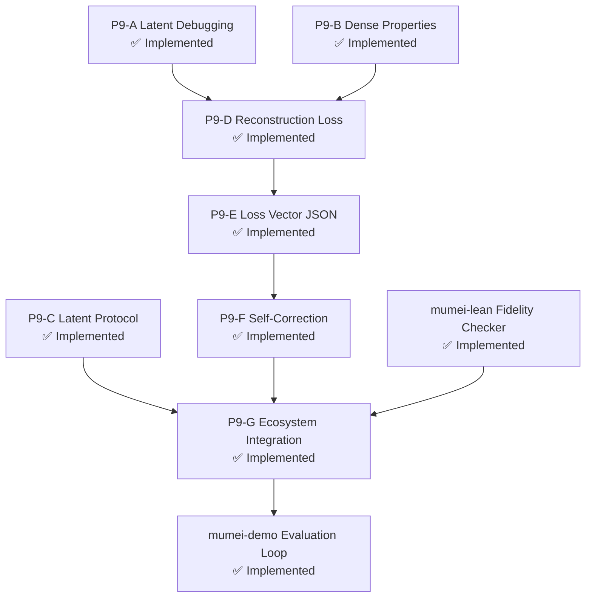
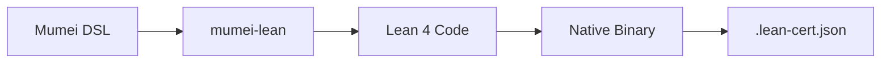
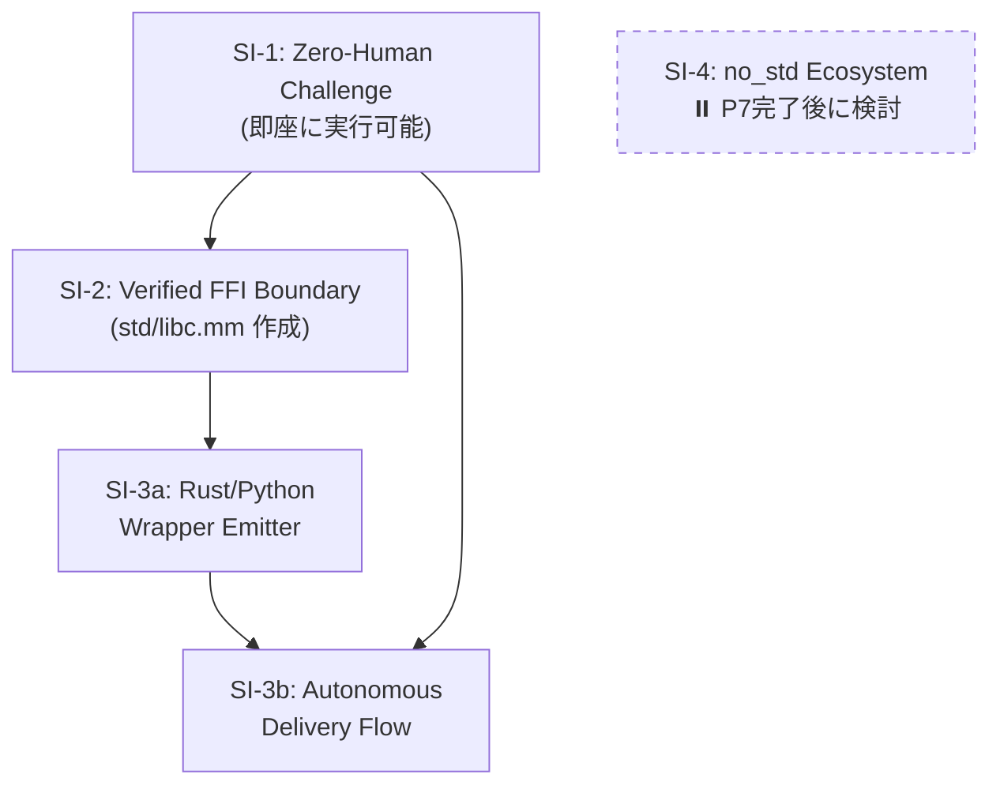
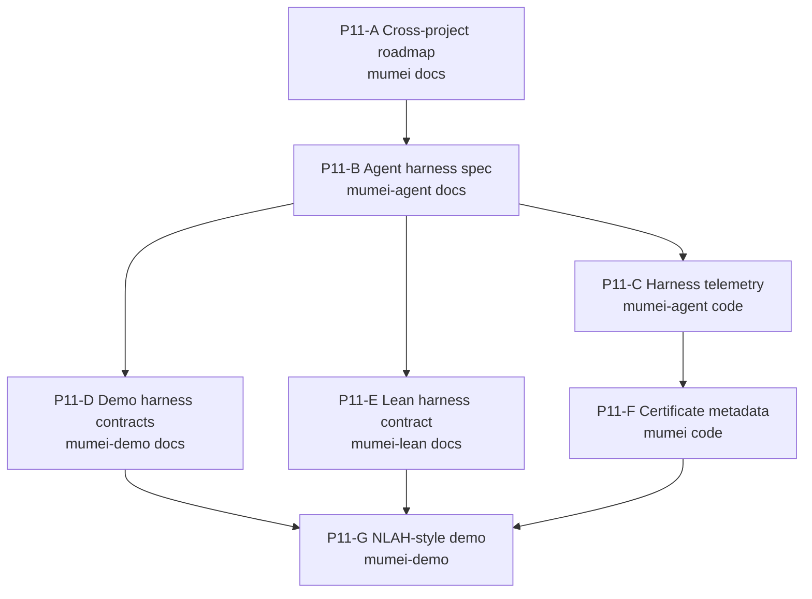
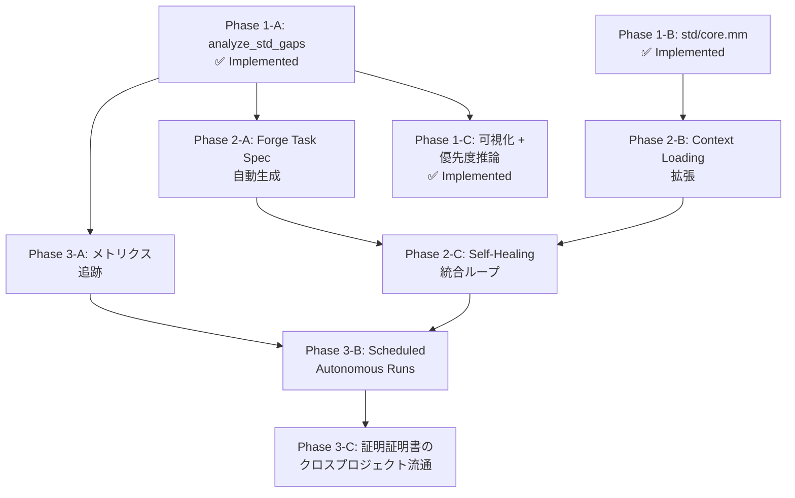
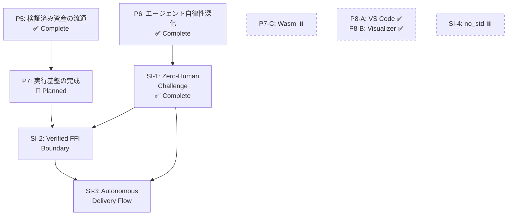
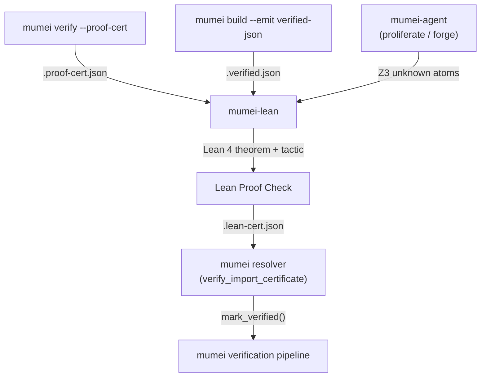
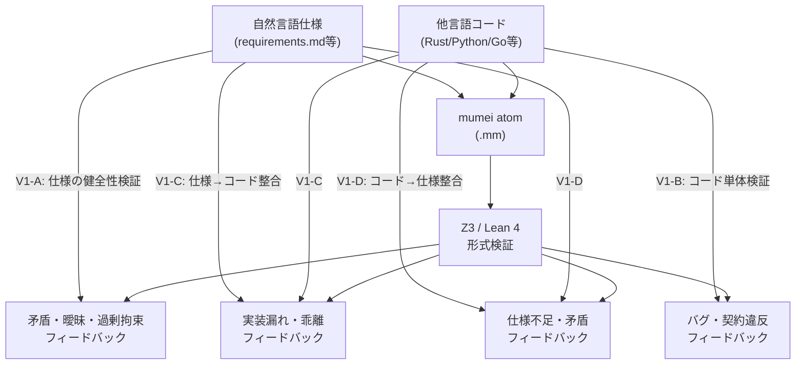
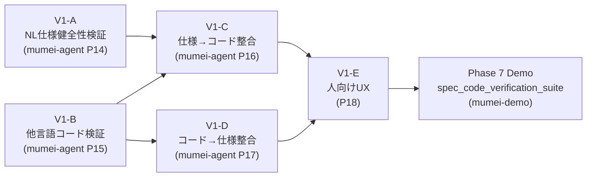

# Cross-Project Roadmap — mumei + mumei-agent (2026-03 〜)

> mumei エコシステム全体の次期ロードマップ。mumei の思想（proof-first / AI生成コード → 検証済み資産への変換）に沿って優先度を設定。

## Canonical cross-project contract

This file is the single top-level roadmap for `mumei`, `mumei-agent`, `mumei-lean`, and demo/tap follow-ups. Repository-local roadmaps may track local acceptance details, but they must not introduce a competing priority order. When wording diverges, align local docs back to this file first.

Canonical harness vocabulary:

| Term | Contract meaning | Primary owners |
| --- | --- | --- |
| `harness_contract` | Identifier/path for the policy that binds stages, gates, failure taxonomy, and evidence expectations. | `mumei` certificate metadata; agent/Lean/demo harness docs |
| `intent_fidelity` | Review metadata showing whether generated specs/artifacts still match the original natural-language intent. | `mumei-agent`, `mumei-demo`, certificate consumers |
| `artifact_paths` | Ordered evidence paths that CI, demos, or MCP clients must collect/compare. | compiler proof certificates, agent audit reports, Lean bridge summaries |
| `spec_health_issues`, `verification_violations`, `verification_status`, `cross_validation_gaps`, `next_steps`, `migration_hints`, `healed_files`, `heal_errors` | Canonical no-`.mm` audit artifact set from existing code through migration and self-healing. | `mumei-agent audit --auto-migrate --auto-heal`, MCP `scan_and_fix`, `mumei-demo/scenarios/no_mm_audit` |
| `contract_consistency[]` ↔ `missing_constraints[]`; `global_invariant_conflicts[]` ↔ `divergences[]`; `circular_dependencies[]` ↔ `drift_issues[]` | Cross-spec artifact mapping shared by human review and MCP consumers. | `mumei cross_spec.json`, `mumei-agent` cross-validation, P14-D human review |
| `budget_policy_fingerprint` | Stable hash of the retry/search policy used when producing evidence. | agent self-healing/audit, compiler proof certificates |
| `lean_verified` | Certificate status for an atom accepted only when the current `translator_version` and `bridge_lemma_hash` match both certificate fields and Lean result metadata; otherwise the atom is stale/unproven. | `mumei-lean` bridge; `mumei` certificate resolver; CLI/MCP certificate consumers |

The completed P11/P14 integration established docs-sync and harness-contract regression prevention as ongoing gates for the Verification-Native program below: keep the vocabulary above stable, keep local docs subordinate to this roadmap, and run the bridge/MCP/audit/spec regression gates whenever those contracts move. Manual review is now backed by the deterministic `scripts/check_contract_vocabulary.py` docs-sync gate — which checks docs, CLI help (`src/cli.rs`), and MCP tool docstrings (`mcp_server.py`) for forbidden aliases and `contradiction_type` drift. MCP docstring extraction uses `ast`-based parsing with a count assertion (decorator count vs extracted docstring count) to prevent silent false-negatives from decorator-argument or signature variations. Repository-local contract tests in `mumei-agent`, `mumei-lean`, and `mumei-demo` complement the central gate; `mumei-demo` extends its `scripts/check_scenario_contracts.py` to cover docs/README files for forbidden aliases in key-like contexts (backtick, code fence, JSON key style). `mumei-lean` extends its `tests/test_contract_vocabulary.py` beyond docs text to cover Python bridge code surfaces: `scripts/export_cert.py` constants (`TRANSLATOR_VERSION`, `BRIDGE_LEMMA_HASH`) are asserted against `docs/LEAN_HARNESS_CONTRACT.md` pinned values for bidirectional drift detection, and docstrings/argparse help/user-visible strings in `export_cert.py`, `bridge.py`, `ingest_cert.py`, `bridge_harness.py` are checked for Lean vocabulary alias drift in key-like contexts. All four repositories now symmetrically cover docs + code-surface contract vocabulary regression.

## Verification-Native program: ordered implementation

Mumei will evolve from primarily Z3-backed verification toward a small common
specification language connected to multiple formal verification methods,
while retaining execution. It will not become a universal language containing
every backend's logic. The user-approved program is tracked in
[the parent issue](https://github.com/mumei-lang/mumei/issues/784).
The [architecture and acceptance contract](VERIFICATION_NATIVE.md) defines
ownership, existing foundations, plugin requirements, evidence and non-goals;
this file remains the sole authority for cross-project implementation order.

| Wave | Work | Exit condition |
| --- | --- | --- |
| 1 | C01 ownership; initial C02 evidence contract; C03 minimal semantic design; C13 negative baseline | Shared meaning and non-guarantees are documented, and contract fixtures are checked without changing existing verdicts or grades. |
| 2 | C03 supported vertical slice; C04 planner; C11 replaceable plugin contract | Existing Z3/Lean paths and test adapters demonstrate capability checks, user selection/configuration, explainable routing and explicit fallback. No new external tool adoption is required. |
| 3 | C05 CFG/dataflow and C08 evidence-bound native bundles | Preserve Go facts and source provenance; independently check artifact identity, freshness and build conditions without claiming semantic correctness. |
| 4 | C06/C07 language/interprocedural analysis; C09 limited LLVM translation validation; individual C11 feasibility pilots | Expand one supported domain at a time, preserving assumptions, bounds and unsupported cases. |
| 5 | C10 consumer-side executable checks; demand-driven C12 authority correspondence | Recheck required evidence and display unverified runtime, ABI, linking and authority connections. |
| Deferred | C14 WASM; additional solvers; dynamic capability stages | Revisit only with explicit demand and the native/runtime/evidence prerequisites. |

Wave 1 is the initial foundation delivery, not completion of C02/C03/C13 or
the later waves. Existing logic-fragment tags, HIR/MIR, Translator IR,
Claim Book, native compilation and Lean dual checks must be extended rather
than re-created. Existing audit keys, grades, dependency freshness and Lean
promotion gates remain unchanged.

| Work item | Scope | Priority | Owner | Dependencies |
| --- | --- | --- | --- | --- |
| [C01](https://github.com/mumei-lang/mumei/issues/785) | Define Verification-Native ownership and assurance boundaries | P0 | mumei | None |
| [C02](https://github.com/mumei-lang/mumei/issues/786) | Define backend-neutral verification evidence without changing proof grades | P0 | mumei | C01 |
| [C03](https://github.com/mumei-lang/mumei/issues/787) | Define a minimal common semantic contract over existing IRs | P0 design; P1 vertical implementation | mumei | C01; co-design with C02 |
| [C04](https://github.com/mumei-lang/mumei-agent/issues/649) | Build an explainable user-configurable verifier planner | P1 | mumei-agent | C02; minimal C03 contract; co-design C11 |
| [C05](https://github.com/mumei-lang/mumei-agent/issues/650) | Connect explicit CFGs to existing function-local dataflow facts | P1 | mumei-agent | C02 source/provenance contract |
| [C06](https://github.com/mumei-lang/mumei-agent/issues/651) | Extend language semantics and type-symbol resolution incrementally | P2 | mumei-agent | C05 |
| [C07](https://github.com/mumei-lang/mumei-agent/issues/652) | Add interprocedural summaries over resolved calls | P2 | mumei-agent | C05; target-language C06 |
| [C08](https://github.com/mumei-lang/mumei/issues/788) | Bind native artifacts to source proof and build provenance | P1 | mumei | C02; identity/semantic-settings portion of C03 |
| [C09](https://github.com/mumei-lang/mumei/issues/789) | Pilot limited semantic translation validation to LLVM | P2 research pilot | mumei | C03; C08 target identification |
| [C10](https://github.com/mumei-lang/mumei/issues/790) | Add consumer-side checks for evidence-carrying native executables | P2 staged integration | mumei | C08; C09 for translation-validated claims |
| [C11](https://github.com/mumei-lang/mumei-agent/issues/653) | Define replaceable verifier plugin contracts before external adoption | P1 contract design; P2 individual feasibility pilots | mumei-agent | C02; co-design C04; C03 when semantic translation is needed |
| [C12](https://github.com/mumei-lang/mumei/issues/791) | Connect effect resource and capability models to real authority | P2 investigation; demand-driven | mumei | C03; concrete use case |
| [C13](https://github.com/mumei-lang/mumei-demo/issues/118) | Add regression gates against cross-backend assurance confusion | P0 baseline; ongoing per milestone | mumei-demo | Alongside C01/C02 and each later feature |
| [C14](https://github.com/mumei-lang/mumei/issues/792) | Keep WASM execution deferred behind native assurance milestones | Deferred / TODO | mumei | Native stability; C08/C10; concrete demand |

These priorities order this new program; they do not reopen completed work or
override unrelated security fixes. All four repository-local roadmaps follow
this order. C14 extends the existing deferred P7-C item, not a second active
WASM implementation. C12 preserves the existing demand gate for Capability
Stage 2 and later. Solver diversification is deferred rather than a default
requirement of the plugin architecture.
The compiler must not embed all external tools or implement every logic.
Agent owns external-tool selection/execution; Mumei owns specification semantics
and shared evidence acceptance. Do not equate external success with proved,
hide semantic loss in a universal IR, or run every backend in parallel by
default. Purpose-driven comparisons require permitted policy, budget and
result-reconciliation rules.

The initial C03 scalar implementation is an opt-in library profile over the
existing parser/HIR/MIR, with a real Z3/LLVM/native finite-regression slice.
It does not complete general obligation decomposition, default producer/consumer
integration, stable IR interchange or translation validation; see the
[supported scope](VERIFICATION_NATIVE.md#first-supported-scalar-slice).

### Wave 2 explicit result-contract routing follow-up

Agent's opt-in C04/C11 planner now supports an optional exact `ResultContract`
binding a profile/method pair to scope, complete bound/assumption identifiers
and correspondence relation/status. Registered offers must match one whole
contract: no borrowing fields across offers or treating missing declarations
as wildcards. Priority, explicit selection and permitted preflight fallback
cannot relax it. No implication, numeric ordering, assumption discharge or
correspondence upgrade is inferred. Unconstrained requests retain their earlier
v1 payload and do not silently acquire an assurance policy.

This is partial routing and C13 confusion regression, not Evidence ingestion,
proof acceptance, capability truth, lifecycle/execution/resource enforcement or
runtime fallback/reconciliation. Existing Core source/native consumers remain
separate; audit keys, grades, Lean gates and Mumei/Agent ownership are unchanged.
No external verifier is adopted and WASM stays deferred. The
[Agent roadmap](https://github.com/mumei-lang/mumei-agent/blob/develop/docs/ROADMAP.md#c04c11-explicit-result-contract-routing)
owns local API details under this implementation order.

### Wave 2 typed configuration follow-up

Agent's opt-in C04/C11 planner adds host-reviewed non-secret setting schemas:
strict Boolean, explicitly bounded integer and closed identifier choice only.
Registered defaults precede per-adapter explicit overrides. Unknown adapters or
options and invalid/duplicate values fail before selection, even for disabled
candidates; they cannot silently fall back. Permitted fallback uses its own
schema/defaults/overrides without copying settings or weakening the result
contract. Schema-less legacy output stays unchanged.

Only approved selected values are exposed/fingerprinted. A canonical
`mumei.adapter-configuration/v1` SHA-256 projection binds schema, defaults,
effective settings/budgets and selected adapter/tool/request context. Raw
overrides are not serialized or hashed before validation. The host must approve
all declared labels/defaults as non-secret; this is not secret detection or a
Core Evidence configuration identity. It is not an execution/authenticity or
acceptance receipt.

This remains partial C04/C11 and C13. Input preparation, actual permissions,
tool/plugin execution, secret transport, resource enforcement and runtime
reconciliation remain open. Core acceptance, audit grades, Lean/native/LLVM
guarantees and deferred WASM are unchanged; no external verifier is adopted.
The [Agent settings contract](https://github.com/mumei-lang/mumei-agent/blob/develop/docs/ROADMAP.md#c04c11-typed-configuration-follow-up)
owns local API details.

### Wave 2 bounded source-input preparation

Agent's opt-in C04/C11 planner can constrain an explicit input-format declaration.
Missing offers are not wildcards; all prior filters and exact result contracts
remain in force. A separate `prepare_source` API replans against current registry
metadata and binds at-most-1-MiB immutable UTF-8 source bytes to a host-supplied
expected SHA-256 and the selected plan. The explicit manifest exposes only
format/digest/byte count and plan metadata, not source text, plus a deterministic
request fingerprint. Legacy unconstrained JSON stays unchanged.

This is partial input preparation and C13 negative-regression coverage, not
source parsing/semantic extraction, an Evidence identity, observation freshness,
authenticity, execution permission or acceptance. Saved records cannot authorize
later execution. Input/file/environment access policy, transport, real execution,
resource enforcement and runtime reconciliation remain separate work. No Core
acceptance, audit/Lean/native/LLVM guarantees or deferred WASM policy changes;
no external verifier is adopted. See the [Agent preparation contract](https://github.com/mumei-lang/mumei-agent/blob/develop/docs/ROADMAP.md#c04c11-bounded-source-input-preparation).

### Wave 2 declared permission-policy filtering

Agent's next opt-in C04/C11 slice matches host-declared required permission
categories against an explicit allowed set. Missing requirements fail closed
under an explicit policy; an empty allowed set denies all nonempty declarations.
Priority/explicit selection cannot bypass the filter, and permitted fallback
uses the destination declaration while preserving exact result/input contracts.
Omitted policy retains legacy planning/JSON without implying approval. Explicit
plan metadata and prepared-source fingerprints retain the policy/requirements.

This is coarse declaration matching and C13 regression coverage, not proof of
actual privilege requirements, authenticated user/admin authorization, an OS
sandbox, resource enforcement or execution. A matching plan cannot authorize
code execution or data egress; the later runner must independently enforce its
boundary. Core specification/Evidence ownership, C12's demand gate and existing
audit/Lean/native/LLVM/deferred-WASM policies remain unchanged. No external
verifier is adopted. See the [Agent permission contract](https://github.com/mumei-lang/mumei-agent/blob/develop/docs/ROADMAP.md#c04c11-declared-permission-policy-filtering).

### Wave 2 bounded host-observed attempt lifecycle

Agent's next partial C11/C13 contract records host-reported start, cancellation
request/acknowledgement, exit, failure and timeout observations against a prepared
manifest fingerprint, attempt number and declared timeout. Immutable histories
are bounded to three events, validate elapsed counters and terminal transitions,
and reject exit observations at/after the deadline. Cancellation requests are not
acknowledgements; incomplete histories remain nonterminal. Exit code zero is not
verification success or Evidence acceptance.

This is an observation contract, not a runner, authority token or common Evidence
replacement. No clock/process/I/O/signal operations, actual timeout/cleanup,
global attempt uniqueness, cross-attempt/backend arbitration, output ingestion or
default audit/CLI/MCP integration is added. Core meaning/Evidence ownership,
C12's real-authority demand gate and existing assurance/Lean/native/LLVM/deferred
WASM boundaries are unchanged. No external verifier is adopted. See the
[Agent lifecycle contract](https://github.com/mumei-lang/mumei-agent/blob/develop/docs/ROADMAP.md#c11-bounded-host-observed-attempt-lifecycle).

### Wave 2 same-attempt report reconciliation

Agent's next partial C11/C13 step compares an incoming immutable attempt snapshot
to the caller's current record. Request fingerprint, attempt number and timeout
must match; all known events must remain an exact prefix. Identical reports are
idempotent, and complete validated extensions may advance multiple observations.
Stale/shorter, divergent or rewritten terminal histories fail rather than being
merged or resolved in favor of code zero, later counters or report arrival order.

The helper does not select which independent branch is true. Callers still own
retaining and atomically updating their current record and surfacing conflicts;
starting from an older prefix can still fork. Duplicate acceptance is not
freshness, authentication or replay protection. No global ledger, new schema,
runtime/process/clock/I/O operation, actual enforcement or output/Evidence
normalization/acceptance is added. Cross-attempt/backend result reconciliation
and full C11 execution remain open. Core meaning/acceptance, C12's demand gate,
existing assurance/Lean/native/LLVM behavior and deferred WASM are unchanged.
See the [Agent reconciliation boundary](https://github.com/mumei-lang/mumei-agent/blob/develop/docs/ROADMAP.md#c11-same-attempt-report-reconciliation).

### Wave 2 bounded sequential attempt records

Agent adds an opt-in `AttemptSequence` for one prepared-request fingerprint and
unchanged per-attempt timeout, with at most 16 exact immutable attempt records.
An empty sequence requires explicit permission metadata when prepared; direct
construction checks representation only. Reserving a record assigns the next
contiguous ordinal from 1 and requires a terminal predecessor. Gaps, duplicates,
mixed bindings, nonterminal predecessors and overflow fail without truncation.
No process starts and no retry is authorized. The current record is not a winner.

Reports must target an already reserved ordinal and preserve that attempt's
known prefix via existing same-attempt reconciliation. Unknown ordinals, rewinds,
branches and terminal replacements fail; exact duplicates of old terminal reports
remain idempotent, not fresh. Sequence JSON adds only ordered attempt metadata,
not stdout, successful results or common Evidence; prior attempt/output formats
and the explicit Core handoff are unchanged. A changed plan/timeout needs a
separate prepared request/sequence, not cross-backend fallback reuse.

This is local logical ordering, not global numbering, atomic/durable publication,
replay/authenticity protection, retry scheduling or cross-attempt/backend result
arbitration. Hosts retain/atomically advance their canonical value; independent
values can fork. A terminal report does not prove cleanup or prevent physical
process overlap. No total retry deadline, backoff, resource/authority enforcement,
stream collection, output selection/invalidation, normalization or Core-owned
Evidence acceptance is added. Code zero remains only an observation. C11/C13 are
partial, C12 remains demand-gated, existing assurance/Lean/native/LLVM/deferred-WASM
policies unchanged, with no default audit/CLI/MCP route or external verifier.
See the [Agent sequence boundary](https://github.com/mumei-lang/mumei-agent/blob/develop/docs/ROADMAP.md#c11-bounded-sequential-attempt-records).

### Wave 2 bounded opaque stdout snapshots

Agent's next partial C11/C13 step prepares host-supplied immutable stdout bytes
against an exited attempt, a separately specified attempt number, the prepared
request/timeout and a caller-supplied raw SHA-256. The helper requires explicit
permission metadata; this is not authority. The 0–65,536-byte bound is checked
before hashing, with no truncation. Failed/timed-out/cancelled/nonterminal records
are rejected, but zero/nonzero exit codes and empty/binary/invalid JSON bodies
remain opaque transport data, not verification success or well-formed Evidence.

The bounded snapshot retains stdout for explicit access, while repr/JSON expose
only attempt, size/digest and canonical metadata fingerprint. Generic reflection
or `.stdout` access is not redacted. Same-output reconciliation is idempotent only
for identical attempt histories and raw bytes; changed metadata/body fails, not
last-writer-wins. Callers must first reconcile their current attempt and retain
and atomically publish a canonical output; independent snapshots can still fork.

No parsing, process/stream collection, I/O/clock operation, authentication/replay
protection, actual resource/authority enforcement or default audit/CLI/MCP wiring
is added. Caller-supplied digests do not establish origin, completeness, delivery
timing, secrecy or Evidence acceptance. Cross-attempt/backend arbitration,
adapter result normalization and Core-owned common Evidence checks remain open;
C12's demand gate, existing
assurance/Lean/native/LLVM behavior and deferred WASM are unchanged. No external
verifier is adopted. See the [Agent output boundary](https://github.com/mumei-lang/mumei-agent/blob/develop/docs/ROADMAP.md#c11-bounded-opaque-stdout-snapshots).

### Wave 2 bounded JSON stdout decoding

Agent adds explicit private-body decoding of one UTF-8 JSON object from a bounded
stdout snapshot. Duplicate decoded keys, extra output, BOM/other encodings,
unpaired surrogates, invalid syntax and non-JSON numeric constants fail with a
static error and no chained decoder payload. Nesting is bounded to 32 before
parsing; number tokens are at most 128 characters and decimal exponents must be
representable. Exact integer/Decimal values avoid binary-float precision loss.

Each decode returns a fresh private tree without changing raw bytes, identity or
metadata. Neither decoded content nor explicit byte access is safe to log. Empty
objects and success claims are still untrusted, not Evidence. Core must check
original bytes, not a reserialized Python tree. Core schema/meaning/acceptance,
adapter normalization, stream collection, execution and authority enforcement
remain separate; no default audit/CLI/MCP route or external verifier is added.
C11 remains partial, C12 demand-gated and existing assurance/Lean/native/LLVM/
deferred-WASM behavior unchanged. See the [Agent JSON boundary](https://github.com/mumei-lang/mumei-agent/blob/develop/docs/ROADMAP.md#c11-bounded-json-stdout-decoding).

### Wave 2 original-byte Core stdin representation checks

Core's explicit `evidence check --stdin [--json]` accepts original stdout bytes
without a temporary file or reserializing Agent's private decoded tree. It uses
the existing common Evidence representation decoder and unchanged anonymous
diagnostic: success is representation-valid only, acceptance remains
`not_evaluated`. Empty objects/saved success claims still fail Core shape checks.

Exactly one file or stdin source is required; missing/conflicting selection is
a usage error, and a positional `-` remains a file name. Both modes keep the
65,536-byte limit. Stdin reads at most one extra byte to detect overflow and
does not drain an oversized stream. This is no time bound: the invoking host
must close input and own deadlines/cancellation. No private body, decoder or
underlying I/O error is echoed. File-only source/native consumers are unchanged.

This is an opt-in Core integration entry point, not an Agent call/runner, receipt,
normalization or result-contract binding. Agent execution/stream collection and
Core-owned Evidence meaning/acceptance remain separate open work. C11 is partial;
C12, assurance/Lean/native/LLVM and deferred-WASM policies are unchanged, with no
external verifier adoption. See the [Core consumer](VERIFICATION_NATIVE.md#standalone-representation-only-cli-consumer).

### Wave 2 explicit Agent-to-Core representation handoff

Agent adds a separately invoked POSIX-only local Core handoff. The host must
independently authorize a trusted absolute executable; adapter declarations,
fingerprints and an absolute path do not establish authority or authenticate it.
Fixed `evidence check --stdin --json` receives the original bounded stdout bytes,
with no reserialization, temporary input file, environment forwarding or command
discovery. No default route calls it and no external verifier is adopted.

A separately supplied 1–60,000 ms timeout bounds pipe I/O and child exit (not
uninterruptible OS process creation), with up to one extra second for direct-child
kill/reap. Nonblocking concurrent pipes bound each diagnostic to 4,096 bytes plus
one overflow byte. This is not a general plugin runner, descendant sandbox or
memory/CPU/authority enforcement. Windows support remains outside this pilot.

Agent additionally accepts an optional host-owned standard `threading.Event`
for cooperative cancellation of this Core call. A pre-set event prevents spawn;
otherwise pipe/exit waits poll at most every 50 ms without resetting the deadline.
Observed cancellation closes pipes and kills/reaps the direct child before a
fixed cancellation error (cleanup failures remain check failures). This does
not interrupt process creation, guarantee real-time response or stop descendants.
Signals can race with the last completion check and set/clear pulses can be
missed: the host must keep the event set until return and arbitrate completion.
No event is changed and no host attempt cancel/timeout report is synthesized.

An optional Agent `attempt_sequence` argument checks an exact `AttemptSequence`
against the exact stdout snapshot before Core spawn/I/O. Its
`check_output_binding()` requires the current record to match request fingerprint,
ordinal, timeout and complete event history; empty/unreconciled sequences,
old/future outputs and changed histories fail with static, body-free errors.
Omission/`None` preserves the sequence-independent API and all existing schemas.
This is equality of supplied immutable metadata, not global currentness or
Evidence/request-contract matching: a stale sequence may match a stale output.
Competing bodies for the same record both pass binding; the host must retain and
reconcile canonical outputs and own atomic updates, publication/completion and
result selection. No lock/CAS, completion revalidation, authentication/replay
protection, process cleanup proof, receipt or acceptance is added.

The complete known v1 diagnostic and zero Core exit are both required; stderr,
malformed/duplicate/extra output, unknown versions and timeouts fail with static
errors. The function returns no receipt/record and changes no snapshot. A normal
return means representation-valid only, relying on the trusted executable;
`acceptance` remains `not_evaluated`. An anonymous saved diagnostic is not proof
of this invocation. Evidence/request result-contract matching, adapter
normalization, actual plugin execution, truth, authenticity, freshness and Core
acceptance remain separate.
C11 stays partial; C12 and existing assurance/Lean/native/LLVM/deferred-WASM
policies are unchanged. See the [Agent handoff boundary](https://github.com/mumei-lang/mumei-agent/blob/develop/docs/ROADMAP.md#c11-explicit-local-core-representation-handoff).

### Wave 2 host-declared canonical result selection

Agent adds `AttemptSequence.select_result(output)`, a canonical-result-selection
contract on the sequential-attempt ledger. The supplied snapshot must satisfy
the existing `check_output_binding` against the sequence's current `exited`
record — request fingerprint, ordinal, timeout and complete event history.
Selection marks the detached `(attempt_number, output_fingerprint)` pair as
this value's canonical result and closes the sequence: further reservations
and competing snapshots fail with static errors, while re-selecting the same
output is an idempotent no-op. `to_dict()` carries the marker under the
existing `mumei.verifier-attempt-sequence/v1` schema with no stdout, source or
diagnostics.

A selected result is host-declared canonical metadata for that sequence value
only — not truth, Evidence acceptance, a Core representation-check receipt or
cross-sequence arbitration. Independently captured snapshots bound to the same
attempt both satisfy binding, and independent sequences can select independent
results; hosts still own canonical storage, `AttemptOutput.reconcile`,
atomic publication and any cross-attempt/backend arbitration. There is no
global ordering, locking/CAS, replay protection, freshness or authenticity
claim, and selection neither revalidates the output nor invokes Core.
C11 stays partial: runner/scheduler, stream collection, Evidence
normalization/acceptance and actual execution/cancellation remain open, and
C12's demand gate plus existing assurance/Lean/native/LLVM/deferred-WASM
policies are unchanged. See the
[Agent result-selection boundary](https://github.com/mumei-lang/mumei-agent/blob/develop/docs/ROADMAP.md#c11-canonical-result-selection-for-sequential-attempts).

### Wave 2 atomic canonical-lineage publication

Agent adds `AttemptSequenceStore`, an in-process compare-and-set publication
point for one canonical `AttemptSequence` lineage — the atomic storage hosts
were previously told to own. `publish(sequence)` stores the first canonical
value; `compare_and_set(expected, updated)` atomically swaps it when
`expected` equals the stored value, so competing writers extending the same
prefix can no longer silently fork. A mismatch reports the fork with a static
error and changes nothing; equal updates and re-publications are idempotent.

An update must be a lineage extension of the expected value: same request
fingerprint and timeout, every retained record equal or a valid same-attempt
report extension, and no change after a selected result. Removed, replaced,
rewound, rebound or diverged updates are rejected. The store holds immutable
metadata values only — never source or stdout bodies — and has no
serialization surface of its own. It linearizes callers on this object only:
it is not durable storage, a cross-process/OS lock, replay protection at the
boundary or authentication. Stale expectations are detected by equality, not
freshness proof; hosts still own distribution, crash recovery and any
cross-attempt/backend arbitration. C11 stays partial: runner/scheduler,
stream collection, actual execution/cancellation and Evidence
normalization/acceptance remain open, and C12's demand gate plus existing
assurance/Lean/native/LLVM/deferred-WASM policies are unchanged. See the
[Agent publication boundary](https://github.com/mumei-lang/mumei-agent/blob/develop/docs/ROADMAP.md#c11-atomic-canonical-lineage-publication).

### Wave 2 monotonic report stamps for replay detection

Agent's `AttemptSequence.reconcile_report` accepts an optional
`report_stamp`: a host-declared monotonic counter bound to the lineage's
report stream. Stamps are exact positive bounded integers; once one is
accepted every later report must carry one. A stamp must strictly increase
across distinct deliveries — a smaller stamp fails as stale, and a reused
stamp only reconciles an identical report (reused stamp + changed content
fails too). A fresh stamp on identical content advances the counter, so
replays arriving after newer reports are detected. The last accepted stamp
serializes as detached `report_stamp` metadata under the existing
`mumei.verifier-attempt-sequence/v1` schema, and `AttemptSequenceStore`
lineage updates may never regress it.

This is a replay/reorder detection contract, not a clock, freshness proof,
authentication or authorization: a host assigns stamps itself, so a host can
always mint a higher one. Delivery integrity, sender identity, durable
storage, global counters across lineages and content acceptance remain host
duties. Stamps carry no report content, source or stdout. C11 stays partial:
runner/scheduler, stream collection, actual execution/cancellation and
Evidence normalization/acceptance remain open, and C12's demand gate plus
existing assurance/Lean/native/LLVM/deferred-WASM policies are unchanged.
See the
[Agent report-stamp boundary](https://github.com/mumei-lang/mumei-agent/blob/develop/docs/ROADMAP.md#c11-monotonic-report-stamps-for-replay-detection).

### Wave 2 declared execution and cancellation requests

Agent's `AttemptSequence.request_execution()` returns an
`AttemptExecutionRequest` value declaring which reserved record a host
intends to run next; only a `ready` current record can produce one, so an
unreserved, started, cancelling, terminal or selected-result-closed sequence
fails with a static error. `request_cancellation()` returns an
`AttemptCancelRequest` for a `running` current record only — cancellation
intent cannot be declared for nothing running or twice. Both serialize as
detached metadata under `mumei.verifier-attempt-execution/v1` and
`mumei.verifier-attempt-cancel/v1`.

These are declarations of intent only: producing a request never spawns a
process, signals a running one, delivers anything to a runner, reserves
resources or confirms an outcome — dispatch, delivery integrity, process
control and start/stop observation remain host duties, and a request bound
to a stale sequence value is just a stale description the host must discard.
The calls are pure and carry no source, stdout, environment or process
state. C11 stays partial: runner/scheduler, stream collection, actual
execution/cancellation effects and Evidence normalization/acceptance remain
open, and C12's demand gate plus existing
assurance/Lean/native/LLVM/deferred-WASM policies are unchanged. See the
[Agent request boundary](https://github.com/mumei-lang/mumei-agent/blob/develop/docs/ROADMAP.md#c11-declared-execution-and-cancellation-requests).

### Wave 2 declared stream identity and completeness

Agent's `AttemptOutput` declares the collection boundary of its snapshot with
two optional metadata fields: `stream` names the declared stream the captured
bytes came from (the `STREAM_KINDS` vocabulary supports only `"stdout"`
today — other names fail as unsupported rather than being aliased), and
`complete` is an exact `bool` declaring whether the capture is the whole
stream. `reconcile` compares the claims too, so identical bytes carrying
different declarations conflict instead of silently merging, and the
`mumei.verifier-output/v1` manifest emits both only when non-default so
default `output_fingerprint` values are unchanged.

Both fields are host declarations, not proven observations: a declared
`complete=True` does not establish completeness and `False` does not measure
what was missed — only the SHA-256 binds the captured bytes. No streams are
read, pipes are opened or truncation is detected; capture mechanics, the
producer's true byte count and multi-stream capture remain host duties. C11
stays partial: runner/scheduler, actual execution/cancellation effects and
Evidence normalization/acceptance remain open, and C12's demand gate plus
existing assurance/Lean/native/LLVM/deferred-WASM policies are unchanged.
See the
[Agent stream-declaration boundary](https://github.com/mumei-lang/mumei-agent/blob/develop/docs/ROADMAP.md#c11-declared-stream-identity-and-completeness).

### Wave 2 evidence-candidate handoff descriptors

Agent's `AttemptSequence.evidence_candidate()` returns an
`AttemptEvidenceCandidate` naming the declared canonical snapshot for a host
to hand to Core: the request fingerprint, the selected attempt ordinal and
the output manifest fingerprint — nothing else. Only a sequence closed by
`select_result` can produce one, and the value serializes as detached
metadata under `mumei.verifier-evidence-candidate/v1`.

This is a handoff descriptor, not Evidence: the fingerprint binds the
manifest, not content correctness — hashing a manifest is not semantic
correctness and naming a candidate is not acceptance. The value carries no
bytes, makes no validity claim and grants no authority; Core owns the
meaning and acceptance of the original bytes, which the host must still
deliver over its own channel. C11 stays partial: runner/scheduler, actual
execution/cancellation effects and Evidence normalization/acceptance itself
remain open, and C12's demand gate plus existing
assurance/Lean/native/LLVM/deferred-WASM policies are unchanged. See the
[Agent evidence-handoff boundary](https://github.com/mumei-lang/mumei-agent/blob/develop/docs/ROADMAP.md#c11-evidence-candidate-handoff-descriptors).

### Wave 2 dispatch-boundary checks for declared requests

Agent's `AttemptSequence.next_dispatch()` derives the single outstanding
dispatchable intent — a `ready` current record yields its
`AttemptExecutionRequest`, and anything else yields `None` (which does not
mean nothing may run: an in-flight attempt continues and host-initiated
cancellations are declared separately). `check_dispatch` is the static
counterpart for host-built requests: an execution request must name this
value's current ready record including its declared timeout, a cancellation
request the current running one — wrong types, foreign fingerprints, stale
ordinals and unserved states are static errors, never silent drops.

These are boundary checks, not a runner or scheduler: nothing is
dispatched, delivered, queued, ordered across sequences or confirmed —
dispatch, delivery integrity, ordering policy and process control remain
host duties, and a request that passes today is just a description the host
must re-check against the canonical value at send time. C11 stays partial:
actual execution/cancellation effects and Evidence normalization/acceptance
remain open, and C12's demand gate plus existing
assurance/Lean/native/LLVM/deferred-WASM policies are unchanged. See the
[Agent dispatch boundary](https://github.com/mumei-lang/mumei-agent/blob/develop/docs/ROADMAP.md#c11-dispatch-boundary-checks-for-declared-requests).

### Wave 2 real process control for declared execution requests

Agent's `attempt_runner.py` is the first effectful boundary in the C11
cluster: `AttemptRunner.run(request, argv, cancel_event=None)` spawns one
real child process for one declared `AttemptExecutionRequest`, waits bounded
by the request's declared timeout, terminates runaways and honors a single
`threading.Event` cancellation. Observations are reported as `AttemptRecord`
events — `started`, then exactly one of `exited` (real exit code), `failed`
(spawn refused by the OS), `timed_out` (deadline reached, child killed) or
`cancelled` (cancel grace expired after `cancel_requested` + terminate).
Captured stdout is drained on a side thread so writers past the pipe buffer
cannot deadlock the wait, bounded to `MAX_STDOUT_BYTES`, and returned with a
`complete` declaration that is `False` whenever truncation occurred or the
bounded drain could not finish.

`run` performs no authorization, scheduling, dispatch decision, output
interpretation or canonical publication — the host still decides via
`check_dispatch`, binds snapshots with `AttemptOutput` and publishes through
`AttemptSequenceStore`. `complete=False` records observed truncation, not
how much was lost, and an `exited` code is a fact about process exit, never
a verification verdict. C11 stays partial: Evidence normalization/acceptance
remains open, and C12's demand gate plus existing
assurance/Lean/native/LLVM/deferred-WASM policies are unchanged. See the
[Agent attempt runner](https://github.com/mumei-lang/mumei-agent/blob/develop/docs/ROADMAP.md#c11-real-process-control-for-declared-execution-requests).

### Wave 2 normalized run-result descriptors

Agent's `AttemptRunResult.normalized()` maps one observed terminal run into
`AttemptNormalizedResult` — detached metadata under
`mumei.verifier-run-result/v1` naming only the request binding (fingerprint,
ordinal, declared timeout), the terminal outcome
(`exited`/`failed`/`timed_out`/`cancelled`), the terminal event's elapsed
counter, the exit code when and only when the outcome is `exited`, and the
bounded-output manifest (size, SHA-256, `complete`). Hosts can consume every
outcome through one stable shape without reading event histories or raw
bytes; non-terminal outcomes, foreign exit codes, oversize declarations and
non-bool completeness are static errors.

Normalization covers agent-side observations only: the digest binds bytes,
not meaning; an exit code is transport metadata, never a verification
verdict; `complete` records only that collection stayed within the bound.
No parsing, verdict interpretation, acceptance or canonical publication is
added — Core still owns Evidence checks and meaning, and hosts still bind
snapshots with `AttemptOutput` and publish via `AttemptSequenceStore`. C11
stays partial; C12's demand gate plus existing
assurance/Lean/native/LLVM/deferred-WASM policies are unchanged. See the
[Agent normalized run result](https://github.com/mumei-lang/mumei-agent/blob/develop/docs/ROADMAP.md#c11-normalized-run-result-descriptors).

### Wave 2 declarative adapter manifests

Agent's `AdapterDescriptor.from_manifest(manifest)` statically parses a
detached host-supplied manifest (`mumei.verifier-adapter/v1`) into a
validated descriptor, and `AdapterRegistry.register_manifest(manifest,
replace=...)` registers it — a test user adapter can be described and added
or replaced without editing core code. `to_dict()` round-trips losslessly;
wrong schema versions, unknown or missing fields, malformed label lists,
result contracts or setting specs are static errors.

A manifest is metadata, not a plugin: it names capabilities, budgets and
schemas but carries no code, grants no authority and proves nothing about
availability — nothing is imported, discovered, probed or executed on
registration. Actual plugin loading, adapter code execution, resource
enforcement and Evidence acceptance remain host duties and open work. C11
stays partial; C12's demand gate plus existing
assurance/Lean/native/LLVM/deferred-WASM policies are unchanged. See the
[Agent adapter manifest](https://github.com/mumei-lang/mumei-agent/blob/develop/docs/ROADMAP.md#c11-declarative-adapter-manifests).

### Wave 2 monotonic observation stamps for replay detection

Agent's `RuntimeObservation` carries an optional host-declared `stamp` — a
bounded monotonic counter, the planner-side analogue of attempt
`report_stamp`. `AdapterRegistry.plan()` records accepted stamped
observations per adapter id: once one is accepted every later observation
for that adapter must carry a stamp, a smaller stamp is a static stale
error, a reused stamp only tolerates an identical observation and a larger
one advances the boundary. Tracking only updates when the whole plan
succeeds; unstamped tuples keep legacy behavior.

A stamp is a delivery counter, not freshness proof, authenticity or
acceptance: the host can always mint a larger one, and observed
availability/tool versions stay untrusted claims. Probing, clock checks,
delivery completeness, cross-registry ordering and Evidence acceptance
remain host duties and open work. C11 stays partial; C12's demand gate plus
existing assurance/Lean/native/LLVM/deferred-WASM policies are unchanged.
See the
[Agent observation stamps](https://github.com/mumei-lang/mumei-agent/blob/develop/docs/ROADMAP.md#c11-monotonic-observation-stamps-for-replay-detection).

### Wave 2 declared memory bounds for attempted executions

Agent's `AttemptRunner.run()` accepts an optional host-declared
`memory_bound_mb`: the child is spawned under POSIX `RLIMIT_AS`, so the
declared `memory_mb` budget a `VerificationPlan` produces now reaches the
execution boundary rather than stopping at the plan manifest. The bound is
validated statically, applies to the child only, and a non-POSIX host
refuses it outright.

The bound is best-effort resource enforcement, not a sandbox: it covers no
CPU, I/O, network or permission policy, and exceeding it surfaces only as
an ordinary observed outcome (`exited`/`failed`/`timed_out`), never
diagnosed as a resource violation. Authorization, scheduling, Evidence
acceptance and further isolation remain host duties and open work. C11
stays partial; C12's demand gate plus existing
assurance/Lean/native/LLVM/deferred-WASM policies are unchanged. See the
[Agent memory bounds](https://github.com/mumei-lang/mumei-agent/blob/develop/docs/ROADMAP.md#c11-declared-memory-bounds-for-attempted-executions).

### Wave 2 bounded plan history for runtime fallback records

Agent's `AdapterRegistry.plan()` appends each successful
`VerificationPlan` to a bounded in-memory `history()` — the runtime
fallback/selection record in the C04/C11 gap list. Entries are appended
in call order and evicted oldest-first past the bound; failed plans are
never recorded, `prepare_source` records exactly the plan it ran and
adapter replacement does not clear the record.

History is a declared record, not a durable audit or Evidence: it is lost
with the registry, evicts silently past the bound, and says nothing about
dispatch or acceptance. Persistence, tamper evidence and Evidence
acceptance remain host duties and open work. C11 stays partial; C12's
demand gate plus existing assurance/Lean/native/LLVM/deferred-WASM
policies are unchanged. See the
[Agent plan history](https://github.com/mumei-lang/mumei-agent/blob/develop/docs/ROADMAP.md#c11-bounded-plan-history-for-runtime-fallback-records).

### Wave 2 declared runtime fallback replanning

Agent's `AdapterRegistry.replan(plan, exclude=(), observations=None)`
re-routes a recorded plan after a host-declared runtime failure — the
runtime fallback the plan history was recorded for. The previously
selected adapter plus every registered `exclude` id is treated as
disabled and explicit selection is cleared; the same request and policy
constraints are preserved. The plan must come from the registry's
recorded history, must have selected an adapter, and must permit
routing — an explicit non-fallback selection stays a hard boundary.
When `observations` is `None` the registry reuses its last accepted
stamped observations.

Replanning is a declared re-selection, not a runtime verdict: it records
that the host observed a failure — it does not prove the excluded
adapter failed or that the new route works, and it carries no attempt
outcome or Evidence. See the
[Agent runtime fallback](https://github.com/mumei-lang/mumei-agent/blob/develop/docs/ROADMAP.md#c04c11-declared-runtime-fallback-replanning).

### Wave 3 first supported boundaries

The [Agent C05 slice](https://github.com/mumei-lang/mumei-agent/pull/656)
adds source-mapped structured Go normal-flow graphs and return-site lookup over
the existing heuristic walker. Unsupported control flow produces gaps, not a
partial graph; fixed-point CFG dataflow, complete source identities, typed
resolution and other-language coverage remain open.

The [first C08 native identity slice](VERIFICATION_NATIVE.md#first-native-identity-bundle-slice)
adds opt-in `native-bundle build/check` for one pure-i64 `main` on Linux/x86_64.
It captures source/specification/IR/certificate/object/executable identities
and observed build settings in the same fresh build. The consumer compares
snapshots to an externally pinned build ID, without executing the artifact or
promoting hash consistency to authenticity, translation validation or an
`artifact_verified` claim. System dependencies, tool execution, filesystem
metadata and wider ABI/runtime semantics remain unverified. This is partial
C08 and a narrow C10 identity-check foundation, not completion of either item.

### Wave 3 fixed-point assignment facts over the explicit Go CFG

Agent's `control_flow.assignment_facts(body, graph)` runs the first
bounded fixed-point dataflow over the `mumei.go-explicit-normal-flow/v1`
graph: per-node `all_paths` (identifiers textually assigned on every
path from entry) and `some_path` (assigned on at least one path). Both
directions converge monotonically on a finite lattice with a defensive
iteration bound; a body that does not match the graph digest or fails to
parse is a static error.

Facts are declared textual assignment, not memory truth: only simple
identifier targets count — selectors, indexes, the blank `_`,
scoping/shadowing and mutation through opaque calls are excluded, and
unreachable nodes hold the vacuous universe. Interprocedural flow,
use/defect detection and proof-grade semantics remain open C05/C06 work.
See the
[Agent assignment facts](https://github.com/mumei-lang/mumei-agent/blob/develop/docs/ROADMAP.md#c05-fixed-point-assignment-facts-over-the-explicit-cfg).

### Wave 3 possibly-unassigned use hints over assignment facts

Agent's `control_flow.unassigned_uses(body, graph)` connects the
fixed-point assignment facts to reads: it reports `UnassignedUse` when a
simple identifier is textually assigned somewhere in the body yet absent
from a node's `all_paths` pre-state — a possibly-unassigned read (one
sided branch, loop-gated assignment). Checks run against the pre-state
and initializers flow into their conditions.

A finding is a hint for the host's own analysis, not a defect verdict:
fields/elements, calls, shadowing and closures are not modelled, and
proof-grade semantics remain open C05/C06 work. See the
[Agent unassigned-use hints](https://github.com/mumei-lang/mumei-agent/blob/develop/docs/ROADMAP.md#c05-possibly-unassigned-use-hints-over-assignment-facts).

### Wave 3 definite unassigned-use classes over the same facts

Agent's `UnassignedUse` gains a `definite` flag: a possibly-unassigned
read is definite when the name is textually assigned somewhere in the
body yet absent from the node's `some_path` pre-state too — no modelled
path can deliver it (assignment only after the use, or only in a
sibling the use's path never takes). `definite = False` keeps the
earlier class where some path may deliver the value.

Still a hint for the host's own analysis, not a defect verdict — a
definite finding is a stronger suspicion, not proof, and fields, calls,
shadowing, closures and unreachable code remain unmodelled. See the
[Agent definite unassigned-use classes](https://github.com/mumei-lang/mumei-agent/blob/develop/docs/ROADMAP.md#c05-definite-unassigned-use-classes-over-the-same-facts).

### Wave 3 unused-assignment hints at name granularity

Agent's `control_flow.unused_assignments(body, graph)` reports
`UnusedAssignment` when a recognized assignment statement targets a
simple identifier that appears in no use position anywhere in the body —
the dead-store hint at name granularity, over the same conservative
identifier scan as the unassigned-use hints.

Still a hint for the host's own analysis, not a defect verdict: any
textual occurrence counts as a read (including inside the name's own
initializer, `x++`, and unreachable code), every writer of an unread
name is flagged, and fields, calls, shadowing and closures remain
unmodelled. See the
[Agent unused-assignment hints](https://github.com/mumei-lang/mumei-agent/blob/develop/docs/ROADMAP.md#c05-unused-assignment-hints-at-name-granularity).

### Wave 3 one-pass flow-hint report and unreachable-statement hints

Agent's `control_flow.flow_hints(body, graph)` returns `FlowHints` —
the three bounded hint families in one immutable report:
`unassigned_uses`, `unused_assignments` and the new
`unreachable_statements(graph)`, which flags every span-carrying node
outside `graph.reachable()` as `UnreachableStatement` — statements no
normal-flow path from the entry reaches.

The aggregate adds no analysis of its own: syntactic reachability over
explicit normal flow is not dead-code proof, and each finding stays a
hint for the host, not a defect verdict. See the
[Agent flow-hint report](https://github.com/mumei-lang/mumei-agent/blob/develop/docs/ROADMAP.md#c05-one-pass-flow-hint-report-and-unreachable-statement-hints).

### Wave 3 independent hint metrics over declared expectations

Agent's `control_flow.evaluate_flow_hints(hints, expected)` compares a
`FlowHints` report against host-declared `HintExpectations` and returns
per-family `FamilyMetrics` — `matched`, expected-but-unreported
(`missed`) and reported-but-unexpected (`unexpected`) — keeping false
positives and missed defects independent as the C05 acceptance
criteria require.

Expectations are host declarations, not ground truth: agreement
measures consistency between two declarations, not correctness of
either. See the
[Agent hint metrics](https://github.com/mumei-lang/mumei-agent/blob/develop/docs/ROADMAP.md#c05-independent-hint-metrics-over-declared-expectations).

### Wave 3 file-level provenance over Go source units

Agent's `control_flow.go_file_units(source)` indexes every function
declaration in one Go source unit into `GoFileUnits` — the unit's
SHA-256 plus per-function `FileFunction` entries with raw name,
declaration and inner-body `SourceSpan`s and body digests.
`function_body(source, units, function)` hands `build_go_cfg` only
bytes whose declared digests still match, so analysis results can bind
back to a verified location in the source file instead of a detached
body string. Bodiless declarations and unparseable units surface as
declared gaps, never a partial index.

Provenance is declared metadata, not semantic identity: digests bind
bytes, not meaning, and the index is not symbol resolution or
cross-file linking. See the
[Agent file provenance](https://github.com/mumei-lang/mumei-agent/blob/develop/docs/ROADMAP.md#c05-file-level-provenance-over-go-source-units).

### Wave 3 labelled loop jumps over the explicit CFG

Agent's `build_go_cfg` now models labelled `break`/`continue`: a label
on a `for`/`range` statement becomes a jump target for that loop's
body, so `break L` / `continue L` edge to the labelled loop's exit or
update — including jumps through nested unlabelled loops. Labels on
non-loop statements, unresolved label names and `goto` stay declared
gaps (`labelled_statement`, `unresolved_label`, `unsupported_goto`), so
existing flow analyses work over the new edges without change — a
labelled break skipping the loop update is reported unreachable.

Label names come from syntax, not scope resolution; duplicate-label
rejection is not modelled. See the
[Agent labelled jumps](https://github.com/mumei-lang/mumei-agent/blob/develop/docs/ROADMAP.md#c05-labelled-loop-jumps-over-the-explicit-cfg).

### Wave 3 terminating calls as exit edges

Agent's `build_go_cfg` now models Go terminating calls
(`panic`/`os.Exit`/`log.Fatal*`/`log.Panic*`/`runtime.Goexit`) as
`terminate` nodes edging to the CFG exit instead of refusing the body
with `unsupported_terminate`. Normal flow after such a call becomes
genuinely unreachable, so `unreachable_statements` reports trailing
code after `panic`, while branch-local termination keeps sibling paths
live and arguments still count as reads.

Termination means exit of the modelled function's normal flow only —
deferred calls, `recover` and unwinding semantics stay unmodelled, and
a terminate edge says nothing about whether the process stops. See the
[Agent terminating calls](https://github.com/mumei-lang/mumei-agent/blob/develop/docs/ROADMAP.md#c05-terminating-calls-as-exit-edges).

### Wave 3 declared unreliable names over flow hints

Agent's `flow_hints` now exports `unreliable` — names the extractor
declares unsafe for path facts (closure-assigned or address-taken).
They still appear in `unassigned` findings but are never promoted to
`definite`, since a closure call or aliased write sits outside the
modelled paths and "no modelled path can deliver it" would overclaim.
The set is exported on the report so hosts can see suppressed claims.

The set is syntactic, not call-graph or escape analysis — conservative
marking is possible in both directions. See the
[Agent unreliable names](https://github.com/mumei-lang/mumei-agent/blob/develop/docs/ROADMAP.md#c05-declared-unreliable-names-over-flow-hints).

### Wave 3 expression switches as exclusive alternatives

Agent's `build_go_cfg` now models Go expression switches: the `switch`
node edges to one `case`/`default` node per arm with implicit-break
semantics (each arm exits to the switch's following), plus a direct
edge to following when no `default` exists. `break` inside a case
exits the switch — not an enclosing loop — `continue` still targets
the enclosing loop, and switch initializers are modelled. `select` and
type switches stay declared gaps (`unsupported_select_switch`/
`unsupported_type_switch`), as do `fallthrough` and non-loop labels.

Arms are alternatives under the non-evaluating profile — no ordering,
overlap or exhaustiveness claims beyond the default's no-match path.
See the
[Agent expression switches](https://github.com/mumei-lang/mumei-agent/blob/develop/docs/ROADMAP.md#c05-expression-switches-as-exclusive-alternatives).

### Wave 3 compound targets as reads, not assignments

Agent's flow hints now treat compound assignment targets (`x.f`,
`a[i]`, `*p`) as reads of every identifier inside them: `x := 1;
x.f = 2` no longer flags `x` as an unused store and `a[i] = 2` keeps
both `a` and `i` live — removing dead-store false positives on
composite roots. Compound targets still never assign their root in
`assignment_facts`, and a name whose only writes are compound stays
outside the declared universe.

The scan is textual: field names may be over-counted as reads — a
conservative miss, never a false "assigned" claim. See the
[Agent compound targets](https://github.com/mumei-lang/mumei-agent/blob/develop/docs/ROADMAP.md#c05-compound-targets-as-reads-not-assignments).

### Wave 3 terminal fallthrough in expression switches

Agent's Go CFG now models a `fallthrough` statement that is the final
statement of a non-final case clause (including a non-final `default:`):
it edges into the next clause's body instead of producing the declared
`unsupported_fallthrough` gap. `break` inside such a clause still exits
the switch and `continue` still targets an enclosing loop. Any other
`fallthrough` position — last clause, mid-body, outside a switch —
remains the declared gap, and the model is positional rather than a Go
type check. See the
[Agent terminal fallthrough](https://github.com/mumei-lang/mumei-agent/blob/develop/docs/ROADMAP.md#c05-terminal-fallthrough-in-expression-switches).

### Wave 3 let bindings in scalar parameter summaries

Agent's C07 body fragment now admits `name := expression` declarations
ahead of the single scalar return: each let binding records its
compiler-resolved binding identity, requires a scalar declared type, and
contributes its initializer's dependencies to later expressions and the
return. Reassignment, tuples and other statement shapes stay
`unsupported_statement`; a left-hand identifier with no compiler binding
or a non-scalar type yields `binding_unavailable`. Dependencies remain a
conservative overapproximation — never equality or proof. See the
[Agent let bindings](https://github.com/mumei-lang/mumei-agent/blob/develop/docs/ROADMAP.md#c07-let-bindings-before-the-single-return).

### Wave 3 branched bodies and multiple returns

Agent's C07 fragment now admits `if`/`else` statements and more than one
return: dependencies union every syntactic return, conditions are
evaluated but contribute no result dependency (every fragment statement
is effect-free), and branch-local let bindings stay scoped to their
branch. Unreachable returns still contribute — reachability is not
proven — and `if` initializers, loops and other statement shapes stay
`unsupported_statement`. See the
[Agent branched bodies](https://github.com/mumei-lang/mumei-agent/blob/develop/docs/ROADMAP.md#c07-branched-bodies-and-multiple-returns).

### Wave 3 bounded for statements in scalar summaries

Agent's C07 fragment now admits `for` statements under a narrow clause
contract: a single let-binding initializer, a supported condition and an
inc/dec update on a bound scalar — or no clause at all (`for {}`,
`for cond {}`). Loop-scoped bindings never escape; returns inside union
into the result; iteration is never unrolled or counted. `range`,
`break`/`continue` and assignment updates stay unsupported. See the
[Agent bounded for statements](https://github.com/mumei-lang/mumei-agent/blob/develop/docs/ROADMAP.md#c07-bounded-for-statements).

### Wave 3 scalar reassignment in scalar summaries

Agent's C07 fragment now admits scalar `x = expression` reassignments:
a single identifier target bound to a parameter or in-scope let, never
a declaration. Top-level reassignment replaces dependencies; inside a
branch or loop the new value joins back by union (a may-analysis);
loop bodies join to a widening fixed point so dependencies propagating
across iterations are captured.
Compound operators, tuple targets and out-of-scope names stay
unsupported. See the
[Agent scalar reassignment](https://github.com/mumei-lang/mumei-agent/blob/develop/docs/ROADMAP.md#c07-scalar-reassignment).

### Wave 3 expression switches in scalar summaries

Agent's C07 fragment now admits `expression_switch_statement` bodies:
no initializer, no `fallthrough`; tag and case guards are evaluated
effect-free, clause bodies run scoped with union-join (a may-analysis),
and returns inside clauses union into the result. Type switches and
`select` stay unsupported. See the
[Agent expression switches](https://github.com/mumei-lang/mumei-agent/blob/develop/docs/ROADMAP.md#c07-expression-switches-in-bodies).

### Wave 3 var declarations in scalar summaries

Agent's C07 fragment now admits `var_declaration`: one name per
`var_spec` with at most one value, scalar bindings only, and `var x T`
binding the dep-free zero value. Multi-name specs, non-scalar bindings,
`const` and grouped `var (...)` stay declared gaps. See the
[Agent var declarations](https://github.com/mumei-lang/mumei-agent/blob/develop/docs/ROADMAP.md#c07-var-declarations-in-bodies).

### Wave 3 effect-free control statements in scalar summaries

Agent's C07 fragment now accepts `x++`/`x--` on bound scalars
(dependency-preserving), blank `_ = expression` (evaluate-and-discard),
and unwraps inert `labeled_statement`s. Unlabelled `break`/`continue`
mark the innermost loop-or-switch body they exit, turning its remaining
statements into may-assignments that union rather than replace — the
jump may have skipped them. Labelled jumps, `goto`, `defer`, `go` and
non-identifier inc/dec operands stay declared gaps. See the
[Agent effect-free control statements](https://github.com/mumei-lang/mumei-agent/blob/develop/docs/ROADMAP.md#c07-effect-free-control-statements).

### Wave 3 statement initializers in scalar summaries

Agent's C07 fragment now accepts a simple-statement `initializer` on
`if` and expression `switch` — `if v := f(); v > 0 { ... }` and
`switch v := f(); v { ... }` — dispatched like a for-clause init with
the bound name scoped to the statement. Multi-name declarations,
compound assignments and expression/send initializers stay declared
gaps. See the
[Agent statement initializers](https://github.com/mumei-lang/mumei-agent/blob/develop/docs/ROADMAP.md#c07-statement-initializers-on-if-and-switch).

### Wave 3 scalar conversions in scalar summaries

Agent's C07 fragment now treats conversion calls `T(e)` as effect-free:
the result inherits the operand's dependencies; the type change
(truncation, widening, signedness) is not modelled. Conversions to
non-scalar targets still fail closed at the binding check. See the
[Agent scalar conversions](https://github.com/mumei-lang/mumei-agent/blob/develop/docs/ROADMAP.md#c07-scalar-conversions-in-expressions).

### Wave 3 pure builtins in scalar summaries

Agent's C07 fragment now admits the `min`/`max` builtins — the only
pure, result-producing builtins usable in-fragment — with the result
unioning every argument's dependencies. `panic`, `len`, `cap`,
`append`, `make`, `new` and the rest stay opaque. See the
[Agent pure builtins](https://github.com/mumei-lang/mumei-agent/blob/develop/docs/ROADMAP.md#c07-pure-builtins-in-expressions).

### Wave 3 compound and tuple assignments in scalar summaries

Agent's C07 fragment now admits compound assignments `x op= e` — the
result unions the binding's current dependencies with the right-hand
side's — and parallel tuple assignments `x, y = e1, e2`, where every
right-hand side evaluates against the pre-state before any store lands.
Selector/index targets and multi-valued call results stay declared
gaps. See the
[Agent assignment forms](https://github.com/mumei-lang/mumei-agent/blob/develop/docs/ROADMAP.md#c07-compound-and-tuple-assignments).

### Wave 3 integer range loops in scalar summaries

Agent's C07 fragment now admits `for` statements with a `range` clause
over an integer operand — `for i := range e` binds a scoped index
variable carrying the operand's dependencies, `for i = range e` reuses
an existing binding, and `_`/bare forms just evaluate. Composite ranges
are unreachable in-fragment and multi-variable ranges stay declared
gaps. See the
[Agent integer range loops](https://github.com/mumei-lang/mumei-agent/blob/develop/docs/ROADMAP.md#c07-integer-range-loops).

### Wave 3 multi-name declarations in scalar summaries

Agent's C07 fragment now admits `a, b := e1, e2` and multi-name `var`
specs: each left-hand name binds its matching right-hand side's
dependencies, all right-hand sides evaluating in parallel against the
pre-state, `_` slots discarding their values, and mixed redeclares
keeping their existing bindings. Non-scalar names and multi-valued
call results stay declared gaps. See the
[Agent multi-name declarations](https://github.com/mumei-lang/mumei-agent/blob/develop/docs/ROADMAP.md#c07-multi-name-declarations).

### Wave 3 expression statements in scalar summaries

Agent's C07 fragment now admits statement-position expressions — in Go
only calls (and receives, unreachable in-fragment) are legal there —
evaluating the inner expression for its recorded transfer and
discarding the result, including inside `if`/`switch`/`for`
initializers. Unsummarizable callees keep their declared gaps. See the
[Agent expression statements](https://github.com/mumei-lang/mumei-agent/blob/develop/docs/ROADMAP.md#c07-expression-statements).

### Wave 3 alias and resource-state coverage in scalar summaries

Agent's C07 acceptance criterion for aliasing and resource state is now
exercised as negative fixtures: pointer parameters, `&x` aliases,
slice/map/channel resource state, package globals touched by a callee,
constructor state, bound function values and closures all fail closed
as declared gaps rather than producing summaries that silently miss the
alias or mutation. See the
[Agent alias and resource-state fixtures](https://github.com/mumei-lang/mumei-agent/blob/develop/docs/ROADMAP.md#c07-alias-and-resource-state-fixtures).

### Wave 3 dependent invalidation in scalar summaries

Agent's `GoSummarySet.stale_dependents(known)` closes the "callee
replacement invalidates dependent summaries" criterion: recorded call
targets are source-anchored binding identities, so a replaced or
deleted callee never reuses its identity and every summary that
recorded a call to an absent target is exactly the re-derive set.
Detection only — the host decides what to rebuild. See the
[Agent dependent invalidation](https://github.com/mumei-lang/mumei-agent/blob/develop/docs/ROADMAP.md#c07-dependent-invalidation).

### Wave 3 switch fallthrough in scalar summaries

Agent's expression-switch fragment admits a terminal `fallthrough` in
non-final clauses, mirroring the positional rule the C05 checker already
models: a clause reached by fallthrough is evaluated both as a
sequential continuation of the chain (writes carry through) and as a
fresh direct-match alternative (skipping the preceding clause's
writes), while a conditional `break` before it keeps the continuation's
writes may-assignments. A trailing
fallthrough in the final clause and non-terminal fallthroughs stay
rejected (upstream at the type check, with a defensive gap as well).
Type switches, `select`, labelled jumps and `goto` remain outside the
fragment. See the
[Agent switch fallthrough](https://github.com/mumei-lang/mumei-agent/blob/develop/docs/ROADMAP.md#c07-switch-fallthrough).

### Wave 3 general for updates in scalar summaries

Agent's for-clause update no longer requires the `i++`/`i--` inc/dec
shapes: the update statement runs through the same statement dispatch
as the body, once per fixed-point pass, so assignments, compound and
tuple updates and calls all admit — assignment RHS
dependencies widen into the loop fixed point like any body statement.
Update shapes rejected elsewhere still surface as declared gaps;
condition evaluation stays a once-per-loop approximation and trip
counts remain unmodelled. See the
[Agent general for updates](https://github.com/mumei-lang/mumei-agent/blob/develop/docs/ROADMAP.md#c07-general-for-updates).

### Wave 3 scalar constants in summaries

Agent's scalar fragment now admits `const` declarations and constant
reads: a constant expression can never read a variable, so a
scalar-typed `constant` binding always resolves to an empty dependency
set and the declaration writes nothing — `iota` is dep-free, and spec
values are still checked for fragment legality. Non-scalar constants
stay declared gaps, grouped `const ( ... )` remains a parser gap, and
this is dependency analysis, not constant evaluation. See the
[Agent scalar const declarations](https://github.com/mumei-lang/mumei-agent/blob/develop/docs/ROADMAP.md#c07-scalar-const-declarations-and-reads).

### Wave 3 remaining scalar binary operators

Agent's scalar fragment now admits every scalar binary operator —
`/`, `%`, `<<` and `>>` join the arithmetic, bitwise, comparison and
logical set — since dependency composition is operation-agnostic. The
compound forms (`/=`, `%=`, `<<=`, `>>=`) were already admitted, so
this also removes an inconsistency in the declared boundary; no value,
overflow, shift-count or division-by-zero semantics are modelled. See
the
[Agent remaining scalar operators](https://github.com/mumei-lang/mumei-agent/blob/develop/docs/ROADMAP.md#c07-remaining-scalar-binary-operators).

### Wave 3 named scalar result parameters

Agent's scalar fragment now admits a named result —
`func F(x int64) (r int64)` — as an ordinary dep-free local: body
statements write to it like any local, a bare `return` yields its
current dependencies, and `return e` assigns the expression's
dependencies exactly as an unnamed result. An untouched result stays
parameter-independent; multiple results, methods and generics stay
declared signature gaps, and no zero-value semantics beyond
parameter-independence are modelled. See the
[Agent named result parameters](https://github.com/mumei-lang/mumei-agent/blob/develop/docs/ROADMAP.md#c07-named-result-parameters).

### Wave 3 multi-file package units and per-file freshness

Agent's Go producer gains a package profile —
`mumei.go-types-package/v1` — that takes named `{name, source}` files
as one unit. Spans carry a file index, `source_sha256` is a unit digest
over `name\x00file-digest` pairs, and each binding identity embeds its
declaring file's digest — so replacing one file churns only that
file's identities and the existing `stale_dependents` check maps
file-level changes to dependents without re-deriving untouched files.
Calls across file boundaries inside the unit classify `direct_local`.
Single-file v1 reports keep their exact wire shape. A unit is exactly
the declared file set — no import resolution (`imports_not_supported`
still applies), at most 64 files of 64 KiB each, unique names, one
shared package name. File indices are report-internal, not paths. See
the
[Agent multi-file package units](https://github.com/mumei-lang/mumei-agent/blob/develop/docs/ROADMAP.md#c07-multi-file-package-units-and-per-file-freshness).

### Wave 3 host-declared import resolution

Agent's package profile accepts `imports: [{path, sources}]` — the host
declares every source set an import path may resolve to; nothing reads
disk, the network, or the toolchain, and the stdlib is not provided.
Resolution is recursive and cycle-safe; an undeclared, uncompilable or
cyclic import fails the report as `unresolved_import`. Package-qualified
calls `lib.G(x)` record `direct_import` whose target is the callee's
identity in the imported unit's own coordinate space — the same
identity that unit's own package report assigns — so regenerating it
churns the target and `stale_dependents` flags callers across package
boundaries. Imported member uses record `import` references; package
names stay namespace qualifiers. The consumer treats an imported call's
result as potentially depending on every argument — a documented
over-approximation; bodies and package-level state stay opaque. Only
zero-result or single-scalar-result callees are `direct_import` —
composite or multi-valued imported results fail closed; a summary
recording an imported transfer reports `effects` as `unknown`; imported
sources honour the same no-directive contract; identities are
content-addressed, so identical imported sources across paths share
identities. Which
packages exist, their paths and source order stay host decisions; there
is no shadowing, vendoring or version selection. See the
[Agent host-declared import resolution](https://github.com/mumei-lang/mumei-agent/blob/develop/docs/ROADMAP.md#c06-host-declared-import-resolution).

### Wave 3 imported member declarations and scalar constant reads

The package report gains `imported_members: [{id, name, kind, type}]` —
one declaration per imported object the unit actually names, carrying
the member's own binding identity plus its kind (`function`, `const`,
`var`, `type`) and type fact. The section is optional: a report without
it still loads and imported names stay unmodelled. The consumer admits
a package-qualified read `lib.K` only when the declared member is a
scalar constant and the record's name matches the source token —
constants carry no dependencies, like local constants. Imported
functions (not values) keep `non_parameter_reference` and fail
closed, as does any read whose member declaration is absent.
Constant *values* are not modelled — the fragment tracks
dependencies, not what a constant equals — and member types carry no
identity usable for consumer-side type checks yet. Dot-imported
names stay unmodelled: they are plain identifiers, not
package-qualified selectors.

A package-qualified scalar `var` read `lib.V` is an opaque state
read: it records a zero-argument imported `CallTransfer`, so the
result carries no parameter dependencies while `effects` reports
`unknown`, and the member identity still propagates staleness to
readers via `stale_dependents`. A `var` of non-scalar type stays
closed.

Member declarations also classify `lib.T(e)` conversion targets: the
consumer admits the call only when the declared member is a `type`
whose type fact is integer or boolean, so the result inherits the
operand's dependencies like a local or predeclared scalar conversion.
Alias targets (`type A = int64`) take the same path; non-scalar named
types, non-`type` records and missing declarations keep
`binding_unavailable`, and generic instantiations `lib.T[int](e)` stay
closed (the `index_expression` callee is not an admitted expression).

### Wave 4 first compiler-backed source-analysis boundary

The [C06 Go adapter](https://github.com/mumei-lang/mumei-agent/pull/657) adds an
opt-in, standard-library `go/types` metadata producer and a pure Agent-side
reader. It type-checks one explicitly supplied source unit under Go 1.23
language rules with explicit `gc` integer widths for `amd64`, `386` or `arm64`.
Bindings, scopes, references, named/alias scalar types, parameters/results and
ordinary local declaration call targets are tied to the full source identity;
shadowing is distinct and reassignment is not a new lexical binding. The reader
checks the unit identity before joining the exact body to the existing C05 CFG,
keeping file UTF-8 byte spans separate from body Unicode-codepoint spans.

Imports/directives and failed type checks produce no partial bindings. Dynamic,
method, generic, variadic, bodyless, deferred/concurrent and other unsupported
call/value semantics remain opaque. A direct target is declaration lookup,
not purity, termination, recursion analysis or argument/return/effect transfer.
Source hashes detect stale reports, not compiler authenticity or semantic truth.
The helper is explicitly provisioned/used by an authorized Agent-side caller;
Mumei gains no external tool dependency, and existing audit/grade/Lean gates do
not change. No external verifier is adopted.

This is **partial C06**, not full Go/project/import resolution, other-language
coverage or a completed C07 call-summary engine. Continue with conservative C07
summaries only over explicitly supported resolved calls; keep unresolved calls
and aliases/resources unsafe or unsupported. C09 remains a separate, limited
LLVM translation-validation pilot after its C03/C08 prerequisites; neither
compiler type metadata, finite replay nor C08 hash binding supplies that claim.

### Wave 4 first resolved-call dependency summaries

The [C07 scalar dependency slice](https://github.com/mumei-lang/mumei-agent/pull/658)
composes formal-to-actual parameter dependencies through trusted C06 local call
targets and source-mapped C05 CFG joins. It is an opt-in, in-process Agent
consumer, not a compiler/evidence dependency or a default audit-route change.
The fragment has scalar integer/Boolean parameters and one explicit scalar
return expression; supported syntax is parameter/literal reads, selected pure
operators and supported ordinary local calls. Target widths and named type
identities remain compiler-derived, not inferred from identifier spelling.

Reordered/nested calls compose dependencies, but this is not value evaluation
or a correctness proof: `x*0` still includes parameter `x`, and an empty set
means parameter-independent within the fragment, not a known constant. Every
argument must be supported even when the callee ignores it. Missing/opaque
edges, recursion, effects, unsupported signatures/statements/operators and
alias/resource operations block summaries; unknown results are not empty
dependencies or effect-free facts. Unsupported callees block their callers.

Full source/profile/language/target/compiler and consumed-report identities
invalidate reuse after any unit/callee change. Bounded analysis fails closed,
and no persistent cache, proof acceptance or finding suppression is added.
Invocation-fragment effect metadata does not verify package initialization,
process/runtime behavior, resource state or authority; hashes do not establish
authenticity. Existing function-local dataflow and audit/grade/Lean gates stay
authoritative. No external verifier is adopted.

This is **partial C07**, not general value/SSA/fixed-point analysis, cross-file
freshness, alias/resource semantics or production audit integration. Those
remain open alongside broader C06 resolution. C09 is still a separate limited
LLVM translation-validation pilot; neither dependency summaries nor C08 hashes
establish executable semantic correctness.

### Wave 4 first LLVM equivalence boundary

The [C09 pilot](VERIFICATION_NATIVE.md#first-llvm-translation-validation-slice)
compares a C03 source body to a separately interpreted LLVM 17 SSA snapshot
over all concrete i64 inputs using the existing Z3 library. It fixes Linux/x86_64
target/layout and accepts only a memory-free, acyclic scalar instruction
whitelist. Wrong signedness, changed values and phi edges are refuted;
unsupported/invalid IR, poison/undef, budget exhaustion and inconclusive solver
results never become equivalence. Unflagged `add`/`sub`/`mul` are admitted as
mod-2^64 wrapping arithmetic (the emitter never sets nsw/nuw, and flagged IR
arithmetic stays rejected — overflow is still unproved). Unflagged
`sdiv`/`srem`/`shl`/`ashr` are admitted as truncating signed division,
remainder and shifts under partial-domain refinement: equivalence is claimed
only on inputs the source's own defined domain binds (nonzero divisor except
`i64::MIN / -1`, shift amount `0..64`), IR poison on such an input reports
`UndefinedBehavior` rather than a value difference, a source whose guarded
operators bind no input is an error, and hard nonlinear queries
(variable-divisor `srem`) keep failing closed as `Inconclusive`.
`udiv`/`urem`/`lshr` and any flagged form stay rejected. Source
`&`/`|`/`^` are admitted as total i64 bitwise `and`/`or`/`xor` on both
sides — defined for every input, so no partial domain applies.
Block-scoped `let` bindings and pure expression statements are admitted
in bodies: initializers and discarded expressions are encoded in order
under the enclosing guard (keeping their definedness obligations) and
bindings stay lexical —
assignment, call statements and trailing `let`s without a value
statement stay rejected. The C03
recheck/native-bundle fragment keeps arithmetic and statement sequences
excluded so build and recheck
agree on one grammar; only the equivalence source side is widened.

The real CLI regression supplies emitted pre-optimization IR with an explicitly
pinned target/layout. The result concerns that exact snapshot, not its origin
or later optimizer/backend/object/linker/runtime/executable stages. It does not
prove requires/ensures, independently validate parser normalization, authenticate
reports, change C08 native-bundle acceptance or add an evidence/grade/Lean route.
This is **partial C09**, not full LLVM semantics or final-artifact verification.
C06/C07 expansion and broader C09/C02/C10 remain open. No external verifier is
adopted and Mumei/Agent ownership remains unchanged.

### Wave 5 first clean source-recheck consumer boundary

The [C10 Stage A slice](VERIFICATION_NATIVE.md#first-clean-source-recheck-consumer-slice)
adds `native-bundle recheck-source` separately from identity-only `check`.
A clean consumer checks the separately pinned C08 snapshots and freshly queries
the C03 source postcondition under fixed, bounded Z3 settings. It needs no
producer directory, project configuration/cache or compiler/linker processes;
it neither executes the artifact nor emits new proof/evidence acceptance.
Forged self-consistent source certificates do not substitute for the query;
stale/tampered/missing inputs and inconclusive results cannot become success.

This is **partial C10**, source-and-identity-only. It does not connect C09 LLVM
correspondence (Stage B), certify executable semantics, authenticate a producer
or change Claim Book/Seal Grade/Lean gates. Dependency closure, wider programs
and targets, runtime/ABI/linker and final-artifact assurance remain open. No
external verifier is adopted, and Mumei/Agent ownership remains unchanged.

### Wave 5 first native LLVM snapshot consumer boundary

The [C10 Stage B slice](VERIFICATION_NATIVE.md#first-native-llvm-snapshot-consumer-slice)
adds opt-in `native-bundle recheck-llvm`: Stage A's pinned identity and fresh
source-postcondition gates plus a C09-derived check of the actual pinned
`program.ll`. A separate narrow native profile compares the full i64 user-main
body and checks the direct-call/truncating C-main wrapper shape without rewriting
snapshots or relaxing the existing scalar C09 profile. Target/layout observations
must match the module exactly; unsupported shapes and inconclusive queries never
become success. Copied read-only consumers need the existing Z3/LLVM libraries,
not producer tools, project config/cache or artifact execution.

This is **partial C09/C10 integration**, not proof that these IR bytes produced
the object, or that an i64 result equals an OS exit status. Object/backend/linker,
runtime/ABI/OS/final-binary semantics, authenticity, dependency closure, wider
profiles/targets, common evidence integration and full C10 policy remain open.
Neither packaging nor repinning object/executable bytes promotes proof status.
Existing commands, grades, Claim Book, Lean gates and Mumei/Agent ownership stay
unchanged; no external verifier is adopted.

### Wave 5 first native consumer Evidence producer

The [C02/C10 producer slice](VERIFICATION_NATIVE.md#first-native-consumer-evidence-producer)
adds opt-in `native-bundle recheck-llvm --json` after every Stage A/B gate succeeds.
It emits three separate common-Evidence records: pinned bundle identity, fresh
source postcondition and restricted source-to-LLVM user-body correspondence.
The envelope explicitly leaves acceptance unevaluated. Source/IR/specification
hashes bind the same in-memory snapshots; labels are fixed, provenance is local,
and the configuration fingerprint contains only approved non-secret settings.
No failure or inconclusive query emits a success report or partial Evidence.

This is partial C02/C10 output integration, not a new report-acceptance path.
Saved/schema-valid JSON supplies no truth, freshness, authenticity, grade or
artifact guarantee. General evidence consumers, C02 acceptance/mapping, object,
linker/runtime/ABI/OS/final-binary correctness, dependency/toolchain closure and
broader C09/C10 remain open. Agent orchestration, existing text/default commands,
Claim Book/Seal Grade/Lean gates and external-verifier adoption are unchanged.

### Wave 5 first saved native Evidence replay consumer

The [C02/C10 replay slice](VERIFICATION_NATIVE.md#first-saved-native-evidence-replay-consumer)
adds `native-bundle recheck-evidence`: bounded closed report decoding plus all
fresh Stage B checks against separately pinned bundle/source snapshots. Every
decoded field must agree with the fresh same-profile/provenance result; saved
success or self-consistent hashes cannot substitute for either query. Unknown,
refuted, unsupported, malformed, stale and mismatched inputs never become a
consistency result. Read-only consumers need no producer tools, cache/config or
artifact execution, and report values never select files/tools to open/run.

This is partial C02/C10 consumer integration, not general Evidence acceptance,
authenticity, historical proof execution, version migration or grade promotion.
Object/backend/linker/runtime/ABI/OS/final-binary assurance, dependency closure,
broader profiles and common acceptance/mapping remain open. Existing commands,
schema, Claim Book/Seal Grade/Lean gates, Mumei/Agent ownership and the decision
not to adopt external verifiers are unchanged.

### Wave 5 shared Core Evidence representation gate

The [C02/C13 Core gate](VERIFICATION_NATIVE.md#shared-core-representation-gate)
provides the existing common v1 owned model and bounded runtime decoding plus
shape/vocabulary/list/digest/outcome/scope/correspondence checks. Native producer
and replay share it without changing emitted JSON or bypassing pins/fresh queries/
same-profile equality. Missing nullable targets are rejected in accordance with
the unchanged schema. Python/schema and Rust share a 1,152-case synthetic oracle;
Core needs no Python, runtime schema library, new tool or verifier dependency.

This is representation infrastructure, not proof acceptance, metadata trust,
semantic support, grade/Claim Book/Lean promotion or final-binary assurance.
Generic acceptance/mapping, more real producers/consumers, wider C09/C10 and
final-artifact semantics remain open. Agent orchestration/plugin ownership,
external-verifier adoption decisions and deferred WASM remain unchanged.

### Wave 5 standalone Evidence representation consumer

`mumei evidence check <record> [--json]` exposes the existing shared v1 Core
representation gate without a Native bundle or Rust integration. It accepts one
bounded regular JSON file and emits only a static anonymous diagnostic, not raw
metadata or a reusable Evidence/acceptance receipt. Valid non-success records
also pass the representation gate; no solver, hash/file check, record-selected
tool/file access, project configuration, proof cache or artifact execution occurs.

This is partial C02/C13 consumer integration, not trust/freshness/authenticity,
semantic support, common acceptance/mapping, grade/Claim Book/Lean promotion or
final-binary assurance. Native's independently pinned fresh same-profile rechecks
remain separate and unchanged; Agent's orchestration boundary, external-verifier
adoption decisions and deferred WASM remain intact. See the
[CLI contract](VERIFICATION_NATIVE.md#standalone-representation-only-cli-consumer).

### Wave 5 standalone fresh source Evidence producer

`mumei evidence verify-source <source> [--json]` uses the existing bounded C03
encoder and a fresh linked-Z3 query independently of Native bundles or existing
certificates. Only unsat yields one common v1 record; sat/unknown/unsupported
inputs emit none. The literal-true pure-i64 comparison/conditional profile
prevents vacuity and explicitly trusts parser/model/solver correspondence.
Positive timeout/resource budgets and actual tool/configuration provenance
bound the local query; saved JSON is not accepted or authenticated proof.

This is partial C02/C13 producer integration, not common acceptance/mapping,
general verifier/LLVM-lowering correspondence, grade/Claim Book/Lean promotion,
or final-artifact assurance. Native consumer/replay, Agent orchestration,
external-verifier adoption decisions and deferred WASM remain unchanged. See the
[source producer contract](VERIFICATION_NATIVE.md#standalone-fresh-source-evidence-producer).

### Wave 5 standalone source Evidence consistency consumer

`evidence recheck-source <record> --source <source> [--json]` and Core's recheck
API connect the standalone producer to a strict same-profile consumer. A single
bounded common record is decoded, then independently supplied source/budgets
drive a fresh source query. Only unsat and agreement of all decoded fields with
the current producer result succeeds; forged success, rebound hashes, stale or
different profile/tool/configuration/assumption metadata cannot replace it.
Anonymous diagnostics are not Evidence or acceptance receipts. No saved field
selects a tool, file, artifact, query or budget.

This remains partial C02/C13, not generic acceptance/mapping, authenticity,
historical execution, independent source-model correspondence, grade/Claim
Book/Lean promotion or LLVM/final-artifact assurance. Native rechecks, Agent
orchestration, external-verifier decisions and deferred WASM remain unchanged.
See the [source consistency contract](VERIFICATION_NATIVE.md#standalone-source-evidence-consistency-recheck).

## No-`.mm` front door and V1 order

Claim Book's opt-in `--require-complete` gate complements grade requirements:
it requires non-empty claims with complete dependency coverage without changing
Seal Grade semantics or default CLI behavior. The reusable gate exposes the
same optional check as `require-complete`; scenario consumers must continue to
distinguish dependency coverage from proof, observations, and runtime assumptions.
See [Claim Book](CLAIMBOOK.md#gates-and-exit-codes) for the contract.

### Scenario-scoped evidence and the reviewed-contract example

`mumei-demo`'s Charter scenario opts into `mumei-demo.scenario-evidence/v1`.
Its readers revalidate required claims and local artifacts rather than trusting
a stored success label. Reports separate model evidence, finite observations,
declared assumptions, unverified connections, and exclusions. Existing G0–G5
semantics and scenarios without the opt-in metadata remain unchanged.

The [Charter runbook](https://github.com/mumei-lang/mumei-demo/tree/main/scenarios/charter_gate_demo)
is the requirements-to-CI reference. The `make demo-charter-regression` follow-up
connects the existing Charter, controls, and observation examples, with real
G4/completeness and stale-certificate gates plus explicitly synthetic evidence
reader regressions. These are separate models, not one application proof;
controls and observations on other examples do not strengthen `clamp_dose`.
CI exposes the reviewed Charter, lock, project configuration, and required
evidence as a snapshot and Git diff for human review. Local hashes and a green
publishing job are not approval, authenticity, or semantic-equivalence proofs.

Under C13, a required claim may pin `evidence_kind` (exact match over the claim
and its dependency coverage), so a requirement written for model proof is not
satisfied by finite replay or another backend's evidence carrying the same
grade — including one reached transitively; the kinds stay distinct. The pin is
optional and existing contracts without it are unchanged. `dependency_kinds`
extends the pin per claim atom, so a mixed-kind chain can pin each claim's own
kind (the selected claim and any reachable dependency may be named; a name
outside the coverage fails closed), and a per-claim pin composes with a uniform
`evidence_kind` rather than overriding it. `content_hash`/`proof_hash` pins
bind the requirement to the reviewed producer bytes, so a same-atom claim
regenerated with different bytes no longer satisfies it. Synthetic reader
regressions cover the pinned-match, substituted-kind, per-claim-selector and
producer-hash arms.

Repository responsibilities stay the same: `mumei` owns proof and dependency
gates; `mumei-agent` owns harvesting and repair tools; `mumei-lean` remains the
optional proof backend under its existing acceptance rules; `mumei-demo` binds
and displays scenario evidence. No new compiler DSL, grade system, audit-key
alias, or mandatory LLM path is introduced. Production/runtime correspondence,
clinical suitability, external services, and authority-aware execution remain
outside this example. A runtime experiment requires separate scope approval.

### Existing-code audit route

The canonical no-`.mm` route is `mumei-agent audit --code-file ... --auto-migrate --auto-heal` and MCP `scan_and_fix`. Both names describe the same contract and must keep the gate order `audit -> migrate-suggest -> heal`:

Language coverage for this front door is Python, Rust, TypeScript, Go, and Solidity. The language selector only changes the parser path; it must not rename or alias the eight no-`.mm` result keys. The fixed artifact keys and gate order do not vary by language: Rust overflow/bounds, TypeScript null/undefined, Go bounds/nil/overflow, and Solidity reentrancy/CEI/access-control findings are normalized into `verification_violations`, while spec/code drift remains `cross_validation_gaps` and human review still starts only at `next_steps`.

Deterministic/no-LLM mode must keep the same Z3 counterexample route for multi-language fixtures: Rust `a + b` i64 overflow/bounds, TypeScript `name!.length` null/undefined, and Go `values[idx]` bounds / `user.Name` nil / `a + b` overflow are audit findings before any Lean escalation. `mumei-demo/scenarios/no_mm_audit` is the cross-project demo fixture for this contract; it stops at `audit -> migrate-suggest -> heal` and does not expect `lean_verified`.

- `audit` classifies `spec_health_issues`, `verification_violations`, `verification_status`, `cross_validation_gaps`, and `next_steps`.
- `migrate-suggest` / `--auto-migrate` emits `migration_hints` and generated `.mm` skeleton evidence.
- `heal` / `--auto-heal` emits `healed_files` and `heal_errors`.

Those eight no-`.mm` keys are the public contract for CLI JSON, MCP `scan_and_fix`, report formatting, and demo artifacts. Do not document `recommendations`, `actions`, `audit_issues`, `verification_gaps`, `repair_hints`, `review_actions`, `human_review`, or other aliases as alternate keys.
`mumei-demo` scenario metadata may list these same keys as `artifact_keys` so demo reviewers can compare them against ordered evidence paths; `artifact_keys` must not introduce alternate audit field names. Phase 7 is now materialized as `mumei-demo/scenarios/spec_code_verification_suite`, which runs V1-A〜V1-D as `mode_a -> mode_b -> mode_c -> mode_d` and still keeps `next_steps` as the only human-review entrypoint before migration/heal evidence.

The V1 implementation order is fixed across repositories:

1. `V1-A` natural-language spec health and `V1-B` existing-code audit run in parallel.
2. `V1-C` spec→code conformance and `V1-D` code→spec conformance run after V1-A/V1-B stabilize the artifact contract.
3. `V1-E` human review comes last and starts from `next_steps` plus `intent_fidelity` evidence.

`mumei-lean` is a complement for Z3 `unknown` only. The multi-language no-`.mm` audit expansion does not widen that role: Rust / TypeScript / Go audit findings remain agent-side `verification_violations` / `cross_validation_gaps`, not Lean fallback candidates. It must not be documented as a general fallback for `sat`, `unsat`, parser failures, or audit findings; promotion to `lean_verified` requires current `translator_version` and `bridge_lemma_hash`, otherwise the failure condition is `stale_translator`.

Every PR in this area should review this file together with the local roadmap it changes and record the bridge/MCP/audit/spec regression commands from `mumei-agent/tests/` and `mumei-lean/tests/`.

## 現状サマリ

**mumei (コンパイラ)**: P1〜P34 を実装済み。P34 Claim Book / Seal Grade に続き、charter、erosion、negative controls / vacuity、test observations、certificate dependency freshness、opt-in local proof store を実装（P35〜P39）。エフェクトシステム、MIR、temporal verification、modular verification、LSP、concurrency codegen、proof certificate / proof graph、capability Stage 1、nlsat 先行経路まで到達。 v0.6.23 リリース済み（P34〜P39 を含む）。

**mumei-agent**: V1-A〜V1-E（spec health / 監査 / 双方向整合 / 人向け UX）全項目実装済み。Track A データフロー層（A-1〜A-6）、Lean AI 証明生成（B-4〜B-6、`--external-proofs` 経路）、`language_patterns` レジストリ（tree-sitter scope-aware、confidence フィールド付き）まで到達。Forge Mode は Infrastructure Complete / Expansion In Progress（cron 稼働中）。2026-10-24〜26 の #616〜#627 で trusted atom の satisfiability-aware `all_verified`、charter / erosion / controls guard、test harvesting と observation-feedback spec extraction、dependency-aware proliferation を追加。#630 で classic heal に negative-controls による修正案の順位付け（`--controls-gate`、既定 off）を追加。#631 / #633 で `extract-spec --from-tests` が `inconclusive` / `outside_requires` を再試行の指示と警告にし、後の再試行が不正なときは soft feedback だけの仕様に戻る。共有する sibling claim は machine-verified G4 に限定。

**mumei-lean**: live generated theorem path 20 本、obligation class 9 種（P31 で `concurrency_obligation` 追加）。B-1 群 1 全 4 構文 lowering 完了、`task`/`task_group:all`/`any` の並行意味論 bridge lemma と seq 中段 `task_group` lowering（P31 完結、2026-09-22）も実装済み。B-2/B-3 external-proof 受理面と群 3 loop-VC（B-4 経由）で全 3 atom `lean_verified` 実証済み。`bridge_lemma_hash = 5716cfdd…`（3 repo lockstep）。2026-10-24 の PR #136 で Python exporter と native Lean `CertWriter.lean` の `all_verified` 判定を一致させた。trusted atom は spec が satisfiable のときに限り verified に数える（satisfiability 欠落時は satisfiable 扱い）。

**mumei-demo**: PR #78〜#81 で Claim Book report fields、Charter Gate、Negative Controls、Test Observations を追加。README の no-LLM specimen scoreboard は 10/171 detected (6%)、29/171 detected or function-flagged、with LLM は not run yet。

---

## 次の計画

1. **Done** — v0.6.23 lockstep release。
2. **Done** — no-LLM specimen re-measure（mumei-demo #84、10/171 で score change なし）。
3. **Done** — Seal Grade G2 は observation-backed に実装済み（`consistent` / `entailed` があり、`contradicts_ensures` / `not_entailed` がない場合）。G3 は bounded-proof evidence source ができるまで予約。controls は discrimination / `--require-discriminating` を通じて grade と直交。G5 は Lean dual-check で実装済み（項目 5）。
4. **Done** — charter / Claim Book CI reusable workflow を実装（mumei#758）。mumei-demo の `.github/workflows/mumei-gate.yml` が `charter_gate_demo` の `correct.mm` を G4 + Charter で検査する dogfood を PR と週次 cron で実行（mumei-demo#85）。
5. **Done** — Lean dual-check を `lean_verified` とは別 field（`lean_dual_check`）に記録し、Claim Book の G5 gate を実装（mumei#762、trust boundary は変更しない）。mumei-lean の `bridge.py --dual-check` が Z3-unsat atom を Lean で再証明して書き込む（mumei-lean#138）。
6. **Done** — erosion / controls を使った agent heal ranking（mumei-agent#630）。classic `heal --controls-gate off|warn|require`（既定 off）が verify・Charter・erosion を通過した修正案に negative controls を実行する。`warn` は weak な候補で止めずに再試行し、予算が尽きたら `(malformed, weak atom 数, survived mutant 数, attempt)` の順で最良候補を採用して `Heal candidate ranking` を出力する。`require` は weak / malformed / unavailable を採用しない。
7. **Done** — observation-feedback re-extraction を local LLM（Ollama `qwen2.5-coder:1.5b`、6 関数 × 3 回 × 説明文のみ / `--from-tests`）で 3 回測定。テストの観測と矛盾した仕様は `--from-tests` で 0/54、説明文のみで 7/54。測定で見つかった、判定できない `inconclusive` と例を除外する `outside_requires` が黙って採用される穴を修正し、再試行の指示と最終試行の警告にした（mumei-agent#631）。再試行が schema 不正になると使える仕様を失う回帰も修正し、soft feedback だけの最新の仕様に戻るようにした（mumei-agent#633）。1.5B モデルは soft feedback をほとんど解消できず、多くは 3 回目に警告付きで採用される。1 関数 3 回では版の差が回ごとのばらつきと同程度。feedback による修正率は、より大きいモデルでの測定を残課題とする。

## Priority 1: mumei-agent の実用化（"AI → 検証済み資産" パイプラインの完成）

mumeiの根幹思想は「AIが生成した不確実なコードを検証済みの信頼できる資産に変換する」こと。

現在のmumei-agentは **fix（修正）** に特化しているが、**generate（生成）** モードが追加されたばかりで、まだ「自然言語仕様 → 検証済みコード」のフルパイプラインが未完成。

### P1-A: Generate Mode の強化

**Repository**: `mumei-lang/mumei-agent`

現在の `generate_code` は基本的なコード生成のみ。以下を追加すべき:

- **仕様からの atom 生成**: 自然言語で `requires`/`ensures` を記述 → LLMが `atom` を生成 → `mumei verify --json` で検証 → 失敗時は self-healing ループへ
- **`mumei infer-contracts`/`mumei infer-effects` との統合**: 生成前にエフェクト推論を実行し、LLMプロンプトに注入
- **テンプレートベースの生成**: `atom` のスケルトン（requires/ensures/body）をLLMに埋めさせる形式で、hallucination を抑制

### P1-B: structured_unsat_core の活用

**Repository**: `mumei-lang/mumei-agent`

mumei側で最近追加された `structured_unsat_core`（PR #97）をagent側で消費する:

- `report.json` の `structured_unsat_core` フィールドをパースし、LLMプロンプトに「どの制約が矛盾しているか」を具体的に伝える
- 現在のプロンプトテンプレート群（`agent/prompts/`）を拡張し、unsat core 情報を活用

### P1-C: E2E テスト・CI の整備

**Repository**: `mumei-lang/mumei-agent`

- GitHub Actions で `pytest` を実行するCI
- mumei バイナリのモック or 実バイナリを使ったインテグレーションテスト
- 各 violation type（precondition, effect_mismatch, temporal_effect 等）に対する修正成功率の回帰テスト

---

## Priority 2: mumei コンパイラの検証能力深化

mumeiの差別化は「Z3による完全自動検証」。この強みをさらに深める。

### P2-A: Cross-atom contract composition（呼び出し元での契約合成） ✅ Implemented

**Repository**: `mumei-lang/mumei`

- ✅ `analyze_temporal_effects_with_contracts()` in `mumei-core/src/mir_analysis.rs`: forward dataflow analysis verifies callee `effect_pre` against caller's current temporal state and applies `effect_post` as state transition
- ✅ `AtomEffectContract` struct mapping effect names to (pre_state, post_state) pairs
- ✅ `TemporalOp` enum distinguishing `Perform` and `Call` operations
- ✅ `mumei-core/src/verification.rs` builds `callee_contracts` map from `ModuleEnv` and passes to analysis
- ✅ 5 unit tests: valid composition, invalid order, no contracts, chained A→B→C, effect_post available to caller
- ✅ E2E tests: `tests/test_modular_verification.mm`, `tests/test_modular_verification_error.mm`, `tests/test_cross_atom_chain.mm`

### P2-B: Trait method constraints の Z3 注入 ✅ Implemented

**Repository**: `mumei-lang/mumei`

- ✅ `TraitMethod.param_constraints` injected into Z3 at both `verify_impl` (law verification) and inter-atom call sites
- ✅ Naive `.replace("v", ...)` replaced with word-boundary-aware `replace_constraint_placeholder()` using `\bv\b` regex
- ✅ `method_trait_index: HashMap<String, Vec<(String, usize)>>` added to `ModuleEnv` for deterministic method→trait lookup
- ✅ `get_traits_for_method()` returns all candidates; callers use `find_impl()` to disambiguate
- ✅ `infer_requires` callee argument substitution with simultaneous placeholder-based replacement
- ✅ `collect_callees_with_args_expr/stmt` and `expr_to_source_string` helpers added
- ✅ `check_contract_subsumption()`: when `atom_ref(concrete)` is passed to a `contract(f)` parameter, verifies both `contract.requires ⇒ concrete.requires` and `(concrete.requires ∧ concrete.ensures) ⇒ contract.ensures`, failing closed with a verification error on a violated or undecidable implication
- ✅ Unit tests for all items (replace_constraint_placeholder, method_trait_index, infer_requires substitution, subsumption check)

### P2-C: Struct method parsing（`impl Struct { atom ... }` 構文） ✅ Implemented

**Repository**: `mumei-lang/mumei`

- ~~`StructDef.method_names` は存在するが、`impl Stack { atom push(...) }` 構文のパーサーが未実装~~
- ~~OOP的なメソッド呼び出し `stack.push(x)` を可能にし、実用的なデータ構造定義を支援~~
- ✅ `ImplBlock` AST node added (`Item::ImplBlock` variant)
- ✅ `impl StructName { atom method(...) ... }` syntax parsing implemented
- ✅ Methods registered in `ModuleEnv` with qualified names (`StructName::method_name`)
- ✅ Handled in all match arms (`main.rs`, `resolver.rs`, `lsp.rs`, `cmd_build`, `cmd_check`, REPL)

### Verified FFI Layer ✅ Implemented

**Repository**: `mumei-lang/mumei`

- ✅ `ExternFn` extended with optional `requires`/`ensures` fields
- ✅ Extern function contracts propagated to `Atom` registration (no more hardcoded `"true"`)
- ✅ Contracts verified at call sites by Z3 (callers must satisfy `requires`)
- ✅ Backward compatible: omitted contracts default to `"true"`

---

## Priority 3: 実世界ユースケースの証明（"Proof of Concept → Proof of Value"）

mumeiの思想を体現する実践的なデモが不足している。

### P3-A: 実行可能な HTTP API スクリプトの E2E デモ ✅ Demo Ready

**Repository**: `mumei-lang/mumei`

- ~~`examples/http_demo.mm` を実際にビルド・実行し、HTTP レスポンスを取得するデモ~~
- ~~FFI バックエンド（`reqwest`）が実際にリンク・動作することの検証~~
- ✅ `examples/http_e2e_demo.mm` — Verified HTTP client demo with:
  - Safe/unsafe URL handling (Z3 catches unconstrained inputs)
  - JSON parse pipeline with contract propagation
  - Multi-user fetch composition with verified contracts

### P3-B: mumei-agent による「仕様 → 検証済みAPI クライアント」デモ

**Repository**: `mumei-lang/mumei-agent`

mumeiの思想の究極的な体現:

1. 自然言語で「GitHub API からユーザー情報を取得し、名前を返す」と指示
2. mumei-agent が `atom` を生成（`effects: [SecureHttpGet]`, `requires`/`ensures` 付き）
3. `mumei verify` で検証
4. 失敗時は self-healing ループで自動修正
5. 検証通過後、LLVM IR にコンパイル（ネイティブバイナリ生成）し FFI 経由で利用

### P3-C: Capability Security の実践デモ ✅ Demo Ready

**Repository**: `mumei-lang/mumei`

- ~~`SecurityPolicy` を使って「このagentは `/tmp/` 以下のファイルのみ読み書き可能」を強制するデモ~~
- ~~mumei-agent が生成したコードが capability boundary を超えた場合に自動的にリジェクトされるフロー~~
- ✅ `examples/capability_demo.mm` — Comprehensive capability security demo with:
  - `SafeFileRead`: `/tmp/` path restriction + traversal prevention
  - `SafeFileWrite`: `/tmp/output/` write restriction
  - `SecureHttpGet`: HTTPS-only URL enforcement
  - Sandboxed pipeline composing all three capabilities
  - Three unsafe examples that Z3 rejects at compile time (passwd read, path traversal, plain HTTP)

### P3-D: Phase 1 Demo: Ownership Transfer Protocol ✅ Demo Ready

**Repository**: `mumei-lang/mumei`

- ✅ `std/ownership.mm` — Stateful `Ownership` effect with `Idle`, `PendingTransfer`, and `Transferred` states
- ✅ Verified atoms for proposal, acceptance, cancellation, full transfer, and propose-then-cancel composition
- ✅ E2E tests covering valid transfer flows and hostile takeover rejection via temporal effect verification

---

## Emitter Plugin Architecture (コード生成プラグイン構造)

mumei のコード生成バックエンドをプラグイン化し、LLVM IR 以外のターゲットへの出力を可能にするアーキテクチャ。

### Phase 1 (Current — PR scope) ✅ Implemented

- `Emitter` trait と enum ベースの静的ディスパッチを mumei core に追加
- 既存の `codegen::compile()` (LLVM IR バックエンド) を `LlvmEmitter` としてトレイトを実装
- `CHeaderEmitter` を第2のエミッターとして追加 — 検証済み `HirAtom` から `.h` ヘッダファイルを生成
- `mumei build` コマンドに `--emit` CLI フラグを追加（値: `llvm-ir` (デフォルト), `c-header`）
- すべてのエミッターは mumei バイナリクレート内で `pub(crate)` のまま
- ワークスペース再構成は不要
- ✅ `Artifact` 抽象化: `Emitter` trait の戻り値を `MumeiResult<Vec<Artifact>>` に変更。`Artifact` 構造体（`name`, `data`, `kind`）と `ArtifactKind` enum (`Binary`, `Source`, `Header`) を追加。ファイル書き出しを `cmd_build` 側に移動
- ✅ `CHeaderEmitter` の Doxygen 形式強化: `/* requires: ... */` → `/** @pre ... */`, `/* ensures: ... */` → `/** @post ... */`, `@brief` コメント自動生成
- ✅ 型マッピング拡充: `i32` → `int32_t`, `u32` → `uint32_t`, `f32` → `float`

### Phase 2 (Future — 3+ emitters exist 時) ✅ Implemented

- ✅ `mumei-core` 共有クレートを抽出: `HirAtom`, `ModuleEnv`, `Emitter` trait, 関連型を含む
- ✅ リポジトリを Cargo ワークスペース構造に変換 (`mumei-core`, `mumei-emit-llvm`, `mumei-cli`)
- ✅ `Emitter` trait とコア型を `pub` にし、外部クレートがエミッターを実装可能にする
- ✅ 外部プラグインリポジトリ (例: `mumei-emit-wasm`) が可能になる
- ✅ `VerifiedJsonEmitter` を第3のエミッターとして追加 (`--emit verified-json`)
- ✅ `ProofBookEmitter` を第4のエミッターとして追加 (`--emit proof-book`) — 検証済み Atom から人間可読な Markdown 証明書ドキュメントを生成

### Phase 3 (✅ Implemented)

- ✅ 動的プラグインローディングのファウンデーション (Task 1-C):
  - `mumei-core/src/emitter.rs` に `EmitTarget::External(String)` バリアントを追加し、CLI 不明文字列を外部プラグイン名として保持できるようにした。
  - `ArtifactKind::Metadata` バリアントを追加し、`Source` / `Header` / `Binary` のいずれにも当てはまらないプラグイン由来サイドカー (Wasm component manifest, lean cert blob 等) のための分類軸を用意。
  - `pub type BoxedEmitter = Box<dyn Emitter + Send + Sync>` 型エイリアスと `pub fn load_external_emitter(name: &str) -> MumeiResult<BoxedEmitter>` を公開。`~/.mumei/emitters/<name>/libmumei_emit_<name>.{so,dylib,dll}` を `crate::manifest::mumei_home()` 経由で解決し、`libloading` で実 dlopen を行う。
  - プラグインは `mumei_emitter_abi_version() -> u32` と `mumei_create_emitter() -> EmitterPluginHandle` を export する。ホスト側は `EMITTER_ABI_VERSION` を検証し、C-compatible な2ポインタ handle から trait object を復元して、`PanicSafeEmitter` で `emit()` 中の panic を `MumeiError` に変換する。
  - `src/main.rs` の `--emit` 文字列マッチを拡張し、未知ターゲット文字列は `EmitTarget::External(other.to_string())` として保持する。`cmd_build` は外部 emitter を build ごとに1回だけロードし、`dispatch_emit` の `External(name)` 分岐へ再利用して渡す。
  - 単体テスト: `test_artifact_kind_metadata_distinct`、`test_emit_target_external_carries_name`、`test_load_external_emitter_missing_plugin_errors`、`test_emitter_abi_version_constant`、`test_panic_safe_emitter_catches_panic`。
- ✅ 動的ローダー本体 (`libloading` 経由の dlopen + ABI バージョニング + panic-safety wrapper) を実装。
- ✅ `mumei add --emitter <name> [--path <path>] [--force]` で外部エミッターを `~/.mumei/emitters/<name>/` にインストールする CLI 導線を実装（`src/cli.rs` の `Command::Add`、`src/commands/add.rs` の `cmd_add_emitter`）。`--path` は cdylib 本体・ディレクトリ・cargo プロジェクト（`target/release` → `target/debug`）のいずれでもよく、既定は現在ディレクトリ。インストール先は `mumei-core::emitter::external_emitter_library_path()` でローダーと同一に解決する。インストールは atomic で、候補をまず同一ディレクトリ内の `.<lib>.incoming` に staging し、`load_external_emitter_from_path()`（`load_external_emitter()` と同一の `EMITTER_ABI_VERSION` 検証・`mumei_create_emitter` handle 検証・`PanicSafeEmitter` ラップ）を通してから `rename` で確定させる。検証に失敗した場合は staging ファイルを削除するだけなので、既存の正常なプラグインは一切変更されない。回帰: `tests/test_add_emitter.rs`（invalid name / 期待ファイル名 / 非ライブラリの拒否 / ABI mismatch / `--force` 失敗時に既存 install が bit 単位で不変 / `--emitter` と依存引数の排他）と `mumei-core` の `test_external_emitter_path_helpers_agree`
- ⏸ Wasm ターゲット（現在保留中）を外部プラグインとして core に触れずに追加可能

### Design Decisions

- **プラグイン境界**: `HirAtom` + `ModuleEnv` + `ExternBlock[]` (LLVM 非依存のデータ構造)
- **将来の境界**: MIR (`MirBody`) が MIR ベースの codegen 実装後にプラグイン境界となる可能性
- **静的ディスパッチ**: 安全性のため enum ベースのディスパッチを動的ディスパッチ (trait objects / .so loading) より優先
- **Wasm 出力**: 意図的に延期; プラグインアーキテクチャにより core を変更せずに後から追加可能

---

## Priority 5: 検証済み資産の流通基盤 (Verified Asset Distribution) ✅ Implemented

mumeiの思想「AI生成コード → 検証済み資産への変換」の次段階。検証済み資産を流通・消費できるエコシステムの構築。

### P5-A: Proof Certificate Chain（証明書チェーン） ✅ Implemented

**Repository**: `mumei-lang/mumei`

- ✅ `AtomCertificate` 拡張: `proof_hash`, `dependencies`, `effects`, `requires`, `ensures` フィールド追加
- ✅ `ProofCertificate` 拡張: `package_name`, `package_version`, `certificate_hash`, `all_verified` フィールド追加
- ✅ `generate_certificate()` が `ModuleEnv` を活用して推移的ハッシュ・依存関係グラフを埋める
- ✅ `mumei verify-cert <path>` CLI コマンド: 証明書の整合性検証
- ✅ `--emit proof-cert` フラグ: `.proof-cert.json` 出力

### P5-B: パッケージレジストリの実装 ✅ Implemented

**Repository**: `mumei-lang/mumei`

- ✅ `VersionEntry` 拡張: `cert_path`, `cert_hash` フィールド追加
- ✅ `mumei publish`: 検証 → 証明書自動生成 → レジストリ登録
- ✅ `mumei add`: レジストリ解決 → 証明書検証 → `mumei.toml` 自動追記

### P5-C: Verified Import（検証済みインポート） ✅ Implemented

**Repository**: `mumei-lang/mumei`

- ✅ インポート時の `.proof-cert.json` 自動検証
- ✅ 証明書なし/期限切れのインポートは taint analysis 対象
- ✅ `--strict-imports` フラグ: 証明書なしインポートをハードエラーに

---

## Priority 6: エージェントの自律性深化 (Agent Autonomy Deepening) ✅ Implemented

### P6-A: Multi-atom / Multi-file 生成 ✅ Implemented

**Repository**: `mumei-lang/mumei-agent`

- ✅ Multi-atom spec JSON フォーマット (`atoms: [...]` 配列)
- ✅ `generate_multi_atom()`: 依存関係検出・ソート・一括生成・atom 単位 retry
- ✅ 既存 single-atom spec との後方互換性維持

### P6-B: Pattern Library の学習型拡張 ✅ Implemented

**Repository**: `mumei-lang/mumei-agent`

- ✅ `FixPattern` に `applied_count` / `success_count` フィールド追加
- ✅ `try_pattern_fix()`: 成功率ベースのパターン自動適用（LLM バイパス）
- ✅ `lookup()` の成功率ランキング
- ✅ `Metrics` に `pattern_attempts` / `pattern_successes` 追加

### P6-C: Specification Refinement Loop ✅ Implemented

**Repository**: `mumei-lang/mumei-agent`

- ✅ `spec_refinement.py`: 検証失敗時に仕様（requires/ensures）自体の修正を提案
- ✅ `RetryHistory.is_same_error_repeating()` トリガーで仕様洗練モードに切り替え
- ✅ `mumei infer-contracts` 結果を活用した仕様推論

---

## Priority 7: 実行基盤の完成 (Runtime Completion)

### P7-A: REPL 実行エンジン

**Repository**: `mumei-lang/mumei`

LLVM ORC LLJIT を使用した JIT 実行:

- `inc(5)` → `= 6` のような即時評価
- atom 定義 → JIT コンパイル → 式評価の連続フロー
- 相互依存 atom の incremental 解決と atom redefinition（`ResourceTracker` による再コンパイル）
- FFI 関数（`json_parse`, `http_get` 等）の JIT 内シンボル解決
- `mumei-emit-llvm/src/jit.rs` に `JitEngine`（ORC LLJIT ベース）/ `compile_to_module()` を追加
- `cmd_repl()` に `ReplContext` 構造体を導入
- 回帰テスト: `tests/test_repl_incremental.rs` が cross-atom resolution と redefine を担保

### P7-B: End-to-End バイナリ実行

**Repository**: `mumei-lang/mumei`

- `mumei run src/main.mm` コマンド: verify → codegen → link → execute を一括実行
- `--emit binary` フラグ: 全 atom を単一 LLVM Module にコンパイル → `clang` でリンク → 実行可能バイナリ
- `atom main()` をエントリポイントとして C の `main` にエクスポート
- ランタイムライブラリ: `@__mumei_resource_{name}` mutex / `@__effect_{name}` ハンドラのスタブ

### P7-C: Wasm Target — ⏸ Deferred / not starting now

**Repository**: `mumei-lang/mumei`

**Not starting now**: Emitter Plugin Architecture lets `mumei-emit-wasm` be added later as an external library without moving it into core. Runtime ABI, distribution evidence, and `artifact_paths` / `harness_contract` are still changing, so near-term priority stays on docs-sync and harness-contract regression prevention.

**意図的に保留**。Emitter Plugin Architecture (Phase 3) により、`mumei-emit-wasm` を外部プラグインとして core に触れずに後から追加可能。P7-A/P7-B の実行基盤が安定した後に検討する。

---

## Priority 8: DX の成熟 (Developer Experience)

### P8-A: VS Code Extension の Marketplace 公開 — ✅ Ready for Publish

LSP は completion/definition まで実装済み。Marketplace 公開に必要なファイル一式を整備完了:
- TextMate grammar（全キーワード・契約・エフェクト・演算子対応）
- language-configuration.json（ブロックコメント、折り畳み、自動閉じペア）
- tsconfig.json / .vscodeignore / README.md / CHANGELOG.md / icon.png
- `vsce package` で .vsix 生成可能な状態
- 公開には Marketplace publisher アカウントと PAT が必要

### P8-B: Counter-example Visualizer in Editor — ✅ Implemented (Plan 22, PR #167)

LSP の `relatedInformation` を活用し、Z3 counter-example をエディタ内でインライン表示する拡張がマージ済み。mumei doc 拡張と同期して [PR #167](https://github.com/mumei-lang/mumei/pull/167) で導入された。

### P8-G: Retry Budget Theoretical Foundation — ✅ Implemented

Self-healing loop と Lean escalation の retry を、固定回数の経験則ではなく `BudgetPolicy` による明示的な制御問題として扱う基盤を実装済み。

**Implemented scope**:
- `mumei-core/src/proof_cert.rs`: `BudgetPolicy`, `ActionClassLimit`, `AttemptSummary`, `CostSuccessMetrics` と atom certificate retry metadata fields を追加
- `mumei-agent/agent/budget_policy.py`: policy JSON loader、SHA-256 fingerprint、action class classification、budget exhaustion 判定
- `mumei-agent/agent/self_healing.py`: `--budget-policy`、同一 counterexample signature 抑制、budget exhaustion 時の `manual_review_required` structured summary
- `mumei-agent/agent/strategies/fix_strategy.py`: action class を prompt に注入し、budget exhausted の場合は LLM call を抑制
- `mumei-agent/agent/budget_metrics.py`: `attempts_to_success`, `tokens_to_success`, `solver_seconds_to_success`, `spec_drift_score` aggregation

**Operational plan**:
1. Forge / heal / MCP request ごとに policy fingerprint を証明書・agent log・quarterly metrics に保存する。
2. Default policy は `max_attempts`, `max_tokens`, `max_solver_time_ms`, `max_semantic_delta` と action class limits（`llm_fix`, `effect_fix`, `precondition_strengthening`, `postcondition_fix`, `lean_escalation`）を持つ。
3. 同一 counterexample signature が再出現した場合、情報利得なしの retry とみなし manual review へ切り替える。
4. Lean escalation は action class limit により bounded にし、unknown / timeout の無制限再投入を避ける。
5. 四半期ごとに proof health gain per token と retry success rate を集計し、default budget を再調整する。

---

## P9: NLAE Integration — ✅ Implemented

Anthropic Natural Language Autoencoders (NLAE) の構図を mumei エコシステムに対応させ、自然言語・LLM 推論・Mumei DSL・Z3/Lean 証明を Loss Vector で閉じた自己修復ループとして接続する。

### P9-A〜G 実装状態

| Phase | 状態 | 実装済みスコープ |
| --- | --- | --- |
| P9-A: Latent-space Debugging | ✅ Implemented | `mumei-agent` の `LatentEncoder` / `LatentDecoder` / `LatentDebugStrategy` が修復前段の潜在表現と fallback を提供 |
| P9-B: Dense Property Generation | ✅ Implemented | `mumei-agent` の `DensePropertyGenerator` が spec/source から圧縮された `requires` / `ensures` 候補を生成 |
| P9-C: Latent Protocol for Agent Communication | ✅ Implemented | `send_latent_message`, `send_latent_message_batch`, `async_send_latent_message` MCP tools が latent protocol を外部 agent に公開 |
| P9-D: Reconstruction Loss Formalization | ✅ Implemented | `mumei` が Z3 反例・違反 property・constraint/data-flow trace を復元誤差として Loss Vector に格納 |
| P9-E: Structured Feedback JSON Schema | ✅ Implemented | `mumei verify --emit loss-vector <file.mm>` と `get_structured_feedback` MCP tool が P9-E JSON を出力 |
| P9-F: Self-Correction Protocol | ✅ Implemented | `mumei-agent self-correct <file.mm>` / `self_correct` MCP tool が Loss Vector を使って修復・再検証を bounded loop 化 |
| P9-G: Ecosystem Integration | ✅ Implemented | `NLAEPipeline` / `run_nlae_pipeline` / `examples/nlae_integration_demo.mm` / Lean witness / demo harness で 4 repo E2E を接続 |

### 4リポジトリ NLAE コンポーネントマッピング

| Repository | NLAE 役割 | 最新 artifact |
| --- | --- | --- |
| `mumei-lang/mumei-agent` | Module A (AV) / Self-Correction Controller | `agent/nlae_pipeline.py`, `python -m agent self-correct`, `run_nlae_pipeline` MCP tool |
| `mumei-lang/mumei` | Module B (AR) / Z3 reconstruction | `mumei verify --emit loss-vector`, P9-E Loss Vector schema, `examples/nlae_integration_demo.mm` |
| `mumei-lang/mumei-lean` | Fidelity Checker | live generated theorem path の `lean_verified` export、`scripts/known_witnesses.py` の NLAE vault witnesses |
| `mumei-lang/mumei-demo` | Evaluation Loop | `demos/nlae_integration/run_demo.sh`, expected output fixture, 4 repo flow evidence |

### 推奨実行順序



---

## Strategic Initiatives: 「信頼のインフラ」への道筋

> mumei は「あらゆる言語、プラットフォーム、そして AI エージェントに対して『数学的真理』を供給するインフラ」という独自の頂点を目指す。以下は、その実現に向けた戦略的イニシアチブの評価と推奨順序。

### SI-1: Zero-Human Challenge（自律性の証明）— ✅ Complete

**目的**: mumei-agent に難易度の高い課題を与え、人間が一切介入せずに検証をパスするまでのログを公開する。

**思想との整合性: ★★★** — mumei の根幹思想「AI生成コード → 検証済み資産への変換」の直接的な証明。

**完了済みインフラ**:
- ✅ mumei-agent の generate mode + self-healing loop + pattern library + retry history
- ✅ `mumei verify --json` による構造化フィードバック
- ✅ P6-A (Multi-atom 生成) による複数 atom モジュール生成

**課題 spec (7/7 バリデーション OK)**:
- ✅ **100% 安全なキュー** (`safe_queue_spec.json`): 4-atom, overflow/underflow 防止
- ✅ **Verified JSON validator** (`verified_json_validator_spec.json`): SafeFileRead エフェクト + capability security
- ✅ **Deadlock-free producer-consumer** (`deadlock_free_producer_consumer_spec.json`): resource hierarchy による deadlock-free 証明
- ✅ bounded_queue, safe_arithmetic, payment, verified_clamp

**成果物**:
- ✅ `examples/challenges/` ディレクトリに課題 spec + 結果テンプレート + サンプル生成コード
- ✅ `docs/ZERO_HUMAN_CHALLENGE.md` にチャレンジ分析ドキュメント
- ✅ `.github/workflows/challenge.yml` で `workflow_dispatch` によるフル実行可能

---

### SI-2: Verified FFI Boundary（安全でない関数を安全に使う）— ✅ Implemented

**目的**: C 標準ライブラリ（`memcpy`, `strlen`, `malloc` 等）を mumei から呼ぶ際、厳格な事前条件を課した検証済みラッパーを量産する。

**思想との整合性: ★★★** — mumei の Verified FFI Contracts (`extern "C"` + `requires`/`ensures`) の実践的活用。

**既存インフラ**: 完備
- `extern "C"` ブロックに `requires`/`ensures` 契約を付与し、Z3 が呼び出し元で検証する仕組みが実装済み
- `--emit c-header` で Doxygen `@pre`/`@post` 付き `.h` ファイルを自動生成
- ExternFn → trusted atom への自動変換が実装済み

**実装内容**:
- ✅ `std/libc.mm` モジュールを新規作成
- ✅ `memcpy`, `memmove`, `memset`, `strlen`, `malloc`, `free`, `calloc`, `realloc`, `snprintf` の検証済みラッパー（9関数）
- ✅ 各ラッパーに現実的な `requires`/`ensures` 契約（例: `memcpy` の `requires: n >= 0 && dst_size >= n && src_size >= n`）
- ✅ `tests/test_libc_contracts.mm` / `tests/test_libc.mm` による呼び出し元検証テスト
- ✅ `tests/test_libc_contracts_error.mm` / `tests/test_libc_error.mm` による契約違反テスト
- ✅ `examples/libc_demo.mm` — メモリ確保→使用→解放パイプライン + 安全/不安全呼び出しデモ
- ✅ `--emit c-header` で生成される `.h` を C プロジェクトが直接利用可能（Doxygen `@pre`/`@post` 付き）

**追加実装**: コンパイラ側の変更は不要。`std/libc.mm` の作成のみ。

---

### Phase 3: Verified Microservice Demo — ✅ Implemented

**目的**: 検証済み支払いロジック + RBAC を実装し、Python FFI 経由で呼び出すデモを提供する。

**実装内容**:
- ✅ `examples/verified_microservice/payment.mm` — `calc_subtotal`, `calc_tax`, `calc_total` atoms
- ✅ `examples/verified_microservice/rbac.mm` — capability security による RBAC 検証
- ✅ `examples/verified_microservice/demo_ffi.py` — Python ctypes FFI デモ
- ✅ `examples/verified_microservice/build.sh` — verify → emit c-header ビルドスクリプト
- ✅ `examples/verified_microservice/README.md` — "logic fortress" パターンのドキュメント

**パターン**: 「logic fortress」— ビジネスロジックを mumei で形式検証し、FFI 経由で任意の言語から呼び出す。

---

### SI-3: Autonomous Delivery Flow（完全自律型デリバリー）— ✅ Complete (実地検証完了)

**目的**: mumei-agent が mumei コードを書く → 検証 → Rust/Python ラッパーを自動生成 → PR を出す、完全自律パイプライン。

**思想との整合性: ★★★** — 「生成 → 検証 → 流通」パイプラインの完成形。

**実装内容**:

| 必要な機能 | 状態 |
|-----------|------|
| mumei コード生成 + 検証 | ✅ generate mode + self-healing |
| C ラッパー生成 | ✅ `--emit c-header` |
| Rust ラッパー生成 | ✅ `--emit rust-wrapper` (`mumei-emit-rust` crate) |
| Python ラッパー生成 | ✅ `--emit python-wrapper` (`mumei-emit-python` crate) |
| PR 自動作成 | ✅ `--publish` モード (mumei-agent) |

**重要**: `RustWrapperEmitter` / `PythonWrapperEmitter` は **トランスパイラではない**。
コンパイル済み mumei バイナリ（`.so`/`.dll`）を FFI 経由で安全に呼び出すためのグルーコードを生成するもの。
`CHeaderEmitter` と同じレイヤー。

**実現ステップ**:
1. ✅ `RustWrapperEmitter` + `PythonWrapperEmitter` を emitter plugin として追加（`CHeaderEmitter` パターンを踏襲）
2. ✅ mumei-agent に `--publish` モードを追加（生成 → 検証 → ラッパー生成 → git commit → PR）
3. ✅ GitHub Actions CI テスト（Rust/Python からラッパーを呼び出し、契約が守られることを確認）

**実地検証（E2E テスト・CI 連携確認）**:
- ✅ `tests/test_publish_e2e.py` — E2E インテグレーションテスト（既存 spec + mock mumei バイナリ）
- ✅ `tests/test_wrapper_validation.py` — C/Rust/Python ラッパーの静的検証テスト
- ✅ `.github/workflows/verify-examples.yml` — publish dry-run テストジョブ追加
- ✅ `docs/AUTONOMOUS_DELIVERY.md` — パイプラインドキュメント（mermaid フロー図、使い方、CI 連携）

**前提条件**: SI-1 (Zero-Human Challenge) と SI-2 (Verified FFI Boundary) の完了

---

### SI-4: no_std Ecosystem — ⏸ Deferred / not starting now

**Not starting now**: `no_std` requires redesigning `reqwest`, `serde_json`, pthread/runtime, and stdlib FFI assumptions. Completed items remain in place; future priority is docs-sync plus regression prevention for `harness_contract`, `artifact_paths`, `budget_policy_fingerprint`, and `lean_verified`.

**目的**: no_std 環境での動作を安定させ、マイコン等で「スタックオーバーフローが物理的に起きない」制御ソフトのデモを作る。

**思想との整合性: ★★☆** — 検証の価値は高いが、現在の mumei の強みはアプリケーションレベルの検証。

**保留理由**:
- ランタイムが `reqwest`, `serde_json`, `pthread` に依存しており、no_std 化には大幅な再設計が必要
- std ライブラリ（Vector, HashMap, JSON, HTTP）がすべて allocator 前提
- 静的スタックサイズ解析が未実装
- P7（実行基盤の完成）が完了し、リンカーパイプラインが安定した後に検討すべき

---

### SI-6: Lean 4 Executable Code Generation — ✅ Completed

**目的**: ArkLibの「Lean 4で本番コード（CLIツール等）を直接書く」アプローチをMumeiエコシステムに統合

**関連リンク**:
- Vitalik's comment: "you can even write live production code (including eg. CLI tools) directly in Lean"

**思想との整合性: ★★★** — Mumei DSL → Lean 4 → 実行可能バイナリの完全パイプラインにより、証明された仕様がそのまま本番コードになる世界を実現

**実装内容**:
- `mumei-lean/scripts/lean_to_executable.py`: Lean 4モジュールから実行可能バイナリを生成
- `mumei-lean/examples/lean_cli/`: Lean 4で書かれたCLIツールの例
- `mumei-lean/docs/LEAN_EXECUTABLE.md`: Lean 4実行可能コードのガイドライン
- `mumei-lean/examples/lean_cli/.lean-cert.json`: Lean executable artifact contract と witness theorem を記録

**アーキテクチャ**:


**完了状態**: Phase 4-6 デモと mumei-lean witness modules が揃い、Lean 4 CLI executable pipeline は `mumei-lean/scripts/lean_to_executable.py`、`mumei-lean/examples/lean_cli/`、`mumei-lean/docs/LEAN_EXECUTABLE.md` で実行・レビュー可能。

---

### Strategic Initiatives 推奨実行順序



| 順序 | イニシアチブ | 理由 |
|------|------------|------|
| **1** | SI-1: Zero-Human Challenge | 追加実装ゼロ。mumei の思想を最も直接的に証明。マーケティング効果大 |
| **2** | SI-2: Verified FFI Boundary | `std/libc.mm` の作成のみ。C header emitter との相乗効果。実用的価値が高い |
| **3** | SI-3: Autonomous Delivery Flow | Rust/Python emitter の追加が必要だが、既存の `CHeaderEmitter` パターンを踏襲可能 |
| **保留** | SI-4: no_std Ecosystem | P7 完了後。ランタイム・リンカー・std の大幅な再設計が必要 |

---

## Priority 11: Natural-Language Agent Harnesses 対応ロードマップ

**背景**: "Natural-Language Agent Harnesses" (arXiv:2603.25723) は、エージェント性能をモデル単体ではなく、周辺の harness（実行制御、状態、検証、停止条件、artifact 契約）が強く規定することを示す。Mumei エコシステムでは、既に P6 self-healing、P8-G retry budget、P9 Forge、P10 MCP、P11 natural-language spec extraction、P12 NLAE、mumei-lean fallback、mumei-demo scenario runner が分散実装されている。次の焦点は、これらを「コードに埋もれた制御」ではなく、外部化・計測・ablation 可能な harness 仕様として扱うことである。

### 学ぶべき設計原則

1. **Harness を第一級オブジェクトにする**
   生成、修復、検証、Lean fallback、PR 作成、demo 実行を controller code の暗黙状態ではなく、読み書き可能な harness policy として表現する。
2. **自然言語 = 方針、Mumei DSL / JSON schema / Z3 / Lean = 執行**
   NLAH の編集性は取り入れるが、決定的な検証、証明証明書、adapter、schema validation はコード・DSL・証明器側に残す。
3. **Artifact contract と file-backed state を必須にする**
   各段階で読むファイル、生成するファイル、検証証拠、停止条件を明記し、長期実行や子エージェント handoff を context 依存にしない。
4. **Verifier は evaluator / intent に近づける**
   Z3/Lean の数学的正しさだけでなく、元の要求仕様との fidelity、semantic drift、manual review 条件も artifact に残す。
5. **重い探索より acceptance path を短くする**
   Multi-candidate search は費用対効果が悪化し得るため、まずは単一路線の generate → verify → repair → evidence gate を堅牢化し、分岐は独立性と budget が明確な場合だけ使う。
6. **Module ablation を前提に設計する**
   file-backed state、evidence-backed answering、verifier separation、self-evolution、multi-candidate search、context compression、markdown memory を個別に ON/OFF できるようにし、成功率・token・solver time・handoff loss を比較する。

### P11-A: Cross-project harness plan & task ordering — ✅ This roadmap PR

**Repository**: `mumei-lang/mumei`

既存ロードマップへ NLAH 論文からの学習点を統合し、以降の PR 順序を明文化する。

**成果物**:
- `docs/CROSS_PROJECT_ROADMAP.md` に Priority 11 を追加。
- mumei-agent / mumei-demo / mumei-lean / mumei 本体の責務境界を整理。
- 後続 PR の順序を「まず harness 仕様と artifact contract、次に runtime 実装、最後に demo/Lean/MCP 連携」に固定。

### P11-B: Agent Harness Spec（NLAH 風プレイブック）導入 — ✅ Completed

**Repository**: `mumei-lang/mumei-agent`

mumei-agent の Forge / heal / extract-spec / proliferate / Lean fallback を、外部化された harness 仕様として文書化し、実行時ログと対応付ける。

**実装タスク**:
- `docs/AGENT_HARNESS_SPEC.md` を追加し、role、stage、artifact contract、state semantics、verifier gates、failure taxonomy、budget policy、stopping criteria を定義。
- `docs/ROADMAP.md` に P13: Harness Externalization を追加。
- `agent` の既存 CLI は変更せず、まずは仕様と運用契約を固定する。
- `summary.json` / `forge_log.json` / `lean_fallback` / `budget_metrics` の各フィールドがどの harness stage の証拠かを対応表にする。

**受け入れ条件**:
- `pytest -q` が通る。
- `AGENT_HARNESS_SPEC.md` だけで Forge run の入力、出力、検証ゲート、停止条件をレビューできる。

### P11-C: Harness telemetry & ablation metrics — ✅ Completed

**Repository**: `mumei-lang/mumei-agent`

論文の module ablation を Mumei 向けに実行できるよう、module flags と集計指標を追加する。

**実装タスク**:
- `agent/harness_metrics.py` を追加し、`module_enabled`, `artifact_contract_passed`, `verification_gate`, `handoff_count`, `retry_class`, `intent_fidelity_status` を集計。
- P8-G `budget_metrics.py` と統合し、`tokens_to_success`, `solver_seconds_to_success`, `spec_drift_score` と同じ summary に出す。
- `--harness-profile basic|stateful|verifier|self_evolution|lean_fallback|full` を Forge / proliferate dry-run に追加する。
- `tests/test_harness_metrics.py` で module ON/OFF と summary JSON を検証する。

**受け入れ条件**:
- module ごとの成功率・コスト・drift を比較可能。
- 重い multi-candidate search は default off のまま、明示 profile のみで起動する。

### P11-D: Demo scenario harness contracts — ✅ Completed

**Repository**: `mumei-lang/mumei-demo`

scenario runner を NLAH 風の artifact contract と evidence gate で説明可能にする。

**実装タスク**:
- `docs/HARNESS_CONTRACTS.md` を追加し、scenario.json の `l1_z3`, `l2_agent`, `l3_lean` を stage contract として定義。
- 各 scenario の `result.json`, `report.md`, proof certificate, dashboard summary がどの gate の証拠かを明記。
- `docs/SCENARIO_SPEC.md` に `artifact_contracts` と `intent_fidelity` の推奨フィールドを追記。
- `Makefile` の scenario 一覧と README の ten-scenario 記述を整合させる。

**受け入れ条件**:
- `python3 -m compileall -q scripts dashboard`
- `bash -n scripts/setup_repos.sh scripts/run_scenario.sh scripts/run_all.sh`
- 代表 scenario JSON が `python3 -m json.tool` を通る。

### P11-E: Lean bridge harness contract — ✅ Completed

**Repository**: `mumei-lang/mumei-lean`

mumei-lean を「Z3 unknown を受ける deep-proof verifier module」として、入力・出力・失敗分類を harness contract 化する。

**実装タスク**:
- `docs/LEAN_HARNESS_CONTRACT.md` を追加し、`.proof-cert.json` / generated Lean / lake build / `.lean-cert.json` の contract を定義。
- `manual_lemma_required`, `translator_ir`, `bridge_lemma_hash`, `stale_translator`, `lake_missing`, `lean_verified` の failure taxonomy を整理。
- `docs/BRIDGE_PIPELINE.md` から参照する。
- CI pending 対策として、live E2E job に timeout と skip diagnostics を追加する別 PR を後続で切る。

**受け入れ条件**:
- `PYTHONPATH=scripts MUMEI_LEAN_SKIP_LIVE=1 python -m pytest -q`
- `PATH="$HOME/.elan/bin:$PATH" lake build`（環境が重い場合は結果を PR に明記）

### P11-F: Mumei-side harness certificate fields — ✅ Completed

**Repository**: `mumei-lang/mumei`

mumei 本体の proof certificate / MCP / doc 生成に、harness が参照できる intent・artifact・budget メタデータを追加する。

**実装タスク**:
- `ProofCertificate` に optional `harness_contract`, `intent_fidelity`, `artifact_paths`, `budget_policy_fingerprint` を追加する設計を固める。
- `mumei verify --proof-cert` で既存 schema と後方互換を保ったまま追加 metadata を出す。
- `mcp_server.py::get_proof_certificate` と `generate_doc` が追加 metadata を返す。
- `docs/PROOF_CERTIFICATE.md` を更新する。

**受け入れ条件**:
- `cargo test` または関連 unit tests。
- `python -m pytest tests/test_mcp_server.py -v`。
- 既存 certificate consumer が optional field を無視して動作する。

### P11-G: NLAH-style integrated demo — ✅ Completed

**Repository**: `mumei-lang/mumei-demo`

P11-B〜F の成果を、demo で「自然言語要件 → harness spec → artifact contract → Z3/Lean/agent evidence」として可視化する。

**実装タスク**:
- 既存 `nl_to_verified` scenario を拡張し、harness policy、state file、verification evidence、intent fidelity を dashboard に表示。
- `make demo-nl` で harness contract compliance を report に出す。
- Phase 4 Merkle Tree / Phase 5 DeFi Invariant / Phase 6 ArkLib-Style Audit がこの contract を標準採用する。

**受け入れ条件**:
- `make demo-nl` または fixture mode equivalent が PASS。
- dashboard summary に harness contract compliance が表示される。

### P11-H: Cross-repository harness consistency check — ✅ Completed

**Repository**: `mumei-lang/mumei`, `mumei-lang/mumei-agent`, `mumei-lang/mumei-lean`, `mumei-lang/mumei-demo`

P11-B〜G と Phase 4-6 完了後の横断確認。各 repository の harness 仕様、artifact contract、failure taxonomy が同じ役割境界を共有していることを確認した。

**整合性確認結果**:
- `mumei-agent/docs/AGENT_HARNESS_SPEC.md`: Forge / heal / extract-spec / proliferate / Lean fallback の stage、artifact、verifier gate、budget/failure taxonomy を定義。
- `mumei-lean/docs/BRIDGE_HARNESS_SPEC.md` と `docs/LEAN_HARNESS_CONTRACT.md`: `mumei-lean-bridge-harness/v1`、`.proof-cert.json` → generated Lean → `lake build` → `.lean-cert.json` → summary JSON の artifact contract、`manual_lemma_required` / `translator_ir` / `bridge_lemma_hash` / `stale_translator` / `lake_missing` / `lean_verified` を安定 vocabulary として定義。
- `mumei-demo/docs/HARNESS_CONTRACTS.md`: `scenario-harness/v1`、`harness_contract_compliance`、scenario-to-gate mapping、Phase 4-6 を含む全 scenario の `artifact_contract` / `verifier_gate` / `failure_taxonomy` を dashboard/report evidence に接続。
- `mumei/docs/PROOF_CERTIFICATE.md`: `harness_contract`, `intent_fidelity`, `artifact_paths`, `budget_policy_fingerprint` を optional certificate metadata として定義し、demo/agent/Lean harnesses から参照可能。

### 推奨 PR 順序



| 順序 | PR | Repository | 理由 |
|------|----|------------|------|
| 1 | P11-A | `mumei` | クロスプロジェクトの順序と責務を固定する |
| 2 | P11-B ✅ Completed | `mumei-agent` | 実行制御の中心である agent harness contract を先に外部化する |
| 3 | P11-D ✅ Completed | `mumei-demo` | 既存 scenario runner を artifact contract として説明可能にする |
| 4 | P11-E ✅ Completed | `mumei-lean` | deep-proof verifier の input/output/failure taxonomy を固定する |
| 5 | P11-C ✅ Completed | `mumei-agent` | harness module の計測・ablation を実装する |
| 6 | P11-F ✅ Completed | `mumei` | certificate / MCP metadata を harness から参照可能にする |
| 7 | P11-G ✅ Completed | `mumei-demo` | 全成果を統合 demo として可視化する |
| 8 | P11-H ✅ Completed | 全リポジトリ | harness 仕様・artifact contract・failure taxonomy の横断整合性を確認する |

---

## P14: `.mm`を書かない入口と Human-in-the-Loop UX（2026-06-15 実装状態）

P14 は「既存コード/自然言語仕様を入口に、必要になった部分だけ `.mm` へ段階移行する」
ためのクロスプロジェクト層。P11 の harness contract を前提に、mumei 側は
multi-file cross-spec と MCP 向け conflict analysis を提供し、mumei-agent 側は
audit / migration / self-healing / MCP の 1 コマンド導線を提供する。

### P14-A: 自然言語仕様の健全性検証強化 ✅ Implemented

**Repository**: `mumei-lang/mumei-agent`（主）、`mumei-lang/mumei`（検証バックエンド）

**実装タスク**:

1. `validate-spec` / `extract-spec --check-contradiction-only` で自然言語仕様を
   Mumei contract atom に変換し、矛盾・曖昧さ・過制約・vacuity を検出する。
2. `contradiction_type` を structured result と human/markdown report に含め、
   `direct_contradiction` / `overconstraint` / `satisfiability` 系の原因を人間と MCP client が
   同じキーで扱えるようにする。
3. MCP から `check_spec_contradiction` を呼び、コード生成前に spec-only の fail-fast
   verification を実行できるようにする。

**対象ファイル**:

- `mumei-agent/agent/cross_validation.py` — `NLSpecValidationResult.contradiction_type`
- `mumei-agent/agent/extract_spec.py` — contradiction-only extraction / report generation
- `mumei-agent/agent/report_formatter.py` — `contradiction_type` の human / markdown 表示
- `mumei-agent/agent/mcp_server.py` — `check_spec_contradiction`
- `mumei/mumei-core/src/proof_cert.rs` / `mumei-core/src/verification/*` — Z3 result と
  proof metadata の検証基盤

**成功指標**:

- 仕様だけを入力した場合に `.mm` 生成へ進む前に直接矛盾を検出できる。
- CLI / MCP / report のすべてで `contradiction_type` が同じ意味で読める。
- `validate-spec` の出力が human review で原因分類・修正対象・再検証手順を追える。

### P14-B: 他言語コードの論理的健全性検証 ✅ Implemented

**Repository**: `mumei-lang/mumei-agent`

**実装タスク**:

1. `audit --code-file <file>` で既存 Python/Rust/TypeScript から仕様を抽出し、
   spec health、foreign-code contract verification、cross-validation をまとめて実行する。
2. `audit --code-file src/` のディレクトリスキャンで対応拡張子を再帰収集し、
   ファイルごとの `AuditResult` と集約 `AuditDirectoryResult` を返す。
3. 問題がある関数に対して `migrate-suggest` の `.mm` skeleton を生成し、
   `--auto-migrate --auto-heal` で skeleton 生成から self-healing まで 1 コマンド化する。
4. MCP tool `scan_and_fix` で同じ audit → migrate → optional heal flow を外部 agent から呼べるようにする。

**対象ファイル**:

- `mumei-agent/agent/audit.py` — `AuditPipeline.audit_file()` / `audit_directory()`,
  `--auto-migrate`, `--auto-heal`, `--heal-output-dir`
- `mumei-agent/agent/extract_spec.py` — `_collect_code_files()` と directory extraction
- `mumei-agent/agent/mm_migration_advisor.py` — `.mm` migration skeleton generation
- `mumei-agent/agent/mcp_server.py` — `scan_and_fix`

**成功指標**:

- 単一ファイルとディレクトリを同じ `--code-file` 導線で監査できる。
- 問題なしなら `.mm` を書かずに監査完了、問題ありなら skeleton / heal 結果が機械可読に返る。
- MCP 経由でも `scan_and_fix(code_file, language, auto_heal=true)` で同等の flow を再現できる。

### P14-C: 仕様↔コードのクロス検証 ✅ Implemented

**Repository**: `mumei-lang/mumei-agent`（主）、`mumei-lang/mumei`（multi-file cross-spec）

**実装タスク**:

1. mumei PR #285 の multi-file cross-spec verification を基盤に、
   `mumei verify --cross-spec-files a.mm,b.mm --report-dir reports/ main.mm` で複数 `.mm`
   の contract consistency / global invariant / circular dependency を検査する。
2. `validate-spec-to-code` で自然言語仕様の制約が既存コードに実装されているかを検査する。
3. `validate-code-to-spec` でコード変更に仕様が追従しているかを drift として検査する。
4. mumei-agent PR #121 の MCP tools で `check_cross_spec_consistency` を公開し、
   cross-spec report を外部 agent が利用できる JSON に正規化する。
5. mumei MCP 側では `analyze_contract_conflicts` / `propose_interface_refactoring`
   が `cross_spec.json` を読み、interface-level refactoring proposal を返す。

**対象ファイル**:

- `mumei/src/cli.rs` — `verify --cross-spec-verify`, `--cross-spec-files`, `--report-dir`
- `mumei/src/pipeline.rs` — `load_cross_spec_files()` / `merge_module_env()`
- `mumei/mumei-core/src/cross_spec/mod.rs` — `CrossSpecVerifier`,
  `CrossSpecResult`, `GlobalInvariantConflict`
- `mumei/mcp_server.py` — `analyze_contract_conflicts`, `propose_interface_refactoring`
- `mumei-agent/agent/cross_validation.py` — spec↔code alignment / drift result
- `mumei-agent/agent/mcp_server.py` — `check_cross_spec_consistency`,
  `validate_spec_to_code`, `validate_code_to_spec`

**成功指標**:

- `reports/cross_spec.json` に `contract_consistency[]`, `global_invariants[]`,
  `global_invariant_conflicts[]`, `circular_dependencies[]` が出力される。
- 複数ファイル間の caller/callee contract mismatch が `caller_file` / `callee_file`
  付きで説明される。
- spec↔code drift が `missing_constraints[]`, `divergences[]`, `drift_issues[]`
  として CLI / MCP の両方で取得できる。

### P14-D: 人間向けUX強化（Human-in-the-Loop）✅ Implemented

**Repository**: `mumei-lang/mumei`, `mumei-lang/mumei-agent`, `mumei-lang/mumei-demo`

**実装タスク**:

1. `.mm` を書かない入口を README / workflow guide / demo scenario に明文化し、
   `audit --auto-migrate --auto-heal` と MCP `scan_and_fix` を標準導線にする。
2. 反例・仕様矛盾・cross-validation gap を human-readable report と structured JSON の
   両方で出し、人間レビュー対象を `contradiction_type` や migration hints で分類する。
3. mumei 側の cross-spec diagnostics と mumei-agent 側の audit summary をつなぎ、
   「完了」「移行候補」「要 human review」の判断を同じ artifact set で追跡する。
4. mumei-demo では no-`.mm` audit scenario / human review workflow をデモ化し、
   人間が判断する境界を可視化する。

**対象ファイル**:

- `mumei-agent/README.md` — `.mmを書かない入口` flowchart
- `mumei-agent/docs/VERIFICATION_WORKFLOW_GUIDE.md` — audit / directory scan / MCP guide
- `mumei-agent/agent/human_review.py`, `agent/audit.py`, `agent/report_formatter.py`
- `mumei/docs/ROADMAP.md`, `docs/CROSS_PROJECT_ROADMAP.md`
- `mumei-demo/scenarios/*`, `scripts/run_scenario.sh`, `reports/*`（demo 側）

**成功指標**:

- ユーザーは既存コードに対して `mumei-agent audit --code-file src/ --auto-migrate --auto-heal`
  または MCP `scan_and_fix` から開始できる。
- `.mm` を手で書く前に「監査完了」「自動移行」「human review」の分岐が説明される。
- demo / docs / CLI output が同じ P14 用語（audit, migration hints, contradiction_type,
  cross-validation gaps）で揃っている。

---

## 優先度マトリクス（更新版）

| 優先度 | 項目 | リポジトリ | 状態 |
|--------|------|-----------|------|
| ~~最高~~ | P1-A/B/C: Agent 実用化 | mumei-agent | ✅ Complete |
| ~~高~~ | P2-A/B/C: 検証能力深化 | mumei | ✅ Complete |
| ~~中~~ | P3-A/B/C: 実世界デモ | 両方 | ✅ Complete |
| ~~中~~ | Emitter Plugin Phase 1-2 | mumei | ✅ Complete |
| ~~最高~~ | P5-A/B/C: 検証済み資産の流通 | mumei | ✅ Complete |
| ~~最高~~ | P6-A/B/C: エージェント自律性深化 | mumei-agent | ✅ Complete |
| ~~高~~ | P7-A: REPL 実行エンジン | mumei | ✅ Implemented |
| ~~高~~ | P7-B: E2E バイナリ実行 | mumei | ✅ Implemented (Known Limitations fixed) |
| ~~高~~ | SI-1: Zero-Human Challenge | mumei-agent | ✅ Complete |
| ~~高~~ | SI-2: Verified FFI Boundary | mumei | ✅ Implemented |
| ~~中~~ | SI-3: Autonomous Delivery Flow | 両方 | ✅ Complete (実地検証完了) |
| ⏸️ | P7-C: Wasm ターゲット | mumei | Deferred |
| ✅ | P8-A: VS Code Extension Marketplace 公開準備 | mumei | Published workflow ready (PR #153) |
| ✅ | P8-B: Counter-example Visualizer | mumei | Implemented (Plan 22, PR #167) |
| ✅ | P9-A〜G: NLAE Integration | 全リポジトリ | Implemented (Loss Vector, self-correction, 4 repo demo) |
| ✅ | P9: Autonomous Forge Mode | mumei-agent | Complete (SI-5 統合、vStd-1/2/5 鍛造検証済) |
| ✅ | vStd-5: SafeList | mumei | Forged (PR #151) |
| ✅ | Phase 1 Demo: Ownership Transfer Protocol | mumei + mumei-lean + mumei-agent | Complete (PR #184, mumei-lean PR #5, mumei-agent PR #53) |
| ✅ | Phase 2 Demo: RTGS Settlement | mumei-demo + 全リポジトリ | Complete |
| ✅ | Phase 3 Demo: RegTech Compliance | mumei-demo + 全リポジトリ | Complete |
| ✅ | mumei-demo: 統合デモリポジトリ | mumei-lang/mumei-demo | Complete (ten-scenario harness suite) |
| ✅ | Phase 4: Merkle Tree Verification | mumei-demo + mumei-lean + mumei-agent | Completed |
| ✅ | Phase 5: DeFi Invariant | mumei-demo | Completed |
| ✅ | Phase 6: ArkLib-Style Audit | mumei-demo + mumei-lean | Completed |
| ✅ | P11: NLAH-style Harness Externalization | 全リポジトリ | Completed |
| ✅ | P14-A: 自然言語仕様の健全性検証強化 | mumei-agent | Implemented |
| ✅ | P14-B: 他言語コードの論理的健全性検証 | mumei-agent | Implemented |
| ✅ | P14-C: 仕様↔コードのクロス検証 | mumei-agent + mumei | Implemented |
| ✅ | P14-D: 人間向けUX強化（Human-in-the-Loop） | mumei + mumei-agent + mumei-demo | Implemented |
| ✅ | 自然言語仕様抽出の曖昧性レポート（欠落要件 vs underspecified 意図） | mumei-agent | Implemented (`agent/spec_ambiguity.py`: 抽出された contract clause が trivial かつ prose が対象に一切言及しない場合のみ `missing_requirement` として `cross_validation_gaps` に出し `verified` verdict を止める。言及はあるが確定していない場合・語彙的に曖昧な prose は `underspecified_intent` として `next_steps` の人手確認へ回し、clause を推測で補完しない。8 固定キー契約（`AUDIT_SCHEMA_KEYS`）はそのままで、新規 verdict 分類や別名 alias は追加しない。回帰ゲートは mumei-agent `tests/test_spec_ambiguity.py` / `tests/test_audit.py`) |
| ✅ | SI-6: Lean 4 Executable Code Generation | mumei-lean | Completed |
| ✅ | SI-6 / Lean fallback unknown-obligation bridge | mumei + mumei-lean | Implemented (20 live generated paths: `abs_saturating`, `bounded_mul_with_overflow_check`, `constant_time_eq_flag`, `ff_zero_eq_zero`, `verified_insertion_sort_ascending`, `poly_bound_monotone`, `exists_pivot_partition`, `sum_nonneg_inductive`, `rtgs_transfer_conservation`, `ff_mul_commutative`, `ff_mul_associative`, `ff_mul_add_distributive`, `predicate_guard_collapse`, `ff_pow_square_expands`, `cei_compliant_withdraw` / `guarded_state_update`, `move_once` / `read_before_move`, `clamp_to_range`, `take_point`, `join_all_last_result`, `race_two_replicas`)。escalation bundle は `body_expr` / `body_summary` を搬送するため、`mumei verify --escalate-lean` 経路でも body semantics 依存 obligation が `lean_verified` へ昇格する |
| ✅ | 生成定理の自動タクティク探索 | mumei-lean | Implemented (`scripts/tactic_search.py`: 決定的 17 候補 ladder、per-obligation timeout `--tactic-search-timeout`（既定 300s）、`residual` / `build_failure` の 2 stage。採用タクティクは生成 proof として emit され、再生成した定理が実際に `lake build` を通った場合のみ `lean_verified`。失敗時は `manual_lemma_reason` を保持し誤昇格しない。探索時間は既存 `lean_solver_time_s` に加算。12 番目の live path `ff_mul_add_distributive` を `mumei_ff_mod` で discharge; `docs/LEAN_TRANSLATOR_SPEC.md` §12) |
| ✅ | タクティク ladder の非算術拡張と候補順序の学習 | mumei-lean | Implemented (arithmetic / modular / field 以外の命題論理・リスト・順序・帰納目標をカバーする `tauto` / `mumei_list` / `mumei_order` / `mumei_induct` を追加して ladder を 16 候補へ拡張。候補順序の学習は pinned artifact `data/tactic_search_history.json`（`mumei-lean.tactic_search_history/v1`）に基づく決定的な並べ替えのみで、候補の追加・削除は行わず ladder の permutation を超えない（tie は宣言順、未知候補・壊れた artifact は無視）。記録は実際に `lake build` を通った採用のみ。13 番目の live path `predicate_guard_collapse` を `tauto` で discharge。`translator_version` / `bridge_lemma_hash` は不変; `docs/LEAN_TRANSLATOR_SPEC.md` §12.2/§12.5) |
| ✅ | タクティク ladder の剰余べき乗拡張（候補 C）| mumei-lean | Implemented (`mumei_ff_pow` を ladder 末尾に追記して 17 候補へ拡張。`Int.toNat` リテラル還元と指数の下の剰余還元（`MumeiLean.Algebra.emod_pow_emod`）を含むため、`mumei_ff_mod` では届かない modular exponentiation 目標を discharge できる。14 番目の live path `std/algebra/finite_field.mm::ff_pow_square_expands`。bridge lemma catalog は無変のため `bridge_lemma_hash` / `translator_version` は不変。既存 16 候補の順序は prefix として不変; `docs/LEAN_TRANSLATOR_SPEC.md` §12.2) |
| ✅ | 契約式トランスレータ / `mumei_arith` の有限体・群論拡張 | mumei-lean | Implemented (`finite_field_commutativity_lowering` + `MumeiLean.Algebra.ff_{add,mul}_comm_eq`; `mumei_field` cascade と `mumei_arith` の `ring1` / `field_simp`; 10 番目の live path `ff_mul_commutative` と 11 番目の `ff_mul_associative`（`finite_field_associativity` bridge pattern + `MumeiLean.Algebra.ff_{add,mul}_assoc_mod` / `ff_eq_refl`、既存 catalog 補題のみのため hash 不変）; `bridge_lemma_hash` = `ee8cd3ba…4347`, `docs/LEAN_TRANSLATOR_SPEC.md` §5.6/§5.14/§5.15/§8/§10) |
| ✅ | CertParser.lean / CertWriter.lean ネイティブ実装 | mumei-lean | Implemented (`Lean.Data.Json` ベースの parse/write が Python bridge と round-trip 一致。`z3_result_class` / `escalation_reason` / `logic_fragment_tags` を書き換えず保持し、`tests/test_cert_roundtrip.py` で固定) |
| ✅ | Obligation class bridge lemma catalog + escalation timing | mumei-lean + mumei | Implemented (`docs/LEAN_TRANSLATOR_SPEC.md` §10/§11; `bridge_lemma_hash` derived from the catalog and bumped to `ee8cd3ba…4347` across all pinned docs/fixtures; `lean_solver_time_s` reported per atom and in the bridge summary, consumed by `benchmarks/run_benchmarks.py`) |
| ✅ | vStd crypto primitives forge | mumei + mumei-agent | Complete (`std/crypto/primitives.mm`; Z3 decidable fragment; Lean escalation 不要) |
| ✅ | vStd core guards forge | mumei + mumei-agent | Complete (`std/core_guards.mm`; deterministic bodies; Z3 decidable fragment; Lean escalation 不要) |
| ✅ | 多言語 no-`.mm` 監査の回帰固定 | mumei-agent | Implemented (Rust/TypeScript/Go Z3 counterexamples normalize to `verification_violations`) |
| ✅ | Priority 16: 大規模ケースでの atom-local proof obligation 合成性検証 | mumei + mumei-demo + mumei-agent | Implemented (5 scale シナリオ / 172 atoms / 依存深さ 5–7、1014 clause の ablation で `atom_local_closure_ratio` 0.4945、合成の破れ 277 本を `call_site_precondition` 86 / `counterexample_replay_mismatch` 86 / `effect_state_obligation` 58 / `neighbor_ensures_strengthening` 47 に分類。全 172 atom の certificate が `verify-cert --strict` 5/5 通過、`std/` trusted atom は 0 のまま、アプリ trusted atom 0 / FFI 境界 0 / Lean escalation 0、Z3 solver 9.77s、`budget_policy_fingerprint: sha256:scale-default`。報告は既存の `verification_status` / `verification_violations` / `next_steps` のみ) |
| ✅ | Priority 18 / P22: Session Types（分散プロトコル検証） | mumei + mumei-agent | Implemented (測定 2026-08-29。`cargo test --test test_session_types` 4/4 / `cargo test -p mumei-core session_types` 20/20 passed。`duality_mismatch` / `unreachable_receive` / `deadlock_no_progress` を有界抽象解釈のみで判定し、打ち切りは `session_analysis_skips[]` で可視化。agent 側は `agent_artifact_mapping[]` の宣言どおり `session_protocol_violations[]` を `missing_constraints[]`（`spec_vs_code`）として消費し、新規 verdict 語彙は追加しない) |
| ✅ | Priority 19 / P23: Proof-Aware Observability（実行時モニタリング） | mumei + mumei-agent | Implemented (測定 2026-08-29。`cargo test --test test_runtime_monitor` 6/6 / `cargo test -p mumei-core trust_boundary` 6/6 / `cargo test -p mumei-emit-monitor` 6/6 passed。信頼境界のみ計装し証明済み純粋 atom は成果物 0、ゼロコスト検証 `cargo tree --edges no-dev` に opentelemetry は現れない。運用フローは mumei-agent `docs/OBSERVABILITY.md` § (f)) |
| ✅ | Priority 20 / P24: Remote Package Registry（証明書付きパッケージのネットワーク配布） | mumei | Implemented (測定 2026-08-29。`cargo test --test test_remote_registry` 14/14 / `cargo test -p mumei-core registry` 12/12 passed。`mumei.toml` の `[registry] url` か `MUMEI_REGISTRY_URL` を設定したときだけ name 依存が HTTP レジストリへフォールバックし、`.proof-cert.json` のハッシュ・パッケージ帰属を既存 P5-B の検証で確認してから `~/.mumei/packages/<name>/<version>/` にキャッシュして既存のローカル解決経路へ合流する。`--strict-imports` は証明書なし / ハッシュ不一致 / パース不能をハードエラーにし、新規 verdict 語彙は追加しない。未設定時は従来どおりローカル / path / git のみ) |
| ✅ | Priority 21 / P25: concurrency codegen follow-up（polymorphic `chan<T>` payload / task body の配列要素キャプチャ） | mumei | Implemented (測定 2026-08-30。`cargo test --test test_concurrency` 25/25 passed。`send` / `recv` は payload を既存 `bitpreserve_cast` で runtime の `int64_t` スロットへビット保存変換 / 復元し（`f64` は `bitcast`、`Str` / ポインタは `ptrtoint` / `inttoptr`）、runtime helper のシグネチャは i64 固定のまま。task wrapper は capture した配列の fat pointer `(len, data)` を pthread args struct 経由で受け取り、task body が親の要素ストレージを bounds check 付きで参照する。併せて追加検証で見つかった 2 件の codegen 不具合を修正: struct パラメータが i64 に潰れて `p.x` が codegen 失敗していた点と、オブジェクトを非 PIC で出力していたため文字列リテラルが PIE リンクに失敗していた点。follow-up 測定 2026-09-06: `cargo test --test test_concurrency` 37/37 passed。値渡し aggregate は `malloc` box + `ptrtoint` / `inttoptr` で搬送し `recv` / `join` 側が 1 回だけ `free`（cancel で捨てられた send は `__mumei_chan_send_owned` の戻り値で送信側が解放、cancel で起こされた recv はゼロ初期化値）、非 i64 task join 結果は `send` と同じビット保存変換で復元（`task_group:any` の敗者は wrapper 内で自身の box を解放）。runtime helper は i64 シグネチャのまま `__mumei_chan_send_owned` と、boxed payload の `malloc` NULL 時に abort する `__mumei_payload_box_alloc_failed`（`noreturn`）を追加) |
| ✅ | Priority 22 / P26: Interactive Proof Graph（依存・証明関係のインタラクティブ可視化） | mumei | Implemented (測定 2026-08-30。`cargo test -p mumei-core proof_graph` 8/8 / `cargo test --test test_proof_graph_export` 3/3 / `PYTHONPATH=. pytest tests/` 151/151 passed（`tests/test_proof_graph_lib.py` 10 件を新規追加）。`mumei verify --emit proof-graph` が cross-spec の `dependency_graph[]`・各 atom の requires/ensures・P23 trust boundary 分類・session protocol 違反を単一の `proof_graph.json` に畳み込み、既存 Streamlit 基盤に追加した Proof Graph ビュー（`visualizer/app.py` + 純粋変換層 `visualizer/proof_graph_lib.py`）が atom 選択で契約・依存元 / 依存先・trust boundary・session 違反を表示する。色分けは `std_graph_lib` と同じ緑 / 黄 / 赤で、新規 verdict 語彙・新規 Web フレームワーク・追加 Python 依存はなし。`cargo tree --edges no-dev` に opentelemetry は現れない) |
| ✅ | Priority 23 / P27: 6 軸定量評価スイート（paper §7 の評価軸を制御タスク群で測定） | mumei + papers | Implemented (測定 2026-08-30。`PYTHONPATH=. pytest tests/` 177/177 passed（`tests/test_evaluation_suite.py` 23 件を新規追加）。`benchmarks/evaluation_suite.py` が既存 6 カテゴリ 46 ファイル / 105 atom を制御タスク群として `PAPER_DRAFT.md` §7 の 6 軸を 1 回の run で測定する: proof success rate 100.00%（46/46）、counterexample quality 100.00%（20/20）、trust surface アプリ trusted atom 0 / FFI 境界 0 / Lean escalation 候補 6、user burden 2.4667 clauses/atom・spec/impl token 比 1.8902、runtime artifact utility 93.27%（97/104 emission）、repair convergence は agent 修復データ非投入のため `SKIP`。既存 `run_benchmarks.py` / `scale_trust_surface.py` の測定をそのまま再利用し、新規 verdict 語彙は追加せず欠測は `SKIP` に決定論的縮退。artifact は `benchmarks/evaluation/evaluation_suite.json`（`mumei.evaluation_suite/v1`）と `docs/EVALUATION_SUITE.md`。`cargo tree --edges no-dev` に opentelemetry は現れない) |
| ✅ | Priority 24 / P28: ベンチマーク verdict とインフラ失敗の分離 | mumei | Implemented (測定 2026-08-30。`PYTHONPATH=. pytest tests/` 185/185 passed（回帰テスト 8 件を新規追加）。`mumei verify` は棄却と判定未到達（timeout / 入力不可読 / crash）の双方で終了コード 1 を返すため、`run_benchmarks.py` が verdict サマリ行（`✅` / `❌` / unverifiable の `⚠️`）の有無で両者を見分け、判定に到達しなかった run を `verify_status` = `TIMEOUT` / `FAIL` かつ `actual` = `SKIP` として counterexample catch rate から構造的に除外し、`no_verdict_files` / `no_verdict_statuses` として markdown・forge feedback・`evaluation_suite.json` に明示する。既存 6 カテゴリ 46 ファイルは全件 `MEASURED` / `no_verdict_files` 0 のため P27 の測定値は不変。新規 verdict 語彙は追加せず `MEASURED` / `TIMEOUT` / `FAIL` / `SKIP` の既存語彙のみ) |
| 🔧 | Priority 25: 意味モデル移行と AI 主体 Lean 証明生成 — 実行計画 | mumei-agent + mumei-lean + mumei + papers | In progress（棚卸し 2026-09-18。Track A: A-1〜A-6 ✅ mumei-agent PR #570 / #588 / #589 / #590（A-6 全 3 系統対応済み） / Track B: B-4・B-5・B-6 と B-0 の mumei-agent 側 ✅ PR #572、mumei-lean 側 B-1 / B-2 / B-3 ✅ PR #115 / #116、B-4 → B-2 経路接続 ✅・B-7 測定 ✅（2026-09-13、Wave 4 ✅ 完了）/ Track C: C-1 ✅ 分類済み（mumei P30 / P31 起票）・C-2 ✅ Implemented（mumei PR #562、2026-09-14、Wave 5）+ B-7 再測定 ✅（escalation 候補 6 → 6・`lean_verified_delta` 0 不変）。Wave 表は本書「Priority 25」節で実装実態に合わせて改訂済み） |
| 🔧 | Priority 26: mumei コンパイラ側残課題バックログの整理と対応順序 | mumei + mumei-agent + papers | In progress（棚卸し 2026-09-18: 群 1 R-1 ✅（PR #553）・R-2 ✅（PR #554）・R-3 / R-4 ✅（PR #555）・R-5 ✅・R-6 需要待ち / 群 2 R-7 ✅（2026-09-13、repair convergence `MEASURED`）・R-9 ✅・R-8 ✅ Implemented（= C-2、Wave 5、mumei PR #562、2026-09-14）・R-10 ✅ 分類済み（= C-1、mumei P30 / P31 起票）/ 群 3: 需要待ち R-11〜R-18。詳細は本書「Priority 26」節） |
| ⏸️ | SI-4: no_std Ecosystem | mumei | Deferred |

## vStd: Verified Standard Library Expansion

検証済み標準ライブラリの拡張。AI エージェントが再利用可能な検証済み部品を発見・活用するための基盤。

### vStd-1: std/contracts.mm — Verified Contract Catalog

汎用の精緻型（`Port`, `Percentage`, `Byte`, `HttpStatus` 等）と検証済みバリデータ（`clamp`, `abs_val`, `safe_divide` 等）のカタログ。AI エージェントが新規コード生成前に再利用可能な型とバリデーションロジックを発見するためのモジュール。

### vStd-2: std/math/fixed_point.mm — Fixed-Point Arithmetic

4 桁精度（スケールファクター 10000）の固定小数点演算モジュール。加減乗除、整数変換、述語チェックを提供し、すべての演算でオーバーフロー防止契約を Z3 で検証する。浮動小数点が使えない環境での金額計算等に有用。

### vStd-3: std/container/safe_queue.mm — Verified FIFO Queue

`std/container/bounded_array.mm` と同パターンの検証済み FIFO キュー。enqueue/dequeue のオーバーフロー/アンダーフロー防止、バッチ操作、安全な操作バリアントを提供。SI-1 Zero-Human Challenge の「100% 安全なキュー」課題の基盤。

### vStd-4: std/http_secure.mm — HTTPS-only HTTP Client

`std/http.mm` の FFI バックエンドを再利用しつつ、パラメタライズドエフェクト（`SecureHttpGet`, `SecureHttpPost`, `SecureHttpPut`, `SecureHttpDelete`）で `starts_with(url, "https://")` 制約をコンパイル時に強制する HTTPS 専用クライアント。

### vStd-MCP: list_std_catalog ツール

MCP サーバーに `list_std_catalog` ツールを追加。`std/` ディレクトリを再帰的にスキャンし、全モジュールの型定義・atom シグネチャ・構造体定義を JSON で返す。AI エージェントがコード生成前に既存の検証済み部品を発見するためのディスカバリ API。

### vStd-5: std/container/safe_list.mm — Verified SafeList

境界チェックが数学的に証明されたリスト。`safe_get(index)` の `requires: 0 <= index < len` により Out of Bounds アクセスを完全に排除。`std/container/safe_queue.mm` / `std/container/bounded_array.mm` と同パターン。mumei-agent Forge モード（P9）による初の無人鍛造ターゲット。

### vStd-Core: std/core.mm — Core Axioms（最小の真理セット）

プロジェクト全体で共有すべき最も基礎的な精緻型と安全な操作。`Size`, `Index`, `NonZero`, `BoundedIndex` の公理型、`safe_to_non_negative`/`safe_narrow`/`checked_add`/`checked_sub`/`checked_mul` の安全変換 atom、`equals`/`compare`/`min`/`max` の比較 atom を提供。全 atom が Z3 で完全検証済み（`trusted atom` を使用しない）。`std/prelude.mm` / `std/contracts.mm` より下層に位置し、他 std モジュールが公理として利用できる最小の真理セット。

### vStd-Crypto-Primitives: std/crypto/primitives.mm — ✅ Complete

`forge_tasks/vstd_crypto_primitives.json` から決定的 forge された crypto predicate
モジュール。`is_valid_key_len`, `is_valid_nonce_len`, `constant_time_eq_flag`,
`digest_len_ok` は Z3 decidable fragment 内で proof certificate 検証済みで、Lean
escalation は不要。`constant_time_eq_flag` は mumei-lean 側の crypto live generated
theorem fixture としても使われ、Z3 `unknown` ルーティング時は
`Generated.Std.Crypto.Primitives.constant_time_eq_flag_correct` へ昇格する。

### vStd-Core-Guards: std/core_guards.mm — ✅ Complete

`forge_tasks/vstd_core_guards.json` から決定的 forge された core-seeded defensive
guard モジュール。`is_in_bounds`, `safe_abs_diff`, `clamp_to_positive`,
`both_positive` は明示 body と `deterministic_bodies: true` により LLM credential
なしでレンダリングされ、Z3 decidable fragment 内で proof certificate 検証済み。Lean
escalation は不要。

### vStd-MCP-Gaps: analyze_std_gaps ツール

MCP サーバーの `list_std_catalog` と対を成すディスカバリ API。`std/` 依存グラフ構築、`trusted atom`（証明の穴）検出、`TODO`/`Phase` コメント収集、`tests/`/`examples/` 内の atom 利用頻度分析を統合し、「次に実装すべき std コンポーネント」を優先度付きで最大 3 件提案する。SI-5 Autonomous Proliferation の「次に何を作るか」を AI エージェントが自己判断するための基盤。

2026-Q2 continuation: `analyze_std_gaps` now returns `core_seed` and `extension_anchor` metadata, keeping vStd follow-up anchored on `std/core.mm` atoms such as `safe_to_index` and `is_nonzero`; `P7-C` (Wasm Target) and `SI-4` (no_std Ecosystem) remain deferred. Its `candidate_policy` / `next_implementation_candidates` output narrows each std implementation batch to 1–3 items before agents start work.

### vStd-Trusted-Atoms: Runtime Contract Harness — ✅ Implemented

`docs/TRUSTED_ATOMS.md` の Reduction roadmap Step 1。`std/json.mm`, `std/http.mm`, `std/http_secure.mm`, `std/http_server.mm`, `std/file.mm` の 48 trusted atom から `requires`/`ensures` を抽出し、`scripts/ffi_contract_test_gen.py` が `tests/ffi_contracts/*.rs` を生成する。`mumei-ffi-tests` crate が Rust FFI backend（JSON/HTTP/HTTPS/HTTP server/File）に対して proptest property tests を実行し、CI は `.github/workflows/ffi-contract-tests.yml` で std/・FFI backend 変更時に生成差分チェック + `cargo test -p mumei-ffi-tests` を走らせる。

### Forge Mode Integration (mumei-agent P9)

mumei-agent の forge モード（P9）により、vStd の各タスクを自律的に実行可能。タスク spec JSON → generate → verify → self-healing → commit の完全自律パイプライン。Z3 Logical Repair Protocol と Cross-file Context Loading により、複数 std ファイルをまたいだスタイル / 契約一貫性を担保する。

| vStd 項目 | Forge タスク | 状態 |
|-----------|-------------|------|
| vStd-1: contracts.mm 拡張 | `vstd_safe_add.json`, `vstd_safe_multiply.json` | ✅ Forged (PR #151 — `safe_add`, `safe_multiply`) |
| vStd-2: fixed_point.mm | `vstd_fixed_point.json` | ✅ Forged (PR #151 — `fp_negate`, `fp_min`, `fp_max`, `fp_clamp`) |
| vStd-3: safe_queue.mm | — | ✅ Already exists |
| vStd-4: http_secure.mm | — | ✅ Already exists |
| vStd-5: safe_list.mm | `vstd_safe_list.json` | ✅ Forged (PR #151 — 初回鍛造完了) |
| vStd-MCP: list_std_catalog | — | ✅ Implemented |
| vStd-Core: std/core.mm | — | ✅ Implemented (SI-5 Phase 1-B 基盤) |
| vStd-Core-Predicates: std/core_predicates.mm | `vstd_core_predicates.json` | ✅ Forged (deterministic bodies, no LLM credential required; Z3 decidable fragment) |
| vStd-Core-Guards: std/core_guards.mm | `vstd_core_guards.json` | ✅ Forged (deterministic bodies, no LLM credential required; Z3 decidable fragment) |
| vStd-MCP-Gaps: analyze_std_gaps | — | ✅ Implemented (SI-5 Phase 1-A 基盤) |

---

## 統合デモ戦略 (mumei-demo)

**Repository**: [`mumei-lang/mumei-demo`](https://github.com/mumei-lang/mumei-demo)

3リポジトリ（mumei / mumei-agent / mumei-lean）を統合し、「1つの体験」として見せるデモリポジトリ。

### デモの核心メッセージ

> "Mumei detects bugs in LLM-generated code using formal verification."

技術説明ではなく「LLM のバグを証明で潰す」というストーリーを中心に据える。
成功例より**失敗例**（バグ検出の瞬間）を見せることで、mumei の価値を直感的に伝える。

### Phase 1: Ownership Transfer Protocol — ✅ Complete

| リポジトリ | PR | 内容 |
|---|---|---|
| mumei | #184 | `std/ownership.mm` — Temporal Effect による状態遷移検証 |
| mumei-lean | #5 | `MumeiLean/Ownership.lean` — `no_transfer_without_accept` 到達不可能性証明 + `decide` タクティク |
| mumei-agent | #53 | `forge_tasks/vstd_ownership.json` — Forge タスク仕様 |

デモストーリー:
1. LLM が ownership transfer を実装（バグ入り: accept なしに直接 Transferred へ遷移）
2. mumei verify → InvalidPreState でバグ検出 + 反例表示
3. mumei-lean → 正しい実装の到達不可能性を数学的に証明
4. BEFORE (LLM alone: バグ見逃し) vs AFTER (LLM + mumei: バグ検出)

### Phase 2: RTGS Settlement — ✅ Complete

基幹システム寄りのデモ。mumei の全機能を同時に活用:
- Resource Hierarchy（デッドロック防止）
- Temporal Effects（決済ステータス遷移）
- Loop invariant + decreases（停止性証明）
- forall 量化子（残高不変量）
- safe_queue（キュー操作）

実装:
- ✅ mumei: `std/settlement.mm` — RTGS 決済プロトコル。Temporal Effect (`Pending → Validated → Settled`)、Resource Hierarchy (`ledger → queue`)、Loop invariant + decreases（キュー処理停止性）、forall 量化子（全残高の非負性）を統合。

Z3 → Lean エスカレーション: Z3 が個別トランザクションの安全性を証明、Lean がグローバル残高保存の帰納的証明を担当。

### Phase 3: RegTech Compliance — ✅ Completed

規制遵守の論理的コンプライアンス保証。forall 量化子 + match 網羅性で Z3 が処理。
注: Z3 だけで完結する可能性が高いため、2層検証デモとして設計。

実装:
- ✅ mumei: `std/compliance.mm` — KYC/AML コンプライアンスプロトコル。`CustomerType` / `RiskLevel` enum、全顧客タイプの match 網羅性、forall 量化子による全取引の限度額遵守、`RiskScore` / `TransactionAmount` 精緻型、guards による承認レベル分類を統合。Lean 不要の Z3-only デモとして構成。
- ✅ mumei-demo: `scenarios/regtech_compliance/` — バグ検出デモ、正しい実装検証、E2E テスト、ドキュメント、デモ動画。
- ✅ mumei: `tests/test_compliance.mm` — E2E テストスイート。
- ✅ mumei: `tests/test_compliance_negative.mm` — 負テストスイート（PEP漏れ検出）。

### Phase 4: Merkle Tree Verification — ✅ Completed

**目的**: VitalikがArkLibで示した「マージルツリーの衝突抵抗性」をMumei DSLで証明

**関連リンク**:
- Vitalik's FV article: https://vitalik.eth.limo/general/2026/05/18/fv.html
- ArkLib: https://github.com/Verified-zkEVM/ArkLib

**実装内容**:
- `scenarios/merkle_tree_verification/buggy_code.mm`: ハッシュ関数が破られた前提での衝突攻撃コード
- `scenarios/merkle_tree_verification/correct_code.mm`: 正しいマージルツリー実装（`requires: hash_function_secure`）
- `scenarios/merkle_tree_verification/scenario.json`: 3層検証（L1 Z3 + L2 Agent + L3 Lean）
- `MumeiLean/MerkleTree.lean`: Phase 4 witness module
- `forge_task.json`: `--harness-profile verifier` で L2 agent harness を dry-run 可能

**トップレベル定理（Mumei DSL）**:
```mumei
atom verify_merkle_proof(root: Hash, leaf: Hash, proof: [Hash], index: i64)
    requires: hash_function_secure;
    ensures: result == true => merkle_root(leaf, proof, index) == root;
    body: { ... };
```

### Phase 5: DeFi Invariant — ✅ Completed

**目的**: スマートコントラクトの典型的な脆弱性（オーバーフロー、アンダーフロー）をMumeiのrefinement typesで防止

**関連リンク**:
- zkSecurity "End Coding": https://blog.zksecurity.xyz/posts/end-coding/

**実装内容**:
- `scenarios/defi_invariant/erc20_overflow.mm`: オーバーフロー脆弱性のあるtransfer実装
- `scenarios/defi_invariant/erc20_safe.mm`: `type Uint256 = i64 where v >= 0 && v <= MAX_UINT256` で保護
- `scenarios/defi_invariant/scenario.json`: 2層検証（Z3のみで完結可能）
- `scenarios/defi_invariant/correct_code.mm`: harness contract compliance と proof density を dashboard summary に出力する Z3-only acceptance path

**トップレベル定理**:
```mumei
type Uint256 = i64 where v >= 0 && v <= 115792089237316195423570985008687907853269984665640564039457584007913129639935;

atom safe_transfer(from: Uint256, to: Uint256, amount: Uint256, balance_from: Uint256, balance_to: Uint256)
    requires: balance_from >= amount;
    ensures: result.from_balance == balance_from - amount && result.to_balance == balance_to + amount;
    body: { ... };
```

### Phase 6: ArkLib-Style Audit — ✅ Completed

**目的**: Vitalikの「レビュアーはトップレベル定理だけを確認し、実装はLeanの証明スタンプを信じる」という監査パラダイムを実証

**関連リンク**:
- Vitalik's comment on ArkLib: https://github.com/Verified-zkEVM/ArkLib
- zkSecurity "End Coding": https://blog.zksecurity.xyz/posts/end-coding/

**実装内容**:
- `scenarios/arklib_style_audit/complex_implementation.mm`: 複雑な最適化を含む実装（人間が読むのは困難）
- `scenarios/arklib_style_audit/top_level_theorem.mm`: クリーンな`requires`/`ensures`のみを定義
- `scenarios/arklib_style_audit/scenario.json`: L3 Lean層で「実装の正しさ」を証明
- `MumeiLean/ArkLibAudit.lean`: Phase 6 reviewed top-level theorem witness

**トップレベル定理（人間がレビューする対象）**:
```mumei
atom verified_merkle_branch(root: Hash, leaf: Hash, path: [Hash], index: i64) -> bool
    requires: 0 <= index && index < 2^path.length;
    ensures: result == true => hash_collision_impossible;
    // bodyは複雑な最適化実装（レビュー不要）
```

**Lean 4証明（mumei-lean側）**:
- `MumeiLean.MerkleBranch.verified_merkle_branch_correct`: 実装の正しさを数学的に証明
- `.lean-cert.json`が「証明スタンプ」として機能

### ディレクトリ構成設計

scenarios/ 配下にシナリオを配置。scenario.json の layers フィールドで 2層/3層を切り替え可能。
- 3層: ["l1_z3", "l2_agent", "l3_lean"]（Ownership Transfer, RTGS）
- 2層: ["l1_z3", "l2_agent"]（RegTech）

### デモ実行

目標: `make demo` の1行で全シナリオを実行可能にする。

---

## SI-5: Autonomous Proliferation（自律増殖） — ✅ Complete

**目的**: AI エージェントが「次に何を作るか」を自己判断し、検証済み資産を自律的に増殖させるループを完成させる。SI-3 の「生成 → 検証 → 流通」パイプラインに「ディスカバリ → 計画 → 実装 → 計測」の自己参照サイクルを接続する。

**思想との整合性: ★★★** — 検証済み資産を起点に、人間の介入なしで標準ライブラリが成長し続けるエコシステム。

**全体像**: 3 層 × 3 フェーズの構成。

- **Phase 1（ディスカバリ基盤）**: 「何が足りないか」を自動で把握する。
- **Phase 2（計画 + 生成）**: 欠落を埋める spec を自動生成し、Forge で鍛造する。
- **Phase 3（計測 + 拡張）**: 成果物の質・利用度を計測し、ループを継続する。

### Phase 1: Discovery Layer（ディスカバリ基盤）

#### Phase 1-A: `analyze_std_gaps` MCP ツール — ✅ Implemented

**Repository**: `mumei-lang/mumei`

`std/` を走査し、依存グラフ、`trusted atom`（証明の穴）、TODO/Phase コメント、`tests/`/`examples/` 内の利用頻度を統合して「次に実装すべきコンポーネント」を最大 3 件提案する MCP ツール。AI エージェントが「何を作るか」を自己判断するための基盤。

#### Phase 1-B: `std/core.mm` シード — ✅ Implemented

**Repository**: `mumei-lang/mumei`

プロジェクト全体で共有する最小の真理セット。`Size`, `Index`, `NonZero`, `BoundedIndex` の公理型、`safe_to_non_negative`/`safe_narrow`/`checked_add`/`checked_sub`/`checked_mul` の安全変換、`equals`/`compare`/`min`/`max` の比較 atom を提供。全 atom が Z3 で完全検証済み。std 拡張時に参照できる「公理の根」として機能する。

#### Phase 1-C: 依存グラフ可視化 + 優先度推論の精緻化 — ✅ Implemented

**Repository**: `mumei-lang/mumei`

`analyze_std_gaps` の出力を Mermaid / DOT 形式で可視化し、`visualizer/` に統合。ヒューリスティクス（現在はルールベース）を `atom 使用頻度` × `依存深度` × `trusted 密度` の加重スコアに拡張し、提案の精度を向上させる。

実装:
- ✅ `mcp_server.py` に `visualize_std_graph(format)` MCP ツール追加。Mermaid / DOT 双方を生成し、ノードを健全度で色分け（green = 完全検証済 / yellow = trusted atom あり / red = 検証失敗予約）。ラベルに `<N> atoms, <M> trusted` を含める。
- ✅ `mcp_server.py::analyze_std_gaps` の `_rank_key` を 3 軸加重スコア (`_compute_weighted_score`) に刷新。`usage_demand` × `dep_depth` × `trusted_density` − `difficulty_penalty` を 0.30 / 0.30 / 0.25 / 0.15 の重みで合成し、proposals に `score` フィールドを付加。`priority` は score 降順の連番として維持。
- ✅ `visualizer/generate_graph.py` と `visualizer/std_graph.md` を追加。`mcp_server` 内のヘルパを再利用し、GitHub 上で直接レンダリングされる Mermaid を `std_graph.md` に書き出す。CI の `update-metrics.yml` / `proliferate.yml` から定期再生成可能。
- ✅ ws5 (PR #154) で visualizer ヘルパを `std_graph_lib.py` に抽出 — `_scan_std_imports` / `_collect_trusted_atoms` / `_count_atoms_per_file` / `_trusted_by_file_counts` / `_classify_health` / `_sanitize_node_id` / `_render_std_graph_mermaid` / `_render_std_graph_dot` を純粋 Python モジュールに切り出し、`mcp_server.py` と `visualizer/generate_graph.py` の両方が直接 import する構成に統一。FastMCP 依存の lazy-import dance を排除。

#### Phase 1-D: Claude Code MCP 統合 — ✅ Complete

**Repository**: `mumei-lang/mumei`

Claude Code CLI が project scope の MCP 設定として自動検出する `.mcp.json` と、プロジェクト固有の作業指示 `.claude/CLAUDE.md` を追加。`mcp_server.py` の FastMCP stdio server (`mumei-forge`) を Claude Code から直接利用し、検証・ビルド・std 分析・証明証明書・doc 生成までの mumei ツールを会話内で呼び出せる。

- ✅ `.mcp.json` — `mumei-forge` を stdio transport で起動。Claude Code 互換性のため `cwd` には依存せず、shell wrapper でリポジトリルートへ移動して `python mcp_server.py` を実行。
- ✅ `.claude/CLAUDE.md` — mumei の概要、MCP ツール一覧、推奨ワークフロー、`.mm` 基本構文、`semantic_feedback` / `machine_readable` / `counter_example` の読み方を記載。
- ✅ `docs/CLAUDE_CODE_QUICKSTART.md` — Claude Code + mumei のセットアップ、動作確認、バグ修正ワークフロー、MCP ツール早見表を追加。
- ✅ P10-D toolchain — `mcp_server.py` の `measure_std_health()` / `get_proof_certificate(module_path)` / `generate_doc(source_code, format)` を Claude Code から直接呼び出せる状態に整理。

### Phase 2: Planning & Generation Layer（計画 + 生成）

#### Phase 2-A: Forge Task Spec 自動生成 — ✅ Implemented

**Repository**: `mumei-lang/mumei-agent`

`analyze_std_gaps` の JSON 提案を入力として、`forge_tasks/vstd_*.json` 形式の spec を自動生成する。`depends_on`、`difficulty`、`reason` フィールドから `requires`/`ensures` テンプレートと `import` プレアンブルを構築。

実装: `mumei-lang/mumei-agent` の `agent/propose.py` と `python -m agent propose` サブコマンド（`--gaps-json` / `--auto` / `--output-dir` / `--overwrite` / `--dry-run`）。`difficulty` → `max_retries`（low=3 / medium=5 / high=8）のスケーリング、`depends_on` → `import "<path>" as <alias>;` プレアンブル構築、`forge_discovery._load_task` 互換のラウンドトリップ検証を含む（mumei-agent PR #35）。

#### Phase 2-B: Cross-file Context Loading の拡張 — ✅ Implemented

**Repository**: `mumei-lang/mumei-agent`

P9 の `Cross-file Context Loading` を拡張し、`std/core.mm` の公理型 / 安全 atom を常に LLM プロンプトのプレフィックスに注入する。新規 std モジュールが「公理の根」を自動的に再利用できるようにする。

実装: `mumei-lang/mumei-agent` の `agent/strategies/generate_strategy.py` に `_is_std_module` / `_summarise_core_axioms` / `_load_core_axiom_context` / `_build_core_axiom_context` を追加し、単一 atom (`generate_code`) と複数 atom (`generate_multi_atom`) の両経路で `std/` 配下モジュール生成時に公理ブロックを注入。`AgentConfig.core_axiom_path` / `inject_core_axioms` (`CORE_AXIOM_PATH` / `INJECT_CORE_AXIOMS` 環境変数) で制御可能、`(path, mtime)` キーのキャッシュで繰り返し読み取りを回避（mumei-agent PR #35）。

#### Phase 2-C: Self-Healing + Forge の統合ループ — ✅ Implemented

**Repository**: `mumei-lang/mumei-agent`

Forge が生成した `.mm` を verify → 失敗時は self-healing ループに委譲 → 成功時は PR を自動作成するフロー。SI-3 の既存の `--publish` モードと統合する。

実装: `mumei-lang/mumei-agent` の `agent/proliferate.py` と `python -m agent proliferate` サブコマンド。

- `analyze_gaps(std_dir)` — `mcp_server.py::analyze_std_gaps` と同等のロジックをローカルファイルシステム上で直接実行（MCP サーバー起動不要）。依存グラフ、trusted atom、TODO/FIXME、提案リストを返し、difficulty + 未充足依存数でランキング。
- `generate_specs_from_gaps(gaps, max_count)` — `propose.build_spec_from_proposal` を再利用して forge 互換 spec を生成。
- `check_blast_radius(mumei_client, repo_dir, new_file_path, code)` — 新規 `.mm` を `std/` にトランザクション的に仮配置 → 既存 `std/*.mm` を全件 `mumei verify` → 仮ファイルを自動除去（例外時も確実にクリーンアップ）。既存 std を壊したかどうかを判定する安全柵。
- `attempt_heal(client, model, broken_info, mumei_client)` — 既存 `agent/strategies/fix_strategy.py` の `get_fix` を再利用し、blast-radius で壊れた既存 `.mm` を自動修復。
- `proliferate(mumei_repo_dir, max_proposals, dry_run)` — 全体オーケストレーター。各提案を独立処理（1 件の失敗が他をブロックしない）、壊れたファイルが生じた場合は rollback / heal を自動選択、ループ前後で Phase 3-A の `measure_health` を呼び出し健全度 delta を表示。

CLI: `python -m agent proliferate --mumei-repo <path> [--max-proposals 3] [--dry-run]`。`--dry-run` では git/PR 操作と生成ファイルの永続化をスキップし、analyze → spec 生成 → generate → blast-radius のフローのみを検証可能（mumei-agent PR #36）。

### Phase 3: Measurement & Expansion Layer（計測 + 拡張）

#### Phase 3-A: 利用頻度・証明健全度メトリクス — ✅ Implemented

**Repository**: `mumei-lang/mumei-agent` (+ 将来的に `mumei-lang/mumei` 側で時系列 CI を追加予定)

`analyze_std_gaps` の `usage_frequency` を時系列で記録し、`docs/STDLIB_METRICS.md` を自動更新する CI ジョブ。`trusted atom` 数の推移を「証明の穴の数」として追跡。

実装（エージェント側の定量測定層）: `mumei-lang/mumei-agent` の `agent/std_health.py` と `python -m agent health` サブコマンド。

- `measure_health(mumei_client, std_dir)` — `std/` 配下の各 `.mm` を `mumei verify` で検証し、atom 数 / trusted atom 数 / TODO 数を集計。返却: `total_files` / `verified_files` / `failed_files` / `total_atoms` / `verified_atoms` / `trusted_atoms` / `health_score` / `todo_count` / `details[]`。
- `compute_health_score(total, verified, trusted, todo)` — 0.0〜1.0 クランプされた健全度スコア。base = `(proven_atoms + TRUSTED_CREDIT × trusted_atoms) / total_atoms`（proven = atoms - trusted, TRUSTED_CREDIT = 0.8）、TODO ペナルティは 1 件あたり 0.01（累積上限 0.2）、`mumei verify` が FAIL した場合は最終スコアを半減。ws1 (PR #150) で `trusted` は「レビュー済み契約」として 0.8 credit を与える設計に更新（旧式では FFI を trusted に変更すると score が下がる矛盾があった）。
- `proliferate.py` からの統合 — 増殖ループの前後で `measure_health` を呼び出し、健全度 delta をログ表示（将来的なロールバック判定の基盤）。

CLI: `python -m agent health --mumei-repo <path> [--format json|table]`。失敗ファイルが 1 件でもあれば exit code 2 を返し、CI ゲートとして使用可能（mumei-agent PR #36）。

mumei 側の時系列記録（`docs/STDLIB_METRICS.md` 自動更新 CI）は `.github/workflows/update-metrics.yml` + `scripts/generate_stdlib_metrics.py` で実装済み（✅ SI-5 Phase 3-A 完了）。`std/**` への push で走り、各モジュールの atom / trusted atom / TODO / `mumei verify` 結果 / health score を集計した `docs/STDLIB_METRICS.md` を自動生成 + コミットする。

#### Phase 3-B: Scheduled Autonomous Runs — ✅ Implemented

**Repository**: `mumei-lang/mumei-agent` + `mumei-lang/mumei`

週次の GitHub Actions で `analyze_std_gaps` → Forge → PR を自動実行。人間の介入なしで提案が実装され続ける定常ループを確立する。

- ✅ `mumei-lang/mumei-agent` `.github/workflows/proliferate.yml`
  - 毎週月曜 00:00 UTC (`cron: '0 0 * * 1'`) で自動起動 + `workflow_dispatch` で手動トリガー可
  - mumei-agent と mumei の両リポジトリを checkout し、mumei コンパイラを `cargo build --release` でビルドして `PATH` に追加
  - `python -m agent health` で pre/post-flight のヘルスチェックを JSON 出力
  - `python -m agent proliferate --mumei-repo ../mumei --output-json /tmp/proliferate/summary.json` を実行
  - 初期の安全柵として `schedule` 起動時と `workflow_dispatch` の `dry_run=true` デフォルトでは `--dry-run` を強制し、PR を作らずにパイプラインを検証
  - 必要なシークレット: `MUMEI_REPO_TOKEN`（cross-repo で mumei に push/PR するため）、`OPENAI_API_KEY`
  - 生成物: `pre_health.json` / `post_health.json` / `proliferate.log` / `summary.json` を artifact `proliferate-logs` として保存
- ✅ `mumei-lang/mumei-agent` `agent/proliferate.py` の CI 対応強化
  - `[PROLIFERATE] Step N/4: ...` 形式のステップログで CI 出力を人間が追いやすく
  - `--output-json <path>` オプションで `timestamp` / `pre_health` / `post_health` / `proposals_processed` / `proposals_succeeded` / `proposals_failed` / `details[]` を構造化出力
  - `publish()` に `pr_title_prefix` / `pr_body_extra` を渡し、自動生成 PR のタイトルに `[SI-5 Autonomous Proliferation]` を付与、description に提案・健全度 delta・検証サマリを含める
- ✅ `mumei-lang/mumei` `.github/workflows/verify-std.yml`（回帰差分ゲート）
  - `std/**` / コア / backend / `Cargo.*` に触れる PR で自動起動
  - 同一 job 内で PR head と PR base の両方を `cargo build --release` → `find std -type f -name '*.mm'` で全件 `mumei verify` にかけ、それぞれの失敗集合を `/tmp/verify-std/{head,base}_failures.txt` に記録
  - `comm -23 head base` で **新規に失敗したモジュールが 1 件以上あれば CI 失敗**、既に base で失敗していたモジュールは許容（develop 時点で 8 モジュールが未検証状態のため絶対基準では全 PR がブロックされてしまう問題への対応）
  - artifact `verify-std-report` に `head_failures.txt` / `base_failures.txt` / `new_failures.txt` / `fixed_modules.txt` を出力し、pre-existing / 新規回帰 / 新規修復 を可視化
  - proliferate が開いた PR が「既存の green だった std モジュールを red に戻す」事故を防ぐ安全柵として機能

#### Phase 3-C: Cross-Project Proof Certificate Sharing — ✅ Implemented

**Repository**: `mumei-lang/mumei` + `mumei-lang/homebrew-mumei`

生成された検証済みモジュールの `.proof.json` を下流プロジェクトが再利用できるように `homebrew-mumei` 経由で配布。検証済み資産の「流通」を自動化する SI-3 の延長。

実装:
- ✅ `mumei-lang/mumei` `.github/workflows/generate-std-certs.yml` — `std/**` への push で走り、`find std -type f -name '*.mm'` の全件に対して `mumei verify --proof-cert --output std/certs/<rel>.proof.json` を実行。失敗ファイルは `::warning` を出しつつ継続。生成された `std/certs/` を artifact として upload + develop ブランチへ自動コミット。
- ✅ `mumei-lang/mumei` `scripts/bundle_std_certs.py` — `std/certs/` 配下の全 `.proof.json` を単一の `std-proof-bundle.json` に集約する CLI。bundle schema は `bundle_version` / `generated_at` / `mumei_version` / `modules` / `summary` (total_modules / all_verified / partial_verified / total_atoms / proven_atoms) を含み、各 `AtomCertificate` の Lean translator contract metadata (`translator_version` / `binder_mapping` / `bridge_lemma_hash` / `manual_lemma_reason` / `translator_ir`) をそのまま配布する。
- ✅ `mumei-lang/mumei` `.github/workflows/release.yml` — Unix ターゲット向けパッケージング直前に `mumei verify --proof-cert` で全 std モジュールの証明書を生成し、`bundle_std_certs.py` で `std-proof-bundle.json` を作成して release tarball に同梱。
- ✅ `mumei-lang/homebrew-mumei` `Formula/mumei.rb` + `mumei-lang/mumei` `scripts/homebrew/mumei.rb` (テンプレート) — tarball に含まれる `std-proof-bundle.json` を `#{share}/mumei/std-proof-bundle.json` に install し、`MUMEI_PROOF_BUNDLE` を `etc/mumei/env.sh` から export。`caveats` にもパスを明示。
- ✅ `mumei-lang/mumei` `mumei-core/src/resolver.rs::verify_import_certificate` — `MUMEI_PROOF_BUNDLE` 環境変数を参照するフォールバックを追加 (PR #152)。ローカルの `.proof-cert.json` / `proof_certificate.json` を優先し、見つからない場合はバンドル内 `modules["std/<dir>/<stem>"]` を引く 3-tier 探索。`module_key_from_source()` がソースパスから正規キーを抽出し、`lookup_bundle_certificate()` が `ImplBlock` メソッドも含む qualified atom 名でも動作する。Lean 側から返る `lean_verified` atom は `translator_version` と `bridge_lemma_hash` が現在の translator contract と一致する場合のみ受理し、不一致は `stale_translator` として再翻訳を要求する (PR #221)。

### SI-5 推奨実行順序



| 順序 | フェーズ | 理由 |
|------|---------|------|
| **1** | 1-A, 1-B | 「何を作るか」を決定する基盤。互いに独立なので並行実装可能 |
| **2** | 1-C | 1-A の出力を人間/エージェント双方が理解できる形に可視化 |
| **3** | 2-A, 2-B | 生成パイプラインを std/core.mm と analyze_std_gaps に接続 |
| **4** | 2-C | 生成 → 検証 → PR の完全自律サイクル |
| **5** | 3-A | 定量評価（「証明の穴」の推移を計測） |
| **6** | 3-B | 定常ループの確立（週次自動実行） |
| **7** | 3-C | 下流プロジェクトへの流通（エコシステム拡大） |

**前提条件**: SI-3 (Autonomous Delivery Flow) 完了、P9 (Autonomous Forge Mode) のインフラ完了、vStd-MCP (`list_std_catalog`) 実装済み。

---

## 推奨実行順序



---

## 残課題サマリー（SI-5 完了後）

SI-5 Autonomous Proliferation が 9 フェーズ全て ✅ Implemented / Complete に到達した時点での残課題を整理する。ws1〜ws6 (PR #150〜#155) で多くの後続タスクを消化した後の現状スナップショット。

### Active

| 項目 | リポジトリ | 状態 | 備考 |
|------|-----------|------|------|
| std/ 健全度維持 (health 0.9+ 継続) | mumei | ✅ Achieved (0.917 @ ws1) | FFI + quantified-forall を trusted 化、TRUSTED_CREDIT = 0.8。Z3 Array store 追跡が入ったら trusted を外す `// TODO` コメントで逆転マーキング済 |
| vStd 鍛造実績拡大 | mumei | ✅ Baseline (PR #151) | vStd-1/2/5 の初回鍛造完了。今後は forge_tasks/ を追加投入して proliferate ループ駆動 |
| resolver.rs MUMEI_PROOF_BUNDLE フォールバック | mumei | ✅ Implemented (PR #152) | 3-tier 探索 (local `.proof-cert.json` → `proof_certificate.json` → bundle env) + `module_key_from_source()` / `lookup_bundle_certificate()` |
| visualizer ヘルパ分離 (std_graph_lib.py) | mumei | ✅ Implemented (PR #154) | FastMCP lazy-import dance を排除、`mcp_server.py` / `visualizer/generate_graph.py` の両経路が直接 import |
| VS Code Extension Marketplace 公開 | mumei | ✅ Published | `.github/workflows/publish-vscode.yml` 経由で [`mumei-lang.mumei`](https://marketplace.visualstudio.com/items?itemName=mumei-lang.mumei) を公開。`vscode-v*` タグ push で再発行可能 |
| STDLIB_METRICS.md 時系列推移の表示 | mumei | ✅ Implemented | `scripts/generate_stdlib_metrics.py` が `git log` から過去 `docs(std): auto-update STDLIB_METRICS.md` コミットを遡って Summary 行を抽出し、`## History` テーブル (最大 20 行, 同日コミットは最新のみ) を出力。`--no-history` / `--stdout` では省略可能 |
| trusted atom の削減 (Z3 Array store 追跡 + fold index + sorted_map) | mumei | ✅ Complete (sort / fold index / sorted_map 系) | Task 1-A で `std/list.mm::verified_insertion_sort` / `verified_merge_sort` から `trusted` を除去。`mumei-core/src/mir.rs::infer_hir_ty()` に配列アクセスの要素型推論を追加し、`[i64]` / `[f64]` / `[bool]` などの polymorphic 配列型 (`[T]`) から `let key = arr[i]` の Copy 推論を成立させる（型注釈なし配列は後方互換として `i64` にフォールバック）。二重 while 内側ループの MIR move 解析 false-positive は `tests/test_nested_while_no_trusted.mm::nested_while_with_array_read_init` と `tests/test_verified_sort.mm::verify_insertion_sort_full` で回帰テスト。`verified_insertion_sort` は OOB 推論用に `forall(i, 0, n, arr[i] >= 0)` を `requires` に追加（`verify_insertion_sort_skeleton` と同じイディオム）。`std/list.mm::fold_min_index` / `fold_max_index` も early-return 分岐 (`n == 0` -> -1 / else -> valid index) が Z3 path 条件と MIR move 解析で証明可能になったため `trusted` を除去し、`tests/test_fold_no_trusted.mm` で同じ body パターンを回帰検証。`std/container/sorted_map.mm::sorted_map_insert` からも `trusted` を除去（Z3 decidable fragment: 末尾挿入は `map_len` 位置への store のみで、`forall(i, 0, map_len, keys[i] <= key)` から不変量維持を証明可能。`z3_check_result: "unknown"` 時は mumei-lean Lean 4 escalation 対象）。残る `std/list.mm::fold_left` の `trusted` は `atom_ref` 契約展開の制限に起因。 |
| P10-D mumei-side MCP tools | mumei | ✅ Complete | `mcp_server.py` に `measure_std_health()` / `get_proof_certificate(module_path)` / `generate_doc(source_code, format)` を実装済み。Claude Code 統合として `.mcp.json` と `.claude/CLAUDE.md` を配置し、`docs/CLAUDE_CODE_QUICKSTART.md` にセットアップ・動作確認手順を追加。 |
| ベンチマーク評価スイート | mumei | ✅ Implemented | `benchmarks/run_benchmarks.py` で検証成功率・Z3 solver 時間・trusted atom 比率をカテゴリ別に集計し、`docs/BENCHMARK_RESULTS.md` に時系列で蓄積。stdlib 全体の metrics も統合出力。dafny_puzzles / svcomp_style カテゴリで 100% 成功率を達成 |
| ベンチマーク評価スイート拡張 (P16) | mumei / mumei-agent / mumei-lean | ✅ Implemented | mumei-local な実装チェックポイントは `docs/ROADMAP.md` P16。arithmetic / state_machine / concurrency / domain_compliance の 4 カテゴリを追加（成功例＋「検証で捕捉されるべきバグを含む反例ケース」）し、総 atom 数 6→**105**・カテゴリ数 2→**6**、反例バグ捕捉率 **20/20 = 100%** を達成。`run_benchmarks.py` の `success_rate` は「expected どおりの結果になった率」に一般化し、`mumei verify --proof-cert --escalate-lean` 経由の Lean escalation 時間を `details.lean_solver_time_s` として収集（bridge 不在・candidate 0 件時はゼロコストで `SKIP`）。`benchmarks/arithmetic/finite_field_modular.mm` と `benchmarks/domain_compliance/modular_commitment.mm` の 6 atom は Z3 が実際に `unknown` を返すため、この channel は実測値を記録し（カテゴリ別 Lean discharge 率 6/6、うち 4 件は mumei-lean の自動タクティク探索が採用）。回帰ゲートは `python3 -m pytest tests/test_benchmark_suite.py -q`。標準ライブラリ拡張パイプライン（vStd forge / proliferate）へのフィードバック接続も P16-C で実装済み: `run_benchmarks.py --forge-feedback <path>` が `mumei.benchmark_forge_feedback/v1`（カテゴリ別の weakness score → stdlib ドメインへの負の `priority_delta`）を出力し、mumei-agent の `agent/benchmark_feedback.py` が `python -m agent forge|proliferate --benchmark-feedback <path>` で gap proposal / forge task spec の優先度のみを並べ替える（提案の追加・削除なし、provenance は run summary の `benchmark_feedback`）。回帰ゲートは mumei-agent `tests/test_benchmark_feedback.py`。提案生成自体の導出も P16-C 拡張として実装済み: `run_benchmarks.py` は弱点カテゴリ（expected-outcome 不一致 / 反例捕捉不足 / trusted 比率）から決定的な新規 vStd 提案を後方互換の optional フィールド `generated_proposals` として出力し、mumei-agent の `agent/benchmark_feedback.py` が既存 gap proposal と重複しないものだけを forge / proliferate のキューへ合流させる（provenance は `benchmark_generated`、既存提案の削除は行わない）。canonical harness 語彙（`harness_contract` / `artifact_paths` / `lean_verified`）と既存優先順位を保持し、競合する priority order は導入しない |
| 並行性・所有権証明の強化 (paper Future Work #5 / P17) | mumei | ✅ Implemented | mumei-local な実装チェックポイントは `docs/ROADMAP.md` P17。MIR lowering が `task_group` の子を逐次チェーンへ平坦化するため MIR move 解析（Phase 1h）では並行 interleaving も `task_group:any` のキャンセルも表現できない。この不足を AST レベルの検証フェーズ **Phase 1h-2**（`mumei-core/src/verification/support/task_ownership.rs`）で補い、`task_group:any` winner cancellation を超えるカバレッジを追加した: 並行二重 move（`ConcurrentDoubleMove`）、兄弟が参照中の値の move（`MoveWhileSiblingUses`）、同期なしの共有書き込み（`ConcurrentDataRace`）、子が consume した値の親による使用（`UseAfterConcurrentMove`）、`task_group:any` の子が書いた値の親による読み出し（`CancelDependentRead`）。非 i64 キャプチャ（配列 / struct / `f64` / pointer）も宣言型から movability を導くため対象に含まれる。Z3 側は子が `acquire` したリソースについて `parent_done ⇒ resource_released`、`JoinSemantics::All` では `parent_done ⇒ ¬cancelled_i` を assert する。これらの義務は構文的に決定されるため常に hard error となり Z3 `unknown` を経由せず、Lean escalation（`lean_solver_time_s` / mumei-lean `MumeiLean/Ownership.lean`）へ流れず `lean_verified` へ誤昇格しない。struct キャプチャは `struct Name { ... }` 宣言形（`type Name = ...` は refinement type）で正例・反例とも回帰固定済み。失敗理由は `mumei verify --json` の `diagnostics` に atom 毎（`code` / `severity` / `message` / `tags`）で出力され、`warnings` は advisory のみを保持する（[`docs/REPORT_SCHEMA.md`](REPORT_SCHEMA.md)）。E2E テストで判明した検証パスの穴も解消済み: 束縛変数を含まない Z3 quantifier pattern（`forall(i, .., exists(j, .., arr[i] * arr[j] ...))` の `arr[j]`）による null AST panic を `expr_mentions_var` によるパターン絞り込みで解消し、`--solver-timeout` を Phase 0a（spec validation）と effect-state probe にも伝播、`code: "escalation_candidate"` 診断（`escalation_reason` / `z3_unknown`）を `tests/test_verify_json_diagnostics.rs` で回帰固定した。回帰ゲートは `cargo test --test test_concurrency`、`cargo test --test test_verify_json_diagnostics`、`cargo test -p mumei-core task_ownership`、`python3 -m pytest tests/test_benchmark_suite.py -q`、`python3 scripts/check_contract_vocabulary.py`、mumei-agent `uv run pytest tests/test_contract_vocabulary.py -q`、mumei-lean `PYTHONPATH=scripts MUMEI_LEAN_SKIP_LIVE=1 python -m pytest tests/test_contract_vocabulary.py -q`。canonical 語彙（`harness_contract` / `intent_fidelity` / `artifact_paths` / `budget_policy_fingerprint` / `lean_verified`）と既存優先順位を保持し、競合する priority order や alias は導入しない |
| 外部コード dogfooding 堅牢性拡張 | mumei-agent | ✅ Implemented | mumei-agent-local な受け入れ詳細は `mumei-agent/docs/ROADMAP.md`「外部コード dogfooding 堅牢性拡張」。項目1: `tests/corpora/oss/`（`MANIFEST.json` で upstream commit sha をピン留めした python / rust / typescript / go / solidity の実 OSS ファイル 13 件 / 1139 行）を決定的抽出（`use_llm=False`）に通し、全 62 atom の `requires` / `ensures` を既存 oracle（`_malformed_extraction_issue_strings` / `_is_boolean_like_clause` / `_is_multi_value_return_expression`）で面検証（`tests/test_foreign_code_oss_corpus.py`, 実行 < 1s / CI 予算ガード付き）。漸進拡大分（generics 2 件 / inline assembly 1 件）は `MANIFEST.json` の `risk_shape` に追加理由を記録する。項目2: `scripts/dogfood_triage_gate.py` がディレクトリ / コーパス監査を既存 verdict（`refuted` / `unverifiable` / `verified`）でバケット分けし、`refuted` のみを既存 `next_steps` 入口に浮かせ、`unverifiable` は原因サブカテゴリへ畳み込む。`.github/workflows/dogfood-triage.yml` が cron + `ollama-local`（外部依存ゼロ）で恒久運用。8 固定キー契約（`AUDIT_SCHEMA_KEYS`）はそのまま反射し、新規分類や別名 alias は追加しない。堅牢化として `--per-file-timeout` がファイル単位の子プロセス監視（`agent/dogfood_timeout.py`）で予算超過ファイルのみを打ち切り（既存語彙の `unverifiable` / `timeout` に畳み込み、構造的 risk marker `large_function` / `inline_assembly` / `complex_generics` を job summary に出力）、`--history-file` が verdict バケットの時系列（`agent/dogfood_trend.py`, workflow 側は `actions/cache` 保持）から `refuted` 急増と `unverifiable` サブカテゴリ偏りを `::warning::` で検知する。回帰ゲートは `uv run pytest tests/test_foreign_code_oss_corpus.py tests/test_dogfood_triage_gate.py tests/test_dogfood_timeout.py tests/test_dogfood_trend.py tests/test_contract_vocabulary.py tests/test_ci_workflow_timeouts.py -q` |
| ドッグフーディング本監査（12リポ・4331ファイル） | mumei-agent | ✅ 集計完了・バックログ起票 | 2026-09 実施、`verified` 515 / `unverifiable` 237 / `refuted` 6 / timeout 3576（≈82%、主因はローカル LLM 推論律速）。是正 4 PR（mumei-agent #573 encoding-gap 誤判定 / #574 Solidity const・配列長 / #580 Rust 固定長配列パラメータ / #582 Go interface スコープ）マージ済み。残る改善は mumei-agent `docs/ROADMAP.md`「ドッグフーディング本監査（12リポ・4331ファイル）」に B-1〜B-8 として起票。対象リポ側の確定的な不具合はゼロ |
| NLAE マルチエージェント検証ワークフロー (paper Future Work #9) | mumei-agent | ✅ Implemented | mumei-agent-local な実装チェックポイントは `mumei-agent/docs/ROADMAP.md` P12-D。P9-G の単一 pipeline（generate → verify → self-correct → Lean fidelity）と `LatentProtocol` の 1 対 1 メッセージングに留まっていた範囲を、1 つの spec を複数の検証エージェントで分担する opt-in ワークフローへ拡張した: `agent/nlae_multi_agent.py` の `MultiAgentOrchestrator` が `generator`（生成 + verify）/ `counterexample`（Loss Vector 駆動 self-correction、`NLAE_MULTI_AGENT_MAX_ROUNDS` ラウンド）/ `lean_escalation`（`mumei-lean` fidelity check）の 3 role を固定順で決定的にオーケストレーションする。role 間の受け渡しは既存の `LatentProtocol.encode_message` envelope（`lp-v2` versioned envelope / `blake2b-128` semantic hash / `hmac-sha256` authentication tag / AES-256-GCM / redacted audit log）に載せ、`NLAEResult.multi_agent` に handoff 毎の `from_role` / `to_role` / `round` / `semantic_hash` / `protocol_version` / `transfer_bytes` / `authenticated` を記録する。verdict は従来どおり verifier と Lean bridge のみが決定し、新規 verdict 分類や別名 alias は追加しない。OTel は 1 本の分散トレースを維持（`mumei.nlae.pipeline` root → `mumei.nlae.multi_agent` → `mumei.nlae.agent.<role>` / `mumei.nlae.handoff`）。デフォルト無効（`ENABLE_NLAE_MULTI_AGENT`、MCP は `run_nlae_pipeline` の `multi_agent` 引数）で、失敗時は既存の単一 pipeline へ graceful fallback（`multi_agent.status = "fallback"`）する。回帰ゲートは mumei-agent `uv run pytest tests/test_nlae_pipeline.py tests/test_latent_protocol.py tests/test_contract_vocabulary.py -q`、`python3 scripts/check_contract_vocabulary.py`（mumei）、mumei-lean `PYTHONPATH=scripts MUMEI_LEAN_SKIP_LIVE=1 python -m pytest tests/test_contract_vocabulary.py -q`。canonical 語彙（`harness_contract` / `intent_fidelity` / `artifact_paths` / `budget_policy_fingerprint` / `lean_verified`）と 8 固定キー契約（`AUDIT_SCHEMA_KEYS`）を保持する |
| P13 harness externalization telemetry / ablation (paper Future Work #10) | mumei-agent | ✅ Implemented | `mumei-agent/docs/ROADMAP.md` P13-B / P13-C。P13-B: `agent/harness_metrics.py` が stage/module 単位で `artifact_contract_passed` / `verification_gate` / `handoff_count` / `retry_class` / `intent_fidelity_status` を集計し、P8-G `budget_metrics.py` と同じ summary に出力、`--harness-profile basic\|stateful\|verifier\|self_evolution\|lean_fallback\|full` で ablation 実行が可能。P13-C: `forge_log.json` / `proliferate --output-json` の details に harness stage evidence を追加し、Lean fallback / manual review / blast-radius rollback を同一 failure taxonomy で表示、certificate metadata（`harness_contract` / `intent_fidelity` / `artifact_paths` / `budget_policy_fingerprint`）を summary から参照する。残作業は harness 配線ではなく、より大きな task population での ablation データ蓄積。paper 側の記述はこの実装済み状態に同期済み |
| proof artifact の配布 / CI / エディタ診断統合 (paper Future Work #7 / Priority 17) | mumei / homebrew-mumei | ✅ Implemented | P17 で `scripts/bundle_std_certs.py` v1.1 が `artifact_paths` と `lean_provenance` を生成し、release / Homebrew が per-module `std/certs/` と bundle を同梱する。既知の未証明 atom は certificate-derived baseline `scripts/std_proof_baseline.json` と共有 checker `scripts/verify_packaged_certs.py` で厳密に固定し、配布物のみで再検証する。`.github/workflows/stdlib-proof-gate.yml` が stdlib metrics `--check` と baseline drift gate を通常 CI で実行する。`docs/LSP_DIAGNOSTIC_DATA.md` / `docs/MCP_TOOL_CONTRACT.md` と AST 回帰テストがエディタ・MCP 契約を固定する。既存の proof certificate chain（P5-A）、package registry（P5-B）、Lean escalation（P5-C/P18-B）は互換のまま維持する。 |
| mumei-agent P15 OTel Phase 1 完了 | mumei-agent | ✅ Complete | 直接 `client.chat.completions.create` 呼び出し全 8 箇所の個別 span 計装、`complete_with_tools` 独立 span 化、ディスパッチ関数 `complete_text` / `complete_response` 計装完了。既存 JSON メトリクス形式への影響なし |
| P15 OTel 分散トレース CI 回帰ゲート | mumei | ✅ Complete | `src/telemetry.rs::attach_parent_context` の `TRACEPARENT` 抽出と `mumei.verify.cli` → `mumei.z3.solve` span 親子関係を `#[cfg(all(test, feature = "otel"))]` ユニットテスト（インメモリ exporter）で end-to-end 検証。`.agents/skills/testing-mumei-cli/SKILL.md` の検証フロー（ゼロコスト検証・両ビルドターゲット・`TRACEPARENT` 受理/無視・graceful degradation・出力等価・Python 側 no-op）を `.github/workflows/otel-tracing.yml` として CI ジョブ化 |

### Deferred

| 項目 | リポジトリ | 備考 |
|------|-----------|------|
| P7-C: Wasm ターゲット | mumei | LLVM Wasm backend 依存 + ABI 設計が必要 |

| SI-4: no_std Ecosystem | mumei | embedded 向け、ランタイム・リンカ・std の再設計が必要 |

---

## mumei-lean: External Lean 4 Proof Backend — ✅ Active (External Project)

**Repository**: [`mumei-lang/mumei-lean`](https://github.com/mumei-lang/mumei-lean)

mumei の Z3 検証で `unknown` となる複雑な性質に対し、Lean 4 による対話型証明を**外部プロジェクト**として提供する。mumei 本体には変更を加えず、既存の Proof Certificate Chain (P5-A) と `MUMEI_PROOF_BUNDLE` (SI-5 Phase 3-C) を介してのみ連携する。

- **入力**: `.proof-cert.json` / `std-proof-bundle.json` 内で `z3_check_result: "unknown"` となっている `AtomCertificate`
- **出力**: mumei 互換の `.lean-cert.json`(`ProofCertificate` スキーマ準拠)。成功した atom は `z3_check_result: "lean_verified"` / `status: "verified"` を持つ
- **連携**: resolver の 3-tier 探索 (tier 1: ローカル `.proof-cert.json` / `proof_certificate.json`、tier 3: `MUMEI_PROOF_BUNDLE`) に統合

**思想的位置づけ**: mumei の「完全自動検証」思想は維持。Lean は Z3 の能力を超える領域(暗号プリミティブの正当性、量化子重視の不変条件 等)のみを対象とし、mumei ユーザーには透過的に動作する。`mumei-core/src/resolver.rs::verify_import_certificate` はデフォルトで `"unsat"` 以外を `"unproven"` 扱いするが、PR 2 で導入された `--allow-lean-verified` フラグと `verify_certificate(.., allow_lean_verified)` シグネチャ拡張により、オプトインしたビルドだけが `"lean_verified"` を `"proven"` として認識する（後方互換）。

**連携アーキテクチャの全体像**:



| 項目 | 状態 | 備考 |
|------|------|------|
| Lean 4 プロジェクト初期構成 | ✅ Implemented (mumei-lean PR #1) | `lakefile.lean` (mathlib4 依存), `lean-toolchain` (`leanprover/lean4:v4.15.0`), `MumeiLean/{Basic,CertParser,TheoremGen,Verify,CertWriter}.lean` |
| Python ブリッジ | ✅ Implemented (mumei-lean PR #1) | `scripts/{expr_translator,ingest_cert,export_cert,bridge}.py` — mumei 契約式 → Lean `Prop` トランスレータ + cert ↔ `generated/*.lean` ↔ `.lean-cert.json` パイプライン |
| pytest スイート + GitHub Actions CI | ✅ Implemented (mumei-lean PR #1) | 24 ケース。`lake build` ジョブは mathlib4 ブートストラップ中の暫定 `continue-on-error: true` |
| Ownership 到達不可能性証明 | ✅ Implemented (mumei-lean PR #5) | `MumeiLean/Ownership.lean` — `no_transfer_without_accept` 定理。`decide` タクティクを `mumei_arith` に追加 |
| SC 頻出パターン証明ライブラリ | ✅ Implemented (mumei-lean PR #7) | `MumeiLean/Patterns.lean` — `add_bounded`, `transfer_preserves_sum`, `list_transfer_preserves_sum`, `monotone_comp`, `counter_monotone` |
| RTGS 残高保存の帰納的証明 | ✅ Implemented (mumei-lean PR #8, 拡張 PR #44) | `MumeiLean/Settlement.lean` — `balance_conservation` 定理を `sorry` なしで証明（`MumeiLean.Patterns.list_transfer_preserves_sum` 経由）。PR #44 で `trace_balance_conservation` と `Algebra.rtgs_transfer_conserves_sum{,_of_amounts}` に拡張 |
| 契約式トランスレータ拡張 (mathlib4 active 利用) | ✅ Implemented | translator v2: 9 種の obligation class taxonomy (`quantifier_obligation`, `finite_field_obligation`, `group_theory_obligation`, `crypto_primitive_obligation`, `arithmetic_obligation`, `smart_contract_obligation`, `smart_contract_guard_trace_obligation`, `rtgs_obligation`, `unknown_obligation`)。`classify_obligation()` + `obligation_bridge_lemmas()` で各 escalated atom をクラス分類し、`MumeiLean/AdvancedPatterns.lean`, `Algebra.lean`, `Crypto.lean`, `Quantifiers.lean` の bridge lemma entry points にマッピング。`translator_version = mumei-lean-translator-ir-v2`, `bridge_lemma_hash` 更新済み |
| A1/L3: Solidity guard-trace obligation class (stage 3) | ✅ Implemented | mumei-agent `agent/strategies/foreign_code_strategy_helpers.py` の `extract_solidity_guard_trace_atoms` / `build_solidity_guard_trace_proof_certificate` が Solidity の reentrancy guard を guard-trace atom（`obligation_class == "smart_contract_guard_trace_obligation"`, `logic_fragment_tag == "smart_contract_guard_trace"`）として抽出し、mumei-lean `scripts/expr_translator.py`（`OBLIGATION_CLASS_SMART_CONTRACT_GUARD_TRACE` / `render_guard_trace_theorem` / `normalize_guard_trace_translator_ir`）が `MumeiLean/SmartContract.lean`（`GuardState` / `GuardOp` / `runGuard` / `no_external_call_without_lock`）を用いた `runGuard` トレース theorem を生成、Lake ビルドで `z3_check_result == "lean_verified"` へ昇格する。回帰ゲート: mumei-agent CI の "Guard-trace regression gate" ステップ（`tests/test_foreign_code.py` + `tests/test_audit.py::test_audit_pipeline_emits_guard_trace_certificate_and_upgrades_via_lean_bridge`）と mumei-lean CI の guard-trace 回帰（`tests/test_ingest_cert.py` render + `tests/test_lean_bridge_e2e.py::test_guard_trace_fixture_upgrades_unknown_to_lean_verified` E2E）。既存 bridge lemma を再利用するため `bridge_lemma_hash` は不変 |
| mumei 側 `"lean_verified"` 認識 | ✅ Implemented (PR 2 + Task 1-B) | `verify_certificate(.., allow_lean_verified)` と `--allow-lean-verified` CLI フラグ (`build` / `verify` / `verify-cert`) を追加。デフォルトでは `"unsat"` のみ受付、フラグ付けで `"lean_verified"` も `"proven"` として認識。Task 1-B で resolver の (a) `strict_imports` をマニフェスト dep 配下のサブ import (`path` / `git` / `registry` 全分岐) の `ResolverContext` にも伝播 (`test_strict_imports_propagated_to_sub_imports` で回帰)、(b) `allow_lean_verified` で `"lean_verified"` atom を `"proven"` として受理した際に `🔗 Lean-verified atom '{}' accepted as proven (--allow-lean-verified)` の audit ログを `eprintln!` に追加、(c) `mumei verify --proof-cert` 完了時に `z3_check_result == "unknown"` の atom 数を `ℹ️  N atom(s) returned 'unknown' from Z3. Consider running mumei-lean to discharge them.` として要約出力。 |
| P8-B Counter-example Visualizer | ✅ Implemented (Plan 22) | LSP `relatedInformation` を活用した Z3 反例のインライン表示。mumei doc 拡張と同期して PR #167 でマージ |

---

## Priority 14
現状の各リポジトリを把握できました。以下にロードマップ整理と新規追加提案をまとめます。

---

## 現状の整理

まず、ユーザーが求める4機能と**既存実装の対応関係**を整理します。

```
求める機能                                    既存の実装（部分的）
─────────────────────────────────────────────────────────────────
① 自然言語仕様の検証・FB          ← ambiguity_detector.py, P8-B SpecContradiction
② 他言語コードの検証・FB          ← code_to_spec.py (コード→仕様抽出のみ)
③ 自然言語仕様→他言語コード整合   ← spec_code_mapper.py, intent_tracker.py (部分的)
④ 他言語コード→自然言語仕様整合   ← code_to_spec.py (抽出のみ、比較なし)
```

①は`ambiguity_detector.py`と`P8-B`で部分実装済みですが、②③④は「抽出」止まりで**検証・フィードバック**まで届いていません。

---

## ロードマップ提案

### 全体像



---

### V1-A: 自然言語仕様の健全性検証

**対象リポジトリ**: `mumei-lang/mumei-agent`（主）、`mumei-lang/mumei`（検証基盤）

**実装状況**: ✅ Implemented（旧計画の `verify-spec` / `spec_verifier.py` / MCP `verify_spec_soundness` / `check_spec_satisfiability` は下記の実装に置き換わった）

- **V1-A-1 仕様充足可能性チェック — 実装済み**: `python -m agent audit` / `validate-spec`（`agent/cross_validation.py` の `main_validate_spec`）が抽出仕様を `mumei verify --enable-vacuity-check --proof-cert` にかけ、`SpecHealthChecker`（`agent/strategies/spec_health_strategy.py`）が矛盾（`ContradictionInfo`）・vacuity・過剰拘束（`_suggest_overconstrained_fix`）・曖昧さを分類して `spec_health_issues` 出力キーに集約する。MCP では `check_spec_health` / `check_spec_contradiction` / `validate_nl_spec` / `scan_and_fix` が同経路を公開する。
- **V1-A-2 仕様完全性チェック — 実装済み**（mumei-agent PR #596/#597）: `audit --domain-hint` / `validate-spec --domain` / `extract-spec --domain`（MCP `extract_spec_from_code(domain_hint=)`）が `DOMAIN_CHECKLISTS`（`agent/spec_completeness_checker.py` の `check_domain_completeness` / `check_forge_spec_domain_completeness`）でドメイン必須条件の欠落を検査する。checklist 項目は `clause` スコープ（requires/ensures/any）持ち — 例: financial は残高保存則を ensures に、非負金額を requires に要求し、欠落時は `domain-completeness: financial spec lacks balance conservation (…; expected in ensures)` を `spec_health_issues` / `completeness_warnings` に出す。prose-only 仕様は clause 単位で全文フォールバック。残件: keyword ヒューリスティックのため意味的マッチは限定的。
- **V1-A-3 人向けフィードバックレポート — 実装済み**: `audit`/`validate-spec` は構造化 JSON（`spec_health_issues` + `next_steps`）と人向けレポートを出力し、mumei-demo Phase 7 `mode_a` でも実行される。

---

### V1-B: 既存他言語コードの検証・フィードバック

**対象リポジトリ**: `mumei-lang/mumei-agent`（主）、`mumei-lang/mumei`（検証基盤）

**実装状況**: ✅ Implemented（旧計画の `verify-code` / `code_verifier.py` は `validate-code` + `audit` に置き換わった）

- **V1-B-1 コード→仕様→Z3検証パイプライン — 実装済み**: `python -m agent validate-code`（旧 `verify-foreign` は同サブコマンドに統合）が Python/Rust/TypeScript/Go/Solidity から契約を推定し `mumei verify` で検証、違反は `_with_source_lines` / `_infer_foreign_source_line_map`（`agent/cross_validation.py`）で元コードの行番号に紐付けて `verification_violations` に出す。MCP では `validate_code` / `validate_foreign_code` / `verify_foreign_code` が利用可能。
- **V1-B-2 言語別の検証ヒューリスティクス — ✅ Implemented**（mumei-agent PR #598、マージ済み）: `agent/language_patterns.py` の宣言的 registry（`LANGUAGE_PATTERNS`）で 5 言語の「よくある問題」パターンを advisory warning として注入 — Python mutable default/bare except、Rust unguarded unwrap/expect、Go defer-in-loop、TS floating promise、Solidity tx.origin/selfdestruct/unchecked low-level call。advisory のみで `success` を反転させない配線（`_language_advisory_issues` 経由、`fix_suggestion` テンプレート連携）。現行の言語別契約推定は `_infer_{go,python,rust}_contracts` 等で動作中。残件: cross-file/import 解決、custom guard 関数、`#[allow]` 系 opt-out（Rust conditional repairs は mumei-agent PR #607 で対応中）。
- **V1-B-3 差分フィードバック — 実装済み**（mumei-agent PR #596/#597）: `validate-code` の各 issue に `_with_fix_suggestions` が `fix_suggestion` を付与 — 違反種別テンプレート（reentrancy→`nonReentrant`、access-control→`require(msg.sender …)`、除算→`divisor != 0`、overflow→operand bound、bounds→`0 <= i && i < len(…)`、null→non-null 前提等）に加え、`source_line`/`location` があれば行アンカー付き `Suggested diff` fenced block（契約コメント挿入・solidity 1 行ガード）。残件: rewrite patch ではなく挿入ヒント；自動適用なし（`next_steps` が唯一の human-review 入口のまま）。

---

### V1-C: 自然言語仕様 → 他言語コードの整合性検証

**対象リポジトリ**: `mumei-lang/mumei-agent`（主）

**実装状況**: ✅ Implemented（計画どおりの `conformance_verifier.py` / `verify-conformance` が実装済み — MCP ツール名は `validate_spec_to_code`）

- **V1-C-1 仕様→コード網羅性チェック — 実装済み**: `python -m agent validate-spec-to-code` / `verify-conformance`（MCP `validate_spec_to_code` / `verify_conformance`）が自然言語仕様の各条件をコード内実装にマッピングし（LLM 意味的マッピング + 抽出 atom の `mumei verify` の 2 段階）、未実装条件を `cross_validation_gaps` に列挙する。`agent/conformance_verifier.py` + `agent/verify_conformance.py`。
- **V1-C-2 未実装条件の特定 — 実装済み**: 仕様にあるが実装されない条件・実装されるが仕様に無い条件の両方向を `cross_validation_gaps` で報告（`_with_spec_code_source_lines` で行番号紐付け）。
- **V1-C-3 トレーサビリティマトリクス — 実装済み**: `verify-traceability`（V1-D-3 と共有）が条件↔コードの対応を `conformance` ビューで出力する。

---

### V1-D: 他言語コード → 自然言語仕様の整合性検証

**対象リポジトリ**: `mumei-lang/mumei-agent`（主）

**実装状況**: ✅ Implemented

- **V1-D-1 コード→抽出仕様 vs 元仕様の差分検出 — 実装済み**: `python -m agent validate-code-to-spec`（MCP `validate_code_to_spec`）が `code_to_spec` で抽出した契約と元の自然言語仕様を比較し、仕様不足・実装の仕様超過を `cross_validation_gaps` / `drift` に列挙する。
- **V1-D-2 仕様ドリフトレポート — 実装済み**: 乖離度 `drift_score`（0.0〜1.0）と乖離箇所の説明を `verify-traceability` が出力し、`next_steps` で修正方向を提示する。
- **V1-D-3 双方向整合性サマリ — 実装済み**: `python -m agent verify-traceability --code src/ --spec req.md` / MCP `verify_code_spec_traceability`（`agent/traceability_verifier.py` + `agent/verify_traceability.py`）。出力キーは `conformance` / `drift` / `cross_validation_gaps` / `drift_score` / `next_steps` で固定、`next_steps` が唯一の human-review 入口（`recommendations` 等の alias は出さない）。

---

### V1-E: 人向けUX強化（Human-Friendly UX）

**対象リポジトリ**: 全リポジトリ

**現状のギャップ**:
- フィードバックが機械向けJSON中心で、人が読む際の可読性が低い
- CLIの出力が英語のみ
- インタラクティブな対話フローがない（一方向の検証のみ）

**追加すべき機能**:

```
V1-E-1: 人向けフィードバックフォーマット（実装済み）
  - --format human|json|markdown の選択
  - 問題の重要度（🔴 error / 🟡 warning / 🔵 info）の視覚的表示
  - 日本語/英語の自動切り替え（LANG環境変数対応）
  - 修正提案を「コピペできるコード」として提示

V1-E-2: インタラクティブ検証モード（実装済み）
  - mumei repl の拡張: :verify-spec, :verify-code コマンド追加
  - mumei-agent CLI サブプロセス連携を採用: `validate-spec --format json` / `validate-code` JSON stdout を parse
  - 出力語彙は `spec_health_issues` / `verification_violations` / `cross_validation_gaps` / `next_steps` に固定
  - 検証失敗時に「修正しますか？ (y/n)」の対話フローを出し、`next_steps[0].command` を提示（自動実行はしない）

V1-E-3: エディタ統合（LSP拡張） — 実装済み
  - 既存 LSP サーバー（src/lsp.rs）に mumei-agent diagnostics を追加
  - `.mm` 内の自然言語コメント（/// spec: ...）を `validate-spec --format json` で検証し、`spec_health_issues` を該当コメント行へ表示
  - `.py` / `.rs` / `.ts` / `.tsx` / `.go` を開いた際に `validate-code --input <path>` を呼び（`--language` は任意、拡張子から推定）、`verification_violations` / `cross_validation_gaps` をインライン表示
  - `mumei-agent` JSON サブプロセス連携を採用し、`mumei-agent` 不在・JSON parse 失敗時は既存 `.mm` diagnostics のみ返す graceful degrade
  - 出力語彙は `spec_health_issues` / `verification_violations` / `cross_validation_gaps` / `next_steps` に固定し、`next_steps` を唯一の human-review 入口として表示する

V1-E-4: mumei-demo への統合 — 実装済み
  - `mumei-demo/scenarios/spec_code_verification_suite/` に V1-A〜D の4モードをデモシナリオとして追加
  - "仕様のバグを証明で潰す" ストーリーを `mode_a` (spec health) / `mode_b` (code audit) / `mode_c` (spec→code conformance) / `mode_d` (code→spec drift) で可視化
  - Phase 7: Spec-Code Verification Suite デモは no-`.mm` 入力を前面に出し、`next_steps` を唯一の human-review 入口として固定
```

V1-E-3 の LSP diagnostics 拡張により、V1-E 系は V1-E-1〜V1-E-4 まで全完了。これで V1-A〜V1-E はすべて実装済み。local roadmap (`docs/ROADMAP.md`) も P3 / LSP の完了項目としてレビュー済み。

---

## 既存ロードマップへの組み込み位置

| 新規項目 | 組み込み先 | 前提条件 |
|---------|-----------|---------|
| V1-A: NL仕様健全性検証 | mumei-agent P14 | P11（extract-spec）✅ |
| V1-B: 他言語コード検証 | mumei-agent P15 | code_to_spec.py ✅ |
| V1-C: 仕様→コード整合 | mumei-agent P16 | V1-A + V1-B |
| V1-D: コード→仕様整合 | mumei-agent P17 | V1-B + intent_tracker ✅ |
| V1-E: 人向けUX | mumei P10 / mumei-agent P18 | V1-A〜D |
| mumei-lean連携 | ✅ 実装済み（math / crypto / algebra / sort / nonlinear-monic / quantifier-alternation / induction / RTGS / finite-field-commutativity / finite-field-associativity / finite-field-distributivity / predicate-guard-collapse / finite-field-exponentiation / perform-statement-sequence / let-statement-sequence / nested-if / struct-projection / task-group-all / task-group-any の20 live generated theorem paths が `known_witness_used = false` で `lean_verified` を E2E export） | V1-A〜D（Z3 unknown時）✅ |

---

## 推奨実装順序



**V1 系はすべて実装済み**。`mumei-lean連携` は Z3 `unknown` 専用の補完経路として math / crypto / algebra / sort / nonlinear-monic / quantifier-alternation / induction / RTGS / finite-field-commutativity / finite-field-associativity / finite-field-distributivity / predicate-guard-collapse / finite-field-exponentiation / perform-statement-sequence / let-statement-sequence / nested-if / struct-projection / task-group-all / task-group-any の20 live generated theorem paths を通し、いずれも `known_witness_used = false` のまま `lean_verified` を E2E export することを確認済みです。sort ascending-preservation 経路は `tests/fixtures/sort_ascending.mm::verified_insertion_sort_ascending` の `forall(i, 0, n-1, arr[i] <= arr[i+1])` ensures を `MumeiLean.Sort.insertion_sort_ascending_bridge` で mathlib の `List.Sorted` に接続します。追加3経路は `std/math/patterns.mm::poly_bound_monotone`（非 conjunction 非線形算術を `mumei_arith_deep` で）、`std/list.mm::exists_pivot_partition`（∀∃ 交代を `MumeiLean.Quantifiers.forall_exists_swap_of_finite` で）、`std/math/patterns.mm::sum_nonneg_inductive`（自然数帰納を `MumeiLean.AdvancedPatterns.int_nonnegative_induction_pattern` で）discharge し、いずれも既存 backing lemma を再利用するため `bridge_lemma_hash` は不変です。10 番目の `std/algebra/finite_field.mm::ff_mul_commutative` は swapped operand の `ff_eq` を `MumeiLean.Algebra.ff_mul_comm_eq` で discharge し、この 2 補題が catalog に加わるため `bridge_lemma_hash` は `ee8cd3ba…4347` に更新されています。11 番目の `ff_mul_associative` は `MumeiLean.Algebra.ff_mul_assoc_mod` + `ff_eq_refl` で discharge し、12 番目の `ff_mul_add_distributive` と 13 番目の `std/core_predicates.mm::predicate_guard_collapse` は bridge lemma template を持たないため、決定的な tactic 探索（`mumei-lean/scripts/tactic_search.py` の 17 候補 ladder）がそれぞれ `mumei_ff_mod` / `tauto` を採用します。14 番目の `std/algebra/finite_field.mm::ff_pow_square_expands`（modular exponentiation の展開）は ladder 末尾に追記した `mumei_ff_pow` が採用され、bridge lemma catalog は変更しないため `bridge_lemma_hash` は不変のままです。15 番目は `domain_compliance/defi_invariants.mm::cei_compliant_withdraw` / `guarded_state_update` で、`{ perform Eff.op…; <pure tail> }` body が `perform_statement_lowering`（mumei-lean spec §4.3）で tail 式に lowering されて `lean_verified` へ昇格します。16 番目は `concurrency/linear_ownership.mm::move_once` / `read_before_move` で、`{ let x = e; …; <tail> }` body が `let_statement_lowering`（§4.4）により束縛を tail へ代入展開して lowering されます。17 番目は `arithmetic/saturating.mm::clamp_to_range` で、`{ if c { a } else { if … } }` body が `nested_if_lowering`（§4.5）によりブランチを再帰 lowering し、`mumei_arith_deep` の `split <;> omega` 段で discharge されます。18 番目は `concurrency/task_struct_capture_double_move_fail.mm::take_point` で、`p.x` のフィールド読み取りが `struct_projection_lowering`（§4.6）により Int バインダ `p_x` へ一貫改名され、`mumei_arith_deep` で discharge されます。15〜18 番目はいずれも既存補題または tactic のみを使うため `bridge_lemma_hash` は不変です。19 番目は `concurrency/task_group_all.mm::join_all_last_result` で、`task_group:all { task {…}; … }` body が `task_group_all_lowering`（§4.7）により最終 task の値へ lowering され `omega` で discharge されます。本 path は新 obligation class `concurrency_obligation`（§10 catalog）を伴うため `bridge_lemma_hash` は `5716cfdd…d8e9` に更新されています。20 番目は `concurrency/task_group_any_winner.mm::race_two_replicas` で、`task_group:any { task {…}; … }` body が `task_group_any_lowering`（§4.7）により候補値リスト `[e₁, …, eₙ]`（`List Int`）へ lowering され、`result ∈ <def>` 仮定を `fin_cases` が候補毎に分解して discharge されます。既存 `concurrency_obligation` catalog を再利用するため `bridge_lemma_hash` は不変です。`Phase 7 Demo` は `mumei-demo/scenarios/spec_code_verification_suite` として実体化済みで、推奨順序を壊さずに4モードを1本の CI fixture シナリオで確認できます。

---

## 既存思想との整合性

| mumei の思想 | V1 での体現 |
|-------------|------------|
| Proof-First | 自然言語仕様も「証明前に健全性を検証」する対象として扱う |
| AI生成コード → 検証済み資産 | 他言語コードも「検証済み資産への変換」の対象に拡張 |
| Logic Fortress | 仕様とコードの両方が「要塞の壁」として機能するか検証 |
| Structured Feedback | 人向けフィードバックも `structured_unsat_core` と同じ構造化原則で設計 |
| Harness Externalization (P11/P13) | V1の各検証モードも AGENT_HARNESS_SPEC.md のステージとして定義 |

既存の `agent/spec_extractor.py`、`agent/code_to_spec.py`、`agent/ambiguity_detector.py`、`agent/spec_code_mapper.py`、`agent/intent_tracker.py` はすべて**変更せず再利用**し、新規モジュールがそれらを組み合わせる設計にすることで、既存パイプラインへの影響を最小化できます。 [0-cite-1](#0-cite-1) [0-cite-8](#0-cite-8) [0-cite-2](#0-cite-2) [0-cite-4](#0-cite-4) [0-cite-9](#0-cite-9)

---

## Priority 15: Capability Model 拡張の評価と段階的導入 — ✅ 調査完了（タスク 1〜4）/ ✅ Stage 1 実装済み / ⏸ Stage 2 以降は保留（タスク 3 結論: 否定）

**Repository**: `mumei-lang/mumei`（設計調査の本体） / `mumei-lang/mumei-agent`（生成側の追従は調査結果が出てから）

**目的**: AI エージェントに対して権限を**動的に委譲・narrowing・revoke** できる object-based capability model を、既存の parameterized effect system（Option A: effects + Z3）と互換を保ったまま段階導入できるかを評価する。`docs/CAPABILITY_SECURITY.md` は現状の制約として「動的な capability 委譲不可 / 失効不可 / 第一級 capability オブジェクト非対応」を挙げ、代替案を "Section 3. Object-Based Capability Model (Alternative)" として記述したうえで、Recommendation は Option A 継続、object-based は capability 委譲ニーズの観測待ちとして保留している。本 Priority はその保留状態を「評価タスク」としてロードマップ化するものであり、**今すぐ着手する実装ではない**。

**具体タスク**:

1. **非破壊な設計調査（先行・必須）** — 実装に入る前に、以下4点の要否と影響範囲を文書化する。
   - 新 AST ノード（`capability` 型宣言、`grant` 式、narrowing 構文）の必要性と、既存 `effect` 宣言との共存方法
   - 型システム拡張（capability を第一級の値として扱う際の subtyping / linearity との相互作用。`LinearityCtx` による move 追跡は revocation の自然な実装候補になり得る）
   - Z3 エンコーディング（capability 値の制約を現行の `check_constant_constraint()` / Z3 String Sort 上でどう表現するか。effect containment 証明 `UsedEffects(body) ⊆ AllowedEffects(signature)` を壊さないこと）
   - capability オブジェクトのランタイム表現の要否（compile-time 消去できるなら zero runtime overhead を維持できるか）
2. **互換性判定** — 既存 `.mm` を一切書き換えずに新モデルを opt-in できるか（`grant` 未使用コードは現行セマンティクスのまま）を判定基準として明記する。破壊的変更が不可避と判明した場合は Option A 継続の再確認で打ち切る。
3. **AI エージェント側の需要検証** — ✅ **調査完了（結論: 否定）**。mumei-agent が生成・修復するコードで「呼び出し先に狭めた権限を渡したい」ケースを収集した結果、現行の `requires` による暗黙的 narrowing で足りており、Stage 2 以降を要求する実需要は観測されなかった。成果物: `mumei-lang/mumei-agent` [`docs/CAPABILITY_DEMAND_STUDY.md`](https://github.com/mumei-lang/mumei-agent/blob/develop/docs/CAPABILITY_DEMAND_STUDY.md)（PR [mumei-agent#567](https://github.com/mumei-lang/mumei-agent/pull/567)、マージ済み）。
4. **段階導入計画** — 1〜3 の結果が肯定的な場合にのみ、`grant` / narrowing / revocation の順に最小サブセットから導入するフェーズ分割案を作成する。

**契約への影響**: なし。本 Priority は `harness_contract` / `intent_fidelity` / `artifact_paths` / `budget_policy_fingerprint` / `lean_verified` と no-`.mm` の8キーいずれも変更しない。capability 由来の検証結果は既存の effect 検証と同じ経路（`verification_violations` / `next_steps`）で報告する。

**調査結果**（2026-08-30、タスク 1（非破壊な設計調査）とタスク 2（互換性判定）の完了）:
成果物は `mumei-lang/mumei` の `docs/CAPABILITY_MODEL_STUDY.md`（コンパイラのコード変更なしの調査 PR）。
4 項目すべてで判定基準「`grant` を使わない既存 `.mm` が現行セマンティクスのまま通る」を充足し、
**結論は肯定的**：静的に解決できる capability・コンパイル時に閉じた constraint・capability を
data structure に載せない、という最小サブセットに限れば実装フェーズに進める。

- 新 AST ノードはすべて新バリアントの追加。effect 部分は既存 `TypeRef.effect_set` で表現できるが、
  constraint は `effect_set` に載らないため capability 専用の型フィールドを追加し HIR / MIR まで伝播させる。
  `grant` / `capability` はコンテキスト依存キーワードとして導入する（無条件なキーワード化は外部ソースに破壊的）。
- subtyping は constraint の含意 `C1 ⟹ C2` だけで閉じる（effect は不変。子 effect の capability を
  親 effect のパラメータに代入できると権限拡大になるため、capability の subtyping に effect 階層は使わない）。
  revocation は MIR move 解析
  （`movability_from_type()` が未知の型名を `Move` に分類）の骨格にそのまま載る。ただし `Rvalue::Call` の
  引数は現状消費されないため、呼び出し地点の所有権移動は Stage 4 で新規実装する。動的 revocation は非対象。
- capability の制約は既存の文字列制約断片と同一で、effect containment 証明
  （`UsedEffects(body) ⊆ AllowedEffects(signature)`）と effect propagation checking は不等式を変えずに維持される。
- 静的に effect 名が決まる範囲では capability 値は compile-time に完全に消去でき、zero runtime overhead を維持できる。
  LLVM 側はパラメータを 1 対 1 で具現化するため、capability パラメータと実引数を除去する ABI 消去パスが Stage 2 に入る。
- タスク 4（段階導入計画）は Stage 1（capability 型宣言）→ Stage 2（`grant`）→ Stage 3（narrowing）→
  Stage 4（move ベース revocation）として `docs/CAPABILITY_MODEL_STUDY.md` §6 に記載した。
- タスク 3（AI エージェント側の需要検証）は別途完了し、**結論は否定**。本調査の肯定判定は「技術的に着手可能」であり、需要判断ではない。

**Stage 1 実装**（2026-08-30、`mumei-lang/mumei` `docs/ROADMAP.md` P29）:
Stage 1（capability 型宣言 + capability 型パラメータ、`grant` なし）は `grant` を含まず
完全に非破壊なため、タスク 3 の結果に依存せず実装済み。`type X = capability E(..) where C;` を
コンテキスト依存キーワード（study §1.4 案 1）で導入し、capability パラメータを
`TypeRef.effect_set` 付きパラメータとして既存の effect containment 規則 3（`carries_effects()` ゲート 3 箇所）に
乗せた。capability 版と等価な effect パラメータ版が同一 verdict を出すことをテストで固め、
`std/` + `examples/` + `tests/` の既存 `.mm` 132 ファイルで `develop` と verdict が完全一致（回帰ゼロ）。
Stage 1 では `grant` 関連を一切実装していない。
未着手の制限: import 越しの capability 型パラメータ（resolver への搭載は Stage 2 以降）。

**タスク 3（AI エージェント側の需要検証）**（2026-08-30、調査完了 / **結論: 否定**）:
成果物は `mumei-lang/mumei-agent` の
[`docs/CAPABILITY_DEMAND_STUDY.md`](https://github.com/mumei-lang/mumei-agent/blob/develop/docs/CAPABILITY_DEMAND_STUDY.md)
（PR [mumei-agent#567](https://github.com/mumei-lang/mumei-agent/pull/567)、コード変更なしの需要検証 PR、マージ済み）。
self-healing / generate / forge / audit / MCP の各ワークフローを洗い出し、
呼び出しごとの権限委譲・narrowing・失効が本質的に必要なユースケースは現時点で存在しないと判定した:
mumei-agent は third-party `.mm` を消費せず（委譲の相手が存在しない）、生成 `.mm` を実行せず
（`verify` / `check` / `infer-*` / `build` のみ = 失効させる実行時主体が存在しない）、最小権限化の価値がある権限は
harness の Python プロセス側（LLM / Lean bridge / git / MCP）にあり `.mm` の `grant` では届かない。
現行の `requires` による暗黙的 narrowing と静的 effect 宣言で全ユースケースを表現できている。
最も需要に近い「self-healing が effect 違反を effect 宣言の拡大で修復できる」点も、対策は修復器側の
静的 allowlist ゲート（mumei-agent 側のフォローアップ候補）であり Stage 2 では閉じない。

**したがって Option A（parameterized effects + Z3）を既定として継続し、Stage 2 以降（PR-A2 / A3 / A4）は
需要が観測されるまで保留する**。保留解除トリガ T1〜T4 は `docs/CAPABILITY_MODEL_STUDY.md` §6.1 に記載。
Stage 1 は非破壊なので実装済みのまま維持する。

`docs/CAPABILITY_SECURITY.md` §4 の Recommendation（Option A 継続）は撤回しない。Option A を既定パスとして継続し、
capability model は Stage 1 のみが opt-in 拡張として上積みされている位置づけとなる。

**関連ファイル**:
- `docs/CAPABILITY_MODEL_STUDY.md` — 調査成果物（4 項目の分析、opt-in 判定、段階分割案）
- `docs/CAPABILITY_SECURITY.md` — 現状評価と Section 3 の代替案、Next Steps の設計調査項目
- `docs/ROADMAP.md` — local checkpoint（P19 設計調査 / P29 Stage 1 実装）
- `mumei-core/src/verification/support/effects.rs` — `check_constant_constraint()`, `parse_constraint_to_z3_string()`, `verify_effect_params`, `verify_effect_containment`, `verify_effect_consistency`
- `mumei-core/src/ast.rs` / `mumei-core/src/hir.rs` / `mumei-core/src/mir.rs` — effect 宣言と AST/HIR/MIR 表現、`Movability`
- `mumei-core/src/mir_analysis/move_analysis.rs` — move 解析（revocation の実装候補）
- `examples/capability_demo.mm` / `tests/test_capability_evaluation.mm` — 既存 capability デモと評価テスト
- `mumei-lang/mumei-agent` `docs/CAPABILITY_DEMAND_STUDY.md`（PR #567）— タスク 3 の成果物（結論: 否定）

---

## Priority 16: 大規模・安全性クリティカル領域での atom-local proof obligation 合成性検証 — ✅ Implemented

**Repository**: `mumei-lang/mumei`（std / certificate 側） / `mumei-lang/mumei-demo`（`main`、シナリオ拡張） / `mumei-lang/mumei-agent`（監査・自己修復の実行側）

**目的**: 「証明義務を atom ローカルに閉じる」という mumei の中核仮説が、**実運用規模**でも composable であることを実証する。現状の case study ドメイン（医療機器制御・RTGS 決済・RegTech・DeFi 等）は概念実証規模に留まっており、atom 数・依存深さ・effect 状態機械の組み合わせが増えたときに、局所的な `requires`/`ensures` の合成だけで全体の安全性が導けるか（あるいはどこで破綻するか）が未測定である。

**具体タスク**:

1. **大規模ケースの構築** — 既存ドメインを実運用規模へ拡張する。医療機器制御（多段の temporal effect 状態機械）、RTGS 決済（決済ファイナリティと残高不変条件の連鎖）、RegTech（コンプライアンス規則の組合せ爆発）、DeFi（再入・所有権移転）の各シナリオで、atom 数と依存グラフ深さを一桁上げたケースを用意する。
2. **合成性の測定** — atom ローカルな証明義務のみで全体不変条件が導けた割合、逆に「隣接 atom の契約を強めないと閉じない」箇所（合成の破れ）を分類して記録する。破れのパターンは compiler 側の modular verification（`effect_pre` / `effect_post`, Plan 24）の改善入力とする。
3. **スケール時のメトリクス維持** — 大規模ケースでも以下を維持・再生成できることを評価指標に含める。
   - proof certificate（`.proof-cert.json`）が全 atom 分生成でき、`mumei verify-cert --strict` を通ること
   - `std/` の trusted atom 数を **0 のまま**維持すること（大規模化のために証明を諦めて trusted に落とさない）
   - trust surface の測定（アプリ側 trusted atom 数・FFI 境界数・Z3 unknown から Lean escalation に回った atom 数）を各ケースで記録し、規模に対する増え方を追跡すること
   - Z3 solver 時間と Lean escalation 件数のスケール特性（`budget_policy_fingerprint` 付きで記録）
4. **デモへの反映** — 拡張候補として `mumei-demo`（`mumei-lang/mumei-demo`、ブランチ `main`）の scenario 群を大規模ケースへ拡張する。既存の fixture モード（決定的 CI 実行）を壊さず、大規模ケースは別 target として追加する。

**実装結果**（2026-08-28、`budget_policy_fingerprint: sha256:scale-default`）:

1. ✅ **大規模ケース** — `mumei-demo/scenarios/` に 5 つの scale シナリオを追加（合計 172 atoms、依存グラフ深さ 5–7、各ケース 8 状態の effect 状態機械）。既存シナリオ比で概ね一桁増: `medical_device_scale` 34 atoms / depth 7（`InsulinPump`: Idle → SelfTested → SensorsValidated → ProfileLoaded → DoseComputed → LimitsChecked → InterlockArmed → Delivered）、`rtgs_settlement_scale` 30 / 5（`Settlement`、予約→ネッティング→ポスティング→ファイナリティ→照合の残高保存連鎖）、`regtech_compliance_scale` 41 / 7（`ComplianceReview`、12 規則 × 5 規則群の組合せ）、`defi_invariant_scale` 32 / 5（`Vault`、再入ガードと share/reserve 所有権移転）、`ownership_transfer_scale` 35 / 6（`Ownership`、quorum / timelock / escrow / dispute）。すべて Z3 で全 atom 検証済み。
2. ✅ **合成性の測定** — `scripts/measure_composability.py` が clause ablation（`requires` / `ensures` / `effect_pre` / `effect_post` を 1 本ずつ落として再検証）で 1014 clause を probe し、`benchmarks/composability/scale_composability.json` に記録した。所有 atom だけが落ちる=atom-local 271 本、他 atom が落ちる=合成の破れ 277 本（`atom_local_closure_ratio` 0.4945）、どこも落ちない slack 466 本。top-level（whole-system）不変条件は 16 本すべてが宣言済み atom 契約のみで閉じ、そのうち 9 本は隣接 atom の契約を弱めると閉じなくなる。破れは `modular_verification_inputs` として compiler surface 別に分類: `call_site_precondition` 86、`counterexample_replay_mismatch` 86（隣接契約を弱めたとき Z3 model と body replay が食い違う=翻訳 / Lean escalation 側の面）、`effect_state_obligation` 58（Plan 24 の `effect_pre` / `effect_post` 連鎖）、`neighbor_ensures_strengthening` 47。
3. ✅ **スケール時のメトリクス** — `scripts/scale_trust_surface.py` が `benchmarks/composability/scale_trust_surface.json` を生成: 172 atom すべてに proof certificate が出て `mumei verify-cert --strict` が 5/5 通過（0 changed / 0 unproven / 0 missing）、`std/` trusted atom は 344 atom 中 **0 のまま**、アプリ側 trusted atom 0、FFI 境界 0、Z3 unknown → Lean escalation 0、Z3 solver 時間は 5 ケース合計 9.77s（最大は 34 atom の `medical_device_scale` で 2.39s）。詳細は `docs/TRUSTED_ATOMS.md` / `docs/STDLIB_METRICS.md` / `docs/BENCHMARK_RESULTS.md`。
4. ✅ **デモへの反映** — `mumei-demo` の Makefile に `SCALE_SCENARIOS` と `make demo-scale` / `make demo-{medical,settlement,regtech,defi,ownership}-scale` を**別 target**として追加。既存 `SCENARIOS` は不変で、決定的 fixture モード（`make demo-ci`）の対象は変わらない。
5. ✅ **mumei-agent 追従** — `python -m agent scale-report` が composability / trust-surface artifact を読み、合成の破れを既存の `verification_violations` に、compiler surface 別の改善入力を既存の `next_steps` に載せて報告する。verdict は既存の `verified` / `refuted` / `unverifiable` のみで、certificate strict 失敗と `std/` trusted atom 回帰だけが `refuted` を立てる。

**契約への影響**: なし。報告経路は既存の `verification_status` / `verification_violations` / `next_steps` と proof certificate をそのまま使う。新しい verdict 分類や別名は追加しない。

**関連ファイル**:
- `scripts/measure_composability.py` / `scripts/scale_trust_surface.py` — 合成性 ablation と scale trust surface の測定
- `benchmarks/composability/scale_composability.json` / `benchmarks/composability/scale_trust_surface.json` — 測定 artifact
- `mumei-agent/agent/scale_report.py` — 既存 8 固定キーでの報告
- `mumei-core/src/proof_cert.rs` — proof certificate スキーマと `BudgetPolicy`
- `scripts/generate_stdlib_metrics.py` / `docs/TRUSTED_ATOMS.md` — trusted atom 数と trust surface のメトリクス
- `.github/workflows/generate-std-certs.yml` — certificate 再生成と `--strict` ゲート
- `mumei-demo/scenarios/medical_device`, `rtgs_settlement`, `regtech_compliance`, `defi_invariant`, `ownership_transfer` — 既存シナリオ（大規模拡張の起点）
- `docs/CROSS_PROJECT_ROADMAP.md` の「統合デモ戦略 (mumei-demo)」節 — 既存デモ方針との整合

---

## Priority 17: AI エージェントネイティブ統合の標準化（MCP / CI / エディタ）— ✅ Implemented

**Repository**: `mumei-lang/mumei` / `mumei-lang/mumei-agent`

**既存の統合土台**（本 Priority はこれらを置き換えず、標準化・常時化する）:
- `mumei-agent` の `.mcp.json` に登録された `mumei-forge`（mumei コンパイラ側 MCP サーバ、`mcp_server.py`）と `mumei-agent` MCP サーバ（`agent/mcp_server.py`）
- contract-vocabulary の CI ゲート（`mumei/scripts/check_contract_vocabulary.py` と `mumei-agent/.github/workflows/contract-vocabulary.yml`）
- LSP の Z3 / エージェント診断（`mumei/src/lsp.rs`、V1-E-3 LSP Agent Diagnostics と P18-B の Lean escalation 状態表示）

**目的**: AI エージェントが「どのエディタ・どの CI・どの MCP クライアントからでも同じ証明成果物と同じ語彙を受け取れる」状態を標準として固定する。

**具体タスク**:

1. **proof artifact のパッケージ配布同梱** — proof certificate と proof bundle（certificate + 依存 atom + `bridge_lemma_hash` / `translator_version`）を、Homebrew / release アーティファクト等の配布物に同梱する。利用側は配布物だけで `mumei verify-cert --strict` を再実行でき、`lean_verified` atom の来歴を検証できることを条件とする。
2. **CI での常時化** — 標準ライブラリメトリクス（trusted atom 数・proof density）と proof bundle の再生成を、リリース時のみでなく通常 CI で常時実行する。certificate-derived baseline `scripts/std_proof_baseline.json` と異なる再生成結果は、改善を含めて baseline 更新を要求し、既知の未証明状態以外の乖離を失敗させる。`artifact_paths` に成果物パスを載せる既存契約をそのまま使う。
3. **エディタ横断の Z3 診断標準化** — 現在 VS Code 拡張が描画している Z3 counter-example / Lean escalation 状態を、LSP の `data` フィールド仕様として文書化し、他エディタ（Neovim / Emacs / JetBrains 等）が同じ描画を実装できる形に固定する。診断の語彙は `lean_verified` / `escalation_reason` / `z3_result_class` を反射するのみとし、新規別名を作らない。
4. **MCP ツール群の標準化** — `mumei-forge` と `mumei-agent` の両 MCP サーバが公開するツール名・引数・戻り値キーを 1 つの表として固定し、docstring と CI ゲートで乖離を検出する。

**契約への影響**: なし（維持が要件）。no-`.mm` の8キー（`spec_health_issues` / `verification_violations` / `verification_status` / `cross_validation_gaps` / `next_steps` / `migration_hints` / `healed_files` / `heal_errors`）と harness 系キー（`harness_contract` / `intent_fidelity` / `artifact_paths` / `budget_policy_fingerprint` / `lean_verified`）はそのまま。`scan_and_fix` = `audit --auto-migrate --auto-heal` の契約と別名禁止ルールも維持する。

**実装エビデンス**:
- ✅ **Task 1 — 配布物**: `scripts/bundle_std_certs.py` が v1.1 bundle の `artifact_paths`、Lean provenance、atom summary を生成し、`.github/workflows/release.yml` が `std/certs/` と bundle を Unix / Windows 配布物に同梱する。unpack 後の全 certificate は `scripts/verify_packaged_certs.py` で `mumei verify-cert --strict` を再実行し、既知の未証明状態だけを `scripts/std_proof_baseline.json` と照合して許容する。`scripts/homebrew/mumei.rb` と `scripts/generate_formula.py` も `MUMEI_PROOF_CERTS` と再検証手順を公開する。
- ✅ **Task 2 — 常時 CI**: `.github/workflows/stdlib-proof-gate.yml` と `.github/workflows/generate-std-certs.yml` が証明書生成、`scripts/verify_packaged_certs.py` による baseline-aware strict gate、bundle 生成、`scripts/generate_stdlib_metrics.py --check`、`scripts/check_proof_bundle_drift.py` を実行し、`std/certs/` と `std-proof-bundle.json` を artifact として保存する。certificate-derived truth は `scripts/std_proof_baseline.json` に固定する。metrics の `proven` / proof density は source-count heuristic であり、certificate-derived counts との density 比較は意図的に行わない。`tests/test_check_proof_bundle_drift.py` と `tests/test_verify_packaged_certs.py` が module / atom / translator / artifact drift を固定する。
- ✅ **Task 3 — エディタ**: `docs/LSP_DIAGNOSTIC_DATA.md` が `src/lsp.rs` の source / data / CodeLens 契約を Neovim・Emacs・JetBrains 向けに標準化し、`tests/test_lsp_diagnostic_data_doc.py` が Rust literal と双方向同期を検査する。
- ✅ **Task 4 — MCP**: `docs/MCP_TOOL_CONTRACT.md` が mumei-forge / mumei-agent の tool signature と return keys の canonical table となり、`scripts/check_mcp_tool_contract.py` と `tests/test_check_mcp_tool_contract.py` が mumei 側 AST signature drift を検出する。

**関連ファイル**:
- `mcp_server.py`（mumei 側 MCP）/ `mumei-agent/agent/mcp_server.py`（agent 側 MCP）/ `mumei-agent/.mcp.json`
- `scripts/check_contract_vocabulary.py` / `scripts/check_mcp_tool_contract.py` / `mumei-agent/.github/workflows/contract-vocabulary.yml`
- `src/lsp.rs` / `docs/LSP_DIAGNOSTIC_DATA.md` / `tests/test_lsp_diagnostic_data_doc.py` / `editors/vscode/src/extension.ts`
- `.github/workflows/generate-std-certs.yml` / `.github/workflows/stdlib-proof-gate.yml` / `scripts/generate_stdlib_metrics.py` / `scripts/bundle_std_certs.py` / `scripts/check_proof_bundle_drift.py` / `scripts/verify_packaged_certs.py` / `scripts/std_proof_baseline.json`
- `tests/test_check_mcp_tool_contract.py` / `tests/test_check_proof_bundle_drift.py` / `tests/test_verify_packaged_certs.py` / `docs/MCP_TOOL_CONTRACT.md`
- `scripts/homebrew/mumei.rb` / `scripts/generate_formula.py` / `.github/workflows/release.yml` — 配布物への proof artifact 同梱

---

## Priority 18: Session Types（分散プロトコル検証）— ✅ Implemented

**Repository**: `mumei-lang/mumei` + `mumei-lang/mumei-agent`（`docs/ROADMAP.md` の P22 に対応）

**既存の土台**（本 Priority はこれらを置き換えず、ファイル横断に拡張する）:
- `mumei-core/src/mir_analysis/temporal_effects.rs` の `EffectStateMachine`（`MAX_EFFECT_STATES = 8` の有界解析）
- `mumei-core/src/parser/ast.rs` の `EffectDef` / `EffectTransition` と atom の `effect_pre` / `effect_post` 契約
- `mumei-core/src/cross_spec/`（`CrossSpecVerifier` / `cross_spec.json`）

**目的**: 送信側 atom の `effect_post` と受信側 atom の `effect_pre` を双対として突き合わせ、複数 `.mm` に分割された通信プロトコルの順序不整合・到達不能状態・循環待ちデッドロックをコンパイル時に検出する。

**MVP の範囲**:
- `mumei-core/src/cross_spec/session_types.rs` が `duality_mismatch` / `unreachable_receive` / `deadlock_no_progress` を有界抽象解釈（`MAX_PROTOCOL_NODES = 32` / `MAX_PROTOCOL_ROLES = 64` / `MAX_PROTOCOL_ITERATIONS = 512`）で判定する。Z3 は使わない。
- `CrossSpecResult.session_protocol_violations[]` として `cross_spec.json` に出力し、既存 `contract_consistency[]` と同じ粒度（`caller_file` / `callee_file` / `message` / `suggested_fix`）で報告する。新規 verdict 語彙や別名 alias は追加しない。
- 上限超過で解析を打ち切った effect は `CrossSpecResult.session_analysis_skips[]` / `summary.session_analysis_skipped_count` として明示し、fail-open な打ち切りが黙って PASS に見えないようにする（違反ではないため exit code には影響しない）。
- `mumei verify --cross-spec-files` / `mumei build` で違反を hard error にする。

**実装エビデンス**（測定 2026-08-29）:
- ✅ **判定**: `cargo test -p mumei-core session_types` 20/20 passed — duality / 到達性 / progress / 単一ファイル除外 / 上限超過スキップと alias 集約を固定する。Z3 は呼ばない。
- ✅ **CLI 経路**: `cargo test --test test_session_types` 4/4 passed — 正常系 exit 0、循環待ち異常系と `import` 経由の `mumei build` が exit 1 で `deadlock_no_progress` を `cross_spec.json` に出力、上限超過系は exit 0 で `session_analysis_skips[0].reason == state_limit_exceeded`。
- ✅ **agent 側消費**: mumei-agent の Meta-Architect が `session_protocol_violations[]` を `missing_constraints[]` と `enforce_session_protocol` 提案に変換し、MCP `check_cross_spec_consistency` が同じマッピングで返す（`agent/cross_spec_artifacts.py`、`tests/fixtures/cross_spec_session_violation.json`、mumei-agent `uv run pytest` 1981 passed / 64 skipped）。新規 verdict 語彙・別名 alias は追加していない。

**関連ファイル**:
- `mumei-core/src/cross_spec/session_types.rs` / `mumei-core/src/cross_spec/mod.rs`
- `src/commands/verify.rs` / `src/commands/build.rs`
- `tests/fixtures/session_types/` / `tests/test_session_types.rs`
- mumei-agent `agent/cross_spec_artifacts.py` / `agent/meta_architect.py` / `agent/mcp_server.py` / `docs/VERIFICATION_WORKFLOW_GUIDE.md`

---

## Priority 19: Proof-Aware Observability（実行時モニタリング）— ✅ Implemented

**Repository**: `mumei-lang/mumei` + `mumei-lang/mumei-agent`（`docs/ROADMAP.md` の P23 に対応）

**既存の土台**:
- P15 OpenTelemetry 分散トレース連携（`src/telemetry.rs`、`OTEL_ENABLED` / `OTEL_EXPORTER_OTLP_ENDPOINT`、mumei-agent `docs/OBSERVABILITY.md` のリファレンススタック）
- `mumei-emit-rust` / `mumei-emit-python` の契約チェック生成（`requires` → `assert!`、`ensures` → `debug_assert!`）
- `trust_level: trusted` の既存判定（`mcp_server.py` の `visualize_std_graph` が黄色ノードとして描く基準）と `docs/TRUSTED_ATOMS.md` の trust surface メトリクス

**目的**: 証明が前提として信頼している境界（trusted atom / `extern` FFI / `effect_pre` による初期状態の仮定）だけに実行時モニタを注入し、証明済み純粋 atom はゼロコスト（無計装）に保つ。証明で閉じている領域を計装しないこと自体が trust surface の可視化になる。

**MVP の範囲**:
- `mumei-core/src/trust_boundary.rs` が信頼境界を `trusted_atom` / `extern_ffi` / `effect_pre_override` に分類する。
- `--emit runtime-monitor`（`mumei-emit-monitor`）が信頼境界 atom にのみモニタを生成し、契約違反時に panic ではなく OTel イベントとして報告する。純粋 atom には成果物を生成しない。
- `OTEL_ENABLED` 未設定時は NoOp、報告先は P15 と同じ `OTEL_EXPORTER_OTLP_ENDPOINT`。`otel` feature 無効時に OTel 依存が入らないゼロコスト回帰ゲートを維持する。

**実装エビデンス**（測定 2026-08-29）:
- ✅ **境界分類と生成**: `cargo test -p mumei-core trust_boundary` 6/6 passed、`cargo test -p mumei-emit-monitor` 6/6 passed — `trusted_atom` / `extern_ffi` / `effect_pre_override` のみ計装し、証明済み純粋 atom は成果物を 1 件も生成しない。
- ✅ **生成物のゴールデンテスト**: `cargo test --test test_runtime_monitor` 6/6 passed — 生成モニタが `rustc` 単体でコンパイルでき、`panic!` / `assert!` を含まず、hook / probe / 契約評価の panic を monitored 呼び出しへ伝播させない。
- ✅ **ゼロコスト**: `cargo tree --edges no-dev` の出力に opentelemetry は現れない（既定ビルドに OTel 依存なし、P15 と同一のゲート）。
- ✅ **運用導線**: mumei-agent `docs/OBSERVABILITY.md` § (f) が `mumei_monitor::Violation` の `atom` / `boundary` / `contract` / `expression` / `observed`、hook / probe の登録、P15 リファレンススタック（OTLP/HTTP `:4318`、Jaeger）への接続と agent 側の集計方法を記載する。

**関連ファイル**:
- `mumei-core/src/trust_boundary.rs` / `mumei-emit-monitor/src/lib.rs` / `mumei-core/src/emitter.rs` / `src/codegen.rs`
- `tests/fixtures/runtime_monitor/` / `tests/test_runtime_monitor.rs`
- `src/telemetry.rs` / `mumei-agent` `docs/OBSERVABILITY.md`

---

## Priority 20: Remote Package Registry（証明書付きパッケージのネットワーク配布）— ✅ Implemented

**Repository**: `mumei-lang/mumei`（`docs/ROADMAP.md` の P24 に対応）

**既存の土台**:
- ローカルレジストリ `~/.mumei/registry.json`（`mumei-core/src/registry.rs` の `resolve()` / `register_with_cert()`、`VersionEntry.cert_path` / `cert_hash`）
- P5-B / P5-C の証明書付きインポート（`resolver/imports.rs` の `verify_import_certificate`、`--strict-imports`）
- `docs/TOOLCHAIN.md` の Deferred: Tooling「Remote package registry (central server for `mumei add <name>`)」

**目的**: 証明書付きパッケージを実ネットワークで配布し、取得時に既存の証明書検証を通してからローカルキャッシュへ受け入れる。opt-in であり、未設定のプロジェクトは従来どおり完全にローカル / path / git のみで動作する。

**MVP の範囲**:
- `mumei.toml` の `[registry] url` / `timeout_ms` と環境変数 `MUMEI_REGISTRY_URL`（環境変数が優先）。
- name 依存の解決でローカル `registry.json` に無い場合のみ HTTP レジストリへフォールバックし、`index.json` → パッケージファイル → `.proof-cert.json` を取得する。
- 証明書のハッシュ（既存 SHA-256）とパッケージ帰属を確認してから `~/.mumei/packages/<name>/<version>/` にキャッシュし、`register_with_cert()` でローカル登録して既存の解決経路に合流する。
- `--strict-imports` 時は証明書なし / ハッシュ不一致 / パース不能をハードエラーにする。新規 verdict 語彙は追加しない。

**実装エビデンス**（測定 2026-08-29）:
- ✅ **リモート解決**: `cargo test --test test_remote_registry` 14/14 passed（ローカル HTTP fixture サーバ）— 証明書付き取得とキャッシュ、`^` / `~` / 完全一致 / `*` のバージョン選択がローカル解決と一致、未知パッケージ / 未知バージョンは「解決なし」。
- ✅ **証明書検証**: ハッシュ不一致・証明書欠如が `--strict-imports` でハードエラー、非 strict では検証できない証明書を破棄して provenance に残さない。他パッケージ名を宣言する証明書、および `index.json` 経由のパストラバーサルを拒否。
- ✅ **`mumei add <name>`**: リモートから取得して `~/.mumei/packages/<name>/<version>/` にキャッシュし、`registry.json` に `cert_path` / `cert_hash` を登録、`mumei.toml` に解決済みバージョンを書き戻すところまで CLI テストで固定。
- ✅ **キャッシュの健全性**: 取得は staging ディレクトリ経由で、失敗時に部分キャッシュを残さず、証明書が消えた再取得で古い証明書も破棄される。古いバージョンのキャッシュで `latest` は後退しない。
- ✅ **回帰なし**: `cargo test -p mumei-core registry` 12/12 passed（`registry.json` スキーマの後方互換とバージョン選択）。`cargo tree --edges no-dev` の出力に opentelemetry は現れない。

**関連ファイル**:
- `mumei-core/src/registry/remote.rs` / `mumei-core/src/registry.rs` / `mumei-core/src/manifest.rs`
- `mumei-core/src/resolver/dependencies.rs` / `src/commands/add.rs`
- `tests/test_remote_registry.rs` / `docs/TOOLCHAIN.md`

---

## Priority 21: concurrency codegen follow-up（polymorphic `chan<T>` payload / task body の配列要素キャプチャ）— ✅ Implemented

**Repository**: `mumei-lang/mumei`（`docs/ROADMAP.md` の P25 に対応）

**既存の土台**:
- Plan 8 / Plan 21 の concurrency 構文・型・Z3 join 制約・pthread backed の基本 codegen（`mumei-emit-llvm/src/codegen/task_runtime.rs`、`runtime/mumei_runtime.c`）
- `bitpreserve_cast`（`mumei-emit-llvm/src/codegen/lowering.rs`）の int / float / pointer 間ビット保存変換
- Phase 1h-2 の並行 capture 所有権検証（宣言型から movability を導出）

**目的**: `docs/CONCURRENCY.md` Implementation Status 表に残っていた codegen follow-up 2 件を解消する。既存の構文 / 型 / 検証 / runtime は変更しない。

**MVP の範囲**:
- `send` / `recv` の payload を i64 固定ではなく宣言型 `T` に応じてマーシャリングする（runtime helper のシグネチャは i64 のまま）。
- task body の free variable に含まれる親スコープ配列を fat pointer `(len, data)` として args struct 経由で capture する。

**実装エビデンス**（測定 2026-08-30）:
- ✅ **`chan<f64>` の実行時往復**: `mumei run` の終了コードで payload 保持を確認（従来は非 int payload が `i64 0` に潰れていた）。
- ✅ **`chan<Str>`**: 生成 `.ll` に `ptrtoint` / `inttoptr` 対が現れ、`recv` を返す atom が `ptr` を返す。
- ✅ **配列要素 capture**: task wrapper が args struct から `(len, data)` を load し、task body が親の要素ストレージを GEP する。
- ✅ **回帰なし**: `cargo test --test test_concurrency` 25/25 passed（既存の struct capture / `task_group:all` / `:any` / Phase 1h-2 所有権検証を含む）。`cargo tree --edges no-dev` に opentelemetry は現れない。

**Follow-up（測定 2026-09-06）**: 旧残課題 2 件を解消した（mumei `docs/ROADMAP.md` P25「Follow-up」節）。
- ✅ **値渡し aggregate の payload**: `send` は struct 値を `malloc` した box にコピーし、box アドレスを `ptrtoint` で i64 スロットへ載せる。`recv` は `inttoptr` → 宣言型で `load` → `free` を 1 回だけ行う（box の所有者は常に 1 つ）。cancel で捨てられた `send` は `__mumei_chan_send_owned` の戻り値で送信側が自分の box を解放する。
- ✅ **非 i64 の task join 結果**: wrapper が body 結果を `send` と同じビット保存変換（`f64` は `bitcast`、aggregate は heap box）で i64 結果スロットへ格納し、`PendingTask` が body の LLVM 型を保持して `join` で復元する。`task_group:any` の敗者は wrapper 内で自身の box を解放する。
- ✅ **runtime 無変更**: `__mumei_chan_send` / `__mumei_chan_recv` / task group helper のシグネチャは i64 固定のまま。
- ✅ **回帰ゲート**: `cargo test --test test_concurrency` 39/39 passed（struct 値渡し往復、`task { f64 }` / `task { struct }` join、`task_group:all` f64 / `:any` struct 復元、cancel 経路の box 解放、`chan<[i64]>` 拒否、Phase 0-nominal の同レイアウト struct 拒否を含む）、`cargo test --test test_run` 10/10 passed（`chan<Point>` 往復と非 i64 join の E2E 2 件を追加）、`cargo test -p mumei-core lowering` 通過、`tests/test_concurrency_runtime.mm` に `chan<Point>` 往復 / `task { f64 }` / `task { Point }` fixture を追加、`cargo tree --edges no-dev | grep -i opentelemetry` は空。

**残る制約**: box は shallow copy であり、ポインタを含む aggregate はポインタ値のみ搬送する。配列 payload（`chan<[i64]>`）は fat pointer で by-value 表現がないため codegen 診断で拒否する。

**関連ファイル**:
- `mumei-emit-llvm/src/codegen/expr_emit.rs` / `task_runtime.rs` / `driver.rs` / `stmt_emit.rs`
- `mumei-core/src/lowering.rs` / `mumei-core/src/mir.rs`
- `tests/test_concurrency.rs` / `tests/test_concurrency_runtime.mm` / `docs/CONCURRENCY.md`

---

## Priority 22: Interactive Proof Graph（依存・証明関係のインタラクティブ可視化）— ✅ Implemented

**Repository**: `mumei-lang/mumei`（`docs/ROADMAP.md` の P26 に対応）

**既存の土台**:
- P14-D の cross-spec 解析（`mumei-core/src/cross_spec/mod.rs` の `build_dependency_graph()` / `verify_all()` と `cross_spec.json`）
- P22 の session protocol 解析（`session_protocol_violations[]`）
- P23 の trust boundary 分類（`mumei-core/src/trust_boundary.rs`）
- 静的グラフの健全度色分け（`std_graph_lib` / `visualizer/generate_graph.py` / `visualize_std_graph`）
- 既存 Streamlit ダッシュボード構成（mumei-agent `visualizer/app.py`）

**目的**: 複数ファイル / atom 間の依存・証明関係の可視化が静的な Mermaid / DOT 生成に留まっていた点を解消し、「どの atom のどの契約が、どの制約に依存して安全性を担保しているか」を選択して辿れるようにする。新規 Web 基盤は導入しない。

**MVP の範囲**:
- `mumei verify --emit proof-graph` による単一 JSON（`proof_graph.json`）エクスポート（cross-spec 解析を自動有効化、`cross_spec.json` は無変更）。
- Streamlit の Proof Graph ビュー（atom 選択 → requires/ensures・依存元 / 依存先・trust boundary・session 違反）。
- MCP ツール `visualize_proof_graph`（`analyze_contract_conflicts` と同じ subprocess パターン）。

**実装エビデンス**（測定 2026-08-30）:
- ✅ **複数ファイル project**: `tests/test_cross_spec_multi_file*.mm` でノード / エッジ / 契約 / trust boundary / summary を出力し、契約不一致ペアがエッジに違反文つきで現れる。
- ✅ **session 違反の紐付け**: `payment_client.mm` + `payment_server.mm` の deadlock 違反が caller / callee 双方のノードから index 参照できる。
- ✅ **色分けの一貫性**: `failed` / `unverifiable` = 赤 > trust boundary = 黄 > それ以外 = 緑。fill / shape は `std_graph_lib.render_std_graph_dot` と同一。
- ✅ **回帰なし**: `visualize_std_graph` / `visualizer/generate_graph.py` / `analyze_contract_conflicts` は無変更、`PYTHONPATH=. pytest tests/` 151/151 passed。`cargo tree --edges no-dev` に opentelemetry は現れない。

**残課題**: `st.graphviz_chart` はクリックイベントを返さないため、ノード選択はサイドバーのセレクタと依存元 / 依存先ボタンで行う。import 済み / prelude atom の `verification_status` は `null`（健全度は trust boundary のみで決まる）。

**関連ファイル**:
- `mumei-core/src/proof_graph.rs` / `src/cli.rs` / `src/commands/verify.rs`
- `visualizer/proof_graph_lib.py` / `visualizer/app.py` / `visualizer/README.md` / `mcp_server.py`
- `tests/test_proof_graph_export.rs` / `tests/test_proof_graph_lib.py` / `docs/REPORT_SCHEMA.md`

---

## Priority 23: Lean escalation 翻訳カバレッジ拡張（paper Known limitation #2 対応）— ✅ Implemented（第 1 弾: modular exponentiation）

**Repository**: `mumei-lang/mumei-lean`（tactic ladder / bridge lemma catalog の本体） / `mumei-lang/mumei`（std atom・ロードマップ同期） / `mumei-lang/papers`（`PAPER_DRAFT.md` §8 Known limitations）

**目的**: paper §8 の Known limitation #2「Lean escalation still depends on translation coverage」を縮小する。Z3 `unknown` atom が**手書き bridge lemma を要さずに** `lean_verified` へ昇格する割合を上げ、`manual_lemma_reason` を保持したまま残る obligation を減らす。

**方針**: 拡張は次の 2 系統のいずれか最小のものに限る。
1. `mumei-lang/mumei-lean/bridge_lemma_catalog.json` だけを編集し、mumei-lean repo から `python scripts/sync_contract_constants.py --write` を実行する（兄弟 repo を隣接 checkout に置くか、`--mumei-repo` / `--mumei-agent-repo` で指定）。3 repo の diff をレビューする。
2. tactic ladder（§12.2）へ新候補を**末尾追記**する（既存の採用結果を変えないため interleave しない）。bridge lemma catalog が不変なら `bridge_lemma_hash` も不変。

**第 1 弾の実装**（2026-08-30、方針 2）:
- 残余 goal 形状の分類で、**modular exponentiation**（`ff_pow(a, e, p)` を反復剰余乗算へ展開する ensures）が既存 ladder では exhausted になることを確認した。`mumei_ff_mod` は `Int.toNat` リテラルにも指数の下の剰余にも届かない。
- `MumeiLean/Tactics.lean` に 17 番目の候補 `mumei_ff_pow` を**末尾追記**。支持補題 `MumeiLean.Algebra.emod_pow_emod`（`(a % p) ^ n % p = a ^ n % p`、`sorry` なし）を追加したが、これは obligation class catalog の bridge lemma ではないため **`bridge_lemma_hash` は `ee8cd3ba…4347` のまま不変**、`translator_version` も `mumei-lean-translator-ir-v2` のまま。
- 14 番目の live generated theorem path として `std/algebra/finite_field.mm::ff_pow_square_expands` を追加し、実 proof-cert fixture から `Generated.Std.Algebra.Finite_field.ff_pow_square_expands_correct` が `known_witness_used = false` / `manual_lemma_reason = null` で `lean_verified` になることを実 `lake build` で確認した。
- 既存 16 候補の宣言順は ladder の prefix として不変、8 obligation class の分類も不変、既存 13 live path は回帰なし。

**契約への影響**: なし（`bridge_lemma_hash` / `translator_version` 不変、新しい verdict 分類・別名 alias なし）。

**回帰ゲート**: mumei-lean `PYTHONPATH=scripts MUMEI_LEAN_SKIP_LIVE=1 python -m pytest -q`（308 passed / 10 skipped）、`tests/test_contract_vocabulary.py`、`tests/test_expr_translator.py::test_bridge_lemma_hash_matches_catalog`、`tests/test_cert_roundtrip.py`、`tests/test_lean_bridge_e2e.py`、`lake build`（`sorry` なし）、mumei `benchmarks/run_benchmarks.py` の `lean_solver_time_s` チャネル。

**次弾候補**: benchmark 側で残る `unknown_obligation`（body semantics に依存する非算術 obligation）と、bridge lemma 追加が必要な形状。後者に着手する場合は hash lockstep 更新が必須。

**関連ファイル**:
- mumei-lean: `scripts/tactic_search.py` / `MumeiLean/Tactics.lean` / `MumeiLean/Algebra.lean` / `tests/fixtures/tactic_ladder_driver.lean` / `tests/fixtures/std_algebra_finite_field_ff_pow_square_expands.proof-cert.json` / `docs/LEAN_TRANSLATOR_SPEC.md` §12.2 / `docs/LEAN_HARNESS_CONTRACT.md` / `docs/ROADMAP.md`
- mumei: `std/algebra/finite_field.mm` / `docs/ROADMAP.md` P30 / `docs/STDLIB.md`
- papers: `PAPER_DRAFT.md` §8 Known limitations #2

---

## Priority 25: 意味モデル移行と AI 主体 Lean 証明生成 — 実行計画（🔧 In progress、B-0 の mumei-lean 側が未完了）

**ステータス棚卸し（2026-09-13、実コード・テスト照合）**:

| 項目 | 現況 | 根拠 |
|---|---|---|
| Track A: A-1〜A-6 ✅ | 実装済み | mumei-agent PR #570（`agent/dataflow_facts.py` / `tree_sitter_extract.extract_statements` / `tests/test_dataflow_facts.py`）・PR #588（A-6 第 2 弾 `uninitialized_use`）・PR #589（A-6 第 3 弾: 状態遷移前提 — `use_after_close` / `send_on_closed_channel` / `close_nil_channel` / `unlock_of_unlocked`）・PR #590（A-6 最終: 契約由来事後条件 `contract_output_unassigned`）。mumei-agent `docs/ROADMAP.md` P14-B「意味モデル化 ✅ Implemented (stage 3)」 |
| B-0（契約合意） | 部分実装 | mumei-agent 側は PR #572 で `bundle_schema_version` / `atom` / `counterexamples` / `tried_invariants`（`cegis_loop_helpers.escalate_to_lean`）と lean-cert の `ai_proof_used` / `ai_proof_attempts` を実装・`docs/LEAN_FALLBACK.md` に記載。mumei-lean 側（`docs/ARCHITECTURE.md` への同一スキーマ記載、B-0 (3) の build 失敗構造化形式）は未着手で、B-2 / B-3 と同一 PR で扱う |
| B-1 / B-2 / B-3（mumei-lean） | ✅ Implemented | mumei-lean PR #115（B-1）/ PR #116（B-2 `scripts/external_proof.py` + `scripts/ingest_cert.py` / `scripts/bridge.py --external-proofs`、B-3 `--failure-report` の `mumei-lean-build-failures-v1`）。B-2 敵対行列（`sorry` / unsolved goals / type mismatch / missing witness lemma）は `.agents/skills/testing-mumei-lean-live-generated/SKILL.md` §4 と `tests/test_lean_bridge_e2e.py -k external_proof_matrix` で固定 |
| B-4 / B-5 / B-6（mumei-agent） | ✅ Implemented | mumei-agent PR #572（2026-09-11 マージ）。`agent/lean_ai_proof.py::run_ai_proof_repair` / `lean_bridge.py::run_lean_bridge(..., ai_proof_generator=...)` / `--enable-lean-ai-proof` / `lean_fallback_strategy = "ai_generated_proof"` / `human_review.escalate_to_lean` の `stage = "human_final_fallback"`。`tests/test_lean_ai_proof.py` |
| B-4 → B-2 経路接続（mumei-agent、Wave 4） | ✅ Implemented（2026-09-13） | `agent/lean_ai_proof.py` の自前 `lake build` 実行・ログ解釈（`_lake_build_module` / `_build_log_accepts`）を撤去し、LLM が返す tactic script を `mumei-agent.external_proofs/v1` として `scripts/bridge.py --external-proofs --failure-report` に渡す。昇格は mumei-lean 正規経路（`export_cert.py` ゲート）が書いた lean-cert の `z3_check_result == "lean_verified"` かつ `ai_proof_used == true` のみ。禁止 token 事前拒否・`#print axioms` 監査は維持、修復 feedback は B-3 の atom 単位構造化 JSON。`tests/test_lean_ai_proof.py`（FakeBridge 行列）+ live E2E |
| B-7（mumei + papers） | ✅ Measured（2026-09-13） | `benchmarks/evaluation_suite.py --ai-proof-cert-dir` で AI off/on 2 測定を `evaluation_suite.json` の `trust_surface.lean_ai_proof` に記録。Lean escalation 候補 6 atom（2 ファイル）: off `lean_verified` 6 / on 6、増分 +0、`ai_proof_used` 0、`ai_proof_attempts` 0、`manual_lemma_reason` 残 0、`lean_solver_time_s` off 19.517 / on 16.22（off 側は suite 実行ごとに再計測される wall-clock で、コミット済み `evaluation_suite.json` の値が正典。on 側は固定 cert から読む。on cert は certificate version 1.1 = `content_hash` v2 の binary で再生成し、off 側 atom hash と一致することを suite が検証）。R-1 の exit 3（INCONCLUSIVE）導入後は harness が Lean escalation 候補を stderr からも読み、`--escalate-lean` の verdict で exit 3 を置き換える（Lean timeout / bridge 無しは SKIP のまま）。ローカル LLM（Ollama `qwen2.5-coder:3b`、CPU）。既存 6 カテゴリ 46 ファイルの P27 値（46/46、20/20、0/105、97/104）不変 |
| C-1 / C-2（mumei） | ✅ C-1 分類済み / ✅ C-2 Implemented（mumei PR #562、2026-09-14、Wave 5） | C-2: `fragment.rs` の `bounded_nonlinear_arithmetic` 内部マーカー（次数 ≤ 2・非線形変数 ≤ 3・全変数に literal 上下限・除数は 0 除外閉区間・`%` / べき / finite-field 除外）と `executor.rs` の nlsat 先行（`arith.nl` / `arith.nl.nra` / `arith.nl.grobner`）。`sat` / `unsat` は確定、`unknown` / timeout のみ既存 `nonlinear_arithmetic` / `z3_timeout` reason で Lean 降格（mumei `docs/ROADMAP.md` P10-D）。母数: std + benchmark の `nonlinear_arithmetic` 27 atom 中 9 が窓内（全て Z3 `unsat` 確定）、18 は従来どおり Lean 候補。B-7 再測定: escalation 候補 6 → 6（finite-field のみ）、`lean_verified_delta` 0 不変。C-1: benchmark 105 atom を translator で全走査し 37 atom（Z3 `unsat`）を 3 群に分類 — 群 1（ladder 末尾 / 翻訳前処理、hash 不変）23 → B-1 入力、群 2（bridge lemma、hash lockstep）`task_group` 11 → mumei P31（`all`/`any` とも lowering 済み、live path 19/20）・群 3（AI 証明）ループ不変量 3 → B-4 入力（mumei `docs/ROADMAP.md` P30）。群 3 進捗（2026-09-19、mumei-lean）: `while … invariant:` body は `while_loop_invariant_lowering`（spec §4.8）で VC theorem（`requires → I[init] ∧ step ∧ decreases ∧ exit→ensures`）として emit されるようになり、従来の partial 滞留を解消して B-4 external-proof 入力へ到達可能になった（deterministic ladder では `unknown` 残留が設計どおり）。実 cert 実証済み: `all_transactions_within_limit` が `--external-proofs` で `lean_verified`（mumei-lean PR #130、宣言型 `[i64]` の非 index パラメータが `List Int` で bind されるよう修正込み）。新ギャップ: cert の `requires` は spec-level `forall` conjunct を `true` に正規化（`forall_constraints` 非 serialize）— `sum_array` / `queue_total_is_nonnegative` の step VC は要素前提を欠き証明不能、cert への `forall_constraints` 出力を実装済み（emit + mumei-lean ingest 復元）— 群 3 全 3 atom が実 cert で `lean_verified`（external-proof 経路、e2e pin）。B-4 実運用化（2026-09-19、mumei-agent）: `measure_lean_ai_proof.py --force-lean-atom` で Z3 `unsat` atom を bridge 入力側のみ `unknown` 降格して AI 証明生成へ投入 — 実走行（gpt-4o）で `all_transactions_within_limit` が手動 external-proofs 無しに `lean_verified` 到達（残 2 atom: OpenAI 429 → ローカル Ollama 1.5b 再実行は AI 段到達も `tactic_failed`/`unsound_source` で未証明、forced miss は Z3 verdict 復帰を実走行確認） |
| Priority 26 群 1: R-1〜R-4 | ✅ Implemented | R-1 終了コード分離（PR #553）/ R-2 全 pending atom 表示（PR #554）/ R-3 sibling certificate 補完 + R-4 `--escalate-lean` E2E（PR #555） |
| Priority 26 群 1: R-5 / 群 2: R-9 | ✅ Implemented | 2026-09-06（各行に記載） |
| Priority 26: R-6、R-11〜R-19 | R-6 / R-15〜R-18 は Deferred。R-11〜R-14 / R-19 は実装済み | 各表の記載どおり |
| Priority 26: R-8（= C-2）/ R-10（= C-1） | ✅ R-8 Implemented（mumei PR #562、2026-09-14）/ ✅ R-10 分類済み（2026-09-13） | 上記 C-1 / C-2 行 |

**Repository**: `mumei-lang/mumei-agent`（データフロー層 / AI 証明生成の起点） / `mumei-lang/mumei-lean`（AI 証明の受理面・translator 拡張） / `mumei-lang/mumei`（escalation bundle・契約定数・評価スイート同期） / `mumei-lang/papers`（Known limitation #2 の更新）

**目的**: 各リポジトリの roadmap に個別に「提案（proposed）」として書かれた次の 4 件を、1 つの実行計画として依存関係と着手順序を確定する。個々の設計詳細は各 repo の roadmap が正で、本節は **cross-repo の順序・契約・完了条件** だけを記録する。

| 由来 | 提案内容 | 状態 |
|---|---|---|
| mumei-agent `docs/ROADMAP.md` P14-B「次タスク候補: 外部コード安全性推論の意味モデル化（データフロー / パス感度）」 | 関数内ローカルなデータフロー事実を第三の入力に据え、`_go_*_guarded_indices` / `guaranteed_nonzero` 系の抑制分岐を置換しつつバグ種別を拡大する（stage 3） | ✅ Implemented（mumei-agent PR #570・A-6 第 2 弾は PR #588・第 3 弾は PR #589・最終弾は PR #590） |
| mumei-agent `docs/ROADMAP.md`「Task 2-D: unknown atom の AI 主体 Lean 証明生成」 | Z3 `unknown` 義務に対し AI が Lean 証明を生成・自動修復し、`lake build` 成功時のみ `lean_verified` へ昇格する opt-in 経路 | ✅ Implemented（mumei-agent PR #572、B-4〜B-6） |
| mumei-lean `docs/ROADMAP.md`「AI-assisted proof ingestion and translator surface extension」 | (a) translator の `partial_translation` 縮小、(b) 外部（AI）供給 proof body の受理面、(c) `lake build` 失敗の構造化フィードバック | ✅ Implemented（mumei-lean PR #115 / #116、B-1 / B-2 / B-3。mumei-agent B-4 の `bridge.py` 経由接続は 2026-09-13 完了） |
| 本書 Priority 23 / mumei `docs/ROADMAP.md` P30「次弾候補」 | benchmark に残る body semantics 依存の非算術 `unknown_obligation` の分類と bridge lemma / ladder 拡張 | 残課題 |

### 全トラック共通の不変条件

1. **健全性**: AI 出力・LLM 推論を信頼して verdict を上げることはしない。Track A は LLM を呼ばない純決定論解析、Track B は `lake build` 成功のみを `lean_verified` の根拠とする。情報が欠けるときは保守側（偽陰性を出さない / unknown のまま）に倒す。
2. **既存互換**: 新機能はすべて opt-in（Track B は `--enable-lean-fallback` の内側に `--enable-lean-ai-proof` を追加）とし、無効時と no-LLM / `CI_FIXTURE_MODE` / `MUMEI_LEAN_SKIP_LIVE=1` 経路の出力は byte-identical に保つ。
3. **語彙固定**: `verification_status`（`verified` / `refuted` / `unverifiable`）、8 固定キーの audit 契約、`lean_verified` / `manual_lemma_reason` / `known_witness_used` に新 verdict や別名 alias を追加しない。`ForeignSafetyIssue` / `requires` 文字列 / counterexample のインタフェースも不変。
4. **契約定数の lockstep**: `mumei-lang/mumei-lean/bridge_lemma_catalog.json` だけを編集し、mumei-lean から `python scripts/sync_contract_constants.py --write` を実行する（兄弟 repo は隣接 checkout または `--mumei-repo` / `--mumei-agent-repo` で指定）→ 3 repo の diff をレビューする。CI gate は mumei-lean `--check`（`tests/test_contract_vocabulary.py` 経由）、mumei `scripts/check_contract_vocabulary.py --check`、mumei-agent `tests/test_contract_vocabulary.py` とし、各 repo は in-repo の `schema/bridge_lemma_catalog.json` mirror を読む。
5. **完了報告の形式**: 各タスクの完了は本節の表と各 repo roadmap の該当節を同一 diff で「✅ Implemented（測定日・回帰ゲート・件数）」に更新することで確定する（Priority 16〜24 と同じ書式）。

### Track A: 外部コード安全性のデータフロー層（mumei-agent 単独）

Track B と依存関係を持たず、mumei-agent だけで完結する。`agent/semantic_safety.py` で実証済みの「型述語・定数モデルへの集約 = 実装量減 + 偽陽性減」をデータフロー事実へ拡張する。

| # | タスク | 内容 | 完了条件 / 回帰ゲート |
|---|---|---|---|
| A-1 ✅ | データフロー事実の器と定数畳み込み | `analyze_expression` の構文的事実・`semantic_safety` の型定数モデルと並ぶ第三の入力 `DataflowFacts`（仮称）を導入し、`const` 派生定数と算術初期化子の値解決を載せる。既存の抑制ヘルパはまだ触らない | `tests/test_foreign_code.py` 全件不変。新規 fixture は決定論（tree-sitter のみ、compiler 不要） |
| A-2 ✅ | ガード条件の伝播 | `if` / 早期 `return` / ループ条件から各文に到達する事実（`i < len(xs)`、`d != 0`）を収集し、添字・除数判定の入力にする | bounds / division の既存偽陽性抑制テストが `_go_*_guarded_indices` を経由せず同一結果になること |
| A-3 ✅ | 到達定義と `len` 由来値の識別 | `n := len(xs); ... xs[n-1]` 型の代入到達、除数・添字に到達する定義の追跡 | `_go_binary_search_guarded_indices` / `_go_sort_search_guarded_indices` 相当ケースの再現 |
| A-4 ✅ | 局所エイリアス追跡 | 同一関数内のスライス / ポインタ / 参照の別名付け。関数スコープを跨ぐ解析は対象外 | nil / bounds の alias 起因偽陽性 fixture |
| A-5 ✅ | 抑制ヘルパの置換と削減計測 | A-1〜A-4 の事実で説明できる `_go_*_guarded_indices` / `guaranteed_nonzero` 系ヘルパを削除・縮退させ、削減行数と dogfood corpus の verdict bucket（`refuted` / `unverifiable`）差分を記録する | dogfood 集計層（cron workflow / pinned corpus）の `refuted` 件数が増えないこと（偽陰性ガード）。削減量を roadmap に記録 |
| A-6 ✅ | 新バグ種別（データフロー層があって初めて健全に扱える種別） | 未初期化値の使用 ✅（PR #588 `uninitialized_use`）・状態遷移前提 ✅（PR #589: `use_after_close` / `send_on_closed_channel` / `close_nil_channel` / `unlock_of_unlocked`）・契約由来事後条件 ✅（PR #590 `contract_output_unassigned`: `ensures` が参照する named result / `*T` 出力引数の到達定義） | 種別ごとに `verification_violations` への正規化と counterexample 付与を固定。データフロー事実だけで閉じない義務は `unverifiable` または Lean 送りのまま |

順序は A-1 → A-2 → A-3 → A-4 → A-5 → A-6。A-2 以降は「新しい事実を追加」→「その事実で説明できる抑制分岐を削る」を 1 PR 単位で繰り返し、A-5 は各段の締めとして計測を伴う。A-6 は A-5 で削減が確認できてから着手する（削減が出なければ設計を見直す）。

**実装状況（2026-09-18 棚卸し）**: A-1〜A-6 は mumei-agent PR #570 で一括実装済み（`agent/dataflow_facts.py` の `analyze_function` → `FunctionDataflow` / `PathFacts`、`tree_sitter_extract.extract_statements`、A-5 で 8 系統の `_go_*` 抑制ヘルパを削除、A-6 第 1 弾は nil マップ書き込み / ロック二重取得 / ロック保持 `return` / ハンドル未 `Close` の 4 種別）。A-6 第 2 弾は PR #588 で `uninitialized_use`（`var` 宣言の nil 可能値 — ポインタ / スライス / `func` / `error`・`any`・`interface{…}` — の確定パニック使用）を追加。回帰は `tests/test_dataflow_facts.py`、`tests/test_foreign_code.py` / `tests/test_cross_validation.py` 無変更で通過。A-6 第 3 弾は PR #589 で状態遷移前提（ガード状態依存の呼び出し順序: `use_after_close` / `send_on_closed_channel` / `close_nil_channel` / `unlock_of_unlocked`、`_Env.held` の `closed_chan` / `closed_file` / `mutex_unlocked` / `uninit_chan` マーカ）を追加。A-6 最終弾は PR #590 で契約由来事後条件（`contract_output_unassigned`: doc コメント `ensures:` が指名する named result / `*T` 出力引数が return パスで未代入の場合を `_Env.defined` must-assign 解析で報告）を追加し、A-6 の拡張種別は全件完了。 また A-5 第 2 弾は PR #592 で `_go_median_guarded_indices` / `_go_sort_search_guarded_indices` を汎用事実（`_LEN_DIV`+`min_len`、`i < len` 条件ガード）へ置換し、`:=` での `len_values` seed 非対称修正と `(a+b)>>k` midpoint 規則を追加 — binary search（ループ不変式）/ enum string（iota 未解決）/ bits uint8 lookup（テーブル未宣言）は置換不可を確認し保持。A-5 第 3 弾は PR #593 で残存 `_go_*` ヘルパを全件 probe 監査: range index（ループ内は `_range` の `lt_len` で汎用カバー、ループ後 alias のみ保持）、short-circuit `||`（`i <= len` ∧ `i != len` の合成交差がモデル範囲外）、pow10 / op_enum / mapfast / cnames（enum・iota 値域やテーブルサイズが未解決・未モデル）など全て置換不可を確認し、call site に保持理由を明記 — これで Track A（A-1〜A-6）は全件完了。

### Track B: AI 主体 Lean 証明生成（mumei-agent × mumei-lean × mumei）

Task 2-C の known witness 経路と Priority 23 の tactic ladder を **先に** 試し、それでも残った unknown 義務だけを AI 証明生成へ回し、AI でも解けない残余だけを人手 witness（最終手段）へ回す 3 段構えにする。

```
Z3 unknown ──> known witness / tactic ladder（決定論、既存） ──> AI 証明生成 + 修復ループ（B-4、opt-in） ──> 人手 witness（最終手段）
                     │                                             │
                     └── lake build 成功のみ lean_verified ────────┘（provenance: known_witness_used / auto_tactic / ai_proof_used）
```

| # | repo | タスク | 内容 | 完了条件 / 回帰ゲート |
|---|---|---|---|---|
| B-0 ✅（mumei-agent 側）/ mumei-lean 側は B-2・B-3 と同時 | 全 repo（docs のみ） | 契約合意 | (1) escalation bundle の拡張スキーマ: CEGIS 側 `escalate_to_lean`（`agent/strategies/cegis_loop_helpers.py`）が現在書く `source_file` / `loop_line` / `loop_context` / `reason` に、対象 atom の `requires` / `ensures` / body、`_extract_counterexample` の反例、試行済み不変量候補を追加する。mumei `mumei verify --escalate-lean` 側 bundle（`body_expr` / `body_summary` / `TranslatorIRMetadata` を既に搬送）とキー名を揃え、両 bundle を mumei-lean が同一の reader で読めるようにする。(2) lean-cert の provenance: `known_witness_used` と対になる `ai_proof_used`（bool）と `ai_proof_attempts`（int）を追加。(3) `lake build` 失敗の構造化フィードバック形式（atom 単位の unsolved goals / 型不一致 / `import_error`）。(4) `translator_version` / `bridge_lemma_hash` は不変とする前提を明記 | 3 repo の roadmap / `docs/PROOF_CERTIFICATE.md` / mumei-lean `docs/ARCHITECTURE.md` / mumei-agent `docs/LEAN_FALLBACK.md` に同一スキーマを記載。コード変更なし |
| B-1 | mumei-lean | translator surface 拡張（提案 (a)） | `_unsupported_reasons` に列挙される unsupported function call / `match` / regex / `==>` / `let` のうち sound な lowering が存在するものを 1 構文ずつ下ろし `partial_translation` を縮小。`LEAN_TRANSLATOR_SPEC.md` §8 / §10 を更新。catalog に触らない lowering-only 変更に限定し hash 不変を原則とする | `PYTHONPATH=scripts MUMEI_LEAN_SKIP_LIVE=1 python -m pytest -q`、`test_bridge_lemma_hash_matches_catalog`、`lake build`（`sorry` なし）。構文ごとに live generated path を 1 本追加 |
| B-2 | mumei-lean | 外部 proof body の受理面（提案 (b)） | `IngestedAtom.auto_tactic` を一般化し、外部供給の tactic script / witness lemma を `render_theorem` に注入する経路を `scripts/ingest_cert.py` / `scripts/bridge.py` に追加。`scripts/export_cert.py` の `_translator_contract_current` / `_lean_result_contract_current` ゲートは迂回しない。`ai_proof_used` を lean-cert に書く | 敵対的「no false promotion」行列（`.agents/skills/testing-mumei-lean-live-generated/SKILL.md`）に「AI proof が `sorry` を含む」「build 失敗」「tactic 未解決」を追加し、いずれも `lean_verified` にならないこと |
| B-3 | mumei-lean | build 失敗の構造化フィードバック（提案 (c)） | `export_cert.py` の build-log 帰属を使い、atom 単位の失敗理由を B-0 (3) の形式で出力する | fixture の失敗ログから決定論的に同一 JSON が出ること |
| B-4 ✅（PR #572、B-2 経路接続 ✅ 2026-09-13） | mumei-agent | AI 証明生成と修復ループ | `--enable-lean-ai-proof` を追加し、`extract_unknown_atoms` → known witness / ladder で残った atom にのみ AI 生成 → `agent/lean_ai_proof.py` が `scripts/ingest_cert.py` で statement を再生成し、LLM の tactic script を `scripts/bridge.py --external-proofs` に渡して mumei-lean 正規経路（`export_cert.py` ゲート）で build → `--failure-report` の B-3 構造化 JSON をフィードバックに上限回数まで再生成（PR #572 時点の自前 `lake build` 実行・ログ解釈は Wave 4 で撤去）。多エージェント handoff は `agent/nlae_pipeline.py` の `LeanBridgeRunner` / `ConfiguredLeanBridgeRunner` 構造を再利用。生成 Lean ソースと検証ログは証跡として保存 | `tests/test_lean_bridge.py` / `tests/test_lean_bridge_e2e.py` の既存結果不変。LLM をモックした fixture で「1 回目失敗 → 修復成功」「上限到達で unknown 残置」「フラグ無効で byte-identical」を固定 |
| B-5 ✅（PR #572） | mumei-agent | 昇格のマージと集計伝搬 | 成功 atom を `merge_lean_cert_into_proof_cert` で non-mutating にマージし、`summary.json.details[].publish_result.proof_certificate_summary.lean_verified_count` へ Task 2-C と同一経路で伝搬。`ai_proof_used` 件数を summary に併記 | `proliferate` の `partial_success` 判定が AI 経路の失敗で変わらないこと |
| B-6 ✅（PR #572） | mumei-agent | 人手フォールバックの再配置 | `docs/LEAN_FALLBACK.md` error code 表（`tactic_failed` / `partial_translation` の Typical action）を「AI 証明生成を先に試み、残余のみ手書き witness」へ更新。`agent/human_review.py` / MCP `escalate_to_lean` は AI 残余に対してのみ起動 | `tests/test_contract_vocabulary.py`、MCP docstring と README の同一記述 |
| B-7 ✅（2026-09-13） | mumei + papers | 測定と Known limitation 更新 | `benchmarks/evaluation_suite.py` の trust surface 軸（Lean escalation 候補 6）と `lean_solver_time_s` チャネルで、AI 経路有効時の `lean_verified` 増分と `manual_lemma_reason` 残数を測定。`PAPER_DRAFT.md` §8 Known limitation #2 を更新 | `evaluation_suite.json` に AI 経路の on/off 2 測定を記録（`trust_surface.lean_ai_proof`: off 6 / on 6 `lean_verified`、増分 +0、`ai_proof_used` 0、`manual_lemma_reason` 残 0。既存 tactic ladder が候補 6 atom を全て解くため AI 段に渡る残余は 0。ローカル Ollama `qwen2.5-coder:3b`）。既存 6 カテゴリ 46 ファイルの P27 測定値は不変 |

### Track C: mumei コンパイラ側の補助（Track B の対象義務を減らす）

| # | タスク | 内容 | 位置づけ |
|---|---|---|---|
| C-1 ✅（2026-09-13） | P30 残課題の分類 | benchmark に残る body semantics 依存の非算術 `unknown_obligation` の goal 形状を分類し、「ladder 末尾追記で届く」「bridge lemma 追加が必要（hash lockstep）」「AI 証明生成へ回す」の 3 群に振り分ける | B-1 / B-4 の対象義務の一覧を与える。B-0 と同時に着手可 |
| C-2 ✅ Implemented（mumei PR #562、2026-09-14） | P10-D 有界低次数非線形算術 | 有界・低次数の非線形式を `nlsat` / `grobner` で Z3 側で先行処理し、無条件 Lean escalation を緩和する | Lean 送り件数そのものを減らす独立タスク。Track B とは非依存、B-7 の測定前に入れると比較が濁るため **B-7 の測定後** に着手 |

### 対応順序（Wave）— 2026-09-13 改訂

各 Wave は 1 repo あたり 1〜数 PR。Wave 内は並行可能、Wave 間は前 Wave の完了条件を前提とする。

**当初計画からの乖離と解消**: 当初は「受理面（mumei-lean B-2 / B-3）→ 生成側（mumei-agent B-4）」の順を前提にしていたが、実装では mumei-agent PR #572 の B-4 が **mumei-lean の受理面に依存せずに** 先行完了した。`agent/lean_ai_proof.py` は (1) 現在の certificate に対して mumei-lean の `scripts/ingest_cert.py` を subprocess として再実行し `theorem <atom>_correct` の statement を再生成（LLM は statement を書けない）、(2) LLM が返す tactic script を `:= by` の後ろに連結して `Generated.AiProof.<Atom>_<run>` モジュールを組み立て、(3) mumei-lean checkout 内で独立に `lake build` を実行して exit 0 / `error:` 無し / `declaration uses 'sorry'` 無し / `#print axioms` 監査を通過した atom のみ `lean_verified` に昇格する。したがって B-2（`IngestedAtom.auto_tactic` 一般化による tactic 注入）と B-3（build-log の atom 単位構造化 JSON）は **B-4 の前提ではなく**、「同じ AI 証明経路を mumei-lean の `scripts/bridge.py` 経由でも動かし、mumei-agent 側の自前 lake 実行・ログ解釈（`_build_log_accepts` / `_classify_bridge_failure`）を mumei-lean 側の正規経路に寄せる」ための **後続タスク** に位置づけ直す。B-0 の mumei-lean 側（`docs/ARCHITECTURE.md` への `ai_proof_used` / `ai_proof_attempts` スキーマ記載）は B-2 と同一 PR で行う。

| Wave | mumei-agent | mumei-lean | mumei / papers | 状態 / 前提 |
|---|---|---|---|---|
| 1 | A-1〜A-6（PR #570）/ B-0（agent 側スキーマ、PR #572） | — | — | ✅ 完了 |
| 2 | B-4, B-5, B-6（PR #572） | — | — | ✅ 完了。mumei-lean 受理面に依存せず `ingest_cert.py` statement 再生成 + 独立 `lake build` で自己完結 |
| 3 | docs-sync（Task 2-D 節 / `LEAN_FALLBACK.md` の実装一致） | B-1（第 1 構文）/ B-2 + B-0 mumei-lean 側 docs / B-3 | 群 1 R-1〜R-4（Priority 26） | ✅ 完了（mumei-lean PR #115 / #116、mumei R-1〜R-4）。mumei-lean 側は既存 lean-cert キー（`ai_proof_used` / `ai_proof_attempts` / `lean_fallback_strategy = "ai_generated_proof"`）に合わせ、新 alias なし |
| 4 | B-4 を mumei-lean B-2 経路へ接続 ✅（mumei-agent PR #579: `bridge.py --external-proofs` に tactic を渡し、B-3 `--failure-report` の構造化 JSON を feedback に使う、2026-09-13）| B-2 敵対行列拡充 ✅（mumei-lean PR #118、SKILL.md §4） | B-7 ✅ + R-7 ✅（mumei PR #558 / papers PR #6、2026-09-13、同一 PR 群。repair convergence `SKIP` → `MEASURED`: 20 counterexample ファイル 24 atom、収束 10（41.67%）、平均 1.33 attempts、Ollama `qwen2.5-coder:3b`）| ✅ 完了（2026-09-13）。A-6 残種別・B-1 続きは Wave 5 以降へ持ち越し。B-7 / R-7 の再測定は OpenAI 互換 API でも同一経路（`--ai-proof-cert-dir` / `--repair-cert-dir`）で可能 |
| 5（現在） | A-6（残種別）全完了 ✅ `uninitialized_use`（PR #588）・状態遷移前提（PR #589）・契約由来事後条件（PR #590 `contract_output_unassigned`、2026-09-19） | B-1（続き: C-1 群 1 の 23 atom を対象義務入力とする）群 1 は全 4 構文 lowering 済み ✅（mumei-lean PR #121〜#124）/ 群 2 P31 は全形状完了（mumei-lean PR #126 / #128 + seq 中段 `task_group` 2026-09-22、live generated theorem path 20 本）/ 群 3 は VC emission で B-4 入力面へ到達（while_loop_invariant_lowering、spec §4.8）+ 実 cert で external-proof 経路 `lean_verified` 実証（regtech atom、mumei-lean PR #130）— forall は `forall_constraints` フィールドとして cert emit + ingest 復元済み — 群 3 全 3 atom が `lean_verified` 到達（external-proof）+ B-4 自動経路を `--force-lean-atom` で実運用化し AI 生成証明による `lean_verified` を実 cert で実証（mumei-agent、gpt-4o） | C-2（= R-8）✅ Implemented（mumei PR #562、2026-09-14）+ B-7 再測定 ✅（同一 PR 群、escalation 候補 6 → 6・`lean_verified_delta` 0 不変）/ C-1（= R-10）✅ 分類済み（mumei `docs/ROADMAP.md` P30、bridge lemma 群は P31 起票） | 進行中。前提「B-7 の測定値が確定していること」は Wave 4 で満たされた。C-1 群 2（`task_group`、hash lockstep）は P31 として別起票 → `all`/`any` は 2026-09-19 完了、seq 中段は 2026-09-22 に lowering で完結（hash は slice-1 で `5716cfdd…` へ lockstep 済み、slice-3 は catalog 不変）。群 3（while 不変量 3 atom）は VC emission 実装済みで B-4 入力へ接続 |

**順序の根拠**:
- **契約は mumei-agent 側の実装が先に固めた（B-0）**: escalation bundle v2（`bundle_schema_version` / `atom` / `counterexamples` / `tried_invariants`）と lean-cert provenance（`ai_proof_used` / `ai_proof_attempts`）は PR #572 で確定し `docs/LEAN_FALLBACK.md` に記載済み。mumei-lean 側 B-2 はこのキー名をそのまま採用する（別名 alias を作らない）。
- **受理面は生成側の後続になった（B-4 → B-2/B-3）**: B-4 は translator（`ingest_cert.py`）を信頼境界として再利用し、`lake build` を自前で実行することで健全性ガードを mumei-agent 側に持った。B-2 / B-3 の価値は「同じガードを mumei-lean の正規経路（`bridge.py` → `export_cert.py` の `_translator_contract_current` / `_lean_result_contract_current`）に置き、mumei-agent の自前ログ解釈を薄くする」ことにある。
- **B-1 は独立に前倒し**: translator 拡張は AI 統合と無関係に `partial_translation` を減らし、B-4 が扱う義務の母数も減らす。hash lockstep を伴う bridge lemma 追加は C-1 の分類が出るまで保留する。
- **Track A は Track B と完全並行**: 共有ファイル・契約定数が無く、mumei-agent 内でも `foreign_code_strategy*` と `lean_bridge*` は疎結合。A-5 の削減計測が出るまで A-6 を始めないのは、「抑制コード削減とバグ種別拡大を同一投資で両立する」という stage 3 の前提を先に検証するため。
- **C-2 を最後に置く**: Z3 側で解ける義務を増やすと Lean 送りの母数が動き、B-7 の on/off 比較が読めなくなる。測定確定後に入れる（Wave 5 で実施。C-2 と B-7 再測定を同一 PR 群で扱い、再測定で escalation 候補 6 → 6 を確認済み）。

### スコープ外（本計画では扱わない）

- 関数スコープを跨ぐ大域的なエイリアス / データフロー解析、LLM による意味推論（Track A）。
- `translator_version` / `bridge_lemma_hash` を動かす bridge lemma 追加（C-1 で必要と判明した形状のみ、別 Priority として起票）。
- Capability Model Stage 2 以降（Priority 15、需要トリガ T1〜T4 待ち）、SI-4 no_std、P7-C Wasm。
- units of measure の追加機能（直近の mumei PR 群で実装済みの範囲を維持し、残課題が出た時点で `docs/ROADMAP.md` に個別起票する）。

### 関連ファイル

- mumei-agent: `agent/strategies/foreign_code_strategy_helpers.py` / `agent/semantic_safety.py` / `agent/tree_sitter_extract.py` / `agent/lean_bridge.py` / `agent/lean_bridge_helpers.py` / `agent/proliferate.py` / `agent/strategies/cegis_loop_helpers.py` / `agent/nlae_pipeline.py` / `agent/human_review.py` / `docs/LEAN_FALLBACK.md` / `docs/ROADMAP.md`（P14-B 次タスク候補、Task 2-D）
- mumei-lean: `scripts/expr_translator.py` / `scripts/ingest_cert.py` / `scripts/bridge.py` / `scripts/export_cert.py` / `scripts/tactic_search.py` / `docs/LEAN_TRANSLATOR_SPEC.md` §8 / §10 / §12 / `docs/ARCHITECTURE.md` / `docs/ROADMAP.md`
- mumei: `mumei-core/src/verification/types.rs` / `mumei-core/src/proof_cert/` / `docs/PROOF_CERTIFICATE.md` / `benchmarks/evaluation_suite.py` / `docs/ROADMAP.md` P10-D / P30
- papers: `PAPER_DRAFT.md` §8 Known limitations #2

---

## Priority 26: mumei コンパイラ側残課題バックログの整理と対応順序 — ✅ Complete（未着手項目は Deferred に整理）

**Repository**: `mumei-lang/mumei`（主） / `mumei-lang/mumei-agent`（P27 repair convergence の certificate 供給、Layer B 言語拡張） / `mumei-lang/papers`（P27 TikZ 図）

**目的**: Priority 16〜24 の「✅ Implemented」節の末尾に個別に残された **残課題** と、`docs/ROADMAP.md` で Implementation Plan まで書かれたまま未着手の P10-B / P10-C / P10-D を、1 つのバックログとして棚卸しし、着手条件と順序を決める。Priority 25（Track A/B/C）の実行と競合しないよう、Priority 25 と共有するファイル（`fragment.rs` / `executor.rs` / evaluation suite）に触る項目は Priority 25 の該当 Wave に従属させる。

**判断基準**: 各項目を次の 3 群に分ける。
- **群 1（独立・小規模、随時着手可）**: 単一 repo・単一 crate に閉じ、契約語彙・`translator_version` / `bridge_lemma_hash` に触らないもの。1 PR で完結する。
- **群 2（Priority 25 と連動）**: Lean escalation の母数や evaluation suite の測定値を動かすため、Priority 25 の Wave に位置を固定するもの。
- **群 3（需要待ち / Deferred 維持）**: 着手トリガが外部に依存するもの。トリガを明記して保留を継続する。

### 群 1: 独立・小規模（随時着手可、推奨順に記載）

| # | 由来 | タスク | 内容 | 完了条件 / 回帰ゲート |
|---|---|---|---|---|
| R-1 | P28 残課題 | `mumei verify` の終了コード分離 — ✅ Implemented | 終了コード表 `0` verified / `1` rejected（既存互換）/ `3` inconclusive（Z3 unknown・timeout・resource_limit・unverifiable、counterexample なし）/ `4` input error（入力不可読・resolve 失敗・空ディレクトリ）/ `5` internal error（panic・artifact / bridge 書き出し失敗）を `src/commands/verify.rs` の `VerifyOutcome` に固定し、ディレクトリ verify は最悪値を返す。`benchmarks/run_benchmarks.py` は `VERDICT_SUMMARY_RE` を廃止して終了コードのみで verdict を判定し、`verify_status` 語彙（`MEASURED` / `TIMEOUT` / `FAIL` / `SKIP`）は不変、per-file に `exit_code` を追加。`docs/CLI.md` に終了コード表を追記 | `cargo test --test test_verify_exit_codes`（verified / rejected / inconclusive / input error / directory 最悪値）、`PYTHONPATH=. pytest tests/test_benchmark_suite.py`（終了コード表が `verify.rs` の `EXIT_*` 定数および `docs/CLI.md` と一致することをピン留め） |
| R-2 | P18 残課題 | エディタの全 pending atom 表示 — ✅ Implemented | `src/lsp.rs` の Lean escalation 診断を「1 ファイルにつき最初の未決 atom のみ」から certificate 記載の全未決 atom へ拡張。sibling `<file>.proof.json` で `escalation_reason` を持ち `lean_verified` でない atom すべてに `data.lean_escalation.status = "pending"` 診断（`certificate` パス付き）を付与し、in-process 失敗で既に表示した atom は重複させない。語彙は既存の `lean_escalation` / `status` / `z3_result_class` / `escalation_reason` のみ | `cargo test --test test_lsp_lean_escalation`（複数 pending ケース `lsp_reports_every_pending_escalation_recorded_in_the_sibling_certificate` を追加）。`editors/vscode` の ghost text は語彙不変 |
| R-3 | P26 残課題 | Proof Graph の import / prelude atom の `verification_status` — ✅ Implemented | `proof_graph::backfill_verification_status_from_sibling_certificates()` が、当該 run で status を持たない `dependency_graph[]` atom について source file の sibling certificate（`<src>.proof.json` / `<src>.proof-cert.json` / `<dir>/.proof-cert.json` / `<dir>/proof_certificate.json` の順、最初に atom を載せる 1 件で確定）、sibling file が無ければ `verify_import_certificate` と同じ `MUMEI_PROOF_BUNDLE` の module entry を参照し、`cert.file` が当該 source を指すもの（他ファイル向けの directory certificate は不一致として skip）に限り、既存の import 信頼判定と同じ鮮度ゲート（`proof_cert::load_certificate` の translator メタデータ検証 + `proof_cert::verify_certificate` の `content_hash` 一致、`lean_verified` は verify コマンドの `--allow-lean-verified` / `--escalate-lean` opt-in がありかつ `translator_version` / `bridge_lemma_hash` が現行値と一致する場合のみ）を通った `proven` だけを `verified` として補完する。`alias::name` ノードは import 登録時に記録された alias（`spec_metadata["import_alias"]`）だけを外して照合し、`Struct::method` の構造修飾は外さない（top-level `push` は `Stack::push` を証明しない）。certificate 欠落 / 破損 / hash 不一致 / stale translator / 未決（`unknown` / `sat`）はすべて `null` 維持、当該 run の status は上書きしない。`content_hash` は certificate `version` で算法を選択（`"1.0"` = name/requires/ensures/body の旧 hash、`"1.1"` = signature・`spec_metadata`（`semantics: bitvec` 等）・effects・invariant 等を含む content-hash v2）し、新規生成は `1.1` で書く。mumei-lean / mumei-agent は `content_hash` / `version` を不透明値として verbatim に複製するだけで再計算しないため、lockstep 変更は mumei 側の生成 / `verify_certificate` に限られる。`edges[].is_consistent` の三値化も実装済み（`Option<bool>` → JSON `null` で未検査を表現、visualizer は `null` を灰色点線で描画）| `cargo test -p mumei-core proof_graph`（fresh unsat / fresh lean_verified の default-off と opt-in / 変更後 hash / 他ファイル向け certificate / `Stack::push` 衝突 / proof bundle / stale bridge hash / stale translator / metadata 欠落 / 未決 / 既存 status 保持 / 欠落・破損 file）。verdict 語彙の追加なし |
| R-4 | P26 残課題 | Proof Graph の `--escalate-lean` E2E — ✅ Implemented | `tests/test_proof_graph_export.rs` に、`MUMEI_LEAN_PATH` で差し替えた決定論 bridge stub（mumei-lean `1.0-lean` lean-cert schema を返す）を用いて「library を `--escalate-lean --proof-cert` で `lean_verified` 昇格 → consumer を `--emit proof-graph` で検証 → import atom / alias node の `verification_status` が sibling certificate から `verified` になる」を回帰固定。library 編集後（hash 不一致）、旧 translator の lean-cert（bridge 適用時に拒否 + 偽造 certificate も gate で拒否）、未決 certificate（bridge なし）の 3 ケースは `null` 維持を固定。実 `lake build` を伴う live 経路は mumei-lean 側 `MUMEI_LEAN_SKIP_LIVE` 行列に委ねる | `cargo test --test test_proof_graph_export`（4 ケース追加） |
| R-5 | P25 残課題 | 非 i64 task join 結果の codegen | ✅ 完了（2026-09-06）: task body の結果が `f64` / ポインタ / aggregate の場合の join 経路を `send` / `recv` と同じビット保存変換（`box_payload_to_i64` / `unbox_payload_from_i64`）へ揃えた | `cargo test --test test_concurrency` 37/37（join 型別ケース 4 件 + 混在型 `task_group:any` 拒否 1 件追加）。runtime helper シグネチャは i64 固定のまま |

**現況（2026-10-26 再整理）**: R-1〜R-5 は実装済み（R-1〜R-4 は PR #553〜#555、R-5 は非 i64 task join codegen）。R-6 は需要が出るまで Deferred とし、下の群 3 に移動した。

順序の根拠: R-1 は benchmark harness の脆さ（出力文字列照合）を除く基盤修正で、以降のすべての測定（Priority 25 B-7 を含む）の信頼性に効くため最初に置く。R-2 / R-3 / R-4 は UX の完成度で、他に影響しない。R-5 は codegen だが既存経路の再利用で閉じる。R-6 は fileless pipeline の需要が確認されるまで Deferred。

### 群 2: Priority 25 と連動（Wave 位置を固定）

| # | 由来 | タスク | 内容 | Priority 25 上の位置 |
|---|---|---|---|---|
| R-7 ✅（2026-09-13） | P27 残課題 | repair convergence の `MEASURED` 化 | mumei-agent の自己修復 run（`heal --proof-cert-out` / `self-correct`、`agent/self_correction.py::write_repair_certificate` が `MUMEI_SELF_CORRECTION_METADATA` 経由で `self_correction_summary` 付き certificate を書く）を `scripts/measure_repair_convergence.py` で counterexample 20 ファイルに実行し、`benchmarks/evaluation_suite.py --repair-cert-dir` に投入。コミット済み測定は `SKIP` → `MEASURED`（24 atom、収束 10 = 41.67%、平均 1.3333 attempts、53,078 tokens、Ollama `qwen2.5-coder:3b`、max 3 retries）。counterexample タスク（`expected: FAIL`）の runtime artifact utility は `runtime_artifact_utility.counterexample` として測定（80/80 = 100.00% as expected、refutation certificate 20/20、build 成果物 leak 0。leak 判定は exit code ではなく非空成果物の有無。#560 以前は concurrency の multi-atom 4 ファイル × 3 build target で先行 atom の `.ll` / header / verified-json が reject 後も残り 68/80 / leak 12 だったが、`mumei build` が reject 時に当該 build の成果物を巻き戻す（#559 / #560）ことで解消） | **B-7 と同一 PR 群**（Wave 4）。paper §8 Known limitation #2 / §9 Future Work #1 は papers 側で同時更新 |
| R-8 ✅ Implemented（mumei PR #562、2026-09-14） | P10-D | 有界低次数非線形算術（`nlsat` / `grobner`） | `fragment.rs` の `nonlinear_arithmetic` タグを「Lean 確定」から「nlsat 先行試行」へ再分類し、`executor.rs` に nlsat 実行経路と unknown / timeout 時の Lean 降格理由記録を追加（`docs/ROADMAP.md` P10-D の Implementation Plan どおり） | **= C-2**（Wave 5）。実装: `fragment.rs` の内部マーカー `bounded_nonlinear_arithmetic`（次数 ≤ 2・非線形変数 ≤ 3・全変数に literal 上下限・除数は 0 除外閉区間・`%` / べき / finite-field 除外）で窓内 atom を無条件 escalation から外し、`executor.rs` で `arith.nl` / `arith.nl.nra` / `arith.nl.grobner` を設定、`unknown` / timeout のみ既存 reason で Lean 降格（新 alias なし、`translator_version` / `bridge_lemma_hash` 不変）。母数: `nonlinear_arithmetic` 27 atom 中 9 が窓内・18 は従来どおり。B-7 再測定を同一 PR 群で実施し escalation 候補 6 → 6・`lean_verified_delta` 0 不変（mumei `docs/ROADMAP.md` P10-D、`docs/EVALUATION_SUITE.md` 2026-09-13 16:29 UTC） |
| R-9 | P25 残課題 | 値渡し aggregate payload の codegen | ✅ 完了（2026-09-06）: struct を値で `send` / task 結果に載せる経路を boxed payload（`malloc` した box のアドレスを `ptrtoint` / `inttoptr` で i64 スロットへ搬送、受信 / join 側で `free`）で実装。runtime には i64 シグネチャの `__mumei_chan_send_owned` を追加（cancel で捨てた send を送信側が解放できるようにする）し、既存 helper は無変更 | `cargo test --test test_concurrency` 37/37（struct 値渡し send/recv 2 件 + scalar チャネルへの aggregate 送信拒否 1 件 + cancel 整合 2 件 + 配列 payload 拒否 1 件 + 配列と同レイアウトの struct 受理 1 件追加）。制約（shallow copy / 配列 payload 拒否）は `docs/CONCURRENCY.md` に明記。追補（2026-09-06）: 同レイアウト別名 struct（`Point` / `Pair`）を LLVM 構造型比較では区別できない点は、`mumei-core` に Phase 0-nominal の名前的型検査（`nominal_types.rs`: call 引数 / `send` / `task_group:any` / 戻り値 / struct フィールド / 再代入 / `if` `match` 分岐、スコープ付き型環境、proof hash に署名情報を含めてキャッシュ無効化）を追加して解消。`cargo test --test test_concurrency` 39/39、`cargo test -p mumei-core` 491/491 |
| R-10 ✅（2026-09-13） | P30 残課題 | body semantics 依存の非算術 `unknown_obligation` | 残る obligation の goal 形状分類と、ladder 末尾追記 / bridge lemma 追加（hash lockstep）/ AI 証明生成への振り分け | **= C-1**。完了: benchmark 105 atom を mumei-lean translator で全走査し、Z3 `unsat` 37 atom を群 1（`perform` 列 / let 列 / ネスト if / 構造体射影、23 atom、hash 不変 → B-1 入力）/ 群 2（`task_group: all` / `any`、11 atom → mumei P31 として別起票、hash lockstep は P31 で）/ 群 3（`while` ループ不変量 3 atom → B-4 入力）に分類（mumei `docs/ROADMAP.md` P30） |

### 群 3: 需要待ち / Deferred 維持（トリガを明記）

| # | 由来 | タスク | 着手トリガ |
|---|---|---|---|
| R-6 | P-Deferred-C | stdin（`-`）入力 | `src/main.rs` の `load_source` を拡張し `-` で stdin から読み込む。fileless pipeline の需要が確認されるまで Deferred。回帰テストは `tests/test_cli*.rs` に stdin ケース 1 件 |
| R-11 ✅ Implemented（mumei PR #584、2026-09-19） | P10-B | Regular Expression Theory（`Z3_RE_SORT` / RegLan） | `reglan.rs` の regex→Z3 RegLan ミニコンパイラ（literal / `.` / `*+?` / `{n,m}` / `[]` / `[^]` / `|` / `()` / escapes / anchors）で `matches()` / `match_regex()` / `re_match()` を `str.in_re` にコンパイル — where 句制約と atom 契約の両経路。compilable パターンは `regex_semantics` タグから除外され Lean 委譲なしで完結。非 compilable 構文は従来どおり近似 + Lean 委譲 |
| R-12 ✅ Implemented（mumei PR #585/#587/#588/#591/#592、2026-09-19） | P10-C | Finite Non-recursive ADT（`Z3_DATATYPE_SORT`） | 有限・非再帰・非 generic・全 payload scalar の enum がネイティブ `DatatypeSort` に下降 — `match` 網羅性は tester 被覆 UNSAT、payload は真の sort のセレクタ束縛、`E::V` ctor 式（#588）と enum 間 `==`/`!=` deep equality（#591）まで codegen 連携。決定的 variant-owner 解決（#587: 宣言型 hint + owners-agree + fail-closed ambiguous）と qualified `E::V` match arm（#592: qualifier は宣言型と一致必須・不一致は "belongs to enum" fail-closed、未知 qualifier は leaf 解決、let 束縛 `local_enum_types` で分岐スコープ済み）。再帰/generic/非 scalar payload は Int-tag + `inductive_data_type` 維持（Lean 委譲境界不変） |
| R-13 ✅ Implemented (M1) | P17 | 同期プリミティブで保護された共有可変状態の干渉推論 | Typed resource state is visible only inside `acquire`; exclusive mode permits writes, shared mode is read-only, and invariant failure at unlock (including solver `unknown`) is a hard error. `task_group:any` cancellation during an acquire body is not modeled; lock-free ordering, atomics, deadlock freedom, and priority inversion remain out of scope. |
| R-14 ✅ Implemented (M1/M2, checker-first) | Multi-Stage IR Phase 4 | borrow checking / lifetime analysis | MIR call-site loans for `ref` / `ref mut` / `consume`, conservative place overlap, hard diagnostics for moves/writes/aliasing/borrow-after-move, and callee parameter access rules. First-class `&T`, reborrowing, lifetime parameters, closure/dynamic capture, and region-polymorphic contracts remain out of scope. |
| R-15 | P19 / P29 残課題 | Capability Stage 2〜4 / per-receiver capability 解決 | Priority 15 の需要トリガ T1〜T4（`docs/CAPABILITY_DEMAND_STUDY.md`）。結論は否定的のため保留継続 |
| R-16 | mumei-agent Layer B | C / C++ / Java / JavaScript の Layer B（strict Z3 verification） | 再評価済み（2026-09-22、A-5 完了後）: `DataflowFacts` / `Statement` IR は言語非依存設計どおりだが、`tree_sitter_extract.extract_statements` の statement 分類器は **Go 専用実装**（`_go_statement` 〜210 行＋`_go_statements` wrapper・`inc`/`dec`/`defer`/`range`/`define` 等の kind 正規化）で非 Go は `None` フォールバック。よって見積もりは「grammar dep + `_<lang>_statements` 分類器（〜200 行級/言語）+ `semantic_safety` 述語 + `language_patterns`」に修正。JavaScript は `"js"/"jsx"` → typescript grammar の alias で Layer B 機械部は共有済み — 残は `SUPPORTED_AUDIT_LANGUAGES` への追加と JS 固有 semantics で規模は小さい。着手トリガは変わらず dogfood corpus への当該言語実 OSS 追加判断（① 集計待ち）— **Deferred 維持** |
| R-17 | mumei-agent P-Deferred-B | `extract_spec_from_code` の Ruby / Swift / Kotlin 等 | 未対応言語でも LLM extractor が `unknown` として扱えるため、ユーザー要求が出るまで保留 |
| R-18 | P7-C / SI-4 | Wasm target / no_std | 既存どおり Deferred。R-9 の runtime ABI 起票がこれらの前提整理を兼ねる |
| R-19 Implemented | P32 起票（P27 user burden / spec 記述負担） | loop invariant 自動推論（template-based infer-verify） | **Implemented (M1)**: `invariant: infer` が bounded counter / accumulator bound / monotonic progress / unchanged-prefix の候補を生成し、既存 base/step VC で検証する。`unsat` のみ採用し、`sat` / `unknown` は棄却する。裸の `while` の fail-closed は維持。CLI フラグは parser が config より先に実行されるため Deferred |

### 推奨着手順（Priority 25 と合わせた全体像）

```
随時（群 1）:      R-1 → R-2 → R-3 → R-4 → (R-6 需要時)      ※ R-5 ✅
完了（P25）:      Wave 1: A-1〜A-6, B-0(agent 側) / Wave 2: B-4, B-5, B-6   ※ PR #570 / #572
完了（P25）:      Wave 3: docs-sync, B-1（第 1 構文）, B-2 + B-0(mumei-lean 側), B-3   ※ mumei-lean PR #115 / #116（C-1(=R-10) は未着手のまま Wave 4 以降へ）
完了（P25）:      Wave 4: B-4 の B-2 経路接続 ✅（mumei-agent #579）, B-7 + R-7 ✅（mumei #558 / papers #6、同一 PR 群）, B-2 敵対行列 ✅（mumei-lean #118）   ※ 2026-09-13
Wave 5（P25、現在）: C-2(=R-8) ✅ Implemented（mumei PR #562、2026-09-14）+ B-7 再測定 ✅（同一 PR 群）, C-1(=R-10) ✅ 分類（P30、群 2 は P31 起票）, B-1 群 1 全 4 構文 lowering ✅（mumei-lean PR #121〜#124、live path 18）, A-6 全種別 ✅（PR #588〜#590）, A-5 全 3 弾 ✅（PR #592 / #593）
Wave 6（P25、現在）: P31 `task_group` — `task` / `task_group:all` lowering + `concurrency_obligation` class + `bridge_lemma_hash` lockstep（`5716cfdd…`、live path 19: `join_all_last_result`）+ `task_group:any`（`List Int` メンバーシップ形状、live path 20: `race_two_replicas`）+ seq 中段 `task_group` lowering（`read_cancellable_write` 型、反例 atom につき live 化対象外）— **P31 完了**
その後:           群 3 はトリガ発生時に個別起票（R-16 再評価済み・Deferred 維持、見積もりは Priority 26 表を参照）
```

### スコープ外

- 新規 verdict 語彙・別名 alias の追加、`translator_version` / `bridge_lemma_hash` の変更（必要なら別 Priority）。
- units of measure の追加機能（直近 PR 群で実装済みの範囲を維持。残課題が出た時点で `docs/ROADMAP.md` に個別起票）。
- V1-A〜V1-D 節の「未実装」記述は 2026-09-19 の docs-sync で実装実態に改訂済み（audit / validate-spec / validate-code / validate-spec-to-code / validate-code-to-spec / verify-conformance / verify-traceability が計画済み名の実装を担う）。残件だった V1-A-2 ドメイン完全性チェック（clause スコープ付き `DOMAIN_CHECKLISTS`）と V1-B-3 修正ヒント・行アンカー diff（`fix_suggestion` + `Suggested diff`）は mumei-agent PR #596/#597 で実装済み。V1-B-2 言語別パターン集の registry 拡充も mumei-agent PR #598 で実装済み。

### 関連ファイル

- mumei: `src/main.rs` / `src/cli.rs` / `src/lsp.rs` / `mumei-core/src/proof_graph.rs` / `visualizer/proof_graph_lib.py` / `mumei-emit-llvm/`（concurrency codegen） / `mumei-core/src/verification/fragment.rs` / `mumei-core/src/verification/executor.rs` / `benchmarks/run_benchmarks.py` / `benchmarks/evaluation_suite.py` / `docs/ROADMAP.md`（P10-B/C/D、P17、P18、P25〜P30、P-Deferred-C）/ `docs/CONCURRENCY.md`
- mumei-agent: `docs/ROADMAP.md`（Layer B 対応言語、P-Deferred-B）、self-healing certificate 出力（R-7）
- papers: `PAPER_DRAFT.md` §9 Future Work #1

---

## Related Documents

- [`docs/ROADMAP.md`](ROADMAP.md) — mumei compiler strategic roadmap (P1-P3, Plans 1-24)
- [mumei-lean `docs/ROADMAP.md`](https://github.com/mumei-lang/mumei-lean/blob/develop/docs/ROADMAP.md) — Lean-side roadmap (AI-assisted proof ingestion / translator surface extension)
- [`docs/SESSION_PLANS.md`](SESSION_PLANS.md) — Detailed session plans for compiler phases
- [mumei-agent `docs/ROADMAP.md`](https://github.com/mumei-lang/mumei-agent/blob/develop/docs/ROADMAP.md) — Agent-specific roadmap
- [mumei-lean `docs/ARCHITECTURE.md`](https://github.com/mumei-lang/mumei-lean/blob/develop/docs/ARCHITECTURE.md) — External Lean 4 proof backend architecture & schema contract
- [`instruction.md`](../instruction.md) — Development guidelines and priorities
- [`docs/ZERO_HUMAN_CHALLENGE.md`](ZERO_HUMAN_CHALLENGE.md) — Zero-Human Challenge results
