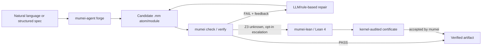
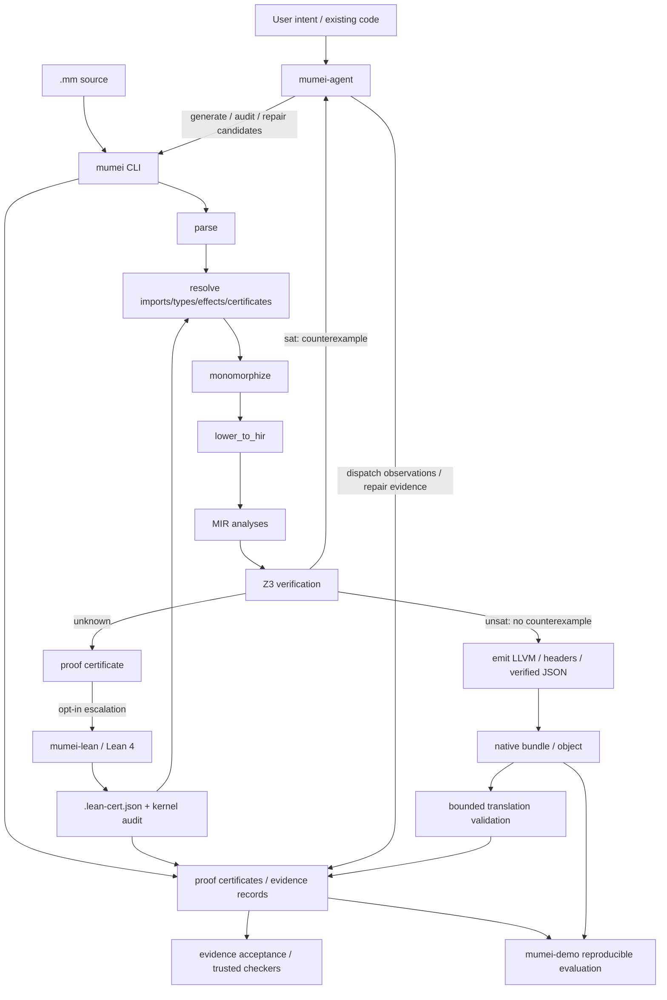
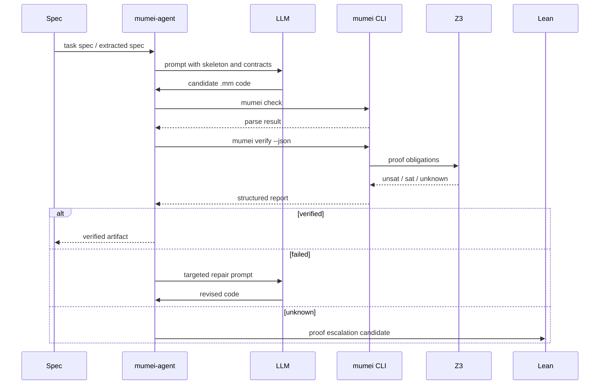
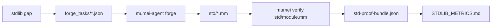

<p class="paper-nav"><a href="{{ site.url }}/">← Back to Mumei home</a></p>

> This public page mirrors the canonical academic draft maintained in [mumei-lang/papers](https://github.com/mumei-lang/papers/blob/main/PAPER_DRAFT.md). Update the canonical draft first, then synchronize this page.

# Mumei: A Verification-Native Engineering Platform for AI-Generated and Existing Software

## Abstract

**Source references:** [mumei README](https://github.com/mumei-lang/mumei/blob/develop/README.md), [verification-native architecture](https://github.com/mumei-lang/mumei/blob/develop/docs/VERIFICATION_NATIVE.md), [mumei-agent audit contract](https://github.com/mumei-lang/mumei-agent/blob/develop/docs/AUDIT_CONTRACT.md), [mumei-lean harness contract](https://github.com/mumei-lang/mumei-lean/blob/develop/docs/LEAN_HARNESS_CONTRACT.md), [mumei-demo benchmark lanes](https://github.com/mumei-lang/mumei-demo/blob/main/docs/BENCHMARKS.md).

Large language models can produce programs that look idiomatic, compile, and pass superficial examples, yet violate latent safety, temporal, financial, or regulatory constraints. Mumei addresses this gap not merely as a programming language but as a verification-native engineering platform for AI-generated and existing software. At its center is a contract-oriented language in which every function-like unit, called an *atom*, is a proof obligation. Around that core, mumei-agent extracts specifications, generates and repairs candidates, audits existing code, and orchestrates verifier adapters; mumei-lean escalates solver-hard obligations to Lean 4; and mumei-demo supplies controlled positive and negative evaluations.

The central thesis is that Mumei transforms AI-generated software from plausible code into evidence-bearing software artifacts through specification-driven formal verification. Proof backends are arranged as a hierarchy—fast SMT checking first, Lean 4 escalation where needed, and explicit evidence acceptance before a result is treated as assurance. Proof certificates, claim freshness, bounded source-to-machine translation validation, and native-object acceptance records connect verification results to the artifacts they describe, while keeping unknown, unsupported, stale, and externally self-reported results distinct from proofs.

We describe the core language, refinement types, effects, ownership and concurrency checks, algebraic laws, the autonomous generate-verify-fix loop, existing-code audit, verifier orchestration, Lean escalation, and evidence architecture. We evaluate the system along three distinct lanes rather than a single score: in the 2026-11-25 benchmark records, all 71 buggy reference ports were refuted and all 71 fixed ports proven at source-contract level; native-object acceptance for fixed variants varied across repeated runs at 39/71 and 42/71; and the no-LLM existing-code audit detected 11/171 planted defects. These results demonstrate both the strength of contract verification and the current limits of machine-level acceptance and foreign-code auditing.

## 1. Introduction

**Source references:** [mumei README](https://github.com/mumei-lang/mumei/blob/develop/README.md), [language reference](https://github.com/mumei-lang/mumei/blob/develop/docs/LANGUAGE.md), [cross-project roadmap](https://github.com/mumei-lang/mumei/blob/develop/docs/CROSS_PROJECT_ROADMAP.md), [mumei-demo scenarios](https://github.com/mumei-lang/mumei-demo/tree/main/scenarios).

Modern software development increasingly delegates first drafts of code to large language models. The resulting code is often persuasive: names are plausible, comments are fluent, control flow resembles production code, and simple unit tests may pass. The hard problem is not syntax. The hard problem is that many real failures are violations of *semantic obligations* that are not explicit in ordinary programming languages: a transition occurs before authorization, a settlement finalizes before validation, a politically exposed person is omitted from a compliance match, or a trait implementation violates an algebraic law.

Mumei starts from the opposite assumption: a generated program is not useful merely because it compiles. It is useful when its stated obligations are mathematically discharged. In Mumei, the smallest verification unit is an atom:

```mumei
atom increment(n: Nat)
    requires: n >= 0;
    ensures: result >= 1;
    body: n + 1;
```

The compiler encodes the atom body, precondition, postcondition, type refinements, effects, and call-site assumptions as solver obligations. In the normal path, Z3 discharges these obligations automatically. When Z3 returns a counterexample, Mumei reports it as structured feedback; when Z3 returns `unknown`, the obligation can be lifted into Lean 4.

The design goal is not to replace theorem provers with LLMs. It is to put LLMs into a loop where they are not the authority. The LLM proposes a program; the compiler and proof backends decide whether the encoded contract is satisfied. The same boundary applies to existing software: an agent may extract a specification or port a body, but extraction, port correctness, native behavior, and proof acceptance are separate questions.

This is the sense in which Mumei is verification-native. It does not ask users to trust a generation model, a solver's process exit, or a proof certificate in isolation. It connects generation, verification, translation, artifact identity, and re-checking through explicit contracts, while recording what each stage does not establish.

### 1.1 The "Looks Correct But Is Broken" Problem

**Source references:** [ownership-transfer demo](https://github.com/mumei-lang/mumei-demo/blob/main/scenarios/ownership_transfer/README.md), [RTGS settlement demo](https://github.com/mumei-lang/mumei-demo/blob/main/scenarios/rtgs_settlement/README.md), [RegTech compliance demo](https://github.com/mumei-lang/mumei-demo/blob/main/scenarios/regtech_compliance/README.md).

The core failure pattern is code that appears correct under casual inspection but violates an implicit safety property. In the ownership-transfer scenario, an LLM-generated `hostile_takeover` path attempts to reach `Transferred` from `Idle` without a pending transfer. The code is plausible because it manipulates the right domain vocabulary, but semantically it skips the required `propose -> accept` protocol. Mumei rejects it with a temporal-effect violation:

```text
InvalidPreState: 'accept' requires 'PendingTransfer'
but current state is 'Idle'
Counter-example: hostile_takeover(attacker=42)
```

In the RTGS settlement scenario, the code attempts to enter `Settled` directly from `Pending`, bypassing validation of sufficient funds:

```text
InvalidPreState: 'settle' requires 'Validated'
but current state is 'Pending'
Counter-example: hostile_settlement(sender_balance=0, receiver_balance=100, amount=50)
```

In the RegTech scenario, a classifier omits `CustomerType::PEP`, producing a non-exhaustive match that could allow high-risk customers to avoid compliance treatment:

```text
Match is not exhaustive: the following value is not covered by any arm:
  Counter-example: CustomerType::PEP (tag=3)
```

These are not formatting or style errors. They are semantic failures. The common form is:

$$
\text{Program appears plausible} \;\land\; \exists x.\; \text{Pre}(x) \land \neg \text{Post}(\text{Program}(x)).
$$

Mumei turns such latent failures into compile-time proof failures.

### 1.2 The Formal Methods Adoption Barrier

**Source references:** [mumei README](https://github.com/mumei-lang/mumei/blob/develop/README.md), [mumei-lean README](https://github.com/mumei-lang/mumei-lean/blob/develop/README.md), [mumei-agent README](https://github.com/mumei-lang/mumei-agent/blob/develop/README.md).

Formal methods have historically suffered from a usability mismatch. Industrial developers often need assurance properties, but the cost of adopting proof assistants, writing invariants, and maintaining proof scripts is high. In contrast, SMT-based systems such as Dafny and F* reduce proof effort by automating large decidable fragments, but they still require users to know how to express specifications and debug solver failures.

The rise of LLM-generated code changes the economics. If an autonomous agent can draft implementation candidates, read solver feedback, and repair code, then the human-facing interface can move upward: from writing proof scripts to stating intent. Mumei's approach is to combine:

1. a small, contract-oriented programming language;
2. Z3 as the default automatic verifier;
3. Lean 4 as an escalation target for obligations beyond SMT;
4. structured diagnostic artifacts designed for machine consumption;
5. an autonomous repair loop that treats failed verification as training signal for the next candidate;
6. evidence records that bind verification claims to source, semantics, transformations, artifacts, provenance, and re-check procedures.

This reframes formal-methods adoption. The user does not need to become a Z3 expert for the common case. They state constraints such as non-negativity, state transitions, conservation laws, and resource ordering; the system attempts to forge a verified artifact.

### 1.3 Mumei's Vision: The Forging Metaphor

**Source references:** [mumei-agent forge tasks](https://github.com/mumei-lang/mumei-agent/tree/develop/forge_tasks), [mumei-agent generate strategy](https://github.com/mumei-lang/mumei-agent/blob/develop/agent/strategies/generate_strategy.py), [Mumei-Forge MCP server](https://github.com/mumei-lang/mumei/blob/develop/mcp_server.py).

Mumei uses a forging metaphor: an atom is a blade, the compiler is the anvil, Z3 and Lean are the proving fire, and the agent is the blacksmith. The blacksmith does not simply write code and hope. It repeatedly heats, strikes, inspects, and repairs until the artifact satisfies its contract.



The metaphor is intentionally operational. A verified standard library can be expanded atom by atom; each new atom carries a contract, proof result, and proof certificate. Over time, the standard library becomes a cache of forged building blocks for future agents and applications.

## 2. System Architecture

**Source references:** [mumei architecture](https://github.com/mumei-lang/mumei/blob/develop/docs/ARCHITECTURE.md), [verification-native architecture](https://github.com/mumei-lang/mumei/blob/develop/docs/VERIFICATION_NATIVE.md), [mumei-agent README](https://github.com/mumei-lang/mumei-agent/blob/develop/README.md), [mumei-lean architecture](https://github.com/mumei-lang/mumei-lean/blob/develop/docs/ARCHITECTURE.md), [proof certificates](https://github.com/mumei-lang/mumei/blob/develop/docs/PROOF_CERTIFICATE.md).

Mumei is organized as an ecosystem rather than a single compiler. The four principal repositories have different trust responsibilities: the core compiler can verify and emit artifacts without the agent; the agent can orchestrate generation, audit, repair, and external verifier execution without claiming proof authority; Lean escalation consumes proof certificates rather than changing compiler semantics; and the demo repository evaluates the resulting claims against reproducible positive and negative controls.



The ownership boundary is deliberate:

| Component | Owns | Does not establish by itself |
|---|---|---|
| Mumei Core | language semantics, Z3 verification, certificates, common evidence rules, LLVM/native emission | correctness of every backend, compiler correctness, or arbitrary machine-code equivalence |
| mumei-agent | extraction, planning, budgets, adapters, execution, repair, evidence collection | proof acceptance, private proof grades, or semantic correspondence of a ported body |
| mumei-lean | Lean translation, bridge lemmas, kernel/axiom checks, escalation and opt-in dual checks | ownership of all verification or automatic source/native equivalence |
| mumei-demo | reproducible scenarios, negative controls, consumer checks, honest presentation | production suitability or guarantees stronger than the recorded evidence |

### 2.1 Mumei Core

**Source references:** [mumei architecture](https://github.com/mumei-lang/mumei/blob/develop/docs/ARCHITECTURE.md), [verification core](https://github.com/mumei-lang/mumei/blob/develop/mumei-core/src/verification/mod.rs), [parser AST](https://github.com/mumei-lang/mumei/blob/develop/mumei-core/src/parser/ast.rs), [MIR analysis](https://github.com/mumei-lang/mumei/blob/develop/mumei-core/src/mir_analysis.rs).

Mumei Core implements the language front end, semantic environment, and verification pipeline. Its current repository structure includes:

- `mumei-core`: parser, HIR, MIR, verification, resolver, manifest, registry, FFI support, emitter traits;
- `mumei-emit-llvm`: LLVM IR emitter;
- `mumei-emit-json`: verified metadata emitter;
- `mumei-emit-proofbook`: Markdown proof-book emitter;
- `mumei-emit-rust` / `mumei-emit-python`: FFI wrapper emitters;
- root `mumei` CLI: `build`, `verify`, `check`, `init`, `doc`, `infer-effects`, `infer-contracts`, and LSP support.

The verification environment tracks refined types, structs, enums, traits, implementations, resources, effects, imported atoms, proof certificates, path abstractions, and linearity state. The default compiler pipeline is:

```text
source.mm -> parse -> resolve -> monomorphize -> lower_to_hir -> verify (Z3) -> emit
```

For an atom with precondition $P$, body semantics $B$, and postcondition $Q$, verification is encoded in the standard weakest-counterexample style:

$$
P(\vec{x}) \land B(\vec{x}, r) \land \neg Q(\vec{x}, r)
$$

If the formula is unsatisfiable, no counterexample exists and the atom is verified:

$$
\operatorname{unsat}\big(P(\vec{x}) \land B(\vec{x}, r) \land \neg Q(\vec{x}, r)\big).
$$

Solver outcomes remain three-valued. `unsat` discharges the encoded obligation, `sat` supplies a counterexample, and `unknown` is neither a proof nor a refutation. This distinction is applied beyond the source verifier. In the current machine-TV checker, a solver `unknown` while proving a division no-trap obligation stays inconclusive: it is neither treated as a `division_trap` witness nor as a successful comparison. That fail-closed treatment is essential because otherwise incomplete solver behavior would silently widen the assurance claim.

### 2.2 Mumei-Agent

**Source references:** [mumei-agent README](https://github.com/mumei-lang/mumei-agent/blob/develop/README.md), [generate strategy](https://github.com/mumei-lang/mumei-agent/blob/develop/agent/strategies/generate_strategy.py), [self-healing loop](https://github.com/mumei-lang/mumei-agent/blob/develop/agent/self_healing.py), [spec extractor](https://github.com/mumei-lang/mumei-agent/blob/develop/agent/spec_extractor.py), [agent MCP server](https://github.com/mumei-lang/mumei-agent/blob/develop/docs/MCP_SERVER.md), [core MCP server](https://github.com/mumei-lang/mumei/blob/develop/docs/MCP.md).

mumei-agent is the autonomous orchestration layer. It accepts structured forge task specs, natural-language requirements, or existing source code; asks an LLM to generate or repair candidates; validates parseability with `mumei check`; verifies with `mumei verify --json`; and records machine-readable audit or repair evidence. Its generate loop is implemented as a sequence:

1. construct an atom or module skeleton from the specification;
2. generate `.mm` code;
3. run parse checks;
4. run full Z3 verification;
5. classify failures by violation type;
6. identify failing atoms;
7. build a targeted repair prompt from structured feedback;
8. retry until verification passes or the retry budget is exhausted.

This design treats formal verification as the supervising signal. The LLM has no authority to declare success; it can only propose a new candidate. The compiler returns success, counterexamples, unsat cores, or unknown obligations.

The same boundary is exposed to other agents through MCP rather than tied to one model or IDE. Mumei Core provides lower-level verification, build, diagnostic, certificate, and catalog tools; mumei-agent exposes higher-level audit, generation, extraction, and repair workflows. MCP clients can therefore compose the platform from outside, but a client conversation or model response remains input to the process—not proof evidence until the independent compiler, solver, certificate checker, or acceptance policy validates it.

### 2.3 The Verification Hierarchy: Z3 + Lean 4

**Source references:** [mumei-lean README](https://github.com/mumei-lang/mumei-lean/blob/develop/README.md), [bridge script](https://github.com/mumei-lang/mumei-lean/blob/develop/scripts/bridge.py), [expression translator](https://github.com/mumei-lang/mumei-lean/blob/develop/scripts/expr_translator.py), [certificate integration](https://github.com/mumei-lang/mumei-lean/blob/develop/docs/INTEGRATION.md).

The verification hierarchy is intentionally asymmetric. Z3 is fast, automatic, and the default. Lean 4 is more expressive and trusted for proofs that exceed the effective SMT fragment. In practice:

- Z3 handles linear arithmetic, many refinement obligations, match exhaustiveness, effect pre/post checks, resource ordering, and many quantified contracts;
- Lean handles proof obligations such as trace properties, inductive invariants, and global conservation theorems that are clearer as typed inductive proofs.

mumei-lean consumes `.proof-cert.json` or `.verified.json` artifacts, collects atoms whose Z3 result is `unknown`, emits Lean theorem files, runs `lake build`, and writes `.lean-cert.json` certificates. A successful Lean proof marks the relevant obligation as:

```json
"z3_check_result": "lean_verified"
```

The escalation is not a blanket upgrade. `lean_verified` is accepted by mumei only when both the source atom and the `lean_result_metadata` of the certificate agree with the current `translator_version` (`mumei-lean-translator-ir-v2`) and `bridge_lemma_hash`; any mismatch is reported as `stale_translator` and the atom stays unproven until the certificate is regenerated with the current bridge. The Lean side additionally audits kernel axioms and allows only `propext`, `Classical.choice`, and `Quot.sound`; audit failure blocks promotion. This makes the Lean tier reproducible rather than merely asserted: a proof produced by an older translator, an unresolved witness, or an unacceptable axiom set cannot silently keep counting as verified. The separate opt-in `--dual-check` route can re-prove an already Z3-`unsat` atom in Lean and records that result in `lean_dual_check` without changing the original proof status.

The hierarchy can be summarized as:

$$
\text{Verified}(a) ::= \text{Z3Unsat}(a) \lor \text{LeanVerified}(a) \lor \text{ReviewedTrusted}(a).
$$

The trusted case is explicit and measured, not hidden — and in the current standard library its measure is zero (§6).

### 2.4 Evidence Contracts and Acceptance Boundaries

**Source references:** [verification-native architecture](https://github.com/mumei-lang/mumei/blob/develop/docs/VERIFICATION_NATIVE.md), [verification evidence schema](https://github.com/mumei-lang/mumei/blob/develop/schema/verification-evidence.schema.json), [proof certificates](https://github.com/mumei-lang/mumei/blob/develop/docs/PROOF_CERTIFICATE.md), [Claim Book](https://github.com/mumei-lang/mumei/blob/develop/docs/CLAIMBOOK.md).

Mumei's evidence architecture separates four questions that are often collapsed into a single "verified" label:

1. **What was checked?** A source atom, extracted contract, proof model, lowered IR, native object, executable observation, or finite replay.
2. **By what method?** Deductive proof, bounded model checking, finite execution, abstract interpretation, heuristic analysis, or identity checking.
3. **Under which semantics and scope?** Integer model, semantic profile, bounds, assumptions, exclusions, target triple, and correspondence relation.
4. **Can the evidence be accepted?** Freshness, translator and bridge-lemma identity, artifact hashes, producer authenticity, and independent re-checks each impose separate gates.

The common evidence record therefore carries subject and specification identity, obligation semantics, method and result, scope and assumptions, correspondence status, provenance, and artifact paths. Representation validity is deliberately weak: a syntactically valid record may describe a counterexample, an unknown result, a timeout, or an unchecked correspondence. It is not yet proof acceptance. Likewise, a completed external process is only a dispatch observation until normalized evidence passes the appropriate checker and acceptance policy.

Proof certificates and the Claim Book provide the complementary source-level view. Certificates record per-atom solver results and metadata; the Claim Book interprets freshness, dependency drift, trusted atoms, assumed clauses, observations, controls, and effective grades. A current Z3 discharge is machine-sealed evidence, while an explicitly enabled current Lean dual-check can raise the claim to the dual-sealed grade when the consumer permits Lean-verified evidence, all without rewriting the original Z3 result.

### 2.5 Evidence-Bearing Native Artifacts

**Source references:** [verification-native execution stages](https://github.com/mumei-lang/mumei/blob/develop/docs/VERIFICATION_NATIVE.md#8-execution-and-assurance-stages-c08c10), [object acceptance design](https://github.com/mumei-lang/mumei/blob/develop/docs/DESIGN_OBJECT_ACCEPTANCE.md), [machine-TV IR model design](https://github.com/mumei-lang/mumei/blob/develop/docs/DESIGN_MACHINE_TV_IR_MODEL.md).

Source verification does not automatically imply that compiler output preserves the verified meaning. Mumei therefore treats the path from source to machine code as a separate evidence chain. Native bundles bind source, specification, dependency, certificate, LLVM IR, object, executable, toolchain, target, optimization, and build-setting identities. Hash consistency shows that the inspected artifacts are the same artifacts described by the bundle; it does not by itself prove semantic preservation or authenticate the producer.

The current translation-validation slices are intentionally bounded. LLVM translation validation covers declared numeric and control-flow profiles, and machine-TV compares lifted x86-64 object-code paths against LLVM IR models under explicit input domains, register conventions, path bounds, definedness conditions, and unsupported-feature exclusions. `native-bundle accept-object` emits an acceptance descriptor only when the reproduced object passes the required correspondence checks and every covered source atom is equivalent within the declared profile. Unknown or unchecked correspondence items make the result inconclusive rather than accepted.

A descriptor can carry an evidence fingerprint over the build ID, canonical linker arguments, emission scope, and source/LLVM/object hashes. Optional detached Ed25519 signatures bind a producer key to the exact descriptor bytes, but this byte binding still does not prove producer authority, historical execution, compiler correctness, runtime/ABI behavior, or semantic preservation outside the declared profile. The important architectural point is not that the chain is complete; it is that each accepted claim names the portion of the chain it actually covers.

## 3. Language Design

**Source references:** [language reference](https://github.com/mumei-lang/mumei/blob/develop/docs/LANGUAGE.md), [parser AST](https://github.com/mumei-lang/mumei/blob/develop/mumei-core/src/parser/ast.rs), [standard library](https://github.com/mumei-lang/mumei/tree/develop/std), [concurrency docs](https://github.com/mumei-lang/mumei/blob/develop/docs/CONCURRENCY.md).

Mumei's language design prioritizes local proof obligations and machine-checkable specifications. The surface language resembles a compact contract language with atoms, types, effects, resources, traits, loops, pattern matching, and explicit contracts.

### 3.1 Atoms and Contracts

**Source references:** [README atom example](https://github.com/mumei-lang/mumei/blob/develop/README.md), [language atom syntax](https://github.com/mumei-lang/mumei/blob/develop/docs/LANGUAGE.md#atom-syntax), [verification core](https://github.com/mumei-lang/mumei/blob/develop/mumei-core/src/verification/mod.rs).

Atoms are the unit of verification. An atom has parameters, optional return type, optional effects and resource annotations, a precondition, a postcondition, and a body.

```mumei
atom safe_div(a: i64, b: i64)
    requires: b != 0;
    ensures: result * b == a;
    body: a / b;
```

Conceptually, the compiler proves the Hoare triple:

$$
\{P\}\; B\; \{Q\}.
$$

For a deterministic expression body, this becomes:

$$
\forall \vec{x}.\; P(\vec{x}) \Rightarrow Q(\vec{x}, B(\vec{x})).
$$

Z3 typically checks the negation:

$$
\exists \vec{x}.\; P(\vec{x}) \land \neg Q(\vec{x}, B(\vec{x})).
$$

If that formula is unsatisfiable, the atom is accepted.

### 3.2 Refinement Types

**Source references:** [language refinement types](https://github.com/mumei-lang/mumei/blob/develop/docs/LANGUAGE.md#refinement-types), [std/contracts.mm](https://github.com/mumei-lang/mumei/blob/develop/std/contracts.mm), [std/core.mm](https://github.com/mumei-lang/mumei/blob/develop/std/core.mm).

A refinement type restricts a base type by a predicate. Inline, the type form is $\{v \in T \mid \varphi(v)\}$. Displayed:

$$
\{v \in T \mid \varphi(v)\}.
$$

In Mumei syntax:

```mumei
type Nat = i64 where v >= 0;
type Port = i64 where v >= 1 && v <= 65535;
type RiskScore = i64 where v >= 0 && v <= 100;
```

A parameter of refined type $R = \{v \in T \mid \varphi(v)\}$ contributes $\varphi(x)$ to the verification context. For example, if `amount: TransactionAmount` and `TransactionAmount = i64 where v >= 0`, the verification context includes:

$$
amount \ge 0.
$$

Refinement types are deliberately lightweight: they let users express common domain constraints without writing a separate proof script.

### 3.3 Effect System

**Source references:** [README effect example](https://github.com/mumei-lang/mumei/blob/develop/README.md), [capability security docs](https://github.com/mumei-lang/mumei/blob/develop/docs/CAPABILITY_SECURITY.md), [std/effects.mm](https://github.com/mumei-lang/mumei/blob/develop/std/effects.mm), [verification core effect context](https://github.com/mumei-lang/mumei/blob/develop/mumei-core/src/verification/mod.rs).

Mumei's effect system makes side effects explicit. An atom that writes files, logs, performs network IO, or triggers a domain-specific state transition must declare the corresponding effect. Undeclared effects are rejected at compile time.

```mumei
effect FileWrite;
effect Log;

atom write_log(msg: Nat)
    effects: [FileWrite, Log];
    requires: msg >= 0;
    ensures: result == msg;
    body: {
        perform FileWrite.write(msg);
        perform Log.info(msg);
        msg
    };
```

At a high level, if $E_{used}$ is the set of effects performed by the body and $E_{decl}$ is the declared set, Mumei checks:

$$
E_{used} \subseteq E_{decl}.
$$

Effect annotations also provide hooks for capability security and temporal verification.

### 3.4 Temporal Effect Verification

**Source references:** [MIR temporal effect analysis](https://github.com/mumei-lang/mumei/blob/develop/mumei-core/src/mir_analysis.rs), [std/effects.mm](https://github.com/mumei-lang/mumei/blob/develop/std/effects.mm), [std/ownership.mm](https://github.com/mumei-lang/mumei/blob/develop/std/ownership.mm), [std/settlement.mm](https://github.com/mumei-lang/mumei/blob/develop/std/settlement.mm).

Temporal effects model effects as finite state machines. A stateful effect declares states, an initial state, and transitions:

```mumei
effect Settlement
    states: [Pending, Validated, Settled];
    initial: Pending;
    transition validate: Pending -> Validated;
    transition settle: Validated -> Settled;
    transition reject: Pending -> Pending;
```

An atom can declare pre/post effect states:

```mumei
atom execute_settlement(sender_balance: i64, receiver_balance: i64, amount: i64)
    effects: [Settlement];
    effect_pre: { Settlement: Validated };
    effect_post: { Settlement: Settled };
    requires: sender_balance >= 0 && receiver_balance >= 0 && amount > 0 && sender_balance >= amount;
    ensures: result == sender_balance + receiver_balance;
    body: {
        perform Settlement.settle;
        let new_sender = sender_balance - amount;
        let new_receiver = receiver_balance + amount;
        new_sender + new_receiver
    };
```

The analysis tracks an effect-state map through MIR control flow. Each `perform e.op` is legal only if the current state matches a transition source. For the settlement example:

$$
\delta(\text{Pending}, \text{validate}) = \text{Validated}
$$

$$
\delta(\text{Validated}, \text{settle}) = \text{Settled}
$$

and the invalid transition is rejected:

$$
\delta(\text{Pending}, \text{settle}) = \bot.
$$

This is the basis of the ownership-transfer and RTGS case studies.

### 3.5 Ownership/Borrowing/Concurrency

**Source references:** [verification LinearityCtx](https://github.com/mumei-lang/mumei/blob/develop/mumei-core/src/verification/mod.rs), [MIR analysis](https://github.com/mumei-lang/mumei/blob/develop/mumei-core/src/mir_analysis.rs), [concurrency docs](https://github.com/mumei-lang/mumei/blob/develop/docs/CONCURRENCY.md), [std/settlement resources](https://github.com/mumei-lang/mumei/blob/develop/std/settlement.mm).

Mumei includes ownership and linearity checks to prevent use-after-move, double move, conflicting merge, and borrow-related misuse. The current architecture uses MIR analyses as the primary path and retains `LinearityCtx` as a secondary Z3-integrated check for call-site borrow tracking and symbolic execution.

Concurrency safety is expressed through resource declarations and acquisition order. In the RTGS module:

```mumei
resource ledger priority: 1 mode: exclusive;
resource queue  priority: 2 mode: exclusive;
```

The intended deadlock-prevention condition is that resources are acquired in priority order. For acquisitions $r_i$ followed by $r_j$:

$$
priority(r_i) \le priority(r_j).
$$

The `full_settlement` atom acquires `ledger` before `queue`, satisfying the hierarchy. This style makes concurrency constraints explicit and verifiable rather than relying on convention.

### 3.6 Algebraic Trait Laws

**Source references:** [README trait law example](https://github.com/mumei-lang/mumei/blob/develop/README.md), [language trait laws](https://github.com/mumei-lang/mumei/blob/develop/docs/LANGUAGE.md#trait-definitions-with-laws), [verification law expansion](https://github.com/mumei-lang/mumei/blob/develop/mumei-core/src/verification/mod.rs).

Traits can carry algebraic laws. For example:

```mumei
trait Comparable {
    fn leq(a: Self, b: Self) -> bool;
    law reflexive: leq(x, x) == true;
    law transitive: leq(a, b) && leq(b, c) => leq(a, c);
}

impl Comparable for i64 {
    fn leq(a: i64, b: i64) -> bool { a <= b }
}
```

Mumei checks each implementation against the declared trait laws. The transitivity obligation has the form:

$$
\forall a,b,c.\; (leq(a,b) \land leq(b,c)) \Rightarrow leq(a,c).
$$

This mechanism prevents a common abstraction bug: an interface that compiles structurally while violating the algebraic assumptions required by generic clients.

## 4. Autonomous Proof Loop

**Source references:** [mumei-agent README](https://github.com/mumei-lang/mumei-agent/blob/develop/README.md), [generate strategy](https://github.com/mumei-lang/mumei-agent/blob/develop/agent/strategies/generate_strategy.py), [prompts](https://github.com/mumei-lang/mumei-agent/tree/develop/agent/prompts), [mumei diagnostics](https://github.com/mumei-lang/mumei/blob/develop/docs/DIAGNOSTICS.md).

The autonomous proof loop is the mechanism that turns formal verification from a terminal failure into an iterative repair signal.

### 4.1 Generate→Verify→Fix Cycle

**Source references:** [generate strategy](https://github.com/mumei-lang/mumei-agent/blob/develop/agent/strategies/generate_strategy.py), [agent generate CLI](https://github.com/mumei-lang/mumei-agent/blob/develop/agent/generate.py), [mumei client](https://github.com/mumei-lang/mumei-agent/blob/develop/agent/mumei_client.py).

The generate-verify-fix cycle is:



The loop can be expressed as a partial function over candidates:

$$
C_{i+1} = \operatorname{Repair}(C_i, \operatorname{Verify}(C_i)).
$$

The fixed point is not semantic self-confidence by the LLM. It is a candidate $C_k$ such that:

$$
\operatorname{Verify}(C_k) = \text{pass}.
$$

### 4.2 Structured Feedback

**Source references:** [verification diagnostics](https://github.com/mumei-lang/mumei/blob/develop/mumei-core/src/verification/mod.rs), [report schema](https://github.com/mumei-lang/mumei/blob/develop/docs/REPORT_SCHEMA.md), [report formatter](https://github.com/mumei-lang/mumei-agent/blob/develop/agent/prompts/report_formatter.py), [counterexample visualizer](https://github.com/mumei-lang/mumei-agent/tree/develop/visualizer).

Structured feedback is the key interface between the verifier and the repair agent. Mumei's error detail includes messages, spans, suggestions, and counterexamples. Reports can include violation type, failing atom, counterexample, and structured unsat core. A simplified report shape is:

```json
{
  "success": false,
  "failure_type": "postcondition",
  "atom": "safe_div",
  "counterexample": { "a": 1, "b": 0 },
  "structured_unsat_core": [
    { "label": "requires", "expr": "true" },
    { "label": "safety", "expr": "b != 0" }
  ],
  "suggestion": "Add a precondition excluding zero divisors."
}
```

For a failed postcondition, the useful solver object is often a model:

$$
M \models P(\vec{x}) \land B(\vec{x}, r) \land \neg Q(\vec{x}, r).
$$

For invariant failures, the useful object is a conflicting set of labeled assumptions, i.e. an unsat core:

$$
\operatorname{core} \subseteq \{a_1, \ldots, a_n\}
$$

such that:

$$
\operatorname{unsat}\left(\bigwedge_{a \in \operatorname{core}} a\right).
$$

Structured feedback lets the agent repair the specification or implementation directly instead of guessing from raw solver logs.

### 4.3 Lean 4 Escalation

**Source references:** [mumei-lean README](https://github.com/mumei-lang/mumei-lean/blob/develop/README.md), [ingest certificate script](https://github.com/mumei-lang/mumei-lean/blob/develop/scripts/ingest_cert.py), [export certificate script](https://github.com/mumei-lang/mumei-lean/blob/develop/scripts/export_cert.py), [Lean tactics](https://github.com/mumei-lang/mumei-lean/blob/develop/MumeiLean/Tactics.lean).

Lean escalation is triggered when a property is desirable but not naturally discharged by Z3. mumei-lean scans certificates, collects `unknown` atoms, translates contract expressions to Lean propositions where possible, and emits theorem stubs. Successful proofs are exported back to Mumei as `.lean-cert.json`.

A hand-written bridge lemma is not required for every obligation. Obligations that no lemma template covers are handed to a deterministic automatic tactic search (`scripts/tactic_search.py`), which probes a fixed ordered ladder of seventeen candidates — `omega`, `linarith`, `nlinarith`, `positivity`, `norm_num`, `ring`, `field_simp`, `decide`, `simp_arith`, `mumei_field`, `mumei_ff_mod`, `aesop`, `tauto`, `mumei_list`, `mumei_order`, `mumei_induct`, `mumei_ff_pow` — spanning arithmetic, modular and field goals in the head and propositional, list, order, inductive and modular-exponentiation goals in the widened tail. Widening is by appending at the tail only, so at the declared order a new stage can only reach goals the previous ladder exhausted; the learned ranking below may later permute the appended stage forward, in which case which tactic discharges a goal can change but its provability cannot, since every adoption is still gated on a real `lake build`. The first candidate whose probe compile closes the goal is adopted, under a per-obligation wall-clock budget; when none does, the obligation is left exactly as it was and reported as exhausted rather than downgraded. Candidate *order* is learned from a pinned history artifact (`data/tactic_search_history.json`), which records only adoptions that subsequently survived a real `lake build`; the learned order is a deterministic permutation of the declared ladder, never an extension or a randomisation of it. Because the search emits only tactics, neither `translator_version` nor `bridge_lemma_hash` changes when the ladder is exercised or widened.

The bridge currently ships twenty live generated theorem paths. The first fourteen cover saturating arithmetic, bounded multiplication, constant-time equality, finite-field zero and algebra, insertion sort, polynomial bounds, quantifier alternation, induction, RTGS conservation, guard collapse, and modular exponentiation. The newer six widen body-semantics lowering rather than merely adding tactics: `perform` statement sequences (`cei_compliant_withdraw` / `guarded_state_update`), `let` sequences (`move_once` / `read_before_move`), nested conditionals (`clamp_to_range`), struct projection (`take_point`), and structured-concurrency `task_group:all` / `task_group:any` paths (`join_all_last_result` and `race_two_replicas`). The `task_group:all` path adds three concurrency bridge lemmas and therefore changes `bridge_lemma_hash` in lockstep across the pinned contract; `task_group:any` reuses that catalog. These are twenty concrete live paths, not a claim that arbitrary Lean theorems are generated automatically.

The escalation rule can be written:

$$
\operatorname{Verify}_{Z3}(a) = \text{unknown} \land \operatorname{Verify}_{Lean}(a) = \text{checked}
\land \operatorname{TranslatorCurrent}(a) \land \operatorname{BridgeHashCurrent}(a)
\land \operatorname{AxiomAuditPass}(a)
\Rightarrow \operatorname{Verified}(a).
$$

Lean is not used to mask ordinary SMT failures. If Z3 finds a concrete counterexample, the candidate is wrong. Lean is reserved for obligations where SMT cannot decide, such as inductive trace properties.

### 4.4 No-.mm Audit and Gradual Migration

**Source references:** [mumei-agent audit contract](https://github.com/mumei-lang/mumei-agent/blob/develop/docs/AUDIT_CONTRACT.md), [mumei onboarding](https://github.com/mumei-lang/mumei/blob/develop/docs/ONBOARDING.md), [MCP server](https://github.com/mumei-lang/mumei-agent/blob/develop/docs/MCP_SERVER.md).

Mumei's adoption path does not begin by requiring every user to rewrite a system in `.mm`. The no-`.mm` front door accepts existing Python, Rust, TypeScript, Go, or Solidity code. Its full migration route has three stages, but plain `audit` performs only the first one:

1. `audit` extracts candidate specifications and classifies findings;
2. `migrate-suggest` (or `audit --auto-migrate`) produces `.mm` contract and implementation skeletons only for findings that need migration;
3. `heal` (or `audit --auto-heal`) attempts verification-guided repair of those generated skeletons.

The combined CLI example is therefore `audit --auto-migrate --auto-heal`, while MCP `scan_and_fix` exposes the same three-stage contract.

The audit output is intentionally machine-readable. Stable keys include `spec_health_issues`, `verification_violations`, `verification_status`, `cross_validation_gaps`, `next_steps`, `migration_hints`, `healed_files`, `heal_errors`, and `trusted_atoms`. This lets CI, MCP clients, and agents consume the result without scraping a natural-language report.

The assurance boundary is narrower than "the original program is formally verified." By default, extracted contracts are checked against trusted atoms with empty bodies; this validates contract consistency and some code/specification relationships but does not prove the foreign function body. The opt-in `--enable-body-port` route asks an LLM to translate a supported body into Mumei and verifies that port. A proven or refuted port is evidence about the translation, not automatic evidence about the original implementation. The separate `--enable-native-replay` route executes supported native functions on counterexample and boundary inputs; it can confirm or fail to reproduce a port counterexample, but remains a finite behavioral observation. This distinction is central to the evaluation in §7.

### 4.5 Replaceable Verifier Orchestration

**Source references:** [mumei-agent roadmap](https://github.com/mumei-lang/mumei-agent/blob/develop/docs/ROADMAP.md), [external verifier pilot](https://github.com/mumei-lang/mumei-agent/blob/develop/docs/EXTERNAL_VERIFIER_PILOT.md), [verification-native planner contract](https://github.com/mumei-lang/mumei/blob/develop/docs/VERIFICATION_NATIVE.md#6-replaceable-planner-and-verifier-plugins-c04c11).

The agent also implements the first verification-native planner and verifier-plugin contract. Adapters can be registered, selected, configured, disabled, and replaced declaratively. Plans expose capability and compatibility decisions, effective non-secret settings, budgets, permission requirements, fallback provenance, and per-candidate exclusion reasons. Execution is host-controlled and permission-gated. Missing tools, version mismatches, invalid settings, timeouts, malformed outputs, unavailable explicit selections, and denied fallback fail closed with reasons. Dispatch selection is still weaker than evidence acceptance: incomplete output may carry a host-declared exit-code `selected` dispatch outcome, but it fails before Core I/O and cannot become evidence acceptance or grade promotion.

The completion of this orchestration contract is not the adoption of a new solver. Adapter self-reports remain dispatch observations, while evidence meaning, acceptance, and grade promotion stay with Mumei Core and the relevant trusted checker. The current Z3 CLI pilot is deliberately non-promotable and narrower than an end-to-end execution proof: its regression fixture verifies that an undeclared source-input contract is rejected before dispatch, and does not yet claim argv execution, stdin feeding, timeout enforcement, exit-code selection, or marker normalization. Because Mumei Core already uses Z3, it would in any case be weak as independent semantic evidence. Future backends such as Kani, SAW/Crucible, Viper, TLA+, Frama-C, Prusti, or additional SMT solvers are candidate evaluation directions, not an automatic integration sequence. Purpose-driven dual checks or comparisons require explicit policy, budget, matching semantics, and disagreement handling; installing multiple plugins never implies running all of them in parallel by default.

## 5. Case Studies

**Source references:** [mumei-demo scenarios](https://github.com/mumei-lang/mumei-demo/tree/main/scenarios), [std/ownership.mm](https://github.com/mumei-lang/mumei/blob/develop/std/ownership.mm), [std/settlement.mm](https://github.com/mumei-lang/mumei/blob/develop/std/settlement.mm), [std/compliance.mm](https://github.com/mumei-lang/mumei/blob/develop/std/compliance.mm).

The case studies demonstrate three classes of semantic properties: temporal authorization, financial conservation, and regulatory exhaustiveness.

### 5.1 Ownership Transfer

**Source references:** [ownership demo README](https://github.com/mumei-lang/mumei-demo/blob/main/scenarios/ownership_transfer/README.md), [std/ownership.mm](https://github.com/mumei-lang/mumei/blob/develop/std/ownership.mm), [Ownership.lean](https://github.com/mumei-lang/mumei-lean/blob/develop/MumeiLean/Ownership.lean).

The ownership-transfer protocol has three states:

```mumei
effect Ownership
    states: [Idle, PendingTransfer, Transferred];
    initial: Idle;
    transition propose: Idle -> PendingTransfer;
    transition accept: PendingTransfer -> Transferred;
    transition cancel: PendingTransfer -> Idle;
```

The intended property is that ownership cannot reach `Transferred` without an `accept` after a pending transfer. In Lean, this is modeled as a trace theorem:

$$
\forall ops.\; accept \notin ops \Rightarrow run(Idle, ops) \ne Transferred.
$$

Operationally, Mumei rejects direct hostile transfer because:

$$
\delta(Idle, accept) = \bot.
$$

The verified implementation composes `propose_transfer` and `accept_transfer`, while `propose_and_cancel` returns to `Idle`. Z3 verifies local effect contracts; Lean certifies the global trace property `no_transfer_without_accept`.

### 5.2 RTGS Settlement

**Source references:** [RTGS demo README](https://github.com/mumei-lang/mumei-demo/blob/main/scenarios/rtgs_settlement/README.md), [std/settlement.mm](https://github.com/mumei-lang/mumei/blob/develop/std/settlement.mm), [Settlement.lean](https://github.com/mumei-lang/mumei-lean/blob/develop/MumeiLean/Settlement.lean), [settlement tests](https://github.com/mumei-lang/mumei/blob/develop/tests/test_settlement.mm).

The RTGS settlement protocol requires `Pending -> Validated -> Settled`. It combines temporal effects, resource hierarchy, loop invariants, decreases clauses, and quantified balance constraints.

A basic conservation obligation for a single transfer is:

$$
(sender - amount) + (receiver + amount) = sender + receiver.
$$

The global invariant can be stated as:

$$
\forall t.\; withdrawn(t) \le allocated(t).
$$

The implemented settlement proof focuses on two properties:

1. no settlement without validation;
2. global balance sum conservation across transfer traces.

The local Z3 obligation for `execute_settlement` is:

$$
 sender \ge 0 \land receiver \ge 0 \land amount > 0 \land sender \ge amount
 \Rightarrow
 (sender - amount) + (receiver + amount) = sender + receiver.
$$

The Lean theorem captures trace-level conservation:

$$
\forall initial, final.\; TransferTrace(initial, final) \Rightarrow sum(final) = sum(initial).
$$

This case study shows why the hierarchy matters: arithmetic conservation is easy for Z3 locally, while trace induction is clearer in Lean.

### 5.3 RegTech Compliance

**Source references:** [RegTech demo README](https://github.com/mumei-lang/mumei-demo/blob/main/scenarios/regtech_compliance/README.md), [std/compliance.mm](https://github.com/mumei-lang/mumei/blob/develop/std/compliance.mm), [RegTech scenario JSON](https://github.com/mumei-lang/mumei-demo/blob/main/scenarios/regtech_compliance/scenario.json).

The RegTech compliance scenario checks that all customer categories are handled and that transaction limits follow risk classifications. The key bug is an omitted `PEP` case. Mumei rejects the non-exhaustive match with a concrete counterexample:

$$
customer\_type = PEP.
$$

The correct implementation defines customer classes and risk levels, then verifies constraints such as:

$$
\forall i \in [0,n).\; 0 \le arr[i] \land arr[i] \le limit.
$$

In Mumei contract syntax:

```mumei
requires: n >= 0 && limit > 0 && forall(i, 0, n, arr[i] >= 0 && arr[i] <= limit);
ensures: result == 1;
```

This is a two-layer case study: Z3 is sufficient for match exhaustiveness and quantified range constraints, so Lean escalation is unnecessary.

## 6. Autonomous Standard Library Expansion (SI-5)

**Source references:** [stdlib metrics](https://github.com/mumei-lang/mumei/blob/develop/docs/STDLIB_METRICS.md), [forge tasks](https://github.com/mumei-lang/mumei-agent/tree/develop/forge_tasks), [forge task README](https://github.com/mumei-lang/mumei-agent/blob/develop/forge_tasks/README.md), [proof bundle workflow](https://github.com/mumei-lang/mumei/blob/develop/.github/workflows/generate-std-certs.yml).

SI-5 is the autonomous proliferation track for expanding the verified standard library. Each forge task describes a target module, atom set, contracts, effects, and expected verification properties. mumei-agent generates and verifies the implementation, and successful modules become part of the standard library and proof bundle.

The current generated metrics report:

- Modules: 59 (59 OK / 0 FAIL / 0 SKIP);
- Atoms total: 356;
- Proven atoms: 356;
- Reviewed trusted atoms: 0;
- TODO/FIXME/XXX/HACK markers: 0;
- Weighted health score: 1.000.

The health score is defined in the metrics document as:

$$
Health = \frac{proven + 0.8 \times trusted}{atoms} - TODO\_penalty.
$$

Failing verification halves the score. The health-score definition is unchanged; what changed is the trust surface it measures. Earlier metrics carried 48 reviewed trusted atoms across 24 modules, weighted at 0.8 each so that no trusted atom could be mistaken for a proven one. Making that surface explicit and measurable is what made it reducible: SI-5 forging, contract strengthening on FFI-heavy modules, and Lean escalation for solver-hard obligations retired every one of them, so `std/` now reports zero trusted atoms and the trusted term of the numerator vanishes. The score of 1.000 is therefore a statement about `std/` specifically — every standard-library atom discharges through Z3 or Lean, and no module relies on reviewer judgement. Recent SI-5 modules include verified containers, math utilities, finite-field algebra, ownership, settlement, and compliance.



SI-5 is important because it makes verification cumulative. Each newly verified atom becomes a reusable lemma-like software component for future generated programs.

## 7. Evaluation and Related Work

**Source references:** [evaluation suite](https://github.com/mumei-lang/mumei/blob/develop/benchmarks/evaluation_suite.py), [evaluation results](https://github.com/mumei-lang/mumei/blob/develop/docs/EVALUATION_SUITE.md), [measurement artifact](https://github.com/mumei-lang/mumei/blob/develop/benchmarks/evaluation/evaluation_suite.json), [mumei-agent benchmark history](https://github.com/mumei-lang/mumei-agent/blob/develop/docs/BENCHMARK_HISTORY.md), [mumei-demo benchmark lanes](https://github.com/mumei-lang/mumei-demo/blob/main/docs/BENCHMARKS.md), [port-divergence replay](https://github.com/mumei-lang/mumei-demo/blob/main/proofs/PORT_DIVERGENCE.md), [mumei-lean harness contract](https://github.com/mumei-lang/mumei-lean/blob/develop/docs/LEAN_HARNESS_CONTRACT.md).

Mumei is evaluated along six dimensions:

1. **expected-outcome match:** proportion of benchmark tasks whose verification result matches the declared expected outcome;
2. **repair convergence:** number of generate-verify-fix iterations before success;
3. **counterexample detection:** proportion of tasks designed to fail verification whose verification result is the expected rejection; refutation certificates are counted separately under runtime artifact utility;
4. **trust surface:** ratio of trusted to proven atoms;
5. **user burden:** amount of formal syntax required from the user;
6. **runtime artifact utility:** ability to emit LLVM IR, C headers, verified JSON, and proof bundles.

The standard-library metrics of §6 provide one snapshot of proof health; the six axes above are measured separately over a controlled task set of 46 programs (105 atoms) spanning arithmetic, state machines, concurrency, domain-specific compliance, Dafny-style puzzles, and SV-COMP-style tasks. A single suite run measures and aggregates all six deterministically and writes a JSON measurement artifact plus a time-series Markdown summary. Twenty of the tasks are counterexample tasks — programs that are *supposed* to fail verification — so success is measured against a declared expected outcome rather than against "verification passed".

| Axis | Status | Result |
|---|---|---|
| expected-outcome match | measured | 100.00% (46/46 tasks matched their declared outcome; task-level, and Z3-only in this run — 6 atoms carry obligations left as Lean escalation candidates) |
| repair convergence | measured | 41.67% (10/24 atoms converged over the 20 counterexample tasks; 1.33 repair attempts per atom on average, 53,078 LLM tokens, at most 3 retries per atom; local `qwen2.5-coder:3b` via an OpenAI-compatible endpoint) |
| counterexample detection | measured | 100.00% (20/20 counterexample tasks rejected) |
| trust surface | measured | 0 trusted of 105 atoms, 0 FFI boundary declarations, 6 atoms escalating past Z3; 6/6 `lean_verified` with the AI proof path off and 6/6 with it on (delta 0, `ai_proof_used` 0, no `manual_lemma_reason` remaining) |
| user burden | measured | 2.47 contract clauses per atom; 1.89 specification tokens per implementation token |
| runtime artifact utility | measured | 93.27% (97/104 artifact emissions for tasks expected to verify); 80/80 emissions as expected for the 20 counterexample tasks (20/20 refutation certificates, 0 leaked build artifacts) |

Two properties of the measurement matter more than the individual numbers. First, an axis whose input is absent reports `SKIP` rather than a substituted value: repair convergence aggregates the `self_correction_summary` block (convergence rate, average repair attempts, token cost) that only mumei-agent's self-correction loop writes into a proof certificate, so a run over locally verified tasks reports `SKIP` for that axis instead of an optimistic zero. The measured value above comes from feeding the certificates of a real `heal` run over the 20 counterexample tasks back into the suite, and the artifact records which model produced them (`agent_runs`), so the number is a property of one model and one retry budget rather than of the language. Second, the static measurements — user burden, and the trusted-atom and FFI-boundary counts of the trust surface — never invoke the solver, so they remain reproducible on a machine that cannot build the compiler; the escalation count of the trust surface is read out of verifier output and reports `SKIP` there rather than zero.

User burden is read two ways from the same source: how many `requires` / `ensures` / `invariant` / `effect_pre` / `effect_post` clauses a task forces its author to write, and how much formal text buys one token of executable code. The ratio varies sharply by domain — 0.89 for concurrency, where the effect and ownership rules carry obligations the author never spells out, against 3.54 for arithmetic, where the contract *is* the program's content. That spread is the honest form of the adoption-barrier question of §1.2: the cost of specification is not a language constant but a property of what is being specified.

The seven missing artifact emissions are also informative. Two tasks (`finite_field_modular`, `modular_commitment`) pass `mumei verify` with their finite-field obligations recorded as Lean escalation candidates, but the build-time verification gate refuses to lower an atom whose obligation Z3 returned `unknown` for, so they produce a proof certificate and no code; one task fails LLVM lowering with an aggregate-extract error while matching over an enum. Artifact utility is therefore not a restatement of proof success: an atom can be proven and still not be emittable, and the suite reports that gap per task and per target rather than folding it into the proof numbers.

### Three Benchmark Lanes

**Source references:** [mumei-demo benchmark lanes](https://github.com/mumei-lang/mumei-demo/blob/eed22e1a6a86e4a2d73aab6cf67c58874cc9e046/docs/BENCHMARKS.md), [contract benchmark report](https://github.com/mumei-lang/mumei-demo/blob/eed22e1a6a86e4a2d73aab6cf67c58874cc9e046/proofs/RESULTS.md), [specimen audit summary](https://github.com/mumei-lang/mumei-demo/blob/eed22e1a6a86e4a2d73aab6cf67c58874cc9e046/specimens/AUDIT_SUMMARY.md).

The controlled suite above measures compiler and repair behavior on benchmark tasks. End-to-end assurance needs a separate evaluation because proving a source contract, accepting a native object, and finding a defect without a supplied contract are different capabilities. The November 2026 demo benchmark therefore keeps three lanes separate and defines no aggregate score. Its measurement revisions are also distinct from the implementation-status snapshots in §8: Lanes A and B used Core [`a0fc10fd`](https://github.com/mumei-lang/mumei/commit/a0fc10fdefb3ba572336ce7be435c56998adac12), while Lane C additionally used Agent [`569f478f`](https://github.com/mumei-lang/mumei-agent/commit/569f478fe5b35f13809338c2071680e17cbe36b3).

| Lane | What it measures | Latest recorded result | Measurement revision |
|---|---|---|---|
| A — source-contract verification | Whether buggy reference `.mm` ports are refuted, fixed ports are proven, and vacuity controls are rejected | 71/71 buggy refuted; 71/71 fixed proven; 71/71 vacuity controls rejected (2026-11-25) | Core `a0fc10fd` |
| B — source-to-machine translation validation | Whether a fresh native bundle can be accepted under the bounded machine-TV/object-correspondence profile | 71/71 buggy variants stopped at fresh source verification in both repeated runs; fixed variants accepted at 39/71 and then 42/71, with 11/142 and then 12/142 outcomes outside profile (all fixed) | Core `a0fc10fd` |
| C — existing-code audit | Whether planted defects are found in existing Python, Rust, TypeScript, Go, and Solidity specimens without a supplied `.mm` contract | 11/171 defects detected (6.4%) in the no-LLM rerun; 9/16 fixed specimens still had at least one false alarm (28 alarms) | Core `a0fc10fd`; Agent `569f478f` |

Lane B must not be read as machine-TV detecting all 71 bugs: every buggy variant was rejected before machine-TV ran. The fixed-side results are more informative about the current boundary. An earlier 2026-11-24 run accepted 43/71 fixed variants; two complete runs at the 2026-11-25 Core revision accepted 39/71 and then 42/71. Both repeated runs had ten fixed source-recheck rejections and no LLVM/object mismatches, environment errors, or per-command timeouts, while inconclusive results fell from eleven to seven. Because the first run overlapped other CPU-heavy work and the same tool revision produced different verdicts, the drop is evidence about reproducibility and sensitivity, not by itself proof of a machine-TV semantics regression. Unsupported and inconclusive outcomes are reported separately rather than counted as successful rejection or acceptance.

Lane C is intentionally conservative. A detection requires agreement on file, function, and defect category, and the false-alarm measure is the share of fixed specimens with at least one finding scored as a false alarm. The comparable LLM audit was not remeasured in the latest run because the original hosted model was unavailable; it therefore cannot be quoted as a current improvement. These results show that the existing-code front door is useful infrastructure but remains an active research problem rather than a mature automatic auditor.

### Port Divergence: Proof of a Port Is Not Proof of Correspondence

**Source references:** [port-divergence replay](https://github.com/mumei-lang/mumei-demo/blob/main/proofs/PORT_DIVERGENCE.md), [run_port_divergence.py](https://github.com/mumei-lang/mumei-demo/blob/main/scripts/run_port_divergence.py).

The most important negative result concerns LLM body ports. In three recorded `openai/gpt-6-luna` runs, a buggy LLM port was accepted 26 times across 12 distinct cases even though the corresponding reference port was refuted on the same concrete replay input. Replay classified the primary semantic changes as follows:

| Primary mechanism in accepted LLM port | Count among 26 case-runs |
|---|---:|
| guard condition added | 18 |
| original operation removed | 3 |
| success convention changed | 3 |
| fallback added | 1 |
| self-call substituted | 1 |

This is not a claim that Mumei's source verifier is unsound. It is evidence that an LLM can make a translated body satisfy a contract by changing the behavior being translated. Consequently, two obligations must remain separate:

$$
\operatorname{VerifiedPort}(p)
\quad\text{and}\quad
\operatorname{Corresponds}(p, original).
$$

The replay is deliberately weaker than an equivalence proof: it uses concrete solver and hand-picked witnesses, records unsupported and inconclusive outcomes separately, and treats lint findings as syntactic clues rather than proof of a silent repair. Its research value is that it measures a failure mode that ordinary benchmark success rates hide: verification of an AI-generated artifact can be genuine while correspondence to the legacy artifact remains unproven.

### Composability at Scale

**Source references:** [scale composability artifact](https://github.com/mumei-lang/mumei/blob/develop/benchmarks/composability/scale_composability.json), [scale trust-surface artifact](https://github.com/mumei-lang/mumei/blob/develop/benchmarks/composability/scale_trust_surface.json), [benchmark results](https://github.com/mumei-lang/mumei/blob/develop/docs/BENCHMARK_RESULTS.md#scale-composability-run--2026-08-28-priority-16), [stdlib metrics](https://github.com/mumei-lang/mumei/blob/develop/docs/STDLIB_METRICS.md), [mumei-demo scale scenarios](https://github.com/mumei-lang/mumei-demo/tree/main/scenarios).

The controlled task set above says nothing about what happens when a program grows: the question the atom-local design has to answer is whether whole-system safety still follows from per-atom `requires` / `ensures` / `effect_pre` / `effect_post` once atom counts and dependency depth rise by an order of magnitude. That was measured separately on 2026-08-28 over five large safety-critical and compliance-heavy scenarios — multi-stage insulin pump control, RTGS settlement, RegTech rule combination, DeFi vault invariants, and ownership transfer — totalling 172 atoms at dependency depth 5–7, each driven by an eight-state effect machine, all under `budget_policy_fingerprint: sha256:scale-default`.

Composability is measured by clause ablation: each of the 1,014 contract clauses is removed in turn and the case re-verified. A clause is *atom-local* when only its owning atom then fails, and a *composition break* when a neighbouring atom fails too — the neighbour could not close its own proof unless that contract were stronger than its owner needs locally. Across the five cases, 271 clauses are atom-local, 277 are composition breaks, and 466 are slack that no obligation depends on, giving an `atom_local_closure_ratio` of 0.4945. The headline result is on the whole-system level rather than the clause level: all 16 whole-system invariants close from declared atom contracts alone, with no auxiliary global lemma, and 9 of them stop closing if a neighbouring atom's contract is weakened.

The 277 breaks are classified by the compiler surface that would have to change for the obligation to become purely local:

| Break pattern | Count | Compiler surface |
|---|---:|---|
| `call_site_precondition` | 86 | call-site `requires` propagation |
| `counterexample_replay_mismatch` | 86 | Z3 translation / Lean escalation path |
| `effect_state_obligation` | 58 | `effect_pre` / `effect_post` state chaining |
| `neighbor_ensures_strengthening` | 47 | value contracts (`ensures`) of called atoms |

Scale did not buy proof coverage by widening the trust surface. All 172 atoms carry a proof certificate and `mumei verify-cert --strict` passes on 5 of 5 cases with 0 changed, 0 unproven, and 0 missing; application trusted atoms, FFI boundary declarations, and atoms escalating from a Z3 `unknown` to Lean are all 0; `std/` trusted atoms stay at 0 of the 344 atoms pinned in that run; and Z3 solver time is 9.77s over the five cases, the largest being 2.391s for the 34-atom pump case. The breaks are reported through the existing `verification_status` / `verification_violations` / `next_steps` keys and the proof certificate — the classification above is an input to modular verification in the compiler, not a new verdict.

### Comparison with Cedar

**Source references:** [Cedar Policy Language](https://www.cedarpolicy.com/), [mumei README](https://github.com/mumei-lang/mumei/blob/develop/README.md), [capability security docs](https://github.com/mumei-lang/mumei/blob/develop/docs/CAPABILITY_SECURITY.md).

Cedar is a policy language and authorization engine designed for analyzable access-control policies. Like Mumei, it emphasizes decidable reasoning over domain constraints. The difference is scope: Cedar focuses on authorization policies, while Mumei is a verification-native engineering platform built around atoms, effects, resources, code generation, and evidence acceptance. Cedar asks whether a request is authorized under a policy; Mumei asks whether a program satisfies its contracts and can be safely emitted with explicit evidence boundaries.

### Comparison with Lean 4 and Coq

**Source references:** [mumei-lean README](https://github.com/mumei-lang/mumei-lean/blob/develop/README.md), [Lean 4](https://lean-lang.org/), [Coq](https://coq.inria.fr/).

Lean 4 and Coq are expressive proof assistants with small trusted kernels and rich dependent type theories. They can express the deepest properties in this paper, including trace induction and algebraic invariants. Mumei is not a replacement for them. Instead, it uses Lean 4 as an escalation backend. The intended workflow is SMT-first automation with Lean for proof obligations that need induction, libraries, or human-readable theorem structure.

In formula form:

$$
\text{Mumei} = \text{Programming surface} + \text{SMT automation} + \text{Lean escalation} + \text{agent orchestration} + \text{evidence-bearing artifacts}.
$$

### Comparison with Dafny and F*

**Source references:** [Dafny](https://dafny.org/), [F*](https://www.fstar-lang.org/), [mumei language reference](https://github.com/mumei-lang/mumei/blob/develop/docs/LANGUAGE.md).

Dafny and F* are the closest relatives: both combine programming with specifications and SMT-backed verification. Mumei differs in four emphases:

1. atoms as the core compilation and proof unit;
2. structured feedback designed for autonomous repair loops;
3. explicit integration with AI agents, existing-code audit, and proof-certificate distribution;
4. evidence records that distinguish source, model, transformation, artifact, provenance, and acceptance boundaries.

Mumei is less mature than Dafny or F* as a verification ecosystem, but it is optimized for a different question: how can AI-generated or existing code be forced through explicit proof, correspondence, and evidence-acceptance loops before becoming a deployable artifact?

## 8. Implementation Status

**Source references:** [mumei README](https://github.com/mumei-lang/mumei/blob/develop/README.md), [verification-native architecture](https://github.com/mumei-lang/mumei/blob/develop/docs/VERIFICATION_NATIVE.md), [mumei-agent audit contract](https://github.com/mumei-lang/mumei-agent/blob/develop/docs/AUDIT_CONTRACT.md), [mumei-agent roadmap](https://github.com/mumei-lang/mumei-agent/blob/develop/docs/ROADMAP.md), [mumei-lean harness contract](https://github.com/mumei-lang/mumei-lean/blob/develop/docs/LEAN_HARNESS_CONTRACT.md), [stdlib metrics](https://github.com/mumei-lang/mumei/blob/develop/docs/STDLIB_METRICS.md), [mumei-demo benchmark lanes](https://github.com/mumei-lang/mumei-demo/blob/main/docs/BENCHMARKS.md).

This revision reflects the repository heads current on 2026-11-26:

| Repository | Branch | HEAD |
|---|---|---|
| `mumei-lang/mumei` | `develop` | `88115f96` |
| `mumei-lang/mumei-agent` | `develop` | `b479c62f` |
| `mumei-lang/mumei-lean` | `develop` | `5005d36` |
| `mumei-lang/mumei-demo` | `main` | `eed22e1a` |

Implemented components include:

- parser and lexer for atoms, refinements, enums, pattern matching, effects, resources, loops, generics, traits, and laws;
- resolver and module environment for imports, types, effects, traits, resources, and proof certificates;
- monomorphization, HIR and MIR lowering, temporal-effect analysis, and ownership/linearity checks;
- Z3 verification of requires/ensures contracts, refinements, quantifiers, arrays, match exhaustiveness, trait laws, resource hierarchy, and many effect obligations, with `unknown` retained as inconclusive rather than proof or refutation;
- emitters for LLVM IR, C headers, verified JSON metadata, native bundles, and proof bundles;
- the common verification-evidence representation, bounded evidence list/consistency checks, Claim Book freshness and effective-grade reporting, proof certificates, and certificate verification;
- bounded LLVM translation-validation and machine-TV slices, object-correspondence gates, `accept-object` descriptors, evidence fingerprints, optional detached producer signatures, and consumer-side replay/recheck commands;
- mumei-agent autonomous generation, verification, repair, natural-language specification extraction, no-`.mm` audit, migration suggestion, body-port checking, native replay, and MCP integration;
- the verification-native C04/C11 planner and plugin contract for declarative adapters, explicit routing, typed settings, permission and resource boundaries, bounded execution records, normalized outputs, and fail-closed incomplete-output handling—without adopting an external verifier as proof authority;
- mumei-lean certificate ingestion, typed translator metadata, deterministic seventeen-candidate tactic search, kernel axiom audit, `translator_version` / `bridge_lemma_hash` gating with `stale_translator` rejection, opt-in dual checks, and twenty live generated theorem paths;
- demo scenarios for ownership transfer, RTGS settlement, RegTech compliance, medical-device control, DeFi invariants, natural-language-to-verified pipelines, no-`.mm` audit, negative controls, test observations, evidence acceptance, and native-object verification;
- the three-lane benchmark harness, repeated machine-TV comparison, specimen audit scoring, and port-divergence replay described in §7;
- large-scale variants of the safety-critical and compliance-heavy scenarios (172 atoms at dependency depth 5–7) with clause-ablation composability measurement and per-case trust-surface measurement;
- SI-5 standard-library metrics and forge tasks.

Known limitations and active areas include:

- `std/` no longer carries trusted atoms (0 of 356 in the current metrics, and 0 of the 344 atoms pinned in the scale run of §7), but the trusted base has not disappeared: FFI declarations constrain rather than prove foreign behavior, and the solver, Lean kernel, bridge lemmas, translator, compiler, linker, and runtime remain part of the assurance boundary;
- existing-code auditing is still weak as a defect detector: the latest no-LLM Lane C run detects 11/171 planted defects (6.4%) and leaves false alarms in 9/16 fixed specimens, while a comparable current LLM run is unavailable;
- specification extraction is not intent preservation. An LLM-extracted contract can omit requirements, over-constrain valid behavior, or encode a different success convention, so spec health and human review remain separate from code verification;
- proof of a body port is not proof of correspondence to the original body. The port-divergence replay records 26 accepted buggy-port case-runs whose behavior was changed by added guards, removed operations, altered success conventions, fallbacks, or self-calls;
- SMT coverage is incomplete. `unknown` and timeout are inconclusive, not success or failure; the nlsat-first window and Lean escalation reduce but do not remove solver-hard obligations;
- Lean escalation depends on translator coverage and the correctness of typed lowering plus bridge lemmas. Twenty live generated theorem paths demonstrate widening coverage, not arbitrary theorem generation; obligations outside the supported expression/body fragment remain unproven or require another evidence route;
- source-to-machine assurance is bounded. LLVM translation validation and machine-TV cover explicit profiles, input domains, instruction subsets, signatures, path bounds, ABI/register assumptions, and correspondence items; they do not constitute a general verified compiler. Lane B also shows run-to-run differences in fixed-variant acceptance (39/71 then 42/71) that need tighter reproducibility analysis;
- external verifier orchestration is architecturally complete as a planner/plugin contract, but no external backend self-report is accepted as proof. Independent adoption still requires maintenance, license, reproducibility, semantic correspondence, cost, and evidence-acceptance review; same-family solvers are weak independent evidence;
- the evaluation combines a controlled 46-program suite, five scale scenarios, 71 paired reference ports, 16 defect specimens, and recorded model outputs. These are meaningful but still benchmark populations, not production-wide evidence. arXiv-ready presentation will also require replacing Mermaid diagrams with publication-quality figures.

## 9. Conclusion and Future Work

**Source references:** [cross-project roadmap](https://github.com/mumei-lang/mumei/blob/develop/docs/CROSS_PROJECT_ROADMAP.md), [verification-native architecture](https://github.com/mumei-lang/mumei/blob/develop/docs/VERIFICATION_NATIVE.md), [mumei-agent roadmap](https://github.com/mumei-lang/mumei-agent/blob/develop/docs/ROADMAP.md), [mumei-lean integration docs](https://github.com/mumei-lang/mumei-lean/blob/develop/docs/INTEGRATION.md), [mumei-demo benchmark lanes](https://github.com/mumei-lang/mumei-demo/blob/main/docs/BENCHMARKS.md).

Mumei demonstrates a practical path for AI-generated and existing software that is not merely plausible but mechanically checked and evidence-bearing. The core idea is no longer only "verify every atom before emission." It is a broader verification-native discipline: make specifications explicit, let independent checkers decide outcomes, keep unknown and unsupported results inconclusive, bind claims to source and artifact identity, record provenance, and expose the boundary of every accepted result. Z3 provides fast automatic verification; Lean 4 provides escalation and optional dual checking; mumei-agent orchestrates generation, repair, audit, and verifier execution without acquiring proof authority; mumei-demo measures capability and non-capability separately.

Several items listed as future work in earlier drafts are now implemented:

1. natural-language specification extraction reports ambiguity explicitly, separating missing requirements from underspecified intent;
2. Lean theorem templates are complemented by deterministic tactic search and body-semantics lowering, taking live generated theorem coverage to twenty paths, with kernel axiom audit and stale-translator rejection;
3. trusted standard-library atoms were reduced to zero, with 356/356 current standard-library atoms reported as proven (§6);
4. proof artifacts are integrated with package distribution, CI, editor tooling, claim freshness, evidence representation checks, native bundles, object acceptance descriptors, and consumer-side replay;
5. the verification-native planner/plugin contract is implemented for declarative adapter selection, configuration, execution boundaries, normalized output, and fail-closed orchestration, without treating backend self-reports as proof;
6. evaluation now distinguishes compiler-suite axes, large-scale composability, source-contract verification, source-to-machine acceptance, existing-code audit, negative controls, vacuity controls, and port-divergence replay.

The remaining research agenda is correspondingly sharper:

1. raise repair convergence beyond the measured small-model baseline and exercise the AI-generated Lean proof path on obligations that the deterministic ladder actually exhausts;
2. improve existing-code audit recall and false-alarm rates, while keeping contract extraction, body-port proof, native replay, and original-code correspondence separate;
3. broaden LLVM and machine-TV coverage beyond the current bounded profiles and explain or eliminate the reproducibility differences seen in repeated Lane B runs;
4. develop evidence-acceptance rules for genuinely independent external verifiers, including semantic correspondence, license/maintenance review, budget policy, and disagreement handling;
5. defer WASM and `no_std` until native evidence and runtime assurance are stable; replacing Mermaid diagrams with publication-quality figures remains an editorial requirement.

The broader claim is that formal methods and AI generation are complementary. LLMs are good at proposing candidates; solvers and proof assistants are good at rejecting invalid ones; evidence systems are needed to connect those decisions to software artifacts without overstating what was proved. Mumei's contribution is to combine these roles into a verification-native engineering platform rather than a standalone AI-oriented programming language.

## References

**Source references:** [mumei organization](https://github.com/mumei-lang), [mumei](https://github.com/mumei-lang/mumei), [mumei-agent](https://github.com/mumei-lang/mumei-agent), [mumei-lean](https://github.com/mumei-lang/mumei-lean), [mumei-demo](https://github.com/mumei-lang/mumei-demo), [Z3](https://github.com/Z3Prover/z3), [Lean 4](https://lean-lang.org/).

1. Mumei. *Formal verification toolchain and contract-oriented programming language*. GitHub repository. <https://github.com/mumei-lang/mumei>
2. Mumei Core Architecture. <https://github.com/mumei-lang/mumei/blob/develop/docs/ARCHITECTURE.md>
3. Mumei Language Reference. <https://github.com/mumei-lang/mumei/blob/develop/docs/LANGUAGE.md>
4. Mumei Verification-Native Architecture and Acceptance Contract. <https://github.com/mumei-lang/mumei/blob/develop/docs/VERIFICATION_NATIVE.md>
5. Mumei Proof Certificate Format. <https://github.com/mumei-lang/mumei/blob/develop/docs/PROOF_CERTIFICATE.md>
6. Mumei Claim Book. <https://github.com/mumei-lang/mumei/blob/develop/docs/CLAIMBOOK.md>
7. Mumei Standard Library Metrics. <https://github.com/mumei-lang/mumei/blob/develop/docs/STDLIB_METRICS.md>
8. Mumei Agent. *AI-driven autonomous fix loop for Mumei*. <https://github.com/mumei-lang/mumei-agent>
9. Mumei Agent Audit Contract. <https://github.com/mumei-lang/mumei-agent/blob/develop/docs/AUDIT_CONTRACT.md>
10. Mumei Agent External Verifier Pilot. <https://github.com/mumei-lang/mumei-agent/blob/develop/docs/EXTERNAL_VERIFIER_PILOT.md>
11. mumei-lean. *External Lean 4 proof backend for Mumei*. <https://github.com/mumei-lang/mumei-lean>
12. mumei-lean Harness Contract. <https://github.com/mumei-lang/mumei-lean/blob/develop/docs/LEAN_HARNESS_CONTRACT.md>
13. Mumei Demo Scenarios. <https://github.com/mumei-lang/mumei-demo/tree/main/scenarios>
14. Mumei Demo Three Benchmark Lanes. <https://github.com/mumei-lang/mumei-demo/blob/main/docs/BENCHMARKS.md>
15. Mumei Demo Port-Divergence Replay. <https://github.com/mumei-lang/mumei-demo/blob/main/proofs/PORT_DIVERGENCE.md>
16. Ownership Transfer Demo. <https://github.com/mumei-lang/mumei-demo/tree/main/scenarios/ownership_transfer>
17. RTGS Settlement Demo. <https://github.com/mumei-lang/mumei-demo/tree/main/scenarios/rtgs_settlement>
18. RegTech Compliance Demo. <https://github.com/mumei-lang/mumei-demo/tree/main/scenarios/regtech_compliance>
19. de Moura, L., and Bjørner, N. *Z3: An Efficient SMT Solver*. TACAS 2008. <https://github.com/Z3Prover/z3>
20. de Moura, L., Ullrich, S. et al. *The Lean 4 Theorem Prover and Programming Language*. <https://lean-lang.org/>
21. The Coq Development Team. *The Coq Proof Assistant*. <https://coq.inria.fr/>
22. Leino, K. R. M. *Dafny: An Automatic Program Verifier for Functional Correctness*. LPAR 2010. <https://dafny.org/>
23. Swamy, N. et al. *F\*: A Higher-Order Effectful Language Designed for Program Verification*. <https://www.fstar-lang.org/>
24. AWS. *Cedar Policy Language*. <https://www.cedarpolicy.com/>
